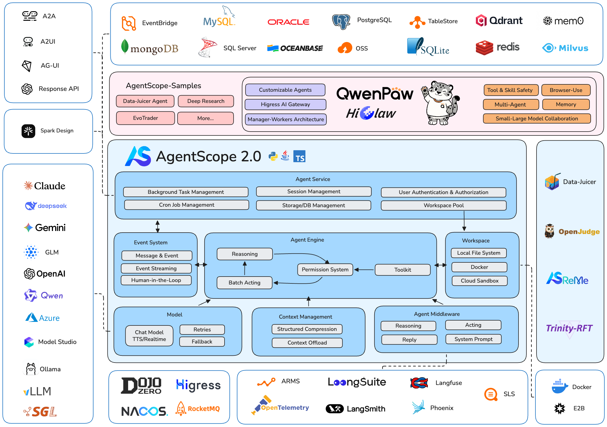
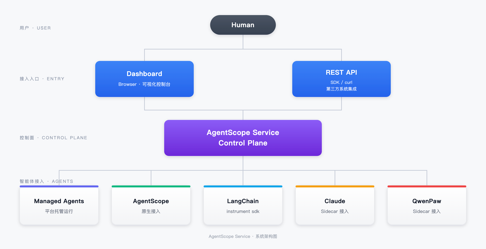

<p align="center">
  
</p>

<span align="center">

[**English Homepage**](https://github.com/agentscope-ai/agentscope-java/blob/main/README.md) | [**中文主页**](https://github.com/agentscope-ai/agentscope-java/blob/main/README_zh.md) | [**ドキュメント**](https://java.agentscope.io/)

</span>

<p align="center">
    <a href="https://discord.gg/eYMpfnkG8h">
        
    </a>
    <a href="https://java.agentscope.io/">
        
    </a>
    <a href="https://img.shields.io/maven-central/v/io.agentscope/agentscope">
        
    </a>
    <a href="#">
        
    </a>
    <a href="./LICENSE">
        
    </a>
    <a href="https://deepwiki.com/agentscope-ai/agentscope-java">
        
    </a>
</p>

## AgentScope Java 2.0 とは？

AgentScope Java 2.0 は、分散型でエンタープライズ品質のエージェントを構築するための、本番環境に対応したフレームワークです。向上し続けるモデルの能力に合わせて機能する重要な抽象化を提供し、長時間動作し、安全に制御されたエージェントの実行を組み込みでサポートしています。

- [**イベントシステム** →](https://java.agentscope.io/v2/en/docs/building-blocks/message-and-event.html) フロントエンドでのリアルタイムのレンダリングと Human-in-the-Loop のための、32 種類の型付きイベントからなる統一されたイベントストリーム。
- [**権限システム** →](https://java.agentscope.io/v2/en/docs/building-blocks/permission-system.html) ツールの呼び出しの制御：許可 / ユーザーの承認が必要 / 拒否。
- [**ミドルウェア** →](https://java.agentscope.io/v2/en/docs/building-blocks/middleware.html) 推論と行動のループを柔軟に拡張するための、AOP スタイルのフックによる割り込み。
- [**ワークスペースとサンドボックス** →](https://java.agentscope.io/v2/en/docs/harness/workspace.html) ローカル、Docker、Kubernetes、AgentRun のクラウドサンドボックスといった、隔離された環境でツールを実行します。
- [**マルチエージェントのオーケストレーション** →](https://java.agentscope.io/v2/en/docs/harness/subagent.html) `agent_spawn` / `agent_send` とリアルタイムのイベントの転送による、複数のサブエージェントの定義パターン。
- [**分散デプロイ** →](https://java.agentscope.io/v2/en/docs/others/going-to-production.html) レプリカをまたいだセッションの復旧を備えた、真の分散型のセッションとメモリーの管理（Redis / MySQL / PostgreSQL / OSS / COS）。
- [**エージェントの進化** →](https://help.aliyun.com/zh/document_detail/3042583.html) エージェントの可観測性と監査、エージェントの評価と実験、エージェントのアセットの管理と継続的な最適化を提供します。



## ニュース
<!-- BEGIN NEWS -->
- **[2026-08] [AgentScope Service](./agentscope-service)：** エージェントの観測、登録、オーケストレーションのためのエージェントのコントロールプレーンとダッシュボードで、AgentScope、LangChain、ADK、Claude / Qoder などとの互換性を考慮して設計されています。
- **[2026-07] `v2.0.0 GA`：** 初めての本番環境向けのリリースです！2 層のエージェントのアーキテクチャ、イベントストリーム、権限システム、ミドルウェア、ワークスペースのサンドボックス、マルチエージェントのオーケストレーション、分散デプロイがすべてそろいました。[ドキュメント](https://java.agentscope.io/) | [リリースノート](https://github.com/agentscope-ai/agentscope-java/releases/tag/v2.0.0)
- **[2026-07] `v2.0.0-RC5`：** モデルプロバイダーのモジュール化、統一された DataBlock によるマルチモーダル対応、ネイティブの構造化出力、Channel による IM の統合、Tencent Cloud COS による状態の永続化。[リリースノート](https://github.com/agentscope-ai/agentscope-java/releases/tag/v2.0.0-RC5)
- **[2026-06] `v2.0.0-RC4`：** ツールの非同期実行とスケジュールされたウェイクアップの振り分け、サブエージェントのレプリカをまたいだルーティングとセッションの復旧。[リリースノート](https://github.com/agentscope-ai/agentscope-java/releases/tag/v2.0.0-RC4)
- **[2026-06] `v2.0.0-RC3`：** 統一された `call()` / `streamEvents()` の実行コア、新しいイベントの種類 `AgentResultEvent`、`CustomEvent`、`HintBlockEvent`。[リリースノート](https://github.com/agentscope-ai/agentscope-java/releases/tag/v2.0.0-RC3)
- **[2026-06] `v2.0.0-RC2`：** 完全にステートレスなエージェント、1 行で設定できる DistributedBackend、サブエージェントのイベントの転送、Channel モジュール（DingTalk、Feishu、WeCom）、A2A / AG-UI プロトコルへの対応。[リリースノート](https://github.com/agentscope-ai/agentscope-java/releases/tag/v2.0.0-RC2)
- **[2026-05] `v2.0.0-RC1`：** 2.0 の最初の RC です。ハーネスエンジニアリング、エンタープライズ向けの分散デプロイ、イベントストリーム / メッセージモデル / ミドルウェア / HITL の全面的な再設計。[リリースノート](https://github.com/agentscope-ai/agentscope-java/releases/tag/v2.0.0-RC1)
- **[2026-05] `v1.1.0`：** `agentscope-harness` と `HarnessAgent` を導入しました。ワークスペース（ペルソナ / メモリー / スキル / サブエージェント）、差し替え可能なファイルシステム（ローカル / 共有ストア / サンドボックス）、プロセスをまたいで再開できるセッションの永続化、階層化されたメモリーとコンテキストのコンパクション、宣言的なサブエージェントのオーケストレーション。[リリースノート](https://github.com/agentscope-ai/agentscope-java/releases/tag/v1.1.0-RC1)
<!-- END NEWS -->

## コミュニティ

コミュニティへの参加をお待ちしています：

| [Discord](https://discord.gg/eYMpfnkG8h)                     | DingTalk                                                              | WeChat                                                       |
|--------------------------------------------------------------|-----------------------------------------------------------------------|--------------------------------------------------------------|
|  |  |  |

## クイックスタート

### インストール

> AgentScope Java には **JDK 17** 以降が必要です。

#### Maven

```xml
<dependency>
    <groupId>io.agentscope</groupId>
    <artifactId>agentscope-harness</artifactId>
    <version>2.0.3</version>
</dependency>
```

2.0 では、モデルプロバイダーは別々の拡張モジュールとして提供されています。必要なものを追加してください。たとえば DashScope の場合：

```xml
<dependency>
    <groupId>io.agentscope</groupId>
    <artifactId>agentscope-extensions-model-dashscope</artifactId>
    <version>2.0.3</version>
</dependency>
```

その他の選択肢：`agentscope-extensions-model-openai`、`agentscope-extensions-model-anthropic`、`agentscope-extensions-model-gemini`、`agentscope-extensions-model-ollama`。詳しくは[モデルのドキュメント](https://java.agentscope.io/v2/en/docs/building-blocks/model.html)をご覧ください。

型付きのテキストと画像の分類については、[OpenAI Decisions](docs/v2/en/integration/judge/openai-decisions.md) をご覧ください。この拡張機能を含む `2.1.0-SNAPSHOT` のビルドで利用できます。

`ReActAgent` の推論とツールの API を使い、アプリケーションの機能を自分で組み立てるには、`agentscope-core` とモデルの拡張機能に依存してください。

## Hello AgentScope!

起動時に共通の Builder を設定し、リクエストごとに `builder.build()` で Agent を作成して閉じます。同じ ID と永続的なストレージによって、インスタンスをまたいで会話が保たれます。実行する前に `DASHSCOPE_API_KEY` を設定してください：

```java
import io.agentscope.core.agent.RuntimeContext;
import io.agentscope.core.event.TextBlockDeltaEvent;
import io.agentscope.core.event.ToolCallStartEvent;
import io.agentscope.core.message.UserMessage;
import io.agentscope.harness.agent.HarnessAgent;
import java.nio.file.Paths;

public class FirstAgent {
    // Configure once at startup; requests only call build().
    private static final HarnessAgent.Builder AGENT_BUILDER = HarnessAgent.builder()
            .name("assistant")
            .agentId("assistant")
            .sysPrompt("You are a helpful AI assistant.")
            .model("dashscope:qwen-plus")
            .workspace(Paths.get(".agentscope/workspace"));

    public static void main(String[] args) {
        try (HarnessAgent agent = AGENT_BUILDER.build()) {
            RuntimeContext ctx = RuntimeContext.builder()
                    .sessionId("demo").userId("alice").build();
            agent.call(new UserMessage("Hello!"), ctx).block();
        }

        // COMMENT_Summarize today in three bullets.
        try (HarnessAgent agent = AGENT_BUILDER.build()) {
            RuntimeContext ctx = RuntimeContext.builder()
                    .sessionId("demo").userId("alice").build();
            agent.streamEvents(new UserMessage("Summarize today in three bullets."), ctx)
                    .doOnNext(event -> {
                        switch (event.getType()) {
                            case TEXT_BLOCK_DELTA -> System.out.print(
                                    ((TextBlockDeltaEvent) event).getDelta());
                            case TOOL_CALL_START -> System.out.println(
                                    "\n[tool] " + ((ToolCallStartEvent) event).getToolCallName());
                            default -> { }
                        }
                    })
                    .blockLast();
        }
    }
}
```

通常の返答、マルチターンのチャット、ワークフローのステップには、`call` / `streamEvents` から始めてください。[クイックスタート](https://java.agentscope.io/v2/en/docs/quickstart)をご覧ください。どちらもデフォルトで Harness の会話履歴を記録します。ページを閉じたあとも作業を続ける必要がある場合、ビジー時にキューに入れる場合、中断後に再開する場合は、[AgentSession](https://java.agentscope.io/v2/en/docs/harness/session-log) を導入してください。[復旧可能なチャットの例](./agentscope-examples/agents/agentscope-chat/README.md)で、統合の全体を確認できます。

## AgentScope Service
**[AgentScope Service](./agentscope-service)** — ビジネスアプリケーションのための Agent as a Service のプラットフォームです。提案書の作成、文書の検証、例外の調査といった機能を API で公開できます。ユーザーは、既存のプロダクトの中で作業を始め、判断を下し、成果物を確認できます。

+ **ビジネスとの統合。** Endpoint を通じて、バックグラウンドのタスク、インタラクティブなアシスタント、専門的なプロセスのステップを提供します。アプリケーションは、そのインターフェース、データの認可、受け入れのルールを維持できます。
+ **永続的な作業と成果物。** Invocation を通じて状態、スナップショット、イベントを追い、人とのやり取りを処理し、ビジネスのプロセスのために結果やファイルを取得します。
+ **タスクに合った実行。** AgentScope Harness を実行するか、既存のエージェントのアプリケーションを接続するか、Coding Agent を再利用します。必要に応じて Team と Workflow を追加します。

[ユースケース](https://java.agentscope.io/v2/en/service/usecases)で統合の方法を選び、[API のクイックスタート](https://java.agentscope.io/v2/en/service/first-session)で呼び出しを完了してください。



## 主要な設計

AgentScope Java 2.0 は、「エージェントを作る」ためのツールキットから、**本番環境でエージェントを動かす** ための完全なプラットフォームへと大きく前進しました。改善点は、3 つの重点領域に分かれます：

### 1 · ハーネスエンジニアリング — 長時間の複雑なタスクのために

素の ReAct ループが解決するのは、1 回の推論のターンだけです。**HarnessAgent** は、Middleware と Toolkit のチャネルを通じて、ReActAgent の上にエンジニアリングの基盤を重ねます。推論のコアはそのままに、機能を重ねていきます：

- **自己進化とスキルのリポジトリ** — 成功したパターンは Markdown のスキルとして自動で保存され、セッション間で共有され、必要に応じて読み込まれます
- **階層化されたメモリー** — コンテキスト内の会話 + エージェントが管理する `MEMORY.md` + ディスク上の事実のログ。自動コンパクションでプロンプトを一定の大きさに抑えます
- **サブエージェント** — 子エージェントの仕様を Markdown で宣言し、実行時に `agent_spawn` / `agent_send` を使って、同期またはバックグラウンドで委任します
- **自動のコンテキスト管理** — 構造化されたコンパクションによって、目標 / 状態 / 発見 / 次のステップを保持します。大きすぎるツールの結果はディスクに退避されます
- **Plan Mode** — 長いタスクのための読み取り専用の計画の状態。計画のファイルは永続化され、実行を導きます

### 2 · エンタープライズ向けの分散デプロイ

本番環境のエージェントは、多くのテナントに対応し、信頼できないコードを安全に実行し、ローリングリスタートにも耐えなければなりません。AgentScope 2.0 は、ステートレスな水平スケーリングのために作られています：

- **マルチテナントの分離** — `session` / `user` / `agent` / `org` の次元での分離。`RuntimeContext` のキーが、ワークスペースのパス、KV の名前空間、サンドボックスの状態のスロットに渡されます
- **安全なサンドボックス** — ローカルのサブプロセス / Docker / Kubernetes / E2B のクラウドサンドボックスに対応し、スナップショットと再開もできます
- **権限の制御** — 3 つの状態（許可 / 承認 / 拒否）を持つエンジン。機密性の高いツールには HITL による承認が必要です
- **セッションの復旧** — `AgentStateStore`（インメモリー / JSON ファイル / MySQL / Redis / PostgreSQL）が、ダウンタイムなしのローリングデプロイを支えます

### 3 · 基盤となるフレームワーク — よりスリムで開発者に優しいコア

メッセージ、イベント、拡張のモデルは、より小さく、より直交したものになりました。HITL とイベントストリーミングは、追加機能ではなく、フレームワークの動作の一部です：

- **イベントストリーム** — モデルの呼び出し、テキストの差分、ツールの実行、ユーザーの確認をリアルタイムでカバーする、32 種類の型付きイベント
- **メッセージモデル** — テキスト / ファイル / 画像 / 音声 / 動画 / ツールの結果を `ContentBlock` に統一し、構築時にロールを厳密に検証します
- **ミドルウェア** — `onAgent` / `onReasoning` / `onActing` / `onModelCall` / `onSystemPrompt` / `onAgentStateReady` の 6 つのステージが、v1 のフラットなフックに代わります
- **HITL を第一級の機能に** — ツールの引数の確認、機密性の高い操作の承認、外部システムへの引き渡しを行い、エージェントは正確に一時停止して再開します

アーキテクチャの全体像については、[ドキュメント](https://java.agentscope.io/v2/en/docs/index.html)をご覧ください。

## コントリビュート

コミュニティからのコントリビュートを歓迎します！コントリビュートの方法のガイドラインについては、[CONTRIBUTING.md](./CONTRIBUTING.md)
をご覧ください。

## ライセンス

AgentScope は Apache License 2.0 のもとで公開されています。

## コントリビューター

コントリビューターの皆さまに感謝します：

<a href="https://github.com/agentscope-ai/agentscope-java/graphs/contributors">
  
</a>
