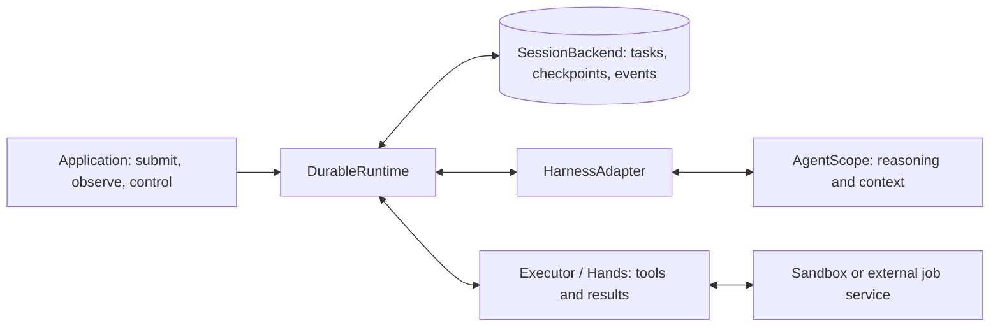

# AgentScope Durable

[Chinese usage guide](../docs/dev/zh/docs/harness/durable.md)

**AgentScope Durable is an embeddable framework for running Agent tasks across
client disconnects, application restarts, and execution-host replacement.** It gives
each accepted task a persistent identity, records its progress and waiting conditions,
and lets a compatible host continue from confirmed state. Applications can submit,
observe, and control work without keeping the original request or Agent instance alive.

Consider a coding assistant asked to fix a bug, run twenty minutes of tests, and
wait for approval before submitting the patch. The user may close the page, the
application may restart during testing, and approval may arrive the next morning.
Durable connects those stages: it retains the task, associates the original test
execution with the Agent's checkpoint, saves the result, and resumes the task when
its waiting condition is satisfied. The user returns to the same task and its history.

You add Durable to an existing Java application, register an Agent factory, and
choose a persistent Backend. The application keeps its model, prompts, tools,
permissions, and workspace configuration. Durable supplies task admission,
scheduling, recovery coordination, tool-result handoff, and replayable public events.
Local integration can run in one JVM with SQLite; shared storage and independent
tool Workers are available when the application needs multiple hosts.

This is a development source API. The repository includes an AgentScope Java
adapter for `ReActAgent` and `HarnessAgent`; the adapter contract allows other
Harness integrations, but they require their own implementation and recovery
verification.

## Start here

- Application integration: [Java usage guide](../docs/dev/en/docs/harness/durable.md).
- User operations, messages and events: [public interaction contract](protocol/public-interaction-contract.en.md).
- Authoritative schema and shared fixtures: [protocol entry](protocol/README.md).
- Host wiring and launch instructions: [Spring Boot examples](../agentscope-examples/durable/README.en.md).

## Where Durable fits

AgentScope Core/Harness owns the native reasoning loop, context, middleware, tools,
and permissions. Durable coordinates the lifetime of the work around that loop:
which input was accepted, which host may advance it, where native execution can
resume, which external results are still pending, and what the user can observe.
The adapter connects native journal boundaries to these persistent facts.

The framework ships as libraries, protocols, and infrastructure extensions. It can
be embedded in a command-line application, a Spring Boot service, or an execution
host. HTTP endpoints, a message broker, and a separate Hands deployment are optional.
A hosting platform can build resource scheduling, tenant management, and operational
controls around the same contracts; Durable itself has no Managed Agents dependency.



The diagram shows responsibilities, not required services. Backend storage can be
local, and Brain and Hands can share a process. **Brain** advances the Agent's
reasoning and context; **Hands** manages tool execution with its own identity,
progress, and result lifecycle. Separating them becomes useful when tools outlive
an Agent invocation or need different dependencies, resources, or permissions.

| Boundary | Responsibility |
| --- | --- |
| `DurableRuntime` | Assembly, business access and lifecycle; Session access, Turn scheduling and recovery |
| `HarnessAdapter` | Native state interpretation and the connection between Agent invocations and durable commits |
| `SessionBackend` | Durable facts, atomic commits, idempotent receipts, leases/fencing and event replay |
| `Executor` | Independent tool start/query/cancel/output, with truthful unconfirmed outcomes |

Durable keeps three kinds of information connected: the Harness's private native
state, durable execution facts, and public messages/events. A display snapshot can
rebuild a UI; the native checkpoint and execution facts determine how work continues.
Applications use the public API without interpreting private checkpoint formats.

### Session, Thread, Turn, and Run

| Concept | Meaning | Coding-assistant example |
| --- | --- | --- |
| Session | Stable application identity and a directory of Threads | The user's work on an order-service incident |
| Thread | A context with a pinned Agent definition and an ordered Turn queue | The main investigation, or a separate review conversation |
| Turn | One persistent logical task | Fix the timeout and verify the patch |
| Run | One native invocation advancing a Turn | The initial invocation or a new invocation after recovery |
| Step | An execution step within a Run | A recorded reasoning or result-application step |

Session creation creates a primary Thread named `main`. Session convenience methods
submit to that Thread. Turns execute in admission order within a Thread; different
Threads can progress concurrently. Recovery keeps the original Turn identity and
records new invocations as Runs, so a process restart does not create a new user task.

## Embed your first durable Agent

Use `io.agentscope:agentscope-durable-adapter-harness-agentscope` and
`io.agentscope:agentscope-extensions-durable-jdbc` at the same version as your
Core/Harness dependencies. The following fragment assumes `model` is an already
configured AgentScope model:

```java
import io.agentscope.core.ReActAgent;
import io.agentscope.durable.DurableRuntime;
import io.agentscope.durable.DurableTypes.SessionKey;
import io.agentscope.durable.agentscope.AgentScopeAdapter;
import io.agentscope.extensions.durable.jdbc.LocalBackend;
import java.nio.file.Path;
import java.time.Duration;
import java.util.Map;

var adapter = AgentScopeAdapter.forReAct(
        binding -> ReActAgent.builder().name("assistant").model(model),
        Map.of());

try (var backend = LocalBackend.open(Path.of("./durable-data"));
        var runtime = DurableRuntime.builder()
                .backend(backend)
                .harness("assistant", "v1", adapter)
                .build()) {
    var session = runtime.createSession(
            new SessionKey("demo", "research-1"), "assistant");
    var turn = session.submit("research-request-1", "Explain this repository");
    runtime.start();
    var result = turn.await(Duration.ofMinutes(2)).toCompletableFuture().join();
    System.out.println(result.output());
}
```

The factory returns a fresh Agent builder for each invocation; the adapter supplies
the native Thread Journal and builds the Agent. Use `AgentScopeAdapter.forHarness`
for a configured `HarnessAgent.Builder`. In a service, keep the Runtime alive for
the host lifetime and close it at shutdown. Waiting for a result is optional:
`submit` returns a durable Turn handle as soon as admission completes. Run blocking
waits and database operations off reactive event-loop threads.

Keep the same `requestId` when retrying the same submission. Identical content
returns the original Turn; changed content under that ID conflicts. A new request
ID means a new task. This resolves the common case where admission succeeded but
the HTTP response was lost.

For a complete example without model credentials, run:

```sh
bash agentscope-examples/durable/integrated/quickstart/run.sh
```

The [quickstart](../agentscope-examples/durable/integrated/quickstart/README.en.md) launches two
JVMs against the same temporary data directory. Its expected output is the same
successful Turn in both runs, with `modelInvocations=1` on the first and `0` on the
second. This demonstrates persistent identity and reuse of a completed result;
the Sandbox example below demonstrates recovery of unfinished work.

## Problems Durable solves

### 1. Reopen a Session after a disconnect or restart

A research assistant has produced half a report when the user refreshes the page.
The application needs to show committed text and tool progress, then continue
observing the existing task. It can retrieve the Session and Turn by their stable
identities without submitting the prompt again:

```java
var session = runtime.getSession(new SessionKey("demo", "research-1"));
var turn = session.getTurn(savedTurnId);
var current = turn.status();
var history = session.history(null, 100);
```

For continuous observation, `session.observe(onSnapshot, onEvent)` delivers a
consistent snapshot followed by events. The overload taking a saved cursor resumes
replay, and expired cursors trigger snapshot resynchronization. HTTP hosts expose
the same model through SSE and `Last-Event-ID`. Message IDs and attempt/revision
rules let clients replace partial output rather than append replayed text twice.
Closing the stream stops observation; it does not cancel the task.

If the execution process also restarted, reopen the same Backend, register compatible
Agent definitions and Executors, and start the Runtime. It discovers recoverable
work, restores native state at supported boundaries, and continues the original
Turn. Completed results remain available without another Agent invocation. Reading
history alone does not start execution.

Recovery reuses committed native results and tool outcomes. An interrupted model
request whose result was never committed may need another model invocation.
Workspace files and remote resources must also remain accessible; a saved checkpoint
cannot reconstruct a deleted workspace or an expired external operation.

### 2. Queue Turns, add instructions, and cancel work

While an assistant investigates an incident, the user asks for a follow-up summary
and then adds a constraint to the current investigation. These are different actions:
`submit` creates a queued Turn; `steer` delivers new instructions to the existing Turn
at a native reasoning boundary.

```java
var investigation = session.submit("investigate-1", "Investigate the export timeout");
var followUp = session.submit("summary-1", "Write a summary of the investigation");

// While the investigation is still active:
investigation.steer("constraint-1", "Focus on database access; do not change the API");

// The user no longer wants the queued summary:
followUp.cancel("cancel-summary-1");
```

The second Turn waits behind the first in the same Thread. A waiting or explicitly
paused Turn also holds its place in that queue. A queued cancellation can complete
without waiting for the head Turn. For independent work with its own context, create
another Thread through `session.createThread(threadId, definition)`.

Controls are durable and deduplicated by request ID. Their receipts confirm
admission, while later events confirm application or completion. A control racing
with task completion can be rejected because its state precondition no longer holds;
clients should re-read the Turn. Steer does not interrupt a model mid-token or undo
an already dispatched tool. Active cancellation records intent and coordinates
outstanding execution; a remote operation is only cancelled when its outcome is
confirmed.

Other controls cover context injection, withdrawal of unapplied input, interaction
responses, and explicit pause/resume. Pause takes effect at a safe boundary; observe
`PAUSED` before assuming the invocation has stopped. Resume requires the observed
revision and rechecks pending waits. The
[public interaction contract](protocol/public-interaction-contract.en.md) specifies
the complete control and race semantics.

### 3. Keep long tools running independently with Brain–Hands separation

A coding Agent starts a twenty-minute test in a Sandbox. Eight minutes later, the
Brain host is replaced. The remote test can still be running, so starting it again
would waste work and could duplicate side effects. Durable preserves the original
tool intent, execution identity, and checkpoint so the replacement can reconnect
the existing result to the original call.

```mermaid
sequenceDiagram
    participant B as Brain
    participant S as Session Backend
    participant H as Hands / Executor
    participant T as Sandbox or job service
    B->>S: Commit checkpoint and tool intent
    B->>H: Dispatch with stable execution identity
    H->>T: Start or query the original operation
    Note over B,S: Turn waits durably; Brain may exit
    T-->>H: Original operation result
    H-->>S: Result accepted through Runtime/transport
    Note over B,S: A compatible Brain claims ready work
    B->>S: Read checkpoint and accepted result
    B->>S: Commit result application and continue Turn
```

The framework distinguishes **tool completed**, **result accepted**, and **result
applied to native state**. If a host fails between acceptance and application, the
replacement consumes the saved result rather than rerunning the tool. Hands retains
execution state and delivery progress; queued delivery can retry without assigning
a new logical operation identity. Active Runtime/Worker processes perform the
network calls shown in the diagram; storage itself does not execute tools.

Choose the execution topology that matches the tool:

| Mode | Suitable use | Required infrastructure |
| --- | --- | --- |
| Native in-process tool | Short work that follows the Harness's supported recovery rules | The Agent host |
| Direct remote Executor | A Sandbox or job service with independent execution and operation lookup | Existing execution service and persistent Backend |
| Independent Hands Workers | Separate tool dependencies, permissions, capacity, or deployment lifecycle | Workers and their durable ledger; RocketMQ is an available transport |

The [integrated Sandbox example](../agentscope-examples/durable/integrated/tool-in-sandbox/README.en.md)
uses sequential `start` and `resume` JVMs with shared persistent data. The first exits
with the Turn waiting and a detached command running; the second reconnects the
original execution, applies its result, and finishes the same Turn. The fixture
checks that its controlled file effect happens once:

```sh
bash agentscope-examples/durable/integrated/tool-in-sandbox/run.sh
```

For separate Brain and Hands processes, start with the
[RocketMQ echo example](../agentscope-examples/durable/brain-hands/echo-tool/README.en.md), then
the [queued Sandbox example](../agentscope-examples/durable/brain-hands/tool-in-sandbox/README.en.md).
Brain–Hands separation is optional; it does not require every tool to become a
remote service.

### 4. Automatically claim unfinished work after a host fails

An Agent service has several Brain replicas. One exits during a deployment while
owning a Turn. With a shared Backend, another compatible, running Runtime can
discover the task after the old lease expires, acquire a new fenced lease, and
continue from committed state. The user does not need to send a new "continue"
prompt or resubmit the original task.

For example, execution hosts can use PostgreSQL instead of the local Backend.
Here `dataSource` is a configured application-owned pool and `adapter` is the
AgentScope adapter from the integration example:

```java
import io.agentscope.extensions.durable.jdbc.PostgresBackend;

var sharedBackend = PostgresBackend.builder().dataSource(dataSource).build();
var host = DurableRuntime.builder()
        .backend(sharedBackend)
        .harness("assistant", "v1", adapter)
        .build();
host.start();
```

Initialize the Backend schema during provisioning with
`PostgresBackend.initializeSchema(dataSource)`, add the PostgreSQL driver, and point
the hosts at the same database. Each host needs matching definition/state versions
and access to the required tools and workspace resources. Close each host and its
Backend at application shutdown; the application owns the supplied pool.

Runtime scans durable ready work and renews ownership while executing it. Fencing
rejects writes from an expired owner even if that process later reconnects. Optional
wakeup notifications reduce latency; durable scans compensate for lost hints.
Recovery policies govern retryable failures and their budgets, so automatic recovery
does not mean repeatedly restarting every failed task or bypassing an unresolved wait.

Automatic claiming needs an active compatible host. If all hosts are stopped,
a process supervisor or external scheduler must start one. SQLite supports local
recovery on a host with access to its retained files; multi-host failover requires
shared storage. Fencing protects durable state but cannot undo an external effect
already performed by a stale process.

### 5. Wait for approval without retaining an Agent instance

A procurement assistant has prepared a purchase and needs a manager's approval the
next morning. The native Harness exposes an interaction, and Durable retains its
identity and the Turn's waiting condition. An API host can inspect and answer the
interaction even when the original Brain instance is gone:

```java
var turn = session.getTurn(savedTurnId);
var pending = turn.pendingInteractions();
if (!pending.isEmpty()) {
    // After the application authorizes approval of this specific interaction:
    turn.respond("approval-1", pending.get(0).id(), true);
}
```

The application selects the intended interaction, checks the approver's authority,
and supplies the response shape that interaction expects. The boolean response
above is suitable for an approval interaction. Repeating the same response request
ID is idempotent. A compatible execution host then continues when the waiting
conditions allow it; an explicitly paused Turn remains paused until resumed.
The same durable-control model supports application signals for external events.

An API-only Runtime can submit, query, observe, and control work without a local
model or Agent factory. It does not call `start()` or claim work. See the
[HTTP example](../agentscope-examples/durable/integrated/http-server/README.en.md) for hosting
public operations and SSE separately from Brain execution.

### What determines the recovery guarantee?

Recovery depends on the Adapter's native boundaries, the Backend's persistence,
and the Executor's ability to identify and query the original operation. The
AgentScope adapter reports tool-boundary recovery; it does not restore an arbitrary
Java stack. Applications can inspect `runtime.executionCapabilities()` and the
capabilities of a pinned definition before choosing their deployment.

For example, if an email service accepted a send but its reply was lost, a stable
idempotency key and operation lookup can establish the original outcome. Without
those facilities, retrying might send another email. Durable retains an unconfirmed
execution as `UNKNOWN` for further verification rather than inventing success or
assuming it is safe to repeat. A tool that sends five emails internally needs its
own per-email identities and recovery logic to resume at email four; a checkpoint
around the outer tool call cannot infer that internal progress.

Restore/fork also does not reverse business actions that already happened. Keep
workspace and artifact retention, external idempotency, authorization, and operational
recovery procedures aligned with the guarantees your application needs.

## Module layout

| Directory | Responsibility |
| --- | --- |
| `durable-runtime` | Public APIs, scheduling/recovery, transactional state machine, messages and events |
| `durable-worker` | Caller-side reliable delivery, Hands execution ledger, recovery and batching |
| `durable-adapters/durable-adapter-harness-agentscope` | Native ReActAgent/HarnessAgent adapter and checkpoint codec |
| `agentscope-examples/durable` | Separate integrated/brain-hands host examples, not library runtime dependencies |

Java groupId is `io.agentscope`. Native integration uses
`agentscope-durable-adapter-harness-agentscope`; there is no separate codec artifact.
`AgentScopeCheckpoints` and `AgentScopeCheckpointCodec` are part of that adapter.
Checkpoint validation and restore/fork still do not construct or start an Agent,
but depending on this artifact brings in Harness dependencies.

Infrastructure extensions all live in [`../agentscope-extensions`](../agentscope-extensions):

| Extension directory | Use |
| --- | --- |
| [durable-jdbc](../agentscope-extensions/agentscope-extensions-durable-jdbc) | SQLite and PostgreSQL backends |
| [durable-http](../agentscope-extensions/agentscope-extensions-durable-http) | Public/internal HTTP clients, handlers and SSE |
| [durable-sandbox](../agentscope-extensions/agentscope-extensions-durable-sandbox) | Sandbox bindings, detached operations, output and cleanup |
| [durable-rocketmq](../agentscope-extensions/agentscope-extensions-durable-rocketmq) | Queued Brain–Hands execution and optional wakeups |
| [durable-objects](../agentscope-extensions/agentscope-extensions-durable-objects) | S3/MinIO and OSS object stores |
| [durable-mcp](../agentscope-extensions/agentscope-extensions-durable-mcp) | MCP connections and explicit recovery extensions |

SQLite needs no database service. PostgreSQL requires a service and an explicit dependency
on the optional `org.postgresql:postgresql` driver. Applications own models, pools,
credentials, resource authorization and host lifecycle.

## Launch examples

Run from the repository root; launchers live alongside each scenario:

```sh
bash agentscope-examples/durable/integrated/quickstart/run.sh
bash agentscope-examples/durable/integrated/http-server/run.sh
bash agentscope-examples/durable/integrated/tool-in-sandbox/run.sh
bash agentscope-examples/durable/brain-hands/echo-tool/run.sh --compile-only
bash agentscope-examples/durable/brain-hands/tool-in-sandbox/run.sh --compile-only
```

`integrated` includes quickstart, API-only http-server and colocated tool-in-sandbox.
The tool-in-sandbox launcher runs sequential `start` and `resume` JVMs, each colocating
Brain and Hands. `brain-hands` includes echo-tool and tool-in-sandbox, with independent
Brain/Hands processes communicating through MQ. Each module packages `${artifact}-brain.jar`
and `${artifact}-hands.jar` with separate Java main classes and runners, without a Java role
argument or enum. Use `run.sh <brain|hands> <endpoint> [data-directory]` to select the JAR;
there is no `worker` alias. Start Hands first, then Brain in another terminal.
Offline fixtures need no model credentials. Local Sandbox requires POSIX shell and Python 3
and runs with host permissions, not production isolation. Real queued runs also require
RocketMQ 5, topics/groups and authorization. `--compile-only` checks packaging, not broker
or end-to-end delivery; see each scenario README for infrastructure and configuration.

## Build and check

Java 17+ and Maven are required; isolated dependency checking also needs Python 3.
From the repository root:

```sh
make -C agentscope-durable check
make -C agentscope-durable independent
```

Normal checking covers build, formatting and tests. Isolation checking builds source
dependencies in a separate Maven cache and audits dependency trees.
Validate broker delivery, provider query/cancel
behavior and recovery under host replacement in your deployment environment.
Unqueryable or unverifiable external effects remain `UNKNOWN`; arbitrary external
operations are not promised exactly-once execution.

## Usage and reference

- [Java usage guide](../docs/dev/en/docs/harness/durable.md): reconnect, control tasks,
  configure independent Threads and diagnose recovery.
- [Public interaction contract](protocol/public-interaction-contract.en.md): lifecycle,
  controls, messages and events.
- [Protocol reference](protocol/README.md): schema, transport boundaries and conformance fixtures.
