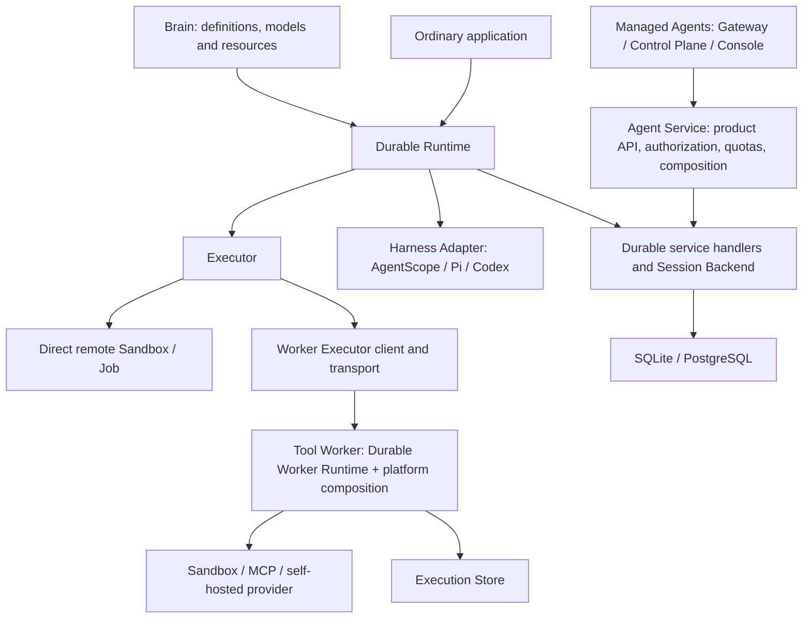

# Durable and Managed Agents: ownership and migration

[中文](platform-boundaries.md)

Date: 2026-11-07. This is the future platform adoption inventory. Durable's current
implementation and acceptance are recorded in migration-plan.en.md and verification.en.md;
the platform repository and deployment remain unchanged. Based on the
[Durable proposal](https://aliyuque.antfin.com/ad3swf/gg3g1v/qecdop0f9bdu5irs)
and the source review recorded below. This refines the
[migration plan](migration-plan.en.md) with explicit platform reuse boundaries.

## 1. Direction and constraints

Durable owns reusable reliability mechanisms and independently usable defaults.
The final architecture has Managed Agents depend on and extend Durable for
multi-tenant hosting, resources and operations, converging on one common
implementation. Complete Durable first; platform adoption, rollout and replacement
start in the next round, only after Durable is ready.

Durable is a general-purpose open-source framework/component. Design its public
abstractions, APIs, protocols, storage and defaults for independent use across
hosts. Managed Agents is still in development and unreleased; its old APIs, DTOs,
prepared profiles, packages and database tables impose no compatibility constraint.
Reuse general mechanisms and redesign or remove historical branches under new
contracts. Do not prebuild compatibility facades, dual protocols or old-table
adapters. The imported runtime is a starting point, not the target architecture.

Retain recovery consistency, native Harness boundaries and Durable's own version
declarations. Stable identity within an execution, atomicity, idempotency, fencing
and result handoff are correctness requirements, not removable legacy compatibility.
The platform adapts to Durable's general contracts in the next round.

Scope:

- Ignore the duplicate implementation at
  `/Users/ken/agentscope-3/agentscope-java/agentscope-service` as a design reference,
  dependency, modification target or acceptance requirement.
- Continue accounting for architecture and sources in
  `/Users/ken/agentcore/agentcore-managed-agents`. Reference, copy and adapt reusable
  mechanisms/tests into Durable without modifying that repository during this effort.
- Agent Service, Brain and Tool Worker below refer to that separate platform.
  Its final architecture and cutover rules are future work; current deliverables
  and acceptance belong to Durable.

The source repository retains its implementation during extraction. Temporary
copies are expected; record provenance and future mappings, then remove duplication
during platform migration rather than changing the platform prematurely.

The four user-facing abstractions remain Runtime, Harness Adapter, Session
Backend and Executor. Worker Runtime, Execution Store, Object Store and message
transport are subordinate implementation components/plugins, not more competing
top-level frameworks.

The following is the final architecture, not a current platform deployment change.
Extract by responsibility while retaining useful deployment boundaries. Agent
Service, Brain and Tool Worker can still scale separately, composing Durable
Backend/service handlers, Runtime/Adapter and Worker Runtime/Executor plugins
respectively. Keeping processes does not require duplicate state machines.

Runtime-to-Backend calls can be local or remote. The default embedded application
does not require Agent Service, Tool Worker, MQ or Redis. Independently surviving
tools still require a suitable remote execution environment; if all hosts stop,
restart or external wakeup is necessary.

## 2. Tool Worker implements the execution side, across several layers

Tool Worker is a key source for Durable distributed execution, not something to
retain exclusively inside AgentCore. It is an Executor service host plus a ledger,
recovery loop and providers. Runtime sees the Executor contract; remote Workers
also require a client proxy and transport.

| Layer | Extracted responsibility | Target owner |
| --- | --- | --- |
| Executor contract | Stable executionId, admission receipt, start/query/cancel, output cursor, capabilities, UNKNOWN | Durable contracts |
| Worker Runtime | Durable admission, duplicate delivery handling, claims/renewal/fencing, asynchronous waits, frozen results/republication, cancellation races | Optional reusable Durable component |
| Execution Store | Physical execution state, original handles, control intent, results, output coverage, result Outbox | Durable execution-side SPI and local/database implementations |
| Worker Executor client | Submit/query/control/result handoff over HTTP or messaging | Optional Durable remote execution implementation |
| Providers | Sandbox connection/process protocol, MCP invocation, self-hosted environment execution | AgentScope/Durable extensions |
| Platform composition | Worker registration, tenant pools, Environment authorization, credentials, capacity and audit policies | Managed Agents |

Extraction entry points include `ManagedToolExecutor`, `ManagedToolWorkStore`,
`ManagedToolWorkerCommands`, `ManagedToolWorkerStore`, `ManagedToolWorkerLoop`,
`ManagedAsyncToolExecution(s)`, `ManagedToolResultPublisher`,
`ManagedSandboxToolExecutor` and `managed-tools.py`. These span tool-worker and
common; moving the tool-worker directory alone is insufficient. `ToolWorkerApp`
has both platform-service and environment-worker entry points; extract their
reusable execution logic separately.

Recommended implementations and capability boundaries:

| Implementation | Purpose and order | Recovery boundary |
| --- | --- | --- |
| Native in-process tools | Preserve the lightest adoption path | No promise to reconnect arbitrary local calls after host exit; automatically retry only declared safe operations |
| Direct Sandbox Executor | Required for the first release; extract the existing E2B path first, then evaluate AgentRun and other existing integrations | Persist execution identity/remote handle, query original operation, collect by cursor; validate actual provider support |
| Worker Executor + Worker Runtime | Required for Durable's first release; extract Tool Worker and validate independently | Separate Runtime/Worker lifetimes; replacement queries the original operation, never restarts merely because a lease expired |
| MCP provider | Reuse execution code with per-tool idempotency/query capabilities | Lost ordinary MCP RPC outcomes can remain UNKNOWN; do not promise universal recovery |
| self-hosted Worker | Extract the environment client once the protocol is stable | Publish generic claim/renew/output/result mechanics; enterprise registration and credentials remain platform policies |

A Sandbox SDK provides environment and command primitives; a Durable Executor
connects them to durable execution. Add adapters under `agentscope-extensions`
that depend on existing Sandbox integrations and Durable contracts, rather than
adding reverse Durable dependencies to base Sandbox SDKs. Deployment modes reuse
one Worker state machine instead of separate local/platform recovery algorithms.

### Keep two authoritative ledgers

Session Backend records tool intent, logical associations, accepted results and
native application progress. Execution Store records external admission, original
handles, physical outcomes and captured output. They may share a database instance
or use separate storage; Worker never reads private Brain checkpoints.

Cross-boundary handoff uses stable IDs, Outbox/Inbox, receipts, queries and repair,
not assumed cross-database transactions. Worker freezes and reliably delivers a
result; Backend accepts it and creates resume work atomically; Adapter commits
native application progress with its checkpoint. Retain both result-acceptance
and native-application confirmations. These ledgers describe different facts,
not duplicate execution engines.

Preserve the existing normal delivery boundary: durable claim, confirmed ACK,
then external invocation. A broker-free implementation may use an equivalent
durable admission receipt; API unification must not weaken existing guarantees.

## 3. Session Backend implementations

Session Backend covers input deduplication, Run/wait relationships, versioned native
state references, commit receipts, execution ownership, accepted/applied results,
durable work and public events/snapshots. It is neither a renamed
`SessionLogStore`/messages table nor an HTTP client alone. The Adapter bridges
native SessionLogStore; Harness-specific state interpretation remains native.

| Backend/plugin | Recommendation | Boundary |
| --- | --- | --- |
| SQLite Backend | First-release default, phase 1B | Embedded transactions, process restart and work scanning; no cross-host shared-file guarantee |
| PostgreSQL Backend | Alongside SQLite, phase 1B | Extract Session Service/common, validate independently and prepare future platform reuse; retain version checks, locks, fencing, Outbox and projection progress |
| Remote HTTP Backend | Establish in phases 1A/1B | Shared contract client; server delegates to the same PostgreSQL/other backend; mountable routes, no mandatory standalone Session Server |
| AgentCore integration | Next round, after Durable is ready | Platform composes Remote Backend with auth/resources under new Durable contracts; no assumed legacy prepared-profile compatibility layer |
| In-memory Backend | Tests/demos only | Explicitly non-durable across processes; never the default durable backend |
| Context integration | Later, capability-dependent | Object/message CRUD supports content/context integration only; full Backend status requires transactions, fencing, receipts and durable work |
| Other databases | Demand-driven | Do not implement every JDBC dialect initially; a JDBC StateStore does not automatically satisfy the Durable contract |

Local/shared storage and local-method/HTTP access are independent dimensions.
In the future platform, Brain may access Backend over HTTP while Agent Service invokes
the same PostgreSQL implementation. Ordinary applications may also embed it.

Do not independently reimplement business state machines for SQLite, PostgreSQL
and a remote platform. Share identity/digest validation, legal transitions and
receipt semantics. Backends implement the required transactions, conditional
writes, locks and mappings, validated by one fault suite. SQL dialects/concurrency
control may differ without introducing a universal SQL abstraction.

Orthogonal plugins, not complete Session Backends:

- Object Store: local files by default; extract existing OSS/S3 implementations.
  Persist large objects before atomically committing references. Validate reference
  integrity, cross-component accessibility and delayed GC; objects do not replace
  transactional metadata.
- Wakeup/Transport: durable work scanning by default; RocketMQ is the first
  enterprise messaging plugin for work hints and tool handoffs. Messages are not
  authoritative state; redelivery never creates a new Run/executionId.
- Redis: optional notification, cache or lease support only for general needs;
  source usage does not require retaining it. Database leases or alternatives
  must pass ownership/fencing tests. Infrastructure loss never authorizes
  repeating an unknown effect.

## 4. Agent Service's relationship to Durable

Agent Service currently hosts public product APIs, internal Session Service and
background recovery work. It is an important source of Durable mechanisms but
belongs neither wholly in the platform layer nor wholly in the framework core.

| Current responsibility | Extract into Durable | Retain in Managed Agents |
| --- | --- | --- |
| Session/Turn/Input admission | Idempotency, command receipts, input/wait association, cancellation intent | Identity authorization, Application/Agent/Environment checks, quota policy, product APIs |
| Execution transactions/recovery | `SessionCommitTransactions`, validation, ownership, result application, checkpoint references, work | Platform policy integration and database/tenant composition |
| Internal Session Service API | Common Backend protocol/client and mountable server handlers | Internal auth, deployment addresses, callers rebuilt against Durable contracts |
| Background work | Dispatch repair, result intake/republication, resume wakeups, waits/timeouts, generic child associations | Replica counts, resource budgets, platform routing/queue configuration |
| Queries/public events/SSE | Immutable events, common projections, cursor replay, snapshot/resync contract and client | API authorization, organization/user views, product indexes and display fields |
| Lifecycle/workspace administration | Recoverable checkpoint/fork/cleanup commands and reference safety | Resource retention, billing, approvals, Vault/Environment and tenant configuration |
| Costs/permissions | Durable authorization evidence, cancellation/permission-version checks, idempotent usage facts | Pricing, plans, cross-session quotas, IAM/RBAC, approval policies, enterprise audit |

`SessionServiceWorkers` already hosts result intake/repair, resume notification and
child control. `SessionCommitTransactions` already hosts native-independent
transaction logic. After extraction, Agent Service hosts platform APIs plus Durable
service capabilities. Generic HTTP handlers belong in optional integrations;
Runtime core does not depend on Spring/JPA controllers.

Separating policy from mechanism must preserve atomicity. Admission/quota
reservation and execution/budget settlement already have transactional
relationships. Use these constraints to validate general transaction extension or
durable reservation capabilities without retaining old tables/interfaces.
Cross-database separation needs explicit idempotent
reserve/confirm/release and repair, not arbitrary network policy calls inside a
database transaction or asynchronous billing in place of admission quota checks.

The current `/api/v1/agent-sessions/{id}/events/stream` endpoint accepts `after`
and `Last-Event-ID`. `AgentServiceEventReads` pages to durable high watermarks and
treats notifications as hints. Reuse this path, then validate/add reliable deltas,
retention/expiry, snapshot consistency and attempt/revision rules. Older interface
documentation still says replay is unsupported; that does not describe every
current endpoint. Cursor support also does not prove that every output is durable.

## 5. What remains in the platform

| Component | Final role |
| --- | --- |
| Gateway | Enterprise identity, tenant ingress, rate limits, routing and request audit |
| Control Plane | Versioned Agent/model/tool/Environment/Skill catalogs, authorization, credentials, releases and resource scheduling; Team/Workflow product orchestration, Cron, channels and Webhooks |
| Agent Service | Product Session APIs and authorization/quotas; production composition of Durable Backend/handlers; product query projections |
| Brain / agent-harness-runtime | Thin application host using Durable Runtime and selected Adapter, with platform Agent/model/definition/credential/environment factories |
| Tool Worker | Durable Worker Runtime/providers plus platform authentication, pools, Environment and deployment configuration |
| Console / CLI / SDK | Product management/adoption experience; reuse Durable event/replay clients, extend management APIs |
| common | Shrinks to platform types/policies; no permanent mirrors of extracted state machines, ledgers or DTOs |
| Deployment/operations | Image assembly, Helm, scaling, capacity, SLOs, alerts, audit, retention and enterprise policies |

Generic parent/child Run relationships, joins, waits and cancellation propagation
belong in Durable. Team/Workflow product modeling, organization/member policies
and business-flow orchestration stay in Control Plane and use Durable task entry
points. Bridge other workflow engines when needed with one advancement/recovery
authority for each execution.

AgentScope `AgentSession` already has persistent tasks, admission and scheduling,
and native SessionLog has state/ownership mechanisms. Reuse native boundaries
instead of implementing another AgentScope reasoning loop. A Durable-managed
session must not run two independent task dispatchers. Phase 1A must specify
Durable-driven outer scheduling with an adapter-controlled native execution
boundary, or explicit delegation by native scheduling. Preserve independent use
of existing AgentSession APIs; Core/Harness must not depend on Durable.

## 6. Code organization

These are logical boundaries/candidate artifacts, not a request to create every
module at once:

| Location | Contents |
| --- | --- |
| `agentscope-durable` | Neutral contracts, Runtime, AgentScope Adapter/codec, optional Worker Runtime, shared protocols/fault suite; evolve current java/runtime without a permanent parallel kernel |
| `agentscope-extensions` | SQLite/PostgreSQL/HTTP integrations, RocketMQ, OSS/S3 and Sandbox Executors; split by actual dependencies and reuse SDKs |
| `agentscope-examples` | SQLite recovery, replacement Brain during remote execution, event replay, PostgreSQL + Worker deployment examples |
| `agentcore-managed-agents` | Architecture/source reference now; next round rebuild platform components/composition against Durable contracts and consume its artifacts/protocols |

Implement Java first. Pi/TypeScript and Codex/Rust retain independent hosts while
sharing protocols, identities and fault suites; they need not depend on Java JARs
or load each other's checkpoints. Declare Durable protocol/state versions and
Adapter/Backend capabilities. The platform selects a validated Durable version
next round; do not promise compatibility with its old development versions.
Update parent/BOM/distribution
and source-publication checks before releasing public extensions.

### Extract and eliminate common and other platform dependencies

The dependency direction is `Managed Agents → Durable → AgentScope/general libraries`.
Durable builds, tests and execution must not directly or transitively depend on
Managed Agents artifacts, checkouts, fixtures, platform databases or services.
Future platform integrations implement Durable extension interfaces on the platform side.

Imported Adapter and Brain POMs both depend on `managed-agents-common`; Adapter
also has a test dependency on `managed-agents-tool-worker`. Both retain original
parents/internal coordinates. An initial explicit-import scan finds 20 and 56
common types respectively, including test sources. This excludes same-package and
transitive references and is not a complete migration count. Passing enabled
runtime/codec builds does not prove independence of the entire import.

| Reference category and examples | Next treatment |
| --- | --- |
| `ManagedJournalStore`, `ManagedAdmissionStore`, `ManagedInputInbox`, `ManagedScope` | Extract general transactions, admission, recovery and identity into Durable; remove platform fields and trace dependencies |
| `RuntimeObjectStore`, `ManagedCheckpointObjects`, `SessionProjectionStore` | Contracts in Durable; database/object implementations in extensions, including required schemas, resources and tests |
| `ManagedMessageBus`, `ManagedProcessOwnership`, MQ consumers and Redis wiring | Separate transport/ownership contracts from plugins; remove platform startup/configuration dependencies |
| `ManagedCatalog`, `AgentDefinition`, `AgentAclService`, `VaultService`, `ControlPlaneClient` | Host interfaces supply Agent factories and credential/permission/resource resolution; platform catalogs, entities, auth and control-plane wiring stay out of core |
| Tool Worker fixtures and common tool tests | Port with execution mechanisms into Durable contract tests; remove test-scope platform dependencies |

Extract implementation closures: source, reusable helpers, resources, tests and
build declarations together. Inspect same-package references, reflection/service
loading configuration and script paths as well as imports. Cut platform-specific
chains at their boundaries rather than copying the whole common module or its
platform dependency graph to make compilation pass. Adopt general Durable APIs
and names without external dependencies or compatibility wrappers.

Acceptance requires every retained supported module to participate in build/tests,
resolved dependency graphs with no platform artifacts, and standalone examples
without Managed Agents sources or cached artifacts. Residual imported references
are unfinished work; disabled modules or import-only scans are insufficient proof.

## 7. Complete Durable before migrating the platform

Phases 1A through 3 stay within Durable and necessary AgentScope integrations,
extensions and examples. Managed Agents supplies design constraints and sources;
modifying or deploying it is not an acceptance prerequisite.

| Phase | Durable delivery | Platform design input (no platform changes now) | Acceptance |
| --- | --- | --- | --- |
| 1A contracts/first slice | Identity mapping, capabilities, transaction/Executor boundaries; extract DTOs, validators, selected transaction logic and tests | Record existing identities, protocols, atomicity/policy constraints and future adapters | Ported semantic regressions pass; no managed common dependency; no dual dispatcher |
| 1B local/shared backend | SQLite default, extracted PostgreSQL backend, HTTP adapter, AgentScope recovery host and standalone examples | Reference Session Service atomicity/concurrency mechanisms; design schema/API for Durable contracts | Duplicate/lost submission, restart recovery; SQLite needs no platform; PostgreSQL rejects stale owners |
| 2A execution side | Worker Runtime/store, Worker Executor, first Direct Sandbox Executor and standalone hosts | Reference Tool Worker protocols, ledgers and failure boundaries; port relevant tests | Shared fault tests cover Runtime/Worker replacement, original operation query, UNKNOWN, cancellation and collection |
| 2B events/client | Extract durable reads/projections; complete event/snapshot/cursor semantics and shared client | Reference event/cursor/projection mechanisms; design formats/clients under general contracts | Gap-free replay/live handoff, expired-cursor resync, accepted versus natively applied results remain distinguishable |
| 3 distribution/second kernel/readiness | RocketMQ plugin, shared-backend real-infrastructure fault acceptance, Pi Durable, artifacts and capability matrix | Reference platform scale/deployment needs; validate using Durable examples | Readiness gate below passes; real infrastructure results and capability limits fully reported |
| Next-round platform adaptation (outside this effort) | Evolve Durable for generally useful gaps; extend Context as needed | Agent Service/Brain/Tool Worker adopt new contracts and retire old code | Auth/quota and execution acceptance; no dual writes/advancement; data migration/handoff designed only for explicit needs |

Each current slice references sources, extracts into Durable, implements and
fault-tests independently, then records future platform mappings. Later migration
adds the Durable dependency, rebuilds against new contracts, validates the platform
and retires old implementations. Port platform tests into Durable contract tests;
do not require platform callers to change first.

### Durable readiness gate

- Working Runtime, Harness Adapter, Session Backend and Executor implementations;
  AgentScope admission, recovery, waits and cancellation in an application that
  depends on neither Service implementation.
- Every retained module has eliminated common and other Managed Agents dependencies
  from builds, tests and execution, including transitive dependencies, and passes
  the isolated-environment acceptance above.
- SQLite, PostgreSQL and HTTP access pass common transaction/protocol tests;
  multi-process checks cover lost receipts, stale owners and result/resume-work
  atomicity. Interfaces or unit tests alone are insufficient.
- Direct Sandbox, Worker Runtime/Executor, reliable events and clients pass
  independent fault acceptance. RocketMQ distributed examples and the second
  kernel, Pi, validate common contracts; report real infrastructure results separately.
- Consumable versioned artifacts, independent examples, documentation, Durable
  protocol/state versions, Adapter/Backend capability matrices and platform
  extension points. Legacy platform adapters or actual platform adoption are not required.

Readiness uses Durable's own evidence, not platform deployment or deletion of old
code. Optional future Context integrations do not block this gate. Required
capabilities with skipped acceptance must be validated; mocks do not replace it.

### Next-round platform adaptation principles (outside this effort)

- Rebuild platform callers, protocols and storage against Durable's new contracts.
  Do not assume old ID formats, tables, prepared profiles or compatibility facades
  must survive. General state belongs in Durable; product fields stay in the platform.
- Evaluate migration tools or temporary adapters next round only for concrete
  requirements to retain data or running tasks. Do not impose hypothetical
  zero-downtime cutover or bidirectional rollback on the current core design.
- Validate auth/quota atomicity, reliable results, object access, child cancellation
  and event replay. If live task handoff is required, preserve execution identity
  and fence the previous owner to avoid repeated external effects.

## 8. Next Durable implementation tasks

Start Durable implementation with phase 1A:

1. Fix Session/Run/Turn/attempt/executionId, receipt, wait and capability models;
   specify one scheduling authority between native AgentSession and Durable.
2. Extract a commit-receipt/ownership-validation slice from
   SessionCommitTransactions / ManagedJournalStore with its tests. Organize code
   under general contracts and validate atomicity/concurrency. Record future
   integration points without changing platform callers now.
3. Define minimal Backend atomic commands and Executor/Execution Store handoffs.
   Use narrow object-store, messaging and policy ports instead of depending on common.
4. Exercise the extracted PostgreSQL code and a local-backend prototype with the same
   admission/lost-receipt/stale-owner/intent-result-work atomicity specification,
   then freeze the first implementable API.

This effort is complete when Durable passes the section 7 readiness gate, ordinary
applications recover without AgentCore, and future platform contracts/mappings
are documented. Actual platform dependency, retirement of old algorithms and
joint consumption of protocols/clients/tests are later platform-migration criteria.

## 9. Evidence and validation scope

Reviewed source: `/Users/ken/agentcore/agentcore-managed-agents`, master commit
`77df8dee65008f0550fe20a900565210355e4eb4`. This is newer than the original import
baseline. No sources were resynchronized; the import manifest retains its snapshot.

| Source entry | Evidence |
| --- | --- |
| `managed-agents/tool-worker/src/main/java/.../runtime/managed/ManagedToolWorkerLoop.java` | Persistent Worker loop, claim/ACK handoff and recovery |
| `managed-agents/common/src/main/java/.../runtime/managed/ManagedToolExecutor.java`, `ManagedToolWorkStore.java` | start/query/cancel, output and UNKNOWN separated from execution persistence |
| `managed-agents/agent-service/src/main/java/.../runtime/managed/SessionCommitTransactions.java` | Session lock, receipts, fencing and atomic execution facts |
| `managed-agents/agent-service/src/main/java/.../agentservice/sessionservice/SessionServiceWorkers.java` | Result intake, repair, wakeups and child coordination |
| `managed-agents/agent-service/src/main/java/.../agentservice/session/AgentServiceEventReads.java` | Durable cursor pages, Last-Event-ID and periodic catch-up |
| `managed-agents/agent-service/src/main/java/.../agentservice/session/AgentServiceTurnAdmission.java` | Admission/quota transaction relationship |
| `agentscope-harness/src/main/java/io/agentscope/harness/agent/session/AgentSession.java` (AgentScope repository) | Existing persistent task dispatcher that must not duplicate advancement |

Bring corresponding semantic tests with each extraction, including
`ManagedSessionStoreTest`, `ManagedJournalStoreTest`, `SessionCoordinationHttpTest`,
`ManagedToolWorkerReliabilityTest`, `AgentScopeRemoteFlowTest` and
`ManagedSessionEventStreamsTest`. Keep real PostgreSQL and external Sandbox
acceptance separately identifiable. This turn only changes planning documents
and checks documentation links/consistency; no runtime tests, build or deployment ran.
