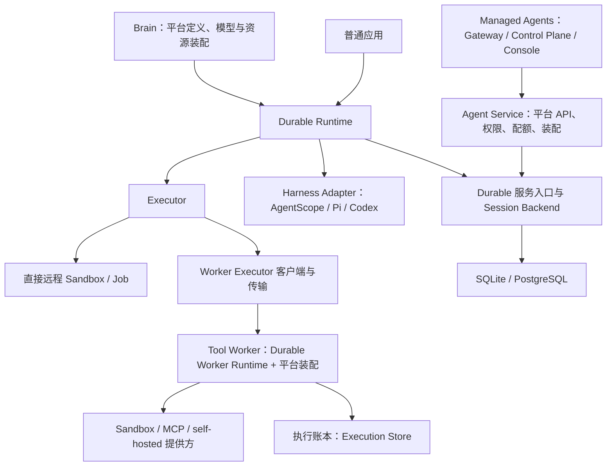

# Durable 与 Managed Agents 的职责和改造规划

[English](platform-boundaries.en.md)

日期：2026-11-07。本文为下一轮平台接入清单；Durable 当前实现和验收见设计及验证记录。
平台仓库和部署未改动。
依据是 [Durable 总体规划](https://aliyuque.antfin.com/ad3swf/gg3g1v/qecdop0f9bdu5irs)
和本次代码审阅。本文细化 [迁移计划](migration-plan.md)，明确平台复用关系。

## 1. 方向与约束

Durable 维护可靠执行的公共机制及可独立使用的默认实现；最终 Managed Agents 通过
依赖和扩展 Durable 提供多租户托管、资源管理与运营能力，通用机制收敛为一份实现。
本次先完成 Durable，Managed Agents 的接入和旧实现替换在下一轮、Durable 就绪后开展。

Durable 定位为通用开源框架/组件，公共抽象、API、协议、存储模型与默认部署方式
按独立使用和多种宿主的需求设计。Managed Agents 仍在开发、尚未正式发布，其
旧 API、DTO、prepared profile、包名和数据库表结构均不构成兼容性约束。
提取时保留通用机制，按新契约重构或删除历史分支；不为旧平台预建兼容 facade、
双协议或旧表适配。已有运行时复制只是起点，不是目标架构。

必要的恢复一致性、原生 Harness 边界和 Durable 自身版本声明仍须保证：同一次
执行的稳定身份、原子提交、幂等、fencing 与结果接续属于正确性要求，不能作为
“兼容逻辑”删除。平台下一轮适配 Durable 的通用契约。

范围约定：

- 忽略 `/Users/ken/agentscope-3/agentscope-java/agentscope-service` 中的重复实现，
  不作为设计参考、依赖、修改对象或本次验收范围。
- 总体规划继续考虑 `/Users/ken/agentcore/agentcore-managed-agents` 的架构与源码。
  本次仅参考、复制并适配可复用机制和测试到 Durable，不改动该源仓库。
- 下文 Agent Service、Brain、Tool Worker 均指独立 Managed Agents 项目的组件。
  平台最终形态与切换规则是后续规划；当前实施产物和验收均落在 Durable 一侧。

提取期间源仓库保留原实现，允许暂时存在两份代码；记录来源版本和后续映射，
在平台迁移时消除重复，不为避免暂时重复而提前改造平台。

四个用户侧抽象仍是 Runtime、Harness Adapter、Session Backend、Executor。
Worker Runtime、Execution Store、Object Store、消息传输是实现这些抽象的内部
组件或插件，不再让用户额外理解一套并列顶层框架。

以下展示最终架构，不表示本次改造平台部署。源码按职责提取，部署进程可继续保留。
最终 Agent Service、Brain 和 Tool Worker
仍可以独立扩缩容，但它们分别装配 Durable Backend/服务入口、Runtime/Adapter、
Worker Runtime/Executor 插件。部署组件继续存在，不意味着重复实现状态机。

图中的 Runtime 到 Backend 是逻辑调用，可为本地方法或远程协议；默认本地应用
无需部署 Agent Service、Tool Worker、MQ 或 Redis。独立工具能力仍需能够持续存在的
远程执行环境。全部宿主停止时需要重新启动或外部唤醒。

## 2. Tool Worker 对应 Executor，但包含多层职责

Tool Worker 是 Durable 分布式执行侧的关键实现来源，不宜只作为 AgentCore 私有
组件保留。它整体相当于 Executor 的服务端宿主，加上执行账本、恢复循环和提供方。
Runtime 看到的是 Executor 接口；使用远程 Worker 时还需要客户端代理和传输。

| 层次 | 提取内容 | 目标归属 |
| --- | --- | --- |
| Executor 契约 | 稳定 executionId、受理回执、start/query/cancel、输出游标、能力声明、UNKNOWN | Durable 公共契约 |
| Worker Runtime | 持久受理、重复投递处理、执行领取、续租与隔离旧写入、异步等待、结果冻结/补发、取消竞争 | Durable 通用可选组件 |
| Execution Store | 物理执行状态、原操作句柄、控制意图、结果、输出覆盖、结果 Outbox | Durable 执行侧存储 SPI 及本地/数据库实现 |
| Worker Executor 客户端 | 提交/查询/控制/结果交接；HTTP 或消息传输 | Durable 可选远程执行实现 |
| 工具提供方 | Sandbox 连接与进程协议、MCP 调用、self-hosted 环境执行 | AgentScope/Durable 扩展实现 |
| 平台装配 | Worker 注册、租户资源池、Environment 授权、凭证获取、容量与审计策略 | Managed Agents |

提取入口包括 `ManagedToolExecutor`、`ManagedToolWorkStore`、
`ManagedToolWorkerCommands`、`ManagedToolWorkerStore`、
`ManagedToolWorkerLoop`、`ManagedAsyncToolExecution(s)`、
`ManagedToolResultPublisher`、`ManagedSandboxToolExecutor` 和 `managed-tools.py`。
这些类目前分散在 tool-worker 与 common，不能只移动 tool-worker 目录就认为完成。
`ToolWorkerApp` 同时提供平台服务与环境侧 Worker 入口，应分别提取可复用执行逻辑。

建议提供以下实现，按实际保证声明能力：

| 实现 | 用途与顺序 | 恢复边界 |
| --- | --- | --- |
| 原生进程内工具 | 保留最轻接入方式 | 不承诺宿主退出后接回任意本地调用；只自动重试声明安全的操作 |
| Direct Sandbox Executor | 首版必做；先提取现有 E2B 路径，再评估 AgentRun 等现有 Sandbox 扩展 | 持久保存执行身份与远程句柄、查询原操作、按游标补收；实际能力由提供方验收 |
| Worker Executor + Worker Runtime | Durable 首版必做；从现有 Tool Worker 提取并独立验收 | Runtime 与 Worker 分离，Worker 替换也只能查询/接回原操作；不因租约失效重新启动 |
| MCP 提供方 | 复用现有执行代码，逐工具声明幂等与查询能力 | 普通 MCP RPC 的结果丢失可为 UNKNOWN，不能宣称所有工具都可恢复 |
| self-hosted Worker | 在通用协议稳定后提取环境侧客户端 | 通用领取/续租/输出/结果机制开源，企业注册与凭证策略由平台实现 |

Sandbox 资源 SDK 和 Durable Executor 的职责不同：前者提供环境与命令 API，
后者负责把它们纳入持久执行协议。应在 `agentscope-extensions` 提供依赖既有
Sandbox 扩展和 Durable 契约的适配模块，不把 Durable 依赖反向加进基础 Sandbox SDK。
多个部署模式复用同一 Worker 状态机；不分别维护“本地执行恢复”和“平台执行恢复”。

### 两类账本必须明确

Session Backend 记录工具意图、逻辑关联、已接受结果以及结果是否进入原生状态。
Execution Store 记录外部动作受理、原句柄、物理结果和输出采集。这是两个权威边界，
可以使用同一数据库实例，也允许独立存储；Worker 不读取 Brain 私有 checkpoint。

跨边界交接采用稳定 ID、Outbox/Inbox、回执、重复查询和补偿，不能假设跨库原子事务。
Worker 的结果被冻结后可靠投递，Backend 接受结果和登记恢复待办在一次事务中完成，
Adapter 再将原生应用位置与 checkpoint 一起提交。工具“结果接受”与“原生应用”
两个确认点都必须保留。这些账本记录不同事实，不是两套重复的执行引擎。

提取时保留现有正常投递路径的“持久认领 → ACK 确认 → 外部调用”边界。
无 MQ 实现可以使用等价的持久受理回执，不应为了 API 看起来统一而弱化现有保障。

## 3. Session Backend：先实现哪些后端

Session Backend 承载完整的会话执行事实，至少覆盖输入去重、Run/等待关系、
版本化原生状态引用、提交回执、执行权、结果接受/应用、持久待办和事件/快照。
它不是 `SessionLogStore` 或单个 messages 表的改名，也不是只实现 HTTP 的客户端。
原生 SessionLogStore 仍由 Adapter 对接，原生格式解释留在 Harness 一侧。

| 后端/插件 | 实施建议 | 说明 |
| --- | --- | --- |
| SQLite Backend | 首版默认，阶段 1B | 单机持久嵌入、事务、进程重启恢复、待办扫描；不承诺跨主机共享数据库文件 |
| PostgreSQL Backend | 与 SQLite 同期，阶段 1B | 优先从现有 Session Service/common 提取，独立验证并供后续平台复用；版本检查、锁、fencing、Outbox、投影进度保持完整 |
| Remote HTTP Backend | 阶段 1A/1B 建立适配 | 客户端使用共同后端契约，服务端委托同一 PostgreSQL/其他后端；提供可挂载路由，不要求单独建设 Session Server |
| AgentCore Backend 集成 | 下一轮、Durable 就绪后实施 | 平台按 Durable 新契约组合 Remote Backend、认证与资源解析；不预设旧 prepared 协议兼容层 |
| In-memory Backend | 仅测试/演示 | 显式声明不支持进程恢复，不作为默认 Durable 后端 |
| Context 集成 | 后续按接口能力验收 | 若仅有对象/消息读写，只作为内容存储或上下文桥接；具备完整原子提交、fencing、回执与待办契约后才能称完整 Backend |
| 其他数据库 | 有明确需求再做 | 首版不同时支持所有 JDBC 方言；已有普通 JDBC StateStore 不自动等价于 Durable Backend |

“本地/共享”是存储能力，“本地方法/HTTP”是访问方式，应避免把两者排列成互斥选项。
未来 Managed Agents 的 Brain 可通过 HTTP 使用 Backend，Agent Service 内部直接调用同一个
PostgreSQL Backend 实现；用户也可以在自己的应用内直接嵌入 PostgreSQL Backend。

不应为 SQLite、PostgreSQL、远程平台分别重写业务状态机。身份/摘要校验、合法状态
转换与回执语义共享实现，后端提供满足契约的事务、条件写、锁和读写映射，并通过同一
故障测试。SQL 方言和并发控制允许不同，不强行为所有存储抽象出万能 SQL 层。

以下是正交插件，不作为完整 Session Backend：

- Object Store：本地文件默认；提取现有 OSS/S3 实现。大对象先可靠写入，再原子提交引用；
  引用完整性、跨组件可访问性和延迟 GC 必须验收，不能用对象存储代替事务数据库。
- Wakeup/Transport：默认持久待办扫描；RocketMQ 作为首个企业级分布式插件，承接工作
  提示及工具交接投递。消息不是状态权威；队列重投不生成新的 Run/executionId。
- Redis：仅按通用需求提供可选通知、缓存或租约实现，不因源代码使用它而强制保留。
  可改用数据库租约等实现，但须验证执行权与 fencing；基础设施丢失不授权重做
  未知副作用。

## 4. Agent Service 和 Durable 的关系

当前 Agent Service 同时承载对外产品接口、内部 Session Service 和后台恢复工作。
它是 Durable 机制的重要来源，不能整体归为平台，也不能整体搬入 Durable 核心。

| 当前职责 | 沉淀到 Durable | Managed Agents 保留 |
| --- | --- | --- |
| Session/Turn/Input 受理 | 幂等受理、命令回执、输入/等待关联、取消意图 | 身份授权、Application/Agent/Environment 校验、配额策略、产品 API |
| 执行事务和恢复 | `SessionCommitTransactions`、提交校验、所有权、结果应用、checkpoint 引用、待办 | 平台策略接入与数据库/租户装配 |
| 内部 Session Service API | 通用 Backend 协议、客户端、可挂载的服务端处理 | 内部鉴权、部署地址、按 Durable 契约重构调用方 |
| 后台工作 | 派发修复、结果接收与重投、恢复唤醒、等待/超时驱动、通用子任务关联 | 副本数、线程/资源预算、平台队列和路由配置 |
| 查询、公开事件与 SSE | 不可变事件、公共投影、游标补读、快照/重同步契约、客户端 | API 鉴权、用户/组织视图、产品查询索引和展示字段 |
| 生命周期与工作区管理 | 可恢复的 checkpoint/fork/清理命令机制、对象引用安全 | 资源保留策略、计费、审批、Vault/Environment 与租户配置 |
| 费用与权限 | 持久执行授权证据、取消/许可版本校验、幂等用量事实 | 定价、套餐、跨会话配额、IAM/RBAC、审批政策、企业审计 |

`SessionServiceWorkers` 已承担工具结果接收、结果修复、恢复通知与子任务控制；
`SessionCommitTransactions` 已承担与原生格式无关的提交事务。
提取这些机制后，Agent Service 成为“平台 API + Durable 服务能力”的宿主。
通用服务端处理应在可选 HTTP 集成层，Runtime 核心不依赖 Spring/JPA Controller。

策略与机制的拆分不能破坏已有原子性。当前受理和配额预留、执行和预算结算有事务
关联；这类约束用于验证通用事务扩展或持久预留能力，不要求保留原表或接口。
跨库拆分另行设计幂等预留/确认/释放与修复，不在数据库事务内调用任意远程策略
服务，也不把“平台稍后扣费”当作受理时配额约束的替代。

当前新版 `/api/v1/agent-sessions/{id}/events/stream` 已接收 `after`、
`Last-Event-ID`，`AgentServiceEventReads` 按持久高水位分页读取并把通知作为提示。
应先复用这条路径，逐项补齐可靠 delta、保留窗口/过期、快照一致性、attempt/修订规则。
旧接口文档还存在“不能续传”的描述，不能据此判定当前所有接口均不支持游标；
也不能以一个接口支持游标推断所有输出都已可靠持久化。

## 5. 最终平台保留什么

| 组件 | 最终定位 |
| --- | --- |
| Gateway | 企业身份、租户入口、限流、路由、请求审计；调用平台 API |
| Control Plane | Agent/模型/工具/Environment/Skill 等资源目录与版本、授权、凭证、发布和资源调度；保留 Team/Workflow 产品编排、Cron、渠道和 Webhook |
| Agent Service | 平台 Session API 与授权/配额、Durable Backend 和服务端路由的生产装配、产品查询投影 |
| Brain / agent-harness-runtime | 薄应用宿主：依赖 Durable Runtime + 选定 Adapter，注入平台 Agent 工厂、模型、定义、凭证与环境解析 |
| Tool Worker | 依赖 Durable Worker Runtime + 提供方，注入平台认证、资源池、Environment 与部署配置 |
| Console / CLI / SDK | 产品管理与应用接入体验；通用事件读取和接续客户端由 Durable 复用，平台 SDK 只扩展管理接口 |
| common | 持续缩减为平台共享类型/策略；已提取的状态机、账本和 DTO 不保留长期镜像副本 |
| 部署与运营 | 镜像装配、Helm、伸缩、容量、SLO、告警、审计、数据保留与企业策略 |

通用的父子 Run 关系、结果汇合、等待与取消传播进入 Durable；Team/Workflow 的产品
建模、组织关系、成员策略和业务流程编排留在 Control Plane，使用 Durable 的任务
入口。必要时支持原生工作流引擎桥接，但同一次执行只允许一个推进与恢复责任方。

AgentScope 的 `AgentSession` 已有持久任务、受理和调度，原生 SessionLog 已有状态
与执行权。Adapter 应复用原生恢复边界，不再实现一套 AgentScope 推理循环。
Durable 管理的 Session 不应同时运行两个独立的任务 dispatcher；阶段 1A 必须明确
由 Durable 负责外层推进，原生执行通过适配边界被驱动，或由原生调度显式委托。
保持已有 `AgentSession` API 的独立使用方式，Core/Harness 不反向依赖 Durable。

## 6. 代码组织建议

以下是逻辑边界与候选制品，不要求一次创建所有模块：

| 位置 | 建议内容 |
| --- | --- |
| `agentscope-durable` | 中立契约、Runtime、AgentScope Adapter/codec、可选通用 Worker Runtime、共享协议与故障套件；现有 java/runtime 逐步提炼，不另建长期平行内核 |
| `agentscope-extensions` | Durable SQLite/PostgreSQL/HTTP 集成、RocketMQ、OSS/S3 和具体 Sandbox Executor；按真实依赖拆制品，复用已有 SDK |
| `agentscope-examples` | 单应用 SQLite 恢复、远程工具换 Brain、事件重连、PostgreSQL + Worker 分布式示例 |
| `agentcore-managed-agents` | 本次只作为架构/源码参考；下一轮按 Durable 新契约改造平台组件与装配，以制品或共同协议消费 Durable |

优先完成 Java 公共实现。Pi/TypeScript 与 Codex/Rust 继续独立宿主，遵循共同协议、
身份和故障套件；不要求直接依赖 Java JAR，也不承诺同一 checkpoint 跨内核可加载。
框架声明自身协议/状态版本及支持的 Adapter/Backend 能力，平台下一轮选择经过
验证的 Durable 版本；不为开发中的旧平台承诺兼容矩阵。
公共扩展发布前补 parent/BOM/distribution 与源码发布检查。

### common 及其他平台依赖的迁入与消除

依赖方向是 `Managed Agents → Durable → AgentScope/通用第三方库`。Durable 的
构建、测试和运行不得直接或间接依赖 Managed Agents 制品、源码目录、测试夹具、
平台数据库或服务。以后如需平台适配，由平台实现 Durable 的扩展接口。

当前导入的 Adapter、Brain POM 都依赖 `managed-agents-common`，Adapter 还以
test scope 依赖 `managed-agents-tool-worker`；二者仍保留原父 POM 和内部制品坐标。
显式 import 初查分别引用 common 中 20、56 个类型，包含测试源码；这个数字不含
同包访问和传递依赖，不能当作完整迁移数量。已启用 runtime/codec 的构建通过也
不能证明整个导入模块已经独立。

| 引用类别与现有入口示例 | 后续处理 |
| --- | --- |
| `ManagedJournalStore`、`ManagedAdmissionStore`、`ManagedInputInbox`、`ManagedScope` | 提取通用事务、受理、恢复与身份机制到 Durable；清理平台字段并追踪传递依赖 |
| `RuntimeObjectStore`、`ManagedCheckpointObjects`、`SessionProjectionStore` | 存储契约进入 Durable；数据库/对象存储实现进入对应扩展，迁入所需 schema、资源和测试 |
| `ManagedMessageBus`、`ManagedProcessOwnership`、MQ Consumer 与 Redis 装配 | 通用传输/执行权契约与具体插件分离；不继承平台启动与配置依赖 |
| `ManagedCatalog`、`AgentDefinition`、`AgentAclService`、`VaultService`、`ControlPlaneClient` | 通用 Agent 工厂、凭证/权限/资源解析改由宿主接口提供；平台目录、实体、认证和控制面装配不迁入核心 |
| Tool Worker 测试夹具及 common 工具测试 | 随通用执行代码迁入并改为 Durable 契约测试；去掉 test scope 的平台制品依赖 |

迁入以实现闭包为单位：源码、调用到的通用辅助代码、资源、测试及构建声明一起
处理。包括没有 import 的同包引用、反射/服务加载配置和脚本路径；平台专属链路
在边界处拆除，不能为解决编译而把整个 common 或平台依赖树复制过来。
按 Durable 的通用 API 和命名整理，既不保留外部依赖，也不新增兼容包装层。

完成条件是所有保留且声明支持的模块参与构建和测试，解析后的依赖图无平台制品，
并能在无 Managed Agents 源码与缓存制品的环境中运行独立示例。当前迁入快照中的
残留引用是待办，禁用模块或只检查 import 都不能替代这项验收。

## 7. 改造顺序：先完成 Durable，再迁移平台

本次阶段 1A 至 3 均在 Durable 及必要的 AgentScope 集成、扩展、示例范围内完成。
Managed Agents 作为设计输入与实现来源，不作为需要同步修改或部署的验收前置。

| 阶段 | Durable 交付 | 平台设计输入（本次不改平台） | 通过条件 |
| --- | --- | --- | --- |
| 1A 契约与第一切片 | 身份映射、能力声明、事务/Executor 边界；提取 DTO、校验、选定事务逻辑及测试 | 梳理当前身份、协议、原子性和策略约束，记录后续适配点 | 迁入的语义回归通过；框架无 managed common 依赖；Session 无双重 dispatcher |
| 1B 本地与共享后端 | SQLite 默认后端、提取 PostgreSQL 后端、HTTP 适配、AgentScope 恢复宿主与独立示例 | 参考 Session Service 原子性与并发机制，按 Durable 契约设计 schema/API | 重复提交/丢回执/新进程恢复；SQLite 无平台服务可运行；PostgreSQL 旧 owner 被拒绝 |
| 2A 执行侧 | Worker Runtime/执行账本、Worker Executor、首个 Direct Sandbox Executor 与独立宿主 | 参考 Tool Worker 执行协议、账本与故障边界，迁入对应测试 | 同一故障套件验证 Runtime/Worker 替换、原操作查询、UNKNOWN、取消和结果补收 |
| 2B 事件与客户端 | 提取持久读流与公共投影，完成可靠事件、快照/游标和共同客户端 | 参考事件、游标与投影机制，按通用契约设计事件格式与客户端 | 断线补读/实时衔接无缺口；过期重同步；已接受结果与原生应用分别可查 |
| 3 分布式、第二内核与就绪 | RocketMQ 插件、共享后端真实基础设施故障验收、Pi Durable、制品与能力矩阵 | 参考平台规模与部署需求，使用 Durable 自身示例验收 | 达到以下就绪门槛；完整报告真实基础设施验证结果与能力限制 |
| 下一轮平台改造（本次不执行） | 对有通用价值的接入缺口演进 Durable；Context 等按需求扩展 | Agent Service/Brain/Tool Worker 按新契约依赖 Durable，移除旧实现 | 权限/配额和执行能力验收；无双写或双推进；数据迁移/交接仅按明确需求另行设计 |

本次每个切片遵循“源码参考 → 提取到 Durable → 独立实现与故障验收 → 记录后续
平台接入点”。平台改造另行按“依赖 Durable → 按新契约重构 → 平台验收 → 移除旧实现”
推进。提取平台测试时适配为 Durable 契约测试，不要求先修改平台调用方。

### Durable 就绪门槛

- Runtime、Harness Adapter、Session Backend、Executor 四个抽象具有可运行实现；
  AgentScope 在不依赖两处 Service 实现的应用中完成受理、恢复、等待与取消。
- 所有保留模块完成 common 等依赖解耦，构建、测试、运行均无 Managed Agents
  直接或传递依赖，并通过上述独立环境验收。
- SQLite、PostgreSQL、HTTP 访问通过共同事务与协议测试；多进程验证丢回执、
  stale owner、工具结果与恢复待办原子性，不能仅凭存储接口或单元测试判定完成。
- Direct Sandbox、Worker Runtime/Executor、可靠事件与客户端完成独立故障验收；
  RocketMQ 分布式示例及第二内核 Pi 验证共同契约，真实基础设施结果单列。
- 提供可消费的版本化制品、独立示例、文档、自身协议/状态版本与 Adapter/Backend
  能力矩阵，并说明平台扩展入口；不要求旧平台兼容层或平台已接入。

就绪验收依赖 Durable 自身证据，不依赖平台部署或旧实现删除。Context 等后续可选
集成不阻塞以上就绪判定；必需能力的跳过项必须补验收，不能用模拟通过替代。

### 下一轮平台改造原则（本次不执行）

- 以 Durable 新契约为准重构平台调用、协议和存储，不预设保留旧 ID 格式、表结构、
  prepared profile 或兼容 facade。通用状态进入 Durable，产品字段留在平台。
- 只有出现明确的存量数据或运行中任务保留需求时，才在下一轮评估迁移工具或临时
  适配；不将假设的无停机切换、双向回滚等需求带入本次核心设计。
- 平台改造验证权限/配额原子性、结果可靠交接、对象可访问性、父子取消和事件接续。
  若确需接管运行中的任务，仍须保持执行身份并隔离旧 owner，避免重复外部动作。

## 8. Durable 下一步实施任务

Durable 实施先做阶段 1A：

1. 固定 Session/Run/Turn/attempt/executionId 和回执、等待、能力模型；确定原生
   AgentSession 与 Durable 的唯一调度责任。
2. 从 SessionCommitTransactions / ManagedJournalStore 中选取提交回执与执行权
   校验切片，连同测试提取到 Durable，按通用契约组织实现并验证原子性与并发正确性；
   记录后续平台接入点，本次不修改平台调用方。
3. 定义 Backend 的最小原子提交契约和 Executor/Execution Store 交接契约。
   对象存储、消息和策略分别通过窄接口接入，不直接依赖整套 common。
4. 以同一测试规格运行提取后的 PostgreSQL 实现及本地后端原型，验证受理、丢回执、
   stale owner、工具意图/结果/待办原子性，再冻结第一版可实施 API。

本次完成标准是 Durable 满足第 7 节就绪门槛，普通应用无需 AgentCore 即可持久恢复，
并提供后续平台接入所需的契约与映射。平台核心路径依赖 Durable、原算法退役以及
双方实际共用协议/客户端/测试，属于后续平台迁移的完成标准。

## 9. 本次代码依据与验证范围

审阅源仓库：`/Users/ken/agentcore/agentcore-managed-agents`，分支 master，
提交 `77df8dee65008f0550fe20a900565210355e4eb4`。这比最初导入清单的基准更新，
本次没有重新同步源码，导入清单仍记录原始快照。

| 代码入口（源仓库路径） | 支撑判断 |
| --- | --- |
| `managed-agents/tool-worker/src/main/java/.../runtime/managed/ManagedToolWorkerLoop.java` | Worker 有独立持久执行循环、认领/ACK 交接与恢复 |
| `managed-agents/common/src/main/java/.../runtime/managed/ManagedToolExecutor.java`、`ManagedToolWorkStore.java` | start/query/cancel、输出及 UNKNOWN，与执行侧账本已有分界 |
| `managed-agents/agent-service/src/main/java/.../runtime/managed/SessionCommitTransactions.java` | Session 锁、回执、fencing、状态与提交事实的事务入口 |
| `managed-agents/agent-service/src/main/java/.../agentservice/sessionservice/SessionServiceWorkers.java` | 结果接收、修复、唤醒及子任务协调已在 Agent Service |
| `managed-agents/agent-service/src/main/java/.../agentservice/session/AgentServiceEventReads.java` | 新接口具有持久游标分页、Last-Event-ID 和定时补读 |
| `managed-agents/agent-service/src/main/java/.../agentservice/session/AgentServiceTurnAdmission.java` | 准入与平台配额已有事务关联 |
| `agentscope-harness/src/main/java/io/agentscope/harness/agent/session/AgentSession.java`（AgentScope 仓库） | 原生已包含持久任务与 dispatcher，须避免重复推进 |

提取时优先带走 `ManagedSessionStoreTest`、`ManagedJournalStoreTest`、
`SessionCoordinationHttpTest`、`ManagedToolWorkerReliabilityTest`、
`AgentScopeRemoteFlowTest`、`ManagedSessionEventStreamsTest` 等相应语义测试；
真实 PostgreSQL 测试与外部 Sandbox 验收单独保留。
本轮仅更新规划文档并校验文档链接/一致性，未运行运行时测试、构建或部署。
