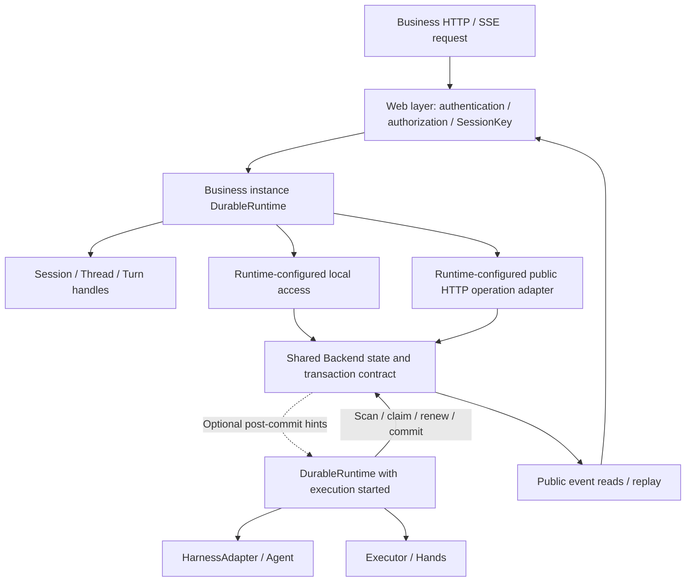

# Durable user API and autonomous execution plan

[中文](user-api-and-runtime-plan.md)

Subsequent design follows the [unified execution model plan](../design/execution-model-plan.en.md):
Thread owns continuing context, Turn is the logical task, Run is one invocation, each Step
belongs to one Run, and native AgentSession scheduling is consolidated into Durable.
The target model is not fully implemented or verified. This document and its verification describe the previous
version; decisions such as excluding Turn no longer constrain the upcoming refactor.

Date: 2026-11-09. P1–P8 core work is implemented and verified. Independent builds, live PG/MQ, platform public APIs and Brain/Hands process recovery passed; see the [verification record](../verification/user-api-verification.en.md) and §10.

This plan follows the discussion about user APIs, Session/Thread/Turn identities, execution hosts and Backends, checked against the current Java source. Complete the general Durable framework before adapting Managed Agents. Scope is Java / AgentScope only. Ignore the duplicate `agentscope-java/agentscope-service`; do not preserve superseded development APIs or introduce mandatory services or message brokers.

**Hard constraint, explicitly confirmed by the user on 2026-11-09: Durable is in development/research; this design and implementation must not accommodate compatibility.** APIs, event names, fields, envelopes and storage formats may change directly. Existing code is input, not a constraint. Delete superseded implementations and update callers, schemas, examples and tests together. Retain no aliases, deprecated forwarders, dual protocols/read-write paths, old-format readers, data-migration layers, downgrade fallbacks or rolling-upgrade compatibility plans. Cross-language alignment targets one current contract, not historical versions. Version checks reject mismatches; idempotency, fencing and recovery correctness remain mandatory.

## 0. Confirmed design decisions

The following decisions guide implementation and replace earlier proposals such as independent Runtime construction:

| Topic | Confirmed decision | Implementation and verification |
| --- | --- | --- |
| Unified entry | DurableRuntime owns interaction, assembly and lifecycle, wiring Backend, notifications, transport and optional execution components | §3.1, P2/P4 |
| Business operations | Runtime creates/gets/lists Sessions directly; Session/Thread/Turn handles expose specific operations without infrastructure assembly | §3.1–3.3, P2/P3 |
| Instances and lifecycle | Runtime is a reusable, thread-safe instance; observer/Runtime shutdown does not cancel durable tasks | §3.1, §5, A9 |
| Access and execution | Building Runtime does not start Brain. API processes use Runtime directly; execution processes explicitly start autonomous claims, execution and recovery without user connections | §4–5, P4/P5, A3/A7 |
| Deployment | Local/embedded, separate Web/API and separate Brain deployments share user contracts; Runtime assembly expresses differences, with neither HTTP nor MQ mandatory | §3.1, §4.2, A1/A10 |
| Managed Agents | A platform application of Durable using the same public APIs, protocols and extensions as other distributed applications; dependencies flow only from platform to Durable | §6, P7/P8, A14 |
| Protocol and replacement | User operations and messages/events form one cross-language interaction contract; complete Durable before platform adoption and replace superseded designs without compatibility logic | §3.5, §7, A15/A16 |

## 1. Objectives and acceptance principles

Durable must satisfy two independent conditions:

1. **Execution without connected users:** after admission, tasks do not depend on HTTP requests, SSE connections or another Session lookup. Hosts discover, claim, recover and advance work autonomously. A new eligible host can take over after a host exits.
2. **Access from any business instance:** a Web service resolves trusted identity and Session ID, then uses one API to retrieve the existing session, inspect state, submit operations and observe events, without finding the original JVM or Agent object.

Local quick starts, direct database access, separate Backend services and Brain–Hands deployments share user concepts and operation semantics. Assembly, storage, transport and execution extensions account for deployment differences.

Retain the four infrastructure boundaries: `DurableRuntime`, `HarnessAdapter`, `SessionBackend` and `Executor`. Add a user entry point and scoped handles, not another task state machine, scheduler or stack of public SPIs.

**Cross-language requirement: user operations and existing message/event formats together define Durable's public interaction protocol. Define language-neutral concepts, granularity, workflows, fields and conformance vectors before implementing Java bindings.** Languages and Harnesses may differ in capabilities and implementation, not in the meaning of a shared operation. See the accompanying [public interaction contract](../../protocol/public-interaction-contract.en.md).

## 2. Existing foundation and gaps

| Area | Current implementation | Required work |
| --- | --- | --- |
| User entry point | Runtime forwards submit/signal/cancel; Backend combines user commands with claim/commit | Runtime owns assembly and directly exposes Session creation, lookup, listing and capability discovery; specific tasks use Session/Thread/Turn handles |
| Session/Thread/Turn | SessionKey, ThreadKey, TurnReceipt, TurnView and Snapshot | Explicit creation/lookup, bounded task/history queries on the primary or an explicit Thread, and consistent command receipts |
| Execution identity | Durable runId maps to native turnId; each native invocation has its own runId | Document and test the distinction throughout APIs and protocols |
| Input/interactions | Raw Signal; AgentScope middleware applies steer/inject at reasoning boundaries | Typed operations, interaction queries/responses and atomic state checks |
| Autonomous execution | Ready scanning, leases, renewal, optional Wakeups and independent Worker ledger | Unified acceptance for startup recovery, failed hints, scan fairness and no-user scenarios |
| Local backend | SQLite, file objects and LocalWakeups | Minimal assembly and automatic polling without notifications |
| PostgreSQL | Process-local hints by default; pluggable Wakeups | Cross-instance correctness through polling, optional hints and production settings |
| HTTP | HttpSessionBackend and handlers exposing internal execution operations | Restricted user operation surface with local/remote parity |
| Events | PublicEvent, Snapshot, cursors, SessionEventClient, Runtime.observe and SSE | Observation without starting Brain, Run filtering and bounded subscriptions |
| Checkpoints | Codec now owns AgentScopeCheckpoints and the state version | Integrate user operations while retaining settled/idle/version/position checks |

Reuse these implementations:

- [Runtime](../../durable-runtime/src/main/java/io/agentscope/durable/DurableRuntime.java), [Backend](../../durable-runtime/src/main/java/io/agentscope/durable/SessionBackend.java), [transactional state machine](../../durable-runtime/src/main/java/io/agentscope/durable/TransactionalSessionBackend.java).
- [Wakeups](../../durable-runtime/src/main/java/io/agentscope/durable/Wakeups.java), [post-commit notifications](../../durable-runtime/src/main/java/io/agentscope/durable/NotifyingSessionBackend.java), [event reader](../../durable-runtime/src/main/java/io/agentscope/durable/SessionEventClient.java).
- [LocalBackend](../../../agentscope-extensions/agentscope-extensions-durable-jdbc/src/main/java/io/agentscope/extensions/durable/jdbc/LocalBackend.java), [PostgresBackend](../../../agentscope-extensions/agentscope-extensions-durable-jdbc/src/main/java/io/agentscope/extensions/durable/jdbc/PostgresBackend.java).
- [AgentScopeAdapter](../../durable-adapters/durable-adapter-harness-agentscope/src/main/java/io/agentscope/durable/agentscope/AgentScopeAdapter.java), [checkpoint operations](../../durable-adapters/durable-adapter-harness-agentscope/src/main/java/io/agentscope/durable/codec/agentscope/AgentScopeCheckpoints.java), [protocol schema](../../protocol/schema.json).

## 3. User model and API boundaries

### 3.1 User types and implemented entry points

These types are implemented; exact Java signatures and wire fields are recorded in the public interaction contract and source.

| Type | Responsibility | Lifetime |
| --- | --- | --- |
| DurableRuntime | Unified assembly, business-operation and lifecycle entry: create/get/list Sessions, discover capabilities, start or stop the execution host | Thread-safe and reusable across requests; construction does not start Brain |
| DurableSession | Snapshot, public history, task queue, submission, session events and checkpoint/restore/fork | Lightweight identity handle; no authoritative state cache, Agent or dispatcher |
| DurableTurn | Status, results, input changes, interaction responses, cancellation, guarded continuation and task events | Reacquired by SessionKey + turnId; independent of the original submitting Runtime |

Do not create additional public service interfaces for `sessions()` or `runs()` access paths. Local/HTTP implementations may share an internal command invocation adapter; no new user-facing event bus or Repository/Manager hierarchy is needed.

**Assembly rule updated by the user on 2026-11-11: DurableRuntime is the unified interaction, assembly and lifecycle entry point. It creates, gets and lists Sessions directly; DurableClient is no longer public.** Runtime wires Backend, notifications, transport and optional execution components; Session/Thread/Turn contracts do not expose infrastructure dependencies.

Runtime is an ordinary instance, not a static class or global singleton; static builder methods only construct instances. Top-level business operations live on Runtime, while specific conversation and task operations live on Session/Thread/Turn handles. Runtime also retains execution lifecycle operations; do not add Client compatibility forwarders. Replace the ambiguous `run(...)` query name with explicit get/status naming.

Building Runtime and starting Brain are separate actions. An API-only process builds Runtime without requiring local Agent factories, models or Hands executors or starting ready scans, claims or inference threads. Configure execution components and explicitly call `start()` to run Brain; calling `start()` without execution configuration fails explicitly. Business operations and event observation do not require local Brain execution; another eligible Runtime using the same backend can execute tasks. Standard registration/resolution still selects Agent definitions; absence of local Agent factories must not bypass definition validation.

Lifecycle follows the physical deployment host. Brain starts only `DurableRuntime`, which opens and closes managed Executors. A RocketMQ Hands process starts only `RocketMqWorker`, which owns its message loops and internal `WorkerRuntime`. Applications start `WorkerRuntime` directly only when embedding that engine without a higher-level Hands host, and register the explicit `LocalWorkerExecutor` from `worker.localExecutor()` with Brain; WorkerRuntime itself does not implement `Executor`. The Executor business operation is named `startExecution(request)`, separate from no-argument component `start()`. Constructors do not start threads. Spring Boot hosts connect the top-level component to the standard container lifecycle, such as `SmartLifecycle`, rather than starting it in a controller or request.

Storage assembly follows the physical role. The default Brain entry accepts only a `SessionBackend`; embedded deployments obtain a complete Backend from `LocalBackend.open(...)`, and `JdbcRecordStore` no longer creates a Backend. The default Hands entry accepts one low-level `RecordStore`: `WorkerRuntime.recordStore(...)` creates the standard transactional execution ledger internally, while `executionStore(...)` is reserved for replacing that ledger. Sandbox lifecycle state may borrow the same Hands `RecordStore`, but `SandboxBindings` remains independent because it also works with RocketMQ, HTTP or direct Executors and does not require a local Worker. The application owns injected Stores and closes them after their consumers.

```java
try (var backend = LocalBackend.open(data.resolve("brain"));
        var handsRecords = JdbcRecordStore.sqlite(data.resolve("hands.db"));
        var sandboxes = SandboxBindings.builder()
                .stateStore(handsRecords)
                .resolver(this::sandboxTarget)
                .build();
        var worker = WorkerRuntime.builder()
                .recordStore(handsRecords)
                .executor("hands", sandboxes.executor(binding, tool))
                .build()) {
    // Brain sees backend; Hands sees handsRecords.
}
```

Implemented API-only usage:

```java
DurableRuntime runtime = DurableRuntime.builder()
        .backend(backend)
        .build();
DurableSession session = runtime.getSession(sessionKey);
// Reuse runtime in API handlers; this process does not start Brain.
```

An embedded deployment configures Harness/Executor and starts execution on the same Runtime; a separate Brain process starts its own Runtime, without another public container or Manager type. Subscriptions close independently; Runtime.close closes its subscriptions and owned resources and invalidates associated handles, without cancelling durable tasks or closing borrowed components. Injected resources such as Backend retain explicit ownership and shutdown ordering.

| Application role | Runtime usage | Business access and execution |
| --- | --- | --- |
| Local or embedded application | One Runtime assembles access and execution components | Runtime serves business operations; start() starts Brain |
| Separate Web/API service | Runtime assembles only business access capabilities | Runtime submits, queries, controls and observes; no local Agent/model/executor or task scans/claims |
| Separate Brain service | Runtime assembles execution components and calls start() | Autonomous discovery, claims and recovery, without requiring Web request handling |
| Separate Hands service | Assemble Worker and tool providers | Standard execution commands/results; no additional user business API required for tool execution |

Access and execution roles may share a deployment. When separated, business and execution Runtimes coordinate through the same authoritative backend state and protocol, without shared JVM objects or request affinity. Business Runtime may be available before Brain starts; admitted tasks remain queryable and await execution when no eligible execution host is available.

### 3.2 Identity and native Agent relationships

```text
SessionKey(namespace, sessionId)
  └─ Thread(main): default continuous context and FIFO task boundary
       └─ Durable Turn: one persistent logical task
       ├─ native invocation attempt A
       ├─ tool executionId / user interactionId
       └─ native invocation attempt B, still within the same Durable Turn
```

- turnId identifies the persistent task; each native Agent invocation has its own runId for execution records and diagnostics.
- requestId identifies idempotent submission; signal/command IDs identify operations. messageId, eventId and executionId remain distinct.
- Native AgentRun is a process-local invocation handle; DurableTurn is the public task handle that can recover across Runs.
- Native AgentSession is an alternative native Harness entry point. DurableSession does not start its dispatcher; Durable-managed sessions have one queue and one execution ownership mechanism.
- Preserve native SessionLog, AgentState, permissions, middleware and inference. The adapter integrates these mechanisms and maps formats.

### 3.3 Operation matrix

| Scope | Operations | Semantics and constraints |
| --- | --- | --- |
| Runtime | createSession / getSession / listSessions | Missing lookup returns NOT_FOUND and never creates implicitly. Creation freezes a definition and is idempotent. Server-side registration/resolution selects definitions; remote users cannot choose arbitrary internal state versions |
| Session | snapshot / history / listTurns | History and Turns default to the primary Thread; no private checkpoint, reasoning or execution ledger exposure. Reads do not make tasks ready |
| Session | submit(requestId, Input) | Atomic admission to the primary Thread with Turn identity; same key/content returns the original receipt, different content conflicts. Transactional admission establishes queue order |
| Session | events(cursor) | Replay and observation from any business instance |
| Turn | status / result / await | Distinguish unfinished, waiting, failed, cancelled and successful states. Timeout stops waiting only and retains turnId for subsequent lookup |
| Turn | steer / inject / withdraw | Target the explicit unfinished task. Do not silently rewrite queued input. Apply at native safe boundaries; withdrawal wins only before application |
| Turn | pendingInteractions / respond | Typed approval, user input or explicitly allowed external tool results. Bind interactionId and validate type/state/repeated responses; never fabricate completion in the Worker ledger |
| Turn | cancel(requestId) | Cancel queued work or request active cancellation. Receipt acknowledges admission, not confirmed external termination |
| Turn | resume | Only for explicitly continuable pause reasons. Failure takeover is automatic; tools and approvals use their own paths. UNKNOWN never authorizes restarting an effect |
| Turn | events(cursor) | Filter the Session event stream while retaining its cursor, without another sequence namespace |
| Thread | checkpoints / restore / fork | Preserve settled, target-idle, namespace, definition/state version and expectedPosition checks. Fork explicitly creates the target identity |

State validation and command acceptance occur in the authoritative transaction, not in a racy client-side read-before-write check. Distinguish accepted/applied/settled receipts or views; confirm asynchronous outcomes through status/events. Stale Runs, withdrawal races, concurrent cancellation, terminal operations and repeated interaction responses need explicit errors or idempotent outcomes.

Session listings and task/history pages must be scoped to an authorized namespace/Session; never expose global scheduler discovery as user listings. Pagination cursors and filters cannot bypass scope checks. Unsupported interaction/checkpoint capabilities return explicit capability errors instead of client-side guesses or fallback to native execution.

Steer supplies additional task instructions; inject supplies context. Both apply at the next native reasoning boundary in this scope, without promising interruption of an active model call, different priority or system-role elevation. P1 defines content mapping and P3 verifies it; two raw Signal strings alone do not constitute defined user semantics.

### 3.4 Content, control and event protocols

- Reuse DurableMessages.Input/Message for public content, with text conveniences and multimodal support; users need not construct AgentScope Msg.
- Define typed user command/response values for necessary operations, reusing RunReceipt/RunView/PublicEvent instead of synonymous DTOs.
- Keep generic Signal as an advanced extension; ordinary users do not assemble `input:steer` or `interaction:...` keys.
- Extend the existing DurableProtocol/schema to validate user operations separately from internal Backend/Executor operations. Update the development protocol and version checks directly; no dual-protocol compatibility.
- ExecutionMessages remains the Brain–Hands command/event protocol, not a queue for every user operation.
- Add call/stream conveniences last, as submit + await/observe. They must not bypass admission, resubmit on repeat subscription or cancel on observer disconnect. Receipts and timeout errors must preserve access to runId.
- Keep Java 17 and existing runtime dependencies. Short commands may perform documented blocking I/O; waiting may use CompletionStage and events reuse callbacks/subscriptions. Do not require Reactor or a Web framework. Web hosts must move blocking calls off event loops.

### 3.5 Protocol-first cross-language alignment

- DurableRuntime/Session/Thread/Turn are Java bindings, not the specification other languages must reverse-engineer. Maintain schemas, operations/transitions, workflow vectors and projection rules together in protocol/.
- Map every user operation to a standard target/request, idempotent identity, receipt/error, transition and expected public events. Typed methods cannot bypass PublicEvent or invent Java-only history.
- Review Input/Message/Content, PublicEvent/Snapshot and core families; reuse sound parts and replace unsuitable ones directly. Fill correlation/history gaps without dual implementations for old formats. The new specification aligns logical message granularity, delta/completion replacement, attempt/revision, cursors and deduplication.
- Use Claude Managed Agents as interaction-design input while retaining Durable's existing formats and guarantees. It is not a wire-compatibility target. The companion contract records differences; do not import ephemeral preview or session/workflow granularity unchanged.
- Local, HTTP and future SDKs share operation semantics. Future/Promise, callbacks/iterators and naming may vary. Unsupported Harness capabilities fail explicitly rather than silently changing behavior.
- Identify and validate protocol, public schemas, native state and private storage separately, supporting only the current selected contract without historical negotiation or conversion. Specify unknown fields/events, optional extensions, errors and uncertain-write retries.
- P1 delivers operation/message/event mappings and language-neutral workflow examples; P7 supplies common vectors and Java conformance tests. Reuse existing cross-language digest/projection fixtures. New language implementations remain future work, with no premature conformance claim.

## 4. Autonomous execution: persistent state, optional hints and scan fallback

### 4.1 Rules shared by Backends

1. Commit commands, checkpoints, tool intents, signals and consumption records in authoritative transactions first.
2. Optionally publish a Wakeups hint afterward. A notification failure does not invalidate a successful receipt. A crash between commit and notification is repaired by ready scanning.
3. Scan immediately on host startup, then periodically with configured capacity and backoff; also accept optional hints.
4. Claim candidates atomically with Backend fencing before execution. Broker ACKs and local callbacks never grant ownership.
5. Discover persistent waits, timers and lease expiry through scanning, independently of in-memory timers.
6. Results, signals and cancellation make work eligible to progress. New hosts resume the same task and original external operation after lease expiry. Do not claim exactly-once effects for unqueryable, non-idempotent tools.

Periodic scanning remains the correctness fallback. Hints improve latency and need no additional durable outbox. Keep tool-command/result inboxes and outboxes: they implement reliable execution delivery.

Audit ready pagination/filtering for starvation, startup discovery, capacity, backoff and notification storms. Extend contracts only for demonstrated gaps.

### 4.2 Backend and deployment matrix

| Deployment | Authoritative state | Change discovery | Default and limits |
| --- | --- | --- | --- |
| One local JVM | SQLite and file objects | LocalWakeups plus periodic scans | Minimal assembly, no HTTP/MQ/Redis. Reuse the directory after restart; execution requires a running host |
| Backend without notifications | Persistent store implementing transaction/claim contracts | Wakeups.none and scans | Automatic polling, including persisted event reads; no simulated broker |
| Multiple local processes | Shared SQLite/object directory under supported filesystem/deployment conditions | Each process scans; hints reach only subscribers on the same local instance | Development verification, not cross-host production HA; storage must remain accessible |
| PostgreSQL replicas | Shared database and optional object store | Local hints plus cross-instance scans by default; optional shared Wakeups | Takeover must work without MQ. Hosts configure pools, provisioning and permissions |
| Separate Backend service | Server-side persistent state | Server-local/shared hints; remote Runtime scans through Backend | HttpSessionBackend stays an internal adapter, hidden from the user client. Remote push is not required for correctness |
| RocketMQ extension | Backend and Worker ledgers | Optional RocketMqWakeups; tool command/control/result channels | Keep hint and execution semantics separate. If only one consumer gets a hint, other observers still poll |

Do not add PostgreSQL LISTEN/NOTIFY, Redis Pub/Sub or CDC providers in this iteration, or a mandatory EventBus abstraction. Future Wakeups implementations must satisfy the same hint contract and failure tests.

### 4.3 Local quick start

Provide minimal assembly: choose a directory, supply an Agent factory and start the Runtime. Wire actual persistence and local hints without another in-memory state machine.

- Reuse LocalBackend rather than simulating MQ.
- Runtime.start belongs to application startup, not each Web request.
- get/observe never implicitly start Brain. Convenience assembly must state whether it includes an execution host.
- Reuse reasonable existing scan defaults; expose a small set of polling, concurrency and shutdown settings, not deployment-specific business APIs.
- Shared assembly objects receive immediate local hints; separate objects/processes pointing at the same directory rely on scans for missed hints.

## 5. Web requests, SSE and lifecycle



- The Web layer derives namespace from trusted business identity and authorizes application access; it may map business session IDs. Durable checks scope, existence and transitions. A client handle is not an authorization credential.
- getSession does not create, claim or recover execution; requests need neither sticky routing nor the previous process.
- Public HTTP handlers allow only user operations. claim/renew/frame/commit and execution-ledger writes stay internal. Sharing implementation must not expose internal operations.
- SSE uses PublicEvent and existing cursors: consistent snapshot plus increments, or replay after a cursor. Expired cursors explicitly resynchronize through snapshots rather than pretending to provide complete history.
- Run filtering advances the underlying Session cursor even when a page contains no matching events. Preserve callback retry and at-least-once delivery.
- Hints may be coalesced, lost or duplicated. Reconnects, slow consumers and shutdown use bounded resources; disconnect with replay support instead of buffering indefinitely.
- The business and execution Runtime may be the same instance or run in separate processes; only a Runtime with execution started scans and claims work.
- Runtime-managed observers have capacity separate from Agent execution. Lightweight handles and individual reads do not create schedulers. Event observation can start on demand without starting Brain.
- Closing a subscription releases that observer. Runtime.close stops local execution and observation and closes owned resources without cancelling durable tasks or closing borrowed Backends. Draining does not rewrite task outcomes; API-only Runtime must also release its access resources on close.

## 6. Modules and Managed Agents boundaries

| Location | Implemented responsibilities |
| --- | --- |
| java/runtime | User contract/handles, command/query values, atomic state checks, independent observation and scheduler fallback verification |
| java/adapter-agentscope | Input/interaction mapping, native permissions/safe boundaries and Durable Turn/native AgentRun mapping |
| java/codec-agentscope | Keep backend-only checkpoint/restore/fork; no dependency back to adapter |
| java/worker | Reuse ledgers and delivery, adding only required user-operation integration checks |
| durable-jdbc | Local/PG defaults and notification-free acceptance |
| durable-http | Remote user API, restricted public handlers and SSE; retain internal HttpSessionBackend for execution components |
| durable-rocketmq | Reuse optional Wakeups and execution queues; verify correctness under message loss/duplication |
| Managed Agents | Adopt the user API last, retaining business authorization, configuration, quotas, resource ownership and routing |

No new Maven modules. Put the user entry point in runtime and transports in extensions. Ordinary users do not need RecordStore, ExecutionStore, internal Signal keys or NativeCheckpointCodec; advanced integrations retain infrastructure interfaces.

The general user entry point must not import the AgentScope codec. Hosts assemble Harness-specific capabilities through the existing NativeCheckpointCodec boundary and corresponding restore implementation. Review reuse first, then make only necessary interface extensions, retaining runtime-to-abstraction and codec-to-runtime dependency directions.

Managed Agents is a platform application of Durable, using the same public APIs, protocols and extension points as any distributed Agent application. Service/SSE routes use their process's Runtime directly; Brain starts execution on Runtime and Hands hosts Worker. The platform owns authorization, definition management, resources and quotas; Durable must not require a Managed service. Do not add platform-owned Session/Thread/Turn state machines or notification consumers. Finish independent Durable acceptance before platform migration; framework builds/tests must not depend on Managed sources or artifacts.

## 7. Execution phases

P1–P8 are complete. The table retains scope and acceptance requirements; actual results are recorded in §10.

| Phase | Work and deliverables | Required verification |
| --- | --- | --- |
| P1 Contract | Language-neutral operation/message/event mappings, granularity, identities, transitions, errors, versions/capabilities and examples first; then minimal Java signatures and schema | Same local/remote API sketches; receipts and events form a complete workflow; legal states/errors; no Turn state machine |
| P2 User API foundation | Runtime as unified assembly and top-level business entry; Session/Thread/Turn, create/get/submit/query and task/history pagination | Runtime without local execution components supports admission/queries; idempotency conflicts, namespace isolation and queued/terminal tasks |
| P3 Control and AgentScope | Typed input/withdrawal/interactions/cancel/guarded continuation and checkpoint/restore/fork | Atomic races, repeated approvals, withdrawal/application races, native result recovery and no double dispatch |
| P4 Autonomous operation | Local/none/PG/remote assembly, startup scans, waits, claims, takeover, backoff and fairness | No-user recovery, lost/failed hints, process exit and fencing; local and replica operation without MQ |
| P5 Events and HTTP | Runtime-configured local/remote access and observation/await without Brain, Run filters and public/internal HTTP boundary | SSE reconnects, snapshot races, expired cursors, slow consumers, authorization, non-executing reads and rejected internal operations |
| P6 Usability and docs | call/stream conveniences, minimal local/HTTP/separate-host examples, EN/ZH docs and removal of superseded entry points/compatibility branches | Runnable examples, no resubmission on repeat subscription, no cancellation on disconnect, dependency/API and no-compatibility audit |
| P7 Framework acceptance | Complete Durable Java build, Backend contracts, shared schema/workflow/projection vectors and actual PG/MQ/multi-JVM failures | Matrix below and protocol contract checks; Java local/HTTP consume the same vectors; affected existing cross-language fixtures pass; isolated audit; no substitution of fakes for actual deployments |
| P8 Platform adoption | Independent Managed Agents uses unified Runtime/Session/Thread/Turn and events, removing superseded adapters | Platform Java build, cross-business-instance SSE/commands, Brain/Hands restart and no repeated original effect |

P2/P3 keep the existing Backend state machine authoritative; no non-atomic facade checks. P4 repairs demonstrated gaps only. P5 verifies Runtime observation through an API-only Runtime without starting Brain. Start P8 only after P7.

## 8. Acceptance matrix

| ID | Scenario | Passing condition |
| --- | --- | --- |
| A1 | Local, no external dependencies | Runtime directly provides creation, queueing, interaction, observation and queries, and executes after start; only directory/Agent factory configuration |
| A2 | No hints | Wakeups.none or post-commit notification failure still progresses work/events within polling intervals |
| A3 | No connected users | Disconnect all users and stop Brain after admission; a new host takes over without any user request |
| A4 | Competing replicas | Races, stale-owner writes and duplicate hints respect fencing and do not repeat confirmed tool effects |
| A5 | Session queue | FIFO within Session, WAITING blocks later turns, independent sessions run concurrently and queued cancellation leaves active work intact |
| A6 | Command races | Deterministic stale Run/interaction, terminal, idempotency-conflict and withdrawal/application outcomes |
| A7 | Any business instance | A submits, B queries/cancels/responds and C serves SSE, each using Runtime without affinity, original objects or local Brain configuration |
| A8 | Event continuity | Replay, snapshot handoff, expired-cursor resync, Run filtering and callback retry preserve promised events |
| A9 | Lifecycle | One Runtime is reused across requests; observation without Brain performs no claims; SSE/Runtime closure does not cancel tasks and Runtime closure invalidates handles; borrowed resources and external Sandboxes remain intact |
| A10 | API parity | Same contract suite passes locally and over public HTTP, including errors, idempotency and receipts |
| A11 | Checkpoints | Backend-only restore/fork preserves native identity/resources; reject unsettled, busy-target and version mismatches |
| A12 | Native/public boundaries | Native permissions/inference remain intact; no double dispatcher or private-state exposure; public HTTP rejects internal operations |
| A13 | Uncertain external work | Lost replies/Hands restarts query original operations; unresolved outcomes remain UNKNOWN instead of restarting effects |
| A14 | Independent open-source delivery | No Managed dependencies; standalone local examples/docs; platform integration uses binary artifacts |
| A15 | Operation/message/event consistency | Shared correlation across submit/steer/respond/cancel, consistent receipts, public input history, states and events; reads do not claim work |
| A16 | Language-neutral conformance | Shared schema/workflow/projection vectors cover valid/invalid data, numbers, duplicates, recovery and unsupported capabilities; Java local/HTTP match semantics and future languages can consume the same fixtures |

POMs remain authoritative for commands:

```sh
# Complete Durable Java/extensions verification, excluding the duplicate Service
mvn -B -ntp -T1 -f agentscope-durable/pom.xml -Pdurable-standalone spotless:check clean verify
python3 agentscope-durable/scripts/verify-independent.py --java-only
bash .github/scripts/check-shade-and-bom-sync.sh

# From docs/
npm test
npm run validate
npm run broken-links

# P8, from the standalone Managed Agents repository root
mvn -B -ntp -T1 spotless:check clean verify
```

Use an actual JDK 17. Multi-process/PG/MQ tests use local fixtures and offline models, not production credentials. Add Core/Harness checks when affected. Record the exact cause and achieved scope if existing duplicate-Service or other repository problems prevent full-root checks. Record logs, counts and gaps per phase; implementation is not acceptance evidence.

## 9. Exclusions and subsequent review

No additional language implementations, platform identity/billing/deployment, mandatory HTTP/MQ, new database-notification provider or another workflow engine.

Subsequent review applies the confirmed decisions in §0 to the following implementation details:

1. Runtime is confirmed as the sole assembly, business-operation and lifecycle entry with no public DurableClient; P1 freezes DurableSession / DurableThread / DurableTurn handles and configuration signatures, including API-only deployment without local Brain.
2. One Durable Turn represents one persistent logical task and can contain multiple native invocation Runs.
3. Every Backend supports scan-based recovery; notifications are optional. Local mode uses actual persistence and process-local hints.
4. Complete general Runtime/Session/Thread/Turn contracts first, then HTTP/convenience APIs, and finally Managed Agents adoption.
5. Review operations and messages/events as one public interaction protocol; specify it before Java bindings, replace old formats/entry points directly and preserve recovery correctness without historical compatibility work.

The core implementation is in place. Section 10 records verification and platform integration. No commit, push or deployment.

## 10. Implementation record (2026-11-09)

| Phase | Status and evidence |
| --- | --- |
| P1 | Current userRequest/controlCommand/page/receipt schemas, input correlations, user-workflows.json, projection vectors and bilingual contract |
| P2 | Runtime as the sole assembly and top-level business entry; Session/Thread/Turn identity handles; transactional pagination/public history; old business entry points removed |
| P3 | Atomic typed controls, queued cancellation, guarded resume, duplicate/forged interaction rejection; native AgentScope steering/injection/withdrawal/approval tests; codec binding and public restore/fork |
| P4 | One Backend/ready/lease/fencing mechanism; no-hint/no-user/multi-instance/cross-JVM recovery tests |
| P5 | Restricted public-operation Handler separate from internal Backend handlers; SessionEventHandler uses Runtime; 11 shared local/HTTP UserApiContract cases plus authorization and lost-success-response checks |
| P6 | call=submit+await; stream=submit+observe; Embedded/HttpServer/QueuedHands/QueuedSandboxHands examples and bilingual guides |
| P7 | Isolated-cache source build of all retained modules and dependency audit passed; SQLite/live PostgreSQL direct/HTTP contracts; live RocketMQ 5.3.2 Brain SIGKILL takeover and Hands restart retaining Run/execution identity; all 12 modules and 224 tests passed; see the verification record |
| P8 | Agent Service uses API-only Runtime/Session/Thread/Turn; SDKs/console/Go use typed interactions and cursors; 9 modules and 71 Java tests passed; actual three-process failure fixture recovered the same Turn in a new Run with one shell side effect; platform retains authorization/definitions/quotas/resources/routing |

No additional public state machine. Control requestId, signalId and public-input requestId align;
respond targets Interaction.id and records interactionId. Queries need no Agent factory; API-only
checkpoint handling needs only the codec. Fork starts a new public timeline while retaining inherited
native history privately. TypeScript/Pi only synchronizes affected shared schemas/projection vectors;
this does not claim another complete language binding. No commit, push or deployment.

P8 checkout: `/Users/ken/agentcore/agentcore-managed-agents` (`durable-ma`). See its
`managed-agents/docs/durable-verification.en.md`, 2026-11-09 record. Successful Run:
`run_95178320-bd72-4e23-b978-21dabc774b27`, 18 initial public events, two primary model
calls, one auxiliary call and one actual shell side effect. Neither checkout was committed,
pushed or deployed.
