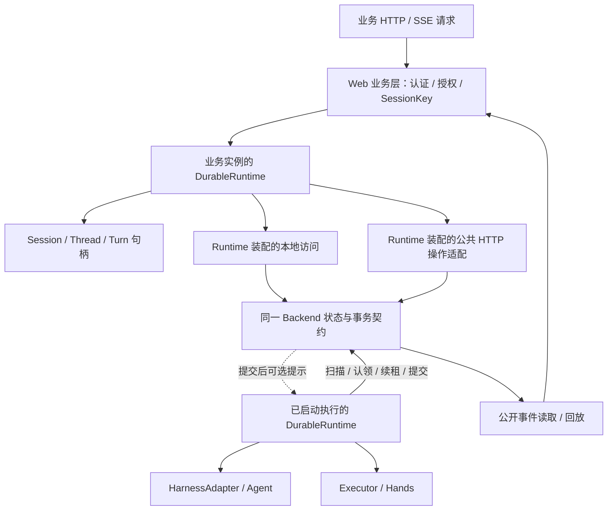

# Durable 用户 API 与自主运行实施计划

[English](user-api-and-runtime-plan.en.md)

日期：2026-11-09。状态：P1–P8 核心内容已实现并验收。框架独立构建、真实 PG/MQ、平台公开 API 与 Brain/Hands 进程恢复均通过；证据见[本轮验收记录](../verification/user-api-verification.md)及第 10 节。

后续设计以[统一执行模型计划](../design/execution-model-plan.md)为准：引入 Thread、以 Turn 表示逻辑任务、Run 表示一次执行、Step 只属于一个 Run，并收敛原生 AgentSession 调度。目标模型尚未整体实现和验收；本文及其验收只描述上一轮版本，其中“不增加 Turn”等结论不再约束后续改造。

本计划依据本轮关于用户 API、Session/Thread/Turn、执行宿主和 Backend 的讨论，以及当前 Java 源码制定。先完善通用 Durable，再适配 Managed Agents。本轮实现 Java / AgentScope；不修改重复的 `agentscope-java/agentscope-service`，不要求兼容开发中的旧入口，不新增强制服务或消息系统。

**硬性约束（2026-11-09 用户明确）：Durable 仍处于开发调研阶段，本次设计和实施完全不考虑兼容性。** API、事件名、字段、协议信封和存储格式都可按新设计直接调整；现有实现只是输入，不是约束。删除被替代实现并同步调用方、schema、示例和测试，不保留旧入口别名、deprecated 转发、双协议/双读写、旧格式读取、数据迁移层、降级回退或滚动升级兼容方案。跨语言对齐针对同一份当前协议，不要求支持历史版本。版本校验用于拒绝不匹配，幂等、fencing 和恢复保证仍必须成立。

## 0. 已确认的设计结论

以下结论作为后续设计与实施的依据，不再保留独立构建 Runtime 等先前方案：

| 议题 | 确认结论 | 落实位置 |
| --- | --- | --- |
| 统一入口 | DurableRuntime 是统一交互、组件装配和生命周期入口，负责 Backend、通知、传输和可选执行组件的接入 | §3.1、P2/P4 |
| 业务操作 | Runtime 直接创建/获取/列举 Session；Session/Thread/Turn 句柄承载具体业务操作，不暴露基础设施装配 | §3.1–3.3、P2/P3 |
| 实例与生命周期 | Runtime 是可复用、线程安全的实例；关闭观察或 Runtime 不等于取消持久任务 | §3.1、§5、A9 |
| 访问与执行 | 构建 Runtime 不启动 Brain。业务 API 进程直接使用 Runtime；执行进程显式 start 后自主认领、执行和恢复，不依赖用户连接 | §4–5、P4/P5、A3/A7 |
| 部署方式 | 本地/单体、独立 Web/API、独立 Brain 使用同一套用户契约；差异由 Runtime 装配表达，HTTP 和 MQ 均不是必选 | §3.1、§4.2、A1/A10 |
| Managed Agents | 它是 Durable 的平台型业务应用，与其他分布式应用使用同一套公开 API、协议和扩展点；依赖方向只能是平台 → Durable | §6、P7/P8、A14 |
| 协议与改造原则 | 用户 API 与 message/event 共同构成跨语言交互规范；先完成通用 Durable，再改造平台，直接替换旧设计，不保留兼容逻辑 | §3.5、§7、A15/A16 |

## 1. 目标与验收主线

Durable 应同时满足两个独立条件：

1. **无用户连接也能运行**：任务受理后，不依赖 HTTP 请求、SSE 连接或用户再次获取 Session；宿主自行发现任务、认领、恢复和推进。实例退出后，可由新的有效宿主接管。
2. **任意业务实例都能访问**：业务 Web 服务根据可信身份和 Session ID，通过统一 API 查找原会话、读取状态、提交操作、观察事件；无需定位原 JVM 或原 Agent 对象。

本地快速体验、直连数据库、独立 Backend 服务和 Brain–Hands 分离应使用相同的用户概念与操作语义。部署差异只体现在装配、存储、传输和执行扩展。

默认继续沿用四个基础设施边界：`DurableRuntime`、`HarnessAdapter`、`SessionBackend`、`Executor`。增加用户操作入口和作用域句柄，不增加第二套任务状态机、调度器或多层公共 SPI。

**跨语言约束：用户操作 API 与已有 message/event 格式共同构成 Durable 的对外交互协议。先定义语言无关的概念、粒度、操作流程、字段和一致性向量，再实现 Java 绑定。** 未来语言和 Harness 可在能力及实现方式上不同，但不能改变相同协议操作的含义。本计划的配套契约为 [对外交互协议](../../protocol/public-interaction-contract.md)。

## 2. 改造前基础与缺口（保留为实施基线）

| 领域 | 当前实现 | 本轮需要补齐 |
| --- | --- | --- |
| 用户入口 | Runtime 提供 submit/signal/cancel 等便捷方法；Backend 同时包含用户命令和 claim/commit 等执行操作 | Runtime 统一装配并直接提供 Session 创建、查询、列举和能力发现；具体任务进入 Session/Thread/Turn 句柄 |
| Session/Thread/Turn | SessionKey、ThreadKey、TurnReceipt、TurnView、Snapshot 已存在 | 明确查找/创建，按主 Thread 或显式 Thread 分页查询任务和公开历史，统一命令回执 |
| 运行身份 | Durable turnId 标识持久任务；原生调用有独立 runId | 将关系固化到 API、协议、文档与测试，避免身份混用 |
| 输入与交互 | 原始 Signal；AgentScope middleware 在 reasoning 边界应用 steer/inject | 类型化用户操作、交互查询与响应，以及原子状态校验 |
| 自驱动 | Runtime 就绪扫描、租约和续租；可选 Wakeups；Worker 独立执行账本 | 完善启动恢复、通知失败、扫描公平性和无连接场景的统一验收 |
| 本地后端 | LocalBackend = SQLite + 文件对象存储 + LocalWakeups | 一次装配即可使用的默认体验；通知缺失时自动轮询 |
| PostgreSQL | PostgresBackend，默认进程内通知，也可注入 Wakeups | 明确跨实例轮询正确性、可选通知与生产参数 |
| HTTP | HttpSessionBackend 远程访问 Backend；现有 Handler 覆盖执行内部操作 | 面向用户的受限操作面，客户端语义与本地一致 |
| 事件 | PublicEvent、Snapshot、游标、SessionEventClient、Runtime.observe、SSE | 无需启动 Brain 的客户端观察，Run 过滤、订阅生命周期和背压边界 |
| checkpoint | codec 已承载 AgentScopeCheckpoints 与状态版本 | 纳入统一用户 API，保持 settled/idle/版本/位置检查 |

当前可复用代码：

- [Runtime](../../durable-runtime/src/main/java/io/agentscope/durable/DurableRuntime.java)、[Backend](../../durable-runtime/src/main/java/io/agentscope/durable/SessionBackend.java)、[事务状态机](../../durable-runtime/src/main/java/io/agentscope/durable/TransactionalSessionBackend.java)。
- [Wakeups](../../durable-runtime/src/main/java/io/agentscope/durable/Wakeups.java)、[提交后通知](../../durable-runtime/src/main/java/io/agentscope/durable/NotifyingSessionBackend.java)、[事件读取](../../durable-runtime/src/main/java/io/agentscope/durable/SessionEventClient.java)。
- [LocalBackend](../../../agentscope-extensions/agentscope-extensions-durable-jdbc/src/main/java/io/agentscope/extensions/durable/jdbc/LocalBackend.java)、[PostgresBackend](../../../agentscope-extensions/agentscope-extensions-durable-jdbc/src/main/java/io/agentscope/extensions/durable/jdbc/PostgresBackend.java)。
- [AgentScopeAdapter](../../durable-adapters/durable-adapter-harness-agentscope/src/main/java/io/agentscope/durable/agentscope/AgentScopeAdapter.java)、[checkpoint 操作](../../durable-adapters/durable-adapter-harness-agentscope/src/main/java/io/agentscope/durable/codec/agentscope/AgentScopeCheckpoints.java)、[协议 schema](../../protocol/schema.json)。

## 3. 用户模型和 API 边界

### 3.1 用户类型与实际入口

下列类型已实现，确切签名与 wire 字段见[对外交互协议](../../protocol/public-interaction-contract.md)及 Java 源码。

| 类型 | 职责 | 生命周期 |
| --- | --- | --- |
| DurableRuntime | 统一装配、业务操作和生命周期入口：创建/获取/列举 Session、能力发现、启动或停止执行宿主 | 线程安全并跨业务请求复用；构建时不自动启动 Brain |
| DurableSession | 会话快照、公开历史、任务队列、提交、会话事件、checkpoint/restore/fork | 轻量身份句柄，不缓存权威状态，不持有 Agent 或 dispatcher |
| DurableTurn | 查询状态、结果、输入调整、交互响应、取消、受控继续、任务事件 | 可按 SessionKey + turnId 重新获取，不绑定最初提交的 Runtime |

不为 `sessions()`、`runs()` 等访问路径再拆独立公共服务接口。内部本地/HTTP 实现可共用命令调用适配，但不新增面向用户的通用消息总线或 Repository/Manager 层。

**装配原则（2026-11-11 用户更新）：DurableRuntime 是统一交互、装配和生命周期入口，直接创建、获取和列举 Session，不再公开 DurableClient。** Runtime 负责接入 Backend、通知、传输及可选执行组件；Session/Thread/Turn 的公共契约不暴露这些基础设施依赖。

Runtime 是普通实例，不是静态类或全局单例；builder 等静态方法只负责构建。顶层业务操作放在 Runtime，具体会话和任务操作放在 Session/Thread/Turn 句柄上。Runtime 同时保留执行生命周期入口，不增加 Client 兼容转发。旧的含混 `run(...)` 查询命名改为明确的 get/status。

构建 Runtime 与启动 Brain 是两个动作。只提供业务 API 的进程也构建 Runtime，但不要求本地 Agent 工厂、模型或 Hands 执行器，不启动 ready 扫描、认领和推理线程。配置执行组件后显式 `start()` 才启动 Brain；无执行配置时调用 `start()` 明确报错。用户操作和事件观察不依赖 Brain 在本进程启动；同一套后端的其他有效 Runtime 可执行任务。Agent 定义仍由标准注册/解析能力选择，不能因 API 进程没有 Agent 工厂而绕过定义校验。

生命周期以物理部署宿主为边界。Brain 只启动 `DurableRuntime`，由 Runtime 打开和关闭受管 Executor；RocketMQ Hands 只启动 `RocketMqWorker`，由 Worker 管理消息循环和内部 `WorkerRuntime`。直接内嵌 Worker 引擎时才由应用启动 `WorkerRuntime`，并通过 `worker.localExecutor()` 把明确的 `LocalWorkerExecutor` 接入 Brain；`WorkerRuntime` 自身不实现 `Executor`。Executor 的业务方法命名为 `startExecution(request)`，与组件的无参 `start()` 分离。构造器不启动线程，Spring Boot 宿主通过 `SmartLifecycle` 等标准容器生命周期调用顶层组件，不在 Controller 或单个请求中启动。

存储装配按物理角色收敛。Brain 的默认入口只接收 `SessionBackend`；嵌入式场景用 `LocalBackend.open(...)` 直接得到完整 Backend，`JdbcRecordStore` 不再反向创建 Backend。Hands 的默认入口只接收一个底层 `RecordStore`：`WorkerRuntime.recordStore(...)` 在内部创建标准事务执行账本，只有替换账本实现时才使用 `executionStore(...)`。Sandbox 生命周期状态可以借用同一个 Hands `RecordStore`，但 `SandboxBindings` 保持独立，因为它也能用于 RocketMQ、HTTP 或直接 Executor，不要求与本地 Worker 绑定。注入的 Store 均由应用按外层到内层的关闭顺序管理。

```java
try (var backend = LocalBackend.open(data.resolve("brain"));
        var handsRecords = JdbcRecordStore.sqlite(data.resolve("hands.db"));
        var sandboxes = SandboxBindings.builder()
                .stateStore(handsRecords)
                .resolver(this::sandboxTarget)
                .build();
        var worker = WorkerRuntime.builder()
                .recordStore(handsRecords)
                .executor("hands", sandboxes.executor(binding, tool))
                .build()) {
    // Brain 只感知 backend；Hands 只感知 handsRecords。
}
```

以下为已实现的 API-only 使用形态：

```java
DurableRuntime runtime = DurableRuntime.builder()
        .backend(backend)
        .build();
DurableSession session = runtime.getSession(sessionKey);
// API 服务复用 runtime；本进程不启动 Brain。
```

嵌入部署在同一个 Runtime 配置 Harness/Executor 后启动执行；分离部署由 Brain 进程启动自己的 Runtime，无需额外公共容器或 Manager 类型。订阅可独立关闭，Runtime.close 关闭其订阅和自有资源、使关联句柄失效，但不取消持久任务或关闭外部借入的组件。Backend 等注入资源继续遵循明确的所有权及关闭顺序。

| 应用角色 | Runtime 的使用方式 | 业务访问与执行 |
| --- | --- | --- |
| 本地或单体应用 | 同一 Runtime 装配访问及执行组件 | Runtime 处理业务，start() 启动 Brain |
| 独立 Web/API 服务 | Runtime 只装配业务访问所需能力 | Runtime 提交、查询、控制和观察；无需本地 Agent/模型/执行器，不启动任务扫描或认领 |
| 独立 Brain 服务 | Runtime 装配执行组件并 start() | 自主发现、认领和恢复任务；不要求同时承载 Web 请求 |
| 独立 Hands 服务 | 装配 Worker 及工具提供方 | 通过标准执行协议处理工具命令和结果；不为工具执行额外引入用户业务 API |

上述访问与执行角色可合并部署。分离时，业务 Runtime 与执行 Runtime 通过同一套后端权威状态和协议关联，无需共享 JVM 对象或请求粘性。业务 Runtime 可先于 Brain 启动；无有效执行宿主时，已受理任务保持可查询并等待执行。

### 3.2 身份和底层 Agent 的关系

```text
SessionKey(namespace, sessionId)
  └─ Thread(main)：默认连续上下文和 FIFO 任务边界
       └─ Durable Turn：一个完整持久逻辑任务
       ├─ 原生调用尝试 A
       ├─ 工具 executionId / 人机交互 interactionId
       └─ 原生调用尝试 B（恢复后仍属同一个 Durable Turn）
```

- turnId 表示持久任务；每次原生 Agent 调用使用独立 runId，供执行记录和诊断使用。
- requestId 表示提交幂等身份；signal/command ID 表示操作幂等身份；messageId、eventId、executionId 不相互替代。
- 原生 AgentRun 是单次进程内调用句柄；DurableTurn 是可跨 Run 恢复的公共任务句柄。
- 原生 AgentSession 是另一种原生 Harness 使用入口。DurableSession 不启动其 dispatcher；受 Durable 管理的会话只有一套任务队列和执行所有权。
- 保留原生 SessionLog、AgentState、权限、middleware 和推理循环；adapter 负责接入及格式映射。

### 3.3 操作矩阵

| 范围 | 操作 | 语义与限制 |
| --- | --- | --- |
| Runtime | createSession / getSession / listSessions | get 不存在时明确返回 NOT_FOUND；不隐式创建。创建需冻结定义且支持幂等；定义选择通过服务端注册/解析能力，不让远程调用者指定任意内部状态版本 |
| Session | snapshot / history / listTurns | 默认读取主 Thread 的历史和 Turn；不暴露私有 checkpoint、推理或执行账本。读取不改变就绪状态 |
| Session | submit(requestId, Input) | 向主 Thread 原子受理并返回 Turn 身份；同键同内容返回原回执，不同内容冲突；排队顺序以事务受理顺序为准 |
| Session | events(cursor) | 会话事件回放与持续观察，可从任意业务实例重连 |
| Turn | status / result / await | 区分未完成、等待、失败、取消和成功；等待超时只停止等待，保留 turnId 供继续查询 |
| Turn | steer / inject / withdraw | 作用于明确的未结束任务；排队任务不静默改写原始输入。应用发生在原生安全边界，撤回只在尚未应用时生效 |
| Turn | pendingInteractions / respond | 类型化审批、用户输入或允许外部提供的工具结果；必须绑定 interactionId，校验种类、状态及重复响应；不能伪造 Worker 账本中的完成结果 |
| Turn | cancel(requestId) | 可取消排队任务或请求停止当前任务；回执只证明受理，终态须等待实际执行协调 |
| Turn | resume | 仅适用于协议明确允许继续的暂停原因；故障接管自动进行，工具等待/审批等待使用各自路径，UNKNOWN 不因 resume 而重做副作用 |
| Turn | events(cursor) | 基于 Session 事件流过滤，仍使用原 Session 游标，不生成另一套序号 |
| Thread | checkpoints / restore / fork | 保持 settled、目标 idle、namespace、定义/状态版本和 expectedPosition 校验；fork 明确创建目标及其身份 |

状态检查与命令提交在权威事务中完成，禁止依赖客户端“先查状态再写”的竞态逻辑。回执区分 accepted/applied/settled，异步操作通过视图或公开事件确认后续结果。过期 Run、撤回与消费竞争、并发取消、终态操作、重复交互响应必须有明确错误或幂等结果。

Session 列表和任务/历史分页必须绑定已授权的 namespace/Session，不能把内部全局发现接口直接作为用户列表。分页游标和过滤不得绕过范围校验。对不支持的交互或 checkpoint 能力返回明确的能力错误，不在客户端猜测或降级为原生调用。

steer 表示对当前任务的补充指令，inject 表示补充上下文；本轮均在下一原生 reasoning 边界应用，不承诺打断当前模型请求、不同优先级或 system-role 提权。P1 明确其内容映射，P3 验证；不要仅把两个 Signal 字符串包装成两个未经定义的方法。

### 3.4 输入、控制和事件协议

- 继续使用 DurableMessages.Input/Message 承载公开内容；支持文本便捷重载及多模态，不要求用户构造 AgentScope Msg。
- 定义类型化用户命令/响应值，覆盖创建、提交、输入调整、交互、取消、恢复等必要操作；复用 RunReceipt/RunView/PublicEvent 等已有类型，避免同义 DTO。
- 通用 Signal 保留为高级扩展通道，普通调用不需要拼接 `input:steer` 或 `interaction:...`。
- 扩展现有 DurableProtocol/schema，分别验证用户操作与内部 Backend/Executor 操作。开发中协议直接同步修改并校验版本；不做双协议兼容。
- ExecutionMessages 继续只承载 Brain–Hands 命令/事件；不把全部用户命令塞入工具 MQ。
- call/stream 最后作为 submit + await/observe 的便捷组合，不绕过入队与持久化。重复订阅不能重复创建 Run，断开观察不等于 cancel；提交回执和超时错误须能找回 runId。
- runtime 保持 Java 17 和现有依赖边界。短命令允许明确的阻塞 I/O；等待可使用 CompletionStage，事件复用回调/订阅，不为统一入口强制引入 Reactor 或 Web 框架。Web 宿主必须把阻塞调用移出事件循环。

### 3.5 协议优先与跨语言对齐

- DurableRuntime/Session/Thread/Turn 是协议的 Java 绑定，不是其他语言需要反向推断的规范源。schema、操作/状态表、流程向量和投影规则放在 protocol/ 中共同维护。
- 每个用户操作必须映射到标准目标和请求、幂等身份、回执/错误、状态变化及预期公开事件。类型化入口不能绕过既有 PublicEvent，也不能另造一套只在 Java 中可见的消息历史。
- 审查现有 Input/Message/Content、PublicEvent/Snapshot 及核心事件族，复用合理部分，直接替换不合理部分，补齐命令关联和公开用户输入历史；不为旧格式保留双实现。新规范中每条逻辑消息的粒度、delta/完成替代、attempt/revision、游标和去重必须在各语言中一致。
- 参考 Claude Managed Agents 的双向交互思路，但以 Durable 已有格式与保证为基线；外部参考不是 wire 兼容目标。对照和差异见配套协议规范，不把其瞬时预览或 session/workflow 粒度直接套用到 Durable。
- 本地、HTTP 和未来 SDK 共享同一操作语义。Future/Promise、回调/迭代器、命名风格可不同；不支持的 Harness 能力明确返回错误，不悄悄改变语义。
- 协议版本、公开 schemaVersion、原生状态版本和私有存储格式分别标识并校验，只支持当前选定契约，不做历史版本协商或转换。未知字段/事件、可选扩展、错误和不确定写入的重试规则形成显式规范。
- P1 交付操作/消息/事件映射表及语言无关流程样例；P7 交付共用向量及 Java 一致性测试。复用已存在的跨语言摘要/投影 fixture，其他语言实现留待后续，不提前声称它们已通过新协议验收。

## 4. 通用自驱动机制：持久状态 + 可选提示 + 扫描兜底

### 4.1 所有 Backend 共用的执行规则

1. 提交命令、checkpoint、工具意图、信号及消费结果，先完成权威事务。
2. 提交成功后可发送 Wakeups 提示；提示失败不反转成功回执。提交与提示之间进程退出，由持久就绪扫描补偿。
3. 宿主启动立即扫描；运行中按可配置间隔、容量和退避扫描 ready 工作，同时接受可选唤醒。
4. 候选任务必须通过 Backend 的原子认领和 fencing 才能执行；MQ ACK 或本地回调不授予执行权。
5. 持久化等待条件、定时唤醒和租约到期均能被扫描发现，不能只依赖内存 timer。
6. 结果、信号或取消变更使任务重新可推进。租约失效后新实例接回同一任务及原外部操作；不承诺不可查询、不可幂等工具的 exactly-once。

保留周期扫描作为正确性兜底。通知只改善延迟；无需为提示再引入持久 outbox。工具命令和结果的 inbox/outbox 则继续保留，它们属于可靠交付协议。

检查 ready 分页/筛选是否会饿死较后的 Session，启动扫描、容量限制、退避和通知风暴是否会形成忙循环；只有发现真实缺口才扩展现有契约。

### 4.2 Backend / 部署矩阵

| 部署方式 | 权威状态 | 变化发现 | 本轮默认与限制 |
| --- | --- | --- | --- |
| 本地一个 JVM | SQLite + 文件对象存储 | LocalWakeups + 定期扫描 | 默认快捷装配；不需 HTTP、MQ、Redis。相同目录重启恢复，不运行时不会执行 |
| 无通知自定义 Backend | 具备事务/认领契约的持久存储 | Wakeups.none + 扫描 | 自动退化为轮询；事件订阅也轮询持久日志，无需模拟 Broker |
| 同机多个本地进程 | 同一 SQLite/对象目录，限受支持文件系统和部署条件 | 各进程扫描；本地提示只覆盖本进程同一实例 | 用于开发验证，不宣称跨主机生产 HA；仅磁盘可达时才可恢复 |
| PostgreSQL 多实例直连 | 共享数据库 + 可选对象存储 | 默认本地提示 + 跨实例扫描；可加共享 Wakeups | 不带 MQ 也必须正确接管。生产池、初始化和权限由宿主装配 |
| 独立 Backend 服务 | 服务端持久状态 | 服务端本地/共享提示；远程 Runtime 经 Backend 扫描 | HttpSessionBackend 保持内部适配；公共客户端无需知道它。远程推送非正确性前提 |
| RocketMQ 扩展部署 | Backend / Worker 账本 | 可选 RocketMqWakeups；工具命令/控制/结果 MQ | 两类通道语义分开；同消费组只唤醒某个实例时，其他观察者仍可轮询 |

本轮不新建 PostgreSQL LISTEN/NOTIFY、Redis Pub/Sub、CDC 等适配，也不抽象统一的强制 EventBus。后续可实现 Wakeups 扩展，但应遵守同一提示契约及故障测试。

### 4.3 本地快速体验

提供最短可运行装配：选目录、提供 Agent 工厂并启动 Runtime。封装实际存储与本地提示接线，不另加一套内存状态机。

- 复用当前 LocalBackend，而非写一个模拟 MQ。
- Runtime.start 是应用启动动作，不在每次 Web 请求中调用。
- 用户只做 get/observe 时不自动启动 Brain；便利装配必须明确是否包含执行宿主。
- 默认扫描间隔沿用现有合理值；暴露少量 poll interval、并发和关闭配置，不给每种部署增加一组业务 API。
- 共享同一装配对象可立即收到进程内提示；同目录的不同对象/进程仍靠扫描补偿。

## 5. Web 请求、SSE 与生命周期



- Web 层从可信业务身份得到 namespace，并执行应用授权；可复用 `sessionId` 与业务会话的映射。Durable 校验身份范围、对象存在性和状态转换，客户端句柄本身不是授权凭据。
- getSession 不创建、不认领、不恢复执行；查找和请求语义一致，不依赖会话粘性或上一台机器。
- 公共 HTTP 处理器只允许用户操作；claim/renew/frame/commit、执行账本写入等留在内部面。公共同源和内部调用可共用代码，不能因复用而公开内部操作。
- SSE 使用 PublicEvent 与原有游标；先一致快照后增量，或按 cursor 重放。游标过期沿用显式快照重新同步机制，不能伪装成完整历史。
- Run 过滤必须推进底层 Session 游标，即使某页没有匹配事件；保留回调失败重投及至少一次语义。
- 通知可合并、丢失或重复；订阅重连、慢消费者、关闭均有有界资源策略。需要断开时让用户依游标续读，不无限缓存。
- 图中业务 Runtime 和执行 Runtime 可以是同一个实例，也可以在不同进程；只有已启动执行的一侧扫描和认领任务。
- Runtime 管理的订阅执行器与 Agent 执行容量分离；不得为每次读取或每个轻量句柄新建调度线程。未启动 Brain 时也可以按需观察事件。
- 关闭订阅只释放该观察者；Runtime.close 停止本实例执行和观察并关闭自有资源，不取消持久任务、不关闭借用的 Backend。Runtime 排空不改写任务终态；无执行配置时也必须能关闭 API 访问资源。

## 6. 模块与 Managed Agents 边界

| 位置 | 落地职责 |
| --- | --- |
| java/runtime | 用户契约和轻量句柄、命令/查询值、事务状态校验、独立观察、调度兜底验证 |
| java/adapter-agentscope | 输入/交互映射、原生权限及安全边界、Durable Turn 与原生 AgentRun 的对应 |
| java/codec-agentscope | 保持 backend-only 的 checkpoint/restore/fork 能力；不回依赖 adapter |
| java/worker | 复用执行账本和交付；只在公共操作链路需要时补验证，不重写 Worker |
| durable-jdbc | 本地/PG 默认装配及无通知模式验收 |
| durable-http | 同一用户 API 的远程客户端、受限公共处理器、SSE；内部 HttpSessionBackend 继续服务执行组件 |
| durable-rocketmq | 复用可选 Wakeups 与工具队列；验证消息丢失/重复时的正确性 |
| Managed Agents | 最后接入统一用户 API；保留业务鉴权、配置、配额、资源归属和平台路由 |

不新增 Maven 模块；用户入口先放 runtime，具体传输仍放 extensions。普通用户不必了解 RecordStore、ExecutionStore、内部 Signal key 或 NativeCheckpointCodec。高级扩展仍可访问基础设施接口。

通用用户入口不直接导入 AgentScope codec。宿主通过现有 NativeCheckpointCodec 边界及对应恢复实现装配 Harness 专属能力；先审查现有接口能否复用，再做必要的最小扩展，保持 runtime → 抽象、codec → runtime 的依赖方向。

Managed Agents 是 Durable 的平台型业务应用，与其他分布式 Agent 应用使用同一套公开 API、协议和扩展点。Service/SSE 路由直接使用本进程 Runtime；Brain 启动执行 Runtime，Hands 保留 Worker。平台自行承担鉴权、定义管理、资源和配额治理，Durable 不要求某个 Managed 服务存在。禁止平台自建第二套 Session/Thread/Turn 状态或通知消费者。Durable 完成独立验收前不把平台改造混入框架实现；框架构建测试不得依赖 Managed 源码或制品。

## 7. 分阶段执行计划

P1–P8 已完成。下表保留实施范围和验收要求，实际结果见第 10 节。

| 阶段 | 工作与交付 | 必须通过的检查 |
| --- | --- | --- |
| P1 契约冻结 | 先冻结语言无关的操作/消息/事件映射、粒度、身份、状态转换、错误、版本/能力及流程样例，再确定 Java 最小签名并同步 schema | 本地/远程同一用例 API 样稿；操作回执和事件形成闭环；合法状态及错误表完整；无新增 Turn 状态机 |
| P2 基础用户 API | Runtime 统一装配与顶层业务入口；Session/Thread/Turn；创建/获取、提交、查询、任务与历史分页 | 无本地执行组件的 Runtime 可提交/查询；幂等冲突、跨 namespace、终态与排队任务测试 |
| P3 控制与 AgentScope | steer/inject/withdraw、交互响应、cancel、受控继续；统一 checkpoint/restore/fork | 原子状态竞争、重复审批、撤回与应用竞争、原生结果恢复；底层 Agent 不被双重调度 |
| P4 自驱动与部署装配 | Local/none/PG/远程 Backend；启动扫描、定时等待、认领、接管、退避和公平性 | 无请求恢复、提示丢失/异常、进程退出、租约 fencing；无 MQ 的本地与多实例链路通过 |
| P5 用户事件与 HTTP | Runtime 装配本地/远程访问及无需 Brain 的事件/await；Run 过滤；公共 HTTP 与内部操作分界 | SSE 重连、快照竞态、过期游标、慢消费者、权限、观察不执行；公共面拒绝内部操作 |
| P6 易用入口与文档 | call/stream 便捷组合、最小本地/HTTP/分离示例、EN/ZH 文档；删除被替代入口与兼容分支 | 示例直接编译运行；重复订阅不重复提交；断开不取消；依赖、API 及无兼容逻辑审计 |
| P7 框架独立验收 | 整个 Durable Java 构建、Backend 合约矩阵、共用 schema/流程/投影向量、实际 PG/MQ/跨 JVM 故障测试 | 完成下表及协议规范的验收；Java 本地/HTTP 消费同一向量，受影响的现有跨语言 fixture 通过；隔离依赖审计；不以 fake 替代实际部署 |
| P8 平台接入 | 独立 Managed Agents 改用统一 Runtime/Session/Thread/Turn 和用户事件入口，删除被替代适配 | 平台 Java 构建；跨业务实例 SSE/操作；Brain/Hands 重启；原外部操作不重复 |

P2/P3 以现有 Backend 状态机为权威，不通过 facade 中的非原子预检查补能力。P4 只修实际缺口。P5 确保只承载业务访问、未启动 Brain 的 Runtime 也能通过 Runtime 观察事件。P7 完成后再开始 P8。

## 8. 验收用例

| 编号 | 场景 | 通过条件 |
| --- | --- | --- |
| A1 | 本地零外部依赖 | Runtime 统一装配并直接创建、排队、交互、观察和查询，start 后执行；只配置目录及 Agent 工厂 |
| A2 | 无提示 | Wakeups.none 或提交后通知失败，任务和事件仍在扫描间隔内推进 |
| A3 | 无连接恢复 | 提交后断开所有用户连接并停止 Brain；新实例启动，无用户请求也能接管 |
| A4 | 多实例认领 | 竞争、旧实例恢复写入、重复通知均不越过租约 fencing；不重复已确认的工具效果 |
| A5 | 会话队列 | 同会话 FIFO，当前 WAITING 不被后续 turn 越过，不同会话并发；排队取消不影响当前任务 |
| A6 | 命令竞争 | stale run/interaction、终态、重复内容冲突、withdraw/apply 竞争有确定结果 |
| A7 | 任意业务实例 | A 提交、B 查询/取消/响应、C SSE；各自使用 Runtime，无需粘性、原进程对象或本地 Brain 配置 |
| A8 | 事件连续性 | 游标回放、快照衔接、过期重同步、Run 过滤和回调重投不丢失已承诺事件 |
| A9 | 生命周期 | 同一 Runtime 跨请求复用；未启动 Brain 时可观察且无认领；关闭 SSE/Runtime 不取消任务，Runtime 关闭后句柄失效；借入资源和外部 Sandbox 不被误关闭/销毁 |
| A10 | API 一致性 | 同一组用户契约测试在本地直连与公共 HTTP 上通过；错误、幂等及回执语义一致 |
| A11 | checkpoint | backend-only restore/fork，原生身份和私有资源正确；未 settled/目标忙/版本不符拒绝 |
| A12 | 原生与公开边界 | 原生权限和推理行为保留；无双 dispatcher；PublicEvent 不泄漏私有状态；公共 HTTP 不允许内部操作 |
| A13 | 外部执行不确定性 | Hands 丢回包/重启可查询原操作；不能确定时保留 UNKNOWN，不用重新 start 制造成功 |
| A14 | 独立开源交付 | Durable 无 Managed 依赖；本地例子和接口文档可独立使用；平台只通过发布形态的二进制依赖接入 |
| A15 | 操作—消息—事件闭环 | submit/steer/respond/cancel 等使用相同关联身份，回执、公开用户输入历史、状态与事件一致；查询不认领任务 |
| A16 | 语言无关契约 | 标准 schema 与流程/投影向量覆盖合法和非法输入、数值、重复、恢复和不支持能力；Java 本地/HTTP 结果符合相同语义，未来语言可直接消费同一 fixture |

检查命令以 POM 为准：

```sh
# Durable Java 及现有扩展的完整检查，不进入重复 Service
mvn -B -ntp -T1 -f agentscope-durable/pom.xml -Pdurable-standalone spotless:check clean verify
python3 agentscope-durable/scripts/verify-independent.py --java-only
bash .github/scripts/check-shade-and-bom-sync.sh

# 文档，在 docs/ 执行
npm test
npm run validate
npm run broken-links

# P8，在独立 Managed Agents 仓库根执行
mvn -B -ntp -T1 spotless:check clean verify
```

实际 JDK 必须为 17；跨进程/PG/MQ 验证使用本地测试基础设施与离线模型，不依赖生产凭据。影响 Core/Harness 时增加对应模块检查；全仓库检查受重复 Service 等既有问题阻碍时，记录具体原因和覆盖范围。构建日志、测试统计和未覆盖项目按阶段记录，不以“已实现”替代验收。

## 9. 范围外与后续评审

本轮不新增语言实现、不实现平台身份/计费/部署、不要求 MQ/HTTP 成为必选、不新增数据库通知提供方、不设计另一套工作流引擎。

后续评审依据第 0 节已确认结论，集中落实以下事项：

1. 已明确 Runtime 是唯一装配、业务操作和生命周期入口，不公开 DurableClient；P1 冻结 DurableSession / DurableThread / DurableTurn 句柄和配置签名，验证无本地 Brain 的 API 部署。
2. 一个 Durable Turn 对应一个持久逻辑任务，可包含多个原生调用 Run。
3. 所有 Backend 必须支持扫描恢复；通知可选；本地复用真实持久化与进程内提示。
4. 优先完成通用 Runtime/Session/Thread/Turn 和协议，再做 HTTP/便捷调用，最后接入 Managed Agents。
5. 用户 API 与 message/event 作为同一对外交互协议评审，先规范后 Java 绑定；按统一新设计直接替换旧格式和入口，保持恢复正确性，不承担兼容历史实现的工作。

核心实现已落地，具体检查结果和平台接入状态记录在第 10 节。不提交、不推送、不部署。

## 10. 实施记录（2026-11-09）

| 阶段 | 状态与证据 |
| --- | --- |
| P1 | 当前 userRequest/controlCommand/page/receipt schema；公开输入关联字段；user-workflows.json 与投影向量；中英规范已同步 |
| P2 | Runtime 作为唯一装配和顶层业务入口；Session/Thread/Turn 身份句柄；事务分页查询与公开历史；删除旧业务入口 |
| P3 | 类型化原子控制、queued cancel、guarded resume、交互防重复/防伪造；AgentScope 原生 steer/inject/withdraw/审批测试；Runtime codec 绑定与公开 restore/fork |
| P4 | 复用同一权威 Backend 和 ready/lease/fencing；无提示、无用户请求、多实例及跨 JVM 恢复测试 |
| P5 | 公共用户操作 Handler 与内部 Backend handler 分离；SessionEventHandler 通过 Runtime；本地/HTTP 共用 11 项 UserApiContract，另测权限和丢成功响应 |
| P6 | call=submit+await，stream=submit+observe；Embedded/HttpServer/QueuedHands/QueuedSandboxHands 示例及中英指南 |
| P7 | 独立缓存源码构建/全部保留模块/依赖审计已通过；SQLite 与实际 PostgreSQL 的直连/HTTP 契约；真实 RocketMQ 5.3.2 Brain SIGKILL 接管及 Hands 重启后原 Run/执行身份保留；12 模块构建与 224 项测试全部通过，详见本轮验收记录 |
| P8 | Agent Service 改用 API-only Runtime/Session/Thread/Turn；SDK/控制台/Go 同步类型化交互与游标；9 模块、71 项 Java 测试通过；真实三进程故障夹具验证同一 Turn 以新 Run 恢复且 shell 副作用一次；平台保留业务授权、定义、配额、资源与路由 |

公共 API 不新增独立状态机。控制 requestId、signalId、公开输入 requestId 相同；respond 使用
Interaction.id 并记录 interactionId。普通查询不需要 Agent 工厂；API-only 的 checkpoint 操作只依赖 codec。
新 fork 建立独立公开时间线，原生历史作为私有恢复状态继承。TypeScript/Pi 仅同步受影响的共享
schema/投影向量，不声称完成另一语言的用户 API。

P8 实际目录为 `/Users/ken/agentcore/agentcore-managed-agents`（`durable-ma`）；
平台证据见其 `managed-agents/docs/durable-verification.md` 的 2026-11-09 记录。
本轮成功 Run 为 `run_95178320-bd72-4e23-b978-21dabc774b27`，18 条初始公开事件，
两次主模型调用、一次辅助调用、一次实际 shell 副作用。两处检出均未提交、推送或部署。
