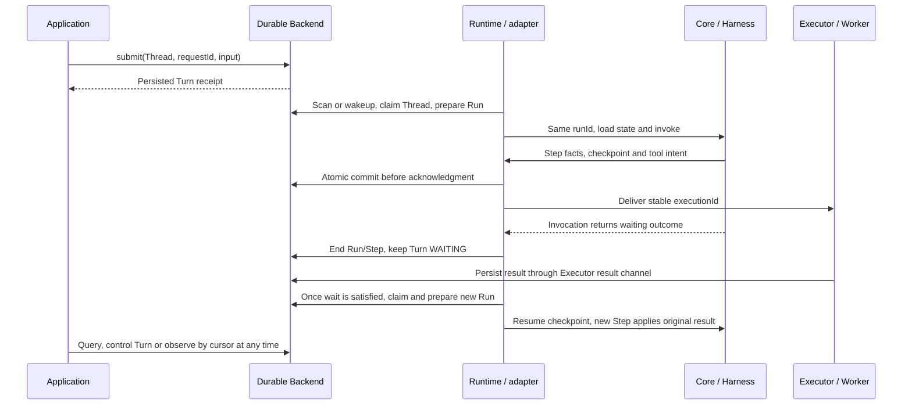

# Unified AgentScope and Durable execution model: implementation plan

Date: 2026-11-09; development audit: 2026-11-10. Status: **Durable development for this iteration is complete; independent integration acceptance remains pending**. Section 11.2 records current delivery; the [progress ledger](../verification/execution-model-progress.en.md) maps requirements to implementation and actual tests. P7 Managed Agents is outside this iteration. Development completion is not production acceptance.

**Latest execution agreement, 2026-11-10: this iteration completes the Durable framework only. P7 Managed Agents adaptation moves to a later iteration; do not modify the platform repository. Prioritize implementation, retaining affected-module compilation, formatting and focused behavior/protocol tests. Real MQ, multi-process faults, full backend combinations and repeated full-repository regression move to the [independent acceptance backlog](../verification/execution-model-acceptance.en.md). This supersedes the earlier full-P6 prerequisite and current-iteration P7 scheduling below. A1–A18 correctness objectives remain; record development completion separately from independent acceptance. Deferred checks are not passes.**

This plan records the agreed Session / Thread / Turn / Run / Step model and assigns responsibilities to ReActAgent, HarnessAgent and Durable. It supersedes the future design decisions in the previous user API plan (`../archive/user-api-and-runtime-plan.en.md`, retained in Git history) that excluded Turn, assigned different meanings to the two Run layers, and retained a separate AgentSession scheduler. That implementation and its [verification record](../verification/user-api-verification.en.md) describe the earlier version; they are not evidence that this plan is complete.

The current [public interaction contract](../../protocol/public-interaction-contract.en.md) changes alongside the implementation. A documented contract is not evidence of verified implementation; section 11.2 records the current source and verification gaps. Replace the contract and its consumers together, without presenting planned capabilities as available today.

This plan separates target design from current groundwork. Subsequent implementation and actual test evidence are recorded in the progress ledger; planning review alone does not establish readiness. The initial planning review changed design only; subsequent implementation and actual checks are recorded in the progress ledger. Start with the decisions in section 0, then review ownership in section 4, execution order in section 11 and effort in section 13.

## 0. Review decisions and implementation boundaries

| Layer | Responsibilities retained in the target | What it supplies to the next layer |
| --- | --- | --- |
| ReActAgent / Core | The sole model/tool loop; one AgentRun; Steps within that Run; native state, journal, recovery phases and invocation outcome | Independent call/stream, one invocation-scoped host cooperation entry, execution facts and recovery state suitable for atomic commit |
| HarnessAgent | Compose Workspace, memory, compaction, skills, permissions and subagents on native execution | Recoverable capabilities and explicit resource scopes; middleware extensions without another persistent task scheduler |
| Durable | Session/Thread/Turn resources; durable admission, FIFO, controls, claiming and recovery; persisted Run/Step views; public messages/events; Brain–Hands protocol | The unified Runtime business API and optional local/production Backend, Executor and Worker extensions |
| Managed Agents | Platform authorization, tenancy, definition resolution, resource provisioning, gateways and product interfaces | Consumers of the same public Durable contract; retain dependency boundaries now and adapt the platform in a later iteration |

The main decisions are:

1. **Session → Thread → Turn → Run → Step.** Thread holds continuous context and Turn represents the logical task. Each new actual invocation creates a new Run; every Step belongs to one Run. Recovery references connect Runs while tool executionId remains stable.
2. **Retain AgentRun as an invocation handle; remove AgentSession's duplicate background scheduler.** The Core handle and Durable RunView describe the same execution. Business tasks are controlled through DurableTurn. Ordinary continuous conversations reuse context through Thread identity and native state; a single call requires no prior persistent Session/Turn creation.
3. **Runtime assembles components and exposes top-level business operations.** Runtime creates, gets and lists Sessions directly; API-only never starts Brain. Pause/cancel target Turn, Run/Step are read-only, and SSE disconnect does not change the task.
4. **Replace unreleased designs directly.** Keep no old AgentSession/DurableRun facade, task protocol or migration branch. Move useful behavior and tests to the correct layer. Core/Harness must not depend on Durable, and Durable must not depend on Managed Agents.

This planning review delivers the target design, per-layer change inventory, P0–P7 execution order and A1–A18 acceptance gates. Some implementation groundwork already exists in the workspace. This iteration continues framework Java, protocol and consumers; P7 remains a future platform architecture reference. Estimate the complete design separately from work remaining on the current code to avoid counting completed migrations again.

The original planning estimate treated this as a medium-to-large cross-module refactor. These historical estimates do not describe remaining development time. The complete framework design was approximately **30–45 person-days**; after allowing for current groundwork and the migrated chat example, the preliminary remaining estimate is **17–30 person-days**. Later platform adaptation provisionally adds **5–8 person-days**. Platform sources were not re-audited in this review; reassess them once the framework contract is fixed. Estimates include testing and contingency, not promised delivery dates. Sections 11–13 detail work packages, assumptions and outstanding gaps.

### 0.1 Mapping the five concepts to Java types and modules

Consistent concepts do not require identically named user objects at every layer. Core needs execution identity; Durable needs persistent resources that can be queried and controlled across processes. The adapter connects them.

| Concept | Representation in Core / Harness | Representation in Durable | User operations |
| --- | --- | --- | --- |
| Session | Business session identity in RuntimeContext, without a background queue | SessionSpec/View and DurableSession, managing the session and Thread directory | Durable provides creation, lookup, closure and session events |
| Thread | ThreadKey and native state/journal; Harness scopes private resources accordingly | ThreadBinding and DurableThread, managing continuous context, FIFO, checkpoints and execution ownership | Durable provides persistent Thread operations; direct calls can reuse native Thread identity |
| Turn | Correlation identity in a managed invocation; Core neither admits nor schedules persistent tasks | DurableTurn and TurnView, authoritative for persistent tasks and controls | submit creates a Turn; steer, inject, pause, resume, respond and cancel target it |
| Run | AgentRun, RunControl and RunOutcome, controlling and describing one in-process invocation | RunView, persisting execution facts, host and recovery origin for the same runId | Native callers control AgentRun; Durable users query Runs rather than controlling a task through a historical Run |
| Step | Actual loop facts and recovery phase, without a separate AgentStep scheduling handle | StepView, linking model requests, tools and the source Step | Read-only diagnosis, usage and recovery links; no submit/pause/cancel |

`HarnessAgent` remains the capability-composition entry and `DurableRuntime` the assembly/lifecycle entry for persistent execution. Do not merge them or add mutual dependencies. Ordinary callers use Agent call/stream; applications needing queues, background recovery and durable controls use Durable. Removing AgentSession removes duplicate task scheduling, while retaining continuous context, state persistence, permissions and native recovery at the appropriate layer.

## 1. Objectives, scope and constraints

Durable is a general-purpose open-source framework for long-running Agent tasks, autonomous scheduling, recovery, uniform interaction and Brain–Hands separation. Managed Agents is a platform application. Dependencies must flow from the platform to Durable; framework builds, tests and operation must not require platform code or services.

The implementation scope is Java / AgentScope: Core, Harness, Durable runtime / adapter / codec / worker, every existing Durable Java backend extension, affected state-store adapters, Java examples, protocols and bilingual documentation. Protocol concepts remain language-neutral, but implementing another language Runtime is not an acceptance condition. Existing experimental implementations in other languages must not be advertised as conforming to the new contract, and do not justify retaining an old protocol branch.

Do not update consumers in `/Users/ken/agentcore/agentcore-managed-agents` this iteration; P7 retains future architecture boundaries only. Continue to exclude this repository's duplicate `agentscope-service`: it is neither a target consumer nor a framework dependency or verification prerequisite.

AgentSession, AgentRun and the Durable user APIs are unreleased. Replace superseded APIs, events and storage layouts directly. Do not add aliases, deprecated forwarding, dual reads/writes, old-format readers, data migration tools, version negotiation or rolling-upgrade compatibility. Reject old development data explicitly and use fresh temporary stores in tests; never automatically erase existing user databases. Retain current-contract validation, idempotency, fencing, truthful UNKNOWN outcomes and side-effect reconciliation. These are correctness guarantees, not compatibility burdens.

The overall division is: **Core owns one invocation, Harness composes capabilities, and Durable owns continuing tasks and recovery.** Five concepts do not require five schedulers or five sets of user controls. Most applications work with Session, its primary Thread and Turn; Run/Step expose execution history, diagnosis and recovery associations. Direct Agent calls remain independent and do not require a DurableRuntime.

## 2. Agreed conceptual model

```text
Session: an ongoing business conversation
└─ Thread: one continuing Agent context
   └─ Turn: one admitted logical task
      └─ Run: one actual Agent invocation
         └─ Step: one round of processing within that invocation
```

| Concept | Ownership and responsibility | Identity during recovery |
| --- | --- | --- |
| Session | Identity, metadata, Thread directory, session-wide public events and lifecycle; not static configuration | sessionId stays unchanged |
| Thread | Agent binding, working state, context history, checkpoints, Turn FIFO and execution ownership | threadId stays unchanged |
| Turn | Initial input, controls, interactions, logical result, task status and budgets | turnId stays unchanged |
| Run | An actual invocation by a host, with start/end facts, recovery source and outcome | A new invocation gets a new runId |
| Step | A model decision and its tool processing within a Run; a recovery Step may execute only the unfinished phase | A new Run gets new stepIds; continuation may reference an earlier Step |

A Run may contain multiple Steps. Each Step belongs to **exactly one Run**. Do not add a Step scheduler, lease, retry queue or public submit/cancel API.

A normal Step includes one logical model decision and zero or more tool calls it produces. Parallel calls from the same decision belong to that Step; a final answer without tools also forms a Step. Model transport retries remain in the Step but retain separate physical request records. A suspended Step ends as STOPPED with a reason. Recovery creates another Step, which may apply the original tool results without calling the model again.

A Step is an execution record, not an arbitrarily replayable transaction or a synonym for checkpoint. It may produce several checkpoints. A tool's business error need not fail the Step or Turn: once the error result is applied, the next Step may decide what to do.

### 2.1 Identities and scopes

| Identity | Meaning and constraints |
| --- | --- |
| SessionKey(namespace, sessionId) | Session lookup and authorization scope |
| ThreadKey(SessionKey, threadId) | Queue, working-state and execution-ownership scope; the default primary Thread is an explicit persisted object |
| turnId | A logical task within a Thread; operations validate the complete ancestry |
| runId / stepId | Invocation and processing records; not task or tool-retry idempotency keys |
| requestId | Submission/control identity; digest includes the target Thread/Turn, operation and payload |
| executionId / interactionId | External execution/interaction identities stable across Runs; results address the original operation |
| messageId / eventId | Logical message and fact identities, separate from the above |
| epoch | Thread ownership fencing generation; not runId and not incremented by heartbeat |

Deduplicate submissions and controls by Session + requestId, with the target Thread/Turn in the digest. Identical retries return the original receipt; changes of target or content conflict. Primary-Thread convenience methods normalize to the same request semantics as explicit Thread operations.

The host allocates and persists a Run immediately before a top-level Agent invocation, and Core adopts that same runId. A stable invocation-start key retrieves the original receipt after a lost response rather than allocating again. A prepared record whose host dies before entering the invocation is marked not-started or lost; it does not imply a model executed. MQ redelivery, ready scans, tool queries and lease renewals do not create Runs. An owner may reconcile existing external operations before invoking; a second native invocation must get a separate Run record.

### 2.2 Configuration is not a Session

Split the responsibilities previously combined in `SessionDefinition` into the following model:

- `SessionSpec / SessionView` represent creation parameters and the persisted session view, including its primary Thread, lifecycle and business metadata.
- `ThreadBinding` pins the Harness, Agent definition reference/version and state version for a Thread. Creation selects a registered definition name; the server resolves and pins it. Reading an existing object does not instantiate an Agent.
- Model, tool, permission and resource configuration stays with factories and host resolvers. Do not copy full configuration or credentials into Session/Thread DTOs. A pinned reference must resolve consistently; storing a version string alone does not freeze the configuration.

The first version does not upgrade an active Thread's definition in place. Configuration changes create a new Thread. Reject incompatible private checkpoint versions.

### 2.3 Practical value and complexity limits of Run and Step

A Run answers which host performed a particular invocation of a task and why it stopped. When a Turn survives pause, restart or takeover, separate Runs distinguish actual invocations and record recovery ancestry, loss, duration and invocation-level cancellation. Its runId matches Core AgentRun, avoiding unrelated Run identities at different layers. A Run does not replace the Thread lease, and stopping an old Run does not cancel a recovering Turn.

A Step explains a round's decision, tools and current phase. It correlates model requests, parallel tools, result application and checkpoints for latency analysis, fault diagnosis and recovery inspection, and supports aggregating actual request usage. A Step does not itself guarantee exactly-once side effects: correctness depends on stable executionId, execution records and atomic commits. Budgets accumulate logical progress across the Turn rather than counting Steps in the current Run.

For example, a request to look up an order and summarize it creates one Turn T1:

| Point | Execution record | Task and recovery meaning |
| --- | --- | --- |
| First invocation | Step 1 of R1 decides to look up the order and atomically commits tool intent E1 and a checkpoint | T1 is unfinished; E1 has a separate stable execution identity |
| Brain process exits | It cannot commit an end record; takeover marks R1 and its unfinished Step LOST | Keep T1; this does not prove E1 never ran or authorize issuing it again |
| E1 result arrives | Persist the result and make the original Thread eligible for scheduling | Receiving a result alone creates no Run; progress does not require an online client |
| New Brain invokes | Create R2; its Step 1 applies E1 directly and references the source Step in R1 | New stepId; do not ask the model to generate the same tool request again |
| Summary produced | Step 2 of R2 reasons and outputs; settle T1 successfully once settlement conditions hold | The user gets one task result; diagnostics show two actual invocations |

Both Runs can have a Step with index 1, but their stepIds differ: a Step has no lifecycle spanning Runs. Without Run records, the original host's invocation and its replacement are hard to distinguish. Without Steps, diagnostics cannot readily identify which reasoning or tool round was slow, failed or needs continuation. The user still waits for or controls the original Turn without managing these records.

### 2.4 Execution boundaries that need explicit treatment

| Scenario | Turn / Run / Step behavior | What must not be inferred |
| --- | --- | --- |
| The model immediately produces a final answer | One Turn, one Run and one Step; finalization is a subsequent phase of that Step | No tools does not mean no Step |
| One model decision produces multiple parallel tools | One Step in the same Run links all tool calls; each external operation has its own executionId | Tool count is not Step count |
| The current model request has a transport retry | Keep Run and Step; record actual request attempts, durations and available usage separately | Do not create a Turn or pretend there was only one request |
| An invocation awaits a model or tool asynchronously without ending | Keep the current Run and Step phase; apply the result within that invocation | Asynchronous waiting, thread switches and MQ arrival alone create no new Run/Step |
| A tool is still running but the current Agent invocation has returned waiting | Stop the original Run/Step; after result persistence and wait satisfaction, start a new Run/Step referencing the original execution | Waiting or receiving a result alone creates no Run; executionId stays unchanged |
| Resume an explicit pause or take over after host exit | Same Turn, new Run and Step; continue the committed reasoning/acting/finalization phase | Do not reopen the old Step, reset the task budget or promise arbitrary Java-stack replay |
| The invocation ended but steer/inject was admitted before task completion | The input belongs to the original Turn; create a new Run if another invocation is needed | Do not lose admitted input or silently turn it into a new Turn |
| The user submits another request after a Turn completes | Create a new Turn in the same Thread, then a new Run/Step when execution starts | Do not fold multiple user tasks into one never-ending Run |

These boundaries become P0 protocol vectors and P1/P3 behavior tests. Durable owns persisted Run/Step queries; Core produces the corresponding execution facts. Default business examples use Session, the primary Thread and Turn, with diagnostic examples expanding Run/Step. Users should not manually assemble five layers for each request.

### 2.5 Minimum Run / Step record contract

Add data that answers execution and recovery questions without another control plane. The table defines target field semantics; settle Java records and JSON schemas together in P0. Extend the existing RunView/StepView rather than adding synonymous objects.

| Record | Minimum facts | Fact production and persistence |
| --- | --- | --- |
| Run | Owning Thread/Turn, runId, start deduplication identity, owner/epoch, previous Run, prepared/started/ended timestamps, status, outcome and reason | Durable prepares and owns execution; Core reports invocation start/end; adapter maps facts; takeover confirms LOST |
| Step | runId/stepId, Run-local index, current phase, status/reason, start/end timestamps and optional resumedFromStepId | Core produces facts at real boundaries; adapter commits them with the checkpoint; Durable offers read-only queries |
| Model request fact | Owning Run/Step, logical reasoning position, physical request identity/attempt, duration, known usage and its completeness | Core records actual requests; adapter maps them consistently; missing usage must not be represented as a known zero |
| Tool association | callId, originating Run/Step, optional external executionId, and result acceptance/application ownership | Core records native calls; Executor/Worker records external execution; adapter correlates them without rewriting origin during recovery |
| Checkpoint association | Owning Thread, commit position, producing Run/Step, next phase and input/result application receipts | Core/Harness supplies state; Backend enforces atomic commit and epoch validation |

Step.index increases only within its Run. Turn-wide reasoning progress, physical model request attempts and tool executionId are separate. A recovery Step may have no new model request, while transport retries of one logical decision may produce several request facts. Aggregate usage after deduplicating physical requests; recovery ancestry must not count it again. Distinguish invocation execution time from total Turn duration, which includes queuing, approval and tool waits.

Keep these associations in existing facts and query projections without a Repository, service or scheduling object for each item. A direct Core invocation without a persistent Turn may have a null turnId; Core must not implicitly admit tasks to satisfy Durable's hierarchy. A Durable-managed invocation must validate its complete Session/Thread/Turn/Run ancestry.

## 3. Lifecycles and user operations

Separate Session/Thread lifecycle `OPEN / CLOSED` from activity. Derive `IDLE / BUSY / BLOCKED` from child tasks for display. A Thread with a paused or waiting head Turn cannot start the next Turn simply because no Run is active. Closing requires no nonterminal tasks. Cancelling tasks before closing is an explicit business operation, not an implicit cascade.

A closed Session rejects Thread creation and new submissions to existing Threads; history remains readable. Creation, submission and closure validate the parent lifecycle transactionally rather than relying on a prior read.

| Object | Target states | Meaning |
| --- | --- | --- |
| Turn | QUEUED, RUNNING, WAITING, PAUSING, PAUSED, CANCELLING, SUCCEEDED, FAILED, CANCELLED | Only the last three are task terminal states; others retain the task identity |
| Run record | PREPARED, RUNNING, COMPLETED, STOPPED, FAILED, LOST | Invocation termination is separate from task success; include outcome/stopReason such as task_completed, waiting_tool, paused or host_shutdown |
| Step record | RUNNING, COMPLETED, STOPPED, FAILED, LOST | Facts within its owning Run; recovery never reopens an old Step |

Core `AgentRun` remains a lazy, single-use, single-subscription invocation handle. Its local subscription state and the durable Run record refer to one execution identity: the former describes the process-local Publisher, the latter records execution and recovery facts. A normal return needs a structured outcome; normal Publisher termination cannot establish Turn success. The recovery host determines LOST, which a dead process cannot report itself.

| Operation | Target and behavior |
| --- | --- |
| submit | Create a Turn in the chosen Thread queue; acceptance does not mean execution started |
| steer / inject | Target an explicit active Turn and apply at a safe boundary; do not create a Turn/Run automatically or elevate user privileges |
| withdraw | Withdraw unapplied input, transactionally competing with application |
| pause | Persist intent. QUEUED may become PAUSED directly; active execution goes PAUSING → safe boundary → PAUSED; a wait without a live Run may pause directly |
| resume | Continue the same PAUSED Turn with an observed revision; pending tools/interactions determine WAITING versus readiness and cannot be bypassed |
| respond | Address a pending interaction of the Turn; admission and consumption are distinct. An answer may be recorded while PAUSED without resuming execution |
| cancel | Cancel QUEUED directly; active work enters reconciliation; terminal results cannot be rewritten |
| signal | Retain constrained extension signals; they cannot impersonate input, automatic tool results or system control |
| await / observe | Wait/read only; timeout, disconnection and client closure do not cancel tasks |

WAITING is driven by persisted conditions and results/signals. There is no forced resume that bypasses approvals or UNKNOWN. PAUSED represents an explicit instruction to stop automatic advancement. Pause takes precedence over later results and retry wakeups: results may still commit, but Brain cannot continue reasoning. Pause does not cancel already dispatched Hands operations by default; task cancellation invokes tool cancellation and reconciliation.

Pause and successful completion compete under the same transaction. If completion won, return the real terminal state/conflict, never a fabricated PAUSED state. Cancellation prevents a later resume. Recovery, approvals, results, pause and finalization require concurrency contract tests.

Later Turns in a Thread cannot overtake a WAITING or PAUSED head. Continue/cancel that head or explicitly use another Thread. A recoverable infrastructure failure in a Run does not directly fail the Turn; automatic recovery uses bounded retry/backoff, and uncertain effects remain WAITING with a reason. Re-executing a terminal task requires a new Turn, optionally referencing its source.

## 4. Responsibilities of ReActAgent, HarnessAgent and Durable

| Capability | ReActAgent / Core | HarnessAgent | Durable / adapter |
| --- | --- | --- | --- |
| Model/tool loop | Own the single ReAct loop, model retries, parallel tools and result processing | Compose middleware without copying the loop | Invoke native Agents; do not implement another reasoning loop |
| Run | Single AgentRun, cancellation/cooperative interruption and invocation outcome | Pass identity and lifecycle through | Persist start, host ownership, recovery source and lost-execution detection |
| Step | Record real reasoning/acting boundaries, including recovery entry | Associate relevant tool/context activity | Store/project Steps, events, timing and references |
| State/checkpoint | AgentState, native phase, input consumption, result application and state capture/load | Include recoverable middleware state | Atomic persistence, version checks, history, recovery selection and fencing |
| Session/task scheduling | No durable task queue or background dispatcher | No cached AgentSession dispatcher | Session/Thread/Turn, FIFO, ready discovery, claims, retries and control state machine |
| Tool permissions/execution | Permission/middleware order, direct tools and execution extension point | Tool catalog, MCP, Sandbox, Workspace and subagent assembly | Hands intents, stable executionId, asynchronous results and UNKNOWN reconciliation |
| Resources | Use injected state access | Workspace, files, memory, compaction, skills and scopes | Controlled resource commits/references; provider connections stay in extensions/hosts |
| User API / SSE | No durable user task API; live AgentEvent is not a commit receipt | Ordinary call/streamEvents remain independently usable | Runtime business operations, public messages/events, snapshots, cursors, SSE and callback consumption |

### 4.1 Core changes

1. Define explicit Thread/Turn/Run execution identity in `RuntimeContext`. Encoded internal keys must not replace user or Session identity. Durable supplies identity for managed execution. An ordinary request context may have no runId until a handle is prepared or invocation starts; reusing that request context must not reuse the previous Run. Direct calls require no persistent Session/Turn and do not implicitly create another logical-task system in Core. Native turnId is optional host correlation: remove placeholder Turns generated merely to satisfy non-null fields, and update native journals, recovery links and tests together.
2. Retain `AgentRun` as one invocation and clarify `RunControl` and outcome. Native interruption reports facts; Durable decides whether the task pauses, retries or cancels.
3. Refactor `SessionRecorder` into invocation recording for Run/Step/model/tool/state facts. Define the continuing-context journal and its key explicitly as Thread-scoped. Rename the relevant classes/schemas directly, without wrappers preserving old names.
4. Remove queue admission and persistent control state machines from `SessionInbox / SessionExecution` after moving their responsibility to Durable. Keep input consumption, capture and result-application mechanisms needed at native execution boundaries.
5. Native logs no longer independently declare durable Turn terminal states. Remove the current `SessionTurns` inference of task status from `run/end`. Core reports invocation outcome; Durable combines it with external settlement before committing Turn completion.
6. Use one invocation-scoped host cooperation entry in `RuntimeContext` for control reading, recovery position and commit receipts, reusing existing middleware/finalization/recording hooks. Do not create a Manager, Repository and Listener family per concept. Its contract references only Core types; the Durable implementation belongs in the adapter.
7. Native checkpoints retain the next execution phase, unapplied inputs/results, cumulative reasoning position and pause boundary. Keep call/streamEvents terminal semantics consistent and blocking storage off Reactor event loops.

Direct calls without Durable still support inference, streaming, saving and explicitly restoring native state. They do not promise autonomous queueing, takeover or persistent user control across instances. Local and remote Durable provide those features through one model.

Direct-call identity consolidation requires more than making `turnId` nullable. Native journals must distinguish a new invocation after completion from explicit continuation of unfinished execution. The former reuses Thread context without inheriting the completed invocation's budget or source Step. The latter restores its phase using checkpoint Run/Step identity and pending tools/interactions, never by treating two null turnIds as proof of continuation. `SessionInteractions.continuationRequests` now directly replaces the Turn aggregation entry, returning committed external-request provenance and validating pending status and consistent host correlation. The Durable adapter additionally validates persistent Turn ownership. Cover ordinary calls and external-tool continuation without a Turn, a fresh invocation after completion, and managed cross-Run budgets and ownership rejection.

### 4.2 Harness changes

Remove `AgentSession` and the dispatcher/cache entry behind `HarnessAgent.session()`. Move existing background-conversation examples to Durable, without a same-name facade. Transfer useful interaction semantics from types such as `SessionAnswer`, then remove types used only by the retired API.

Harness retains Workspace, memory, compaction, skills, permissions, tools and subagent composition. Private context, checkpoints, plan mode, short-term memory, activated tools and caches must be Thread-scoped. Changing only the journal key while keeping mutable state keyed by sessionId is insufficient.

Use an explicit Thread key for native working state/journals and update existing store implementations and consumers. Reuse the store SPI rather than adding another state database or assembling sessionId/threadId manually at many call sites. Long-term memory, files and Sandboxes may be shared by explicit application configuration; scope and conflict control cannot be inferred from common Session membership.

Harness keeps ordinary in-process subagent calls. Persistent background delegation uses an optional extension into Durable. Harness must not depend on Durable, nor must every internal helper invocation become a persistent Thread/Turn.

Local child calls retain parent Run/Step provenance without inheriting parent control handles, persistent Turns or mutable execution context. Update parent correlation construction in `DefaultAgentManager` together: parent turnId may be absent, so it cannot be inserted through a collection factory that rejects null or replaced with an invented Turn. Verify this path in the same work package as Core direct-call identity changes.

### 4.3 Module dependencies and deployment

All arrows below mean “depends on”:

```text
Harness → Core
durable-adapter-harness-agentscope (including codec) → Harness, Core, durable-runtime
durable-worker → durable-runtime
JDBC / HTTP / RocketMQ / Sandbox / MCP / Objects → relevant runtime, worker or host APIs
Applications / Managed Agents → these libraries
```

runtime stays Harness-neutral. The codec is part of `durable-adapters/durable-adapter-harness-agentscope`, not a separate artifact. Validation/restore/fork do not construct or start an Agent, but the adapter artifact brings in Harness/Core/runtime. Worker has no Core/Harness dependency. Examples live in `agentscope-examples/durable`; do not create five Maven modules for the five concepts.

Runtime remains an instance and the unified assembly, business-operation and lifecycle entry. API-only processes need no model/Agent/Executor and claim no tasks. Brain explicitly calls `start()`. Hands may be embedded or separate. Closing Runtime stops the host and its subscriptions, without cancelling durable Turns or destroying borrowed connections/Sandboxes.

Each role composes the existing Maven modules it needs; a module does not imply a separately deployed service:

| Application role | Minimal dependency combination | What starts |
| --- | --- | --- |
| Ordinary Agent application | Core; add Harness and provider extensions when needed | Business code invokes the Agent directly, with no Durable lifecycle |
| Local Durable application | durable-runtime, durable-adapter-harness-agentscope (including codec, transitively Harness/Core), JDBC local assembly | One Runtime provides business access and Brain; embed an Executor as needed |
| Separate API process | runtime and the selected Backend; add HTTP extension when serving HTTP | Construct Runtime without calling start or loading a model |
| Separate Brain process | durable-runtime, durable-adapter-harness-agentscope and selected Backend/Executor extensions | Register Agent factories and start; codec supplies recovery support through the adapter |
| Separate Hands process | worker, execution-ledger storage, selected queue and tool-provider extensions | Start Worker to consume tool commands and return results; Core/Harness and a Brain Runtime are not required |

This table defines library/process relationships without adding five application modules. Select HTTP, RocketMQ, Objects, MCP and Sandbox according to deployment needs. API and Brain share the authoritative Backend contract; the Hands execution ledger handles external-operation delivery and reconciliation.

### 4.4 Invocation handoff between Core and Durable

Adding identity fields while both layers persist and schedule independently is insufficient. A managed invocation follows this handoff:

1. Backend claims the Thread, obtains its epoch, reconciles pending external operations, and commits a Run start record when a native invocation is needed.
2. The adapter loads the Thread checkpoint and supplies the same Thread/Turn/Run identities and invocation-scoped host cooperation entry to ReActAgent or HarnessAgent. Core defines that host interface; the adapter implements it.
3. Core produces records and state at actual model, tool, input-consumption and finalization boundaries. The adapter maps them to Backend commits that atomically confirm checkpoints, applied inputs/results, tool intents and public events. Dispatch Hands only after committing the intent.
4. Core reports invocation outcome. Durable combines it with pause/cancel intent, external settlement and Thread epoch to determine Turn state. Normal Run termination does not automatically complete the Turn.

Backend is the persistent execution authority in managed mode. Native journal writer checks use the host epoch and controlled commits, without independently claiming tasks or maintaining a competing lease. In-memory concurrency guards may remain. Native state storage must not independently commit a successful state and then attempt asynchronous synchronization into Durable. Direct mode can still use Core/Harness native stores and journal writer protection.

The Thread journal contains native recovery data; public messages/events are a mapped user contract. They remain distinct formats. API-only queries, SSE replay and controls require no native Agent instance.

The following example uses separate Brain/Hands processes for one tool wait. Local deployment co-locates the roles while retaining the same handoff semantics:



Result submission uses the standard Executor/result interface; Hands does not require Brain's internal Backend privileges. A result may also arrive before the invocation returns, and transactional state handling must cover that race. Observers do not participate in scheduling; disconnection leaves this flow running.

### 4.5 Minimal developer-facing surface after the change

| Developer need | Entry point | Lifecycle owner |
| --- | --- | --- |
| One invocation or streaming response | ReActAgent / HarnessAgent call and streamEvents; obtain AgentRun when invocation control is needed | Caller owns subscriptions; Core owns this Run and its Steps |
| Preserve continuous context and explicitly invoke again | Stable Thread identity plus native state/journal and recovery APIs | Core/Harness load and save state; caller decides when to execute again |
| Local background tasks, queues and pause/resume | DurableRuntime with local Backend → Session/primary Thread → Turn | Durable persists admission and schedules autonomously; users do not start Runs/Steps |
| Separate API, Brain and Hands processes | Each role assembles Runtime or Worker; business operations use Runtime directly | Backend owns authoritative state, Brain invokes Agents, Hands performs external operations |

`AgentRun` remains useful as the Core invocation handle; do not add a task-oriented DurableRun alongside it. Move `AgentSession` background admission and scheduling into Durable. Ordinary continuous conversations need Thread identity and state access, without another Harness Session/Thread scheduling facade. Thread defines context and durable-task scope; each direct call need not instantiate all five public concepts.

Keeping a concept does not preserve its unreleased API signatures. Adjust AgentRun construction, states, outcomes and controls to invocation semantics and update every caller, without retaining branches for old method names. Step is primarily a native execution fact and a read-only Durable record; it needs no startable, pausable or cancellable AgentStep handle. Developers control AgentRun for direct calls and DurableTurn for persistent tasks, then inspect Run/Step records for diagnosis.

### 4.6 Minimal cooperation contract between layers

Use the existing `AgentExecutionHost` as the invocation-scoped entry from section 4.1 alongside existing state/journal and tool execution extension points. It lets the host coordinate native boundaries without owning the model loop or introducing Backend, MQ or public Session/Turn types into Core. P0/P1 will check its methods against the following handoff semantics rather than introduce another equivalent host interface:

| Boundary | Core / Harness provides | adapter / Durable decides |
| --- | --- | --- |
| Invocation start | Accept execution identity, native state and next phase; establish one AgentRun | Validate Thread ownership, allocate/persist runId and provide recovery position |
| Safe boundary | Check controls before the next model/tool dispatch and finalization; report applied input | Supply consumable Turn input and pause/cancel intent; confirm consumption against revision/epoch |
| State commit | Supply native checkpoint, execution facts and input/tool-result application information | Atomically commit checkpoint, receipts, tool intents and public events before external delivery |
| Pause or wait | Save continuation position, end this invocation and report the reason | Persist PAUSED or WAITING and decide whether/when to schedule the same Turn again |
| Invocation end | Return structured outcome, output and unsettled work; end this Run/Step | Combine control races and external settlement to determine Turn completion, waiting or retry |
| Ownership loss | Stop further execution/new effects and clean up the subscription and invocation resources | Reject stale-epoch commits; a new host reconciles and takes over |

A safe boundary supports a committed recovery position, not arbitrary Java-stack suspension. Already dispatched model/tool calls follow their cancellation and reconciliation contracts. A pause receipt acknowledges intent; only persisted PAUSED confirms that further progress has stopped. Thread interruption alone is not durable pause completion.

Pause handoff must also preserve completed work, especially an already generated final reply:

| Pause boundary | What Core / Harness preserves | How Durable continues |
| --- | --- | --- |
| Before the next reasoning phase | Applied input, accumulated reasoning progress and next phase | A new Run continues at that position without resetting the Turn budget |
| Model returned but tools remain unsettled | Committed model decision, tool intents and result-application position | Reconcile the original executionId instead of regenerating the same tool request |
| Final reply exists but finalization is incomplete | Reply, working state and finalization continuation position, persisted before confirming pause | A new Run finishes finalization without repeating inference or confirmed resource operations |
| Ownership already lost | Clean up this invocation only; the stale host must not commit success or pause | The new owner reads the last valid commit and reconciles effects; Runs/Steps without an end record are treated as lost |

Consequently, pause checks in `beforeBoundary(FINALIZATION)` and result preservation in `finish(...)` must change together; simply throwing at an existing check is insufficient. Native outcome distinguishes cooperative stopping, failure and completion. The adapter combines that fact with durable control intent to decide Turn state. Inputs, tool results and interaction responses arriving during pause remain recorded without automatically advancing execution.

Without a Durable host, Core still saves and explicitly restores state through native storage, without a hidden local task queue. Host cooperation, storage and tool execution extension points have distinct roles; do not introduce RunManager, StepManager or a second Repository family.

Move the adapter onto this cooperation entry and verify recovery before removing SessionExecution/SessionTurns task decisions. Preserve native input deduplication, interaction correlation and result application within the new boundaries rather than deleting them with the retired dispatcher.

Implementation has selected Core `AgentExecutionHost` as this invocation-scoped entry. The adapter binds `AgentScopeExecutionHost` through RuntimeContext, combining input/control boundaries, finalization continuation and recorded model replay. The former AgentFinalization and separate DurableInputMiddleware are removed without aliases; factories return Agent builders, and the adapter installs the invocation-scoped native journal before building the Agent, so the public binding no longer exposes journal storage. Core now provides RunOutcome; the adapter settles Turns from invocation facts while checking pending input. HOST_PAUSED invocation outcomes now connect to PAUSING/PAUSED; native journal naming and format are consolidated under section 4.8; further fault combinations remain outstanding; the competing task scheduler has been removed, as recorded in the progress ledger.

### 4.7 Code ownership and removal boundaries

This inventory assigns implementation ownership, not a new interface or class for every row. Preserving native invocation capabilities does not require preserving the old Session scheduler design.

| Current code or capability | Target ownership and treatment | Verification focus |
| --- | --- | --- |
| ReActAgent, AgentBase, AgentRun, RunControl, RunOutcome | Remain in Core for one invocation, execution boundaries, cleanup and outcome | One runId per invocation; independent call/stream; invocation termination does not determine persistent task termination |
| RuntimeContext, ExecutionIdentity, ThreadKey, AgentState | Remain in Core for identity and recoverable working state | Thread isolation; managed invocations adopt host identity; local children do not inherit parent control objects |
| SessionRecorder, SessionLog, SessionProjection, SessionViews and providers | Retain native journal, checkpoint and read projections; rename for Thread/invocation semantics | Use invocation output facts such as run/output; remove native Turn terminal and old inbox events; Durable emits public turn.* |
| SessionHistoryMode.LEGACY, legacySessionHistory, SessionMigration and migration/baseline | Remove compatibility switches and old-format conversion within this native execution redesign; retain current-format baselines, export and fork as Thread checkpoint capabilities | Standalone stateStore persistence remains valid; enabling a journal selects one state authority, without forcing ordinary calls into Durable; do not also remove unrelated migrations for released formats |
| SessionInbox, SessionExecution, SessionTurns | Remove old task implementations; Durable owns admission, input queues and task outcomes | Host boundaries and checkpoints retain input consumption, deduplication and atomic application rather than deleting behavior |
| SessionRecovery | Keep native UNKNOWN reconciliation in Core; move task cancellation and input rejection to Durable | Commit result correlation with the checkpoint; delete migrated task methods without removing recovery needed by direct calls |
| HarnessAgent, middleware, Workspace, memory, permissions and local subagents | Remain in Harness as native capability composition | Persist recoverable state in native checkpoints; isolate private state by Thread; explicitly configure shared resources |
| AgentSession, SessionAnswer, HarnessAgent.session() and dispatcher cache | Remove; background user operations use Session/Thread/Turn obtained through Runtime | No same-name wrapper, hidden Runtime or Harness → Durable dependency |
| AgentExecutionHost / AgentScopeExecutionHost | Interface in Core, implementation only in durable-adapter-harness-agentscope | One invocation-scoped cooperation entry for safe boundaries/finalization, without another control middleware or model loop |
| AgentScopeAdapter, BackendSessionLog, AgentScopeCheckpointCodec | adapter/codec map, validate and restore native formats against the general protocol | Native records, checkpoints and public events obey the same Backend commit boundary; codec never starts a model |
| AgentScopeMessageEvents, AgentScopeToolEvents and EventProjection | Native fact mapping stays in adapter; Harness-independent public projection belongs in runtime | Replay multiple messages per Turn, output versions, tool arguments/progress/results; do not invent remote executionId for local tools or require business applications to parse native journals |
| DurableRuntime, SessionBackend, TransactionalSessionBackend, InvocationRecords | runtime owns the sole persistent task state machine, scheduling and Run/Step records | API-only never starts Brain; short transactions validate ownership, pending input and terminal races together |
| DurableRuntime/Session/Thread/Turn, EventProjection, public HTTP entry | Runtime and HTTP extension expose user operations, messages, events and observation | Reads neither create resources nor start Agents; SSE disconnect ends observation only; Run/Step are read-only history |
| worker, ExecutionStore, Executor, MQ/MCP/Sandbox/Objects extensions | General external execution belongs in the framework; provider implementations in extensions | Delivery, query, cancellation and result application retain executionId; platforms assemble resources and business policy |

A native Thread journal may record a host-supplied turnId for correlation, but cannot admit Turns or declare their terminal states. Core RunOutcome and Durable RunView share one invocation identity, describing its outcome and persisted execution record respectively, rather than two task state machines.

### 4.8 Native state and journal consolidation

Native state and execution journals must remain usable without Durable, so they stay in Core/Harness. Apply the following names and ownership directly, updating providers, codecs, examples and tests in the same work package. These names, consumers and the current format are implemented in source; the progress ledger records final clean builds and combined recovery acceptance.

| Previous type or entry | Current ownership and responsibility |
| --- | --- |
| `core.session.ThreadKey` | Move to `core.agent.ThreadKey`; snapshots and journals share context identity without making state stores depend on journal implementation |
| `SessionLog / SessionLogStore / JournalSessionLog` | `ThreadJournal / ThreadJournalStore / AtomicThreadJournal` in `core.journal`; retain native facts, atomic append, checkpoints and writer protection |
| `SessionRecorder / SessionProjection / SessionViews` | `InvocationRecorder / JournalProjection / ThreadHistory`; record one invocation, reconstruct journal state and expose read-only history without managing persistent tasks |
| `SessionInteractions / SessionRecovery` | `ThreadInteractions / ThreadRecovery`; retain native external-request correlation, result reconciliation and explicit continuation |
| `SessionMigration` | `ThreadCheckpoints`; support current-format initialization, state export and fork only, with `state/initialized` as the initialization fact |
| Native `SessionEvent` and its codecs | `JournalEvent` and corresponding codecs; change native execution facts, not Durable public Session event types |
| Harness `agent.session` storage and adapter `BackendSessionLog` | Native journal storage and `BackendThreadJournal`, respectively; provider implementations continue using existing SPIs |
| `SessionHistoryMode / legacySessionHistory` | Remove the old mode enum and duplicate switches in favor of `journalEnabled`; disabling the journal still permits current `stateStore` snapshots |

This unifies native names and responsibilities without adding another state-management framework. Retain `AgentRun` as one invocation while allowing its unreleased methods and states to change directly. Do not retain `AgentSession` or introduce an `AgentThread` with the same background scheduling role. Durable Session, Thread and Turn types remain in runtime; do not globally replace the word `Session`.

The native journal accepts one current format. Validate the format version in the authoritative head and Thread identity during state loading and commit, removing separate old-header probing, fallbacks and conversion. Missing/mismatched versions or corrupt content must fail explicitly without altering existing data. Changing a storage directory or key and silently creating an empty journal is not a valid substitute for rejection. Current-format initialization and fork are normal capabilities, not old-version import mechanisms.

This belongs to P1/P3 rather than a new phase. Verify snapshot-only direct calls, context reuse without inheriting completed invocation counters, tool continuation with provenance and no repeated inference, rejection of old/future formats without mutation, and shared commit authority between managed journals and Backend. These checks map to A5, A8, A16 and A18; compilation alone does not verify recovery.

## 5. User API and public views

| Type | Scope |
| --- | --- |
| DurableRuntime | Assembly and execution lifecycle; create/get/page Sessions and discover capabilities |
| DurableSession | Session view, primary Thread, create/get/list Threads, session snapshots/events; submit/call/stream are explicitly primary-Thread conveniences |
| DurableThread | Binding/activity, submit, getTurn/listTurns, context history, filtered events and checkpoint/restore/fork |
| DurableTurn | Status/result/wait/observe, steer/inject/withdraw/pause/resume/respond/cancel/signal, interactions and Run queries |
| RunView / StepView | Read-only execution records, pagination and event association; not another business task handle |

Replace the former task-oriented `DurableRun` with `DurableTurn`; this replacement has begun in the workspace. Do not retain duplicate logical-task objects. Native `AgentRun` is a process-local invocation handle; `RunView` records that same execution durably. Cancel a business task through Turn, not a historical Run handle that could affect a newer invocation.

The following is target API pseudocode; implementation must finalize typed creation parameters, revision and error contracts:

```java
DurableSession session = runtime.getSession(sessionKey);
DurableTurn turn = session.submit("request-1", input); // Primary Thread

turn.steer("request-2", guidance);
turn.pause("request-3");
// Observe PAUSED, then resume with that state's revision.
turn.resume("request-4", pausedRevision);

DurableThread researcher = session.getThread("researcher");
DurableTurn research = researcher.submit("request-5", researchInput);
```

Create Session and primary Thread atomically. Repeating the same identity/specification returns the same resource; a changed specification conflicts. Get never creates implicitly. Handles hold identity only, read authority through Backend, and can be reacquired from another client. Closing an observer or await Future does not alter the task.

Controls explicitly target Turn and use expectedRevision where needed, avoiding stale-page operations against a newer task. Aggregate session history carries threadId. Thread.history represents one context; child-Thread output must not automatically become model input in the primary Thread.

`DurableSession/Thread.call` submits a Turn and waits for its result; `stream` submits a Turn and observes public events. Both use the same submit state machine, rather than forwarding directly to native `agent.call()/streamEvents()`. Native calls are subscription-driven, and cancelling their subscription may stop that Run. A Durable wait timeout or disconnected SSE only ends observation while the task continues. Explicit persistent-task cancellation always uses `turn.cancel`.

## 6. Storage, concurrency and autonomous scheduling

### 6.1 Logical state ownership

Separate the current `TransactionalSessionBackend.State` into clear internal records:

| Scope | Authoritative data |
| --- | --- |
| Session | Metadata, primary Thread/directory, public sequence, request deduplication and session snapshot |
| Thread | ThreadBinding, admitted/settled, active Turn, epoch/lease, native journal/checkpoint head, private resources and context history |
| Turn | Input, controls, status/revision, wait reason, logical result, cumulative budget and tool/interaction references |
| Run | Idempotent invocation-start receipt, host, timestamps, recovery source, outcome and end reason |
| Step | Owning Run, local index, phase, source Step, model/tool references and timing |
| External execution | Stable executionId, original Run/Step, subsequent result receipt/application records; recovery cannot rewrite the original request digest |

### 6.2 Initial transaction strategy

Keep the existing Session-scoped short `RecordStore` transaction and store Thread records in separate parts/keys. Execution ownership, Runtime.active, queues and checkpoint heads are Thread-scoped. Model/tool execution in different Threads may run concurrently. Transactions only update state, receipts, events and ready indexes; they never cover model/tool I/O.

This commits the session-wide public sequence with Thread state atomically, avoiding cross-partition transactions or another aggregation event bus. The tradeoff is serialized short writes within a Session. Measure contention in multi-Thread load tests; do not promise unlimited per-Session write throughput or hide contention by serializing all Thread execution.

The former three-argument `Transaction.schedule(queue, readyAt, value)` allows one queue position per scope. The target uses `schedule(queue, workId, readyAt, value)` and distinguishes entries by `(queue, scope, workId)`. Brain workIds identify Threads stably and commit atomically with the owning Session. `Work` returns scope/workId. This interface and Thread scheduling are connected in the workspace; extend the same implementation with pause, fairness and combined-fault verification across SQLite/PostgreSQL/test stores and Worker. Do not introduce another scheduling-store SPI.

### 6.3 Scheduling and takeover

Ready entries identify Threads. Backend validates the head Turn, pause/wait conditions and lease in a short transaction. Each Thread has one authoritative executor; different Brains may own different Threads. Discovery/filtering/pagination must be bounded and avoid starving other Sessions behind a Session with many Threads.

Separate claim from invocation: reconcile existing tools and unapplied results first, then create a Run when invocation conditions hold. Heartbeats do not create Runs. An owner losing its epoch stops writes and new effects. Under a controlled commit, a new host marks ownerless old Runs/Steps LOST and continues the same Turn. LOST does not mean earlier external work never happened.

Notifications are hints. Periodic scans, lease expiry and persisted ready indexes recover work without a connected user or MQ notification. Ordinary results, timers and retry wakeups cannot resume PAUSED Turns. Polling, notifications, HTTP and MQ use one state machine.

### 6.4 Minimal backend and deployment combinations

| Usage | State and scheduling | Notifications and Hands | Business API |
| --- | --- | --- | --- |
| Direct Core/Harness calls | Native Thread state/journal; explicit invocation and recovery by the caller | Native tools; no Durable required | agent.call / streamEvents / AgentRun |
| Local Durable quick start | LocalBackend: SQLite and a local object directory; the same persistent Turn state machine | In-process wakeups plus periodic scans; tools may be embedded | Runtime business API |
| Production in one process | PostgreSQL and object storage as needed; Thread leases and ready index | Optional notification acceleration; embedded or remote Executor | Runtime business API |
| Separate API, Brain and Hands | The same Backend contract; API-only never claims and Brain recovers independently | RocketMQ may carry wakeups and Executor commands/results on distinct paths; Hands uses its execution ledger | Each application uses its Runtime directly or through public HTTP transport |

HttpSessionBackend adapts access to a remote authoritative Backend; it is not mandatory for every deployment. Public HTTP user operations and internal Brain Backend RPC retain separate permission boundaries. RocketMQ is not the state authority: consuming a notification or delivering a command does not replace checkpoint/result commit. SSE transports public events and does not introduce another state store.

Keep Backend and Executor as the main extension boundaries, reusing RecordStore, ObjectStore, Wakeups and existing Worker mechanisms. Local/production assembly should reduce user configuration. Do not add a separate storage or notification SPI per Session, Thread, Turn, Run or Step. Extensions unable to provide atomicity, fencing or original-operation queries must declare those limitations rather than hiding guarantee differences behind a common interface.

## 7. Checkpoints, Steps and recovery

A representative recovery flow:

```text
T1 / R1 / S1: model decides to call E1
  → commit checkpoint + E1 intent atomically
  → dispatch Hands; on wait S1/R1 STOPPED and T1 WAITING
E1 result: persist and wake the original Thread/Turn
T1 / R2 / S2: resume acting, apply E1, commit checkpoint + applied receipt
T1 / R2 / S3: reason again and produce final output
  → verify external settlement and commit T1 SUCCEEDED
```

- executionId, interactionId, committed model decisions and logical input identities survive Runs. New Run/Step records add associations rather than changing operation deduplication keys.
- Native recovery enters the actual reasoning, acting or finalization phase. The first recovery Step may contain no model request; never repeat inference/tools merely to make the trace look complete.
- maxIters uses committed logical reasoning progress accumulated over the Turn; model cost follows actual invocation facts. Run-local stepIndex is not the global budget counter, and a tool-recovery Step does not consume an extra reasoning iteration.
- An uncommitted model decision cannot be treated as complete. Recovery may require a new model request, recorded with its real cost and output revision. A committed decision continues from checkpoint and is not rewritten just because the Run changed.
- Result acceptance and application are separate. Confirm applied only with a checkpoint containing the real results. Different Runs may receive/apply one execution's result; never restart an UNKNOWN effect to guess its outcome.
- Run/Step events follow actual execution boundaries. Java interruption or process exit is not a reliable final-state commit. Takeover handles missing end records.

Checkpoints belong to Threads. Restore requires no nonterminal Turn or unsettled external effects in the target and a matching expectedPosition. It cannot undo external side effects. Fork creates a new Thread and timeline in the same namespace, either in an existing Session or as the primary Thread of an explicitly created Session, retaining the current ability to fork into a new conversation. Authorize source and target separately, read an immutable checkpoint without changing the source, and commit target identity and fork receipt in the target transaction. Import only valid settled state, without pending executions, old Run/Step identities or fabricated public history. Cross-namespace cloning and atomic whole-Session multi-Thread rollback are outside this iteration.

### 7.1 Invocation stopping and recovery policy

Durable decides recovery from native outcome, durable controls and external execution facts. Do not turn every exception into a `runtime.error` wait requiring manual resume. Reuse Runtime/Backend scheduling and configuration boundaries rather than adding another scheduler for error classification.

| Confirmed fact | Turn handling | Whether another Run is created |
| --- | --- | --- |
| Native invocation completes normally | Check all admitted input and external effects; commit SUCCEEDED only after settlement, otherwise continue the same Turn or wait | Only when another native invocation is required |
| Waiting for tools, approval or a user answer | WAITING with a persisted, specific condition | Only when the condition is satisfied and the Turn is not paused/cancelling |
| Pause handoff completed at a safe boundary | PAUSED with continuation position and outstanding waits | Only after explicit resume is accepted and invocation conditions are satisfied again |
| Recoverable infrastructure failure or host shutdown | Record confirmed failure/stop/lost facts; release ownership or wait for expiry; reclaim after bounded backoff | Reconcile previous external operations and create a Run only if invocation is needed, never merely for a redelivered notification |
| UNKNOWN external effect | Retain the original execution and reconciliation condition; pause/cancel intent still applies | Do not repeat the effect or bypass reconciliation through generic retry/resume |
| Confirmed unrecoverable invocation error or exhausted Turn budget | Commit FAILED after external effects settle, retaining the specific reason | Do not reopen terminal tasks automatically; execution again requires a new Turn |
| Cancellation requested | CANCELLING while reconciling/cancelling dispatched operations; CANCELLED after settlement | No new business invocation; reconciliation and cleanup do not themselves require an Agent |

Retry counts, backoff and accumulated budgets belong to persistent Turn recovery policy and must not reset on JVM restart. Exhausting retries cannot convert UNKNOWN into confirmed failure or success; retain a queryable blocking reason for unsettled effects. Core still handles model-request retries, with actual request records counted separately from Durable recovery through a new Run. These rules map to A5–A10 and A15 and do not introduce a generic API for forcibly retrying arbitrary historical Steps.

## 8. Messages, events, queries and protocol

Retain four boundaries: public operations, privileged Backend operations, Hands messages and native execution logs. Update one set of schemas, errors and conformance vectors. Support one current protocol, without the former interpretation of task runId.

Public envelopes include sessionId, event-appropriate nullable threadId/turnId/runId/stepId, eventId, sequence, cursor, type and data. Parent identities must agree. Task-level events must not fabricate Runs/Steps. Asynchronous tool results carry their original execution ownership; application events may reference a new Run/Step.

| Event family | Meaning |
| --- | --- |
| session.* / thread.* | Creation, closure, binding and activity aggregation |
| turn.* | queued/started/waiting/pause_requested/paused/resumed/cancel_requested and task terminal states |
| run.* | Invocation prepared/started/ended/lost and outcome; never a substitute for Turn completion |
| step.* | started/phase_changed/ended with status/reason; records rather than public control commands |
| message.* | Independent logical input/output messages and revisions |
| signal.* / interaction.* | Acceptance, application, withdrawal, interaction request/resolution |
| tool.* / artifact.* / checkpoint.* | Existing delivery, output, application, artifact and recovery facts with complete identity |

Keep one authoritative public sequence/cursor per Session. Thread/Turn/Run filters advance that same stream cursor rather than creating incompatible public cursors. Private Thread journal positions, checkpoint positions and tool output offsets remain distinct. Snapshots agree with their cursor; expired cursors resynchronize from snapshots. Retaining fewer events does not delete message history.

A Turn may produce multiple messages. Turn, Run, Step and assistant message are not one-to-one. Recovery of one logical output retains messageId with explicit revision/replacement for incomplete versions; genuinely new messages receive new IDs. A new runId must not cause whole answers to be appended twice. Step views expose phase, references, timings and allowed summaries, not private checkpoints or hidden model reasoning.

Public messages contain middleware-processed content approved for user display and persist in the same controlled commit as native facts. Text is replayable before completion. Distinguish a new model request from replay of committed model output; fragments from an old attempt/revision must not contaminate the new version. Final Turn output references the corresponding logical message instead of creating a duplicate answer.

A tool view identifies one logical call by Thread + Turn + callId and covers argument generation, requests, progress, waits, results and application status. Native local tools and remote Hands share the public view; only operations actually handed to an external Executor carry executionId and execution-ledger links. Record execution success, result receipt and result application separately. Late intermediate states must not overwrite real terminal content, and presentation must never convert UNKNOWN into success. Argument and output streams follow versioning and deduplication rules without exposing host-injected credentials or private execution details.

Java APIs, local calls, HTTP, SSE and callback consumption share targets and idempotency semantics. A callback acknowledges progress only on success and may be redelivered. Applications still need idempotency for their own external effects. Normal model return, live event emission and committed state are different facts.

### 8.1 Delivery requirements for lifecycle events and scoped observation

Session/Thread APIs and public events jointly define user interaction. Resource creation needs replayable facts: create Session, its primary Thread, `session.created` and `thread.created` in one transaction. Explicit Thread creation, Thread closure and Session closure also produce their corresponding events. Identical creation retries or repeated closure return resource state without another creation/closure event. Resource changes, events and snapshot projections share one commit boundary. Retrying after a lost response still produces one logical fact. Send immediate wakeups after commit and recover lost notifications through scanning. If a backend uses persistent pending-delivery records, commit those atomically too, without requiring every local deployment to add a queue or outbox.

Session/Thread lifecycle events must not fabricate turnId/runId/stepId. Snapshots must restore the corresponding resource views; snapshot plus subsequent events must agree with direct queries. Backend transactions resolve closure races with creation/submission, rather than publishing success before discovering a failed state change. If derived activity is published, compute it from committed tasks without another lifecycle state machine.

Thread/Turn/Run filters retain the Session cursor. Advance past scanned events even when all are excluded; reaching highWatermark, rather than an empty matching page, establishes catch-up. Expired-cursor resynchronization uses the same filter. A Run scope retains its parent Turn's logical state without claiming a complete historical resource snapshot. SSE cursor control frames advance transport position without introducing a public business event.

Query, snapshot and HTTP/SSE filtering already have implementation groundwork; verify their combined behavior under A11. Creation/closure events and resource projection are now implemented and covered by shared SQLite/HTTP/PostgreSQL contracts; remaining P4 consumer and combined-fault acceptance is tracked in the progress ledger. No new SessionEventStore or message bus is needed.

## 9. Backends, Hands, resources and subagents

| Module | Changes | Reused mechanisms |
| --- | --- | --- |
| runtime | Session/Thread/Turn, Run/Step records, public protocol, Thread scheduling and pause | Transactions, fencing, idempotency, message projection and observation |
| durable-adapter-harness-agentscope | One Run ID, real Step boundaries, Thread binding/journal, host control and native outcome mapping | Agent factory, tool permission chain, finalization and resource commits |
| Checkpoint codec within adapter | New Thread/Turn/Run/Step native format, recovery phase and ownership validation | Validate/restore/fork without constructing an Agent; artifact still brings in Harness |
| worker | New scope/references, pause versus cancellation and result continuation | ExecutionStore, reliable delivery, original-operation query, cancellation tombstones and result retransmission |
| JDBC | Record layout, Thread ready workId, transaction/index contract | SQLite/PostgreSQL drivers and shared state machine |
| HTTP | User/internal operations, Run/Step queries and event filters | Thin handlers, authorization mounting points and SSE replay/snapshot |
| RocketMQ | Identity/schema for command/control/result and wakeups | SDK connections, redelivery, callbacks and independent control channel; no Topic per concept |
| Sandbox / MCP | Stable executionId and new ownership, pause semantics and result handoff | Operation recovery, output cursors, connections and resource lifecycle |
| Objects | Thread ownership validation for checkpoint/resource references | OSS/S3 content storage without task scheduling |

Distinguish private Thread state from explicitly shared resources. Shared Workspace/Sandbox writes still need existing CAS/operation-ledger safeguards; independent Thread leases do not make shared files safe. Uploads may precede transactions, but only committed references are recoverable. Existing lifecycle mechanisms handle unreferenced upload cleanup.

Replace the former `RunExecutor` with the clearly named `DelegationExecutor`: a child Thread and Turn within the Session, using the normal Executor/result boundary. A delegation creates an isolated child Thread by default; an explicit target resolver can select an existing child Thread for continued tasks. Persist the idempotent `executionId → childThreadId + childTurnId` mapping so redelivery cannot create a second task. The parent Turn waits for the child result while the child Thread schedules independently.

Parent cancellation cancels the corresponding child Turn through the delegation protocol, not other callers' tasks in a reused Thread. Parent pause does not pause children by default; results can commit while the parent remains PAUSED. Parent/child references and cancellation rules belong in the general protocol, not Managed Agents internals. Reject or detect dependency cycles; at minimum reject a child task queued behind the waiting parent in the same Thread.

## 10. Direct replacement and affected consumers

| Current implementation | Target treatment |
| --- | --- |
| Former DurableRun / RunReceipt / task RunStatus | Use DurableTurn / TurnReceipt / TurnStatus and turn.* task events throughout; verify the replacement is complete |
| SessionDefinition | Separate session creation/view from ThreadBinding |
| Context, queue and checkpoint operations on DurableSession | Move to DurableThread; primary-Thread conveniences have explicit new semantics, not compatibility forwarding |
| Native AgentRun / RunControl | Retain one-invocation responsibility; improve identity/outcome/stop cooperation without preserving old fields/enums mechanically |
| AgentSession / HarnessAgent.session() | Remove dispatcher and entry point; move examples to Durable |
| SessionInbox / SessionExecution | Remove old queue/control state machine; keep execution-boundary work in Core host cooperation |
| SessionTurns / native task final-state inference | No longer task authority; Durable owns Turn state |
| SessionLog / SessionRecorder / native keys | Rename/define as Thread journals and invocation recording, updating providers, codec, tests and consumers |
| RunExecutor child Session per invocation | Child Thread + Turn within a Session with durable delegation references |

Consumers include `agentscope-examples/agents/agentscope-chat`, every example in `agentscope-examples/durable`, Harness subagent management, state-store extensions and their tests. Do not rename the AgentRun cloud product's Sandbox provider; it is unrelated to `io.agentscope.core.agent.AgentRun`.

The later Managed Agents stage updates agent-service Session/Thread/Turn controllers and projections, Brain execution context, tool-worker ownership/result protocol, and their actual SDK, console and regression consumers. The platform retains tenancy, authorization, definition resolution, provisioning and business features without rebuilding Thread queues or recovery. Unchanged platform tests cannot establish support for the new contract.

### 10.1 Behavior, test and consumer handoff inventory

The original handoff inventory found 17 Java files referencing AgentSession, SessionInbox, SessionExecution, SessionTurns or SessionAnswer, including definitions, production consumers and tests. Those classes are removed and agentscope-chat now uses public Durable APIs; current framework and example Java sources contain no references to those retired scheduling types. Keep the complete behavior inventory below without counting migrated items as code still awaiting removal; see the progress ledger for evidence. Do not copy the old state machine line by line.

| Current location | Change and target verification |
| --- | --- |
| ReActAgent SessionExecution prepare, beforeStep, settleSession and close branches | Replace with host safe boundaries, native input application and invocation cleanup while retaining the ReAct loop. Verify direct calls, finalization, cancellation and cleanup failure |
| SessionExecution context clearing in SubAgentTool and DefaultAgentManager | Remove with the old type; retain clearing of parent host, model replay and recorder bindings. Verify child identity and state isolation |
| SessionInboxCrashRecoveryTest | Move lost admission/rejection acknowledgments, request redelivery and single input application into shared Backend and adapter fault contracts. Atomically commit checkpoint and applied receipt instead of reproducing the old two-commit window |
| SessionRecoveryCancellationTest | Move wrong-target rejection, cancellation/completion races and cancellation before execution into Durable contracts; retain separate Core tests for native UNKNOWN reconciliation |
| SessionRecorderAtomicFactTest | Preserve cumulative progress and atomic checkpoint/input receipt assertions; remove SessionTurns and inspect native commit batches/facts directly |
| Approval/interruption/recovery in AgentSessionTest | Harness retains direct-call permission and result-recovery tests; Durable adapter verifies interaction response, same Turn/new Run, answers not replayed as chat input and tools not executed twice |
| Steering during the final model call in AgentSessionTest | Require accepted input to be applied or withdrawn before Turn success. Continue the same Run if its safe boundary remains available; create a new Run after the invocation has ended. Do not preserve a dispatcher or reuse runId across invocations to satisfy an old assertion |
| HarnessExternalToolProcessRecoveryTest | Move background multi-JVM continuation into adapter tests. Verify same Turn/new Run, stable tool identity, rejection of applied results and model call counts. Tests must not introduce Harness → Durable dependencies |
| agentscope-chat ChatSessions, ChatHistory and affected ChatItems, Controller, frontend and tests | Use LocalBackend + Runtime, explicit Session create/lookup, primary-Thread submission, Turn controls and public snapshots/messages/cursors. Stop inferring task state from native journals or parsing old cursors |
| agentscope-examples/durable, documentation examples and docs/v2 EN/ZH | Show direct invocation and Durable usage consistently; update old entries in agent, context, message-and-event, harness architecture/session-log/durable, quickstart/index and session-chat guides |

Remove old implementations once native replacement boundaries work, behavior tests pass in the owning layer, and consumers are updated; then remove old classes and exclusive DTOs together. Do not simply delete failing tests or retain both implementations as a long-lived transition. Audit source, schemas, event names, build dependencies and examples together. Historical design/provenance records may remain explicitly historical, without providing a runnable compatibility protocol.

## 11. Implementation stages and checkable deliverables

The stages below preserve the planned deliverables and acceptance requirements. P0–P5 implementation and P6 development checks are complete as recorded in sections 11.2 and 11.5. Heavy combined-fault/production verification remains separate; no stage is declared fully production-accepted. This is the development route followed, not a new list of remaining implementation.

Temporary development incompatibility is acceptable without compatibility layers for old protocols. Explicitly record consumers that do not build, then migrate and verify them before delivering their work package. Removing old classes and passing framework tests alone does not complete that package.

| Stage | Deliverables | Completion gate |
| --- | --- | --- |
| P0: target contract | Objects/states/identities, operation/event schemas, positive/negative vectors and pause races | Vectors cover planned operations with no task runId or cross-Run Step semantics |
| P1: native boundaries | Core Run/outcome, Thread identity/journal, Steps, recovery phases and host cooperation; Harness resource isolation | Direct call/stream tests pass; acting recovery does not infer again; no Core → Durable dependency |
| P2: persisted state/scheduling | Session/Thread/Turn, Run/Step records, ready workId, Thread fencing, PAUSED and JDBC | Shared local/PostgreSQL contracts; concurrent Threads in one Session, FIFO within each |
| P3: AgentScope vertical flow | adapter/codec, one Run ID, atomic checkpoint/input/result application and pause/resume | Native model and remote tool flow; recovery keeps Turn/executionId and creates Run/Step |
| P4: public API | Runtime/Session/Thread/Turn, read-only Run/Step, HTTP/SSE/history, removal of AgentSession dispatcher and old entries | API-only works without model; direct/HTTP contracts match; all old background-session callers updated |
| P5: extensions/delegation | worker, MQ, MCP, Sandbox, Objects, new identities and reusable child Threads/cancellation boundaries | Delivery retries, tool reconciliation, parent/child recovery and separate deployments pass |
| P6: full verification | Complete tests, failure injection, examples, bilingual guides, dependency audit and independent build | Evidence for the acceptance matrix, no omitted modules, false passes or superseded code |
| P7: Managed Agents (later iteration) | Not implemented now; retain the platform's framework-consumption boundary | Plan and verify separately; excluded from this iteration's development completion |

The framework path is P0 → P1/P2 → P3 → P4/P5 → P6. P1/P2 can be divided in principle, but this plan does not create parallel agents, worktrees or branches. Start with a local primary-Thread flow that submits, recovers across two Runs and applies the original tool result in a new Step. That vertical slice is not acceptance of all backends and failure behavior.

### 11.1 Source targets and stage handoffs

| Work package | Main source targets | Handoff to the next stage |
| --- | --- | --- |
| P0 | protocol/schema.json, vectors.json, user-workflows.json; DurableTypes, DurableProtocol, DurableOperations | Current contract, state transitions, error semantics and positive/negative vectors |
| P1 | Core ReActAgent, RuntimeContext, AgentRun/RunControl, state/session packages; HarnessAgent, agent/session, middleware/subagent | Independently usable native Run/Step, Thread checkpoint and host interface; inventory consumers before removing the old scheduler |
| P2 | TransactionalSessionBackend, SessionBackend, DurableRuntime, RecordStore, JDBC extension | Thread claims and task state machine; model-independent concurrency, idempotency and pause tests |
| P3 | AgentScopeAdapter, AgentScopeExecutionHost, BackendSessionLog, AgentScopeCheckpointCodec | One Run ID, atomic commits, recovery phases and structured native outcomes; do not restore the removed standalone control middleware/finalization classes |
| P4 | DurableRuntime/Session/Thread/Turn, RunView/StepView, DurableMessages, EventProjection, HTTP extension and native API consumers | Complete Thread/Turn API, Run/Step queries and uniform messages/events; remove task Run and AgentSession scheduling code |
| P5 | worker, DelegationExecutor, RocketMQ/MCP/Sandbox/Objects extensions | Identity across Brain–Hands and subagents; repeatable multi-process fault fixtures |
| P6 | agentscope-examples/durable, other affected examples, docs/v2 EN/ZH, independent build scripts and BOM | Build/test inventory for all supported modules, dependency trees and acceptance evidence |
| P7 | Platform repository managed-agents/agent-service, agent-harness-runtime, tool-worker, SDK and console consumers | Business assembly using only public framework contracts, with platform regression |

Tests accompanied each development stage. The old dispatcher is removed and affected consumers use the new flow. P6 independent acceptance retains cross-module, real-backend and combined-fault scenarios; it does not require compatibility wrappers or another migration of completed consumers.

### 11.2 Development delivery audit

P0–P5 implementation and P6 development compilation, focused checks, protocol/examples/bilingual documentation are complete. [Progress section 3](../verification/execution-model-progress.en.md#3-development-delivery-audited-against-the-plan) maps requirements to source ownership, executed checks and uncovered environments. Heavy verification remains in the [independent acceptance backlog](../verification/execution-model-acceptance.en.md).

Core/Harness retain invocation-level Run/Step and recovery boundaries. Durable owns Session/Thread/Turn, FIFO, controls, persisted recovery and read-only execution records. Model requests/usage, Hands origin/application positions and child delegation share one contract. API-only, recreated clients and HTTP/SSE do not require local Brain execution. Old AgentSession/DurableRun/RunExecutor entries are removed; consumers use current APIs directly.

The final delegation implementation supports explicit reuse, transactional parent/child mappings, cancellation before/during admission, parent pause and cycle rejection. New admissions enter the existing ready index with storage timestamps, so newer Threads do not overtake older work in another Session. Current Java Session format is **14**; old layouts are rejected without modifying data or converting it. Native journal format is 2, with codec `agentscope-thread-journal-v2`.

Latest delegation/protocol/adapter checks pass 224 cases; Backend/User API regression after the last ready-order change passes 166; chat Java passes 12 and Node passes 4. Counts overlap and must not be added as unique coverage. Retained Durable Java modules/examples compile; BOM/format checks pass and source/POM audit finds no Managed Agents dependency. Final isolated-cache dependency builds, full-framework clean verify, real MQ and multi-process combinations remain independent acceptance. Managed Agents is unchanged this iteration.

### 11.3 Implementation order from the current code

This preserves the development order followed in this iteration under P0–P6. Actual results are in the progress ledger; heavy acceptance is separate and P7 is deferred:

| Order | Work and delivery boundary | Main acceptance |
| --- | --- | --- |
| 1 | Fix remaining control, message-version and tool-event contracts and vectors. Distinguish native tool facts from the Hands external-execution ledger; do not invent remotely queryable execution records for local tools | P0; A6, A7, A11, A12 |
| 2 | Basic message/tool, pause and persisted failure-recovery flows are connected. Verify their combination, deeper pause boundaries and control races. The existing chat example must use this pause contract for continuation; cancellation or the old wait-resume cannot substitute | P1/P2/P3/P4; A2–A7, A9, A10, A16 |
| 3 | The agentscope-chat public-API migration is implemented. Verify its source dependency build and recovery scenarios, then audit other consumers. Consolidate Thread-journal semantics and direct-call regression while retaining multiple messages, tool progress and pause/resume; do not redo migrated code | P1/P3/P4; A8, A11, A12, A16, A18 |
| 4 | Complete Hands provenance, delegation reuse/cancellation and backend protocol alignment with focused tests; independently verify real PostgreSQL/RocketMQ multi-process combinations later | P5; A4, A8, A14, A15, A17 |
| 5 | Finish protocols, consumers, examples and bilingual docs, recording required compilation/behavior checks; deliver the remaining heavy-acceptance backlog without platform adaptation | Remaining P4 development and P6 development checks; independent acceptance follows separately |

Each work package includes focused tests and consumers; the second need not wait for all production backends. The final item verifies development delivery rather than deferring earlier correctness tests. Managed Agents is not adapted this iteration, and no temporary old entry points are retained for its future adaptation.

### 11.4 First reviewable delivery and subsequent gates

The first delivery should be a runnable local AgentScope flow using deterministic model/tool fixtures and the target LocalBackend, Runtime and adapter. Reuse existing capabilities, close the remaining gaps and demonstrate their combination in one scenario without a simplified replacement scheduler.

1. Create a Session and primary Thread; submit T1 and T2. T1 dispatches external tool E1 and waits while T2 remains queued.
2. Pause T1 and persist the arriving E1 result. T1 remains PAUSED and T2 cannot overtake it.
3. Close the original Runtime and create a new Runtime. Reacquire the original Session, Thread and Turn solely from persistent identities; queries do not trigger execution.
4. Explicitly resume T1. The new Brain proceeds without an SSE subscriber: same Turn, new Run/Step, same executionId, result applied once and task budget preserved.
5. Finish T1 before executing T2. Public snapshots, history and events provide consistent message/tool views. Another Thread can progress independently.
6. Add a failure branch for persisted bounded backoff after recoverable invocation failures, and for UNKNOWN remaining unresolved by ordinary retries. Process recreation must not reset retry counts.

This local flow is a joint P0–P4 deliverable, not completion of P5/P6. Carry the same operations and assertions into HTTP, real PostgreSQL, separate Brain/Hands and real RocketMQ, then complete delegation, provenance, query filtering and A1–A18. Heavy combined scenarios follow the independent acceptance backlog; P7 is outside this iteration. Each delivery records source scope, actual commands, results and outstanding work.

### 11.5 Current development delivery and independent acceptance

Development completion requires closing P0–P5 implementation gaps, compiling retained Java backends/Hands extensions and affected consumers/examples, focused tests for new behavior, aligned schemas/public APIs/bilingual docs, and no known unresolved development regression or Managed Agents dependency. Necessary Core/Harness integration remains in scope; this is not limited to the runtime module.

These development conditions are met: native journal, model requests/usage, Hands origin/application positions, delegation reuse/cancellation and protocol/consumer/example alignment are implemented with focused evidence. Existing backends and transaction interfaces are reused without compatibility layers or Managed Agents dependencies.

Split P6 into development-time compilation, focused checks and documentation, and later independent integration acceptance. The backlog retains scenarios, available evidence, execution entry points and gaps. Fix actual defects found by focused checks in this iteration. Delivery may state “development complete, independent acceptance pending,” never that production acceptance passed. P7 is outside this iteration.

## 12. Acceptance matrix

| ID | Required verification |
| --- | --- |
| A1 | Atomic Session/primary-Thread creation; creation/closure agrees with events and snapshot projections without duplicate retry facts; lookup from a new client; reject invalid targets, versions and ancestry |
| A2 | Thread FIFO; no overtaking WAITING/PAUSED; queued cancellation without model initialization |
| A3 | Concurrent Threads within a Session, with isolated state, plan mode, checkpoints, inputs and private resources |
| A4 | One effective owner per Thread under concurrent Brains; takeover increments epoch and rejects stale writes/commits |
| A5 | Same Turn with new Run/Step on recovery; tool continuation without model call; lost start receipt creates no duplicate invocation |
| A6 | Pause races with model return, tool result and terminal commit; restart/notifications never resume PAUSED; revision-checked resume |
| A7 | Cancellation races with pause/resume/respond; unknown external results remain truthful; terminal tasks cannot reopen |
| A8 | Atomic checkpoint/intents; acceptance versus application; Hands redelivery/crash/cancellation keeps executionId |
| A9 | Correct Step boundaries for recovery, final no-tool response, parallel tools and model retry; normal Run end is not automatic Turn success |
| A10 | Turn reasoning budget survives Runs; actual request cost is neither duplicated nor omitted by Step continuation |
| A11 | Snapshot/cursor consistency; Thread/Turn/Run filters advance even on empty matching pages; failed callbacks do not acknowledge; SSE reconnection and same-scope expired-cursor resync; observation does not drive tasks |
| A12 | Multiple logical messages and recovery revisions; stale deltas cannot pollute newer output; replayable tool arguments/progress/terminal content without duplicate local/Hands call views; history survives event pruning |
| A13 | Restore/fork idle, settled, ownership and version checks; a new Thread inherits no executable old tasks |
| A14 | Isolated/default and explicitly reused child Threads, idempotent delegation, pause/cancel boundaries and same-Thread wait deadlock rejection |
| A15 | Autonomous recovery without MQ/Wakeups/users; API-only never claims; disconnection/close never cancels a Turn |
| A16 | Core/Harness direct calls without persistent or placeholder Turns; fresh Runs; Thread context reuse; native tool continuation preserves provenance while a new call after completion starts fresh execution counters; middleware ordering, permissions, cancellation cleanup and call/stream result consistency |
| A17 | Common SQLite/PostgreSQL, direct/HTTP and embedded/separate Hands contracts; every retained Durable extension enabled and built |
| A18 | Independent source build/dependency tree excludes Managed/Service; old entries/protocols removed; Java examples and EN/ZH docs agree |

### 12.1 Verification commands and evidence

Use Java 17 and run from the repository root with `-T1`. These are future full implementation gates, not commands claimed to have run during this planning update. Record actual commands, scope and results during implementation:

```bash
# P1/P4: Core/Harness and direct invocation regression
mvn -B -T1 -Dagentscope.frameworkOnly=true -pl agentscope-harness -am test
mvn -B -T1 -Dagentscope.frameworkOnly=true -pl agentscope-harness -am spotless:check

# P2–P6: source build in this checkout with an isolated cache and no platform artifacts; requires Python 3
make -C agentscope-durable independent

# Complete Durable reactor, including JDBC/HTTP/MQ/Sandbox/MCP/Objects
mvn -B -T1 -f agentscope-durable/pom.xml -Pdurable-standalone spotless:check clean verify

# Compile/test the affected ordinary chat example too
mvn -B -T1 -Dagentscope.frameworkOnly=true -pl agentscope-examples/agents/agentscope-chat -am verify

bash agentscope-examples/durable/integrated/quickstart/run.sh
bash agentscope-examples/durable/integrated/http-server/run.sh
bash agentscope-examples/durable/integrated/tool-in-sandbox/run.sh
bash agentscope-examples/durable/brain-hands/echo-tool/run.sh --compile-only
bash agentscope-examples/durable/brain-hands/tool-in-sandbox/run.sh --compile-only
# Follow agentscope-examples/durable/brain-hands/tool-in-sandbox/README.en.md for real two-process Sandbox Brain/Hands acceptance
bash .github/scripts/check-shade-and-bom-sync.sh
```

These example commands use current names, not verification claimed to have run after renaming.
Integrated tool-in-sandbox still runs sequential start/resume phases. Each brain-hands example
provides separate Java main classes/runners and Brain/Hands executable JARs. Its launcher selects
the JAR with `<brain|hands> <endpoint> [data-directory]`; Java accepts no role argument or enum,
and `worker` is not an alias. See the [examples overview](../../../agentscope-examples/durable/README.en.md)
for configuration and complete launch instructions.

Use the existing `-Ddurable.test.jdbcUrl=...` entry for real PostgreSQL, with the local fixture supplying its address rather than embedding credentials here. RocketMQ acceptance needs real Broker/Proxy and multi-process Brain/Hands failure injection, not only SDK mocks or example compilation. Record reproducible persisted data and process-exit boundaries for A3/A4/A6/A8.

Because this work changes Core/Harness, the independent script's earlier skip-tests prerequisite installation cannot replace full native tests. The root POM now supports `-Dagentscope.frameworkOnly=true` to exclude the explicitly ignored agentscope-service during model collection; `-pl` alone cannot prevent Maven from parsing that module first. Run `mvn -B -T1 -Dagentscope.frameworkOnly=true clean verify` for every supported framework module and record the actual scope. A selected chat/dependency reactor does not establish full framework acceptance. Confirm optional PG/MQ tests actually execute and document each skip.

Run `npm test`, `npm run validate` and `npm run broken-links` in `docs/` for published documentation. Separately check design-note relative links, fences, bilingual section alignment and acceptance IDs. Inspect resolved dependency trees, not just imports. Do not automatically commit, push, publish or deploy.

## 13. Change-size estimate

### 13.1 Source baseline checked in this planning review

These are current source counts from this planning review on 2026-11-10. They cover src/main/java and src/test/java, excluding target, and are not a proposal to rewrite every file:

| Area | Main Java files | Test Java files |
| --- | ---: | ---: |
| Durable runtime | 33 | 6 |
| codec-agentscope / adapter-agentscope | 13 | 7 |
| worker / Java examples | 10 | 3 |
| JDBC / HTTP / Sandbox / RocketMQ | 20 | 17 |
| Objects / MCP | 5 | 4 |
| Total | 81 | 37 |

Concentrated change points include the approximately 2,459-line `TransactionalSessionBackend`, 957-line `SessionRecorder`, and identity/execution/state sections of the 6,431-line ReActAgent and 3,167-line HarnessAgent. Do not rewrite the latter two wholesale. AgentSession is already removed and cannot count toward remaining removal effort. Current Core/Harness/Examples/Durable Java sources no longer reference the retired scheduling types. The ChatSessions/ChatHistory migration, including Controller, views, frontend and tests, has been implemented; do not continue counting those classes as pending removal. Thread state-store, resource and protocol propagation extend beyond this inventory. Counts may change with subsequent workspace edits.

### 13.2 Size and effort

Assessment: **a medium-to-large cross-module semantic refactor, not a rename and not a rewrite of Durable from scratch**. Thread isolation, consolidating the two schedulers, and protocol/recovery invariants dominate. Step recording itself is relatively small. Reuse transactions, MQ, Worker, resource operations and the model loop.

Across the complete design, expect approximately **80–130 production Java files, 40–70 test/fixture files, and 20–35 example, documentation or protocol files** to be added or touched; these are not the remaining file counts from the current branch. These groups classify by purpose and do not count example Java twice; the source-baseline table instead classifies by Maven directory. This includes native key/provider propagation. Counts are estimates, not promised diff sizes; refine them after the exact P0 reference inventory.

The following estimates are person-days for an engineer familiar with the code, including normal implementation, review and testing. They are not automated-tool runtimes or delivery-date commitments:

| Work package | Estimated person-days |
| --- | ---: |
| P0: protocol/data/state contract | 2–3 |
| P1: Core/Harness boundaries and isolation | 5–7 |
| P2: Thread state machine, scheduling and storage | 5–7 |
| P3: AgentScope adapter/codec and recovery | 3–4 |
| P4: public API, HTTP/SSE and retired entries | 3–4 |
| P5: production extensions and delegation | 3–5 |
| P6: cross-process fault tests, documentation and full regression | 4–6 |
| Framework base total | 25–36 |
| With approximately 20%–25% cross-module contingency | **30–45** |
| P7: Managed Agents consumers and platform regression, additional | **5–8** |

The framework corresponds to about 6–9 working weeks for one engineer. From the starting point of the complete design, an initial local vertical slice may take 5–8 person-days; this is not effort still required from scratch on the current branch, nor does it establish backend, concurrency or recovery completeness. The platform estimate covers current consumers and integration regression, not console feature expansion, product redesign or complete implementations in other languages.

These estimates cover the complete design from baseline through acceptance, not current remaining effort. Section 13.4 gives a preliminary remaining-work estimate based on this source review; reassess after the detailed P0 inventory and the P3 vertical flow. Confidence is currently medium for the framework and lower for the platform; reassess platform consumers once the framework contract is fixed.

Uncertainty comes mainly from Thread-key propagation through state/Workspace, pause/settlement races, shared-resource isolation, native finalization recovery details and concurrent workspace changes. Use model/tool fakes, deterministic clocks and local fault fixtures to shorten feedback; real PG/MQ verification remains required.

### 13.3 Where the work is concentrated

| Area | Relative effort | Reason |
| --- | --- | --- |
| ReActAgent / Core | Medium | Keep model/tool loops; adjust identity, host cooperation, recovery phases and journal with broad native-call regression coverage |
| HarnessAgent | Medium | Keep capability composition; remove background AgentSession and audit Thread isolation of state, caches and subagents |
| Durable runtime / Backend | Large | Split Session-wide execution into multiple Threads; change queues, leases, checkpoints, pause and public resources together |
| adapter / codec | Medium to large | Connect atomic commits and recovery boundaries; input, result and finalization correctness requires more than field renames |
| HTTP / MQ / Worker / other backends | Medium | Reuse connections and delivery mechanisms; align identities, schemas, receipts and fault tests |
| Examples, protocol, documentation and multi-process acceptance | Large | New concepts affect every entry point; acceptance covers backend combinations, takeover and control races |

Dropping compatibility work for unreleased APIs allows direct removal of duplicate state machines, old DTOs and old entry points, reducing long-term branches. It does not remove concurrency or recovery verification. Deliver the first local vertical slice on the target architecture rather than building a temporary simplified scheduler; production extensions then use the same contract.

### 13.4 Historical remaining-effort estimate (not current remaining work)

Development delivery is complete as of 2026-11-10. The following preserves the earlier estimate including full acceptance, not current pending implementation. Actual follow-up is independent acceptance I1–I9, with P7 planned separately.

The person-day figures below are the earlier baseline including full integration acceptance, not the remaining duration of the current rapid-development phase. The earlier functional estimate was **80%**. Model usage/provenance and Hands provenance have since been implemented; delegation reuse/cancellation and protocol/consumer completion remain. This is not an acceptance pass rate derived from file or test counts. P7 is now outside this iteration; heavy integration acceptance is tracked separately without treating deferral as completion.

This read-only review confirms implementation groundwork for Thread separation, primary-Thread APIs, recovery links, the host interface, RunOutcome, multiple messages, tool projection and scoped event queries/observation. The chat example also uses public APIs. Session/Thread creation and closure events, resource projection, optional native Turn correlation and child-invocation identity isolation are also implemented. Do not estimate these as new implementation or pending migration. See the progress ledger for existing evidence on basic pause, persisted failure classification/bounded backoff, and atomic native failed/cancelled settlement. Implementation tests were not rerun during this review, so groundwork is not treated as complete integration acceptance.

Keep P4 at **2–3 person-days** for combined lifecycle/filter contract review and remaining consumer audits, without counting existing APIs, events and projections as new implementation. Cross-module and combined-fault acceptance for the chat example remains in P6. Core has removed placeholder Turns; P1 continues with section 4.8 journal consolidation and native regression. Other work packages retain their earlier ranges, giving **17–30 person-days** for the remaining framework work. This is engineering judgment rather than a completion percentage derived from test counts; outstanding production-flow verification is still included.

| Remaining work | Estimated person-days |
| --- | ---: |
| P0: remaining protocol/race vectors and consumer inventory audit | 1–2 |
| P1: Thread-journal/format consolidation, direct-call regression and deeper safe boundaries | 2–4 |
| P2: control races around existing recovery, fair scanning and additional Thread scheduling verification | 1–2 |
| P3: combined native recovery/settlement verification, execution provenance/usage and message/tool projection completion | 2–3 |
| P4: combined contracts for existing lifecycle/projection/filtering and remaining consumer audits | 2–3 |
| P5: Hands origin, delegation reuse/cancellation and production extensions | 2–4 |
| P6: real-backend faults, independent builds, examples and full acceptance | 4–6 |
| Remaining framework base total | 14–24 |
| With approximately 20%–25% contingency, rounded up | **17–30** |

At five working days per week, this is approximately **4–6 working weeks** for an engineer familiar with the code. The platform stage provisionally adds 5–8 person-days, not a commitment for the entire platform delivery. P1 covers native mechanisms and tests, P3 covers Durable integration, P4 covers application consumers, and P6 covers combined faults and delivery, avoiding duplicate implementation estimates. The estimate assumes reuse of existing modules, no compatibility requirements and no new product features. Outstanding real MQ fault verification and independent builds are not deducted merely because existing tests pass.

Reassess after P0's contract/reference inventory and again after P3's combined vertical-flow verification. If private Thread state is still shared by Session across consumers, or real MQ operation requires more effect reconciliation, update the relevant work package and estimate rather than retaining an old scheduler or reducing acceptance scope.

## 14. Complexity limits and definition of done

Do not add a Workflow engine, a cross-Run logical Step, separate Step/Run task scheduling APIs, another ReAct loop, modules/SPIs per concept, arbitrary Java-stack recovery or new mandatory provider services. Shared budgets, cross-Session transactions, atomic whole-session rollback, live definition upgrades and other language implementations are outside this iteration.

Completion requires all of the following: the model covers user operations; one task state machine owns each Thread; ordinary call/stream work independently; all retained Java backend/Hands extensions run; recovery does not repeat unknown effects; Run/Step records are truthful; examples/docs use the new API; superseded entry points and protocols are removed. Record actual checks and gaps rather than treating a stage pass as overall completion.
