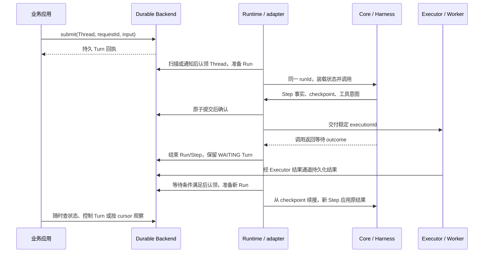

# AgentScope 与 Durable 统一执行模型实施计划

[English](execution-model-plan.en.md)

日期：2026-11-09；开发核对：2026-11-10。状态：**本轮 Durable 开发已完成，独立集成验收待执行**。第 11.2 节记录当前开发交付；逐项实现与实际测试证据见[实施进度](../verification/execution-model-progress.md)。P7 Managed Agents 不在本轮范围，开发完成不表示生产验收通过。

**2026-11-10 最新执行约定：本轮只完成 Durable 框架，P7 Managed Agents 改造移到下一轮，不修改平台仓库。优先完成开发，保留受影响模块编译、格式和定向行为/协议测试；真实 MQ、多进程故障、完整后端组合及反复全仓回归转入[独立验收清单](../verification/execution-model-acceptance.md)。这覆盖下文原有的完整 P6 前置门槛和本轮 P7 安排。A1–A18 的正确性目标保留，开发完成与独立验收完成分别记录，延期不代表通过。**

本计划记录已确认的 Session / Thread / Turn / Run / Step 模型，并安排 ReActAgent、HarnessAgent 与 Durable 的职责收敛。它取代[上一轮用户 API 计划](../archive/user-api-and-runtime-plan.md)中“不增加 Turn”“两层 Run 分别表示任务和调用”“保留另一套 AgentSession 调度入口”等后续设计结论；上一轮实现和[验收记录](../verification/user-api-verification.md)仍然只说明当时版本的行为，不能证明本计划已完成。

当前[对外交互协议](../../protocol/public-interaction-contract.md)随实现共同调整。协议已写入某项语义，不等于该实现已经通过验收；当前源码与验证缺口以第 11.2 节为准。实施时整体替换协议与调用方，不提前把目标设计写成已经支持的能力。

本计划区分目标设计与当前源码基础；后续实施和实际测试结果持续记录在实施进度中，规划评审本身不代表实现就绪。初次规划评审只更新设计；后续实施与实际验证以进度文档为准。先读第 0 节的设计决策，再按第 4 节审查职责、第 11 节审查执行顺序、第 13 节审查改造量。

## 0. 评审结论与实施边界

| 层次 | 最终保留的职责 | 向上一层交付什么 |
| --- | --- | --- |
| ReActAgent / Core | 唯一的模型与工具循环；一次 AgentRun；Run 内 Step；原生状态、日志、恢复阶段与调用 outcome | 可独立使用的 call/stream；一个调用级宿主协作入口；可原子提交的执行事实和恢复状态 |
| HarnessAgent | 在原生执行上组合 Workspace、记忆、压缩、技能、权限与子 Agent | 可恢复的能力组合与明确的资源作用域；通过 middleware 扩展，不增加持久任务调度器 |
| Durable | Session/Thread/Turn 用户对象；持久受理、FIFO、控制、认领和恢复；Run/Step 持久视图；公共消息/事件；Brain–Hands 协议 | Runtime 统一业务操作面，以及可选的本地/生产 Backend、Executor、Worker 扩展 |
| Managed Agents | 平台鉴权、租户、定义解析、资源供应、网关与产品界面 | 使用同一套 Durable 公共契约；本轮只保持依赖方向，平台改造另轮实施 |

关键决策如下：

1. **Session → Thread → Turn → Run → Step**。Thread 保存连续上下文，Turn 表示逻辑任务；一次新的实际调用生成新 Run，每个 Step 只属于一个 Run。跨 Run 通过恢复来源关联，工具 executionId 保持不变。
2. **保留 AgentRun 的调用价值，移除 AgentSession 的重复后台调度。** Core 的调用句柄与 Durable 的 RunView 描述同一次执行；业务任务通过 DurableTurn 控制。普通连续对话通过 Thread 身份与原生状态复用上下文，单次 call 不要求先创建持久 Session/Turn。
3. **Runtime 统一装配并承载顶层业务操作。** Runtime 直接创建、查询和列举 Session；API-only 不启动 Brain。暂停/取消操作 Turn，Run/Step 只读；SSE 断连不改变任务。
4. **未发布设计直接替换。** 不保留旧 AgentSession/DurableRun 门面、旧任务协议或数据迁移分支；有价值的行为与测试迁到正确层次。Core/Harness 不依赖 Durable，Durable 不依赖 Managed Agents。

本次规划评审的产物是这份目标设计、逐层改动清单、P0–P7 执行顺序与 A1–A18 验收条件。工作区已有部分实施基础，本轮继续修改框架 Java、协议和调用方；P7 仅作为后续平台架构参考。实施工作量分别按“完整设计”和“从当前代码继续”估计，避免把已完成的迁移重复计算。

原规划将改造估为中大型跨模块重构，以下保留历史人日估算，不表示当前剩余开发工期。完整框架设计约 **30–45 人日**；扣除当前已具备的基础及已迁移的聊天示例，剩余初估 **17–30 人日**。平台后续适配暂列 **5–8 人日**，本次未重新盘点平台源码，需在框架契约确定后重新估算。估算包含测试与风险余量，不是交付日期承诺；详细分包、前提与现存缺口见第 11–13 节。

### 0.1 五个概念如何落到 Java 类型与模块

概念一致不要求每层都提供同名用户对象。Core 需要识别执行归属，Durable 需要提供可跨进程查询和操作的持久资源；两者通过 adapter 连接。

| 概念 | Core / Harness 中的表达 | Durable 中的表达 | 用户操作归属 |
| --- | --- | --- | --- |
| Session | RuntimeContext 中的业务会话身份；不承载后台队列 | SessionSpec/View、DurableSession，管理会话和 Thread 目录 | 创建、查询、关闭和会话事件由 Durable 提供 |
| Thread | ThreadKey 与原生状态/日志；Harness 按该作用域组织私有资源 | ThreadBinding、DurableThread，管理连续上下文、FIFO、checkpoint 和执行所有权 | Durable 提供持久 Thread 操作；直接调用可以复用原生 Thread 身份 |
| Turn | 受管调用中的关联身份；Core 不接收或调度持久任务 | DurableTurn 与 TurnView，是持久任务和控制的权威 | submit 创建；steer、inject、pause、resume、respond、cancel 指向 Turn |
| Run | AgentRun、RunControl、RunOutcome，控制并描述一次进程内调用 | RunView，持久记录同一 runId 的执行事实、宿主及恢复来源 | 原生调用方控制 AgentRun；Durable 用户查询 Run，不用历史 Run 控制任务 |
| Step | ReAct 循环产生的真实步骤事实与恢复阶段；无需独立 AgentStep 调度句柄 | StepView，关联模型请求、工具和来源 Step | 只读诊断、用量与恢复关联，不提供 submit/pause/cancel |

`HarnessAgent` 继续作为能力组合入口，`DurableRuntime` 作为持久执行的装配和生命周期入口；二者不合并为一个类，也不互相增加依赖。普通 Agent 用户继续直接 call/stream；需要排队、后台恢复和持久控制的用户选择 Durable。删除旧 AgentSession 只移除重复任务调度，连续上下文、状态保存、权限和原生恢复能力仍保留在正确的层次。

## 1. 目标、范围与约束

Durable 是通用开源框架，为 Agent 提供长周期任务、自主调度、状态恢复、统一交互和 Brain–Hands 分离。Managed Agents 是其平台应用，依赖方向始终为平台 → Durable；框架的构建、测试和运行不得依赖平台代码或服务。

本轮实施范围为 Java / AgentScope：Core、Harness、Durable runtime / adapter / codec / worker、全部现有 Durable Java 后端扩展、受影响的状态存储适配器、Java 示例、协议与中英文文档。协议概念保持语言无关，但不以实现其他语言 Runtime 为验收条件。其他语言现有实验代码不能被宣称符合新协议，也不为它们保留旧协议分支。

本轮不改造 `/Users/ken/agentcore/agentcore-managed-agents` 的实际消费者，P7 仅保留后续架构边界。继续忽略本仓库重复的 `agentscope-service`；它不作为新设计的调用方、实现来源依赖或验收前置。

AgentSession、AgentRun 以及 Durable 用户 API 均未正式发布。本轮直接替换被取代的入口、事件和数据布局，不增加别名、deprecated 转发、双读写、旧格式解释器、数据迁移工具、版本协商或滚动升级兼容流程。旧开发数据应明确拒绝，测试使用新建临时存储；不自动清空用户已有数据库。保留当前契约校验、幂等、fencing、真实 UNKNOWN 和外部副作用核实，这些是正确性要求，不是兼容负担。

整体方案是：**Core 负责一次执行，Harness 负责能力组合，Durable 负责持续任务及恢复。** 五个概念不需要五套调度器或五组用户操作。业务用户日常只需使用 Session、默认主 Thread 和 Turn；Run/Step 用于查看执行过程、故障定位和恢复关联。普通同步调用仍只需 Agent，不强制创建 DurableRuntime。

## 2. 已确认的概念模型

```text
Session：持续的业务会话
└─ Thread：一条持续的 Agent 上下文
   └─ Turn：一次被受理的逻辑任务
      └─ Run：一次实际的 Agent 执行
         └─ Step：该次执行内部的一轮处理
```

| 概念 | 归属与职责 | 恢复时的身份 |
| --- | --- | --- |
| Session | 会话身份、元数据、Thread 目录、会话级公共事件和生命周期；不是静态配置 | sessionId 不变 |
| Thread | Agent 绑定、连续工作状态、上下文历史、checkpoint、Turn FIFO、执行所有权 | threadId 不变 |
| Turn | 初始输入、后续控制、交互、逻辑结果、任务状态与预算 | turnId 不变 |
| Run | 某个实例发起的一次实际调用，记录开始、结束、恢复来源与结果 | 新调用生成新 runId |
| Step | Run 内一轮模型决策及工具处理；恢复步骤可以只处理未完成阶段 | 新 Run 使用新 stepId；可引用续接来源 |

一个 Run 可以有多个 Step；每个 Step **只属于一个 Run**。不增加独立的 Step 调度器、租约、重试队列或公共 submit/cancel API。

正常 Step 包括一次逻辑模型决策和它触发的零个或多个工具调用。一次输出的并行工具属于同一 Step；最终无工具回答也是 Step。模型请求的传输重试仍属于当前 Step，但有独立实际请求记录。挂起的 Step 以 STOPPED 和具体原因结束；恢复创建新 Step，可以直接处理原工具结果，不强制再次调用模型。

Step 是执行记录，不是可任意重放的事务，也不是 checkpoint 的别名。一次 Step 可以产生多个 checkpoint。工具业务失败不必导致 Step 或 Turn 失败：错误结果被正常应用后，下一 Step 可以决定后续动作。

### 2.1 身份与作用域

| 身份 | 含义与约束 |
| --- | --- |
| SessionKey(namespace, sessionId) | 会话查找与授权范围 |
| ThreadKey(SessionKey, threadId) | 排队、工作状态和执行所有权范围；默认主 Thread 为显式持久对象 |
| turnId | Thread 内一次逻辑任务；所有查询和控制验证完整归属 |
| runId / stepId | 执行与步骤记录；不得用作逻辑任务或工具重试的幂等键 |
| requestId | 用户提交或控制幂等身份；摘要包含目标 Thread/Turn、操作和内容 |
| executionId / interactionId | 跨 Run 稳定的外部执行与交互身份；结果关联原操作 |
| messageId / eventId | 逻辑消息与事实记录身份；与上述 ID 分开 |
| epoch | Thread 执行所有权的 fencing 代数，不等于 runId，也不随心跳递增 |

提交和控制请求按 Session + requestId 去重，目标 Thread/Turn 纳入摘要。重复相同请求返回原回执，换目标或内容冲突；默认主 Thread 的快捷入口与显式 Thread 入口归一到同一请求语义。

Run 在即将发起一次顶层 Agent 调用时由执行宿主分配并持久化，Core 采用同一个 runId。认领响应丢失时通过稳定调用启动标识重取原回执，不能重复分配；尚未进入调用就崩溃的准备记录标记为未启动或失联，不伪造模型执行。MQ 重投、ready 扫描、工具查询、租约续期均不单独创建 Run。一份所有权可先核实外部操作，再发起调用；若发起第二次原生调用，必须记录新的 Run。

### 2.2 配置不是 Session

拆分原 `SessionDefinition` 混合的含义，统一采用以下模型：

- `SessionSpec / SessionView` 表示创建参数与持久会话视图，包含主 Thread、生命周期和业务元数据。
- `ThreadBinding` 表示该 Thread 冻结的 Harness、Agent 定义引用及版本、状态版本。创建请求传定义名称，由服务端解析并固定；查询不要求实例化 Agent。
- Agent 的模型、工具、权限与资源配置仍由工厂和宿主解析，不把完整配置或凭据复制进 Session/Thread DTO。固定版本必须能重新解析到一致定义；框架不能只保存版本号便声称配置已冻结。

第一版不提供活动 Thread 的 Agent 定义原地升级。配置变化创建新 Thread；私有 checkpoint 版本不兼容直接拒绝。

### 2.3 Run、Step 的实际价值与复杂度边界

Run 回答“这次任务由哪个实例执行了哪一次调用，为什么停止”。同一个 Turn 经历暂停、重启或接管时，新的 Run 清楚地区分各次实际执行，可以记录恢复来源、失联、调用耗时和调用级取消。runId 与 Core AgentRun 一致，避免上下层出现两个无法对应的 Run。Run 不取代 Thread 租约；停止一个旧 Run 也不等于取消正在恢复的 Turn。

Step 回答“这一轮决定做什么、调用了哪些工具、卡在哪个阶段”。它把模型请求、并行工具、结果应用和 checkpoint 关联起来，便于定位慢调用、错误和恢复位置；也能按步骤汇总实际请求用量。Step 本身不保证副作用恰好执行一次：正确性依赖稳定 executionId、执行账本和原子提交。预算按 Turn 累计逻辑进度，不能简单使用当前 Run 的 Step 数。

例如，用户提交“查询订单并生成摘要”，只有一个 Turn T1：

| 时点 | 执行记录 | 用户任务与恢复含义 |
| --- | --- | --- |
| 第一次执行 | R1 的 Step 1 决定查询订单，原子提交工具 E1 意图与 checkpoint | T1 尚未完成；E1 有独立且稳定的执行身份 |
| Brain 进程退出 | 无法提交结束记录；接管后将 R1 及未结束的 Step 标记 LOST | T1 保留；不能据此判断 E1 没有执行或再次发起查询 |
| 收到 E1 结果 | 结果落库并使原 Thread 满足调度条件 | 仅接收结果不创建 Run；没有客户端在线也能推进 |
| 新 Brain 继续调用 | 新建 R2；其 Step 1 直接应用 E1，引用 R1 的来源 Step | 新 stepId，不重新调用模型生成同一工具请求 |
| 生成摘要 | R2 的 Step 2 推理并输出；满足结清条件后 T1 成功 | 用户取得一个任务结果，诊断时可看到两次实际执行 |

两个 Run 都可以有索引为 1 的 Step，但 stepId 不同；Step 没有跨 Run 延续的生命周期。若没有 Run，就难以区分原实例和接管实例的执行事实；若没有 Step，就只能查看整次调用，难以定位其中哪轮推理或工具处理耗时、失败或需要续接。用户仍只需等待或控制原 Turn，无需手动管理这些记录。

### 2.4 容易混淆的执行边界

| 场景 | Turn / Run / Step 的处理 | 不能据此推导的行为 |
| --- | --- | --- |
| 模型直接给出最终回答 | 一个 Turn、一个 Run、一个 Step；finalization 属于该 Step 的后续阶段 | 无工具不代表没有 Step |
| 一次模型决策产生多个并行工具 | 同一 Run 的同一 Step 关联多个工具调用；每个外部操作有自己的 executionId | 工具数量不等于 Step 数量 |
| 当前模型请求进行传输重试 | 沿用 Run 和 Step，分别记录实际请求 attempt、耗时与可取得的用量 | 重试不新建 Turn，也不伪造只请求过一次 |
| 同一次调用内部异步等待模型或工具，调用尚未结束 | 沿用当前 Run；当前 Step 在对应阶段继续，结果返回后在该调用内应用 | 异步等待、线程切换或 MQ 到达本身不创建新 Run/Step |
| 工具仍在执行，但当前 Agent 调用已经返回等待 | 原 Run/Step 停止；结果落库后按等待条件启动新 Run/Step，引用原执行 | 等待和接收结果本身不创建 Run；原 executionId 不变 |
| 显式暂停后恢复，或宿主退出后接管 | 同 Turn，新 Run、新 Step；继续已提交的 reasoning/acting/finalization 阶段 | 不重新打开旧 Step，不重置任务预算，不保证重放任意 Java 栈 |
| 本次调用已结束，但完成前受理了新 steer/inject | 输入仍属于原 Turn；需要再次调用时创建新 Run | 不因调用结束丢弃已受理输入，不把输入静默变成新 Turn |
| 一个 Turn 完成后，用户继续发来下一条请求 | 同 Thread 创建新 Turn；开始实际执行时创建新的 Run/Step | 不把多个用户任务折叠成一个持续不结束的 Run |

以上边界进入 P0 协议向量与 P1/P3 行为测试。持久 Run/Step 查询属于 Durable；Core 只需要产生对应的真实执行事实。默认业务示例围绕 Session、主 Thread 和 Turn 展示，诊断示例再展开 Run/Step，避免让每个用户为一次请求手工装配五层对象。

### 2.5 Run / Step 的最小记录契约

只增加能回答执行与恢复问题的数据，不为记录本身增加新的控制面。下表是目标字段语义；具体 Java record 与 JSON schema 在 P0 一起确定。已有 RunView/StepView 继续完善，不另建同义对象。

| 记录 | 最少需要表达的事实 | 事实产生与持久化归属 |
| --- | --- | --- |
| Run | 所属 Thread/Turn、runId、启动去重身份、owner/epoch、前次 Run、准备/开始/结束时间、状态、outcome 和原因 | Durable 负责准备与所有权；Core 报告调用开始/结束；adapter 映射；接管者确认 LOST |
| Step | runId/stepId、Run 内 index、当前 phase、状态/原因、开始/结束时间、可空的 resumedFromStepId | Core 在真实执行边界产生；adapter 与 checkpoint 一起提交；Durable 提供只读查询 |
| 模型请求事实 | 所属 Run/Step、逻辑推理位置、实际请求身份/attempt、耗时、已知用量及其是否完整 | Core 记录真实请求，adapter 统一映射；缺失用量不填零冒充已知 |
| 工具关联 | callId、原始 Run/Step、可空的外部 executionId、结果接收和应用归属 | Core 记录原生调用；Executor/Worker 记录外部执行；adapter 关联，恢复不改写原始归属 |
| checkpoint 关联 | 所属 Thread、提交位置、产生它的 Run/Step、下一执行阶段、输入/结果应用回执 | Core/Harness 提供状态，Backend 保证原子提交及 epoch 校验 |

Step.index 仅在所属 Run 内递增；Turn 的累计推理位置、模型实际请求 attempt 和工具 executionId 各自独立。恢复 Step 可以没有新模型请求；同一逻辑推理的传输重试可以有多条请求事实。用量按实际请求去重后汇总，恢复来源关联不重复记账。时长需区分本次调用执行时间与 Turn 包含排队、审批和工具等待的总耗时。

这些关联可以保存在已有执行事实和查询投影中，不要求为每项建立 Repository、服务或调度对象。Core 的直接调用没有持久 Turn 时，turnId 可以为空；不能为了满足 Durable 的对象层次在 Core 隐式受理任务。受 Durable 管理的调用则必须验证完整 Session/Thread/Turn/Run 归属。

## 3. 生命周期与用户操作

Session 和 Thread 的 `OPEN / CLOSED` 生命周期与活动状态分开。`IDLE / BUSY / BLOCKED` 从子任务汇总，只用于展示；Thread 当前被暂停或等待时不能因为没有活动 Run 就当成可执行下一任务。关闭只允许无非终态任务的对象；取消全部任务后再关闭必须是显式业务操作，不增加隐式级联取消。

Session 关闭后不得创建 Thread，也不得向其现有 Thread 提交新任务；历史查询仍可用。创建、提交和关闭在事务中校验父生命周期，防止先读后写竞争。

| 对象 | 目标状态 | 状态的意义 |
| --- | --- | --- |
| Turn | QUEUED、RUNNING、WAITING、PAUSING、PAUSED、CANCELLING、SUCCEEDED、FAILED、CANCELLED | 最后三个是任务终态；其他状态保留原任务身份 |
| Run 记录 | PREPARED、RUNNING、COMPLETED、STOPPED、FAILED、LOST | 调用结束与逻辑任务成功分开；携带 outcome/stopReason，例如 task_completed、waiting_tool、paused、host_shutdown |
| Step 记录 | RUNNING、COMPLETED、STOPPED、FAILED、LOST | 只描述所属 Run 的执行事实；恢复不重新打开旧 Step |

Core `AgentRun` 仍是单次、惰性、单订阅调用句柄。它的本地订阅状态与持久 Run 记录不是两个执行身份：前者反映进程内 Publisher，后者记录执行事实和恢复归属。正常返回时必须另有结构化 outcome，不能用 Publisher 正常结束推导 Turn 成功；LOST 由宿主接管判断，本地句柄不能在进程死亡后自行确认它。

| 操作 | 目标及行为 |
| --- | --- |
| submit | 新建 Turn 并进入指定 Thread 队列；受理不等于开始执行 |
| steer / inject | 指向明确的活动 Turn，在安全边界应用；不自动创建 Turn/Run，不提升用户权限 |
| withdraw | 撤回尚未应用的输入，与应用操作事务竞争 |
| pause | 持久化暂停意图。QUEUED 可直接 PAUSED；执行中的任务 PAUSING → 安全边界 → PAUSED；无活动 Run 的等待任务可直接暂停 |
| resume | 只继续 PAUSED 的原 Turn，校验观察到的 revision；根据未完成交互/工具重新进入 WAITING 或可调度状态，不绕过它们 |
| respond | 处理该 Turn 的 pending interaction；响应与消费分开；PAUSED 时可记录答案，但不能偷偷恢复执行 |
| cancel | QUEUED 可立即取消；活动任务进入取消结清流程；终态不能被改写为新结果 |
| signal | 保留受约束的扩展信号，不冒充用户输入、自动工具结果或系统控制 |
| await / observe | 只等待或读取；超时、断连、关闭客户端不取消任务 |

WAITING 由持久等待条件和结果/信号驱动，不提供可绕过审批或 UNKNOWN 的强制 resume。人工需要停止自动推进时使用 PAUSED。暂停优先于后到的工具结果和重试唤醒：结果仍可落库，Brain 不继续推理。暂停默认不取消已经发出的 Hands 操作；取消任务才进入工具取消和核实流程。

pause 与成功完成竞争时，由同一事务校验决定真实结果。若任务已完成，返回明确终态/冲突，不伪造 PAUSED；取消优先于后续 resume。恢复、审批、工具返回、暂停和终态之间都必须有并发契约测试。

同 Thread 的后续 Turn 不能越过 WAITING 或 PAUSED 的队首。用户要运行后续任务，应继续或取消队首，或者显式使用另一条 Thread。Run 的可恢复基础设施故障不直接令 Turn FAILED；自动恢复有退避与上限，不确定副作用保持 WAITING 并说明原因。终态任务再次执行必须提交新 Turn，可记录来源 turnId。

## 4. ReActAgent、HarnessAgent 与 Durable 的职责边界

| 能力 | ReActAgent / Core | HarnessAgent | Durable / 适配器 |
| --- | --- | --- | --- |
| 模型推理、工具循环 | 执行唯一 ReAct 循环；模型重试、并行工具和结果处理 | 通过 middleware 组合，不复制循环 | 调用原生 Agent，不再实现第二个推理循环 |
| Run | 单次 AgentRun、取消/协作中断、调用 outcome | 透传身份与调用生命周期 | 持久启动记录、宿主归属、恢复来源、失联识别 |
| Step | 在真实 reasoning/acting 边界记录步骤；恢复入口也记录 Step | 附加相关的工具/上下文活动 | 保存并投影步骤、事件、耗时与关联信息 |
| 工作状态与 checkpoint | AgentState、原生执行阶段、输入消费和工具结果应用、状态捕获/装载 | 纳入 middleware 所需可恢复状态 | 原子持久化、版本校验、历史索引、恢复选择与 fencing |
| 会话/任务调度 | 不维护持久任务队列或后台 dispatcher | 不缓存并启动 AgentSession dispatcher | Session/Thread/Turn、FIFO、ready 发现、认领、重试与控制状态机 |
| 工具权限与执行 | 权限与 middleware 顺序、直接工具调用、工具执行扩展点 | 工具目录、MCP、Sandbox、Workspace 和子 Agent 装配 | Hands 意图、稳定 executionId、异步结果与 UNKNOWN 核实 |
| 资源 | 使用注入的状态访问 | Workspace、文件、记忆、压缩、技能与资源作用域 | 为恢复提供受控资源提交与引用；供应商连接在扩展/宿主 |
| 用户 API / SSE | 不接收持久用户任务 API，不把 live AgentEvent 当提交回执 | 普通 call/streamEvents 继续独立使用 | Runtime 业务操作、公共消息/事件、快照、游标、SSE 与回调消费 |

### 4.1 Core 的具体调整

1. 在 `RuntimeContext` 明确 Thread/Turn/Run 执行身份；用户和 Session 身份不被编码后的内部 key 替换。受 Durable 管理时由宿主注入。普通请求上下文可以尚无 runId，在准备调用句柄或实际调用时分配；重复使用同一请求上下文不能复用上次 Run。直接调用不要求先创建持久 Session/Turn，也不在 Core 中隐式创建另一套逻辑任务。原生 turnId 是可选的宿主关联，移除为了满足非空字段而生成占位 Turn 的逻辑，并同步调整原生日志、恢复关联和测试。
2. 保留 `AgentRun` 的一次调用含义，梳理 `RunControl` 与结果 outcome。底层中断只报告事实；任务是否暂停、重试或取消由 Durable 决定。
3. 将 `SessionRecorder` 中的 Run/Step/模型/工具/状态记录收敛为调用记录能力；将按持续上下文组织的原生日志及 key 明确为 Thread 日志。相应类名和 schema 直接改为新语义，不保留旧名包装。
4. 删除 `SessionInbox / SessionExecution` 中已迁入 Durable 的排队、命令受理和后台控制状态机；保留执行边界所需的输入消费、状态捕获与结果应用能力。
5. 原生日志不再独立宣告持久 Turn 终态。当前 `SessionTurns` 从 `run/end` 推导逻辑任务状态的做法移除；Core 输出调用 outcome，Durable 结合外部结清事实提交 Turn 终态。
6. 使用一个调用级宿主协作入口聚合控制读取、恢复位置和提交回执，挂入 `RuntimeContext`，复用现有 middleware / finalization / 记录扩展点；不为每个概念再建立一组 Manager、Repository、Listener。接口只引用 Core 类型，Durable 实现在 adapter 内。
7. 原生 checkpoint 记录下一执行阶段、待应用输入与结果、累计推理位置及暂停边界。保持 `call()` 与 `streamEvents()` 最终语义一致，不在 Reactor 事件线程做阻塞存储。

没有 Durable 的直接调用仍能推理、流式输出、保存和显式恢复原生状态；它不承诺自主排队、后台接管或跨实例持久用户控制。这些能力统一通过本地或远程 Durable 获得。

直接调用身份收敛不能只把 `turnId` 改为可空：原生日志必须区分“完成后发起新调用”和“显式继续未完成的执行”。前者只复用 Thread 上下文，不能继承上一次已完成调用的预算或来源 Step；后者按 checkpoint 的 Run/Step、待处理工具和交互关联恢复阶段，不依靠两个空 turnId 相等来判断续接。当前 `SessionInteractions.continuationRequests` 已直接替换旧的 Turn 聚合入口，返回已提交外部请求的来源事实，并校验待处理状态和宿主关联一致性；Durable 适配再校验持久 Turn 归属。验证至少覆盖无 Turn 的普通连续调用、无 Turn 的外部工具续接、完成后新调用，以及受管 Turn 的跨 Run 预算与错误归属拒绝。

### 4.2 Harness 的具体调整

删除 `AgentSession` 以及 `HarnessAgent.session()` 的 dispatcher/缓存入口，把现有后台会话示例转向 Durable。本轮无需保留同名 facade。`SessionAnswer` 等只服务旧入口的类型，迁移有用语义到统一 Interaction 后删除。

Harness 保留 Workspace、记忆、上下文压缩、技能、权限、工具与子 Agent 的组合。Thread 私有上下文、checkpoint、plan mode、短期记忆、工具激活状态与缓存都必须按 Thread 隔离，不能只改 journal key 而继续用 sessionId 共享可变状态。

原生工作状态/日志使用明确的 Thread key；现有状态存储实现和相关调用方同步调整，复用原来的存储 SPI，不新增另一套状态库，也不在多个调用点手拼 sessionId/threadId。长期记忆、文件、Sandbox 可以按应用配置共享，但共享范围和冲突控制必须显式，不能从“属于同一 Session”自动推导。

普通进程内子 Agent 继续由 Harness 调用。需要后台持久化的子 Agent 通过可选委派扩展接入 Durable；Harness 不反向依赖 Durable，也不把所有内部辅助调用强制提升为持久 Thread/Turn。

本地子调用保留父 Run/Step 来源，但不继承父控制句柄、持久 Turn 或可变执行上下文。同步调整 `DefaultAgentManager` 的父执行关联构造：父 turnId 可以为空，不能继续用禁止空值的集合构造器写入它，也不能补造一个 Turn。该路径与 Core 的直接调用身份变更在同一工作包验证。

### 4.3 模块依赖与部署

下面箭头统一表示“依赖”：

```text
Harness → Core
durable-adapter-harness-agentscope（含 codec）→ Harness、Core、durable-runtime
durable-worker → durable-runtime
JDBC / HTTP / RocketMQ / Sandbox / MCP / Objects → 对应 runtime、worker 或宿主 API
业务应用 / Managed Agents → 上述库
```

runtime 保持 Harness 无关；codec 已并入 `durable-adapters/durable-adapter-harness-agentscope`，不再有独立制品。验证/restore/fork 不构造或启动 Agent，但 adapter 制品会引入 Harness/Core/runtime；worker 不依赖 Core/Harness。当前示例位于 `durable-examples`，不为 Session/Thread/Turn/Run/Step 拆五个 Maven 模块。

Runtime 是普通实例以及统一的装配、业务操作和生命周期入口。API-only 进程不要求模型/Agent/Executor，也不认领任务；Brain 显式 `start()`；Hands 可以内嵌或独立进程运行。关闭 Runtime 停止宿主与自有订阅，不取消持久 Turn，也不销毁借入的连接或 Sandbox。

各角色按需要组合现有 Maven 模块，模块本身不等于必须独立部署的服务：

| 应用角色 | 最小依赖组合 | 启动内容 |
| --- | --- | --- |
| 普通 Agent 应用 | Core；需要 Harness 能力时加入 Harness 及其提供方扩展 | 由业务直接调用 Agent，无 Durable 生命周期 |
| 本地 Durable 应用 | durable-runtime、durable-adapter-harness-agentscope（含 codec，传递引入 Harness/Core）、JDBC 本地装配 | 一个 Runtime 同时提供业务访问和 Brain；按需内嵌 Executor |
| 独立 API 进程 | runtime + 所选 Backend；提供 HTTP 时增加 HTTP 扩展 | 创建 Runtime，不调用 start，不加载模型 |
| 独立 Brain 进程 | durable-runtime、durable-adapter-harness-agentscope、所选 Backend/Executor 扩展 | 注册 Agent 工厂并 start；codec 随 adapter 提供恢复支持 |
| 独立 Hands 进程 | worker、执行账本存储、所选队列及工具提供方扩展 | 启动 Worker 消费工具命令并回传结果；不要求 Core/Harness 或 Brain Runtime |

这张表只规定库与进程的关系，不新增五个应用模块。HTTP、RocketMQ、Objects、MCP、Sandbox 均按实际部署需求选择；API/Brain 使用相同的权威 Backend 契约，Hands 的执行账本承担外部操作交付与核实。

### 4.4 Core 与 Durable 的一次执行交接

不能只给 Core 增加字段，再让上下两层各自持久化和调度。一次受管执行必须按以下顺序交接：

1. Backend 认领 Thread，取得 epoch，核实待处理外部操作，在需要原生调用时提交 Run 启动记录。
2. adapter 装载该 Thread 的 checkpoint，将同一组 Thread/Turn/Run 身份和调用级宿主协作入口交给 ReActAgent 或 HarnessAgent。宿主协作接口定义在 Core，具体实现放在 adapter。
3. Core 在真实的模型、工具、输入消费与 finalization 边界生成记录和状态。adapter 将其映射为 Backend 提交，原子确认 checkpoint、输入/结果已应用、工具意图与公共事件。工具意图提交后才能交付 Hands。
4. Core 报告本次调用 outcome；Durable 结合暂停/取消意图、外部操作结清和 Thread epoch 决定 Turn 状态。正常结束 Run 不自动完成 Turn。

受管模式下，Backend 是持久执行权威。原生日志的 writer 检查使用宿主 epoch/受控提交，不再独立认领任务或形成可与 Backend 分歧的第二套租约；内存并发保护可以保留。原生状态存储不能先独立提交一份“成功状态”，再异步尝试同步到 Durable。直接调用模式仍可使用 Core/Harness 的原生状态存储和日志写入保护。

Thread journal 是原生恢复资料；公共消息和事件是经过映射的用户契约，两者不合并成一种日志格式。API-only 的查询、SSE 回放和控制不需要创建原生 Agent。

下面以独立 Brain/Hands 的一次工具等待为例；本地部署将相应角色放在同一进程，交接语义不变：



图中的结果提交经过标准 Executor/result 接口，不要求 Hands 获得 Brain 的内部 Backend 权限。工具结果也可能早于调用返回到达，事务状态机必须覆盖这一竞争；业务观察者不参与调度，断开后该流程仍能继续。

### 4.5 改造后的最小使用面

| 开发者需求 | 使用入口 | 生命周期由谁负责 |
| --- | --- | --- |
| 一次推理或流式响应 | ReActAgent / HarnessAgent 的 call、streamEvents；需要调用级控制时取得 AgentRun | 调用方管理订阅，Core 管理本次 Run/Step |
| 保存连续上下文，显式继续调用 | 同一 Thread 身份 + 原生状态/日志与恢复入口 | Core/Harness 装载和保存状态，调用方决定何时再次执行 |
| 本地后台任务、排队、暂停后继续 | 本地 Backend 装配的 DurableRuntime → Session/主 Thread → Turn | Durable 持久化受理并自主调度；用户不直接启动 Run/Step |
| 分布式 API、Brain 与 Hands | 各角色独立装配 Runtime 或 Worker；业务操作直接使用 Runtime | Backend 管理权威状态，Brain 执行调用，Hands 执行外部操作 |

`AgentRun` 保留为 Core 的调用句柄，有独立价值；不再另设承载持久任务的同名 DurableRun。`AgentSession` 的后台受理和调度能力整体进入 Durable，普通连续对话依靠 Thread 身份与状态访问即可，不需要在 Harness 中再造一个 Session/Thread 调度 facade。Thread 是上下文与持久任务的边界，不要求每次直接 call 都创建五个公共对象。

保留概念不等于保留未发布的 API 签名。AgentRun 的构造、状态、outcome 和控制方法可以按一次调用的语义直接调整，并同步修改全部调用方；不为了原方法名保留额外分支。Step 首先是原生执行事实与 Durable 的只读记录，无需新增可启动、暂停或取消的 AgentStep 用户句柄。使用复杂度因此保持为：直接调用控制 AgentRun，持久任务控制 DurableTurn，诊断时再读取 Run/Step。

### 4.6 最小跨层协作契约

使用现有 `AgentExecutionHost` 作为第 4.1 节的调用级宿主协作入口，配合既有状态/日志与工具执行扩展点。其职责是把原生执行边界交给宿主协调，不接管模型循环，也不把 Backend、MQ 或公共 Session/Turn 类型引入 Core。P0/P1 继续核对其方法与以下交接语义，不再新增一个同义宿主接口：

| 交接点 | Core / Harness 提供 | adapter / Durable 决定 |
| --- | --- | --- |
| 开始调用 | 接受执行身份、原生状态与下一阶段，建立单次 AgentRun | 验证 Thread 所有权、分配并持久化 runId、提供恢复位置 |
| 安全边界 | 在下一次模型/工具调度及 finalization 前检查控制，报告已经应用的输入 | 返回该 Turn 可消费的输入和暂停/取消意图；按 revision/epoch 确认消费 |
| 状态提交 | 提供原生 checkpoint、执行事实与输入/工具结果应用信息 | 在同一事务提交 checkpoint、回执、工具意图和公共事件，再允许外部交付 |
| 暂停或等待 | 保存可继续的位置，结束当前调用并报告原因 | 提交 PAUSED 或 WAITING；决定是否及何时再次调度原 Turn |
| 调用结束 | 返回结构化 outcome、输出及未结清工作；结束本次 Run/Step | 结合控制竞争和外部结清事实，决定 Turn 终态、等待或重试 |
| 所有权丢失 | 停止后续执行和新副作用，清理当前订阅与本次调用资源 | 拒绝旧 epoch 提交，由新宿主核实原执行并接管 |

安全边界是可提交恢复状态的位置，不保证随时冻结任意 Java 栈。已经发出的模型/工具调用应遵守对应取消与结果核实契约；pause 回执表示暂停意图已受理，只有持久状态到达 PAUSED 才表示停止继续推进。不能把一次线程中断当作持久暂停完成。

暂停交接还必须保留“已经完成到哪里”，尤其不能丢掉已生成的最终回答：

| 暂停发生的位置 | Core / Harness 应保留 | Durable 继续执行时的行为 |
| --- | --- | --- |
| 下一次推理之前 | 已应用输入、累计推理位置与下一阶段 | 新 Run 从同一位置继续，不重置 Turn 预算 |
| 模型已返回、工具尚未结清 | 已提交模型决策、工具意图与结果应用位置 | 先核实原 executionId；不为恢复再次生成同一工具请求 |
| 最终回答已生成、finalization 尚未完成 | 回答、工作状态与 finalization 续接位置，在确认暂停前持久化 | 新 Run 完成剩余 finalization，不重新推理，也不重复已确认的资源操作 |
| 所有权已经丢失 | 仅清理本次调用；旧宿主不得再提交成功或暂停 | 新所有者读取最后一次有效提交并核实外部效果；没有结束记录的 Run/Step 按失联处理 |

因此，`beforeBoundary(FINALIZATION)` 的暂停检查与 `finish(...)` 的结果保存需要一起调整，不能只在现有检查点抛出异常。原生 outcome 必须区分协作停止、调用失败和完成；adapter 再将该事实与持久控制意图合并，决定 Turn 状态。暂停期间到达的新输入、工具结果和交互响应仍需保留，但不能越过暂停自动执行。

直接调用没有 Durable 宿主时，Core 仍通过原生存储完成状态保存和显式恢复；不创建隐藏的本地任务队列。调用级协作入口与存储、工具执行扩展点承担不同职责，不为这次改造再增加 RunManager、StepManager 或第二套 Repository。

实施顺序上，先让 adapter 使用该协作入口并通过恢复测试，再移除 SessionExecution/SessionTurns 对任务状态的判定。既有原生输入去重、交互关联和结果应用能力需迁入新边界，不能随着旧 dispatcher 一并丢弃。

当前实现已选定 Core 的 `AgentExecutionHost` 作为调用级入口，adapter 通过 RuntimeContext 绑定 `AgentScopeExecutionHost`，集中输入/控制边界、finalization 续接和已记录模型结果的回放。原 AgentFinalization 与独立 DurableInputMiddleware 已直接移除，不保留别名；工厂返回 Agent Builder，由 adapter 安装调用级原生日志后构建 Agent，公开 Binding 不再暴露日志存储。Core 已增加 RunOutcome，adapter 根据调用事实结清 Turn，并检查待消费输入；持久暂停已通过 HOST_PAUSED 调用结果接入 PAUSING/PAUSED；原生日志命名与格式已按第 4.8 节收敛，更多故障组合仍需验证；旧任务调度已删除，验收进度单独记录。

### 4.7 代码归属与删除边界

以下清单规定实现落点，不要求为表中每项新建接口或类。保留原生调用能力不等于保留原来的 Session 调度设计。

| 当前代码或能力 | 目标归属与处理 | 核对重点 |
| --- | --- | --- |
| ReActAgent、AgentBase、AgentRun、RunControl、RunOutcome | 留在 Core；只承载单次调用、执行边界、清理与结果 | 同一调用的 runId 唯一；普通 call/stream 独立可用；调用结束不决定持久任务结束 |
| RuntimeContext、ExecutionIdentity、ThreadKey、AgentState | 留在 Core；统一身份与可恢复工作状态 | Thread 隔离；受管调用采用宿主身份；本地子调用不继承父调用的控制对象 |
| SessionRecorder、SessionLog、SessionProjection、SessionViews 及 provider | 留下原生日志、checkpoint 和只读投影能力，按 Thread/调用语义重新命名 | 原生输出改用调用事实，如 run/output；移除原生 turn 终态和旧 inbox 事件；公共 turn.* 由 Durable 生成 |
| SessionHistoryMode.LEGACY、legacySessionHistory、SessionMigration 与 migration/baseline | 删除本轮原生执行设计中的兼容开关和旧格式转换；当前格式的状态基线、导出和 fork 归入 Thread checkpoint 能力 | 普通 stateStore 持久化仍是有效独立能力；启用 journal 后只认一个状态权威，不以删兼容为由强制所有普通调用使用 Durable；与本轮无关的已发布格式迁移不顺带清理 |
| SessionInbox、SessionExecution、SessionTurns | 删除旧任务实现；受理、输入排队、任务终态归 Durable | 执行前消费输入、输入去重及原子应用能力由宿主边界与 checkpoint 承接，不能直接删掉行为 |
| SessionRecovery | 原生 UNKNOWN 结果核实留在 Core；任务取消和输入拒绝移至 Durable | 结果关联与 checkpoint 一起提交；只删除已迁移的任务方法，不删除独立调用仍需的恢复能力 |
| HarnessAgent、middleware、Workspace、记忆、权限和本地子 Agent | 留在 Harness；组合原生执行能力 | 可恢复状态进入原生 checkpoint；私有状态按 Thread 隔离；共享资源明确配置 |
| AgentSession、SessionAnswer、HarnessAgent.session() 和 dispatcher 缓存 | 删除；后台用户操作进入 Runtime 获取的 Session/Thread/Turn | 不保留同名包装、隐藏 Runtime 或 Harness → Durable 依赖 |
| AgentExecutionHost / AgentScopeExecutionHost | 接口在 Core，实现只在 durable-adapter-harness-agentscope | 一个调用级协作入口，承接安全边界与 finalization，不另建控制 middleware 或模型循环 |
| AgentScopeAdapter、BackendSessionLog、AgentScopeCheckpointCodec | adapter/codec 负责原生格式与通用协议之间的映射、校验和恢复 | 原生记录、checkpoint 与公开事件受同一 Backend 提交约束；codec 不启动模型 |
| AgentScopeMessageEvents、AgentScopeToolEvents 与 EventProjection | 原生事实映射留在 adapter；与 Harness 无关的公共投影归 runtime | 一 Turn 多消息、输出版本、工具参数/进度/结果可回放；本地工具不伪造远程 executionId；不让业务应用解析原生日志 |
| DurableRuntime、SessionBackend、TransactionalSessionBackend、InvocationRecords | runtime 负责唯一持久任务状态机、调度和 Run/Step 记录 | API-only 不启动 Brain；短事务、所有权、待处理输入与终态竞争统一校验 |
| DurableRuntime/Session/Thread/Turn、EventProjection、HTTP 用户入口 | Runtime 与 HTTP 扩展提供用户操作、消息、事件和观察 | 查询不创建对象、不启动 Agent；断开 SSE 只结束观察；Run/Step 为只读历史 |
| worker、ExecutionStore、Executor、MQ/MCP/Sandbox/Objects 扩展 | 通用外部执行机制归框架，供应商实现归扩展 | 原 executionId 的交付、查询、取消与结果应用贯通；平台只装配资源和业务策略 |

原生 Thread 日志可以记录宿主注入的 turnId 作为关联信息，但不能据此受理 Turn 或宣布其终态。Core 的 RunOutcome 与 Durable 的 RunView 共享一次调用的身份；它们分别表达调用结果和持久执行记录，不是两套任务状态机。

### 4.8 原生状态与日志的具体收敛方案

原生状态和执行日志仍需支持不使用 Durable 的应用，因此这部分留在 Core/Harness。按下表直接调整名称和归属，关联 provider、codec、示例与测试在同一工作包修改；以下命名、调用方及当前格式已落实到源码；最终 clean 构建与组合恢复验收仍以实施进度为准。

| 改造前的类型或入口 | 当前归属与职责 |
| --- | --- |
| `core.session.ThreadKey` | 移到 `core.agent.ThreadKey`；状态快照和日志共用执行上下文身份，不要求状态存储依赖日志实现 |
| `SessionLog / SessionLogStore / JournalSessionLog` | `ThreadJournal / ThreadJournalStore / AtomicThreadJournal`，归 `core.journal`；保留原生事实、原子追加、checkpoint 和写入保护 |
| `SessionRecorder / SessionProjection / SessionViews` | `InvocationRecorder / JournalProjection / ThreadHistory`；分别负责一次调用记录、日志重建和只读历史，不管理持久任务 |
| `SessionInteractions / SessionRecovery` | `ThreadInteractions / ThreadRecovery`；保留原生外部请求关联、结果核实和显式续接 |
| `SessionMigration` | `ThreadCheckpoints`；只支持当前格式的初始化、状态导出与 fork，初始化事实改为 `state/initialized` |
| 原生 `SessionEvent` 及其 codec | `JournalEvent` 及相应 codec；只改原生执行事实，不改 Durable 的公共 Session 事件类型 |
| Harness 的 `agent.session` 存储实现、adapter 的 `BackendSessionLog` | 分别调整为原生 journal 存储和 `BackendThreadJournal`；供应商存储实现继续复用现有 SPI |
| `SessionHistoryMode / legacySessionHistory` | 移除旧模式枚举与重复开关，统一使用 `journalEnabled`；关闭日志时仍可使用当前 `stateStore` 快照能力 |

这里是在原生执行内部统一命名与职责，不增加另一套状态管理框架。`AgentRun` 保留一次调用的概念，其未发布的方法和状态可以直接调整；不保留旧 `AgentSession`，也不新增同样承担后台调度的 `AgentThread`。Durable 的 Session、Thread、Turn 类型仍属于 runtime，不能通过全局替换 `Session` 单词改名。

原生日志只接受一个当前格式：在权威 head 中校验格式版本，在状态装载与提交时校验 Thread 身份；移除独立旧 header 的探测、回退和格式转换。版本缺失、不匹配或内容损坏应明确报错并保留原数据；不能通过改存储目录或 key 后默默创建空日志来规避拒绝。当前格式的基线初始化和 fork 是正常功能，不承担导入旧版本数据的职责。

这项收敛属于 P1/P3，不单独开新阶段。验收覆盖：普通调用可关闭日志使用快照；连续调用复用上下文但不继承已结束调用的执行计数；工具续接保留来源且不重复推理；旧/未来格式拒绝且数据不变；受管日志与 Backend 共享提交权威。对应 A5、A8、A16、A18，不以编译通过代替恢复验证。

## 5. 用户 API 与公开视图

| 类型 | 操作范围 |
| --- | --- |
| DurableRuntime | 装配和执行生命周期；创建/查找/分页列举 Session、能力发现 |
| DurableSession | 会话视图、主 Thread、创建/查找/列举 Thread、会话快照与事件；submit/call/stream 明确作为主 Thread 快捷入口 |
| DurableThread | 绑定与活动视图、submit、getTurn/listTurns、上下文历史、Thread 过滤事件、checkpoint/restore/fork |
| DurableTurn | 状态/结果/等待/观察、steer/inject/withdraw/pause/resume/respond/cancel/signal、交互和 Run 查询 |
| RunView / StepView | 只读执行记录、分页查询与事件关联；不提供第二套业务任务句柄 |

原先表示逻辑任务的 `DurableRun` 直接替换为 `DurableTurn`；工作区已开始这项替换，不同时保留两套逻辑任务对象。原生 `AgentRun` 是当前进程的一次执行句柄；`RunView` 是同一执行的持久记录。业务取消任务应操作 Turn，不通过历史 Run 句柄控制新执行。

以下仅为目标 API 示意，实施时补齐类型化创建参数、revision 与错误契约：

```java
DurableSession session = runtime.getSession(sessionKey);
DurableTurn turn = session.submit("request-1", input); // 主 Thread

turn.steer("request-2", guidance);
turn.pause("request-3");
// 观察到 PAUSED 后，携带该状态的 revision 恢复。
turn.resume("request-4", pausedRevision);

DurableThread researcher = session.getThread("researcher");
DurableTurn research = researcher.submit("request-5", researchInput);
```

创建 Session 时原子创建主 Thread；重复相同身份与创建规格返回同一资源，规格变化冲突。get 不隐式创建。所有句柄只保存身份，通过 Backend 读取权威状态，可跨客户端重新获取；关闭订阅或 await Future 不改变任务。

所有控制显式绑定 Turn，必要时带 expectedRevision。避免“取消当前任务”在页面过期后命中新任务。会话聚合历史明确带 threadId；Thread.history 才是该上下文的消息视图，不能把所有子 Thread 的输出都当作主 Thread 的模型输入。

`DurableSession/Thread.call` 是提交 Turn 并等待结果，`stream` 是提交 Turn 并观察公共事件；两者都经过同一个 submit 状态机。它们不是对原生 `agent.call()/streamEvents()` 的透传。原生调用由订阅驱动，取消订阅可以停止该次 Run；Durable 的等待超时或 SSE 断连只结束观察，任务继续。显式取消持久任务始终使用 `turn.cancel`。

## 6. 存储、并发与自主调度

### 6.1 逻辑状态拆分

将 `TransactionalSessionBackend.State` 的内容拆成清晰的内部数据记录：

| 范围 | 权威数据 |
| --- | --- |
| Session | 会话元数据、主 Thread/Thread 目录、公共事件 sequence、请求去重与会话级快照 |
| Thread | ThreadBinding、admitted/settled、活动 Turn、epoch/租约、原生日志与 checkpoint head、私有资源和上下文历史 |
| Turn | 输入、控制、状态/revision、等待原因、逻辑结果、累计预算、工具与交互关联 |
| Run | 调用启动幂等回执、宿主、时间、恢复来源、outcome、结束原因 |
| Step | 所属 Run、Run 内索引、阶段、来源 Step、模型/工具关联与耗时 |
| 外部执行 | 稳定 executionId、最初发起 Run/Step、后续结果接收与应用记录；恢复不能改写原请求摘要 |

### 6.2 第一版事务策略

保留现有 `RecordStore` 以 Session 为 scope 的短事务边界，把各 Thread 数据放在独立 part/key 下。Thread 执行锁、Runtime.active、队列和 checkpoint head 独立；跨 Thread 模型/工具执行可以并行。数据库事务仅完成状态、回执、事件和 ready 索引更新，绝不覆盖模型或工具 I/O。

这使 Session 公共事件 sequence 与 Thread 状态能够同事务提交，避免再引入跨分区事务或一套聚合事件总线。代价是同 Session 的短写事务串行，应在多 Thread 压测中测量等待时间；本轮不承诺同 Session 无限写吞吐，也不以串行运行所有 Thread 掩盖争用。

原三参数 `Transaction.schedule(queue, readyAt, value)` 每个 scope 在同一队列只有一个位置。目标使用 `schedule(queue, workId, readyAt, value)`，按 `(queue, scope, workId)` 区分待执行项；Brain 的 workId 稳定定位 Thread，且与所属 Session 事务原子提交。`Work` 返回 scope/workId。工作区已接通这项存储接口与 Thread 调度；后续在同一实现上完成暂停、公平性和故障组合的 SQLite、PostgreSQL、测试存储及 Worker 验收，不新增调度存储接口。

### 6.3 调度与接管

ready 项定位 Thread；Backend 在短事务内检查队首、暂停/等待条件和租约。Thread 每次只允许一个权威执行者，不同 Thread 可被不同 Brain 认领。过滤与分页必须有界，防止一个 Session 的大量 Thread 饿死其他 Session。

认领与执行分开：先核实已有工具和待应用结果，满足调用条件后才创建 Run。心跳不产生新 Run；失去 epoch 的旧宿主立即停止写入与新副作用。新宿主在同一受控提交中将无有效所有者的旧 Run/Step 标记 LOST，并继续原 Turn；LOST 不表示先前外部操作从未执行。

通知仅提示检查状态；定期扫描、租约到期和持久 ready 索引保证没有用户连接或 MQ 通知时仍可恢复。暂停的 Turn 不被普通结果、超时或自动重试唤醒。轮询、通知、HTTP 和 MQ 复用同一状态机。

### 6.4 后端与部署的最小组合

| 使用方式 | 状态与调度 | 通知与 Hands | 业务 API |
| --- | --- | --- | --- |
| 普通 Core/Harness 调用 | 原生 Thread 状态和日志，调用方显式运行/恢复 | 原生工具；无需 Durable | agent.call / streamEvents / AgentRun |
| 本地 Durable 快速体验 | LocalBackend：SQLite + 本地对象目录；同一套持久 Turn 状态机 | 进程内唤醒 + 定期扫描，工具可内嵌 | Runtime 业务 API |
| 生产同进程部署 | PostgreSQL 及所需对象存储；Thread 租约与 ready 索引 | 可选通知加速；Executor 内嵌或远程 | Runtime 业务 API |
| API、Brain、Hands 分开部署 | 相同 Backend 契约；API-only 不认领，Brain 独立恢复 | RocketMQ 可分别承载唤醒和 Executor 命令/结果；Hands 使用执行账本 | 各应用直接使用自己的 Runtime，或配置公共 HTTP transport |

HttpSessionBackend 是访问远程权威 Backend 的适配，不是所有使用方式的必选项。公共 HTTP 用户操作与 Brain 内部 Backend RPC 保持不同权限边界。RocketMQ 也不是状态真相来源；消费通知或投递命令成功不能替代 checkpoint/结果提交。SSE 是公共事件的传输方式，不新增一种独立状态存储。

继续以 Backend 和 Executor 为主要扩展边界，复用 RecordStore、ObjectStore、Wakeups 和既有 Worker 机制；通过本地/生产装配减少用户需要配置的对象。不为 Session、Thread、Turn、Run、Step 各自增加存储或通知 SPI。扩展不能满足原子性、fencing 或原操作查询时，要声明能力限制，不能以统一接口掩盖保证差异。

## 7. checkpoint、Step 与恢复流程

典型恢复如下：

```text
T1 / R1 / S1：模型决定调用 E1
  → checkpoint + E1 意图原子持久化
  → 交付 Hands；等待时 S1/R1 STOPPED，T1 WAITING
E1 结果：持久化并唤醒原 Thread/Turn
T1 / R2 / S2：恢复 acting，应用 E1，提交 checkpoint 与 applied 回执
T1 / R2 / S3：再次推理，形成最终输出
  → 核实外部操作结清，提交 T1 SUCCEEDED
```

- `executionId`、interactionId、已提交模型决策与逻辑输入身份跨 Run 保持稳定；新的 Run/Step 只增加关联记录，不参与原操作去重键。
- 原生恢复入口既支持 reasoning，也支持 acting/finalization 等真实执行阶段。恢复产生的第一个 Step 可以没有模型请求；不能为了补齐轨迹重新推理或重复工具调用。
- maxIters 等约束按 Turn 中已提交的逻辑推理位置累计；模型费用按实际调用事实累计。Run 内 stepIndex 不是全局预算计数，工具恢复 Step 不凭空消耗一次模型推理次数。
- 模型最终决策未提交时不能假装已完成；恢复可能需要新的模型请求，并如实记录实际次数和输出版本。已提交决策按 checkpoint 继续，不能因新 Run 改写它。
- 外部结果“已接收”与“已应用”分开。只有包含真实结果的 checkpoint 原子提交后，才确认 applied；允许多 Run 接收/应用关联原 execution，不允许重复执行 UNKNOWN 操作来猜结果。
- Run/Step 的事件依附真实执行边界；不把 Java 线程中断或进程退出假装成可靠的最终状态提交。缺失结束记录由接管流程处理。

checkpoint 按 Thread 管理；restore 仅允许目标无非终态 Turn、无未结清外部效果且 expectedPosition 匹配。恢复不能撤销已经发生的外部副作用。fork 创建同 namespace 的新 Thread 和新时间线，目标可以是现有 Session，或显式新建 Session 的主 Thread，以覆盖当前 fork 到新会话的能力。分别授权源与目标，读取不可变 checkpoint，不修改源；目标身份与 fork 回执在目标事务中提交。只导入合法 settled 状态，不复制未完成的执行、旧 Run/Step 身份或伪造历史公共事件。跨 namespace 克隆和全 Session 多 Thread 原子回滚不在本轮范围。

### 7.1 调用停止与恢复策略

恢复决策由 Durable 结合原生 outcome、持久控制与外部执行事实作出，不能把所有异常都变成需要用户手动 resume 的 `runtime.error`。沿用 Runtime/Backend 的调度和配置边界，不为错误分类另建一套调度器。

| 已确认的事实 | Turn 的处理 | 是否创建下一次 Run |
| --- | --- | --- |
| 原生调用正常完成 | 校验所有已受理输入与外部效果；已结清才 SUCCEEDED，否则继续原 Turn 或保持等待 | 仅当仍需新的原生调用时创建 |
| 等待工具、审批或用户回答 | WAITING，持久化具体等待条件 | 条件满足且未暂停/取消时才可创建 |
| 暂停意图已在安全边界完成交接 | PAUSED，保留恢复位置与未完成等待 | 只有显式 resume 受理并重新满足调用条件后创建 |
| 可恢复基础设施失败或宿主退出 | 记录可确认的失败/停止/失联事实，释放或等待租约到期；有界退避后重新认领 | 核实原外部操作，确有调用需要时创建；不能仅因重投通知创建 |
| 外部副作用结果 UNKNOWN | 保留原执行与核实条件；暂停/取消意图仍有效 | 不重复该副作用，不以通用 retry/resume 绕过核实 |
| 明确不可恢复的调用错误或 Turn 预算耗尽 | 结清外部效果后提交 FAILED，保留具体原因 | 不自动重开终态；再次执行需要新的 Turn |
| 取消请求 | CANCELLING，核实或取消已发出的操作；满足结清条件后 CANCELLED | 不再发起新的业务调用；核实与清理本身不要求启动 Agent |

重试次数、退避时间和累计预算属于持久 Turn 恢复策略，不能随 JVM 重启清零。重试上限耗尽也不能把 UNKNOWN 改成确定失败或成功；对未结清效果继续保留可查询的阻塞原因。模型内部请求重试仍由 Core 处理，其实际请求记录与 Durable 的新 Run 恢复分开统计。上述规则对应 A5–A10、A15 的验收，不增加通用的“强制重试任意历史 Step”API。

## 8. 消息、事件、查询与协议

保留公开用户操作、特权 Backend 操作、Hands 消息、原生执行日志四个边界，更新同一套 schema、错误码与契约向量。协议只支持一个当前版本，不保留旧的“runId 表示任务”解释。

公共信封包含 sessionId、按事件适用性可空的 threadId/turnId/runId/stepId，以及 eventId、sequence、cursor、type、data。父身份必须一致；任务级事件不强制伪造 Run/Step。工具异步结果携带原 execution 归属，当前应用事件可以引用新 Run/Step。

| 事件族 | 意义 |
| --- | --- |
| session.* / thread.* | 创建、关闭、绑定和活动汇总 |
| turn.* | queued/started/waiting/pause_requested/paused/resumed/cancel_requested 与任务终态 |
| run.* | 实际调用的 prepared/started/ended/lost 与 outcome；不能替代 Turn 终态 |
| step.* | started/phase_changed/ended，包含状态和 reason；记录而非公开控制命令 |
| message.* | 输入和输出的独立逻辑消息及版本 |
| signal.* / interaction.* | 受理、应用、撤回、交互请求与解决 |
| tool.* / artifact.* / checkpoint.* | 复用现有交付、输出、结果应用、产物和恢复事实，补齐身份 |

Session 保留一条权威公共 sequence/cursor；Thread、Turn、Run 查询过滤这条流并继续推进原 cursor，不额外创建互不兼容的公开游标。内部 Thread journal、checkpoint 位置和工具输出 offset 仍各有含义，不能与公共 cursor 混用。快照与 cursor 一致；游标过期按快照重同步；消息历史不随事件保留裁剪消失。

消息可以一 Turn 多条，不把 Turn、Run、Step 和 assistant message 强行一一对应。恢复同一逻辑输出沿用 messageId，并使用显式 revision/替换关系处理不完整版本；追加真正的新消息才分配新 ID。增量不能直接凭 runId 更换而重复追加整段回答。Step 视图展示阶段、关联、耗时与允许公开的摘要，不自动暴露私有 checkpoint 或模型内部推理内容。

公开消息保存 middleware 处理后、允许向用户展示的内容，并与原生事实在同一受控提交中持久化。完成前的文本也可回放；重新请求模型与重放已提交模型结果必须区分，旧 attempt/revision 的片段不能污染新版本。最终 Turn 输出引用相应逻辑消息，不再另外生成一条重复回答。

工具视图按 Thread + Turn + callId 标识一次逻辑调用，统一包含参数生成、请求、进度、等待、结果及应用状态。原生本地工具和远程 Hands 使用同一公共视图；只有实际交付外部 Executor 的操作才带 executionId 和执行账本关联。工具执行成功、结果已接收和结果已应用分别记录；晚到的中间状态不能覆盖真实终态内容，UNKNOWN 不能通过展示层补写为成功。参数流与输出流均受版本和去重规则约束，不把宿主注入的凭据或私有执行细节写入公共事件。

Java API、本地调用、HTTP、SSE、通知回调共同遵守同一目标与幂等规则。回调成功才确认进度，失败可重投，应用外部副作用仍需自己的幂等处理。模型正常返回、事件实时发出和状态已提交不得混为一谈。

### 8.1 生命周期事件与过滤观察的交付要求

Session/Thread API 与公共事件一起形成用户交互规范，不能只创建资源而缺少可回放事实。创建 Session 时，在同一事务建立主 Thread，并提交 `session.created` 与 `thread.created`；显式创建 Thread、关闭 Thread、关闭 Session 也提交对应事件。相同创建请求或重复关闭返回原资源状态，不再次产生创建/关闭事件。状态修改、事件和快照投影必须服从同一提交边界；提交响应丢失后的重试仍只能形成一份逻辑事实。即时唤醒在提交后发送，丢失时由扫描补偿；后端若使用持久通知待交付记录，该记录也应原子提交，不要求所有本地部署增加消息队列或 outbox。

Session/Thread 生命周期事件不伪造 turnId/runId/stepId。快照应能恢复相应资源视图；“快照 + 后续事件”与直接查询必须一致。会话关闭与并发创建/提交的竞争由 Backend 裁决，不能先发成功事件再发现状态修改失败。派生的忙闲状态如需发布，应从已提交任务状态计算，不新增独立生命周期状态机。

Thread/Turn/Run 过滤继续复用 Session cursor。扫描到的事件即使全部被排除，返回游标也要推进；到达 highWatermark 才表示追平，不能用“本页没有匹配事件”判断。过期重同步快照必须使用相同过滤条件；Run 范围保留其父 Turn 的逻辑状态，不声称提供历史时刻的完整资源快照。SSE 的 cursor 控制帧仅推进传输位置，不作为新的公共业务事件。

当前查询、快照和 HTTP/SSE 的过滤路径已有实现，后续按 A11 验收其组合行为。创建/关闭事件及资源投影已实现，并通过共享 SQLite/HTTP/PostgreSQL 契约；P4 其余消费者与组合故障验收继续记录在实施进度中；无需新建 SessionEventStore 或另一条消息总线。

## 9. 后端、Hands、资源与子 Agent

| 模块 | 本轮调整 | 继续复用 |
| --- | --- | --- |
| runtime | Session/Thread/Turn 状态、Run/Step 记录、公共协议、Thread 调度、暂停 | 事务提交、fencing、幂等、公共消息投影与观察机制 |
| durable-adapter-harness-agentscope | 一个 Run ID、真实 Step 边界、Thread 绑定与日志、宿主控制和原生 outcome 映射 | Agent 工厂、工具权限链、finalization、资源提交 |
| adapter 内的 checkpoint codec | 新 Thread/Turn/Run/Step 原生格式、恢复阶段和归属校验 | 验证/restore/fork 不构造 Agent；制品仍引入 Harness |
| worker | 新作用域/关联字段、暂停与取消区别、结果续接 | ExecutionStore、可靠命令交付、原操作查询、取消墓碑与结果补发 |
| JDBC | 新记录布局、Thread ready workId、事务和索引契约 | SQLite/PostgreSQL 驱动与统一状态机 |
| HTTP | 新用户/内部操作、Run/Step 查询、事件过滤 | 薄 handler、鉴权挂载点、SSE 重连/快照 |
| RocketMQ | command/control/result 与 wakeup 的身份及 schema | SDK 连接、重投、消费回调、控制独立通道；不为每个概念新增 Topic |
| Sandbox / MCP | 稳定 executionId 与新归属、暂停不盲目取消、结果回传 | 原操作恢复、输出游标、连接和资源生命周期 |
| Objects | checkpoint/资源引用的 Thread 归属校验 | OSS/S3 内容存储，不给对象存储增加任务调度 |

资源默认分为 Thread 私有工作状态与显式共享资源。共享 Workspace/Sandbox 的并发写入继续依靠既有 CAS/操作账本，不能靠 Thread 独立租约假定共享文件安全。对象上传可先于事务，但只有原子提交的引用可被恢复；失败上传残留清理由既有生命周期机制处理。

使用语义明确的 `DelegationExecutor` 替换原 `RunExecutor`：同 Session 的子 Thread + 子 Turn，继续使用标准 Executor/result 边界。默认一次委派创建独立子 Thread；显式目标解析器也可选择已有子 Thread 以连续提交任务。`executionId → childThreadId + childTurnId` 映射持久化并幂等，重投不创建第二个子任务。父 Turn 等待子结果，子 Thread 可独立调度。

父任务取消通过委派协议取消其对应子 Turn；不取消复用子 Thread 中其他调用者的任务。父任务暂停默认不级联暂停子任务，子结果可落库而父任务保持 PAUSED。父子引用与取消策略进入通用协议，不留在 Managed Agents 私有实现中。依赖环必须拒绝或检测，至少禁止将待完成子任务排到被父任务阻塞的同一 Thread 队尾。

## 10. 直接替换与受影响调用方

| 当前实现 | 目标处理 |
| --- | --- |
| 原先的 DurableRun / RunReceipt / 任务 RunStatus | 统一使用 DurableTurn / TurnReceipt / TurnStatus；旧任务 run.* 改为 turn.*，核对替换是否完整 |
| SessionDefinition | 拆为会话创建/视图与 ThreadBinding |
| DurableSession 中上下文、队列和 checkpoint 操作 | 移到 DurableThread；主 Thread 快捷入口是明确的新 API，不是保留旧语义的转发层 |
| 原生 AgentRun / RunControl | 保留一次调用职责，改进 identity/outcome/stop 协作；不强行保留旧字段和 enum |
| AgentSession / HarnessAgent.session() | 移除后台调度实现与入口；示例改用 Durable |
| SessionInbox / SessionExecution | 删除旧队列与控制状态机，执行边界能力归 Core 宿主协作点 |
| SessionTurns / 原生 turn 终态推导 | 不再作为逻辑任务权威；由 Durable Turn 状态机负责 |
| SessionLog / SessionRecorder / 原生存储 key | 按 Thread 日志与调用记录重新命名/定义；同步 provider、codec、测试和消费者 |
| RunExecutor 的每调用 child Session | 同 Session 子 Thread + 子 Turn，并持久化委派关联 |

核对调用方包括 `agentscope-examples/agents/agentscope-chat`、Durable `durable-examples` 全部示例、Harness 的子 Agent 管理、存储扩展及相关测试。不要误改云产品名 AgentRun 所在 Sandbox provider；它不是 `io.agentscope.core.agent.AgentRun`。

Managed Agents 后续同步 agent-service 的 Session/Thread/Turn 控制器与事件投影、Brain 的执行上下文、tool-worker 的归属与结果协议，以及实际消费它们的 SDK、控制台、回归夹具。平台继续保留租户、鉴权、配置解析、资源供应和平台业务，不重新实现 Thread 队列和恢复内核。平台开发是后续阶段，不能通过未改的平台测试宣称新协议可用。

### 10.1 旧行为、测试与调用方的交接清单

最初交接盘点有 17 个 Java 文件引用 AgentSession、SessionInbox、SessionExecution、SessionTurns 或 SessionAnswer，包含类本身、生产消费者和测试。旧类已删除，agentscope-chat 也已迁移到 Durable 公共 API；当前框架与示例 Java 源码已无这些旧调度类型的引用。下表保留完整行为交接清单，已迁移项不再算作待删除代码；具体证据见实施进度。交接不是逐行搬运旧状态机。

| 当前落点 | 改造动作与目标验证 |
| --- | --- |
| ReActAgent 中 SessionExecution 的 prepare、beforeStep、settleSession、close 分支 | 用宿主安全边界、原生输入应用和调用清理替代；正常 ReAct 循环保留。验证直接调用、finalization、取消和清理失败 |
| SubAgentTool、DefaultAgentManager 的 SessionExecution 上下文清理 | 随旧类型删除；继续清理父调用的宿主、模型回放和记录绑定。验证子调用身份及状态隔离 |
| SessionInboxCrashRecoveryTest | 将受理/拒绝后回执丢失、请求重投、输入只应用一次转为共享 Backend 和 adapter 故障契约；新实现原子提交 checkpoint 与 applied 回执，不复刻旧两段提交窗口 |
| SessionRecoveryCancellationTest | 将错误目标拒绝、取消与完成竞争、未开始任务取消等迁入 Durable 契约；另保留 Core 原生 UNKNOWN 结果核实测试 |
| SessionRecorderAtomicFactTest | 保留累计进度及 checkpoint/输入回执原子提交断言；删除 SessionTurns 依赖，改为检查原生提交批次和事实 |
| AgentSessionTest 中审批/中断/恢复用例 | Harness 保留直接调用的权限链与结果恢复测试；Durable adapter 验证 interaction 响应、同 Turn 新 Run、答案不重复作为聊天输入、工具不重复执行 |
| AgentSessionTest 中末次模型调用期间 steer 用例 | 验证已受理输入在 Turn 成功前必被应用或撤回；仍在当前调用安全边界内可继续原 Run，已经结束调用则新建 Run。不得为通过旧断言强留 dispatcher 或跨调用复用 runId |
| HarnessExternalToolProcessRecoveryTest | 将后台任务的多 JVM 续接移到 adapter 测试；验证同 Turn、新 Run、稳定工具身份、已应用结果拒绝及模型调用次数。Harness 模块不因测试反向依赖 Durable |
| agentscope-chat 的 ChatSessions、ChatHistory 及连带的 ChatItems、Controller、前端和测试 | 使用 LocalBackend + Runtime；显式创建/查找 Session，主 Thread 提交，Turn 控制，公共快照/消息/游标；不从原生日志猜任务状态或继续解析旧游标 |
| Durable durable-examples、文档示例及 docs/v2 EN/ZH | 统一展示直接调用与 Durable 两种使用方式；同步 agent、context、message-and-event、harness architecture/session-log/durable、quickstart/index 和 session-chat 指南中的旧入口 |

删除旧实现的门槛是：原生替代边界可用、对应新层的行为测试通过、消费者完成修改，再一起删除旧类与专属 DTO。不能只删失败测试，也不能把两套实现同时保留为长期过渡。源码、schema、事件名称、构建依赖和示例同时核对；历史设计/导入来源记录可以保留并明确标为历史，不作为可运行的兼容协议。

## 11. 实施阶段与可检查交付

以下阶段保留原规划的交付物和验收要求。P0–P5 功能改造及 P6 开发检查已完成，见第 11.2、11.5 节；重型组合故障与生产环境验证仍独立待办，不能将任何阶段称为完整生产验收通过。下表是本轮执行路线，不是新的待开发清单。

允许开发过程中的暂时不兼容，不通过兼容层维持旧协议。暂时不可构建的消费者必须明确列为缺口，并在对应工作包交付前完成迁移和验证；不能只删除旧类、通过框架测试就把该工作包标为完成。

| 阶段 | 内容与产出 | 完成条件 |
| --- | --- | --- |
| P0：冻结目标契约 | 对象/状态/身份表、操作与事件 schema、正反例向量、暂停竞争规则 | 向量覆盖本计划操作；无旧任务 runId 语义或跨 Run Step |
| P1：原生执行边界 | Core Run/outcome、Thread 身份与日志、Step、恢复阶段、宿主协作点；Harness 资源隔离 | 直接 call/stream 行为测试通过；恢复 acting 不重新推理；无 Core → Durable 依赖 |
| P2：持久状态与调度 | Session/Thread/Turn、Run/Step 记录、ready workId、Thread fencing、PAUSED、JDBC | 本地及 PostgreSQL 共用契约；同 Session 两 Thread 并行，同 Thread FIFO |
| P3：AgentScope 纵向接通 | adapter/codec、唯一 Run ID、checkpoint/输入/结果原子应用、暂停恢复 | 原生模型和远程工具贯通；崩溃后同 Turn、新 Run/Step、原 executionId |
| P4：统一用户 API | Runtime/Session/Thread/Turn、只读 Run/Step、HTTP/SSE/history、删除 AgentSession dispatcher 与旧入口 | API-only 无模型可操作；直连/HTTP 同契约；旧后台会话调用方全部改造 |
| P5：生产扩展与委派 | worker、MQ、MCP、Sandbox、Objects、新身份、子 Thread 复用与取消边界 | 命令/结果重投、工具核实、父子恢复与独立部署通过 |
| P6：完整验收与交付 | 全模块测试、失败注入、示例、英文/中文指南、依赖检查与独立构建 | 验收矩阵全部有记录；无假通过、遗漏模块或旧实现残留 |
| P7：Managed Agents 适配（后续轮次） | 本轮不实施；保留平台消费框架的目标边界 | 后续单独规划与验收，不计入本轮开发完成条件 |

P0 → P1/P2 → P3 → P4/P5 → P6 是框架主线。P1/P2 在设计上可分工，但本计划不自行创建并行 agent、worktree 或新分支。优先完成“本地默认 Thread 提交 → 两次 Run 恢复 → 新 Step 应用原工具结果”的纵向样例，再扩展生产链路；该样例通过不等于框架全部完成。

### 11.1 改动落点与阶段交接

| 工作包 | 主要源码落点 | 交给下一阶段的产物 |
| --- | --- | --- |
| P0 | protocol/schema.json、vectors.json、user-workflows.json；DurableTypes、DurableProtocol、DurableOperations | 当前契约、状态转换表、错误语义及正反例 |
| P1 | Core 的 ReActAgent、RuntimeContext、AgentRun/RunControl、state/session 包；HarnessAgent、agent/session、middleware/subagent | 可独立调用的原生 Run/Step、Thread checkpoint、宿主协作接口；删除旧调度入口前列清消费者 |
| P2 | TransactionalSessionBackend、SessionBackend、DurableRuntime、RecordStore、JDBC 扩展 | Thread 认领和任务状态机；不依赖模型的并发、幂等及暂停测试 |
| P3 | AgentScopeAdapter、AgentScopeExecutionHost、BackendSessionLog、AgentScopeCheckpointCodec | 同一 Run ID、原子提交、恢复阶段与结构化原生结果映射；不恢复已删除的独立控制 middleware/finalization 类 |
| P4 | DurableRuntime/Session/Thread/Turn、RunView/StepView、DurableMessages、EventProjection、HTTP 扩展及原生入口调用方 | 补齐 Thread/Turn API、Run/Step 查询、统一消息/事件；旧任务 Run 与 AgentSession 调度代码删除 |
| P5 | worker、DelegationExecutor、RocketMQ/MCP/Sandbox/Objects 扩展 | 新身份贯穿 Brain–Hands 与子 Agent；可重复执行的多进程故障夹具 |
| P6 | durable-examples、其他受影响示例、docs/v2 EN/ZH、独立构建脚本与 BOM | 全部支持模块的构建/测试清单、依赖树和验收记录 |
| P7 | 平台仓库 managed-agents 下的 agent-service、agent-harness-runtime、tool-worker、SDK 与控制台调用方 | 仅依赖框架公共契约的业务装配及平台回归 |

每阶段新增能力时已同步调整相关测试。旧 dispatcher 已删除，受影响消费者已使用新链路；P6 独立验收继续承担跨模块、真实后端和故障组合，不重新引入旧入口、兼容包装或重复迁移已完成的消费者。

### 11.2 本轮开发交付核对

P0–P5 的功能改造和 P6 的开发编译、定向检查、协议/示例/双语文档已完成。逐项源码落点、已执行检查及未覆盖环境见[实施进度第 3 节](../verification/execution-model-progress.md#3-按规划核对开发交付)，重型验收单独列入[独立验收清单](../verification/execution-model-acceptance.md)。

原生 Core/Harness 保留调用级 Run/Step 和恢复边界，Durable 统一管理 Session/Thread/Turn、FIFO、控制、持久恢复与只读执行记录。模型请求、用量、Hands 原始/应用位置和父子委派均进入同一契约；API-only、客户端重建与 HTTP/SSE 不要求本地 Brain。旧 AgentSession/DurableRun/RunExecutor 等入口已删除，消费者直接使用当前接口。

最后的委派改造支持显式复用、事务父子映射、取消先到/受理中取消、父暂停与依赖环拒绝。新任务按存储受理时间进入已有就绪索引，跨 Session 的较早任务不会被后续新 Thread 挤到后面。当前 Java Session 格式为 **14**，旧布局明确拒绝且保留原数据，无兼容转换。原生 journal 使用格式 2，codec 为 `agentscope-thread-journal-v2`。

最新委派/协议/适配检查 224 项、最后就绪排序后的 Backend/User API 回归 166 项、聊天 Java 12 项与 Node 4 项通过；数字存在重复用例，不累加计算独立覆盖。保留的 Durable Java 模块/示例已编译，BOM/格式通过，源码/POM 未发现 Managed Agents 依赖。最终隔离缓存依赖构建、全框架 clean verify、真实 MQ 和多进程组合仍待独立验收；本轮未修改 Managed Agents。

### 11.3 从当前代码继续实施的顺序

以下保留本轮已执行的开发顺序，沿用 P0–P6 阶段；实际结果见实施进度，重型验收另列，P7 留待下一轮：

| 顺序 | 工作与交付边界 | 主要验收 |
| --- | --- | --- |
| 1 | 固定剩余控制、消息版本和工具事件契约及向量；分清原生工具调用事实与 Hands 外部执行账本，不能给本地工具伪造可查询的远程执行记录 | P0；A6、A7、A11、A12 |
| 2 | 消息/工具映射、基本暂停和持久错误恢复已接通；验证其组合、深层暂停边界与控制竞争。旧聊天示例的中断后继续必须使用这套暂停语义，不能用 cancel 或旧等待 resume 替代 | P1/P2/P3/P4；A2–A7、A9、A10、A16 |
| 3 | agentscope-chat 的公共 API 迁移已有实现；复核其源码依赖构建和恢复场景，继续检查其他消费者。收敛 Thread 日志语义及直接调用回归，保留多消息、工具进度和暂停后继续，不重做已迁移代码 | P1/P3/P4；A8、A11、A12、A16、A18 |
| 4 | 完成 Hands 调用来源、委派复用/取消及后端协议对齐，运行定向测试；真实 PostgreSQL/RocketMQ 多进程组合另行验收 | P5；A4、A8、A14、A15、A17 |
| 5 | 完成协议、消费者、示例和双语文档收尾，记录必要编译/行为检查；交付剩余重型验收清单，不进入平台改造 | P4 剩余开发与 P6 开发检查；独立验收另行执行 |

每个工作包都连同对应定向测试和消费者一起完成；第二项不应等待所有生产后端就绪。最后一项是开发交付核验，不把正确性测试集中推迟到最后。Managed Agents 本轮不接入，也不为后续平台改造临时保留旧入口。

### 11.4 首个可评审交付与后续门槛

首个交付应是可运行的 AgentScope 本地完整流程，使用确定性模型与工具夹具，沿用目标架构的 LocalBackend、Runtime 和 adapter。已有对应能力直接复用；补齐剩余缺口并以一个场景证明组合正确，不另写简化调度器。

1. 创建 Session 和主 Thread，提交 T1、T2；T1 发出远程工具 E1 后等待，T2 保持排队。
2. 暂停 T1，收到 E1 结果并持久化；此时 T1 仍为 PAUSED，T2 不越队。
3. 关闭原 Runtime，创建新的 Runtime，仅凭持久身份找回原 Session、Thread、Turn；查询不触发执行。
4. 显式 resume T1。新 Brain 在没有 SSE 订阅的情况下继续：同 Turn、新 Run/Step、同 executionId，工具结果只应用一次，Turn 预算不重置。
5. 完成 T1 后执行 T2；通过公共快照、历史和事件取得一致消息与工具视图。另一个 Thread 可以独立推进。
6. 另设故障分支验证可恢复调用失败的持久限次退避，以及 UNKNOWN 不被普通重试覆盖；进程重建不能重置重试次数。

本地流程对应 P0–P4 的共同交付，不代表 P5/P6 已完成。之后用相同操作和断言覆盖 HTTP、真实 PostgreSQL、独立 Brain/Hands 和真实 RocketMQ，并补齐委派、来源、查询过滤及 A1–A18。重型组合场景按独立验收清单后续执行，P7 移出本轮；每次交付附当前源码范围、实际命令、结果和未完成项。

### 11.5 当前开发交付与独立验收

本轮开发完成条件：P0–P5 的功能缺口关闭；保留的 Java 后端与 Hands 扩展、受影响消费者和示例可编译；新增行为有定向测试；schema、公共 API 和双语文档一致；没有已知未修复的开发回归或 Managed Agents 依赖。框架工作仍包括 Core/Harness 的必要改造，不缩成仅修改 runtime 模块。

上述开发条件已达成：原生 journal、模型请求/用量、Hands 来源/应用位置、子委派复用/取消及协议/消费者/示例收尾均已实现并有定向证据。复用既有后端与事务接口，没有添加兼容层或 Managed Agents 依赖。

P6 拆分为随开发完成的编译、定向检查和文档，以及后续独立执行的重型集成验收。独立验收清单逐项保留场景、已有证据、执行入口和未覆盖部分；若轻量检查发现实际缺陷，仍在本轮修复。完成开发时可以交付“开发完成、独立验收待执行”，不能宣称生产验收完成。P7 不在本轮范围。

## 12. 验收矩阵

| 编号 | 必须验证的行为 |
| --- | --- |
| A1 | Session 原子创建主 Thread；创建/关闭与公共事件、快照投影一致且重试不重复；跨客户端查找；错误目标、版本或归属明确拒绝 |
| A2 | 同 Thread FIFO，WAITING/PAUSED 不越过；排队取消不依赖模型初始化 |
| A3 | 同 Session 两 Thread 并行且状态、plan mode、checkpoint、输入和资源私有区不串线 |
| A4 | 多 Brain 认领同 Thread 仅一个有效所有者；接管增加 epoch；旧写入和迟到执行提交被拒绝 |
| A5 | 同 Turn 恢复产生新 Run/Step；续接工具不调用模型；Run 启动回执丢失不产生重复调用 |
| A6 | pause 与模型返回/工具结果/终态竞争；显式 PAUSED 不被通知或重启自动恢复；resume 校验 revision |
| A7 | cancel 与 pause/resume/respond 竞争；未知外部结果不伪装成功，终态不能重新开启 |
| A8 | checkpoint+工具意图原子；结果接收和应用分离；Hands 重投/崩溃/取消保持原 executionId |
| A9 | Step 在恢复/最终无工具/并行工具/模型重试中边界正确；Run 的正常结束不直接宣布 Turn 成功 |
| A10 | Turn 推理预算跨 Run 不重置；实际请求费用不因 Step 续接重复或漏计 |
| A11 | 会话快照与 cursor 一致；Thread/Turn/Run 过滤含空匹配页均推进 cursor；回调失败不确认、SSE 重连与同范围过期重同步；观察不驱动任务 |
| A12 | 多条逻辑消息与恢复版本正确；旧 delta 不污染新版本；工具参数/进度/终态内容可回放，本地/Hands 合并后无重复调用视图；事件裁剪不删历史 |
| A13 | restore/fork 的空闲、settled、归属和版本校验；新 Thread 不继承可执行的旧任务 |
| A14 | 子 Agent 默认隔离、显式复用、委派幂等、父暂停/取消边界及同 Thread 等待死锁拒绝 |
| A15 | 无 MQ/Wakeups/用户连接时新 Brain 能自驱恢复；API-only 不认领；断连和 close 不取消 Turn |
| A16 | Core/Harness 无持久 Turn 直接调用且不生成占位 Turn；每次新 Run；Thread 上下文复用；原生工具续接保留来源，完成后新调用不继承旧执行计数；middleware 顺序、权限、取消清理和 call/stream 结果一致性 |
| A17 | SQLite/PostgreSQL、直连/HTTP、内嵌/独立 Hands 共用契约；所有现有 Durable 扩展启用并构建 |
| A18 | 独立源码构建和依赖树无 Managed/Service；旧入口/双协议清理；全部 Java 示例及 EN/ZH 文档一致 |

### 12.1 验证命令与证据要求

Java 17；在仓库根执行，保持 `-T1`。以下是整体实施验收命令，尚不代表本次规划已执行；实施时另行记录实际命令、范围和结果：

```bash
# P1/P4：Core/Harness 及直接调用回归
mvn -B -T1 -Dagentscope.frameworkOnly=true -pl agentscope-harness -am test
mvn -B -T1 -Dagentscope.frameworkOnly=true -pl agentscope-harness -am spotless:check

# P2–P6：当前 checkout 的隔离依赖缓存独立构建，无平台制品；需要 Python 3
make -C agentscope-durable independent

# 完整 Durable reactor（含现有 JDBC/HTTP/MQ/Sandbox/MCP/Objects 扩展）
mvn -B -T1 -f agentscope-durable/pom.xml -Pdurable-standalone spotless:check clean verify

# 受影响的普通聊天示例也必须编译、测试
mvn -B -T1 -Dagentscope.frameworkOnly=true -pl agentscope-examples/agents/agentscope-chat -am verify

bash agentscope-durable/durable-examples/integrated/embedded/run.sh
bash agentscope-durable/durable-examples/integrated/http-server/run.sh
bash agentscope-durable/durable-examples/integrated/sandbox-hands/run.sh
bash agentscope-durable/durable-examples/queued/queued-hands/run.sh --compile-only
bash agentscope-durable/durable-examples/queued/sandbox-hands/run.sh --compile-only
# 队列 Sandbox 的真实双进程验收按 agentscope-durable/durable-examples/queued/sandbox-hands/README.md 执行
bash .github/scripts/check-shade-and-bom-sync.sh
```

真实 PostgreSQL 用现有 `-Ddurable.test.jdbcUrl=...` 契约入口，地址由本地测试环境提供，不在计划中硬编码凭据。RocketMQ 要执行真实 Broker/Proxy 的 Brain/Hands 多进程失败注入，不能只凭 SDK mock 或示例编译验收。A3/A4/A6/A8 的持久数据和进程退出点需记录到可复现夹具。

由于本次会修改 Core/Harness，之前隔离脚本中跳过其测试的前置安装不能替代完整原生测试。根 POM 已提供 `-Dagentscope.frameworkOnly=true`，在模型解析时排除用户明确忽略的 agentscope-service；仅使用 `-pl` 不能避免 Maven 提前解析该模块。最终须对全部支持的框架模块执行 `mvn -B -T1 -Dagentscope.frameworkOnly=true clean verify`，记录实际范围；选定聊天示例及依赖的通过不等于全框架通过。新增加的选项型 PG/MQ 测试必须确认实际运行，跳过项逐项说明。

发布文档检查在 `docs/` 执行 `npm test`、`npm run validate`、`npm run broken-links`。设计文档另查相对链接、代码围栏、中英文节次和验收编号。检查所有受影响模块解析后的依赖树，不仅扫描 import；不自动提交、推送、发布或部署。

## 13. 改造量估算

### 13.1 本次规划核对的源码基线

以下为 2026-11-10 本次规划复核时的当前源码盘点；仅统计 src/main/java 与 src/test/java，不含 target，不是预计全部重写的数量：

| 范围 | main Java 文件 | test Java 文件 |
| --- | ---: | ---: |
| Durable runtime | 33 | 6 |
| codec-agentscope / adapter-agentscope | 13 | 7 |
| worker / Java examples | 10 | 3 |
| JDBC / HTTP / Sandbox / RocketMQ | 20 | 17 |
| Objects / MCP | 5 | 4 |
| 合计 | 81 | 37 |

核心集中点包括约 2,459 行的 `TransactionalSessionBackend`、957 行的 `SessionRecorder`，以及 6,431 行 ReActAgent、3,167 行 HarnessAgent 中的身份、执行和状态接入部分；后两者不应整体重写。AgentSession 已删除，不能再把旧类本身计入剩余改造量。Core/Harness/Examples/Durable 的 Java 源码中的旧调度类型引用现已清除；原 ChatSessions/ChatHistory 连带 Controller、视图、前端和测试的迁移已经实施，不能继续按待删除旧类计算。Thread 状态存储、资源和公开协议的连带影响超出这份引用清单；数字会随后续修改变化。

### 13.2 规模与工作量

判断：**中大型跨模块语义重构，不是单纯重命名，也不是从头重写 Durable。** 最大工作量是 Thread 状态隔离、两套任务调度收敛和协议/恢复不变量联动；Step 记录本身相对较小。现有事务、MQ、Worker、资源操作与模型循环可以继续使用。

完整设计预计触及或新增约 **80–130 个生产 Java 文件、40–70 个测试/夹具文件，以及 20–35 个示例、文档或协议文件**，不是从当前分支继续修改的剩余文件数。这三项按用途分组，不重复统计示例 Java；源码基线表则按 Maven 目录分类。范围包含原生 key/provider 的连带修改，文件数不是承诺或精确 diff 预测；P0 完成精确引用盘点后重新估算。

以下按一位熟悉代码的工程师、正常开发与评审测试的人日估算，不是自动化工具运行时间或交付日期承诺：

| 工作包 | 估计人日 |
| --- | ---: |
| P0：协议、数据与状态契约 | 2–3 |
| P1：Core/Harness 执行边界与隔离 | 5–7 |
| P2：Thread 状态机、调度与存储 | 5–7 |
| P3：AgentScope adapter/codec 与恢复 | 3–4 |
| P4：公共 API、HTTP/SSE 与旧入口移除 | 3–4 |
| P5：生产扩展与子 Agent 委派 | 3–5 |
| P6：跨进程故障测试、文档和完整回归 | 4–6 |
| 框架基础合计 | 25–36 |
| 含约 20%–25% 跨模块风险余量 | **30–45** |
| P7：Managed Agents 消费方适配与平台回归，另计 | **5–8** |

框架相当于单人约 6–9 个工作周。从完整设计的起点计算，早期本地纵向样例预计 5–8 人日可形成；这不是当前分支还需从头投入的工时，也不能据此宣布所有后端、并发和恢复已完成。平台估算仅覆盖当前实际消费者与链路回归，不包含控制台功能扩展、产品改版或其他语言完整实现。

上述是完整设计从基线到验收的量级估算，不是当前剩余工时；根据本次源码核对，剩余工作的初步估算见第 13.4 节。P0 精确盘点后和 P3 纵向验证后各复核一次。现阶段框架估算可信度中等，平台估算较低；平台端消费者需要在框架契约固定后重新核定。

估算主要不确定性是 Thread key 在状态/Workspace 中的传播、暂停与结清竞争、共享资源隔离、原生 finalization 在恢复入口的细节，以及同时发生的工作区改动。使用模型/工具 fake、确定性时钟与本地故障夹具缩短验证周期；真实 PG/MQ 测试仍是独立生产验收条件，不再阻塞本轮开发交付。

### 13.3 工作量集中在哪里

| 范围 | 相对改造量 | 判断依据 |
| --- | --- | --- |
| ReActAgent / Core | 中 | 保留模型与工具循环，调整执行身份、宿主协作、恢复阶段和日志；原生调用回归范围较大 |
| HarnessAgent | 中 | 能力组合保留，移除后台 AgentSession；工作状态、缓存及子 Agent 的 Thread 隔离需要逐项核对 |
| Durable runtime / Backend | 大 | Session 单一执行范围拆为多 Thread；队列、租约、checkpoint、暂停及公共对象需一起调整 |
| adapter / codec | 中到大 | 连接两层原子提交和恢复边界；输入、结果、finalization 的正确性不能靠字段改名保证 |
| HTTP / MQ / Worker / 其他后端 | 中 | 基础连接和交付机制复用，但身份、schema、回执和故障测试必须同步 |
| 示例、协议、文档和跨进程验收 | 大 | 新概念贯穿所有入口；最终验收覆盖后端组合、接管和控制竞争 |

不承担未发布 API 的兼容工作，可以直接删掉重复状态机、旧 DTO 和旧调用入口，减少长期维护分支。但它不会减少并发控制与恢复验证的必要工作。因此优先交付同一目标架构上的本地纵向闭环，不另做一套以后再替换的简化调度内核；生产扩展随后接入同一契约。

### 13.4 历史剩余工作量估算（不代表当前余量）

2026-11-10 开发交付已完成。以下保留当时包含完整验收的估算和判断，不能再作为当前待开发清单；实际待办仅见独立验收 I1–I9，P7 另轮规划。

本节人日是此前包含完整集成验收的估算基线，不再作为当前快速开发阶段的剩余工期。此前按功能缺口估算，框架核心开发约完成 **80%**；之后模型用量/来源与 Hands 来源已补齐，当前剩余开发为委派复用/取消及协议和消费者收尾；不是按文件数或测试数计算的验收通过率。P7 已移出本轮，重型集成验收另行记录，不把延期当作完成。

本次只读核对确认 Thread 拆分、主 Thread API、基本恢复关联、宿主入口、RunOutcome、多消息、工具投影及分范围事件查询/观察已有实现基础，agentscope-chat 也已经改用公共 API。Session/Thread 创建关闭事件、资源投影、原生可选 Turn 关联及子调用身份隔离也已有实现；不再按从零建设或尚未迁移估算。基本暂停、持久错误分类/限次退避、原生失败/取消原子结清的已有证据见实施进度。本次没有重新运行实现测试，故不把这些基础等同于全链路验收。

P4 保持 **2–3 人日**，用于生命周期/过滤契约的组合审查和其他消费者复核，不重新计算已有 API、事件与投影的开发。聊天示例的跨模块及故障组合验收仍计入 P6；Core 已去掉占位 Turn，P1 继续完成第 4.8 节日志收敛及原生回归。其余工作包保持原量级，剩余框架初估为 **17–30 人日**。这是工程判断，并非根据测试数量折算完成率，也没有扣掉尚未完成的生产链路验证。

| 剩余工作 | 估计人日 |
| --- | ---: |
| P0：剩余协议/竞争向量及调用方清单复核 | 1–2 |
| P1：Thread 日志与格式收敛、直接调用回归、深层安全边界 | 2–4 |
| P2：现有恢复策略的控制竞争、公平扫描与 Thread 调度补充验证 | 1–2 |
| P3：原生恢复/结清组合验证、执行来源/用量、消息/工具投影收敛 | 2–3 |
| P4：已有生命周期/投影/过滤的组合契约及剩余调用方复核 | 2–3 |
| P5：Hands 来源、委派复用/取消与生产扩展 | 2–4 |
| P6：真实后端故障测试、独立构建、示例与完整验收 | 4–6 |
| 剩余框架基础合计 | 14–24 |
| 含约 20%–25% 风险余量并向上取整 | **17–30** |

按每周 5 个工作日，这约为一位熟悉代码的工程师 **4–6 个工作周**；平台阶段暂列另加 5–8 人日，不能据此承诺平台整体交付。P1 负责原生机制及其测试，P3 负责 Durable 适配，P4 负责业务调用方，P6 负责组合故障与交付，避免重复计算相同实现。估算以继续复用现有模块、无兼容要求、无新增产品功能为前提；不将目前尚未做的真实 MQ 故障验收或独立构建按“已有测试通过”扣除。

P0 的契约和引用盘点完成后复核一次，P3 的纵向组合验证完成后再复核一次。若发现 Thread 私有状态仍由多个调用方按 Session 共享，或真实 MQ 下需要补齐效果核实机制，应更新对应工作包和估算，不通过保留旧调度器或缩减验收范围消化差额。

## 14. 控制复杂度与完成定义

不新增 Workflow 引擎、不引入跨 Run 的逻辑 Step 实体、不增加独立 Step/Run 用户调度 API、不重写 ReAct 循环、不为每个概念拆模块或存储 SPI、不承诺恢复任意 Java 栈、不新增供应商服务依赖。共享预算、跨 Session 事务、整会话原子回滚、运行中定义升级和其他语言实现不进入本轮。

完成必须同时满足：新模型能覆盖用户操作；同一 Thread 只有一套任务状态机；普通 call/stream 仍可独立使用；所有保留的 Java 后端/Hands 扩展可运行；失败恢复不重复未知副作用；Run/Step 轨迹真实；示例和文档使用新 API；旧入口与旧协议代码已移除。记录实际测试结果和缺口，不以阶段通过代替整体完成。
