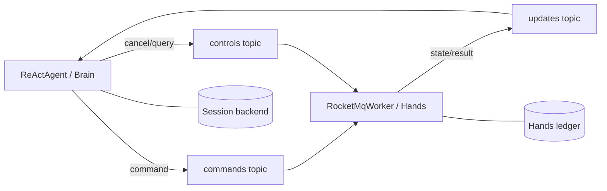

# RocketMQ Queued Hands scenario

[简体中文](README.md) · [Back to overview](../../README.en.md)

This scenario starts `brain` and `worker` roles from the same Spring Boot JAR. Brain runs an offline
AgentScope `ReActAgent` and routes its `echo` Tool Call to `RocketMqRemoteExecutor`. Worker runs
`RocketMqWorker` with a queryable echo Executor. Each side has its own SQLite file and exchanges
execution state only through RocketMQ 5 messages and the Durable protocol.



## Infrastructure

Following the [official RocketMQ quick start](https://rocketmq.apache.org/docs/quick-start/), prepare
a reachable RocketMQ 5 gRPC endpoint and three normal topics:

- `durable-hands-commands`
- `durable-hands-controls`
- `durable-hands-updates`

Topic and consumer-group names are derived from the default `durable` namespace and the `hands`
executor route, so both sides require no separate topology configuration. The example creates no
infrastructure and configures no cloud credentials. A production host adds authentication and TLS
to `ClientConfiguration`.

## Run and verify

Start Worker first:

```sh
bash agentscope-durable/durable-examples/queued/queued-hands/run.sh worker localhost:8081 ./durable-hands
```

Start Brain in another terminal:

```sh
bash agentscope-durable/durable-examples/queued/queued-hands/run.sh brain localhost:8081 ./durable-brain
```

Worker prints `queued-hands worker ready` and keeps running. Brain must print
`queued-hands brain verified ... status=SUCCEEDED` and exit. This proves that Worker consumed the
command, returned the echo result through the event topic, and the Agent applied the Tool Result to
produce its final answer. Stop and restart either side with its original directory to exercise ledger
and delivery recovery. Reusing the Brain directory and request ID must return the original Turn.

Without a Broker, verify packaging, Spring configuration, and compilation with:

```sh
bash agentscope-durable/durable-examples/queued/queued-hands/run.sh --compile-only
```

Automated tests also check required RocketMQ configuration and the echo Executor's start/query/cancel
contract. A real tool must implement idempotency and query behavior according to its side effects;
the pure echo implementation is not suitable for an unqueryable external operation. Production uses
a PostgreSQL RecordStore, shares the execution ledger/topic/group among Worker replicas, and shares
the Session Backend and delivery records among Brain replicas.

## Module and configuration

Standalone Maven module `agentscope-durable-example-queued-hands`, packaged as
`agentscope-durable/durable-examples/queued/queued-hands/target/agentscope-durable-example-queued-hands.jar`. The configuration prefix is `durable.queued-hands`
with properties `role` (`brain`/`worker`), `endpoint`, `data-directory`, `namespace`, `session-id`, `request-id`, `timeout`. Defaults live in `src/main/resources/application.yml`; override them with
command-line arguments, environment variables, or an external `application.yml`.
