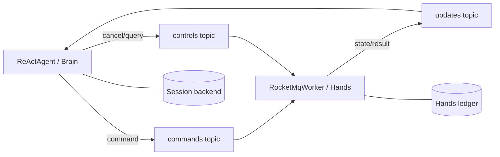

# RocketMQ Queued Hands 场景

[English](README.en.md) · [返回总览](../../README.md)

该场景使用同一个 Spring Boot JAR 启动 `brain` 与 `worker` 两种角色。Brain 运行离线
AgentScope `ReActAgent`，把 `echo` Tool Call 路由到 `RocketMqRemoteExecutor`；Worker 运行
`RocketMqWorker` 和可查询的 echo Executor。两侧使用各自的 SQLite 文件，只通过
RocketMQ 5 消息和 Durable 协议交换执行状态。



## 基础设施

按 [RocketMQ 官方快速开始](https://rocketmq.apache.org/docs/quick-start/) 准备可访问的
RocketMQ 5 gRPC endpoint 和三个普通 Topic：

- `durable-hands-commands`
- `durable-hands-controls`
- `durable-hands-updates`

Topic 和消费组名称由默认 namespace `durable` 与 executor route `hands` 自动派生，两端
无需分别配置。示例不自动创建基础设施，也不配置云凭证；生产宿主应在
`ClientConfiguration` 中增加鉴权和 TLS。

## 运行与验证

先启动 Worker：

```sh
bash agentscope-durable/durable-examples/queued/queued-hands/run.sh worker localhost:8081 ./durable-hands
```

另一个终端启动 Brain：

```sh
bash agentscope-durable/durable-examples/queued/queued-hands/run.sh brain localhost:8081 ./durable-brain
```

Worker 输出 `queued-hands worker ready` 后持续运行；Brain 应输出
`queued-hands brain verified ... status=SUCCEEDED` 并退出。该结果验证命令已由 Worker
消费、echo 执行结果经事件 Topic 返回、Agent 用 Tool Result 完成最终回答。停止并使用原
目录重启两端，可验证账本和交付记录的恢复。使用相同 Brain 目录与 request ID 再次提交，
应返回原 Turn。

没有 Broker 时仍可验证打包、Spring 配置和编译：

```sh
bash agentscope-durable/durable-examples/queued/queued-hands/run.sh --compile-only
```

自动测试还会检查必填 RocketMQ 配置以及 echo Executor 的 start/query/cancel 契约。
真实工具必须根据自己的副作用语义实现幂等键和查询；示例 echo 的纯函数实现不能直接用于
不可查询的外部操作。生产部署应以 PostgreSQL RecordStore 替换 SQLite，并让同池 Worker
副本共享执行账本、命令 Topic 和消费组，让 Brain 副本共享 Session Backend 与交付记录。

## 模块与配置

独立 Maven 模块 `agentscope-durable-example-queued-hands`，打包为
`agentscope-durable/durable-examples/queued/queued-hands/target/agentscope-durable-example-queued-hands.jar`。配置前缀为 `durable.queued-hands`，可用属性：
`role`（`brain`/`worker`）、`endpoint`、`data-directory`、`namespace`、`session-id`、`request-id`、`timeout`；默认值见 `src/main/resources/application.yml`，可通过命令行参数、环境变量或外部
`application.yml` 覆盖。
