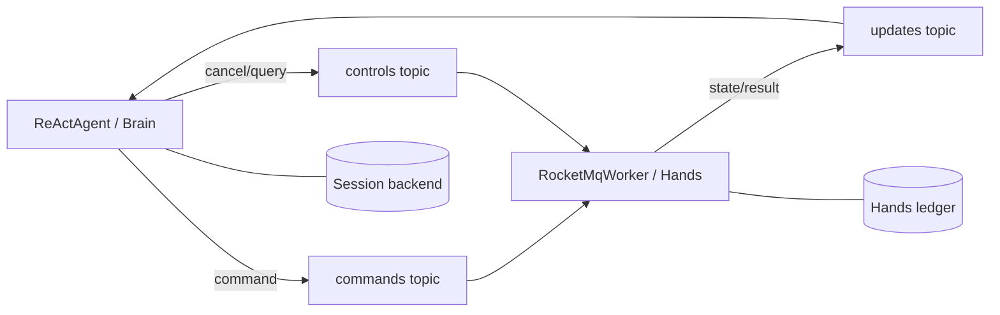

# Brain + Hands: echo tool

[简体中文](README.md) · [Back to overview](../../README.en.md)

One Maven module packages **two independent Spring Boot applications**, not a role-switching runner.
Brain runs an offline AgentScope `ReActAgent` and routes its `echo` Tool Call to
`RocketMqRemoteExecutor`. Hands runs `RocketMqWorker` with a queryable echo Executor.
Each side owns separate SQLite storage and exchanges execution state only through RocketMQ 5
messages and the Durable protocol. The model requires no API key; running the applications requires
**a real Broker and gRPC proxy**.



## Infrastructure

Following the [official RocketMQ quick start](https://rocketmq.apache.org/docs/quick-start/), prepare
Java 17+, Maven, a reachable RocketMQ 5 **gRPC proxy endpoint** (not the NameServer address),
and three normal topics:

- `durable-hands-commands`
- `durable-hands-controls`
- `durable-hands-updates`

Topics and consumer groups derive from the default MQ namespace `durable` and executor route
`hands`. Groups are `durable-hands-brain`, `durable-hands-worker`, and
`durable-hands-worker-controls`; grant their producer/consumer access. The script creates no
infrastructure and configures no credentials. Production hosts add authentication and TLS to
`ClientConfiguration`. Do not mix independent Brain databases in one consumer group.

## Build and run

Run from the repository root. Without a Broker, package both executable JARs:

```sh
bash agentscope-examples/durable/brain-hands/echo-tool/run.sh --compile-only
```

The module `agentscope-durable-example-echo-tool` produces these files in
`agentscope-examples/durable/brain-hands/echo-tool/target/`:

- `agentscope-durable-example-echo-tool-brain.jar`
- `agentscope-durable-example-echo-tool-hands.jar`

Start Hands first, then Brain in another terminal:

```sh
bash agentscope-examples/durable/brain-hands/echo-tool/run.sh hands localhost:8081 ./durable-hands
bash agentscope-examples/durable/brain-hands/echo-tool/run.sh brain localhost:8081 ./durable-brain
```

The script selects a JAR, never passes a Java role parameter, rejects invalid arguments before Maven,
and accepts only `--compile-only` or `<brain|hands> <endpoint> [data-directory]` (`worker` is not an alias).
`DURABLE_MAVEN_REPOSITORY` optionally selects its Maven local repository. Each JAR also starts directly:

```sh
java -jar agentscope-examples/durable/brain-hands/echo-tool/target/agentscope-durable-example-echo-tool-hands.jar --durable.echo-tool.endpoint=localhost:8081
java -jar agentscope-examples/durable/brain-hands/echo-tool/target/agentscope-durable-example-echo-tool-brain.jar --durable.echo-tool.endpoint=localhost:8081 --durable.echo-tool.timeout=60s
```

Hands prints `echo-tool hands ready` and blocks until shutdown. Brain prints
`echo-tool brain verified ... status=SUCCEEDED` and exits after verifying the final answer.
Keep both original directories across restarts. Reusing the request ID returns the original Turn;
a new request ID emits a new `echo-<turnId>` call. Earlier Tool Results cannot complete the new Turn.

## Source, configuration and offline tests

In `src/main/java/io/agentscope/durable/examples/brainhands/echo/`:

- `EchoBrainApplication.java` explicitly imports only `EchoBrainExample.java` (agent/model/runtime).
- `EchoHandsApplication.java` explicitly imports only `EchoHandsExample.java` (worker/executor/authorization).
- `EchoToolProperties.java` holds shared configuration and validation. Neither application scans the package.

Prefix: `durable.echo-tool`; properties: `endpoint`, `data-directory`, `namespace`, `session-id`,
`request-id`, `timeout`. Defaults live in `src/main/resources/application.yml`. Without a directory,
Brain uses `durable-echo-tool-data/brain`, Hands uses `durable-echo-tool-data/hands`.
Override properties with direct JAR arguments, environment variables or external YAML.

```sh
mvn -B -ntp -T1 -f agentscope-durable/pom.xml -Pdurable-standalone \
  -pl :agentscope-durable-example-echo-tool -am test \
  -Dtest=EchoToolExampleTest,EchoRoundTripTest -Dsurefire.failIfNoSpecifiedTests=false
```

Tests check configuration, isolated Spring contexts without invoking runners, start/query/cancel,
authorization and current-Turn result identity. The offline round trip uses production Brain/Hands,
separate SQLite stores and public queue/worker APIs, deliberately duplicating commands/events,
checking the next Turn, and reopening stores before result handoff. No Broker/provider is contacted.
**This is not acceptance evidence for the RocketMQ SDK, real two-process transport or process-kill faults.**
A real tool must implement idempotency and query behavior for its side effects; pure echo is not a
recipe for unqueryable external operations. Production replicas share PostgreSQL ledgers and the
corresponding Session Backend, delivery records, topics and groups.
