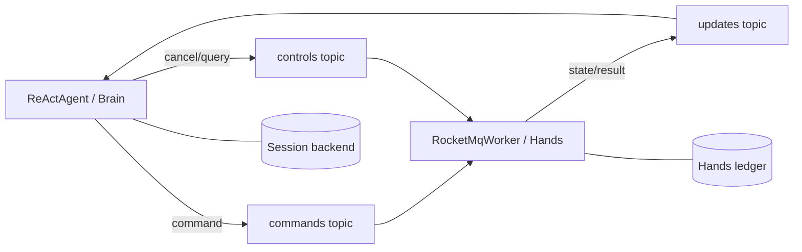

# Brain + Hands：echo 工具

[English](README.en.md) · [返回总览](../../README.md)

一个 Maven 模块打包**两个独立 Spring Boot 应用**，不再通过角色参数切换 runner。
Brain 运行离线 AgentScope `ReActAgent`，把 `echo` Tool Call 路由到
`RocketMqRemoteExecutor`；Hands 运行 `RocketMqWorker` 与可查询 echo Executor。
两侧各自持有 SQLite 存储，只通过 RocketMQ 5 消息和 Durable 协议交换执行状态。
模型无需 API Key，但运行应用**需要真实 Broker 与 gRPC Proxy**。



## 基础设施

按 [RocketMQ 官方快速开始](https://rocketmq.apache.org/docs/quick-start/) 准备 Java 17+、Maven、
可访问的 RocketMQ 5 **gRPC Proxy endpoint**（不是 NameServer 地址）与三个普通 Topic：

- `durable-hands-commands`
- `durable-hands-controls`
- `durable-hands-updates`

Topic 和消费组由默认 MQ namespace `durable` 与 executor route `hands` 派生。
消费组为 `durable-hands-brain`、`durable-hands-worker`、`durable-hands-worker-controls`，
需授予对应生产/消费权限。脚本不创建基础设施、不配置凭证；生产宿主应在
`ClientConfiguration` 中增加鉴权与 TLS。不要让独立 Brain 数据库混用同一消费组。

## 构建与运行

从仓库根目录执行；没有 Broker 也可以打包两个可执行 JAR：

```sh
bash agentscope-examples/durable/brain-hands/echo-tool/run.sh --compile-only
```

模块 `agentscope-durable-example-echo-tool` 在
`agentscope-examples/durable/brain-hands/echo-tool/target/` 生成：

- `agentscope-durable-example-echo-tool-brain.jar`
- `agentscope-durable-example-echo-tool-hands.jar`

先启动 Hands，再在另一个终端启动 Brain：

```sh
bash agentscope-examples/durable/brain-hands/echo-tool/run.sh hands localhost:8081 ./durable-hands
bash agentscope-examples/durable/brain-hands/echo-tool/run.sh brain localhost:8081 ./durable-brain
```

脚本只选择 JAR，不向 Java 传角色参数；无效输入在 Maven 前拒绝。接口仅为
`--compile-only` 或 `<brain|hands> <endpoint> [data-directory]`，不保留 `worker` 别名。
可通过 `DURABLE_MAVEN_REPOSITORY` 指定 Maven 本地仓库。也可直接启动每个 JAR：

```sh
java -jar agentscope-examples/durable/brain-hands/echo-tool/target/agentscope-durable-example-echo-tool-hands.jar --durable.echo-tool.endpoint=localhost:8081
java -jar agentscope-examples/durable/brain-hands/echo-tool/target/agentscope-durable-example-echo-tool-brain.jar --durable.echo-tool.endpoint=localhost:8081 --durable.echo-tool.timeout=60s
```

Hands 输出 `echo-tool hands ready`，阻塞直到关闭；Brain 校验最终答案后输出
`echo-tool brain verified ... status=SUCCEEDED` 并退出。重启保留两侧原目录。
相同 request ID 返回原 Turn；新 request ID 生成新的 `echo-<turnId>` 调用，旧 Tool Result
不能完成新 Turn。

## 入口、配置与离线测试

源码目录 `src/main/java/io/agentscope/durable/examples/brainhands/echo/`：

- `EchoBrainApplication.java` 仅显式装配 `EchoBrainExample.java`（agent/model/runtime）。
- `EchoHandsApplication.java` 仅显式装配 `EchoHandsExample.java`（worker/executor/授权）。
- `EchoToolProperties.java` 保存共享配置与校验；两个应用均不扫描包。

配置前缀 `durable.echo-tool`；属性为 `endpoint`、`data-directory`、`namespace`、
`session-id`、`request-id`、`timeout`；默认值见 `src/main/resources/application.yml`。
未指定目录时 Brain 使用 `durable-echo-tool-data/brain`，Hands 使用
`durable-echo-tool-data/hands`。可通过直接 JAR 参数、环境变量或外部 YAML 覆盖。

```sh
mvn -B -ntp -T1 -f agentscope-durable/pom.xml -Pdurable-standalone \
  -pl :agentscope-durable-example-echo-tool -am test \
  -Dtest=EchoToolExampleTest,EchoRoundTripTest -Dsurefire.failIfNoSpecifiedTests=false
```

测试检查配置、不执行 runner 的 Spring 上下文隔离、start/query/cancel、授权及当前 Turn
结果身份。离线 round trip 使用生产 Brain/Hands、独立 SQLite 与公开 queue/worker API，
故意重复命令/事件，检查下一个 Turn，并在结果交接前重开存储，不连接 Broker/provider。
**这些不是 RocketMQ SDK、真实双进程传输或进程强杀故障的验收证据。**
真实工具须按自身副作用实现幂等和查询；纯 echo 不能作为不可查询外部操作的实现模板。
生产副本应共享 PostgreSQL 账本及对应 Session Backend、交付记录、Topic 与消费组。
