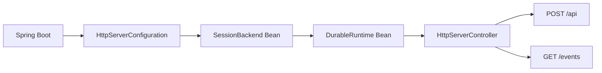

# HTTP Server Spring Boot Web example

[简体中文](README.md) · [Back to overview](../../README.en.md)

This module is an independent, standard Spring Boot Web application. `HttpServerApplication` starts
one Servlet application context. `HttpServerConfiguration` creates the `SessionBackend` and
`DurableRuntime` with ordinary `@Bean` methods, and constructor injection supplies them to the
controller. The application has no `SpringApplicationBuilder`, child context, dynamic bean
registration, or scenario runner.

The controller handles only parameters, authorization, and the Spring `SseEmitter` lifecycle.
Durable Core's `SessionEventStream` owns paging, wakeups, cursor advancement, and expired-cursor
resynchronization. Application code opens it through `session.streamEvents(...)` instead of
operating `SessionEventClient` directly.



The host intentionally starts no Brain. It persists Sessions, Threads, Turns, and public events;
execution hosts can connect to the same backend from other processes. `POST /api` exposes the
public Durable Runtime protocol. `GET /events` streams replayable SSE from the committed Session
event log. Protocol JSON stays under `DurableJson` so Spring Boot 4's Jackson 3 does not alter the
Jackson 2 nodes used by Durable.

SSE names committed frames `durable` and includes their cursor as `id`. If this API host and a Brain
share a `LiveEvents` transport, the same endpoint also emits best-effort `live` preview frames with
no `id`; reconnects therefore replay only committed history. This API-only example has no local
Brain producer, so it normally emits committed frames only.

## Run

From the repository root:

```sh
bash agentscope-examples/durable/integrated/http-server/run.sh
```

Or build and start the application directly:

```sh
mvn -B -ntp -T1 -f agentscope-durable/pom.xml -Pdurable-standalone \
  -pl :agentscope-durable-example-http-server -am package

java -jar agentscope-examples/durable/integrated/http-server/target/agentscope-durable-example-http-server.jar
```

The default address is `http://127.0.0.1:8080`.

| Property | Default | Purpose |
| --- | --- | --- |
| `server.address` | `127.0.0.1` | HTTP listening address |
| `server.port` | `8080` | HTTP listening port |
| `durable.http-server.data-directory` | `durable-http-server-data` | SQLite and object storage directory |
| `durable.http-server.namespace` | `demo` | Namespace accepted by this example |

For example:

```sh
java -jar agentscope-examples/durable/integrated/http-server/target/agentscope-durable-example-http-server.jar \
  --server.port=9090 \
  --durable.http-server.data-directory=./http-server-data
```

## Verification scenario

```sh
mvn -T1 -f agentscope-durable/pom.xml -Pdurable-standalone \
  -pl :agentscope-durable-example-http-server -am \
  -Dtest=HttpServerApplicationTest -Dsurefire.failIfNoSpecifiedTests=false \
  -Djacoco.skip=true test
```

The integration test starts a real Tomcat server on a random port. Client A creates a Session and
submits. Client B reacquires the same `SessionKey`, reads the `QUEUED` Turn and history, and cancels
it. An independent HTTP client subscribes to `/events`, verifies a replayable SSE cursor, and checks
that an unauthorized namespace returns 403.

A production host replaces the example's single-namespace check with real authentication and
authorization and configures a production backend, connection pool, traffic limits, and
observability.
