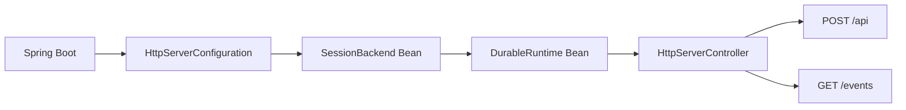

# HTTP Server Spring Boot Web 示例

[English](README.en.md) · [返回总览](../../README.md)

该模块是一个独立、标准的 Spring Boot Web 应用。`HttpServerApplication` 直接启动一个
Servlet 应用上下文；`HttpServerConfiguration` 通过普通 `@Bean` 创建 `SessionBackend` 和
`DurableRuntime`，Controller 使用构造器注入。应用中没有 `SpringApplicationBuilder`、子上下文、
动态 Bean 注册或场景 Runner。

Controller 只负责参数、授权和 Spring `SseEmitter` 生命周期。事件分页、wakeup、cursor 推进和
过期重同步由 Durable Core 的 `SessionEventStream` 统一处理，应用通过
`session.streamEvents(...)` 打开事件流，无需直接操作 `SessionEventClient`。



该宿主刻意不启动 Brain：它负责持久化 Session、Thread、Turn 和公共事件，执行宿主可在其他
进程中连接相同后端。`POST /api` 提供 Durable 公共 Runtime 协议；`GET /events` 从提交后的
Session 事件日志输出可重放 SSE。协议 JSON 始终由 `DurableJson` 编解码，避免 Spring Boot 4
的 Jackson 3 改变 Durable 使用的 Jackson 2 节点。

SSE 将提交后的帧命名为 `durable`，并把 cursor 写入 `id`。如果 API 宿主和 Brain 共享同一个
`LiveEvents` 传输，同一端点也会发送没有 `id` 的尽力而为 `live` 预览帧，因此重连只重放已提交
历史。该示例是 API-only 宿主，没有本地 Brain 生产者，通常只会输出持久帧。

## 启动

从仓库根目录执行：

```sh
bash agentscope-examples/durable/integrated/http-server/run.sh
```

也可以直接构建并启动：

```sh
mvn -B -ntp -T1 -f agentscope-durable/pom.xml -Pdurable-standalone \
  -pl :agentscope-durable-example-http-server -am package

java -jar agentscope-examples/durable/integrated/http-server/target/agentscope-durable-example-http-server.jar
```

默认地址是 `http://127.0.0.1:8080`。常用配置：

| 属性 | 默认值 | 用途 |
| --- | --- | --- |
| `server.address` | `127.0.0.1` | HTTP 监听地址 |
| `server.port` | `8080` | HTTP 监听端口 |
| `durable.http-server.data-directory` | `durable-http-server-data` | SQLite 和对象存储目录 |
| `durable.http-server.namespace` | `demo` | 该示例允许访问的 namespace |

例如：

```sh
java -jar agentscope-examples/durable/integrated/http-server/target/agentscope-durable-example-http-server.jar \
  --server.port=9090 \
  --durable.http-server.data-directory=./http-server-data
```

## 验证场景

```sh
mvn -T1 -f agentscope-durable/pom.xml -Pdurable-standalone \
  -pl :agentscope-durable-example-http-server -am \
  -Dtest=HttpServerApplicationTest -Dsurefire.failIfNoSpecifiedTests=false \
  -Djacoco.skip=true test
```

集成测试在随机端口启动真实 Tomcat。客户端 A 创建 Session 并提交；客户端 B 使用同一个
`SessionKey` 重新获取 `QUEUED` Turn、读取历史并取消；独立 HTTP 客户端订阅 `/events`，
确认 SSE 包含可重放 cursor，并验证错误 namespace 返回 403。

生产宿主需要把示例中的单 namespace 判断替换为真实认证授权，并配置生产 Backend、连接池、
流量限制和可观测性。
