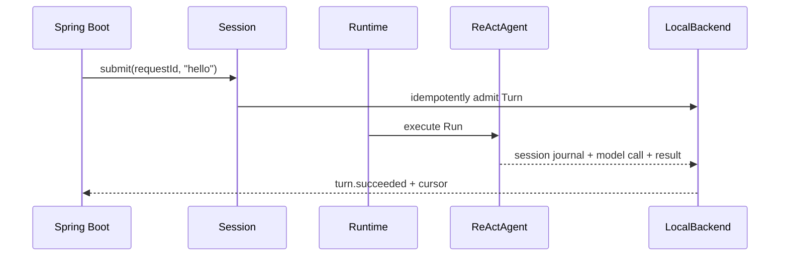

# Quickstart scenario

[简体中文](README.md) · [Back to overview](../../README.en.md)

This scenario puts an AgentScope `ReActAgent`, `DurableRuntime`, and local file Backend in one
Spring Boot process. It is the smallest integration and recovery example. Its deterministic offline
model needs no API key.



`QuickstartExample`:

1. Uses `AgentScopeAdapter.forReAct` to return an Agent builder for each invocation; the adapter
   injects the native Thread Journal and builds the Agent.
2. Observes the initial snapshot and incremental events through `session.observe`, submits the Turn,
   and starts the Runtime.
3. Checks observable evidence through `turn.listRuns` and `turn.listModelCalls`.
4. On another start with the same `namespace/sessionId/requestId`, receives the original Turn without
   another model invocation.

Run:

```sh
bash agentscope-examples/durable/integrated/quickstart/run.sh
```

The script starts two separate Spring Boot processes against one data directory. Both outputs must
contain the same Turn ID and `SUCCEEDED`; the first has `modelInvocations=1`, the second has `0`, and
the Run and model-call records remain queryable. To inspect persistent data, run the JAR directly
with a fixed `--durable.quickstart.data-directory`.

## Module and configuration

Standalone Maven module `agentscope-durable-example-quickstart`, packaged as
`agentscope-examples/durable/integrated/quickstart/target/agentscope-durable-example-quickstart.jar`. The configuration prefix is `durable.quickstart`
with properties `data-directory`, `namespace`, `session-id`, `request-id`, `timeout`. Defaults live in `src/main/resources/application.yml`; override them with
command-line arguments, environment variables, or an external `application.yml`.
