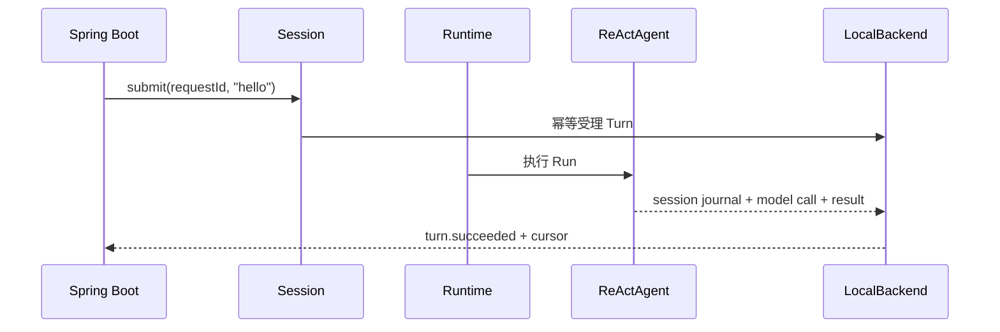

# Quickstart 场景

[English](README.en.md) · [返回总览](../../README.md)

该场景把 AgentScope `ReActAgent`、`DurableRuntime` 和本地文件 Backend 放在同一个
Spring Boot 进程，适合学习最小集成和幂等恢复。模型是确定性的离线实现，无需 API Key。



代码在 `QuickstartExample` 中完成以下动作：

1. 使用 `AgentScopeAdapter.forReAct` 返回每次调用所需的 Agent Builder；adapter
   自动注入原生 Thread Journal 并构建 Agent。
2. 用 `session.observe` 同时消费初始快照和增量事件，再提交 Turn、启动 Runtime。
3. 成功后通过 `turn.listRuns` 和 `turn.listModelCalls` 检查可观测证据。
4. 相同 `namespace/sessionId/requestId` 再次启动时，提交返回原 Turn，不再调用模型。

运行：

```sh
bash agentscope-examples/durable/integrated/quickstart/run.sh
```

脚本启动两个独立 Spring Boot 进程并复用同一数据目录。验收条件是两个输出的 Turn ID
相同、状态均为 `SUCCEEDED`，首次 `modelInvocations=1`，第二次为 `0`，且 Run 和模型调用
记录仍可查询。若要观察持久数据，直接运行 JAR并把
`--durable.quickstart.data-directory` 指向固定目录。

## 模块与配置

独立 Maven 模块 `agentscope-durable-example-quickstart`，打包为
`agentscope-examples/durable/integrated/quickstart/target/agentscope-durable-example-quickstart.jar`。配置前缀为 `durable.quickstart`，可用属性：
`data-directory`、`namespace`、`session-id`、`request-id`、`timeout`；默认值见 `src/main/resources/application.yml`，可通过命令行参数、环境变量或外部
`application.yml` 覆盖。
