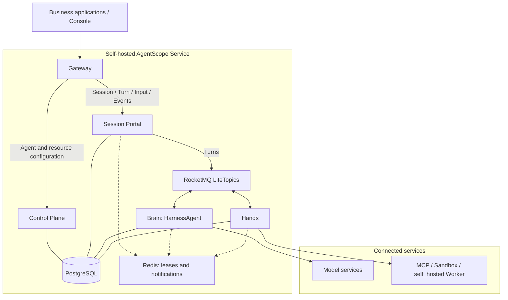

# AgentScope Service

> **A self-hostable Agent as a Service platform: configure Managed Agents built on HarnessAgent and use them from business applications through APIs.**

[中文说明](README_zh.md)

AgentScope Service turns Agent capabilities into services shared by business applications. Deploy the platform on your infrastructure, configure a Managed Agent with instructions, models and tools, and let Service run it. Applications submit work, follow progress, provide human input when needed, and retrieve results through the Session API.

Use it to generate customer proposals in a CRM, verify documents in a pipeline, investigate incidents in an engineering product, or provide an ongoing specialist assistant. Users work inside the existing product; Service manages Agent execution and its records. Application teams own business tools, data authorization, the interface and result acceptance. See [Use cases](../docs/v2/en/service/usecases.md) for integration designs.

## Managed Agents: HarnessAgent as a service

**Managed Agents are the primary starting point for using Service.** They use the same AgentScope HarnessAgent core as the Harness SDK. Configure an Agent directly through Console or management APIs, connect its model and tool execution Environment, then test it in a Session. Configure supported tools and Memory as the task requires, using execution records to check and improve delivery. The first native protocol does not accept Skills/multiagent configuration or client tool confirmation; consult the [current contract](../docs/v2/en/service/claude-session-api.md) before enabling extensions.

Service owns the Agent runtime, session management, background execution, checkpoints and recovery. Application teams can use these capabilities without developing and operating a separate Agent runtime service for each application. In the recommended self-hosted setup, the platform team operates Service and its shared infrastructure.

| Approach | How you develop | Runtime ownership |
| --- | --- | --- |
| Harness SDK | Embed HarnessAgent in a Java / Spring Boot application and compose behavior in code | Your application team deploys and operates the runtime |
| Managed Agents in Service | Configure HarnessAgent-based Agents through Console or APIs, then submit work through the Session API | Service manages execution and Sessions; the platform team operates the deployment |

Choose the [Harness SDK](../docs/v2/en/docs/quickstart.md) when you need to embed execution deeply in application code. Choose Managed Agents when applications should delegate execution to a shared platform. An existing SDK application can also connect as an External Agent.

## From deployment to your first Managed Agent

Start with a small task whose result you can judge. Follow this path; if your team already has a working Service deployment, begin with Agent creation.

| Step | What you do | Guide |
| --- | --- | --- |
| Deploy Service | Start the platform, configure a model and prepare a tool execution Environment | [Docker Compose](../docs/v2/en/service/quickstart.md) / [Kubernetes](../docs/v2/en/service/kubernetes.md) |
| Create a Managed Agent | Configure instructions, model and tools; submit a task and verify the result | [Your first Managed Agent](../docs/v2/en/service/create-managed-agent.md) |
| Configure capabilities | Configure tools and Memory within the current protocol capabilities | [Tools](../docs/v2/en/service/tools.md), [Workspaces](../docs/v2/en/service/workspaces.md), [Memory](../docs/v2/en/service/memory.md) |
| Integrate an application | Create Sessions, submit Turns and follow Events from your product | [Session API integration](../docs/v2/en/service/claude-session-api.md) |
| Expand and operate | Add collaboration where needed and inspect execution records | [Multi-agent orchestration](../docs/v2/en/service/orchestration.md), [Sessions and tasks](../docs/v2/en/service/session-event-log.md) |

## One application model: Session, Turn and Events

An Agent defines a reusable capability. A **Session** selects an Agent, Team or Workflow and freezes its configuration for the work that follows. Each task submitted within that Session creates a **Turn**, which Service executes in the background. Applications retain the Session and Turn IDs to correlate the work with their business records.

Applications read Session state, event history and Turn output to present progress and retrieve results. Current native Managed SSE delivers events after connection; after reconnecting, use paginated history and Turn/output queries. Native snapshots and SSE replay cursors are not supported. Closing the page or disconnecting SSE does not stop execution. A completed Turn still needs the application's business acceptance before its result enters the next stage of a process.

Managed Agents retain conversational context within a Session. Team and Workflow Turns start separate collaboration tasks or process runs. They share Session and Turn concepts. Current Managed execution uses `/v1/sessions` with `agent` creation and `user.message` Events; other backends retain the compatibility API. Payloads, context and supported controls depend on the selected backend. See [Session API integration](../docs/v2/en/service/claude-session-api.md) and the [API reference](../docs/v2/en/service/api-reference.md).

In production, application credentials belong to an Application and grant access to explicit target resources. Applications must also enforce business end-user permissions when exposing data or tools; using different credentials within one Application does not automatically isolate users' tasks.

## Extend Managed Agents with collaboration

Validate delivery with one Managed Agent first. Use a HarnessAgent Subagent when that Agent should delegate part of its work and incorporate the result. Add a Team when independently maintained specialists need a lead to coordinate their responsibilities. Use a Workflow when a process requires explicit steps, conditions or human approval. Applications continue to create Sessions and submit Turns for the selected target.

Existing capabilities can join this collaboration. An [External Agent](../docs/v2/en/service/register-agentscope-agent.md) retains its SDK or framework implementation, process and deployment while adapting task execution and event reporting to Service. A [Hosted Agent](../docs/v2/en/service/connect-hosted-agent.md) reuses a Coding Agent such as Codex or Claude Code through a Runtime Host that manages its provider processes and work directories.

Self-hosting Service means deploying the whole platform. A `self_hosted` tool Worker supplies a Managed Agent's tool execution environment; a Runtime Host runs Hosted Agents. These are separate roles. See [Environments](../docs/v2/en/service/environments.md) and [Runtime Host](../docs/v2/en/service/runtime-host.md) for setup.

## Architecture

The current source deploys five components: Gateway, Control Plane, Session Portal, Brain Dataplane and Hands. The diagram shows the Managed Agent execution path and its shared infrastructure. External Agents and Hosted Runtime Hosts extend the platform through the Control Plane.

### How it works



Applications use Gateway for management and Session APIs. Control Plane manages Agent definitions, resources, identity and collaboration. Session Portal admits work and serves snapshots, queries and SSE. Brain runs HarnessAgent reasoning and commits durable execution state; Hands performs physical tool execution in the configured Environment.

| Component or dependency | Responsibility |
| --- | --- |
| Gateway | Public entry, authentication and API routing |
| Control Plane (`service-controlplane`) | Resource and identity management, Team / Workflow orchestration, Hosted coordination, Cron, channels and outbound delivery |
| Session Portal | Session / Turn / Input admission, queries, public Events and SSE |
| Brain Dataplane | HarnessAgent execution, native logs, checkpoints, tool result commits and recovery |
| Hands | Tool and Sandbox execution, durable outputs and results, tool event publication |
| PostgreSQL | Durable admission and execution records, checkpoints, tool results, deduplication and oversized objects |
| Redis | Renewable execution ownership tokens and transient notifications |
| RocketMQ | Five business channels: Turns, Tool Execute, Tool Control, Tool Events and Turn Resumes |

### Managed Session runtime ownership

Brain and Hands separate Agent reasoning from physical tool execution. Brain persists and authorizes tool intents with the checkpoint; Hands validates that authorization, executes the operation and durably records its result. Brain commits tool results before continuing the same logical Turn. Long-running tools can suspend execution and release active runtime resources while preserving the Session's Turn order. Recovery can run on another Brain replica from durable state.

MCP batch waits use durable direct continuations; other tool operations and input waits use Session-scoped Resume messages. Redis accelerates delivery and protects active ownership, while PostgreSQL preserves the execution facts needed for recovery. With user files disabled, checkpoints and oversized objects use PostgreSQL without requiring NAS. File and Artifact capabilities have their own storage requirements.

Managed AgentTask integration and failure acceptance are still in progress. For protocol details, storage requirements and current integration limits, see [Managed runtime design](docs/managed-runtime-dataplane.md), [Redis and the Turn lifecycle](docs/redis-usage-and-turn-lifecycle.en.md) and [RocketMQ topics and the Turn lifecycle](docs/rocketmq-topics-and-turn-lifecycle.en.md).

### Production deployment architecture

The five components share durable infrastructure and support multiple replicas. Control Plane combines management and background coordination in one binary and image on port 8081; the current source does not require separate Scheduler or orchestration deployments. Its bounded workers use PostgreSQL claims, stream leases and fencing to coordinate across replicas. Helm's `control.executionSlots`, `control.workerBatch`, `control.channelSlots` and `control.webhookSlots` set per-replica concurrency.

For an upgrade from the old deployment, drain incoming channel traffic and outstanding replies, stop the old Java Scheduler and Go orchestration deployments, run the schema jobs and reapply grants, then start the combined Control Plane replicas. Preserve the `cp` / `rt` schemas and signing / encryption keys; the `0007_integrated_scheduler` product migration adds shared jobs and stream leases. Remove old Compose containers with `--remove-orphans`, or scale down old Helm deployments before upgrading. Retire old runtime / scheduler credentials after cutover.

This architecture describes the current source and requires newly built images. Published `2.1.0-BETA1` images and their installation defaults remain release-specific. Follow [Docker / Helm deployment](deploy/README.md) and the [release guide](release/README.md) for released installations.

## Quick start with Docker Compose

Build the current source in local development mode. Prepare Docker Compose v2 and a model credential, then run from the repository root:

```bash
cd agentscope-service
export DASHSCOPE_API_KEY="YOUR_DASHSCOPE_API_KEY"
./deploy/init-env.sh 2.1.0-local agentscope-local
# Configure reachable BUILDER_MANAGED_REDIS_URI / BUILDER_MANAGED_MQ_ENDPOINTS
# in deploy/.env; initialize the five business Lite parent topics and FIFO / Shared / wildcard consumer groups first.
export BUILDER_LOCAL_DEV=true
export BUILDER_ALLOW_LOCAL_ENVIRONMENT=true
docker compose --env-file deploy/.env up -d --build --wait --wait-timeout 600
```

Open http://localhost:18080. Console automatically uses the development identity and default scope; APIs require no login, user token, Application key, or grants. The explicit `BUILDER_LOCAL_DEV=true` setting enables this development flow; source Compose binds host ports to loopback. Models and external tools still need provider credentials.

Published `2.1.0-BETA1` images do not support this mode. See [production deployment](../docs/v2/en/service/kubernetes.md) for released Compose, Helm, accounts, and permissions; continue with [your first Agent](../docs/v2/en/service/create-managed-agent.md).

## Install CLI and Runtime Host with Go

To connect a Coding Agent to local development, install Go 1.26+ and build both commands from the current source. Run from the repository root:

```bash
cd agentscope-service/service-controlplane
go install ./cmd/as ./cmd/agentscope-runtime-host
AS_CLI_BIN_DIR="$(go env GOBIN)"
if [ -z "$AS_CLI_BIN_DIR" ]; then
  AS_CLI_BIN_DIR="$(go env GOPATH)/bin"
fi
export PATH="$AS_CLI_BIN_DIR:$PATH"
as version
agentscope-runtime-host -help
as connect http://localhost:18080
as runtime status
```

Use your actual Service URL when the Host is on another machine. Install and
authenticate the Coding Agent provider separately. The CLI connects to an existing
Service and starts Runtime Host; it does not deploy the platform. Persist the PATH
setting in your shell configuration. See the
[Runtime Host guide](https://java.agentscope.io/v2/en/service/runtime-host).

## Production installation with Helm

Prepare PostgreSQL, Redis, five RocketMQ Lite Topic/group pairs, separate migration and
workload Secrets, domain and TLS. Shared RWX Workspace/Artifact storage is needed only
when user files are enabled. Use the current-source Chart:

```bash
helm lint agentscope-service/helm/agentscope-service \
  --set imageRepository=REGISTRY/NAMESPACE \
  --set existingSecret=service-credentials --set schema.existingSecret=service-migration
```

Follow the [production installation guide](https://java.agentscope.io/v2/en/service/kubernetes)
to run schema jobs, apply business grants, then install the five RollingUpdate Deployments
with the matching image version. Published BETA1 images/Charts retain the earlier architecture.

## Development

For current Managed Session messages, event history and live SSE, follow the [native API quickstart](docs/api-quickstart.en.md).

### Start the source development stack

Source development needs JDK 17+, Maven, Go 1.26+, Node.js 22 and Docker.
From the repository root:

```bash
export DASHSCOPE_API_KEY=YOUR_MODEL_CREDENTIAL
export BUILDER_MANAGED_REDIS_URI=redis://YOUR_REDIS_HOST:6379
export BUILDER_MANAGED_MQ_ENDPOINTS=YOUR_CLUSTER_PROXY:8081
cd agentscope-service
scripts/dev-down.sh
BUILDER_REBUILD=1 scripts/dev-up.sh
# Stop later with scripts/dev-down.sh.
```

The development stack enables `BUILDER_LOCAL_DEV=true`, automatically uses one development identity, and uses development secrets. Rebuilds preserve the database by default. Initialize the five MQ Topic/group pairs first;
use `BUILDER_RESET_DB=1` only to explicitly recreate disposable development schemas.
It is separate from the release Compose installation above.

### Build the backend

Run the Maven build from the monorepo root so all AgentScope snapshots used by the service jars are current:

```bash
mvn -T1 install -DskipTests

cd agentscope-service/service-controlplane
make build
make test
```

### Build or run the console

```bash
cd agentscope-service/frontend
npm install
npm run build   # emits static assets into ../service-controlplane/ui

npm run dev     # Vite HMR; /api proxies to the gateway
```

### Run with Docker Compose

Build the Java artifacts first, then start the containerized stack:

```bash
mvn -T1 install -DskipTests
docker compose --env-file agentscope-service/deploy/.env -f agentscope-service/docker-compose.yml up --build
```

### Service ports

| Service | Port | Exposure |
| --- | ---: | --- |
| Gateway | 18080 | Public (container port 8080 with Docker Compose) |
| `service-controlplane` | 8081 | Internal |
| Data plane | 8082 | Internal |
| Session Portal | 8084 | Internal |
| Hands | 8085 | Internal |
| PostgreSQL | 5432 | Local infrastructure |

### Configuration

Java services use `builder.*` properties and `BUILDER_*` environment variables. All planes must agree on authentication secrets and internal URLs.

| Variable | Purpose |
| --- | --- |
| `DASHSCOPE_API_KEY` | DashScope model credential for local turns |
| `BUILDER_JWT_SECRET` | JWT signing secret shared by gateway/control components |
| `BUILDER_INTERNAL_TOKEN` | Secret for trusted plane-to-plane requests |
| `BUILDER_VAULT_MASTER_KEY` | Encryption key for vault credentials |
| `BUILDER_DB_URL`, `BUILDER_DB_USER`, `BUILDER_DB_PASSWORD` | Java data-plane database |
| `BUILDER_CONTROL_URL`, `BUILDER_DATA_URL`, `BUILDER_SESSION_PORTAL_URL` | Internal service endpoints |
| `BUILDER_E2B_API_KEY` | E2B credential for `sandbox` environments |
| `BUILDER_LOCAL_DEV` | Defaults to `false`; source Compose and development scripts default to `true`, bypassing platform authentication and authorization; release Compose / Helm keep it disabled. |
| `BUILDER_ALLOW_LOCAL_ENVIRONMENT` | Allows new `local` Environment bindings. Defaults to `false` in `service-controlplane`; `scripts/dev-up.sh` and the development Compose stack opt in. Keep disabled in production. |
| `CONTROL_PLANE_PRODUCT_DSN` | Product database used by `service-controlplane` |
| `CONTROL_PLANE_ENABLE_KUBERNETES` | Enables Control Plane CRD reconcilers and Kubernetes integration |
| `BUILDER_REBUILD=1` | Rebuilds the monorepo/service-controlplane while preserving the database |
| `BUILDER_RESET_DB=1` | Explicitly resets the selected disposable development `cp`/`rt`/`portal`/`dp`/`ma` schemas; defaults to `0` |
| `BUILDER_SMOKE_TEST=1` | Runs `scripts/smoke.sh` automatically after health and SQL-schema verification |

Production deployments must replace all development credentials and use durable PostgreSQL.


## Roadmap

Further development focuses on application integration and delivery: end-user authorization, file input contracts, automatic triggers through the Session API, and continued validation of long tasks, complex orchestration, and cost governance.

For enterprise cloud offerings, also see Alibaba Cloud [Agent Teams](https://help.aliyun.com/zh/agentteams/magic-console-product-overview) and [Agent Loop](https://help.aliyun.com/zh/document_detail/3033860.html).

## Documentation

- [Service overview](../docs/v2/en/service/index.md)
- [Use cases and integration designs](../docs/v2/en/service/usecases.md)
- [Deploy Service](../docs/v2/en/service/quickstart.md)
- [Your first Managed Agent](../docs/v2/en/service/create-managed-agent.md)
- [Session API integration](../docs/v2/en/service/claude-session-api.md)
- [Sessions and tasks](../docs/v2/en/service/session-event-log.md)
- [API reference](../docs/v2/en/service/api-reference.md)


## Session Portal refactoring development

The new Managed Session path uses `service-session-portal`, the Harness dataplane and `service-hands`. The implementation is still in progress; [the phase record](docs/session-portal-implementation-status.md) lists runnable paths and remaining integration work.

`make build` builds the combined `bin/service-controlplane`, CLI and Runtime Host. Execution
workers are enabled by default with a product database; SDK-only servers keep them disabled. Portal uses `BUILDER_CONTROL_URL` for Go execution protocols;
`BUILDER_ORCHESTRATION_RUNTIME_URL` remains an optional compatibility override. The old
`--enable-runtime-workers=false` setting is only for resource-seeding test fixtures.

Process fixtures require a dedicated PostgreSQL database and explicit local
`AGENTSCOPE_TEST_REDIS_URI` / `AGENTSCOPE_TEST_MQ_ENDPOINTS`. Pass `--fixture-dsn` to
Host/Hosted/Workflow/Team fixtures, or set `AGENTSCOPE_TEST_POSTGRES_DSN` for the native fixture.
The deployment fixture additionally uses `AGENTSCOPE_TEST_MQ_BROKER_CONTAINER` to create an
isolated Topic/group family. For the Team Java SDK check, first run
`mvn -T1 -pl agentscope-service/service-client dependency:build-classpath -Dmdep.outputFile=target/client-classpath.txt`.

The focused Host smoke is `python3 agentscope-service/tests/orchestration_runtime_host_smoke.py --fixture-dsn <dedicated-local-dsn>`. If the local OS cannot launch the new Go binary through Python, start the local fixture runtime separately and pass `--runtime-url`; use the test-only credentials declared in the script. The smoke uses the combined binary without a product database and checks Portal restart and Host identity/generation. It does not run provider tasks or verify durable runtime storage.


The Go runtime PostgreSQL role also requires `BUILDER_VAULT_MASTER_KEY` (at least
32 bytes, stable across its replicas) for encrypted Portal configuration,
command, and fact payloads. Its private bootstrap/inbox contracts now have a
PostgreSQL replica test and `tests/orchestration_runtime_portal_smoke.py
--runtime-url <local-runtime-url>` process check. Native execution from that
inbox is connected to native Hosted Job and Conversation execution. The focused
`tests/orchestration_runtime_native_smoke.py` check uses real Portal/Go/PostgreSQL
processes and an authenticated fake Host, including Portal restart, final usage,
physical-stop proof and SSE continuation. Add `--exercise-daemon` to run the real
Host daemon against a local fake Codex app-server CLI; `--daemon-cancel` exercises
provider termination and cancellation. These modes verify collaboration MCP,
streamed text/tool output, usage deduplication, snapshots and durable journal
delivery without external model calls. `--daemon-approve` and `--daemon-deny`
exercise a human tool confirmation, a lease interval spent waiting, Portal
restart and the applied receipt through the public Turn actions API. Configure
the Go role's `SESSION_PORTAL_URL` or `--session-portal-url` to reach Portal and
set `--execution-slots` for its local Turn advancement concurrency (default 32,
range 1..128). Public Session creation accepts Managed, Hosted, Workflow and Team backends;
External and mixed backends remain gated until their integrations are complete.
Add `--public-create` to verify Hosted creation and duplicate requests through
Portal using an isolated configuration HTTP fixture.

`tests/orchestration_runtime_hosted_smoke.py --fixture-dsn <dedicated-local-dsn>`
starts the real Portal, Go runtime and Host daemon with a fake Codex app-server.
Use `--approve`, `--deny` or `--cancel` for interaction checks. Create the dedicated
PostgreSQL schema before running. No external provider credentials are used.
Hosted task and reporting credentials last 15 minutes and refresh through Portal
using the current Host identity and physical lease proof. An attempt-local HTTP
relay gives the provider a stable local credential for MCP and task CLI requests,
and forwards them with the latest fenced token. The Host enrollment credential
has its own expiry and is still managed separately.
Gateway sends the new Session, Host machine, collaboration MCP, task-token CLI and
ToolTask paths to `BUILDER_SESSION_PORTAL_URL` (default `http://localhost:8084`).
Compose and Helm route these protocols to the combined control component.


`tests/orchestration_runtime_workflow_smoke.py --fixture-dsn <dedicated-local-dsn>`
checks public Workflow creation, approval, restart of Portal and the Go runtime,
applied receipts, snapshots and SSE replay with real PostgreSQL. Use `--deny`,
`--parallel` or `--signal` for the other root interaction flows. The configuration
admission source is an isolated HTTP fixture; the resource-seeding process stops before
the combined binary executes. Use a dedicated schema and run these process scenarios sequentially.
Pending confirmations and signals, including nested Workflow subgraphs, use the
public Turn `/actions` endpoint. Add `--nested` to the workflow fixture for two
subgraphs with repeated node keys. A waiting human branch does not pause independent
runnable branches. Agent-generated signals, independent Issue child runs and the
remaining Team controls are still being implemented.

`tests/orchestration_runtime_team_smoke.py --fixture-dsn <dedicated-local-dsn>`
checks public Hosted Team Job creation, fenced MCP conclusion, Portal restart,
physical stop, snapshots and SSE replay. Add `--cancel` for cancellation. It uses
an authenticated Host fixture without running a provider CLI; the configuration
source is a fixture and the resource-seeding process stops before the combined binary executes. Native memory
and PostgreSQL checks additionally cover dynamic parallel nodes and require every
worker's physical stop before the public Turn concludes. Child delegation and
the remaining graph controls are still being connected.

## 2026-10-21 runtime upgrade

The Service now includes durable MCP batches and tool submission/commit gates, unified Turn FIFO routing, recoverable acknowledgements, replica-safe outbox publication, and the Session event protocol. Apply the independent schema jobs before rolling out the services; the migration ledger preserves the existing `portal`, `dataplane`, `managed` identifiers and SQL history.

Self-hosted deployment remains the default. Optional data/MQ Secret overrides are empty unless explicitly configured. Existing `BUILDER_*` settings, AgentScope packages, component names, images and release channels are preserved. See [recovery](docs/mcp-execution-recovery.en.md), [API quickstart](docs/api-quickstart.en.md), and [migration notes](docs/master-sync-20261021.en.md).
