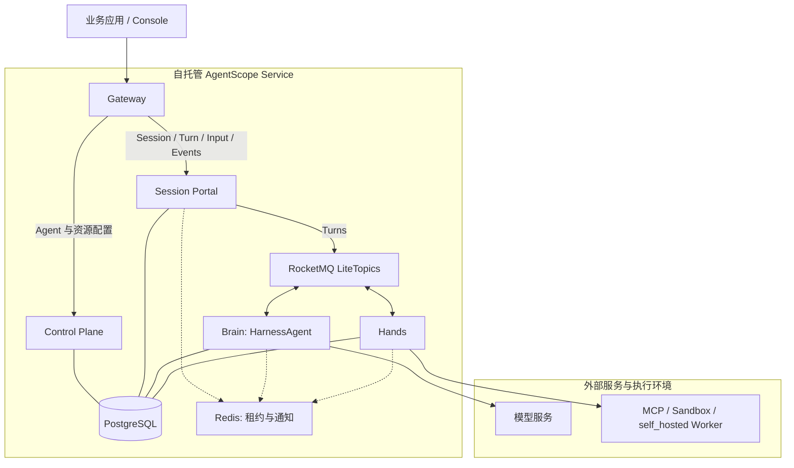

# AgentScope Service

> **可自托管的 Agent as a Service 平台：配置基于 HarnessAgent 的 Managed Agents，通过 API 为业务应用提供 Agent 服务。**

[English](README.md)

AgentScope Service 将 Agent 能力作为多个业务应用可以共享的服务。团队在自己的基础设施上部署平台，为 Managed Agent 配置指令、模型和工具，由 Service 承接运行。应用通过 Session API 提交工作、跟踪进展、在需要时补充人工输入，并获取结果。

业务应用可以在 CRM 中生成客户方案，在文档流水线中核验材料，在研发平台中调查故障，也可以提供持续对话的专业助手。用户在原有产品中工作，Service 管理 Agent 执行及其记录；应用团队负责业务工具、数据授权、界面和结果验收。完整接入设计见[场景案例](../docs/v2/zh/service/usecases.md)。

## Managed Agents：将 HarnessAgent 作为服务使用

**Managed Agents 是使用 Service 的主要起点。** 它与 Harness SDK 使用相同的 AgentScope HarnessAgent 内核。通过 Console 或管理 API 直接配置 Agent，连接模型与工具执行 Environment，再通过 Session 验证任务。随着需求明确，可以按当前能力配置工具与 Memory，依据实际执行记录检查并改进交付。首版原生协议不接受 Skills/multiagent 配置或客户端工具确认，启用扩展前先核对[当前契约](../docs/v2/zh/service/claude-session-api.md)。

Service 负责 Agent 运行时、会话管理、后台执行、checkpoint 和恢复。应用团队可以直接使用这些能力，无需为每个应用开发和运维独立的 Agent 运行服务。在当前推荐的自托管部署方式下，平台团队统一运维 Service 及其共享基础设施。

| 使用方式 | 如何开发 | 谁负责运行 |
| --- | --- | --- |
| Harness SDK | 在 Java / Spring Boot 应用中嵌入 HarnessAgent，通过代码组织行为 | 应用团队部署并运维运行时 |
| Service 中的 Managed Agents | 通过 Console 或 API 配置基于 HarnessAgent 的 Agent，再通过 Session API 提交工作 | Service 管理执行与 Session，平台团队运维部署环境 |

需要在应用代码中深度控制执行时，从 [Harness SDK](../docs/v2/zh/docs/quickstart.md)开始。希望业务应用将执行委托给共享平台时，使用 Managed Agents。已有 SDK 应用也可以作为 External Agent 接入。

## 从部署到第一个 Managed Agent

先选择一个能够判断结果是否合格的小任务，沿以下路径完成验证。团队已有可用 Service 时，可以从创建 Agent 开始。

| 步骤 | 要完成的工作 | 指南 |
| --- | --- | --- |
| 部署 Service | 启动平台、配置模型并准备工具执行 Environment | [Docker Compose](../docs/v2/zh/service/quickstart.md) / [Kubernetes](../docs/v2/zh/service/kubernetes.md) |
| 创建 Managed Agent | 配置指令、模型和工具，提交任务并检查结果 | [第一个 Managed Agent](../docs/v2/zh/service/create-managed-agent.md) |
| 配置能力 | 在当前协议能力内配置工具与 Memory | [工具](../docs/v2/zh/service/tools.md)、[Workspace](../docs/v2/zh/service/workspaces.md)、[Memory](../docs/v2/zh/service/memory.md) |
| 接入业务应用 | 在产品中创建 Session、提交 Turn 并跟踪 Events | [Session API 接入](../docs/v2/zh/service/claude-session-api.md) |
| 扩展协作与运维 | 按需增加协作并检查执行记录 | [多 Agent 编排](../docs/v2/zh/service/orchestration.md)、[会话与任务](../docs/v2/zh/service/session-event-log.md) |

## 统一应用模型：Session、Turn 与 Events

Agent 定义可复用的能力。**Session** 选择 Agent、Team 或 Workflow，并冻结后续工作使用的配置。在 Session 中每提交一次任务，就创建一个 **Turn**，由 Service 在后台执行。应用保存 Session 和 Turn ID，将执行记录与业务对象关联。

应用通过 Session 状态与 **Events** 展示进度、处理待确认操作并获取结果。SSE 提供实时更新；重新连接时，可以通过快照及其事件游标恢复交互。关闭页面或断开 SSE 不会停止执行。Turn 完成后，应用仍需按业务规则验收，再将结果接入下一阶段。

Managed Agent 在 Session 内保留对话上下文；Team 和 Workflow 的每个 Turn 分别启动协作任务或流程运行。它们共用 Session、Turn 概念。当前 Managed 使用 `/v1/sessions` 的 `agent` 创建与 `user.message` Events 写入，其他后端保留兼容 API；请求体、上下文和支持的控制以所选后端为准。详见 [Session API 接入](../docs/v2/zh/service/claude-session-api.md)和 [API 参考](../docs/v2/zh/service/api-reference.md)。

生产环境中的应用凭证归属于 Application，并授权访问明确的目标资源。应用在暴露业务数据或工具时，还需执行终端用户权限校验；同一 Application 中使用不同凭证不会自动隔离用户任务。

## 从 Managed Agents 扩展协作

先用一个 Managed Agent 验证交付。需要它委派部分工作并整合结果时，可以使用 HarnessAgent Subagent。多个独立维护的专业 Agent 需要由负责人协调时，使用 Team；业务流程需要明确步骤、条件或人工审批时，使用 Workflow。应用仍为选定的目标创建 Session、提交 Turn。

已有能力也可以加入协作。[External Agent](../docs/v2/zh/service/register-agentscope-agent.md)保留原有 SDK 或框架实现、进程和部署，通过适配任务执行和事件回报接入 Service。[Hosted Agent](../docs/v2/zh/service/connect-hosted-agent.md)通过 Runtime Host 复用 Codex、Claude Code 等 Coding Agent，由 Host 管理 provider 进程和工作目录。

自托管 Service 指部署整个平台。`self_hosted` 工具 Worker 提供 Managed Agent 的工具执行环境，Runtime Host 则运行 Hosted Agent，三者承担不同职责。配置方式见 [Environment](../docs/v2/zh/service/environments.md)与 [Runtime Host](../docs/v2/zh/service/runtime-host.md)。

## 整体架构

当前源码部署五个组件：Gateway、Control Plane、Session Portal、Brain Dataplane 和 Hands。下图展示 Managed Agent 的执行路径与共享基础设施；External Agent 和 Hosted Runtime Host 通过 Control Plane 扩展平台能力。

### 基本工作原理



应用通过 Gateway 使用管理 API 与 Session API。Control Plane 管理 Agent 定义、资源、身份与协作。Session Portal 受理工作，提供快照、查询与 SSE。Brain 运行 HarnessAgent 推理并提交持久执行状态，Hands 在配置的 Environment 中完成物理工具执行。

| 组件或依赖 | 职责 |
| --- | --- |
| Gateway | 公共入口、认证与 API 路由 |
| Control Plane（`service-controlplane`） | 资源与身份管理、Team / Workflow 编排、Hosted 协调、Cron、渠道和消息投递 |
| Session Portal | Session / Turn / Input 受理、查询、公开 Events 与 SSE |
| Brain Dataplane | HarnessAgent 执行、原生日志、checkpoint、工具结果提交与恢复 |
| Hands | 工具与 Sandbox 执行，持久保存输出和结果，发布工具事件 |
| PostgreSQL | 持久受理与执行记录、checkpoint、工具结果、去重和大对象 |
| Redis | 可续期的执行所有权 token 与临时通知 |
| RocketMQ | Turn、Tool Execute、Tool Control、Tool Events、Turn Resumes 五条业务通道 |

### Managed Session 的运行时归属

Brain 与 Hands 将 Agent 推理和物理工具执行分开。Brain 随 checkpoint 持久保存并授权工具意图，Hands 校验授权后执行操作并持久保存结果，Brain 提交工具结果后继续同一逻辑 Turn。长工具可以触发挂起，释放活动运行资源，同时保留 Session 内的 Turn 顺序；其他 Brain 副本可以从持久状态恢复执行。

MCP 批次等待使用持久的直接恢复意图，其他工具操作和输入等待使用 Session 级 Resume 消息。Redis 加速传递并保护活动所有权，PostgreSQL 保存恢复所需的执行事实。关闭用户文件功能时，checkpoint 和大对象存入 PostgreSQL，无需 NAS；文件与 Artifact 能力另有存储要求。

Managed AgentTask 的完整接入与故障验收仍在进行。协议细节、存储条件与当前接入限制见 [Managed 运行时设计](docs/managed-runtime-dataplane.md)、[Redis 与 Turn 生命周期](docs/redis-usage-and-turn-lifecycle.md)和 [RocketMQ Topic 与 Turn 生命周期](docs/rocketmq-topics-and-turn-lifecycle.md)。

### 生产部署架构

五个组件共享持久基础设施，支持多副本运行。Control Plane 在单个二进制和镜像中合并管理与后台协调职责，监听 8081 端口；当前源码无需独立部署 Scheduler 或 orchestration。有界 worker 通过 PostgreSQL 领取记录、Stream 租约和 fence 校验协调副本。Helm 的 `control.executionSlots`、`control.workerBatch`、`control.channelSlots` 与 `control.webhookSlots` 设置单副本并发。

从旧部署升级时，先暂停渠道入口并排空待回复消息，停止旧 Java Scheduler 和 Go orchestration 部署，执行 schema job 并重新授权，再启动合并后的 Control Plane 副本。保留 `cp` / `rt` schema 与签名、加密密钥；`0007_integrated_scheduler` 产品迁移创建共享任务与 Stream 租约表。Compose 使用 `--remove-orphans` 清理旧容器，Helm 升级前将旧 Deployment 缩容为 0，切换后再停用旧 runtime / scheduler 数据库凭据。

本节描述当前源码架构，需要重新构建镜像。已发布的 `2.1.0-BETA1` 镜像及安装默认值以对应发布版为准。发布安装见 [Docker / Helm 部署](deploy/README.md)和[发布维护手册](release/README_zh.md)。

## Docker Compose 快速开始

从当前源码构建免鉴权本地开发模式。准备 Docker Compose v2 和模型凭据，在仓库根目录运行：

```bash
cd agentscope-service
export DASHSCOPE_API_KEY="YOUR_DASHSCOPE_API_KEY"
./deploy/init-env.sh 2.1.0-local agentscope-local
# 在 deploy/.env 填写可达的 Redis URI / RocketMQ Cluster Proxy 地址，
# 并先初始化五个业务 Lite 父 Topic 和 FIFO / Shared / wildcard 消费组。
export BUILDER_LOCAL_DEV=true
export BUILDER_ALLOW_LOCAL_ENVIRONMENT=true
docker compose --env-file deploy/.env up -d --build --wait --wait-timeout 600
```

打开 http://localhost:18080，Console 自动进入开发身份和默认空间；API 无需登录、用户 token、应用 key 或授权配置。源码 Compose 默认 `BUILDER_LOCAL_DEV=true`，端口仅绑定本机。模型和外部工具仍需要提供方凭据。

已发布的 `2.1.0-BETA1` 镜像不支持该模式。发布版 Compose、Helm、认证与权限配置见[生产部署](../docs/v2/zh/service/kubernetes.md)；继续[创建第一个 Agent](../docs/v2/zh/service/create-managed-agent.md)。

## 使用 Go 安装 CLI 与 Runtime Host

接入本地开发模式时，准备 Go 1.26+，在仓库根目录从当前源码安装两个命令：

```bash
cd agentscope-service/service-controlplane
go install ./cmd/as ./cmd/agentscope-runtime-host
AS_CLI_BIN_DIR="$(go env GOBIN)"
if [ -z "$AS_CLI_BIN_DIR" ]; then
  AS_CLI_BIN_DIR="$(go env GOPATH)/bin"
fi
export PATH="$AS_CLI_BIN_DIR:$PATH"
as version
agentscope-runtime-host -help
as connect http://localhost:18080
as runtime status
```

Host 在另一台机器时，请使用实际 Service 地址。Coding Agent provider 需要另行安装和登录。
CLI 连接已有 Service 并启动 Runtime Host，不负责部署平台。将 PATH 设置写入 shell 配置文件。
更多说明见 [Runtime Host 安装与运维](https://java.agentscope.io/v2/zh/service/runtime-host)。

## 使用 Helm 安装生产环境

先准备 PostgreSQL、Redis、五组 RocketMQ Lite Topic/消费组、分离的迁移与业务 Secret、域名和 TLS。
用户文件开启时才需要 Workspace/Artifact 的共享 RWX 存储。使用当前源码 Chart：

```bash
helm lint agentscope-service/helm/agentscope-service \
  --set imageRepository=REGISTRY/NAMESPACE \
  --set existingSecret=service-credentials --set schema.existingSecret=service-migration
```

按[生产安装指南](https://java.agentscope.io/v2/zh/service/kubernetes)安装
当前源码 Chart，先运行迁移任务、重新授权，再以配套镜像版本部署五个 RollingUpdate 组件。
已发布的 BETA1 镜像与 Chart 保持旧架构，不能替代当前实现。

## 开发

手工验证当前 Managed Session 消息、事件历史与实时 SSE，请使用[原生 API 快速入门](docs/api-quickstart.md)。

### 从源码启动开发环境

源码开发需要 JDK 17+、Maven、Go 1.26+、Node.js 22 和 Docker。
从仓库根目录运行：

```bash
export DASHSCOPE_API_KEY=YOUR_MODEL_CREDENTIAL
export BUILDER_MANAGED_REDIS_URI=redis://YOUR_REDIS_HOST:6379
export BUILDER_MANAGED_MQ_ENDPOINTS=YOUR_CLUSTER_PROXY:8081
cd agentscope-service
scripts/dev-down.sh
BUILDER_REBUILD=1 scripts/dev-up.sh
# 日后用 scripts/dev-down.sh 停止。
```

开发栈默认启用 `BUILDER_LOCAL_DEV=true`，使用单一开发身份与开发密钥，无需登录。重建默认保留数据库。先初始化五组 MQ Topic/消费组，
只有显式设置 `BUILDER_RESET_DB=1` 才重置所选开发 schema。
这与上面的发布版 Compose 安装是不同的环境。

### 构建后端

请从 Monorepo 根目录执行 Maven，确保 Service JAR 使用的 AgentScope Snapshot 都是最新版本：

```bash
mvn -T1 install -DskipTests

cd agentscope-service/service-controlplane
make build
make test
```

### 构建或开发 Console

```bash
cd agentscope-service/frontend
npm install
npm run build   # 静态资源输出到 ../service-controlplane/ui

npm run dev     # Vite HMR，/api 代理到 Gateway
```

### Docker Compose

先构建 Java Artifact，再启动容器化环境：

```bash
mvn -T1 install -DskipTests
docker compose --env-file agentscope-service/deploy/.env -f agentscope-service/docker-compose.yml up --build
```

### 服务端口

| 服务 | 端口 | 暴露方式 |
| --- | ---: | --- |
| Gateway | 18080 | 对外（Docker Compose 容器内仍为 8080） |
| `service-controlplane` | 8081 | 内部 |
| Dataplane | 8082 | 内部 |
| Session Portal | 8084 | 内部 |
| Hands | 8085 | 内部 |
| PostgreSQL | 5432 | 本地基础设施 |

### 配置

Java Service 使用 `builder.*` 属性与 `BUILDER_*` 环境变量。各平面必须使用一致的认证密钥和内部 URL。

| 变量 | 作用 |
| --- | --- |
| `DASHSCOPE_API_KEY` | 本地 Turn 使用的 DashScope 模型凭据 |
| `BUILDER_JWT_SECRET` | Gateway 与控制组件共享的 JWT 签名密钥 |
| `BUILDER_INTERNAL_TOKEN` | 平面间可信调用密钥 |
| `BUILDER_VAULT_MASTER_KEY` | Vault 凭据加密密钥 |
| `BUILDER_DB_URL`、`BUILDER_DB_USER`、`BUILDER_DB_PASSWORD` | Java Dataplane 数据库 |
| `BUILDER_CONTROL_URL`、`BUILDER_DATA_URL`、`BUILDER_SESSION_PORTAL_URL` | 内部服务地址 |
| `BUILDER_E2B_API_KEY` | `sandbox` Environment 的 E2B 凭据 |
| `BUILDER_LOCAL_DEV` | 默认 `false`；源码 Compose 和开发脚本默认 `true`，跳过平台认证与权限校验；发布 Compose / Helm 保持关闭。 |
| `BUILDER_ALLOW_LOCAL_ENVIRONMENT` | 是否允许新的 `local` Environment 绑定。`service-controlplane` 默认 `false`，`scripts/dev-up.sh` 和开发用 Compose 显式开启；生产环境应保持关闭。 |
| `CONTROL_PLANE_PRODUCT_DSN` | `service-controlplane` 使用的产品数据库 |
| `CONTROL_PLANE_ENABLE_KUBERNETES` | 是否启用 Control Plane CRD Reconciler 与 Kubernetes 集成 |
| `BUILDER_REBUILD=1` | 重建 Monorepo/service-controlplane，默认保留数据库 |
| `BUILDER_RESET_DB=1` | 显式重置所选开发实例的 `cp`/`rt`/`portal`/`dp`/`ma` schema；默认 `0` 保留数据 |
| `BUILDER_SMOKE_TEST=1` | 健康检查和 SQL schema 校验通过后自动运行 `scripts/smoke.sh` |

生产部署必须替换全部开发密钥，并使用持久化 PostgreSQL。


## Roadmap

后续演进围绕业务应用的接入与交付：完善终端用户授权和文件输入契约，让自动触发复用公开调用链路，并持续验证长任务、复杂编排和费用治理。

企业级云产品亦可关注阿里云 [Agent Teams](https://help.aliyun.com/zh/agentteams/magic-console-product-overview)、[Agent Loop](https://help.aliyun.com/zh/document_detail/3033860.html)。

## 文档

- [Service 定位与介绍](../docs/v2/zh/service/index.md)
- [场景案例与接入设计](../docs/v2/zh/service/usecases.md)
- [部署 Service](../docs/v2/zh/service/quickstart.md)
- [第一个 Managed Agent](../docs/v2/zh/service/create-managed-agent.md)
- [Session API 接入](../docs/v2/zh/service/claude-session-api.md)
- [会话与任务](../docs/v2/zh/service/session-event-log.md)
- [API 参考](../docs/v2/zh/service/api-reference.md)


进程测试使用专用 PostgreSQL 数据库，并设置本地 `AGENTSCOPE_TEST_REDIS_URI` 和
`AGENTSCOPE_TEST_MQ_ENDPOINTS`。Host / Hosted / Workflow / Team 测试传入 `--fixture-dsn`；
native 测试可通过 `AGENTSCOPE_TEST_POSTGRES_DSN` 指定数据库。完整部署进程测试使用
`AGENTSCOPE_TEST_MQ_BROKER_CONTAINER` 初始化独立 Topic / 消费组，避免消费其他测试的消息。
Team 的 Java SDK 验证前执行
`mvn -T1 -pl agentscope-service/service-client dependency:build-classpath -Dmdep.outputFile=target/client-classpath.txt`。

重构开发中的 Go 运行角色使用 PostgreSQL 时，还需配置至少 32 字节且副本间稳定一致的
`BUILDER_VAULT_MASTER_KEY`，用于加密 Portal 配置、命令和事实 payload。
`tests/orchestration_runtime_portal_smoke.py --runtime-url <本地运行角色地址>`
已经验证真实 Portal/Go/PostgreSQL 的配置与 Inbox 投递及重启回执。
`tests/orchestration_runtime_native_smoke.py` 已跑通 Hosted Job 与 Conversation 的原生执行、
Portal 重启、最终用量、停止证明与 SSE 续传。默认使用认证 Host 替身；增加
`--exercise-daemon` 可运行真实 Host daemon 和本地 fake Codex app-server CLI，
`--daemon-cancel` 验证停止 provider 后完成取消。这两种模式还验证协作 MCP、文本及工具
增量、用量去重、快照和持久 journal 投递，不调用外部模型。
`--daemon-approve` 和 `--daemon-deny` 验证人工工具确认、跨租约周期等待、
Portal 重启，以及公开 Turn actions 的应用回执。
Go 运行角色通过 `SESSION_PORTAL_URL` 或 `--session-portal-url`
访问 Portal，`--execution-slots` 控制本实例并行推进 Turn 的数量，默认 32、范围 1..128。
公开 Session 创建已接通 Managed、Hosted、Workflow 和 Team；External 及混合后端仍按接入进度保留门禁。
增加 `--public-create` 可用隔离配置 HTTP fixture 验证 Portal 的 Hosted 创建与重复请求。

`tests/orchestration_runtime_hosted_smoke.py --fixture-dsn <专用本地测试DSN>`
启动真实 Portal、Go 运行角色与 Host daemon，使用假 Codex app-server；增加
`--approve`、`--deny` 或 `--cancel` 检查交互。运行前创建专用 PostgreSQL schema，
不使用外部供应商凭据。Hosted 任务与报告凭据有效期为 15 分钟，通过 Portal 使用
当前 Host 身份及物理 lease 证明刷新。每个 Attempt 的本地 HTTP 转发提供稳定本地
凭据，将 MCP 和任务 CLI 请求换成最新带 fence 的 token。Host 入驻凭据的到期与
轮换仍独立管理。Gateway 将新 Session、Host 机器协议、协作 MCP、带任务 token
的 CLI 和 ToolTask 路径转至 `BUILDER_SESSION_PORTAL_URL`，默认
`http://localhost:8084`；Compose / Helm 已将 Go 执行协议接入合并后的 control 组件。


`tests/orchestration_runtime_workflow_smoke.py --fixture-dsn <专用本地测试DSN>`
验证公开 Workflow 创建、审批、Portal 与 Go 运行角色重启、应用回执、快照和 SSE 续传，
实际使用 PostgreSQL。增加 `--deny`、`--parallel` 或 `--signal` 验证其他根交互流程。
配置准入源为隔离 HTTP fixture，执行前停止资源准备进程，再由合并后的 control 二进制执行。使用专用 schema，并顺序运行这些
进程场景。确认和信号（包括嵌套 Workflow 子图）通过公开 Turn `/actions` 答复；增加
`--nested` 验证两层使用重复节点名的子图。人工等待分支不会暂停独立的可执行分支。
Agent 发出信号、独立 Issue 子 Run 及其余 Team 控制仍在实施。

`tests/orchestration_runtime_team_smoke.py --fixture-dsn <专用本地测试DSN>`
验证公开 Hosted Team Job 创建、带 fence 的 MCP 结论、Portal 重启、实际停止、快照与
SSE 续传；增加 `--cancel` 验证取消。使用认证 Host 替身，不运行 provider CLI；配置源
为 fixture，执行前停止资源准备进程，再由合并后的 control 二进制执行。原生内存和 PostgreSQL 检查还覆盖动态并行节点，所有
Worker 的实际停止证明齐备后才结束公开 Turn。子任务委派及其余图控制仍在接入。

## 2026-10-21 运行时升级

本轮同步持久化 MCP 批次、工具提交/结果提交门、统一 Turn FIFO 路由、可恢复确认、副本安全的 outbox 发布，以及 Session 事件协议。更新服务前先运行独立数据库迁移 Job；迁移账本继续保留 `portal`、`dataplane`、`managed` 组件 ID 和已有 SQL 历史。

默认继续使用自建部署。额外的数据/MQ Secret 覆盖项默认为空，需显式启用。保留 `BUILDER_*` 配置、AgentScope 包名、组件名、镜像名与发布渠道。参见[恢复说明](docs/mcp-execution-recovery.md)、[API 快速入门](docs/api-quickstart.md)和[同步记录](docs/master-sync-20261021.md)。
