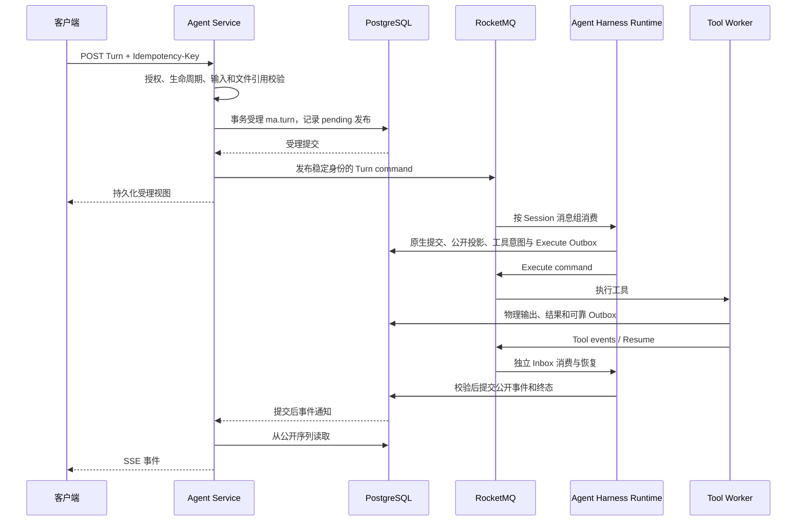
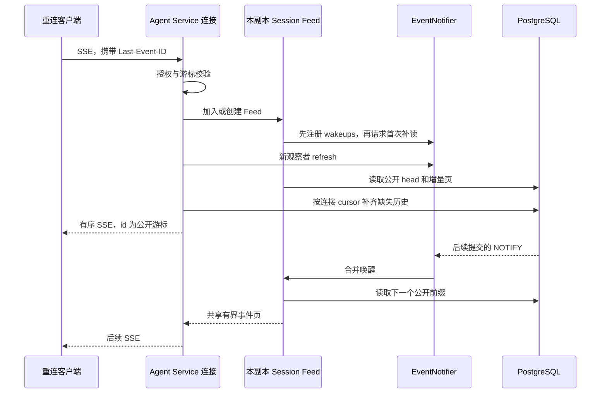
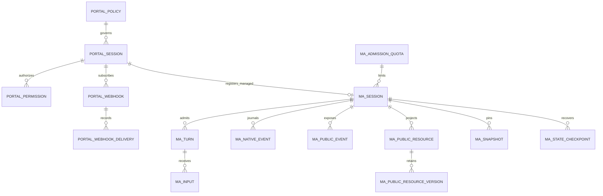

# Agent Service 整体设计与实现

本文描述截至 **2026-10-19 当前源码**的 Agent Service，包括 Managed 原生 Session，以及仍使用通用运行时协议的 Hosted、Team、Workflow 等路径。实现以 `agent-service`、`common` 中的 Managed 存储与传输组件、当前 Agent Harness Runtime／Tool Worker 和 Go Control Plane 为准。

Agent Service 负责用户请求的受理、授权、持久化查询与公开事件交付。Managed 执行通过 MQ 进入 Agent Harness Runtime；Agent Harness Runtime 提交原生日志、Checkpoint、逻辑工具状态和终态；Tool Worker 提交物理工具执行事实，再由 Agent Harness Runtime 消费、校验并形成公开事件。Agent Service 不执行 Harness，也不直接把 Tool Worker 的物理输出当成用户可见事件。

本文是当前实现的独立说明。目录中的早期拆分计划、阶段状态记录保留各自的历史用途；遇到旧 Runtime 事件回传、由 Tool Worker 提交原生状态、独立 Scheduler／Orchestration 部署等描述，应以本文及对应源码为准。完整 Managed 执行细节见[Managed runtime 设计](managed-runtime-dataplane.md)，HTTP 字段与使用示例见[原生 Session API](../../docs/v2/zh/service/claude-session-api.md)。Endpoint／Invocation 是另一套公开业务资源，其 ID 和事件游标不能与原生 Session API 混用。

MCP 批次扩展（2026-10-21）保留 Agent Service 的逐调用工具列表与分页视图，通过 `ma.mcp_batch_call` 关联内部父批次；结果直接唤醒持久恢复意图，不再额外发布 Resume，详见 [MCP 执行恢复](mcp-execution-recovery.md)。

## 1. 系统位置与职责边界

### 1.1 当前服务组成

当前源码部署五类进程。下面的端口是服务默认监听端口，外部地址由 Gateway 和部署配置决定。

| 组件 | 默认端口 | 与 Agent Service 的关系 | 状态与执行归属 |
| --- | --- | --- | --- |
| Gateway | 8080 | 转发公开 Session API，承接公共入口认证与路由 | 不保存 Session 执行账本 |
| Go Control Plane | 8081 | 提供 Session admission、配置和策略投影；承接 Hosted／Team／Workflow 协议；执行 Webhook 网络发送 | 管理面、编排、Hosted 协调、Cron、渠道与出站任务 |
| Agent Service | 8084 | 公开 Session／Turn／Input、查询、SSE、文件和产物入口 | 受理记录、授权投影、公开读模型与交付游标 |
| Agent Harness Runtime Dataplane | 8082 | 从 MQ 消费 Managed Turn；与 Agent Service 共享 Managed 持久化协议 | Harness、原生日志、Checkpoint、逻辑工具任务、工具事件 Inbox、恢复与终态 |
| Tool Worker | 8085 | 经 MQ 与 Agent Harness Runtime 通信；不依赖 Agent Service 来提交运行时事实 | Sandbox／MCP 物理执行、输出、不可变结果、结果与 Resume Outbox |

Go Control Plane 已集成此前 Scheduler 与 Orchestration 的职责，不再需要两套独立部署。源码类名、文件名中仍可能保留这些历史名称。

### 1.2 组件依赖图

```mermaid
flowchart LR
    User[业务客户端] --> Gateway
    Gateway --> Agent Service[Agent Service]
    Agent Service -->|Session admission / 配置 / 策略| Control[Go Control Plane]
    Agent Service -->|Managed Turn 发布| MQ[RocketMQ]
    MQ -->|TURNS / TURN_RESUMES / TOOL_EVENTS| Agent Harness Runtime[Agent Harness Runtime Dataplane]
    Agent Harness Runtime -->|TOOL_EXECUTE / TOOL_CONTROL| MQ
    MQ -->|Execute / Control| Tool Worker
    Tool Worker -->|TOOL_EVENTS / TURN_RESUMES| MQ
    Agent Harness Runtime --> PG[(PostgreSQL)]
    Tool Worker --> PG
    Agent Service --> PG
    PG -->|LISTEN / NOTIFY 唤醒| Agent Service
    Agent Service --> Redis[(Redis)]
    Agent Harness Runtime --> Redis
    Tool Worker --> Redis
    Agent Service <-->|Hosted / Team / Workflow 协议| Control
    Control -->|领取 / 校验 / 回执| Agent Service
    Control -->|Webhook HTTP 发送| Receiver[Webhook 接收方]
```

图中的共享数据库连接不等于可以互相接管职责。Agent Service 使用 Managed 受理、查询、资源变更和控制操作接口；不消费工具执行队列，不推进 Harness 的原生执行状态，不通过查询 `ma.hands_*` 表拼接实时输出。

### 1.3 基础设施分工

| 基础设施 | 保存或传递的内容 | 故障后的恢复依据 |
| --- | --- | --- |
| PostgreSQL | Session／Turn／Input、执行事实、原生日志段索引、公开事件、Checkpoint 引用、Inbox／Outbox、公开投影与交付回执 | 持久化账本与稳定身份 |
| RocketMQ LiteTopics | 有序 Turn、Execute、Control、工具事件、Resume | Broker 重投递与数据库去重／状态校验 |
| Redis | 发布与执行所有权令牌、Input Stream、结果唤醒等加速信息 | 数据库中的受理与执行记录；Redis 丢失不能授权重复外部副作用 |
| PostgreSQL NOTIFY | 某个 Session 的公开事件前缀可能推进了 | 数据库中的公开事件游标；通知本身不提供历史重放 |
| 文件／对象设施 | 按配置保存用户文件、工作空间及产物；私有执行内容通过可插拔对象存储保存 | 对应文件元数据、私有对象和 Checkpoint 引用 |

Session Store 嵌入 Brain，checkpoint/state 与原生日志段使用对象存储；Agent Service 承载独立连接池的异步投影消费者。私有恢复存储始终必需，关闭用户文件能力不会关闭它；具体配置与当前实施边界见 [Session Store 实现说明](session-store.md)。

## 2. Agent Service 内部组件

### 2.1 启动与依赖组织

`AgentServiceApp` 只扫描 `io.agentcore.managed.server.agentservice`，启用定时任务。`AgentServicePersistenceConfig` 注册 Agent Service JPA 实体、Repository 和事务模板，并显式引入 `VaultCrypto`、`SessionEventNotifier`、`ManagedInfrastructureConfiguration`、`ManagedCatalog`。

`managed-agents.runtime.role=agent-service` 决定 MQ 角色：Agent Service 只发布 `TURNS`，没有 Managed MQ 消费组。共享基础设施中的存储 Bean 可供 Agent Service 受理和查询使用；Agent Harness Runtime／Tool Worker 的执行组件不会因共享代码而进入 Agent Service 的组件扫描。

Agent Service 使用 Spring WebFlux，但 JPA／JDBC 是阻塞接口。控制器及 SSE 数据库读取使用 `boundedElastic` 等工作线程承接阻塞工作；网络事件循环不承担数据库阻塞读取。后台补偿任务使用独立命名的 scheduler，分开承担 provisioning、Turn 投递、Input 投递、策略、生命周期、Checkpoint 和 Snapshot 清理。

### 2.2 主要类与依赖

| 领域 | 入口与主要组件 | 关键依赖／产物 |
| --- | --- | --- |
| Managed canonical API | `SessionApiController`、`SessionApi`、`ManagedSessionTurnsApi` | `AgentServiceSessionAccess`、`ManagedAdmissionStore`、`ManagedJournalStore` |
| Session 创建 | `AgentServiceSessionCreation`、`AgentServiceSessionProvisioning` | Control Plane admission／projection、Agent Service Session、冻结的 bootstrap |
| 授权与策略 | `AgentServiceSessionAccess`、`AgentServiceSessionPermissions`、`AgentServicePolicies`、`AgentServicePolicyChanges` | 原始 Actor、共享策略、权限投影、有效期 |
| Managed Turn 发布 | `ManagedAdmissionStore`、`ManagedTurnPublisher` | `ma.turn` 中的待发布记录、Redis guard、MQ `TURNS` |
| Managed Input | `ManagedSessionTurnsApi`、`ManagedInputDelivery` | `ma.input`、Redis Stream，最终应用结果由 Agent Harness Runtime 提交 |
| Managed 事件与 SSE | `ManagedJournalStore`、`SessionEventNotifier`、`ManagedSessionEventStreams` | `ma.public_event`、提交后唤醒、每副本每 Session 一个共享 Feed |
| 公开资源与分页 | `ManagedPublicResources` | 当前资源、历史版本、固定水位的 Snapshot |
| 生命周期与 Checkpoint | `SessionApi`、`ManagedLifecycles`、`AgentServiceSessionCheckpoints`、`AgentServiceCheckpointWrites` | 持久化命令／操作，Agent Harness Runtime 协调执行 |
| 文件、产物、预算 | `ManagedFilesController`、`ManagedArtifactsController`、`AgentServiceSessionBudgets` | Managed 存储与资源事件；按能力和权限开放 |
| 通用后端投递 | `AgentServiceRuntimeBackends`、`AgentServiceTurnAdmission`、`AgentServiceTurnDelivery`、`AgentServiceExecutionAuthorization` | `builder_portal_*` 受理、配额、授权与 HTTP 回执 |
| 通用事实与查询 | `AgentServiceRuntimeFacts`、`AgentServiceResourceProjection`、`AgentServiceEventReads`、`AgentServiceResourceReads` | 来源去重、序列校验、公开事件与资源投影 |
| Webhook | `AgentServiceWebhooks`、`AgentServiceWebhookDeliveryController` | 订阅、游标、租约、fence 和投递回执；Control Plane 执行网络发送 |
| 其他会话入口 | Runtime Host、协作、审批、子会话、trace 等控制器 | 授权后的对应后端调用或持久化视图 |

控制器主要完成协议解码、调用与响应映射。业务事务在服务和共享存储组件中完成。

### 2.3 两条执行路径

| 项目 | Managed 原生路径 | 通用运行时协议路径 |
| --- | --- | --- |
| 主要公开入口 | `/v1/sessions/**` | `/api/v1/agent-sessions/**` 及相关资源入口 |
| Turn 账本 | `ma.turn` | `builder_portal_turn` |
| 投递方式 | 持久化受理后发布 MQ | 持久化命令后向配置的后端服务发 HTTP 请求 |
| 执行结果进入公开视图 | Agent Harness Runtime 直接提交 Managed Journal；Agent Service 自身资源变更也通过 Journal 追加 | 后端上报 `RuntimeFact`，Agent Service 去重并更新投影 |
| 公开事件账本 | `ma.public_event` | `builder_portal_event` |
| SSE 读取组件 | `ManagedSessionEventStreams` | `AgentServiceEventReads` |
| 同 Session 实时读取合并 | 同一 Agent Service 副本内共享 Feed | 当前仍按连接读取 |

这是实现路径的区分，不表示所有后端已具备相同能力。当前公开 Session 创建接通 `managed`、`hosted-runtime`、`workflow`、`team`；后端注册表还识别 `external`、`mixed`，但仅注册了后端种类不等于其公开创建和所有交互能力已接通。调用方应读取 capabilities，不能从 API 名称推断支持范围。

`AgentServiceRuntimeBackends` 中的地址是可有多个副本的服务地址，不绑定某个执行实例。它仍保留 Managed 后端地址映射，但 Managed canonical Turn 的正常执行入口是 MQ。

## 3. 身份、状态与顺序模型

### 3.1 身份和作用域

Managed 的完整作用域是 `(tenant, namespace, sessionId)`。`ManagedScope.messageGroup()` 对带长度前缀的三元组做 SHA-256，并以 URL-safe Base64 编码；结果用于 `scope_key`、消息组与通知关联。Redis key 使用同一作用域，并以 hash tag 将相关 key 置于同一槽。

Turn 和 Input 的幂等身份包含作用域、原始 Actor 与请求键。Managed canonical Session 创建、Turn／Input 提交等写入口要求非空 `Idempotency-Key`，最大 256 字符。相同身份和相同内容返回原受理结果；相同身份改变内容会冲突。共享 `AgentServiceSessionCreation` 的通用创建入口允许省略请求键，省略时为本次请求生成键；这不改变 canonical `SessionApi.create()` 提前校验请求键的要求。

事件游标包含作用域和公开序列，不能跨 Session、跨账本复用。Managed 当前采用 `Base64URL(scope.messageGroup() + ":" + sequence)`；它是位置编码，访问授权仍由服务端独立执行。

### 3.2 四类状态不能混用

| 状态域 | 示例 | 含义 |
| --- | --- | --- |
| Session provisioning | Managed `provisioning → created`；通用路径进入 `ready` 等状态 | 资源是否完成创建／后端准备 |
| Session lifecycle | `active`、`archived`、`deleted` | 是否允许新工作和普通访问 |
| Turn execution | `accepted`、`preparing`、`running`、`waiting`／`waiting_tool`、终态 | 本次逻辑工作的执行进展；内部成功状态 `succeeded` 对外映射为 `completed` |
| Delivery／operation | `pending`、`queued`、`delivered`、操作回执状态等 | 命令是否送达或操作是否完成；不等于执行完成 |

`ma.session` 保存当前 Turn 和多个序列水位。`admission_sequence` 是受理顺序，`publication_sequence` 是 MQ 发布顺序；两者有独立用途。FIFO 执行依赖发布序列和 MQ 消息组，不能把数据库受理序列直接当作已经发布的执行顺序。

原生日志序列与公开事件序列也是两个独立序列域。一个原生提交可以产生多个公开事件，也可能只改变私有运行时状态。公开事件与原生日志并非一一对应。

## 4. 主要工作流程

### 4.1 创建 Session

1. 客户端经过 Gateway 调用 Agent Service。Agent Service 向 Control Plane 的 `/api/internal/runtime-admissions/sessions` 提交 admission，保留原始 Authorization／Application key、tenant、namespace 与请求键。
2. Agent Service 获取对应配置和策略 projection，校验 Session、作用域、配置 revision 和原始 Actor，构造冻结的 `RuntimeSessionBootstrap`。
3. `AgentServiceSessionProvisioning.stage()` 持久化 Agent Service Session、权限和策略关联。敏感 bootstrap／策略内容加密存储；重复创建检查 bootstrap digest，不覆盖已有执行定义。
4. Managed 路径注册 `ma.session`，保存冻结定义的加密引用、定义摘要、配置 revision、owner、Application 和根会话信息，Agent Service Session 进入 `created`。这个步骤不要求同步调用 Agent Harness Runtime。canonical API 还持久化 title／metadata 和创建请求摘要，并经 Journal 提交 `session.created`。
5. 通用路径通过可恢复的 provisioning claim 调用对应后端，校验 ready 回执后更新 Agent Service 状态。未完成记录由后台任务继续投递。

定义冻结与授权刷新是两回事：执行定义由该 Session 的配置版本决定；调用权限可以通过策略投影刷新、失效或撤销。公开 Session 视图不返回私有 prompt、凭据或完整 bootstrap。

### 4.2 提交 Managed Turn



Agent Service 先验证 `invoke` 权限。纯显式 `new_turn` 批次在 Session 锁外完成策略、输入和宽松应用额度预检，再在短事务内锁定 Session、重新检查幂等回执、生命周期和 Session 队列容量，原子保存 Turn 与协议记录；当前 Turn 未结束时仍可自动排队。普通消息、取消、注入和混合批次保持原协调路径，详见[新 Turn 短事务受理](design/new-turn-admission.md)。

应用额度使用一秒计数快照和 Redis 限速，不再锁定应用配额行；Token 通过持久增量后台汇总。允许短暂超额，Session FIFO、取消与幂等不变。详见[宽松应用额度](design/application-soft-quotas.md)。

`ManagedTurnPublisher` 在作用域发布 guard 下预留发布位置，向 `TURNS` 发布包含稳定 Turn 身份与发布序列的命令，收到 Broker 回执后确认 `queued`。MQ／Redis 暂不可用时，已提交的受理记录仍可返回，待发布记录由 Agent Service 的有界重试任务继续发送。发送结果未知可能导致重发，执行端依赖稳定身份与数据库状态避免重复推进。

这类数据库扫描只补发已受理的 Outbox，不负责挑选 Turn 来运行 Harness。Agent Harness Runtime 从 MQ 获得执行工作，并使用执行 epoch／token 等约束提交权。

Agent Harness Runtime 发起工具时，逻辑工具任务与 Execute Outbox 一起提交；Tool Worker 执行后持久化物理事实，可靠发布工具事件。Agent Harness Runtime 在结果提交事务内检查全部 pending 条件并生成 Resume Outbox，独立发布和消费 Resume；工具 Inbox 消费与当前 Harness 是否挂起相互独立。挂起会释放 Harness、Redis token 与 MQ callback，原 Turn 消息保留 FIFO 头部；Resume 恢复同一个逻辑 Turn，原消息只有看到持久化终态后才能确认成功，之后的 Turn 才能推进。

### 4.3 提交 Managed Input 与人工回复

Input 支持 `steer`、`inject`、`reply`、`cancel`。Agent Service 根据类型检查权限：`steer`／`inject` 使用 `invoke`，`cancel` 使用 `cancel`，确认类回复使用 `approve`，其他回复使用 `interact`。回复还校验对应 action 的种类、状态和内容格式。

Input 先以稳定身份写入 `ma.input`，再经 `ManagedInputDelivery` 追加 Redis Stream；投递失败不会抹去已受理记录。Redis 中传递 Input ID、业务序列、类型和数据库引用，数据库记录保留完整语义。恢复时按持久化业务序列重建待处理 Input，不能把 Redis Stream 的先后或 cursor 当成业务顺序。

Agent Service 返回“已受理”不代表 Input 已应用。Agent Harness Runtime 在允许的执行边界消费并提交应用／拒绝结果；生命周期取消标记也可从持久化状态重建。Redis 数据清空或跨副本写入乱序，不应改变已受理 Input 的身份和最终处理顺序。

### 4.4 查询、公开 Snapshot 与运行时 Checkpoint

普通 Managed 查询从 `ma.session`、`ma.turn`、`ma.public_event` 及公开资源投影中读取，不要求正在执行的 Agent Harness Runtime 实例保持在线，也不将查询转发到持有某个 Harness 的实例。

公开资源种类为 `items`、`tools`、`turns`、`runs`、`steps`、`required_actions`、`action_commands`、`inputs`、`artifacts`、`subagents`。资源分页绑定 `snapshot_id`，Snapshot 固定公开序列 `as_of`、usage 和可选 Turn 过滤条件；后续资源变化通过版本表保留该水位需要的旧值。分页游标绑定作用域、Snapshot 和资源种类，不能随意替换过滤条件。

客户端可以先获取 Snapshot、读完资源页，再以 `as_of` 建立 SSE，追加该水位之后的变化。Snapshot 有 TTL 和数量限制，过期后应重新创建。公开 Snapshot 是读一致性机制，运行时 Checkpoint 则用于恢复 Harness、工作空间及原生执行状态。

Checkpoint 列表与元数据读取由 Agent Service 查询 Journal；restore／fork 由 `AgentServiceCheckpointWrites` 校验源、目标、权限与幂等请求，再通过 `ManagedCheckpointOperations.prepare()` 持久化操作。当前写操作要求 Managed 根 Session。后续验证、工作空间操作与原生状态推进由 Agent Harness Runtime 协调，需要物理动作时仍经 Execute／Control 交给 Tool Worker。Agent Service 不自行解释或修改 Checkpoint 的运行时内部状态。

### 4.5 生命周期变更

Managed archive、delete、restore 使用持久化 `ma.lifecycle_command`。Agent Service 在事务内更新所需 lifecycle 和 revision，阻止不应继续进入的新工作，并通过 Journal 提交对应公开资源事件。若仍有未安静的 Turn，授权还需覆盖取消；Agent Service 尝试唤醒相关 Input，失败可由运行时从持久化标记恢复。

公开 lifecycle 与清理回执应分开看：资源已标记 archived／deleted，不代表所有物理清理已经完成。Agent Harness Runtime 负责确认执行停止和后续协调，Tool Worker 只执行被指派的物理操作。delete 后普通读取按资源不可见处理。

### 4.6 通用后端的命令与事实

通用路径在一个事务中建立 `builder_portal_turn`、配额预留、受理事件和待投递命令。`AgentServiceTurnDelivery` 以数据库 claim 领取到期记录，在事务外向后端发送 `TurnCommand`，校验回执后用相同 claim 完成状态更新；临时失败保留重试，不能把 HTTP 超时解释为后端一定没有执行。

`AgentServiceExecutionAuthorization` 处理该协议的 execution grant。后端通过 `/api/internal/runtime/facts` 或批量入口上报事实，`AgentServiceRuntimeFacts` 检查来源、作用域、原始上下文、执行 generation／fence、来源序列与内容摘要。事务内写去重回执、公开事件、资源投影及必要的配额结算。旧执行实例上报的观察不能把已结束的逻辑 Turn 回退成 running。

这组通用协议类仍保留部分 Managed 兼容分支；当前 Managed canonical 主链路使用 `ma.*` 与 MQ，不能据此将旧协议的授权、投递或事实回调重新放回 Agent Harness Runtime／Tool Worker 主链路。非 Managed Input、控制和资源能力也不能由通用接口的存在推断为全部已接通。

## 5. Managed 公开事件与 SSE

### 5.1 事件产生后存在哪里

| 事件来源 | 首先持久化的位置 | 如何进入用户可见序列 |
| --- | --- | --- |
| Agent Harness Runtime 的模型、消息、步骤、逻辑工具状态、终态 | 原生日志、Checkpoint、逻辑执行相关 `ma.*` 表 | Agent Harness Runtime 通过 Journal 提交公开投影与 `ma.public_event` |
| Tool Worker 的物理工具输出、结果、停止／恢复事实 | `ma.hands_*` 与可靠 Outbox | MQ → Agent Harness Runtime 工具 Inbox／校验 → Journal → `ma.public_event` |
| Agent Service 的 Session metadata／lifecycle、文件与产物等公开资源变化 | 对应 Agent Service／Managed 资源表 | 通过同一个 Journal 公开事件提交入口写 `ma.public_event` |
| Hosted／Team／Workflow 等通用事实 | 后端自身账本与上报协议 | Agent Service 接收事实后写 `builder_portal_event` 和通用投影 |

因此公开事件来源不只有 Agent Harness Runtime 和 Tool Worker。对于 Managed SSE，读取的唯一公开事件账本是 `ma.public_event`；Tool Worker 的物理事实只有被 Agent Harness Runtime 接收并形成公开提交后才对用户可见。如果所有 Agent Harness Runtime 工具事件消费者都不可用，Tool Worker 可以已有物理进展，但公开工具输出要等 Agent Harness Runtime 恢复消费。

### 5.2 统一公开事件提交与通知

`ManagedJournalStore.appendPublic()` 是当前生产代码中写入 `ma.public_event` 的统一入口。一次公开追加在同一数据库事务内完成：

1. 写公开事件，按 `(scope_key, source_id)` 去重，并推进该 Session 的公开序列。
2. 更新公开资源投影及需要保留的资源历史版本。
3. 更新 `ma.session.public_sequence` 等对应水位。
4. 调用 `SessionEventNotifier.committed(scope.messageGroup())`，在**同一个事务绑定连接**上执行 `pg_notify`，并注册本地 `afterCommit` 唤醒。

同一事务对同一 Session 追加多个事件只安排一次唤醒。事务回滚时，事件、水位和 PostgreSQL 通知一起回滚，本地 `afterCommit` 也不会执行。通知 SQL 失败会使本次事务失败，避免事件已提交而通知提交逻辑被调用方静默跳过。

通知 channel 为 `builder_session_events`，payload 是发送实例身份和作用域标识，不包含事件正文。事件通知是“有变化，请从自己的游标读取”的提示，不是可靠消息账本。

### 5.3 跨副本唤醒

每个 `SessionEventNotifier` 使用一个专用监听线程和数据库连接执行 `LISTEN builder_session_events`。其行为是：

- 本进程提交成功后直接唤醒本地订阅；监听到自己的实例标识时忽略重复唤醒。
- 其他 Agent Service 副本收到相同数据库通知后，只唤醒本地确有观察者的 Session。
- 监听连接断开后循环重连；启动时数据库暂不可用也进入重试，不永久退化成只靠本地信号。
- 每次成功恢复 `LISTEN` 后，立即唤醒全部本地已订阅 Session，补读断连期间的提交。

`PGConnection.getNotifications(10_000)` 是等待数据库通知的阻塞接口，这个等待不扫描事件表。生产环境需要监听与写入连接处于同一个 PostgreSQL 数据库，且连接方式支持会话级 `LISTEN`；不能依赖会改变后端会话的事务级连接复用来维持监听状态。

### 5.4 重连时消除历史／实时窗口

Managed SSE 使用 `/v1/sessions/{id}/events/stream`。控制器优先采用 `Last-Event-ID`，未提供该 header 时采用 `after`；均未提供时从公开序列 0 开始。服务端校验 cursor 属于当前 scope，且位置在已提交历史内。

订阅建立后，`SessionEventNotifier.wakeups()` **先注册本地监听，再产生首次补读信号**。共享 Feed 读取已提交 head，新连接按自己的 cursor 补齐该 head 之前的事件；注册后产生的新通知继续推进 Feed。这样，事件即使恰好在历史读取和监听建立之间提交，也会进入首次补读或随后的唤醒处理。

当同一 Session 已有 Feed 时，新观察者加入还会触发一次 `refresh()`。即使缓存的 head 因之前漏通知而过旧，新连接也能及时触发数据库补读，不需要等待下一次真实事件或兜底定时器。



### 5.5 同一 Session 合并读取

`ManagedSessionEventStreams` 用 `ConcurrentHashMap<ManagedScope, Feed>` 管理活跃 Session。每个 Agent Service 副本、每个有观察者的 Session 只有一条实时 Feed：

- 合并数据库通知与低频恢复 tick，合并可重复的唤醒信号，串行读取公开 head 和事件页。
- 每页最多 256 条；事件页序列必须连续，发现缺口会报错，不能静默跨过。
- Feed 仅缓存最近一页，不为每个连接长期保留全部事件。
- 每个观察者有独立 cursor。新连接的历史和慢连接错过的页从数据库补齐，不拖住其他连接。
- 最后一个观察者断开时，取消共享订阅与恢复定时器，释放 Feed 和通知引用。

合并范围是**本副本的同一 Session 实时增量读取**，不是全群集单一 reader。不同 Agent Service 副本各有自己的 Feed；每个连接的历史补读、权限检查和心跳仍独立存在。这避免了连接黏着和额外的跨副本 reader 协调服务。

### 5.6 漏通知、限流与慢消费者

PostgreSQL NOTIFY 不保留离线订阅历史。Managed SSE 在正常情况下由通知立即触发读取；以下恢复机制补上通知不可靠的部分：

| 场景 | 恢复机制 |
| --- | --- |
| 写入在新订阅建立前已完成 | 首次补读持久化 head |
| 已有 Feed 缓存旧 head，新连接加入 | 加入时主动 refresh |
| LISTEN 断连期间有提交 | 监听恢复立即唤醒全部本地订阅 |
| 通知丢失且没有后续事件／新连接 | 默认每 15 秒一次、按活跃 Session 合并的恢复读取 |
| Agent Service 副本退出 | 客户端带公开 cursor 连接其他副本，从数据库重放 |

所以实现确实保留低频数据库恢复读取；实时主路径是提交通知驱动。恢复扫描的目的是补漏，不能以它替代正常通知。

每个连接的落后量按冻结的完整公开水位检查，默认最多重放 50,000 条；不能通过拆成 256 条小页绕过限制。超过限制返回 `event_replay_limit`，客户端应先分页补历史或重新获取 Snapshot。待发送批次默认有 30 秒慢消费者超时，空闲等待新事件不属于发送超时。慢观察者可跳过共享页再自行补齐，不应阻塞快观察者。

SSE 连接还受每个入口实例的连接 semaphore 约束；心跳默认每 15 秒发送注释帧。Managed 每个连接独立定时复核 `read` 权限，默认 15 秒，即使 Session 没有新事件也会执行；授权失败结束该连接。共享事件读取不意味着共享调用方身份。

### 5.7 交付保证与边界

服务端保证从持久化公开序列恢复、按 cursor 有序读取、对未提交数据不发出公开事件，并通过重连补读、监听恢复唤醒和恢复定时器处理漏通知。具体延迟仍受数据库、执行消费者、线程池和网络可用性影响。

SSE 没有客户端处理完成的事务确认，网络在发送边界断开时，客户端可能重收已处理事件。客户端应保存最后处理成功的 `id`，按事件 ID／cursor 去重，再用于重连。Agent Service 的重连位置是公开事件序列，不是 MQ offset、原生日志位置或 Redis Stream ID。断开 SSE 不会取消已受理的 Turn。

### 5.8 通用 SSE 的差异

`AgentServiceEventReads` 读取 `builder_portal_event`，支持事件分页、Turn 过滤、SSE 和有限 NDJSON 导出。当前 `after` 与 `Last-Event-ID` 都提供时取较大位置；这与 Managed controller 的 header 优先规则不同。

通用事件通过 `AgentServiceEventNotifications` 在事务中唤醒 Webhook 候选，提交后调用 notifier 的 best-effort `publish()`。它仍有通知与恢复读取，但没有接入 Managed 的共享 Feed，也不使用 Managed `appendPublic()` 的事务内 `pg_notify`。评估数据库读放大和通知原子性时应区分这两条路径。

## 6. Webhook 交付

Agent Service 拥有 Webhook 的订阅、原始 Actor、签名 secret、事件过滤器、公开 cursor、待发事件、稳定 delivery ID、租约与回执。签名 secret 加密保存，创建时返回给调用方。

1. 创建订阅时将 cursor 置于当前公开 head；默认从订阅之后的事件开始。
2. Control Plane 内的 Webhook worker 调用 Agent Service 内部接口领取工作。Agent Service 锁定 Session 和订阅，重新验证读权限，分批读取事件引用并应用事件类型过滤。
3. 匹配到事件后，Agent Service 保存 `pending_event` 和 `pending_seq`，用订阅与事件身份生成稳定 delivery ID，递增 `claim_fence`、建立 claim token 与租约，同时记录 delivery receipt。
4. 交付内容包含事件 ID、类型、Session、cursor、时间和 `event_url` 等元数据，不读取和转发完整事件正文。
5. worker 在实际发送前再次调用 Agent Service 校验 proof 和授权，再执行签名 HTTP 请求；最终上报状态回执。Agent Service 校验 token／fence 后推进 cursor 或安排退避重试。

同一个 delivery 可以多次尝试，接收方应按 delivery ID 幂等。过期 worker 的回执不能覆盖后续 claim。当前单事件最多尝试 8 次，超过后订阅进入失败状态，需要通过订阅操作处理后续重试。

Managed 订阅直接读取 `ma.public_event` 的引用，空闲时默认 5 秒重新检查候选；通用事件追加会主动唤醒其订阅。Webhook 的定时领取／候选检查与 SSE 的 NOTIFY 驱动是不同机制。实现见 Go Control Plane 的 `internal/product/scheduler_webhooks.go`，该文件名不代表独立 Scheduler 进程。

## 7. 数据库设计

### 7.1 物理布局与读写归属

Agent Service 自有表使用无 schema 前缀的 `builder_portal_*` 名称，实际 schema 由数据库连接和部署配置选择，通常部署在 `portal` schema。Managed 表在 SQL 中显式使用 `ma.*`。业务字段 `namespace` 是逻辑作用域，不是 PostgreSQL schema。

Agent Service 同时使用 JPA Repository 管理自己的实体，使用共享 JDBC 存储组件访问 Managed 账本。这些表可以位于同一 PostgreSQL 数据库的不同 schema；跨副本通知必须连接事件写入所在的数据库。以下“归属”表示业务写入职责，实际数据库账号权限仍以部署 grant 为准。



图中是逻辑关系。尤其 Agent Service Session 与 `ma.session` 的关联依靠 Session／scope，不是跨 schema 的外键；资源版本之间也不是逐项外键关联。Managed DDL 中 Session、Turn、Input 等核心关系另有实际外键。

### 7.2 Agent Service Session、策略与 provisioning 表

| 表 | 主要字段／约束 | 用途 |
| --- | --- | --- |
| `builder_portal_session` | `id` PK；唯一 `command_id`；tenant／namespace／owner／Application／runtime_kind；revision／digest；state／lifecycle／lifecycle_revision；policy／policy_id／public_view／bootstrap_payload；root／parent；title／metadata；budget；claim／retry；乐观锁 `version` | 所有路径共享的 Session 公开身份、创建与策略关联；Managed 的执行头与公开序列以 `ma.session` 为准 |
| `builder_portal_session_permission` | `id` PK；唯一 `(session_id, principal_kind, principal_id)`；scope／policy_version／policy_id／valid_until | Session 可访问主体与权限投影 |
| `builder_portal_policy` | `id` PK；scope／Application；加密 policy、configuration_overlay；policy_version／valid_until；claim／retry／version | 共享授权策略及资源覆盖配置，减少逐 Session 刷新 |
| `builder_portal_policy_change` | `id` PK；scope／Application；state／next_policy_id；时间／version | 策略切换与分批传播进度 |

Session 列表索引覆盖 `(tenant, namespace, owner_id, created_at, id)`，另有根会话索引；provisioning 按 `(state, next_attempt_at, claim_until)` 找到待处理记录。策略相关索引用于有效期刷新、分批查找关联 Session 和权限组更新。

### 7.3 Managed 受理与公开账本

| 表 | 关键字段／约束 | Agent Service 与执行侧的使用 |
| --- | --- | --- |
| `ma.admission_quota` | `quota_key` PK；policy_version、宽松并发／token 限额与最终一致用量；旧 RPS 字段保留兼容 | Agent Service 普通读取；Runtime 后台批量汇总 `ma.application_usage_delta` |
| `ma.session` | `scope_key` PK；scope、冻结 configuration、lifecycle；quota FK；current／publishing Turn；execution_epoch；Turn／发布／结算／原生／公开水位；Checkpoint 引用和 usage | Agent Service 创建、受理和控制；Agent Harness Runtime 推进原生执行与终态 |
| `ma.turn` | PK `(scope_key, turn_id)`；Session FK；input_payload／actor；唯一 `(scope_key, admission_sequence)` 和 `(scope_key, publication_sequence)`；delivery_status；status／epoch／token／suspension／resume；Input 水位／usage | Agent Service 持久化受理与发布；Agent Harness Runtime 执行、挂起、恢复、结算 |
| `ma.input` | PK `(scope_key, input_id)`；Turn FK；唯一 `(scope_key, turn_id, input_sequence)`；type／actor／action_id／payload；status／delivery_status／rejection_reason | Agent Service 受理与 Redis 投递；Agent Harness Runtime 提交应用结果 |
| `ma.native_event` | PK `(scope_key, sequence)`；唯一 `(scope_key, event_id)`；私有 payload | Agent Harness Runtime 原生执行日志；Agent Service 不作为公开事件正文返回 |
| `ma.public_event` | PK `(scope_key, sequence)`；唯一 `(scope_key, source_id)`；type／payload／created_at | 统一 Journal 追加；Agent Service 分页、SSE、Webhook 的 Managed 事件来源 |
| `ma.public_resource` | PK `(scope_key, kind, resource_key)`；valid_from／data／turn_id | 当前公开资源投影 |
| `ma.public_resource_version` | PK `(scope_key, kind, resource_key, valid_from)`；valid_through／expires_at／data／turn_id | Snapshot 水位需要的历史版本 |
| `ma.snapshot` | PK `(scope_key, snapshot_id)`；as_of／expires_at／usage／turn_id | 公开分页水位与 TTL |
| `ma.lifecycle_command` | PK `(scope_key, command_id)`；desired／actor／revision／status／failure_code | Agent Service 提交所需状态，Agent Harness Runtime 协调停止与完成 |
| `ma.file`、`ma.artifact` | 以 scope 和文件／产物身份组织，包含内容或存储引用及元数据 | 公开文件／产物操作与能力校验 |

事件分页直接使用 `ma.public_event` 的主键前缀做 scope 内的 sequence 范围查询。`ma_turn_publication` 支持待发布扫描；`ma_input_pending` 支持按 Turn 与业务序列恢复 Input；Snapshot 和资源版本有过期清理索引。通知不需要单独的通知表或触发器，依赖 PostgreSQL 内建 `pg_notify` 与统一提交入口。

### 7.4 Managed 恢复与执行表组

这些表解释公开视图的来源和恢复依赖，但不能作为 Agent Service 接管执行的依据。

| 表组 | 代表表 | 归属与作用 |
| --- | --- | --- |
| 挂起／恢复 | `ma.turn_suspension`、`ma.turn_resume` | Agent Harness Runtime 的挂起 Checkpoint、pending set 与 Resume 发布；一个 suspension 有稳定恢复身份 |
| 逻辑工具与 Inbox | `ma.tool_task`、`ma.tool_stream`、`ma.tool_event`、`ma.tool_event_conflict` | Agent Harness Runtime 验证工具来源、覆盖与结果一致性，再形成逻辑结果和公开投影 |
| 工具命令 | `ma.tool_command_outbox`；相关 `ma.tool_result_outbox` | Agent Harness Runtime 逻辑工具命令与结果发布协议 |
| 模型／动作／预算 | `ma.model_call`、`ma.native_tool_call`、`ma.action`、`ma.budget` | Agent Harness Runtime 执行事实、人工动作与预算消耗 |
| Checkpoint | `ma.state_checkpoint`、`ma.checkpoint_file` | 原生位置、Checkpoint 身份／摘要、公开水位与文件引用 |
| Checkpoint 操作 | `ma.checkpoint_operation`、`ma.checkpoint_hold`、`ma.checkpoint_baseline`、`ma.checkpoint_workspace`、`ma.checkpoint_workspace_step` | restore／fork 验证、互斥占用、基线和工作空间导入导出步骤 |
| 子会话 | `ma.subagent_tree`、`ma.subagent_call` | 父子树、委派调用和结果衔接 |
| 私有对象 | 可插拔对象存储；`ma.native_segment` 保存日志段索引 | checkpoint/state、原生日志段与大 MQ payload；公开事件只暴露平台投影 |
| Tool Worker 物理事实 | `ma.hands_execution`、`ma.hands_control`、`ma.hands_tool_stream`、`ma.hands_tool_event`、`ma.hands_execution_event`、`ma.hands_tool_result_outbox`、`ma.hands_sandbox` | Tool Worker 持久化物理执行、输出、不可变结果及工具事件；Agent Service 不直接拼装这些表作为 SSE |
| MCP 与管理操作 | `ma.mcp_catalog`、`ma.admin_tool_operation` | Runtime 直接获取并固定 MCP 描述；管理操作和真实 MCP 调用由 Tool Worker 承担 |

### 7.5 通用运行时受理、事实和资源表

| 表 | 关键字段／约束 | 用途 |
| --- | --- | --- |
| `builder_portal_turn` | `id` PK；唯一 `(session_id, admission_sequence)`；input_digest／command；quota／reservation；generation／activation／fence／grant；delivery／claim／retry／version | 通用 Turn 受理、配额预留和 HTTP 投递 |
| `builder_portal_quota` | `id` PK；scope／Application；active／queued、并发／token／RPS 计数和配置版本 | 通用路径配额 |
| `builder_portal_execution_grant` | `id` PK；唯一 `(turn_id, generation)`；activation_command_id／fence／valid_until | 通用执行代次与提交授权 |
| `builder_portal_fact_source` | `id` PK；last_sequence | 来源已提交序列水位 |
| `builder_portal_fact_receipt` | `id` PK；唯一 `(source_id, source_sequence)`；digest／public_sequence | 上报事实去重与公开提交回执 |
| `builder_portal_event` | `id` PK；唯一 `(session_id, seq)`；turn_id／type／data／created_at | 通用公开事件流 |
| `builder_portal_resource` | `id` PK；session／turn／kind／resource_key／valid_from／data | 通用当前资源投影 |
| `builder_portal_resource_version` | `id` PK；资源身份、有效序列区间、expires_at／data | 通用 Snapshot 历史版本 |
| `builder_portal_snapshot` | `id` PK；session／turn／sequence／expires_at／usage | 通用固定水位分页 |
| `builder_portal_interaction` | `id` PK；session／turn／kind／摘要／加密 command；delivery_status／native_status；accept_until；claim／retry／version | 通用输入和控制受理；受理、投递、运行时应用分开记录 |
| `builder_portal_lifecycle` | `id` PK；唯一 `(session_id, revision)`；lifecycle／摘要／payload／status；claim／retry | 通用生命周期命令 |
| `builder_portal_checkpoint` | `id` PK；source／target／input_digest／payload／status／failure；claim／retry | 通用 Checkpoint 操作记录，区别于 Managed `ma.checkpoint_operation` |
| `builder_portal_artifact_publication` | `id` PK；session_id／input_digest／data／created_at | 产物发布幂等回执 |

事件表有 `(session_id, turn_id, seq)` 索引；命令表按投递状态、下次尝试时间与租约过期时间找候选；资源表按 Session、kind、resource key 与水位读取。Agent Service 表中的大部分业务关联由事务与稳定 ID 维护，不能把逻辑关联图等同于所有关联都有数据库外键。

### 7.6 Webhook 与保留表

| 表 | 关键字段／约束 | 用途 |
| --- | --- | --- |
| `builder_portal_webhook` | `id` PK；session／url／加密 actor／secret／event_types；state／cursor_seq／pending_event／pending_seq／delivery_id；attempt_count／claim_token／claim_fence／claim_until／next_attempt_at／version | 订阅和单订阅有序交付状态；按 Session、state 与到期时间建索引 |
| `builder_portal_webhook_delivery` | `id` PK；webhook／event／event_seq；status／attempts／claim_fence／claim_token／HTTP 状态／错误／时间 | 稳定 delivery ID 的交付回执和重试审计 |
| `builder_session_api_state`、`builder_session_api_event`、`builder_session_api_input` | V0007 建立的状态、事件和 Input 表；包含各自 Session／序列约束 | 当前 schema 保留；Managed canonical API 不以这三张表为账本 |

V0008 将 Webhook 事件引用长度扩展到 256，以容纳 Managed 原生 source ID。仅凭表名前缀 `builder_session_api_*` 不能判断 canonical API 的实际读写路径；当前应追踪 `ManagedSessionTurnsApi` 到 `ManagedAdmissionStore`／`ManagedJournalStore`。

### 7.7 迁移与初始化

生产 PostgreSQL 普通服务副本只校验迁移账本中的版本和 checksum，不自动执行建表。迁移使用独立 `ServiceSchemaMain` 作业和 owner 身份；`ServiceSchema` 通过 advisory lock 串行化迁移，每个脚本的 DDL 和账本记录在同一事务中完成。

Agent Service 当前迁移为 V0001 至 V0008：基础表、产物发布、Webhook、配置覆盖、预算、Checkpoint、Session API 保留表、原生 Webhook 引用。Managed 迁移清单依次为 `managed-runtime-v2.sql`、`managed-subagents.sql`、`managed-private-objects.sql`、`managed-tool-worker.sql`，目标 schema 固定为 `ma`。未经版本化的已有 Managed schema 不能直接被当作新基线接管。

嵌入式 H2 通过隔离的 schema 脚本初始化，适合开发与测试；它不能验证 PostgreSQL 跨连接 `LISTEN/NOTIFY` 语义，也不能代表多副本生产部署。

## 8. 授权、敏感数据与故障恢复

### 8.1 授权边界

公开路径在 Spring Security filter 层允许进入，不等于业务资源允许匿名访问。`AgentServiceSessionAccess` 负责实际调用方、作用域、Session owner、Application key、权限与策略有效期校验。子 Session 继承根会话的身份／策略边界。

内部接口要求服务 token。通过 Java 内部 `RuntimeHeaders` 转换可信运行时请求时，还要核对 Session、owner、tenant、namespace、Application、非 internal 原始 Actor 和权限有效期。服务传输凭据不能替换原始用户身份；公开 HTTP 也不能只凭伪造的内部身份 header 获得业务权限。显式 `local-dev` 模式是独立的开发配置。

共享策略有有效期，Agent Service 默认将投影 TTL 上限限定为 120 秒；后台续期与策略切换有界执行。刷新失败不延长原有授权有效期，也不把旧授权解释为永久授权。Managed SSE 按连接复核；Webhook 在领取和实际发送前复核。策略数据、bootstrap、通用命令、Webhook Actor 与 secret 等敏感字段按对应存储代码加密，公开资源与事件只返回允许公开的内容。

### 8.2 故障与恢复矩阵

| 故障 | 已提交事实 | 恢复行为与限制 |
| --- | --- | --- |
| Agent Service 在 Turn 受理后退出 | `ma.turn` 或通用待投递命令 | 其他副本继续补发；客户端使用相同请求键查询／重试 |
| MQ 发布结果未知 | 待发布身份与发布位置 | 重试可能重发；执行侧按稳定身份与状态去重 |
| Redis 不可用或数据丢失 | Turn／Input 与运行时事实仍在数据库 | 发布或唤醒延迟；按数据库重建。不能因此重新授权外部副作用 |
| Agent Harness Runtime 挂起或退出 | 原生日志、Checkpoint、pending set、Inbox／Outbox | 通过 MQ 重投递／Resume 恢复；Agent Service 不运行恢复逻辑 |
| Tool Worker 退出／结果发送失败 | Tool Worker 物理事实及 Outbox | 重投递与结果重发；未知物理结果仍需原身份确认 |
| 数据库不可用 | 无法完成新的持久化提交 | 不能承诺新的受理或公开读取成功；监听恢复后补读 |
| SSE 通知丢失／LISTEN 重连 | `ma.public_event` 完整前缀 | 初次／加入补读、监听恢复唤醒与低频恢复读取 |
| SSE 客户端断线 | 公开序列仍持久化 | 任意 Agent Service 副本按 cursor 重放；执行继续 |
| Snapshot 过期 | 当前投影与事件仍可读 | 重新创建 Snapshot；不能继续把旧分页当作同一水位 |
| 旧 Webhook worker 回执 | 当前 claim token／fence | 拒绝过期写回；同一 delivery 可重试，接收方需去重 |

## 9. 关键配置与容量模型

以下是源码默认值。配置项可由部署覆盖；表中单独标注的 Managed Snapshot 构造默认值尚未接入配置。配置前缀未写出的均为 `managed-agents.agent-service.`。

| 配置 | 默认值 | 作用 |
| --- | --- | --- |
| `server.port` | 8084 | Agent Service 监听端口 |
| `spring.datasource.hikari.maximum-pool-size` | 10 | Agent Service 数据库连接池上限；监听连接也需要连接资源 |
| `managed-agents.runtime.role` | `portal` | MQ 发布／消费角色 |
| `max-sse-connections` | 10,000 | Managed 与通用 SSE 各自入口对象的本地连接限制，不是群集共享配额 |
| `max-sse-replay-events` | 50,000 | 单观察者允许追赶的公开序列差 |
| `sse-recovery-ms` | 15,000 ms | 漏通知恢复读取间隔 |
| `sse-authorization-ms` | 15,000 ms | SSE 权限复核间隔 |
| `sse-slow-consumer-seconds` | 30 s | 待发送事件批次的慢消费者限制 |
| `managed-agents.runtime.sse-heartbeat-ms` | 15,000 ms | Managed 心跳间隔 |
| `managed-agents.session-event.notification-reconnect-ms` | 1,000 ms | 通知监听失败后的重试等待 |
| `snapshot-ttl-seconds`／`max-snapshots-per-session` | 120 s／16 | 通用公开 Snapshot 存活与每 Session 上限；不控制 Managed 资源 Snapshot |
| `ManagedPublicResources` 构造默认值 | 10 min／32 | Managed 公开 Snapshot 存活与每 Session 上限；当前由 Journal 使用构造默认值，未接入上述 Agent Service 配置 |
| `managed-agents.runtime.snapshot-cleanup-ms` | 60,000 ms | Managed 过期 Snapshot 清理周期；区别于通用 `snapshot-cleanup-ms=1000` |
| `managed-agents.runtime.publication-retry-ms` | 1,000 ms | Managed 待发布 Turn 重试；每次有界处理 |
| `max-queued-per-application`／`max-queued-per-session` | 1000／128 | 受理队列上限，实际约束还受策略和路径影响 |
| `requests-per-second` | 100 | 默认受理请求速率限制 |
| `max-pending-inputs-per-session` | 128 | Input 积压限制；Managed 复用此配置，对目标 Turn 的待处理输入计数 |
| `policy-max-ttl-ms`／`policy-refresh-slots` | 120,000 ms／16 | 策略有效期上限和刷新并发 |
| `file-transfer-slots` | 16 | 文件传输并发 |
| `runtime-host-slots`／`runtime-host-control-slots` | 64／16 | Runtime Host 数据与控制请求并发 |

容量估算应把 SSE 连接数、活跃 Session 数与补历史连接数分开。同一副本同一 Managed Session 的正常增量读取可以共享；不同 cursor 的历史追赶仍产生独立读取，权限复核与心跳也按连接产生。大量空闲连接的主要成本是连接与权限复核，大量活跃 Session 的恢复读成本则随活跃 Session 数增长。

连接池还要服务普通请求、后台任务和专用 LISTEN 连接。调大 SSE 上限并不会自动增加 JDBC 吞吐；部署时应结合数据库连接预算、每副本工作槽位和真实请求分布调整。

## 10. 验证与源码导航

### 10.1 对应测试

| 关注点 | 主要测试 |
| --- | --- |
| Managed 请求、身份和公开协议 | `SessionApiContractTest` |
| SSE 重连、合并读取、漏通知、慢观察者、完整水位重放限制 | `ManagedSessionEventStreamsTest` |
| 跨副本 PostgreSQL 通知、监听断连／恢复、启动数据库暂不可用 | `ManagedSessionEventStreamsPostgresTest`，并继承共享流基础场景 |
| 原生 Journal、工具事件与 Checkpoint 原子提交 | `ManagedPostgresJournalIntegrationTest`、`ManagedPostgresToolEventsIntegrationTest`、`ManagedPostgresCheckpointOperationsIntegrationTest` |
| 创建与 provisioning 幂等／恢复 | `AgentServiceSessionCreationTest`、`AgentServiceSessionProvisioningTest` |
| 通用受理、授权和控制 | `AgentServiceTurnAdmissionTest`、`AgentServiceInputAdmissionTest`、`AgentServiceActivationStopTest` |
| 策略、Webhook、schema | `AgentServicePoliciesTest`、`AgentServiceWebhooksTest`、`AgentServiceSchemaMigrationTest` |

H2 用例覆盖算法与事务行为，跨副本通知用例需要隔离的 PostgreSQL 测试数据库；`ManagedSessionEventStreamsPostgresTest` 由 `MANAGED_AGENTS_AGENT_SERVICE_SSE_TEST_DATABASE_URI` 启用。必须检查测试报告确认条件用例实际执行，不能将 skipped 当作跨副本验证通过。测试会操作 Managed 表，只能使用专用测试库。

从仓库根目录运行 Agent Service 测试与格式检查：

```bash
mvn -T1 -pl managed-agents/agent-service -am test
mvn -T1 -pl managed-agents/agent-service -am spotless:check
```

跨模块运行时协议变更还应执行根目录 `mvn -B -T1 clean verify`。本文仅解释设计，不替代具体版本的构建／部署验收记录。

### 10.2 关键源码入口

- [Agent Service 应用入口](../agent-service/src/main/java/io/agentcore/managed/server/agentservice/AgentServiceApp.java)、[依赖装配](../agent-service/src/main/java/io/agentcore/managed/server/agentservice/config/AgentServicePersistenceConfig.java)、[默认配置](../agent-service/src/main/resources/application.yml)。
- [公开 Managed 路由](../agent-service/src/main/java/io/agentcore/managed/server/agentservice/api/SessionApiController.java)、[Session 资源与生命周期](../agent-service/src/main/java/io/agentcore/managed/server/agentservice/session/SessionApi.java)、[Turn／Input／事件 API](../agent-service/src/main/java/io/agentcore/managed/server/agentservice/session/ManagedSessionTurnsApi.java)。
- [Session 创建](../agent-service/src/main/java/io/agentcore/managed/server/agentservice/session/AgentServiceSessionCreation.java)、[provisioning](../agent-service/src/main/java/io/agentcore/managed/server/agentservice/session/AgentServiceSessionProvisioning.java)、[访问控制](../agent-service/src/main/java/io/agentcore/managed/server/agentservice/session/AgentServiceSessionAccess.java)、[策略刷新](../agent-service/src/main/java/io/agentcore/managed/server/agentservice/session/AgentServicePolicies.java)。
- [Managed 受理账本](../common/src/main/java/io/agentcore/managed/server/runtime/managed/ManagedAdmissionStore.java)、[Turn 发布](../common/src/main/java/io/agentcore/managed/server/runtime/managed/ManagedTurnPublisher.java)、[Input 投递](../common/src/main/java/io/agentcore/managed/server/runtime/managed/ManagedInputDelivery.java)、[角色装配](../common/src/main/java/io/agentcore/managed/server/runtime/managed/ManagedInfrastructureConfiguration.java)。
- [Journal 与统一公开提交](../common/src/main/java/io/agentcore/managed/server/runtime/managed/ManagedJournalStore.java)、[提交通知与监听恢复](../common/src/main/java/io/agentcore/managed/server/web/managed/service/SessionEventNotifier.java)、[Managed 共享 SSE Feed](../agent-service/src/main/java/io/agentcore/managed/server/agentservice/session/ManagedSessionEventStreams.java)、[公开资源与 Snapshot](../common/src/main/java/io/agentcore/managed/server/runtime/managed/ManagedPublicResources.java)。
- [通用运行时后端](../agent-service/src/main/java/io/agentcore/managed/server/agentservice/session/AgentServiceRuntimeBackends.java)、[事实接收](../agent-service/src/main/java/io/agentcore/managed/server/agentservice/session/AgentServiceRuntimeFacts.java)、[通用事件读取](../agent-service/src/main/java/io/agentcore/managed/server/agentservice/session/AgentServiceEventReads.java)、[通用提交通知](../agent-service/src/main/java/io/agentcore/managed/server/agentservice/session/AgentServiceEventNotifications.java)。
- [Webhook 状态与领取](../agent-service/src/main/java/io/agentcore/managed/server/agentservice/session/AgentServiceWebhooks.java)、[Control Plane Webhook 发送](../control-plane/internal/product/scheduler_webhooks.go)。
- [Agent Service 迁移目录](../agent-service/src/main/resources/db/migration/portal/)、[Managed 核心 DDL](../common/src/main/resources/managed-runtime-v2.sql)、[Tool Worker 与工具协议 DDL](../common/src/main/resources/managed-tool-worker.sql)、[迁移清单与校验](../common/src/main/java/io/agentcore/managed/server/web/persistence/ServiceSchema.java)。
- [共享 SSE 测试](../agent-service/src/test/java/io/agentcore/managed/server/agentservice/ManagedSessionEventStreamsTest.java)、[真实 PostgreSQL 通知测试](../agent-service/src/test/java/io/agentcore/managed/server/agentservice/ManagedSessionEventStreamsPostgresTest.java)。

历史 `ma.hands_resume_outbox` 和 `ma.tool_resume_inbox` 保留迁移与数据，新路径不读写；旧在途通知只触发规范 Runtime Resume 的补发，不直接执行推理。
