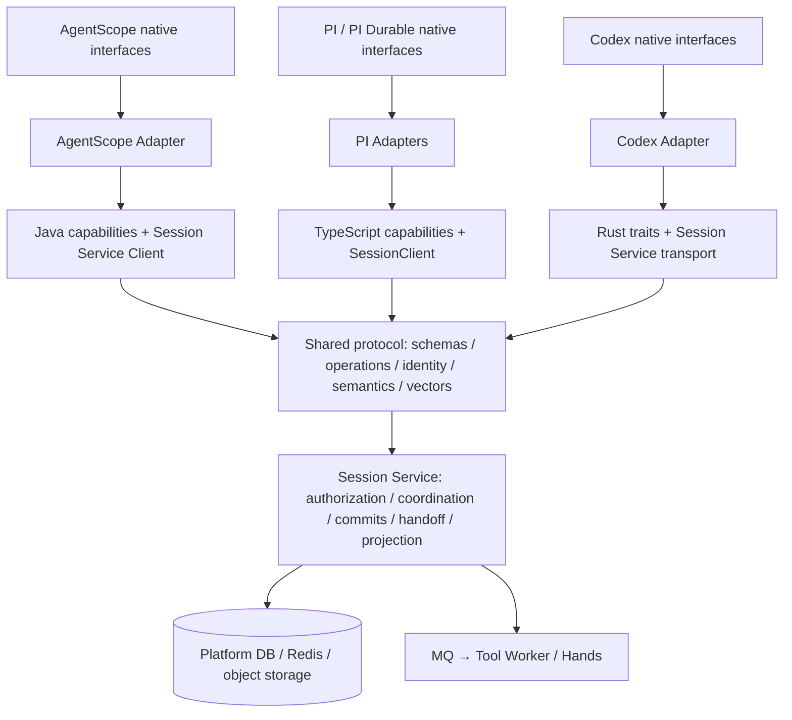
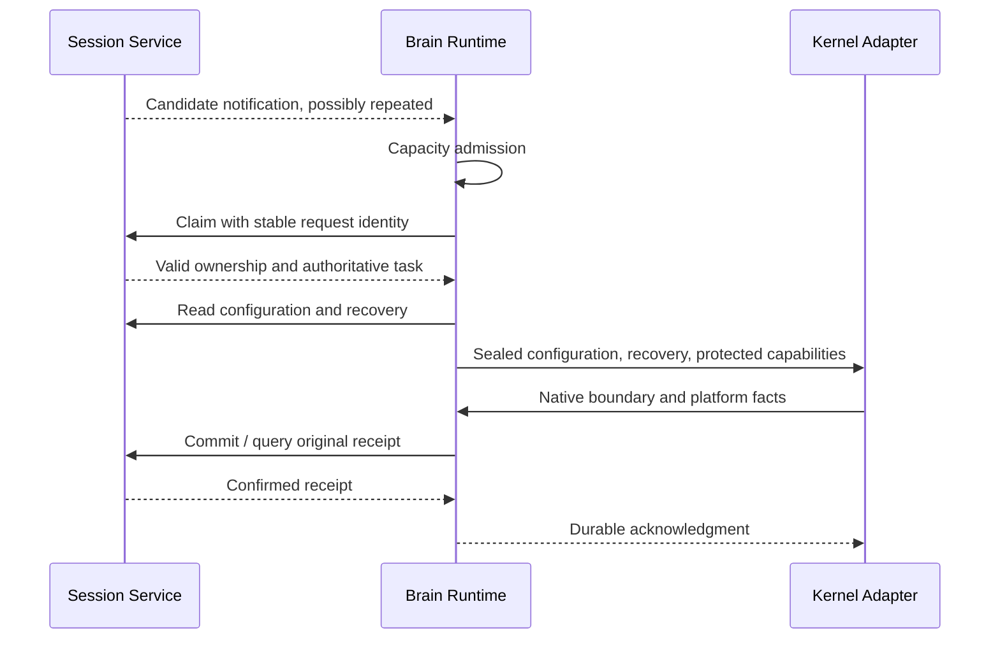

# Multilanguage Brain Platform Interfaces

[中文](brain-platform-interfaces.md)

Date: 2026-10-30. Java basic flow and deployment templates implemented; actual rollout and owner-directed control remain open. See the [implementation record](../../agent-harness-runtime/testing/conformance/verification-java-platform-http-20261030.en.md). The complete target design below does not mean every D0–D4 acceptance item is closed.

## 1. Design Decision

**Maintain one platform protocol, expose semantically equivalent capability interfaces and Session Service implementations in Java, TypeScript, and Rust, and connect native APIs through kernel Adapters.** Kernels in the same language share its Runtime; adding a kernel does not require another platform client.

The lesson from World is that execution kernels depend on stable platform capabilities. Retain this project's Session Service protocol without introducing the World SDK or a parallel Runtime framework. Names such as `PlatformCapabilities` below are proposed local interfaces, not existing types or new HTTP routes.

Unify configuration identity, ownership, durable commits, recovery references, tool handoff, public facts, and error semantics. Native Agent factories, memory structures, state formats, checkpoint granularity, and recovery algorithms remain Adapter responsibilities. Session Service stays inside Agent Service; the five physical deployment roles remain unchanged.

## 2. Layers and Dependencies



The protocol is a contract, not an additional network hop. Each language separates three responsibilities:

| Layer | Owns | Does not own |
| --- | --- | --- |
| Capability interfaces and DTOs | Platform operations, inputs, outputs, errors, acknowledgment semantics | Native SDK types, JPA entities, Redis keys, broker receipts |
| Session Service Client | HTTP encoding, authentication, size/time bounds, response and receipt validation | Local concurrency, native recovery, automatic replacement of business request identities |
| Runtime execution coordination | Capacity admission, claim/renew, serialized fenced commits, retry coordination, cancellation and drain | A duplicate native task state machine or direct platform MQ consumption |

Adapters use these interfaces and the Runtime's protected execution context. They must not maintain a separate lease system or bypass commit coordination. Separate read-only access from a claimed execution context so observation does not require acquiring ownership. Service-side authorization remains mandatory.

## 3. Capability Interfaces

Use narrow interfaces grouped by responsibility, optionally aggregated by a `PlatformCapabilities` composition entry. These are logical groups, not six required modules or services. Each Adapter depends only on the capabilities it needs.

| Group | Operations and guarantees | Existing protocol / remaining work |
| --- | --- | --- |
| `ConfigurationAccess` | Load sealed effective configuration and identity; read already-supported platform resources | Generic `executions/configuration`; Java factory and definition/resource bypasses need convergence. Add reads only for required call paths |
| `ExecutionAccess` | Claim, renew, read inputs/control state, hand off or finish using existing semantics | `executions/claim`, `executions/renew`, `inputs/*`, and Java coordination; unify fences rather than exposing MQ ACKs |
| `StateAccess` | Consistent recovery reads, immutable objects, commits and original receipts | `recovery/read`, `objects/*`, `commits*`; retain dedicated Java profiles for `prepared/query`, `prepared/objects`, `prepared/commits`, and `prepared/receipt` |
| `ToolAccess` | Read tool observations and accepted results; include intents/result applications in commits | `tools/state` and commit changes; no bare `executeTool` that bypasses state commits |
| `PreviewAccess` | Read live interest, publish bounded deltas; report transport outcome without durability | `previews/*`; durable public facts still accompany commits, with no independent final-message write path |
| `NotificationSource` | Deliver task/input/tool/cancellation hints to the local scheduler | Proposed logical interface; transport and instance routing remain undecided and separate from the request client |

Model budgets and dispatch/complete use existing model operations and commit boundaries; Brain still calls models. Handle private workspace and AgentStateStore extensions as described in §7 without adding generic KV, SQL, or Redis RPC.

`StateAccess` unifies semantics without forcing a single commit DTO. Represent generic and Java prepared commits through explicit profiles or separate narrow interfaces; an untyped `Map` must not conceal their authorization differences.

## 4. Equivalence Across Languages

| Concern | Java | TypeScript | Rust |
| --- | --- | --- | --- |
| Types | Interfaces, records / existing DTOs | Interfaces, constrained unions | Traits, structs / enums |
| Suggested async form | `CompletionStage<T>` or a compatible project form | `Promise<T>` with cancellation signals | Async traits / Futures with cancellation tokens |
| Kernel Adapters | AgentScope | Ordinary PI and PI Durable sharing one Runtime | Codex |
| Client implementation | Wrap existing `SessionServiceClient` | Converge existing `SessionClient` and Runtime methods | Converge existing `Transport`, client, and execution modules |

These async signatures are a target. Java currently has a synchronous HTTP client; it can initially run on bounded worker threads behind an asynchronous boundary. Rewriting the network stack is not required. Never block a Reactor event loop. When native APIs require synchronous confirmation, wait only on a native execution thread where blocking is permitted, without returning success early.

Equivalent semantics do not require identical method counts or exception names. For example:

```text
StateAccess.commit(profile, immutableRequest, cancellation) -> CommitReceipt
StateAccess.receipt(profile, originalIdentity) -> Found | NotFound | Unconfirmed
```

This is semantic pseudocode, not an implementation. `commit` may query receipts and retry the original request within a budget. If confirmation remains unavailable, report uncertainty to the coordinator rather than claiming rollback. Cancellation can occur after the server commits; retain the original identity for recovery.

Introduce only interfaces and types needed by current consumers. Some DTOs may be generated from shared schemas. Retry, renewal, cancellation, threading, and native commit bridging require explicit implementation; generation does not establish semantic equivalence.

## 5. Shared Semantic Contract

### 5.1 Identity, Versions, and Configuration

- OpenAPI, schemas, examples, and semantic documentation in `protocol/` define the wire contract. Language interfaces must not independently accept unknown fields or invent compatibility rules. Current version and field validation is strict; extensions require explicit contract and compatibility updates.
- Preserve scope, Turn, owner/incarnation, epoch/token, commitId, and operationId under existing rules. Credentials and executionToken have different roles; validate the scope of all data and references.
- Retain canonical JSON, digests, and decimal-string counters. Preserve Java prepared numeric-position limits separately; do not convert generic counters to JS numbers or mix profile encodings.
- Build native instances from sealed, identity-validated effective configuration. Recovery must not load the latest definition and silently change an execution. Preserve B1/B2: reject unsupported parameters and keep declared tools consistent with registered tools.
- Distinguish protocol version, native state format, and kernel dependency version. Maintain a support matrix; dynamic capability negotiation is outside the initial scope.

### 5.2 Ownership, Retries, and Errors

| Semantic category, not a new wire error code | Common behavior |
| --- | --- |
| Confirmed success | Validate receipt identity, digest, and revision before continuing; object upload is not an execution commit |
| Business or authorization rejection | Preserve the server code; do not retry indefinitely or ignore unsupported configuration |
| Ownership loss / revision conflict | Stop current writes and new side effects; Runtime decides whether to reload/recover, without automatically replacing tokens and replaying |
| Unconfirmed response | Timeout, disconnect, or malformed response does not prove rollback; query receipts / retry within bounds using the original ID and body |
| Receipt currently absent | Do not infer that a tool has not executed; retry the original commit only as ownership permits, otherwise recover under the new owner |
| Local cancellation / drain | Stop new admissions and side effects; reconcile uncertain commits without revoking actions already accepted by Hands |

Runtime serializes an execution's commit boundaries. Model/tool intents, native state, and related public facts retain existing transactional semantics. Client and Adapter must not each run unbounded retries. Runtime coordinates renewal, call deadlines, and ownership-loss stop budgets using server expiry and existing clock handling.

An authorized reader can still retrieve an old owner's successful receipt. Never change a fence while reusing the same commitId for a different body. Recovery preserves tool taskId/executionId; unknown external execution state does not authorize another side effect.

### 5.3 Native Durability and Recovery

1. The Adapter produces native recovery state encoded with a format version, using snapshots, increments, or native journals as appropriate.
2. Runtime uploads required immutable objects, then commits their references with related platform changes. Unreferenced uploaded objects are not active state.
3. Native operations promising durability return success and expose corresponding local state only after receipt confirmation. Staging operations explicitly provide no durable acknowledgment.
4. A new owner obtains committed state and associated results from a consistent recovery view, then the Adapter rebuilds memory and resumes the kernel. Separately loaded configuration must match the fixed Turn identity; do not combine unrelated mutable snapshots.

Do not implement PI Task, Codex Thread, or AgentScope execution loops in Session Service. Shared transactions and recovery references are authoritative. Native payloads may remain opaque, but common envelopes, ownership, integrity, and platform-fact relationships require validation.

### 5.4 Public Events and Deltas

The path is native event → Adapter common facts/preview → Session Service public projection → public SSE. Different native persistence algorithms do not change the external event contract.

- Project final answers, committed intermediate text, and tool/model lifecycles according to existing semantics. Reuse stable message/call/operation identities rather than deduplicating by text or temporary commitId.
- Deltas use a separate bounded preview channel. Disconnect or congestion may lose previews; durable facts still recover final text. Delta streams are not native recovery journals.
- Existing preview/publicFacts identity, sequence, and termination rules remain the baseline. Add contract examples only for actual gaps; this work does not change public SSE payloads.
- Ordinary diagnostics/traces may use separate collection. Recovery logs and reliable audit facts must meet their own consistency requirements.

## 6. Notification Is Independent of Request Interfaces

The request client handles Brain → Service operations; `NotificationSource` supplies Runtime hints. The preferred candidate remains Service callbacks followed by Brain capacity admission and claim. Where inbound connectivity is unavailable, consider a Brain-initiated stream. Initially implement only the transport needed by the target environment.



New work can use a stable service address configured per kernel. Active cancellation/input/tool hints must reach the exact current owner incarnation. Instance discovery and authentication remain undecided; sending cancellation to a random load-balanced instance is not delivery confirmation. Brain self-registration is not a universal prerequisite.

Notifications neither grant ownership nor replace durable tasks, leases, or results. Fact reads and Service repair reconcile duplicates, reordering, and loss. MQ ACK does not wait for Brain availability. Existing polling remains compatibility behavior, not the target primary path. See the [task-push design](brain-session-service-access-and-dispatch.en.md) for reliability and address choices.

## 7. Kernel Mapping and Current Gaps

| Kernel | Existing foundation | Required convergence |
| --- | --- | --- |
| AgentScope Java | SessionLog → prepared commits/receipts; RemoteWorkspaceStore; HTTP Client | Preserve its native protocol profile; complete capability boundaries, unify claim/fence, remove MQ/Redis entry paths and JPA/platform-read bypasses |
| PI | TS Runtime, configuration validation, native session adaptation, commits and previews | Extract necessary interfaces from existing behavior; retain native recovery without presenting it as PI Durable Storage |
| PI Durable | SessionServicePiStorage persist → boundary → local apply, with committed-state recovery | Adapter still implements native PI Storage; share TS platform interfaces/client with ordinary PI rather than another backend |
| Codex | Rust Transport/Runtime, native Adapter, ScratchStore and committed snapshots | Rust traits express shared guarantees; ScratchStore flush remains staging, while protected commit boundaries provide platform durability |

Java still wires JPA AgentStateStore. Audit actual use and choose among three treatments: adapt independently required state through Session Service; reuse the authority for data duplicated by SessionLog/checkpoints; remove unused legacy wiring. Empty implementations, local databases, or dual writes do not satisfy removal of direct access. Do not turn every JPA method into HTTP.

Having clients does not mean all language capability interfaces are already unified. Bridging Java prepared ownership and generic claim remains a key gap; interface design must not conceal incomplete runtime wiring.

## 8. Code Organization and Contract Maintenance

| Location | Future responsibility |
| --- | --- |
| `agent-harness-runtime/protocol/` | Sole wire baseline: operation fields, semantics, profiles, positive/negative examples, shared vectors |
| `java/runtime` | Necessary Java interfaces/DTOs, client wrappers, reusable coordination; native adaptation stays in `adapter-agentscope` |
| `typescript/packages/runtime` | TS interfaces, SessionClient, worker/recovery/preview coordination shared by both PI Adapters |
| `rust/crates/runtime` | Rust traits/DTOs, Transport, worker/execution coordination; native semantics stay in `adapter-codex` |
| Session Service inside Agent Service | Server validation, platform authorization, coordination, transactions, tool handoff, projection; infrastructure implementations remain server-side |

For platform changes, update the existing contract and implementation map, then affected language interfaces, server behavior, and examples. With strict schemas, adding an optional field is not automatically compatible. Define versions/profiles and rollout order. Deploy supporting Service behavior before switching Brain; preserve interpretation of old configurations, native state, receipts, and ownership. Old direct-access leases and new HTTP leases must not independently authorize the same Session.

Only genuinely shared behavior belongs in a language Runtime. Languages cannot share source interfaces across processes; common contracts and test vectors establish equivalence. Multiple kernels in one language do not each need a platform SDK.

## 9. Implementation Order and Stop Boundary

This refines W16 without restarting other feature packages. A full multilanguage interface refactor is not a prerequisite.

| Stage | Deliverable | Necessary targeted validation, to run later |
| --- | --- | --- |
| D0 Contract mapping | Map existing operations to capability groups, common/prepared profiles, supported kernels, identities, errors, gaps; decide notification/owner routing | Document/schema comparison; do not change stable wire contracts for cosmetic uniformity |
| D1 Java execution, J1/J2 | Introduce narrow interfaces at actual consumers; connect claim, renewal, prepared commits, active input/cancellation/tools/previews | Claim competition, lost commit response, ownership-loss stop, one tool and SSE loop |
| D2 Java native storage/wiring, J3 | Classify AgentStateStore, remote required configuration/resources, remove direct infrastructure wiring | Start, execute, and recover without DB/Redis/MQ credentials or network access; preserve B1/B2 |
| D3 Deployment switch, J4 | URL/identity/Brain Secret, old-execution drain, compatible Service rollout, controlled switch | Target deployment templates, one cross-process recovery and owner-directed cancellation |
| D4 TS/Rust as needed | Synchronize only common-contract and notification changes actually required; reuse clients and Adapters | Affected contract vectors and one necessary integration case; no full-kernel rerun for renaming |

When common contracts change, perform D4 alongside the affected stage; compatibility cannot be deferred. TS/Rust renaming, repackaging, and cosmetic uniformity can wait where contracts do not change. Reuse existing tests and add only changed-boundary coverage.

Targeted cross-language examples should cover configuration identity/B1/B2; Unicode, large integers and digests; same-ID replay and conflicting content; receipt recovery after uncertainty; stale fences; no early native durable acknowledgment; committed-state recovery; stable message identity and separation of deltas from final facts. These check interface equivalence, not actual server transactions or failure recovery.

**Stop subsequent implementation once Java completes the basic Agent loop through the shared platform contract, required persistent state recovers, direct platform access is removed, affected languages remain compatible, and targeted gates pass.** Defer large-state performance, unreferenced-object collection, full format-migration matrices, dynamic capability negotiation, multiple notification transports, cross-kernel migration, additional resource/subagent features, and comprehensive fault testing. If one actually blocks the basic loop, document the concrete blocker before adjusting scope.

## 10. Local Evidence

- [Protocol baseline](../../agent-harness-runtime/protocol/README.en.md), [implementation map](../../agent-harness-runtime/protocol/implementation-map.en.md), [OpenAPI](../../agent-harness-runtime/protocol/openapi.json).
- [Java Client](../../agent-harness-runtime/java/runtime/src/main/java/io/agentcore/managed/harness/runtime/SessionServiceClient.java), [Java prepared writer](../../agent-harness-runtime/java/adapter-agentscope/src/main/java/io/agentcore/managed/server/runtime/managed/ManagedRuntimeWriter.java).
- [TS Runtime / SessionClient](../../agent-harness-runtime/typescript/packages/runtime/src/index.ts), [PI Durable Storage](../../agent-harness-runtime/typescript/packages/adapter-pi/src/durable-storage.ts).
- [Rust Client / Transport](../../agent-harness-runtime/rust/crates/runtime/src/client.rs), [Rust Kernel contract](../../agent-harness-runtime/rust/crates/runtime/src/kernel.rs), [Codex staging](../../agent-harness-runtime/rust/crates/adapter-codex/src/store.rs).

This records the static implementation foundation and proposed interfaces, not completion of the stages or runtime acceptance.
