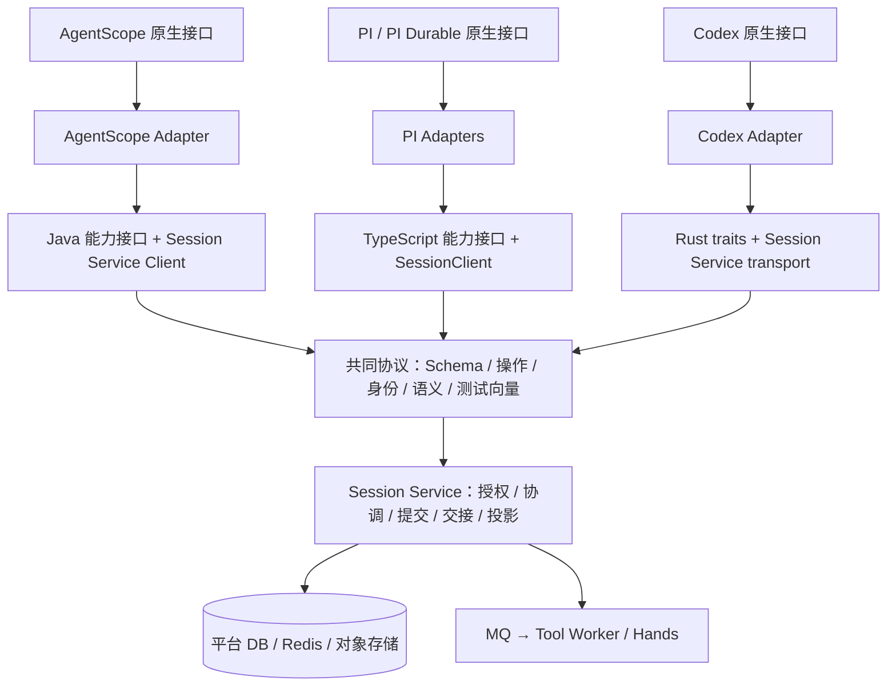
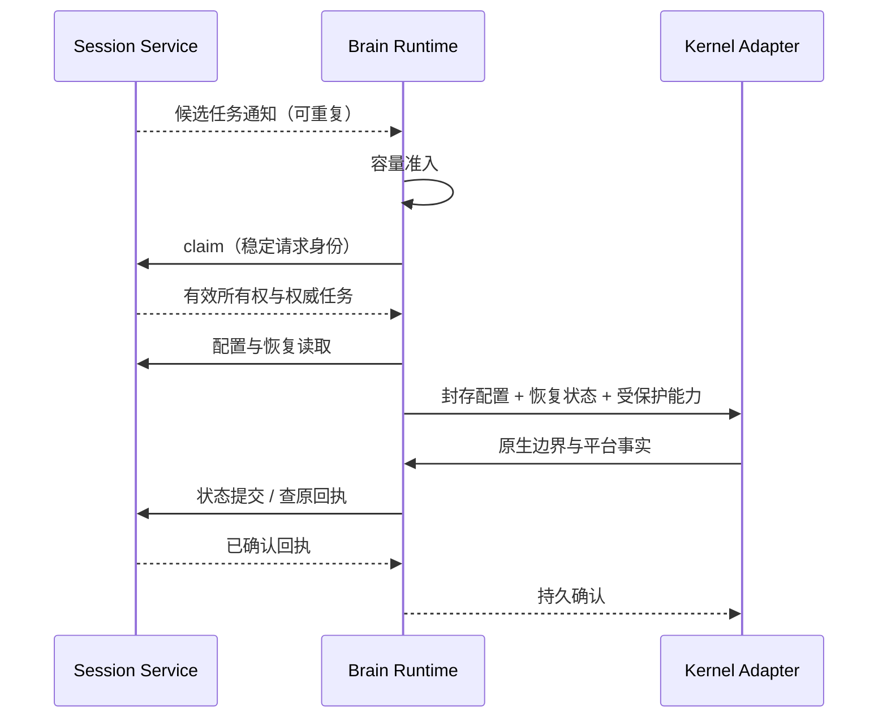

# 多语言 Brain 平台接口方案

[English](brain-platform-interfaces.en.md)

日期：2026-10-30。状态：Java 基础闭环与部署模板已实施，实际部署及 owner 定向控制仍待验收。详见[阶段实施记录](../../agent-harness-runtime/testing/conformance/verification-java-platform-http-20261030.md)。下文保留完整目标设计，不能将所有 D0—D4 验收项视为已关闭。

## 1. 设计结论

**维护一套平台协议，在 Java、TypeScript、Rust 中提供语义对等的能力接口与 Session Service 实现，再由各内核 Adapter 对接原生 API。** 同一语言的多个内核共享语言 Runtime；增加内核不需要再实现一套平台客户端。

World 的借鉴点是“执行内核依赖稳定的平台能力契约”。本项目沿用现有 Session Service 协议，不引入 World SDK，不新建与现有 Runtime 并行的框架。下文 `PlatformCapabilities` 等名称是建议的本地接口名称，不是已有类型或新 HTTP 路由。

统一的是配置身份、执行权、持久提交、恢复引用、工具交接、公开事实和错误语义。原生 Agent 工厂、内存结构、状态格式、checkpoint 粒度和恢复算法继续由各 Adapter 负责。Session Service 保持在 Agent Service 进程内，五个物理部署角色不变。

## 2. 分层和依赖方向



图中协议是契约而非额外网络节点。每种语言内仍区分三项职责：

| 层 | 负责 | 不承担 |
| --- | --- | --- |
| 能力接口与 DTO | 表达平台操作、输入输出、错误及确认语义 | 原生 SDK 类型、JPA 实体、Redis key、Broker receipt |
| Session Service Client | HTTP 编码、鉴权、大小/时间限制、响应与回执校验 | 本地并发调度、原生恢复、自动更换业务请求身份 |
| Runtime 执行协调 | 容量准入、claim/renew、受保护提交串行化、重试协调、取消和 drain | 模拟原生任务状态机、直接消费平台 MQ |

Adapter 使用能力接口及 Runtime 提供的受保护执行上下文；不自行管理另一套租约或绕过提交协调。纯查询客户端与已认领执行上下文分开，避免“读取状态必须抢占任务”。服务端始终重新鉴权，客户端封装不能代替授权。

## 3. 按能力定义接口

建议按以下职责组织窄接口，装配入口可聚合为 `PlatformCapabilities`。这是逻辑分组，不要求新增六个模块或六套服务，也不要求每个 Adapter 都依赖全部能力。

| 接口组 | 核心操作与返回语义 | 既有协议落点 / 待补内容 |
| --- | --- | --- |
| `ConfigurationAccess` | 获取封存的有效配置及身份；读取已有受支持的平台资源 | 通用 `executions/configuration`；Java 工厂与定义/资源旁路待收敛。新增读取须按实际必需调用确定 |
| `ExecutionAccess` | 认领、续租、读取输入/控制状态、按既有语义交接或结束 | `executions/claim`、`executions/renew`、`inputs/*` 与 Java coordination；需统一 fence 关系，不能机械透传 MQ ACK |
| `StateAccess` | 一致性恢复读取、不可变对象读写、提交及原回执查询 | `recovery/read`、`objects/*`、`commits*`；Java `prepared/query`、`prepared/objects`、`prepared/commits`、`prepared/receipt` 保留专属请求 profile |
| `ToolAccess` | 读取工具状态和已接受结果；工具意图/结果应用作为提交内容 | `tools/state`、commit 中的工具变化；不提供绕过状态提交的裸 `executeTool` |
| `PreviewAccess` | 查询在线兴趣、有界发布 delta；返回传输结果，不承诺持久化 | `previews/*`；持久公开事实仍随提交，不另设独立的最终消息写入通道 |
| `NotificationSource` | 向本地调度器提供任务/输入/工具/取消变化提示 | 新的逻辑接口，传输和实例寻址待确定；与上面请求客户端分离 |

模型预算与 dispatch/complete 复用已有模型相关协议及提交边界；模型调用仍由 Brain 执行。私有 workspace / AgentStateStore 等原生扩展按 §7 处理，不为它们创建通用 KV、SQL 或 Redis RPC。

`StateAccess` 统一操作语义，不强制所有语言使用同一种 commit DTO。可将通用提交与 Java prepared 提交表达为显式 profile 或分开的窄接口；禁止使用无类型 `Map` 隐藏两者的授权差异。

## 4. 三种语言如何对等

| 项目 | Java | TypeScript | Rust |
| --- | --- | --- | --- |
| 类型表达 | interface、record / 既有 DTO | interface、受约束的联合类型 | trait、struct / enum |
| 异步调用建议 | `CompletionStage<T>` 等项目兼容形式 | `Promise<T>` + 取消信号 | async trait / Future + 取消令牌 |
| 内核 Adapter | AgentScope | 普通 PI、PI Durable，共享 Runtime | Codex |
| 客户端实现 | 封装现有 `SessionServiceClient` | 收敛现有 `SessionClient` 和 Runtime 方法 | 收敛现有 `Transport`、client、execution 模块 |

以上异步签名是设计方向。Java 当前 HTTP 客户端是同步实现，可先在有界工作线程中调用，由边界适配异步接口；本批不要求重写全部网络栈，禁止在 Reactor event loop 上阻塞。原生 API 要求同步时，只在允许阻塞的原生执行线程等待，不提前返回成功。

同一种语义不要求相同的方法数量或异常类名。例如：

```text
StateAccess.commit(profile, immutableRequest, cancellation) -> CommitReceipt
StateAccess.receipt(profile, originalIdentity) -> Found | NotFound | Unconfirmed
```

这是语义示意，不是代码补丁。`commit` 可在预算内查询回执并重试原请求；无法确认时向协调层返回“不确定”，不能伪装成失败回滚。请求取消也可能发生在服务端提交之后，必须保留原身份以供恢复。

只为当前消费路径建立必要接口和类型。DTO 可从共同 Schema 生成一部分，但重试、续租、取消、线程模型和原生提交桥接必须显式实现；代码生成不能证明语义对等。

## 5. 跨语言必须相同的契约

### 5.1 身份、版本和配置

- `protocol/` 中的 OpenAPI、Schema、样例和语义说明是 wire 契约来源；语言接口不能自行接受未知字段或发明兼容规则。当前协议严格校验版本和字段，扩展需显式更新契约与兼容策略。
- scope、Turn、owner/incarnation、epoch/token、commitId、operationId 等按既有协议传播。凭据和 executionToken 用途不同，所有数据及对象引用都须检查作用域。
- 沿用规范 JSON、摘要和十进制字符串计数规则。Java prepared 的数值位置限制单独保留；不得把通用计数改成 JS number 或混用两个 profile 的编码。
- 原生实例从封存且验证身份的有效配置构建；不能在恢复时重新读取最新定义改变同一执行。保留 B1/B2：不支持的参数明确拒绝，声明工具与实际注册工具一致。
- 协议版本、原生状态格式版本、内核依赖版本分开。内核能力清单按支持矩阵维护；首批不新增动态能力协商服务。

### 5.2 所有权、重试和错误

| 语义分类（不是新 wire 错误码） | 三种语言共同处理 |
| --- | --- |
| 已确认成功 | 校验回执身份、摘要与版本后继续；上传对象成功不等于执行提交成功 |
| 业务或权限拒绝 | 保留服务端错误码；不无限重试，不静默忽略不支持的配置 |
| 所有权失效 / revision 冲突 | 停止当前写入及新副作用；由 Runtime 决定重新读取/恢复，不自动换 token 重放请求 |
| 响应不确定 | 超时、断连、响应损坏等不证明回滚；提交使用原 ID 和原业务体查回执 / 有界重试 |
| 暂无回执 | 不推断工具未执行；所有权允许时按协议重试原提交，已换 owner 则走恢复判断 |
| 本地取消 / drain | 停止接新任务和新副作用，收敛当前提交的不确定结果；不撤销 Hands 已接受的动作 |

一次执行的提交边界由 Runtime 串行协调；模型/工具意图、原生状态及相应公开事实按既有事务语义提交。客户端和 Adapter 不各自无限重试，避免嵌套放大。续租周期、调用 deadline 与失租停止预算统一由 Runtime 管理，沿用服务端有效期和现有时钟处理。

旧 owner 的已成功回执在授权允许时仍可查询；不能修改 fence 后用原 commitId 形成另一份业务请求。恢复后的工具仍使用原 taskId / executionId，外部执行状态未知时不能重新创建副作用。

### 5.3 原生持久化与恢复

1. Adapter 根据内核产生恢复状态，编码成带格式版本的 payload；可使用快照、增量或原生日志。
2. Runtime 上传必要不可变对象，再提交状态引用和关联的平台变化。未被提交引用的对象不代表已生效状态。
3. 承诺 durable 的原生接口在确认回执后才返回成功、发布对应本地状态；staging 接口必须明确标识为非持久确认。
4. 新 owner 从同一一致性恢复视图获取配置、已提交状态及关联结果，Adapter 重建内存视图并恢复内核。配置独立读取时按固定 Turn 身份核对，不拼接任意时点的可变数据。

不在 Session Service 实现 PI Task、Codex Thread 或 AgentScope 原生执行循环。共同事务及恢复引用是平台权威；原生 payload 可保持不透明，但共同 envelope、归属、完整性和平台事实关联仍须校验。

### 5.4 统一公开事件与 delta

事件链路为“原生事件 → Adapter 共同事实/预览 → Session Service 公开投影 → 对外 SSE”。不同内核的持久化方式不改变对外事件契约。

- 最终回答、中间已提交文本、工具和模型生命周期按既有事实语义投影；复用稳定的 message/call/operation 身份，不能按文本内容或临时 commitId 去重。
- delta 经独立、有界的预览通道发送；断线或拥塞允许丢失预览，最终文本仍由持久事实恢复。不能把 delta 流当成原生恢复日志。
- 已有 preview 与 publicFacts 的身份、序列和结束规则继续作为基线；只在实际缺口处补契约样例，不借本批改变公共 SSE payload。
- 普通诊断日志/Trace 可走独立采集；恢复日志和需要可靠保存的审计事实必须按其一致性要求提交。

## 6. 任务通知不绑死平台接口

请求客户端解决 Brain → Service 的平台操作；`NotificationSource` 解决 Runtime 如何得到提示。首选候选仍为 Service 主动回调 Brain，Brain 容量准入后认领；反向网络不通时可选 Brain 建立长连接，首批只实施一种目标环境需要的方式。



新任务可经按内核配置的稳定服务地址分配。执行中取消/输入/工具结果提示需要定位当前 owner 的具体 incarnation；实例寻址与认证尚待确定，不能向随机负载均衡实例发取消后认为送达。无需把 Brain 自注册设成所有集成的前提。

通知不授予执行权，也不替代持久任务、租约或结果。重复、乱序和丢失由事实核查及 Service 补偿收敛；MQ ACK 不等待 Brain 在线确认。旧 polling 仅作为已有兼容行为，不作为此次目标主路径。完整可靠性与地址选型见[任务推送方案](brain-session-service-access-and-dispatch.md)。

## 7. 各内核映射及当前差距

| 内核 | 已有基础 | 按本方案收敛 |
| --- | --- | --- |
| AgentScope Java | SessionLog → prepared 提交/回执；RemoteWorkspaceStore；已有 HTTP Client | 保留原生协议 profile，补齐平台能力边界；统一 claim/fence；去除 MQ/Redis 入口及 JPA/平台读取旁路 |
| PI | 已有 TS Runtime、配置验证、原生会话适配、提交与预览 | 从现有实现提取必要接口；维持原生恢复语义，不伪装成 PI Durable Storage |
| PI Durable | SessionServicePiStorage 的 persist → boundary → 本地 apply 与已提交状态恢复 | 实现原生 PI Storage 的仍是 Adapter；与普通 PI 共用 TS 平台接口和客户端，不再复制一套后端 |
| Codex | Rust Transport / Runtime、原生 Adapter、ScratchStore 与提交快照 | Rust trait 表达共同保证；ScratchStore flush 是 staging，平台 durable 仍由受保护提交边界提供 |

Java 工厂仍装配 JPA AgentStateStore；先审计真实读写用途，再三选一：独立必需状态使用 Session Service 适配；与 SessionLog/checkpoint 重复的状态复用同一权威；未使用历史装配移除。不能用空实现、本地库或双写掩盖去依赖，也不能直接把每个 JPA 方法变成 HTTP。

现有“有客户端”不等于语言能力接口已经全部统一。尤其 Java prepared 所有权与通用 claim 的对接仍是关键缺口。接口设计不得掩盖当前尚未完成的运行接线。

## 8. 代码组织与契约维护

| 位置 | 后续职责 |
| --- | --- |
| `agent-harness-runtime/protocol/` | 唯一 wire 基线；按操作维护字段、语义、profile 映射、正反例与共享向量 |
| `java/runtime` | Java 必要能力接口/DTO、Client 包装、可复用执行协调；原生适配留在 `adapter-agentscope` |
| `typescript/packages/runtime` | TS 接口、SessionClient、worker/恢复/预览协调；两个 PI Adapter 共享 |
| `rust/crates/runtime` | Rust traits/DTO、Transport、worker/执行协调；Codex 语义留在 `adapter-codex` |
| Agent Service 的 Session Service | 服务端协议校验、平台授权、协调、事务、工具交接及公开投影；基础设施实现留在服务端 |

平台行为变更先更新既有协议及实现映射，再同步涉及的语言接口、服务端与契约样例。严格 Schema 下不假定“增加可选字段总是兼容”；迁移需明确版本/profile 和发布顺序。先部署支持目标路径的 Service，再切换 Brain；旧执行的配置、原生状态、回执和有效所有权必须可解释。不得让旧直连租约与新 HTTP 租约同时独立授权一个 Session。

仅把真实共享的行为放进语言 Runtime。不同语言接口不能跨进程共享代码，语义由共同契约与测试向量对齐；同语言无需为每个内核新建平台 SDK。

## 9. 实施顺序与停止边界

本节细化 W16，不重新启动其他功能包；接口收敛不是先做一轮全语言重构的前置条件。

| 阶段 | 交付内容 | 必要定向验收（后续执行） |
| --- | --- | --- |
| D0 契约落表 | 将现有操作映射到能力组，标注 common/prepared profile、支持内核、身份、错误和缺口；定稿通知/owner 寻址 | 文档/Schema 对照；不修改已稳定 wire 以追求形式统一 |
| D1 Java 执行闭环，对应 J1/J2 | 给真实消费点引入窄接口，接通任务认领、续租、prepared 提交、运行中输入/取消/工具/预览 | 单次认领竞争、提交响应丢失、失租停止、一次工具与 SSE 闭环 |
| D2 Java 原生存储与装配，对应 J3 | AgentStateStore 三类处置、必要配置/资源远程读取、移除直接基础设施装配 | 无 DB/Redis/MQ 凭据及网络访问仍能启动、执行和恢复；保留 B1/B2 |
| D3 部署切换，对应 J4 | URL/身份与 Brain Secret、旧执行 drain、兼容 Service 发布与受控切换 | 实际目标部署模板、一个跨进程恢复和 owner 定向取消 |
| D4 按需对齐 TS/Rust | 仅同步本批确实变化的共同契约与通知入口；复用现有客户端和原生 Adapter | 受影响的契约向量和一个必要集成用例；不为接口命名重跑全部内核 |

变更共同契约时 D4 与相关阶段同步完成，不能把兼容性推迟；没有契约变化的 TS/Rust 重命名、抽包和格式统一可后置。每个阶段使用既有用例，仅补本阶段改变的边界。

跨语言定向契约样例应覆盖：配置身份与 B1/B2；Unicode/大整数/摘要；同 ID 同内容与异内容冲突；不确定响应查回执；陈旧 fence；native durable 不提前确认；已提交状态恢复；稳定消息身份与 delta/最终事实分离。它们验证接口对等，不替代真实服务事务与故障恢复验证。

**本批后续实施的停止点：Java 能以同一平台契约完成基础 Agent 闭环，必需持久状态可恢复，平台直连退出，受影响语言保持兼容且定向门禁通过。** 大状态性能、未引用对象回收、完整格式迁移矩阵、动态能力协商、多通知传输、多内核互迁、额外资源/子 Agent 功能和全量故障测试记录为后续，不阻塞基础收敛；若某项实际阻塞当前基础闭环，单列具体原因再调整范围。

## 10. 本地依据

- [协议基线](../../agent-harness-runtime/protocol/README.md)、[实现映射](../../agent-harness-runtime/protocol/implementation-map.md)、[OpenAPI](../../agent-harness-runtime/protocol/openapi.json)。
- [Java Client](../../agent-harness-runtime/java/runtime/src/main/java/io/agentcore/managed/harness/runtime/SessionServiceClient.java)、[Java prepared writer](../../agent-harness-runtime/java/adapter-agentscope/src/main/java/io/agentcore/managed/server/runtime/managed/ManagedRuntimeWriter.java)。
- [TS Runtime / SessionClient](../../agent-harness-runtime/typescript/packages/runtime/src/index.ts)、[PI Durable Storage](../../agent-harness-runtime/typescript/packages/adapter-pi/src/durable-storage.ts)。
- [Rust Client / Transport](../../agent-harness-runtime/rust/crates/runtime/src/client.rs)、[Rust Kernel 契约](../../agent-harness-runtime/rust/crates/runtime/src/kernel.rs)、[Codex staging](../../agent-harness-runtime/rust/crates/adapter-codex/src/store.rs)。

本方案记录当前静态实现基础与目标接口，不表示已完成上述阶段或运行验收。
