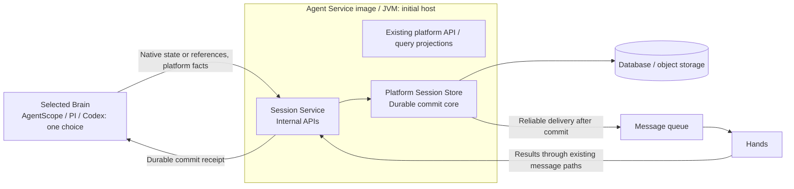

# Multilanguage Brains: source layout and deployment

[中文](brain-runtime-layout-and-deployment.md)

Date: 2026-10-28. Directory layout, Session Service and multilingual development entry points are implemented; deployment and full fault acceptance remain pending.

2026-11-02 update: source layout and process composition now reflect the current implementation. Codex uses a standalone Rust Brain; the historical TypeScript app-server probe has been deleted. Deployment and acceptance status follow the individual verification records; this cleanup does not constitute preproduction acceptance.

This document consolidates the Harness & Brain decisions about source organization, process composition and Session Service hosting. Brain means Agent Harness Runtime; Hands means Tool Worker. A deployment selects one Harness, and each Session retains that Harness and a compatible state format. Cross-Harness delegation and migration are outside the initial scope.

Interfaces, data formats, commit/ACK boundaries, recovery and work division are centralized in the [Brain, Session Service and Hands protocol design](brain-session-hands-protocol.en.md). This document retains source layout and deployment decisions.

Implementation scope and limitations: [implementation map](../../agent-harness-runtime/protocol/implementation-map.en.md). Build and launch: [runtime entry](../../agent-harness-runtime/README.en.md).

## 1. One source root; builds by language and images by Brain

All Brain implementations belong under `managed-agents/agent-harness-runtime/`. This names both the source root and the platform Brain role; it does not require a Java service wrapping other Brains.

Current layout; test/docs subdivisions can grow with each kernel:

```text
managed-agents/
├── agent-harness-runtime/
│   ├── README.md
│   ├── Makefile                      # Shared build, test and image task entry
│   ├── protocol/
│   │   ├── schemas/                  # Cross-language handoff formats
│   │   └── examples/                 # Requests, receipts and recovery scenarios
│   ├── java/
│   │   ├── pom.xml                   # Java modules only
│   │   ├── runtime/
│   │   ├── codec-agentscope/          # Native state codec; no executor
│   │   ├── adapter-agentscope/
│   │   └── brain-agentscope/
│   ├── typescript/
│   │   ├── package.json
│   │   ├── pnpm-workspace.yaml
│   │   ├── pnpm-lock.yaml
│   │   └── packages/
│   │       ├── runtime/
│   │       ├── adapter-pi/
│   │       └── brain-pi/
│   ├── rust/
│   │   ├── Cargo.toml
│   │   ├── Cargo.lock
│   │   └── crates/
│   │       ├── runtime/
│   │       ├── adapter-codex/
│   │       └── brain-codex/
│   ├── images/
│   │   ├── agentscope-java/Dockerfile
│   │   ├── pi/Dockerfile
│   │   └── codex/Dockerfile
│   ├── testing/
│   │   ├── fixtures/                 # Shared protocol examples
│   │   ├── conformance/              # Required behavior across Brains
│   │   └── integration/              # Session Service and Hands integration
│   └── docs/
├── agent-service/                    # One Maven module, image and JVM
│   └── src/
│       ├── main/java/io/agentcore/managed/server/
│       │   ├── agentservice/sessionservice/  # Internal HTTP API and composition
│       │   │   ├── api/              # Session Service internal APIs
│       │   │   └── store/            # Request validation, ownership and storage API
│       │   └── runtime/managed/      # Transactions, publication and repair
│       └── test/java/                # Platform and cross-role integration tests
└── tool-worker/                      # Hands
```

Java uses Maven, TypeScript uses pnpm and Rust uses Cargo; not every directory is a Maven child module. Each Brain gets its own image rather than bundling every engine. Keep this aggregate directory initially and extract a separate project only when independent publication is needed.

## 2. Module responsibilities

| Module | Responsibility |
| --- | --- |
| `protocol` | Brain/Session Service/Hands handoff formats, versions, errors and retry semantics; no unified native Context, message or checkpoint format |
| Language-specific `runtime` | Execution coordination, ownership and cancellation, commit/receipt handling, tool waits and recovery, platform clients and Adapter interfaces; no duplicated database commit transactions |
| `codec-agentscope` | Lightweight native-format interpretation: event validation, checkpoint settlement and restore/fork baselines. Explicitly used by Agent Service and the adapter; no database, Spring or executor dependency |
| `adapter-*` | Native APIs, storage hooks, event interpretation, tool/result conversion and native recovery; associate native records with platform execution identities |
| `brain-*` | Assemble Runtime and the selected Adapter; startup configuration, identity/credentials, health, admission draining and shutdown cleanup |
| `sessionservice` within Agent Service | Expose Session Service APIs; its platform Session Store implements durable commits, idempotency, ownership validation, Outbox and result/wakeup consistency without interpreting native engine messages |
| `tool-worker` | Execute tools, persist execution status/results, and support lookup and recovery using the original execution identity |

Dependencies flow from `brain-*` to Runtime and Adapter. Adapters depend on Runtime interfaces and native SDKs; Runtime does not depend on a specific Adapter. Java, TypeScript and Rust share protocols and behavior contracts, while implementing coordination and corresponding tests in their own languages.

When an engine supports native storage hooks, the Adapter injects an implementation and the engine performs its normal reads, writes and recovery. The Adapter need not manually reconstruct every Context. For file-only or external-process engines, it handles file synchronization, persistence confirmation and recovery entry points. Section 4 distinguishes native storage interfaces from the platform Session Store.

Unit tests and engine-specific fixtures stay in their modules. Each language's Brain entry point owns process startup, intake draining, cancellation and cleanup. The Rust Brain owns the Codex lifecycle without a TypeScript launcher.

## 3. Languages and processes by Brain

| Brain | Outer adaptation | Engine integration | Current processes and packaging |
| --- | --- | --- | --- |
| AgentScope Java | Java Runtime + AgentScope Adapter | Java library | One JVM, dedicated Brain image |
| PI | TypeScript Runtime + PI Adapter | TypeScript library | One Node.js process, dedicated Brain image |
| PI durable | TypeScript Runtime + corresponding storage adaptation | TypeScript library and durable storage hooks | Normally the same Node.js process; validate storage/recovery separately from ordinary PI and split the Adapter package only if warranted |
| Codex | Rust Runtime + Codex Adapter | Direct link to pinned `codex-core` | One Rust process, dedicated Brain image |

These are baseline process combinations, not limits on engine-created tool or worker processes. A shared language does not guarantee one process; different languages do not require independently deployed services.

**Deploying PI Brain starts the TypeScript Brain without an additional Java AgentScope Brain.** It may still call Session Service hosted in a Java platform service. That is a platform storage interface, not a Java Brain relay.

The Codex Runtime, Adapter and Brain entry point all live in `rust/`. They require no Node.js and launch neither the Codex CLI nor app-server. Native APIs capture state, inject results and recover the original Turn; authoritative checkpoints commit through Session Service, and Hands executes external tools. See [Rust Brain](../../agent-harness-runtime/rust/README.en.md) for build instructions and supported scope. The release app-server remains a [future validation alternative](codex-app-server-alternative.en.md), not the current implementation.

## 4. Session Service is logically separate and initially cohosted

**Session Service is the service boundary; the platform Session Store is its internal durable commit core. They are not two separately deployed services.** Distinguish three names:

| Name | Responsibility and ownership |
| --- | --- |
| Native Harness `SessionStore` / `SessionLog` | Engine-defined read/write interfaces integrated by the Adapter, preserving native formats and recovery behavior; distinct from the platform Session Store |
| Platform Session Store | Store native state and platform facts; implement commit transactions, idempotency, ownership validation, Outbox and result/wakeup consistency; more than database CRUD |
| Session Service | Expose commit, read and recovery-data APIs to Brains in different languages; handle access control and requests, calling its internal Session Store without duplicating commit logic |

Typical path: `native storage interface → Adapter → Session Service → platform Session Store → database / object storage`. The engine and Adapter still perform native recovery together.

**All code lives under `managed-agents/agent-service/src/` in one Maven module: `agentservice/sessionservice` owns APIs and composition, while `runtime/managed` owns transactions and background processing. They share one Agent Service image and JVM.** Packages preserve responsibility boundaries; module extraction is deferred until needed. Brains in all languages share the implementation through internal HTTP APIs. Cross-role integration tests live in Agent Service, composing Adapter and Tool Worker through test dependencies to avoid module cycles.

Native interpretation, execution and recovery belong to Harness Adapters. `SessionCommitTransactions` in Agent Service's `runtime/managed` package owns prepared commits, exposed through `api`. Common retains entities, infrastructure and ledger access shared across roles, without composing adapters. Preserve transaction and recovery guarantees instead of building a second storage implementation:



This diagram describes target responsibilities and data flow: tool-result consumption moves into Session Service, while Hands retains its execution store and result Outbox. Existing MQ paths need not all become RPC. Platform APIs continue to serve SSE using durable events and query projections. Session Service does not interpret native token streams.

Cohosting preserves these boundaries:

- **A receipt confirms durable commit**, not merely request acceptance. Retry or query with the same commit identity after a lost response.
- **Platform interfaces do not depend on native engine classes.** Move AgentScope/PI event interpretation into Adapters; Session Service handles explicit platform facts and opaque native data.
- **Bound resources and failure impact.** Commit and object-storage I/O use controlled executors, connection pools and backpressure separate from API/projection work, without blocking Reactor event loops. Cohosted modules still share process failures and capacity limits.

Extract a Session Service module with its own startup entry and image when independent scaling, failure isolation or release cadence warrants it, retaining the Brain-facing interface. Session commits/native storage and AgentScope scheduling coordination are service-owned. Brain retains Redis/MQ transport; local JPA catalog/memory and some infrastructure assembly still require a database.

## 5. Protocol and implementation coordination

The [protocol design](brain-session-hands-protocol.en.md) centralizes existing capabilities versus changes, interfaces/formats, the three tool-stage guarantees, ACK conditions, recovery and team deliverables, avoiding duplicate maintenance across documents.

Proceed through frozen contracts/shared cases, the Java reference path, Session Service APIs inside Agent Service, and Hands/PI/Codex integration subject to capability validation. Move directories with the corresponding work packages rather than all of `common`. Independent Session Service deployment remains a later isolation/capacity decision.

## 6. Relationship to existing designs

Borrow Durable Harness's shared coordination, thin Adapters, external-process lifecycle management and per-engine assembly. Retaining Java and TypeScript Runtimes means maintaining two coordination implementations, build dependencies, images and behavior validation in addition to protocols. Centralized Session Service transactions reduce duplication but do not eliminate these costs.

- [Replaceable Brain Runtime research](replaceable-harness-runtime.en.md): retains replacement boundaries and capability analysis; this document supersedes Rust Codex as the default candidate and per-Runtime storage transaction implementations.
- [Current Session Store implementation](../session-store.en.md): describes embedded commits; the target hosting arrangement here is not an already deployed implementation.
- [Session Store commit design](../../../docs/session-store-oss-and-direct-commit-design.en.md) and [execution commit/projection design](../../../docs/execution-commit-and-projection-delivery-redesign.en.md): retain existing mechanism designs and implementation records; the [protocol design](brain-session-hands-protocol.en.md) owns the cross-language target contract.

Use this document for directory organization, process composition and initial hosting decisions. Interface definitions, schemas and handoff fixtures now form the [protocol 0.1.0 development baseline](../../agent-harness-runtime/protocol/README.en.md); actual support and limits are recorded in the implementation map. Implementations must share that contract rather than invent transaction semantics independently.

Checkpoint administration uses the runtime-defined `NativeCheckpointCodec` interface and an explicit lightweight format plugin. The plugin does not run agents or own transactions; it has a private event registry and does not rely on Brain initialization in the same JVM.
