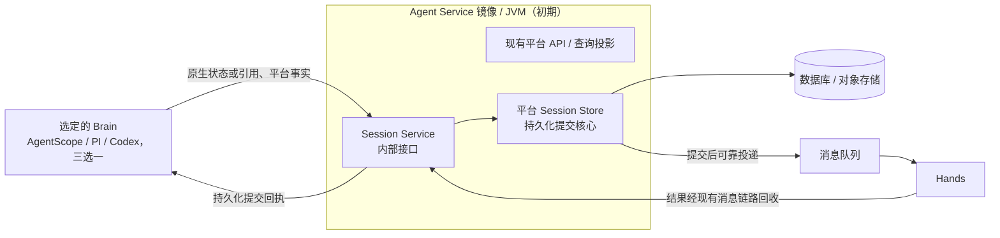

# 多语言 Brain：目录组织与部署方案

[English](brain-runtime-layout-and-deployment.en.md)

日期：2026-10-28。状态：目录、服务边界和多语言开发入口已落地；部署与整体故障验收尚未执行。

2026-11-02 更新：目录与进程组合按当前实现校正；Codex 使用独立 Rust Brain，历史 TypeScript app-server 探针已删除。部署和验收状态以各轮验收记录为准，本次目录清理不构成预发验收。

本方案汇总 Harness & Brain 适配讨论中关于代码组织、进程组合和 Session Service 承载方式的结论。Brain 指 Agent Harness Runtime，Hands 指 Tool Worker。一次部署选择一种 Harness，一个 Session 固定使用该 Harness 及兼容的状态格式；暂不考虑跨 Harness 委派或迁移。

接口、数据格式、提交与 ACK、恢复流程和开发分工统一见[Brain、Session Service 与 Hands 协议设计](brain-session-hands-protocol.md)，本文保留目录和部署决策。

实施范围和限制统一见[实现映射](../../agent-harness-runtime/protocol/implementation-map.md)，构建与启动见[Runtime 入口](../../agent-harness-runtime/README.md)。

## 1. 目录统一，按语言构建、按 Brain 打包

所有 Brain 实现统一放在 `managed-agents/agent-harness-runtime/`。它既是源码根目录，也是平台中的 Brain 角色名称，不表示必须存在一个 Java 服务来包裹其他 Brain。

当前目录结构（测试与 docs 可随内核继续细分）：

```text
managed-agents/
├── agent-harness-runtime/
│   ├── README.md
│   ├── Makefile                      # 统一构建、测试、镜像任务入口
│   ├── protocol/
│   │   ├── schemas/                  # 跨语言交接数据格式
│   │   └── examples/                 # 请求、回执、恢复场景样例
│   ├── java/
│   │   ├── pom.xml                   # 只聚合 Java 模块
│   │   ├── runtime/
│   │   ├── codec-agentscope/          # Native state codec; no executor
│   │   ├── adapter-agentscope/
│   │   └── brain-agentscope/
│   ├── typescript/
│   │   ├── package.json
│   │   ├── pnpm-workspace.yaml
│   │   ├── pnpm-lock.yaml
│   │   └── packages/
│   │       ├── runtime/
│   │       ├── adapter-pi/
│   │       └── brain-pi/
│   ├── rust/
│   │   ├── Cargo.toml
│   │   ├── Cargo.lock
│   │   └── crates/
│   │       ├── runtime/
│   │       ├── adapter-codex/
│   │       └── brain-codex/
│   ├── images/
│   │   ├── agentscope-java/Dockerfile
│   │   ├── pi/Dockerfile
│   │   └── codex/Dockerfile
│   ├── testing/
│   │   ├── fixtures/                 # 共享协议样例
│   │   ├── conformance/              # 各 Brain 必须通过的行为测试
│   │   └── integration/              # Session Service、Hands 联调
│   └── docs/
├── agent-service/                    # 单一 Maven 模块、镜像和 JVM
│   └── src/
│       ├── main/java/io/agentcore/managed/server/
│       │   ├── agentservice/sessionservice/  # 内部 HTTP 接口与服务装配
│       │   │   ├── api/              # Session Service 内部接口
│       │   │   └── store/            # 请求校验、所有权与存储接口
│       │   └── runtime/managed/      # 提交事务、发布与补偿
│       └── test/java/                # 平台与跨角色联调测试
└── tool-worker/                      # Hands
```

Java 使用 Maven，TypeScript 使用 pnpm，Rust 使用 Cargo；不要求所有目录成为 Maven 子模块。每种 Brain 单独构建镜像，不打包全部内核。先保持这一聚合目录，未来需要独立开放时再提取项目。

## 2. 模块各管什么

| 模块 | 具体职责 |
| --- | --- |
| `protocol` | 定义 Brain 与 Session Service、Hands 的交接格式、版本、错误和重试语义；不统一各内核的 Context、消息和 checkpoint 格式 |
| 各语言 `runtime` | 实现执行协调、所有权与取消、提交及回执处理、工具等待与恢复，并提供平台客户端和 Adapter 接口；不重复实现数据库提交事务 |
| `codec-agentscope` | 轻量原生格式解释：校验事件、判断 checkpoint 是否已结清、生成恢复/分叉基线。由 Agent Service 与 Adapter 显式使用；无数据库、Spring 或执行器依赖 |
| `adapter-*` | 调用内核 API、接入原生存储接口、解释原生事件、转换工具请求和结果、调用内核恢复能力；负责关联原生记录与平台执行标识 |
| `brain-*` | 组装 Runtime 与选定 Adapter，处理启动配置、身份凭证、健康检查、停止接单和退出清理 |
| Agent Service 内的 `sessionservice` | 对外提供 Session Service 接口，内部由平台 Session Store 实现持久化提交、幂等、所有权校验、Outbox、结果与唤醒的一致性；原生语义委托 codec |
| `tool-worker` | 承接工具执行，保存执行状态和结果，支持按原执行标识查询与恢复 |

依赖方向是 `brain-* → runtime + adapter-*`；Adapter 依赖 Runtime 定义的接口及内核 SDK，Runtime 不反向依赖具体 Adapter。Java、TypeScript 与 Rust 共享协议和行为契约，各自实现协调代码和对应测试。

内核支持原生存储扩展接口时，Adapter 注入其实现，由内核正常调用读写和恢复；不要求 Adapter 手工重建所有 Context。内核只提供文件或外部进程接口时，Adapter 负责文件同步、刷盘确认和恢复入口。原生存储接口与平台 Session Store 的区别见第 4 节。

单元测试和内核专属样例留在各模块中。每种语言的 Brain 入口负责本进程启动、停止接单、取消和清理；Codex 的生命周期由 Rust Brain 负责，不经过 TypeScript launcher。

## 3. 各 Brain 的语言与进程组合

| Brain | 外围适配层 | 内核接入 | 当前进程与镜像组合 |
| --- | --- | --- | --- |
| AgentScope Java | Java Runtime + AgentScope Adapter | Java 库 | 一个 JVM，独立 Brain 镜像 |
| PI | TypeScript Runtime + PI Adapter | TypeScript 库 | 一个 Node.js 进程，独立 Brain 镜像 |
| PI durable | TypeScript Runtime + 对应存储适配 | TypeScript 库及 durable 存储接口 | 原则上同一 Node.js 进程；与普通 PI 的存储、恢复路径分别验证，按差异决定是否拆 Adapter 包 |
| Codex | Rust Runtime + Codex Adapter | 直接链接固定版本 `codex-core` | 一个 Rust 进程，独立 Brain 镜像 |

表中是基础进程组合，不限制内核另行启动工具进程或工作进程。语言相同不一定同进程；语言不同也不要求两个独立部署服务。

**部署 PI Brain 时，只启动 TypeScript Brain；不需要额外启动 Java AgentScope Brain。** 仍可调用 Java 平台服务承载的 Session Service，这是平台存储接口，不是 Java Brain 中转层。

Codex 的 Runtime、Adapter 和 Brain 入口都在 `rust/`，运行时不需要 Node.js，也不启动 Codex CLI 或 app-server。原生状态捕获、结果回填和原 Turn 恢复通过内核 API 完成，权威检查点经 Session Service 提交，外部工具由 Hands 执行。构建与支持范围见 [Rust Brain](../../agent-harness-runtime/rust/README.md)；发布版 app-server 仅保留为[未来验证方案](codex-app-server-alternative.md)，不是当前实现。

## 4. Session Service 逻辑独立，初期合并部署

**Session Service 是服务边界，平台 Session Store 是它内部的持久化提交核心，两者不是两个并列部署的服务。** 需要区分三个名称：

| 名称 | 职责与归属 |
| --- | --- |
| Harness 原生 `SessionStore` / `SessionLog` | 内核定义的读写接口，由 Adapter 实现接入，保留内核自己的数据格式与恢复方式；不是平台 Session Store |
| 平台 Session Store | 保存原生状态和平台事实，处理提交事务、幂等、所有权校验、Outbox 和结果/唤醒一致性；不只是数据库 CRUD |
| Session Service | 向各语言 Brain 提供提交、读取和恢复所需数据的接口，负责访问控制和请求处理，调用内部 Session Store；不重复实现一份提交逻辑 |

典型调用路径：`内核原生存储接口 → Adapter → Session Service → 平台 Session Store → 数据库 / 对象存储`。内核恢复仍由内核与 Adapter 配合完成。

**代码统一位于 `managed-agents/agent-service/src/`，使用一个 Maven 模块：`agentservice/sessionservice` 包承载接口与装配，`runtime/managed` 包承载提交事务及后台流程。它们打在同一个镜像、运行在同一个 JVM 进程中。** 当前通过包保持职责边界，未来有明确需求时再拆分模块；各语言 Brain 通过内部 HTTP 接口共享同一套提交能力。跨角色联调测试放在 Agent Service，通过测试依赖组合 Adapter 与 Tool Worker，避免模块循环依赖。

原生事件解释、执行与恢复归 Harness Adapter；提交核心为 Agent Service 的 `runtime/managed` 包中的 `SessionCommitTransactions`，由 `api` 暴露内部接口。`common` 保留确实跨角色共享的实体、基础设施与账本访问，不反向装配 Adapter。保留现有事务和恢复保障，不另起一套存储实现：



图表示目标职责与数据流：工具结果消费迁入 Session Service，Hands 保留独立执行存储与结果 Outbox；不要求把现有 MQ 链路全部改成 RPC。SSE 仍由平台 API 对外提供，持久化事件和查询投影为其提供数据；Session Service 不直接承接内核 token 的解释。

合并部署时仍保持以下边界：

- **回执代表已经持久化提交。** 不能以“请求已接收”代替；响应丢失时，用同一提交标识重试或查询原回执。
- **平台接口不依赖内核类。** AgentScope、PI 等原生事件的解释放回 Adapter，Session Service 提交核心只处理明确的平台事实和不透明原生数据；checkpoint 管理通过 Runtime 定义的 `NativeCheckpointCodec` 接口调用轻量格式插件。插件不执行 Agent，也不拥有提交事务。
- **资源与故障影响要可控。** 提交、对象存储 I/O 与 API/投影使用受控的执行器、连接池和背压，不阻塞 Reactor 事件循环。合并部署仍共享进程故障和资源上限。

后续确有独立扩缩容、故障隔离或发布节奏需求时，再提取 Session Service 模块、增加独立启动入口和镜像，Brain 侧保持接口不变。当前元数据提交、原生对象、私有 workspace、工具结果消费及 AgentScope 调度协调已由 Session Service 承载；Brain 保留 Redis/MQ 传输，本地 JPA 目录/记忆与部分基础设施装配仍依赖 DB。

## 5. 协议与实施衔接

[协议设计](brain-session-hands-protocol.md)集中定义现有能力与待改造项、接口与数据格式、三个工具阶段的保障、ACK 条件、恢复流程和各团队交付，避免在两份文档重复维护。

推进顺序为：冻结协议与公共用例 → 改造 Java 参考路径 → 在 Agent Service 内开放 Session Service → Hands、PI 和 Codex 按能力验证接入。目录迁移随对应工作包进行，不整体搬走 `common`。Session Service 是否独立部署，仍由后续隔离与容量需求决定。

## 6. 与已有方案的关系

借鉴 Durable Harness 的共用协调层、薄 Adapter、外部进程生命周期管理和按内核装配的方式。本项目保留 Java 与 TypeScript 两套 Runtime，因此除协议维护外，还需承担两套协调实现、构建依赖、镜像和行为验证的成本；集中 Session Service 事务逻辑可以减少重复，但不会消除这些成本。

- [可替换 Brain Runtime 研究](replaceable-harness-runtime.md)：保留替换边界与能力分析；其中 Rust Codex 为默认候选、各 Runtime 各自实现存储事务的组织方式，由本文更新。
- [当前 Session Store 实现](../session-store.md)：说明现有内嵌提交机制；本文不把目标承载方式描述为已上线实现。
- [Session Store 提交设计](../../../docs/session-store-oss-and-direct-commit-design.md)及[执行提交与投影设计](../../../docs/execution-commit-and-projection-delivery-redesign.md)：继续承载现有机制的详细设计与实现记录；跨语言目标契约统一见[协议设计](brain-session-hands-protocol.md)。

目录、进程组合与初期承载方式以本文为准；接口定义、Schema 与交接样例已形成 [protocol 0.1.0 开发基线](../../agent-harness-runtime/protocol/README.md)，运行接入范围见实现映射。各实现须共用该契约，不自行定义事务语义。
