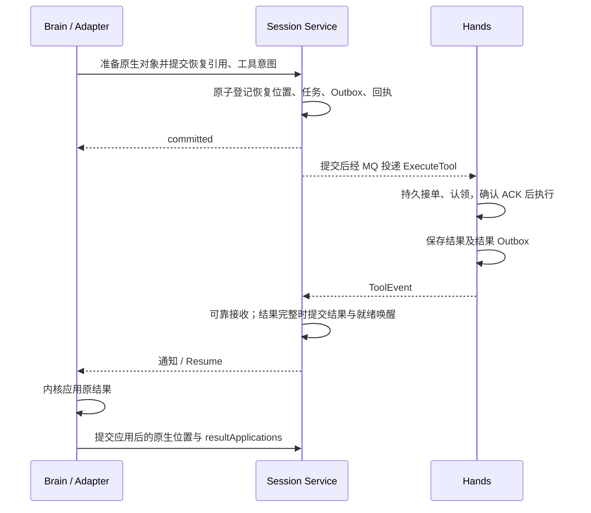

# Brain、Session Service 与 Hands 协议设计

[English](brain-session-hands-protocol.en.md)

日期：2026-10-28。协议与首版 Runtime 已落地。可执行字段见 [protocol](../../agent-harness-runtime/protocol/README.md)，实际支持范围与验收缺口见[实现映射](../../agent-harness-runtime/protocol/implementation-map.md)。本文保留设计理由与交接边界。

目录、语言与进程组合见[多语言 Brain：目录组织与部署](brain-runtime-layout-and-deployment.md)。Session Service 代码先放在 Agent Service 内部独立包，与其同镜像、同 JVM；平台 Session Store 是其中的提交核心。每次部署选择一种 Harness，本文不引入跨 Harness 委派或状态迁移。

AgentScope 的提交和原生存储走 prepared 服务配置；PI 使用通用协议；Hands 复用现有可靠 MQ 传输。Codex 在关键持久化能力验证前禁止认领 Turn。

## 1. 现有能力与待改造内容

| 范围 | 当前已有 | 本次目标 |
| --- | --- | --- |
| 执行提交 | `SessionStore.commit / receipt / head`、幂等回执、所有权检查、对象准备与数据库提交 | 提供跨语言接口；原生状态与显式平台变化共同提交 |
| 内核解释 | `SessionCommit` 仍转换回 AgentScope `SessionEvent`，存储层识别原生事件 | 将原生解释移入 Adapter，Session Service 不依赖内核事件格式 |
| 工具派发 | 工具任务、恢复引用和 Outbox 在平台事务内关联，提交后可靠投递 | 保留保障；明确原生调用与多个平台操作的关联，解除 Java 类型耦合 |
| Hands 执行 | 独立执行记录、可靠接单、原执行查询、结果 Outbox、不确定状态处理 | 保留 Hands 所有权；规范命令、结果、查询和取消契约 |
| 结果与恢复 | 结果与持久化唤醒保持一致，AgentScope 专属结果回填和恢复 | 工具结果消费迁入 Session Service；提供通用恢复数据，Adapter 负责原生应用 |
| 公开事件 | 可靠事实投影、SSE 游标与实时预览分离 | 沿用现有投影链路；公开序号不与内核日志位置混用 |

代码依据：[SessionStore](../../agent-harness-runtime/java/adapter-agentscope/src/main/java/io/agentcore/managed/server/runtime/managed/SessionStore.java)、[原生提交转换](../../agent-harness-runtime/java/adapter-agentscope/src/main/java/io/agentcore/managed/server/runtime/managed/ManagedSessionCommitAdapter.java)、[提交核心](../../agent-service/src/main/java/io/agentcore/managed/server/runtime/managed/SessionCommitTransactions.java)、[Hands 存储](../../tool-worker/src/main/java/io/agentcore/managed/server/runtime/managed/ManagedToolWorkerStore.java)。本次为源码分析，没有重新运行这些路径的测试。

## 2. 接口与责任归属

初期采用 **HTTP/JSON 内部服务接口 + 现有 MQ 命令和事件链路**。调用方必须通过身份与 scope 权限校验；请求里的 tenant、owner 或 executionToken 不能替代访问授权。Brain 不直接操作平台数据库事务。

| 接口 / 消息 | 调用关系 | 输入 → 输出及约束 |
| --- | --- | --- |
| `claimExecution` | Brain → Session Service | scope、Turn、实例身份、稳定 claimId、调度/Resume 身份 → owner、epoch、executionToken、有效期；重试同一次认领不能生成多个新 owner，仍需校验容量与接管资格 |
| `renewExecution` | Brain → Session Service | 原 owner 与执行凭据 → 新有效期或所有权失效；沿用现有租约与 fencing 保障，不把每次续约变成 checkpoint 提交 |
| `deferDelivery` | Brain → Session Service | 原 Ready/Resume 身份与退避时间 → 持久延后回执；登记成功后才可 ACK，不释放已运行 owner |
| `loadRecovery` | Brain → Session Service | scope、Turn → `RecoveryBundle`；读取不授予写权限，执行前必须取得有效所有权 |
| `putNativeObject / readNativeObject` | Adapter 经 Runtime → Session Service | 原生字节、格式及摘要 → `ObjectRef`；读写按 scope 隔离；成功上传不等于执行提交 |
| `commitBoundary` | Brain → Session Service | `CommitBoundary` → `CommitReceipt`；只在持久化提交后返回成功，禁止用 accepted 代替 |
| `getCommitReceipt` | Brain → Session Service | scope、commitId → 原回执或未找到；超时先查询/重试原请求，不能据此新建工具执行 |
| `ExecuteTool / CancelTool / ReplayToolEvents` | Session Service Outbox → MQ → Hands | 不可变工具身份及配置、取消或输出补发请求；Replay 只重发原输出，不能启动工具 |
| `ToolEvent` | Hands Outbox → MQ → Session Service | 工具独立序号下的输出、进度、缺口或最终结果；可靠接收后 ACK，满足结果完整性与等待条件后安排 Resume |
| `getToolState` | Brain → Session Service | taskId、executionId → 已接受结果或观察状态；需要核对外部执行时由 Hands 查询原执行，不能将平台缓存未命中解释为工具未执行 |
| `Resume` | Session Service Outbox → MQ → Brain | 稳定 resumeId、Turn、suspensionId、原挂起版本；先验证仍适用，再可靠接管或登记延后处理 |

平台 API 继续受理用户输入、交互答复、取消和撤回；这些变化必须与提交核心共用一致性规则。SSE 仍由平台 API 提供，不新增一套 Brain 对外事件服务。

**Hands 保留独立执行存储。** Session Service 管平台授权、接受结果和唤醒；Hands 管外部动作、句柄、执行状态和结果交付。两侧通过稳定身份关联，不要求跨服务数据库事务。

## 3. 数据格式：统一交接字段，保留原生格式

### 3.1 身份、版本与引用

| 数据 | 建议字段与规则 |
| --- | --- |
| 公共消息头 | `protocolVersion, messageId, kind, scope`；Turn 消息增加 turnId，Session Ready 由认领时选择 Turn；追踪信息留在传输元数据，不能作为去重键 |
| scope | `tenant, namespace, sessionId`；服务端验证调用者权限与资源归属 |
| 所有权 | `owner, epoch, executionToken`；实例 incarnation 与租约规则沿用现有实现；与工具逻辑身份分开 |
| 工具关联 | `nativeCallId ↔ operationId/taskId/executionId`；允许一个原生调用对应多个操作，批量执行需显式成员关系；重投和恢复不更换 executionId |
| 对象引用 | `backendId, key, sha256, size, formatVersion`，归属 scope 由服务端校验；稳定引用不保存临时签名 URL 或凭据 |
| 三类位置 | `brainRevision` 为 Brain 提交位置；`nativeCursor` 由 Adapter 解释；`publicSequence` 用于公开事件。工具输出另用 `sourceSeq`，不借用内核序号 |

跨语言编码基线：ID 为字符串；可能超过 JavaScript 安全整数范围的计数、epoch 和序号使用十进制字符串；原生内容以字节或对象引用传递。数组有序，必填集合可为空数组；省略可选字段表示本次不更新，清除状态必须使用显式操作，不能依赖 null 的不同语言解释。

`protocolVersion` 与内核 `stateFormatVersion`、现有投影 schema 分开。未知必需操作或不支持的版本明确拒绝，不静默丢字段。请求摘要按统一规范编码计算；字段范围、数字/Unicode 编码、工具 ID 派生算法必须提供 Java/TypeScript 共用的固定输入输出样例后才能冻结，不能直接拿各自默认 JSON 序列化结果做摘要。

### 3.2 执行提交

完整字段见 [commit.schema.json](../../agent-harness-runtime/protocol/schemas/commit.schema.json)，带真实摘要的合成样例见 [tool-handoff.json](../../agent-harness-runtime/protocol/examples/tool-handoff.json)。0.1.0 使用结构化 owner、带 scope 的对象引用、nativeCallIds 数组和 inline/ref 内容封装；不再维护第二份 draft-1 JSON 示例。

| 提交部分 | 内容与验证 |
| --- | --- |
| `nativeState` | checkpoint 和/或 journal 引用、原生格式版本与游标；必须形成可从已提交前缀恢复的新位置，不要求每次提交完整快照 |
| `toolCalls / toolOperations` | 原生调用记录与平台执行意图；验证稳定身份、参数、关联关系和恢复依据。同身份改参数必须报冲突 |
| `inputApplications` | 输入 ID、应用或拒绝状态、原因、原生应用位置；应用回执必须关联能够恢复该输入的原生状态 |
| `resultApplications` | nativeCallId、所应用的 resultIds、原生应用位置；只有这些结果进入可恢复状态后才提交，不能以“已收到”替代 |
| `modelUpdates / interactionUpdates` | 模型调用身份、预算预留/结算、结果引用；交互请求与答复关联。移除原生解释时仍须保留现有模型和交互能力，不增加重复记账 |
| `suspension / terminal` | 挂起 ID、待等待的任务/交互及恢复阶段，或终态与输出引用；挂起必须包含一致的恢复位置，完成前校验未结事项 |
| `publicFacts` | 有稳定事实 ID 的公开变化；原生事件由 Adapter 转换，工具操作结果由 Session Service 产生，按事实归属去重，不能双方各发一次相同事实 |

`CommitReceipt = {commitId, contentHash, outcome: committed, brainRevision, nativeCursor}`。重复提交返回原回执，不重复推进版本；同 ID 不同内容报冲突。查询旧回执可在 epoch 变化后成功，但不恢复旧 owner 的写权限。

新 `brainRevision` 只用于 Brain 恢复位置的并发控制，不由 Hands 输出或公开投影推进。输入撤回、取消、工具结果等并发状态，仍须在提交事务中读取权威状态并校验，不能只靠版本号判定。

不额外建立 `InputApplied / ToolAuthorized / ToolResultApplied` 三份独立事件流水：输入与结果应用由对应字段表达，工具授权由任务和 Outbox 的提交表达。它们可以与原生状态合并提交。

### 3.3 工具消息、恢复数据与错误

| 结构 | 最小业务内容 |
| --- | --- |
| `ExecuteTool` | commandId、taskId、executionId、原生关联、toolName、arguments 或参数引用、封存配置引用、授权提交引用；身份不含当前 Brain 的物理租约 |
| `CancelTool / ReplayToolEvents` | commandId、原 taskId/executionId；取消原因或输出重放起点。控制消息先到时不能创建新的执行 |
| `ToolEvent` | eventId、taskId、executionId、sourceSeq、type、data；type 沿用输出/进度/缺口/最终结果语义，同身份内容不同拒绝 |
| 最终结果 | resultId、taskId、executionId、`succeeded/failed/cancelled`、结果或引用、产物引用、输出终点/缺口信息；`unknown` 是观察状态，不伪装成已确认终态 |
| `RecoveryBundle` | snapshotId、brainRevision、原生恢复引用、待处理输入及应用回执、原生调用与操作关联、已接受结果及应用记录、交互/模型恢复信息、当前挂起与终态 |

`RecoveryBundle` 必须来自一致的元数据快照；大对象与分页通过该快照的稳定引用读取，不能把多次无关联查询拼成恢复状态。拿到快照后仍可能有新结果到达，后续按版本增量读取或重取，不能以通知代替持久化读取。

错误响应统一为 `{code, message, retryable, retryAfterMs?}`：

- 所有权失效：停止该执行的提交与本地内核驱动；由有效 owner 接管。
- 版本冲突：重新读取恢复数据，不盲目覆盖。
- 提交/结果内容冲突、非法引用、不支持的版本：拒绝并定位原因，不换 ID 自动绕过。
- 容量不足或暂时不可用：带退避重试；提交超时先查原回执，未找到也不能当作外部动作未发生。
- 工具状态不明：保留原执行并交给恢复处理，不转换成可自动重试的普通失败。

## 4. 提交与 ACK 边界

**Tool call 的保证是“没有可恢复依据就不能授权执行”。** 原生日志可先于授权存在；对象、数据库与 MQ 并非一个事务。已有可恢复原生前缀后，平台事务必须将其引用、工具任务、Outbox 与回执一起提交。Adapter 不得在提交失败后让工具绕过 Hands 自行执行。

**Execute 的保证是“可靠记录执行身份并恢复原执行”，不是任意外部动作恰好执行一次。** Hands 保存 starting 也无法与外部副作用原子提交。动作已发生而句柄/结果未保存时，仍可能 unknown；只有执行方明确支持稳定身份幂等启动，才可安全重试。

**Result 的保证分两层：结果可靠接收，以及结果进入可恢复的内核状态。** Session Service 不等内核应用才接收结果；Brain 不把结果通知视为已应用。内核尚未应用时，结果必须可供新 Brain 重新读取。

| 交接 | 可以确认的条件 | 确认不代表什么 |
| --- | --- | --- |
| `commitBoundary` 返回 | 对象引用已可用，元数据与平台变化提交成功 | 不能以进入内存队列或 accepted 返回成功 |
| Execute MQ ACK | Hands 持久接单并完成受容量约束的可靠认领；正常消息路径确认 ACK 后才准备/启动外部执行 | 不代表工具已完成；崩溃后由 Hands 的持久恢复责任接续 |
| ToolEvent MQ ACK | 事件已持久接收并去重；乱序时允许可靠缓冲 | 不代表输出已连续、结果已接受或内核已应用。现有 buffered 与 committed 必须区别表达 |
| 最终结果接受 | 输出覆盖/缺口契约满足，结果与符合条件的 Resume Outbox 同事务提交 | 临时 Redis 通知成功不能替代持久化唤醒 |
| Resume / Ready ACK | 已可靠认领，或同一意图已持久登记延后处理；过期/重复消息校验后可结束 | 收到消息或启动本地 Future 不足以 ACK；保留现有渠道各自的认领语义 |
| 投影 MQ ACK | 查询后端的连续事实前缀已可见并完成身份校验 | 不等待浏览器读取 SSE；实时预览不参与执行提交 |

原生存储接口返回“提交成功”也必须满足它承诺的持久化语义，不能为减少远程调用先返回成功再异步落盘。多个内部事件可以合并，但不能跨越工具执行、输入应用确认或终态等可靠边界。

## 5. 恢复流程与不确定性

新 Brain 的固定流程：取得有效所有权 → 读取一致的 `RecoveryBundle` → Adapter 调用内核原生恢复入口 → 核对原工具与结果应用记录 → 继续执行或重新挂起。Brain 退出不说明 Hands 已停止；旧 Brain 被 fencing 后应停止本地驱动与子进程，不自动取消仍有效的 Hands 任务。

| 崩溃或竞态位置 | 恢复动作 |
| --- | --- |
| 对象已上传，提交未成功 | 不授权工具；原对象只是未引用数据，恢复时以已提交位置为准 |
| 提交已成功，响应丢失 | 使用原 commitId 查询/重试并校验内容，不生成新的工具操作 |
| 工具授权已提交，MQ 尚未送达 | 原 Outbox 补发；重复投递复用 commandId 和 executionId |
| Hands 已接单，执行是否发生不明 | 查询原 executionId；具备稳定身份幂等启动才可重试，否则保留 unknown。NOT_FOUND 不能自动证明未发生 |
| Brain 已更换，原工具稍后完成 | 校验原任务与结果身份后接收；不能因为 Brain epoch 变化而丢弃真实结果，冲突结果仍拒绝 |
| 结果先于挂起提交到达 | 挂起事务重新检查结果/输入就绪条件，生成必要唤醒，避免永久等待 |
| 结果已接收，内核尚未应用 | 读取原结果、按 nativeCallId 回填，提交对应原生位置及应用关联；不重跑工具 |
| 原生结果已持久化，平台应用回执不确定 | 先查原提交；分离存储路径按稳定结果 ID 和原生记录核对，补齐应用关联。无法可靠判定时停止推进，不能无条件重复追加 |
| 输出乱序、缺口或 ACK 丢失 | 幂等接收、补齐输出或记录明确缺口，再按契约接受终态；可靠缓冲不冒充完整结果 |
| 取消与执行完成竞争 | 取消是请求，确认前不伪造 cancelled；原执行已有真实结果时保留该事实；取消后不重新启动原工具 |

## 6. Adapter 准入与 Durable Harness 借鉴

Adapter 必须提供并通过测试：稳定调用身份、原生存储接入、执行前拦截、持久化完成确认、结果回填及应用位置识别、恢复入口、失去所有权后的停止能力。原生格式由内核定义；协议只记录不透明引用和明确的平台关联。

原生接口支持完整提交时，将平台变化与原生引用一起提交；外部进程只能提供日志/文件时，需要先建立可验证的持久化屏障，再授权 Hands。只有原生日志尾读、没有工具执行前阻断能力的接入，不能承诺完整可靠执行。缺失能力需显式拒绝对应模式，不通过 Adapter 名称假定所有内核等价。

Durable Harness 的[工具桥接](https://github.com/vercel-labs/durable-harness/blob/ea8aa4060cf4fb8cd39737ce8ab21c4e0f40c741/packages/harness-process/src/tools.ts)使用稳定 callId 关联 effect，在不可安全重放工具执行前等待原生日志屏障；[输入放置](https://github.com/vercel-labs/durable-harness/blob/ea8aa4060cf4fb8cd39737ce8ab21c4e0f40c741/packages/harness-process/src/inbox.ts)先可靠记录再发送给内核。借鉴这两个交接机制，不要求增加同名平台事件。

[PI durable 的存储适配](https://github.com/vercel-labs/durable-harness/blob/ea8aa4060cf4fb8cd39737ce8ab21c4e0f40c741/packages/pi-world/README.md)保留 PI 自己的恢复：安全工具可重跑，其他中断工具返回 interrupted。本项目的 Hands 可独立继续执行，因此 PI Adapter 必须验证能够关联并等待原任务、回填原结果；不能把 Brain 进程退出直接转换成原工具 interrupted 或重跑。Codex 同样需要验证工具交接与结果回填，RPC 连通不是能力验收。

## 7. 开发分工、实施顺序与验收

以下是建议工作包，不代表已分配人员或已经完成：

| 工作包 | 主要交付 | 对接依赖 |
| --- | --- | --- |
| 协议与公共用例 | `agent-harness-runtime/protocol/` 下的 API、Schema、错误、身份/摘要规则、正反例；`testing/conformance/` 行为用例 | Session Service、Hands、Brain 共同确认；不能各自发明字段或去重规则 |
| Session Service | Agent Service 内的 `sessionservice/api` 与 `store`；认领、提交、恢复读取、结果消费、Outbox、唤醒 | 保留现有 SQL 事务保障，移除原生解释；接口返回持久回执 |
| Hands | 复用现有接单/执行存储，完成命令和事件映射、查询/取消、重放及 unknown 处理 | 以原 executionId 执行，维护输出序列；不解释内核 Context |
| Java Runtime / AgentScope Adapter | 将 `ManagedMqSessionLog`、原生 checkpoint/工具恢复解释归 Adapter；Runtime 管协调与平台客户端 | Java 首先成为完整参考实现；模型、预算、交互、取消等能力不能漏迁 |
| TypeScript Runtime / PI | 实现同一服务协议与 PI 原生存储/工具接入，验证 PI durable 的原任务恢复 | 复用协议样例与故障用例，不复制 SQL 事务 |
| Codex Adapter | 验证前置工具拦截、稳定 ID、日志持久化与结果回填；补齐子进程生命周期 | 复用 TypeScript Runtime，通过能力验收后承诺支持 |

实施顺序：

1. **以 0.1.0 基线分头开发。** API、JSON Schema、身份/摘要固定样例、model/interaction/input 子结构、限制与错误映射已放入 protocol 目录并通过离线校验。后续改动共同更新契约与样例；数据库、MQ 与真实内核故障验收仍待实现，不能把静态用例当作运行保障。
2. **先改 Java 参考路径。** 将原生解释移回 Adapter，以显式平台变化驱动提交核心；保留现有行为测试，不先大规模搬目录。
3. **开放 Session Service。** 迁入 Agent Service 内部包，提供远程接口并迁移工具结果消费；Java Brain 先走完整远程路径，验证响应丢失和所有权变更。切换时保持单一权威提交/消费逻辑，不长期维护两套事务实现。
4. **并行接入与联调。** Hands 按冻结协议对接，PI 完成执行/等待/恢复闭环，Codex 先验证能力。最后完成各 Brain 镜像与真实依赖故障测试。

验收必须覆盖：

- 相同提交重试不重复授权；相同 ID 内容冲突必须拒绝。
- 重复命令只恢复原执行；外部动作发生但结果未落盘时不盲目重跑。
- 结果先到/挂起后到以及并发多个结果，仅产生正确的恢复意图。
- 旧 Brain 无权新增提交，但原 Hands 的有效迟到结果仍可接受。
- 结果接收与原生应用之间崩溃，不丢结果、不重复执行工具或追加原生结果。
- 输出乱序、缺口与 ACK 丢失仍可收敛；取消不伪造外部结果。
- Java/TypeScript 使用同一编码、身份、摘要、错误与版本样例。
- 输入应用/撤回竞争、模型结果与预算、交互恢复、终态和公开投影保持现有能力。

已有[工具可靠性测试](../../agent-service/src/test/java/io/agentcore/managed/server/runtime/managed/ManagedToolWorkerReliabilityTest.java)包含结果与 Resume 回滚、乱序结果、迟到结果和稳定消息身份等用例；将其语义提升为跨语言验收，不宣称当前已通过新协议。

## 8. 文档边界

本文负责协议设计理由、提交/ACK、恢复和开发分工；可执行字段与样例统一由 [protocol](../../agent-harness-runtime/protocol/README.md)维护，[目录与部署方案](brain-runtime-layout-and-deployment.md)负责模块、语言和进程。详细现有机制继续见[当前 Session Store](../session-store.md)、[提交设计](../../../docs/session-store-oss-and-direct-commit-design.md)、[执行提交与投影](../../../docs/execution-commit-and-projection-delivery-redesign.md)。0.1.0 是开发基线；各接入方式和实际 wire 格式以实现映射为准，尚未部署验收。
