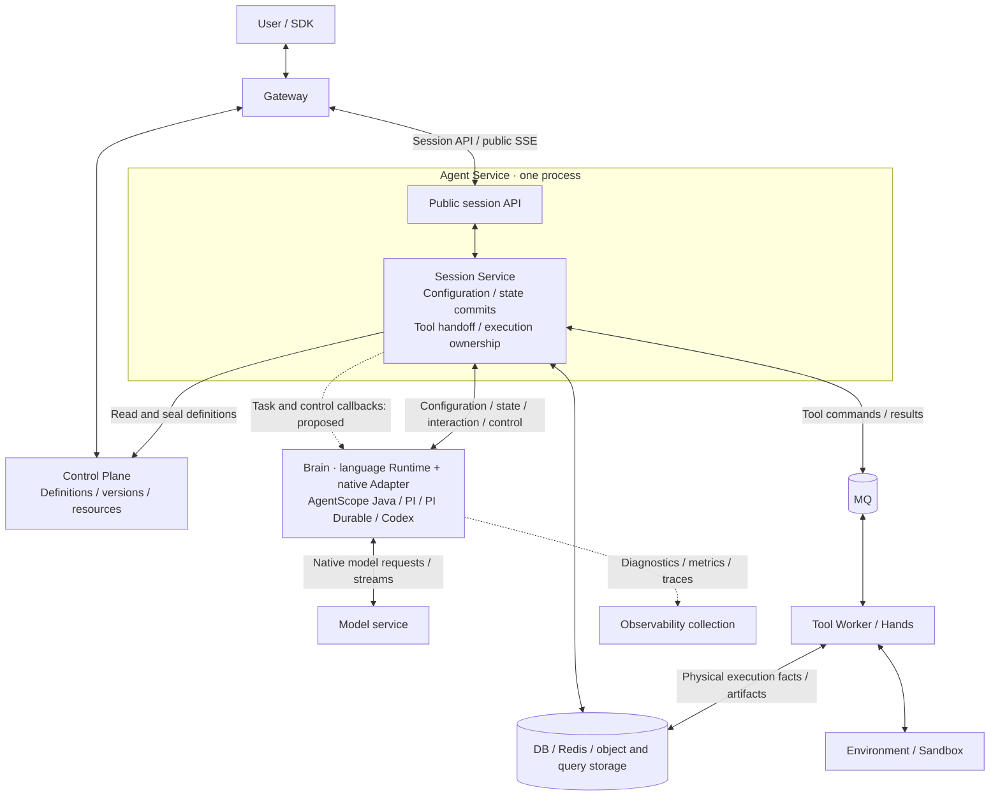
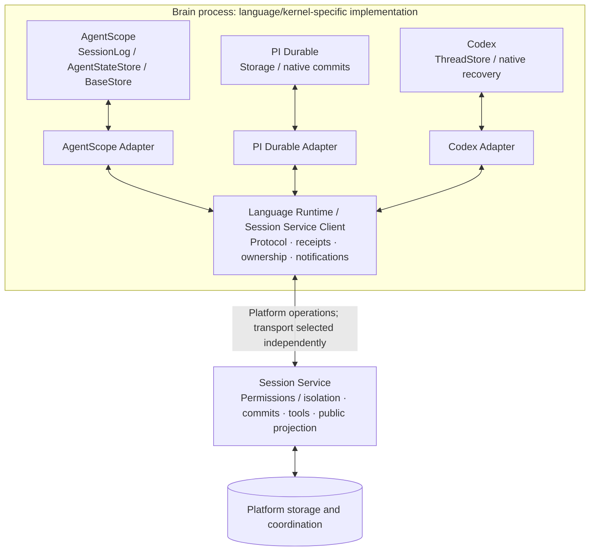

# Multikernel Brains: Native Storage Adaptation and Task Push through Session Service

[中文](brain-session-service-access-and-dispatch.md)

2026-10-30 implementation update: the target design and historical assessment below are retained. The Java HTTP basic flow is implemented; current gaps and evidence are in the [phase record](../../agent-harness-runtime/testing/conformance/verification-java-platform-http-20261030.en.md).

Date: 2026-10-29. Status: design draft and scope convergence, not implemented. This document consolidates native storage adaptation, lessons from World layering, the four data paths, HTTP notifications, callbacks, address discovery, and execution claims. Recommendations do not authorize development. Working directory: `/Users/ken/agentcore/agentcore-managed-agents`, branch `master`.

Related: [implementation plan §2.10](../../../docs/managed-brain-completion-plan.en.md#210-java-brain-access-exclusively-through-session-service-scope-assessment-2026-10-29), [layout and deployment](brain-runtime-layout-and-deployment.en.md), and [existing protocol design](brain-session-hands-protocol.en.md). Proposed callbacks, instance routing, and extensions are not existing protocol guarantees. This document refines W16 responsibilities and dispatch choices in the implementation plan.

2026-10-30 addition: [Multilanguage Brain platform interfaces](brain-platform-interfaces.en.md) specifies the shared protocol, equivalent Java/TypeScript/Rust capabilities, client/Runtime boundaries, kernel mappings, and implementation stages. Interface names are proposals built on existing protocols and clients, not a separate World framework.

## 1. Conclusions and Decision Status

**Unify platform access and authoritative state, not native execution internals.** Java, PI/PI Durable, and Codex access platform capabilities through Session Service. Brain holds no platform DB/Redis/MQ connections or credentials. Native Agent construction, state codecs, recovery algorithms, and local execution scheduling stay in Brain.

| Topic | Conclusion / status |
| --- | --- |
| Platform boundary | The user requires Java to use Session Service too; retaining direct Java MQ/Redis access is not the final target |
| Native storage boundary | Native interface → kernel Adapter → common protocol/client → Session Service backend; include native recovery state while keeping working memory and reconstructible caches in Brain |
| Physical deployment | Retain Control Plane, Gateway, Agent Service, Agent Harness Runtime, and Tool Worker; Session Service stays inside Agent Service |
| Normal task discovery | Recommended candidate: Service calls Brain with a specific task candidate; Brain atomically claims it. Frequent empty polling is not the target primary path |
| Reliability | Durable tasks, leases/fencing, idempotent commits, and receipts provide reliability. Callbacks notify; do not add a second reliable MQ-to-Brain forwarding protocol |
| Discovery | Prefer deployment configuration and existing service DNS. Brain self-registration is not mandatory. Routing controls to a particular owner still needs a decision |
| Implementation | Design only. Callback contracts, instance endpoints, repair policy, and latency targets are not finalized; no implementation or testing started |

A common entry point does not put all bytes through one synchronous chain. Brain still calls model endpoints directly. Ordinary diagnostics, metrics, and traces may use independent collection. Durable business/audit facts must not bypass consistency requirements by being labeled ordinary logs.

## 2. Four Paths and Responsibility Boundaries

| Path | Session Service / platform | Brain |
| --- | --- | --- |
| 1. Agent definitions and configuration | Retrieve versioned Control Plane definitions; enforce platform permissions/capability admission; seal effective definitions, model/tool configuration, and resource references | Map configuration to native Agent/Model/Tools; handle kernel-specific parameters and instance lifecycle |
| 2. Context, state, and recovery | Store state references and format versions; atomic commits, conflict detection, idempotent receipts, correct committed recovery views | Encode/decode native state; establish recovery boundaries; load, replay, or resume native execution |
| 3. Tools, events, and logs | Authorize and reliably hand off platform tools; persist business facts and public projections; accept previews | Map native tool calls/events into protocol facts; adapt results; produce deltas and diagnostics |
| 4. Scheduling and control | Runnable tasks, Session/Turn ownership, leases/fencing, durable input/cancellation, recovery discovery, notifications | Local concurrency/capacity; renewal; model interruption; native safe points; stopping on lease loss and draining |

Control Plane continues owning definition management. Session Service is neither another Control Plane nor the native factory for every kernel. The protocol may carry versioned kernel-specific state/configuration fragments without loading a complete native executor into Service.

Paths 2 and 3 are logically distinct but sometimes require one commit: recovery state, tool intent, final answer, and Turn state must become durable together where required. Avoid dispatching a tool before its recovery boundary exists or announcing completion before committing state. Reuse shared transactions rather than introducing another commit algorithm.

Path 3 has distinct guarantees:

- **Execution commands/results** involve side effects and require permission checks, stable identities, reliable handoff, and result recovery.
- **Durable business events** agree with corresponding state and may be published by asynchronous projection.
- **Live text previews** are best effort and bounded; failure must not block final commits. Final answers cannot depend on preview delivery.
- **Diagnostics/traces** may be collected independently; billing/audit data with durability requirements remain platform facts.

Adapters translate native events into common facts; the platform projects common facts into public events. Native formats, recovery granularity, and algorithms remain kernel-specific.

### 2.1 Borrow World's Layers, Not One HTTP Call per Database Method

There are two independent extension directions: **a new Harness needs native adaptation; a new infrastructure backend needs a World implementation.** PI and Codex do not each implement an entire World. Workflow World combines Storage, Queue, and Streamer; PI WorldStorage implements PI's own Storage interface and calls World internally.

| Layer | durable-harness / World | Project target |
| --- | --- | --- |
| Native runtime interface | PI Durable Storage, ordinary PI loop, Codex native threads/logs | AgentScope SessionLog/AgentStateStore, PI Durable Storage, Codex state/recovery interfaces |
| Kernel adaptation | pi-world, harness-pi, harness-codex | Native interface binding, codecs, commit boundaries, event mapping, and recovery in each Adapter |
| Common platform contract | World storage, queue, and stream capabilities | Cross-language Session Service protocol for ownership, commits/receipts, objects, tool handoff, events/notifications |
| Application-side backend connector | Vercel World and other client implementations | Session Service Client inside each language Runtime, with local concurrency, lifecycle, and notifications |
| Platform backend | Deployment-specific storage, queues, and streams | Session Service and existing DB/MQ/Redis/object/query stores; physical execution remains in Hands |

This is a responsibility analogy, not a one-to-one API mapping. Do not require the World SDK, force every kernel to implement the same native Storage, or duplicate databases/message systems per kernel. A World abstraction also does not inherently require a separately deployed central service.

The following comparison uses pinned source versions and does not establish compatibility between arbitrary releases:

| External implementation | Actual adaptation | Lesson and boundary |
| --- | --- | --- |
| Ordinary PI | Wrap model/tool calls as common effects, persist intent/result, and reconstruct context | Add recovery around a non-native Durable loop; do not confuse it with PI Durable Storage |
| PI Durable | Encode a native commit as a World event; persist before applying to MemoryStorage; replay logs to rebuild the read view | PI owns Task/Entry/Document semantics; the adapter bridges persistence, write isolation, and wakeups |
| External durable-harness Codex | Sandbox app-server path mirrors rollout, restores native logs/threads, and reconciles tool results | Identical Storage interfaces are unnecessary. Sandbox Drive files are not World session logs. This is not our Rust Codex integration |
| Vercel World | Compose managed storage clients, Vercel Queues callbacks, and Streamer; deployment identity participates in routing | Not a PI-specific backend. Queue delivery participates in recovery/takeover, rather than implementing our proposed notify-then-claim pattern. Public clients do not establish the underlying server database engine |

Sources: durable-harness `ea8aa406` [PI Adapter](https://github.com/vercel-labs/durable-harness/blob/ea8aa4060cf4fb8cd39737ce8ab21c4e0f40c741/packages/harness-pi/src/index.ts), [PI WorldStorage](https://github.com/vercel-labs/durable-harness/blob/ea8aa4060cf4fb8cd39737ce8ab21c4e0f40c741/packages/pi-world/README.md), and [Codex Adapter](https://github.com/vercel-labs/durable-harness/blob/ea8aa4060cf4fb8cd39737ce8ab21c4e0f40c741/packages/harness-codex/README.md); Workflow `6829c26` [World contract](https://github.com/vercel/workflow/blob/6829c261c56aafcd16f26cf9b4c766f52e91e660/packages/world/src/interfaces.ts), [Vercel World assembly](https://github.com/vercel/workflow/blob/6829c261c56aafcd16f26cf9b4c766f52e91e660/packages/world-vercel/src/index.ts), and [queue implementation](https://github.com/vercel/workflow/blob/6829c261c56aafcd16f26cf9b4c766f52e91e660/packages/world-vercel/src/queue.ts).

### 2.2 Include Native Persistence Without Remote Calls for Every Context Access

**Native context/session state, execution journals, and checkpoints required for Managed persistence/recovery belong behind Session Service.** Persisting public messages alone while native recovery depends on a Brain-local database does not meet the target.

| Data | Target treatment |
| --- | --- |
| Active reasoning context, native objects, reconstructible read views, staging | Brain memory, optionally non-authoritative temporary caches; never the only cross-process recovery source |
| Native entries, execution records, task/document state, checkpoints | Adapter encodes native boundaries and persists through Service; restoration loads committed versions and invokes native recovery |
| Persistent platform data such as private workspace | Existing platform storage interfaces and their consistency semantics; physical execution files remain owned by Hands/Environment storage |
| Public messages, tool intent/result application, Turn completion | Commit together with native state references when required; platform owns public projection |
| Model deltas and diagnostics | Dedicated preview channel for deltas; independent diagnostics collection is allowed but cannot replace recovery journals |

Native persistence through Service does not mean every file goes into one table/log or every get/append becomes an HTTP request. Keep caches, read views, batches/deltas, and references. Explicitly distinguish staging operations from operations promising durability to the kernel.

### 2.3 Common Guarantees, Kernel-Specific Payloads

This is a contract responsibility checklist using existing protocol foundations, not new endpoint definitions:

| Common information / guarantee | Service | Adapter / Runtime |
| --- | --- | --- |
| Scope, Session/Turn, kernel/format versions | Tenant isolation, valid bindings, version/reference checks | Correct kernel/codec declaration; reject incompatible state rather than silently changing formats |
| Owner, epoch/token, lease, base revision | Validate current ownership and commit base; reject stale writes | Renew and stop after loss; notifications/local appends are not authorization |
| Native objects/references, cursor, content integrity | Persist and maintain committed head; check scope/integrity according to contract | Native encoding, snapshot/delta organization, context reconstruction, recovery |
| State and associated tool/public facts | Shared transactions, permissions, reliable handoff/projection | Extract common facts, stable identities, and appropriate boundaries from native events/calls |
| Commit ID, request hash, receipt | Idempotent confirmation, conflict detection, recovery evidence | Query/retry the original identity after uncertainty rather than creating a replacement write |

Service need not interpret every native field, but is not an arbitrary byte-upload endpoint: common envelopes, authorization, references, and side-effect relationships must be checkable. Limited format validators/codecs are allowed without moving complete native executors or another Task state machine into Service.

### 2.4 Write, Confirmation, and Recovery Semantics

1. At the native boundary, the Adapter produces state changes/snapshots and associated platform facts.
2. Large state can first be written as immutable objects through existing interfaces, then referenced in a commit. Uploaded objects are not committed state. Do not invent distributed object-store/DB transactions to satisfy joint publication.
3. Service validates ownership, base revision, and content identity, atomically advances authoritative references and associated facts, and returns a receipt.
4. Operations promising native durability return success/publish the corresponding local state only after confirmation. Uncertain responses use the original commit identity; timeout is not rollback. Staging-only native methods are not durable acknowledgment and require protected Adapter boundaries.
5. A new valid owner reads committed head, rebuilds memory views, and resumes through native semantics. Observational reads must not claim execution ownership merely to inspect state.

Do not force Java prepared commits and generic commits into one request shape. Reuse transactions/guarantees while retaining native granularity; the two entry points must not bypass each other's ownership. Remote durable confirmation enters the critical path. Optimize with caching, batches/deltas, and object references, not early acknowledgments. Record uncommitted-object cleanup, large-state capacity, and format migration as follow-ups without starting another storage redesign.

## 3. Target Structure

This is a target diagram. Dashed callbacks are not implemented. Kernels are deployment choices, not successive stages.



Session Service is a logical entry point with separate configuration, coordination, commit, tool, and projection responsibilities. Network waits and notifications do not hold state transaction locks; previews do not share an unbounded queue with authoritative commits. Keep existing physical roles without adding a centralized scheduler service.

### 3.1 Native Interfaces to the Common Backend



Adapters represent alternatives, not a requirement to load all SDKs into one process. Ordinary PI uses its execution-boundary adapter rather than pretending to expose PI Durable Storage.

## 4. Existing Implementation and Gaps

| Area | Current fact | Gap |
| --- | --- | --- |
| Java Brain | Prepared commits/receipts and some reads, objects, workspace, model configuration, and coordination already use Service; MQ delivery, Redis leases/signals, and JPA/shared wiring remain | Replace residual direct dependencies and platform bypasses while preserving native recovery |
| PI / Codex | HTTP discovery, claim, and execution. TS worker defaults to a 500ms task-poll delay; Rust worker has a 500ms loop wait; TS active-input checks run every second | These are code intervals, not end-to-end SLAs. HTTP integration does not establish callback or owner-targeted notification support |
| HTTP next / claim | NextRequest and Service claim currently allow pi/pi-durable/codex only. next discovers candidates; claim atomically activates and records a lease | Bridge Java prepared token/epoch to the generic fence; extending an enum is insufficient |
| Brain callback | Proposed in discussion only | Define endpoint, identity, duplicate handling, local capacity, instance routing, and drain without expanding all native features |
| Service URL | Java uses MANAGED_AGENTS_SESSION_SERVICE_URL; PI/Codex use SESSION_SERVICE_URL | Deployment injection suffices; no registry is required |

Compose currently uses `http://agent-service:8084/internal/session-service/v0`. PI Helm uses Agent Service DNS. The Java Helm explicit-URL injection gap remains in plan §2.9; target wiring is not delivered wiring.

### 4.1 Native Storage Status and Required Java Work

These are static repository findings, not new runtime acceptance evidence.

| Kernel / interface | Existing path | Remaining assessment |
| --- | --- | --- |
| AgentScope SessionLogStore / SessionLog | ManagedSessionLogStore binds the active Managed execution; ManagedMqSessionLog uses ManagedRuntimeWriter and prepared/commits, querying prepared/receipt on uncertainty | Core native journals already have remote commits. Mq in the class name does not mean every log commit sends MQ. Execution entry still requires MQ/Redis removal |
| AgentScope BaseStore | RemoteWorkspaceStore calls prepared/workspace; private atomic IO can carry execution receipt identity | Reuse this path rather than restoring Brain-local persistence |
| AgentScope AgentStateStore and JPA wiring | HarnessRuntimeConfig still creates JpaAgentStateStore; the factory receives/binds it, alongside other definition/catalog JPA dependencies | Required W16/J3 audit, not an exception. Whether it holds independent state or duplicates SessionLog remains to be verified |
| PI Durable Storage | SessionServicePiStorage extends MemoryStorage; commit/mintId confirm persist → host.boundary before advancing the local view; restore reconstructs it from committed snapshots | Native adaptation already exists. Preserve format/dependency contracts without rewriting PI tasks or treating MemoryStorage as sole persistence |
| Project Codex ThreadStore | Rust ScratchStore provides incarnation-local staging; Adapter snapshots and Runtime commit boundaries capture native rollout/history for recovery | Local flush is not platform durable commit. Preserve protected boundaries rather than switching to external durable-harness's app-server/Drive topology |

Choose the AgentStateStore treatment by tracing actual callers, not remotely wrapping all JPA CRUD:

1. **Independent required state:** retain the native interface with Service-backed adaptation and necessary identity, permissions, versioning, and ownership.
2. **State duplicated in SessionLog/checkpoints:** reuse authoritative state/recovery interfaces; avoid dual writes and competing recovery sources. Confirm legacy-data compatibility separately.
3. **Unused legacy Managed wiring:** remove it from the factory/component scan rather than adding remote APIs for unused components.

Completion requires native construction, commit, and cross-process recovery without DataSource/JPA wiring. Deleting a bean while disabling required behavior is insufficient. If SDK interfaces cannot support the boundary, record the concrete blocker without modifying upstream binary dependencies or expanding kernel features implicitly.

Code: [SessionLogStore](../../agent-harness-runtime/java/adapter-agentscope/src/main/java/io/agentcore/managed/server/runtime/managed/ManagedSessionLogStore.java), [SessionLog commit](../../agent-harness-runtime/java/adapter-agentscope/src/main/java/io/agentcore/managed/server/runtime/managed/ManagedMqSessionLog.java), [BaseStore](../../agent-harness-runtime/java/adapter-agentscope/src/main/java/io/agentcore/managed/server/runtime/managed/RemoteWorkspaceStore.java), [JPA factory wiring](../../agent-harness-runtime/java/brain-agentscope/src/main/java/io/agentcore/managed/server/web/config/HarnessRuntimeConfig.java), [PI Storage](../../agent-harness-runtime/typescript/packages/adapter-pi/src/durable-storage.ts), [PI Durable Adapter](../../agent-harness-runtime/typescript/packages/adapter-pi/src/pi-durable.ts), [Runtime boundary](../../agent-harness-runtime/typescript/packages/runtime/src/index.ts), [Codex staging](../../agent-harness-runtime/rust/crates/adapter-codex/src/store.rs), and [Codex Adapter](../../agent-harness-runtime/rust/crates/adapter-codex/src/lib.rs).

## 5. HTTP Transport Choices

HTTP is not limited to short polling. Operations and notifications can use different channels while sharing ownership and authoritative facts.

| Choice | Benefit | Cost / condition |
| --- | --- | --- |
| Short polling | Existing implementation, simple recovery, outbound-only Brain connectivity | Empty queries, discovery delay, Service/DB load; not the target primary notification path |
| Long polling | Wait while idle and return on change; no inbound Brain connectivity required | Connections, timeouts, asynchronous waits, and wakeup races; do not occupy blocking threads or DB transactions |
| Brain-initiated SSE / streaming | Service pushes over an existing connection; useful where reverse connectivity is unavailable | Connection lifecycle, reconnection, backpressure, and cross-replica connection routing; the stream is not durable fact storage |
| Service callback to Brain | Notify when work becomes ready; no normal Brain task scans | Inbound reachability, authentication, instance routing, capacity rejection, retries, and repair |

**Recommended candidate: callback + atomic claim + low-frequency Service repair where the services are mutually reachable.** Otherwise select long polling or a Brain-initiated notification connection. Do not implement every transport at once or promise latency/capacity figures without evidence. Text deltas flow Brain → Service and can retain bounded, batched preview reporting.

## 6. Address Discovery Is Not Instance Registration

Brain reaches Service through a deployment-configured stable URL resolved by container networking or Kubernetes Service DNS, independent of individual Service Pods.

Service-to-Brain notifications have two routing needs:

| Notification | Required target | Proposal |
| --- | --- | --- |
| New work or recovery after ownership release | Any compatible instance with capacity | Configure a Brain service address per kernel, let load balancing choose an instance, then check local capacity and claim |
| Cancellation, new input, or tool-result hints for active execution | The current owner's exact process | Instance routing is required; a shared load-balanced address is insufficient |

Candidates for instance routing are deployment endpoint discovery, validated instance endpoints/incarnations supplied during claim/renewal, or instance-initiated notification connections. No choice is finalized. Self-registration, global capacity reporting, and centralized node selection are not prerequisites. Kubernetes Headless Services/EndpointSlices supply addresses/readiness, not application execution capacity.

Callbacks authenticate their caller. Instance addresses come from trusted configuration or validated internal endpoints, not arbitrary business URLs. Restarted processes must be distinguishable from previous incarnations. Building a complete registry is outside this batch.

## 7. Proposed Push and Execution Flow

Operations below are logical; callback URLs and response formats remain undecided. The normal path claims the notified candidate directly without calling next.

```mermaid
sequenceDiagram
    participant API as Public session API
    participant S as Session Service
    participant B as Brain service / instance
    participant M as Model
    participant H as MQ / Hands
    API->>S: Accept input
    S->>S: Persist input and runnable task facts
    S->>B: Notify task candidate
    B->>B: Validate, check capacity, reserve local slot
    B-->>S: Accept or reject promptly; do not await execution
    B->>S: executions/claim with stable claimId
    S->>S: Atomically validate and grant ownership
    S-->>B: owner / epoch / token / expiresAt
    B->>S: Read effective configuration and recovery state
    B->>M: Build or restore, then call model
    M-->>B: Deltas / tool call
    B->>S: Publish preview; commit state and tool intent
    S->>S: Commit together and create reliable tool handoff
    S-->>B: Commit receipt
    S->>H: Tool command
    Note over B,S: On suspension, finish this execution slice through commit semantics
    H-->>S: Tool result
    S->>S: Idempotently persist result and recoverability
    S-->>H: ACK after durable acceptance conditions hold
    S->>B: Notify recovery candidate
    B->>S: Claim again and read recovery data
    B->>B: Restore with native kernel semantics
    B->>S: Commit final state, answer, and completion together
```

While an execution holds a valid lease, tool/input notifications target its owner rather than creating a competing execution. Recovery is reclaimed after suspension releases ownership. Local callback acceptance is not execution authorization; execution must wait for successful claim.

A shared service address selects a reachable instance, not necessarily one with an available slot. Full or draining instances reject promptly. Service uses bounded backoff, coalescing, and repair rather than tight retries or broadcasting every task. Multiple Service replicas must reuse durable queue/dispatch coordination to avoid notification storms; claim still protects correctness.

## 8. Exact Meaning of executions/claim

claim converts a task candidate into authorization for one execution. It neither builds an Agent nor ACKs MQ.

Inputs include scope/Turn/trigger, kernel type, owner identity, and a unique claimId. Within a transaction, Service rechecks eligibility, kernel binding, recovery trigger, and current lease, then returns owner, epoch, executionToken, and expiresAt. Configuration and recovery are read afterward. Use the authoritative Turn and credentials in the response; a stale candidate is not authorization.

- Competing instances: one valid owner per execution scope; other attempts stop on conflict.
- Uncertain response: retry the same claimId and body to retrieve the idempotent result. An expired returned grant does not authorize execution.
- Running: renew and track remaining validity; stop locally on lease loss.
- Committing: Service validates ownership and epoch; stale credentials cannot add valid commits.
- Completion/suspension: release through the appropriate commit/handoff semantics; a Session is not permanently assigned to an instance.

This guarantees one authorized committer, not the absence of overlapping computation during a partition or exactly-once effects in arbitrary external systems. Preserve Hands action identities and recovery; Brain lease loss does not justify repeating or revoking accepted actions.

| Authorization placement | Behavior | Assessment |
| --- | --- | --- |
| Notify, then claim | Brain checks local capacity and competes for ownership | Recommended candidate; reuses claim and supports a stable service entry point |
| Assign, then push | Service creates a lease for a specific Brain and pushes credentials | Saves a round trip but requires exact instance/capacity knowledge and handling undelivered/rejected reservations; not the default batch design |

Atomic authorization is essential; a separate HTTP request is not inherently mandatory. Future consolidation must retain authorization and must not route credentials bound to instance A to instance B through generic load balancing.

## 9. Reliability Without a Second Delivery System

**Avoid: MQ → Service holds receipt → waits for Brain HTTP ACK/completion → ACKs MQ.** This couples broker delivery to network connections and Agent lifetime.

Use existing durable facts as business authority: task/queue state describes pending work, leases describe ownership, and commits describe progress/completion. Do not introduce a parallel Brain-message completion ledger.

| Failure window | Required behavior |
| --- | --- |
| Task transaction commits, Service exits before notification | Existing durable queue/outbox or low-frequency repair rediscovers work; an in-memory after-commit callback alone is insufficient |
| Duplicate, reordered, or unconfirmed callback | Recheck trigger version and claim; coalesce duplicates. HTTP 2xx is not task completion |
| Brain accepts callback and exits before claim | Work remains pending and can be notified again |
| Brain claims but callback response is lost | Consult the valid lease; callback timeout must not immediately transfer ownership |
| Claim or commit response is lost | Query receipts/retry with the original identity; timeout is not proof of rollback |
| Tool result persists but MQ ACK is lost | Deduplicate redelivery using stable identity; result and recoverability must already be durable or deterministically reconstructible |
| Brain exits during execution | Reclaim after lease expiry using committed state and existing results; do not repeat side effects merely because of a notification |
| Cancellation callback is lost | Durable cancellation remains discoverable by control-state checks. Callback alone has no unconditional latency guarantee; checking mechanism and bounds remain undecided |

ACK tool-result messages when results and recoverability are durably accepted, without waiting for Brain availability. Tasks already represented in the DB do not need another MQ hop before reaching Brain. Retire the old Java Turn/Resume consumption path after drain and receipt settlement; do not mechanically move all old consumers into Service.

## 10. Cost, Multikernel Adaptation, and Scope

Compared with one Java Brain directly consuming MQ, this increases Service coordination/notification responsibility, a claim round trip, and HTTP failure handling. The benefit is avoiding three language-specific Broker clients, deferred acknowledgments, and infrastructure permission integrations. Overall complexity improves only if existing queues/transactions are reused without duplicate dispatch/delivery state machines.

Language Runtimes own protocol clients, callback endpoints, capacity, renewal, and drain. Native Adapters own construction, event mapping, state, and recovery. A common notification contract does not authorize additional subagent, resource, checkpoint-management, or long-context features.

Keep W16 bounded by J1–J4:

1. **Decide notification/routing contracts first**, then connect Java claim/leases to prepared commits. Do not treat pure polling as the final architecture or build a general scheduling framework.
2. Replace direct Java input/cancel, tool-result, and preview dependencies; missed notifications remain recoverable from facts.
3. Audit AgentStateStore and other Java entry points by native contract: remotely adapt independent state, reuse authoritative journals for duplicates, remove unused wiring. Then remove JPA/DataSource/Redis/MQ wiring and replace required platform reads. Do not create one HTTP method per JPA method or substitute empty implementations/local databases.
4. Adjust Brain configuration, permissions, health checks, and controlled cutover. Retain historical schemas/migrations; Service/Worker retain infrastructure responsibilities.

## 11. Open Decisions and Minimal Acceptance

Resolve before implementation; none are assumed decided:

- Service → Brain reachability in the target environment and kernel-specific task-entry addresses.
- Owner-instance endpoint source, incarnation, authentication, and expiration; prefer existing deployment capabilities.
- Callback envelope, stale/duplicate handling, full-capacity responses, bounded retry, and repair coordination.
- Task-start/cancellation latency goals and concurrency scale before selecting timeouts, backoff, and repair frequency.
- One authoritative relationship between Java prepared ownership and generic claim/fencing; compatibility for existing Sessions and receipts.
- Rollout order across the three language Runtimes, preserving protocol compatibility without assuming all implementations change at once.
- Actual AgentStateStore readers/writers and authority relative to SessionLog; staging/durable acknowledgment boundaries, codec compatibility, and recovery-data mappings for native interfaces.

After explicit implementation authorization, use targeted checks only: Java startup with no platform storage credentials/connections; model/tool/public-SSE flow; duplicate callbacks/claim competition, full capacity, and drain; uncertain claim/commit responses; takeover after tool suspension; owner-targeted cancellation and missed-notification repair; Compose/Helm wiring. Diagrams are not runtime evidence. Native-storage checks must also cover no early durable acknowledgment, no exposure of uncommitted state after failed commits, reconstruction of read views from committed data, and Java recovery without local JPA. Do not mistake Codex staging flush for platform commit success. Reuse existing cases and add only changed-boundary tests rather than a full cross-kernel suite.

Exclude full fault/capacity suites, cross-kernel migration, complete capability catalogs, billing/Vault redesign, table deletion, repository-wide module cleanup, and independently deploying Session Service. Stop after targeted gates pass and record remaining edges.

## 12. Evidence and This Iteration

Code: [HTTP acquisition/leases](../../agent-service/src/main/java/io/agentcore/managed/server/agentservice/sessionservice/store/HarnessProtocolStore.java), [schema](../../agent-harness-runtime/protocol/schemas/runtime.schema.json), [Java execution](../../agent-harness-runtime/java/adapter-agentscope/src/main/java/io/agentcore/managed/server/runtime/managed/ManagedHarnessRuntimeTurns.java), [Java prepared commits](../../agent-harness-runtime/java/adapter-agentscope/src/main/java/io/agentcore/managed/server/runtime/managed/ManagedRuntimeWriter.java), [TS worker](../../agent-harness-runtime/typescript/packages/runtime/src/worker.ts), and [Rust worker](../../agent-harness-runtime/rust/crates/runtime/src/worker.rs).

Transport/discovery references: [SSE](https://developer.mozilla.org/en-US/docs/Web/API/Server-sent_events/Using_server-sent_events), [Kubernetes Headless Services](https://kubernetes.io/docs/concepts/services-networking/service/#headless-services), and [EndpointSlices](https://kubernetes.io/docs/concepts/services-networking/endpoint-slices/). Availability of those mechanisms does not establish project integration.

This iteration updates bilingual design documents and plan references with native-storage/World layering, existing paths, and AgentStateStore treatment, and checks Markdown structure/local links. No production code changes, tests, image builds, deployments, commits, or pushes. Existing primary-checkout changes are preserved.
