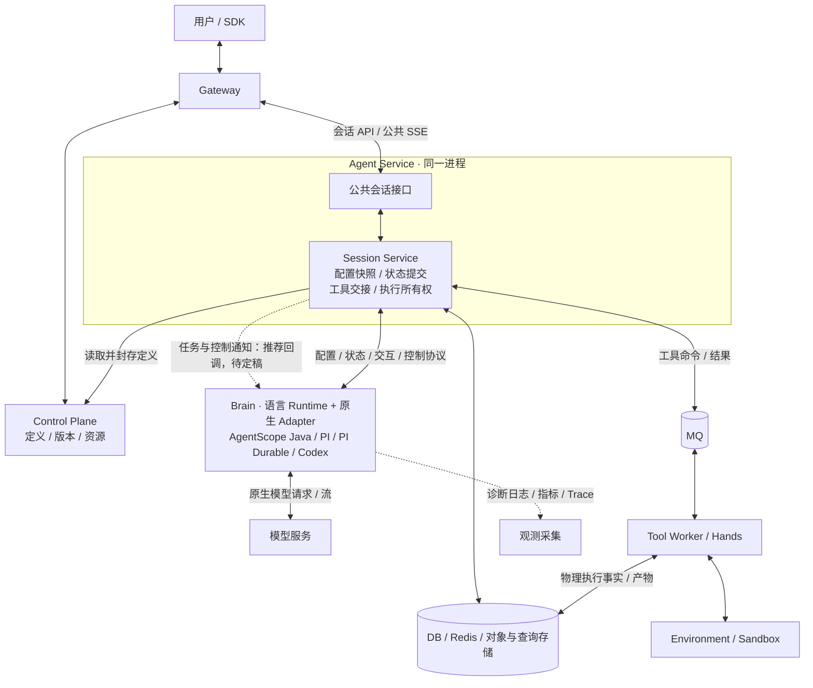
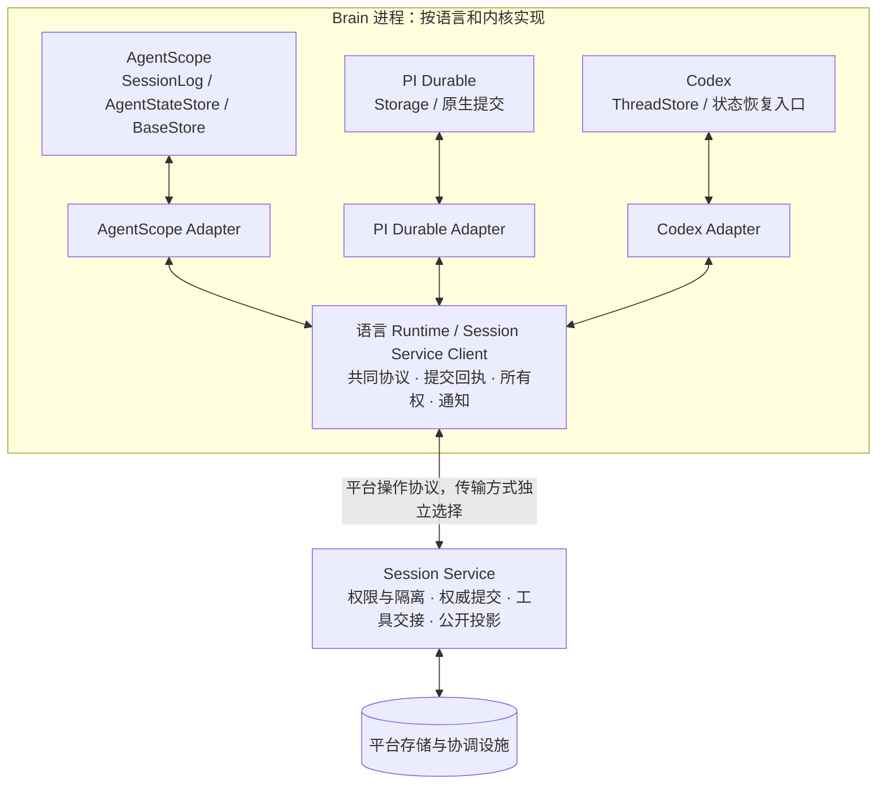
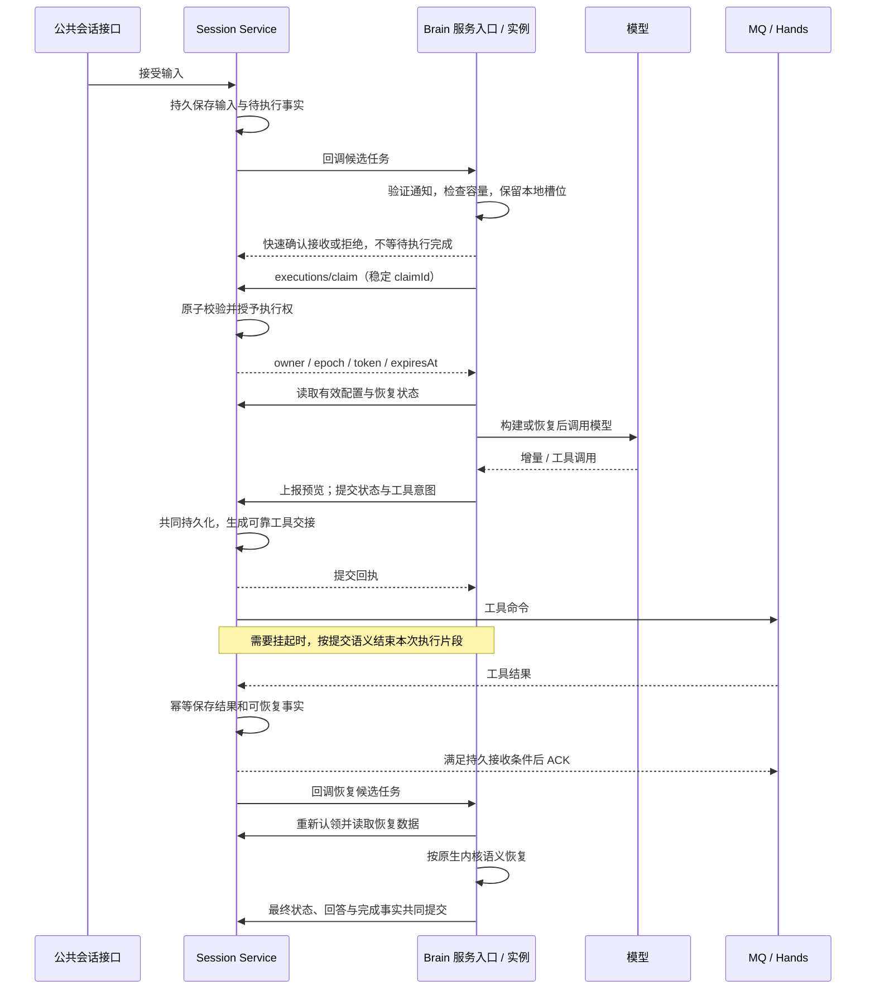

# 多内核 Brain：Session Service 原生存储适配与任务推送方案

[English](brain-session-service-access-and-dispatch.en.md)

2026-10-30 实施更新：下文是完整目标及历史评估；Java HTTP 基础闭环已实施，当前差距与验收范围以[阶段记录](../../agent-harness-runtime/testing/conformance/verification-java-platform-http-20261030.md)为准。

日期：2026-10-29。状态：设计草案与范围收敛，尚未实施。本文汇总原生存储接口适配、World 分层借鉴、四类数据链路、HTTP 通知、主动回调、地址发现和任务认领的讨论；推荐方案不等于已获开发授权。实际工作目录为 `/Users/ken/agentcore/agentcore-managed-agents`，分支 `master`。

关联：[实施计划 §2.10](../../../docs/managed-brain-completion-plan.md#210-java-brain-仅经-session-service-接入范围评估2026-10-29)、[目录与部署](brain-runtime-layout-and-deployment.md)、[既有协议设计](brain-session-hands-protocol.md)。本文提出的回调、实例寻址和协议扩展均不代表既有协议已经支持；对后续 W16 设计，以本文对职责和调度方式的澄清补充实施计划。

2026-10-30 补充：[多语言 Brain 平台接口方案](brain-platform-interfaces.md)细化共同协议、Java/TypeScript/Rust 对等能力接口、客户端与 Runtime 边界、内核映射及分阶段实施。接口名称为设计建议，沿用现有协议与客户端，不另建 World 框架。

## 1. 结论与决策状态

**统一平台访问和权威状态，不统一内核内部执行过程。** Java、PI/PI Durable、Codex 均通过 Session Service 协议使用平台能力；Brain 不持有平台 DB、Redis、MQ 等基础设施连接与凭据。原生 Agent 构建、状态编解码、恢复算法和本地执行调度保留在 Brain。

| 事项 | 结论 / 状态 |
| --- | --- |
| 平台访问边界 | 用户已明确 Java 也应仅经 Session Service 接入；不以保留 Java MQ/Redis 直连作为最终目标 |
| 原生存储边界 | 采用“原生接口 → 内核 Adapter → 共同协议/客户端 → Session Service 后端”分层；原生恢复状态纳入范围，运行中内存与可重建缓存留在 Brain |
| 物理部署 | 保留 Control Plane、Gateway、Agent Service、Agent Harness Runtime、Tool Worker 五个角色；Session Service 继续包含在 Agent Service 进程中 |
| 正常任务发现 | 推荐评估 Service 主动回调 Brain，携带具体候选任务，Brain 再原子认领；不以高频空轮询作为目标主路径 |
| 可靠性 | 由持久任务、租约/fencing、幂等提交和回执保证；回调是通知，不建立第二套 MQ 到 Brain 的可靠消息转发协议 |
| 服务发现 | 优先部署配置和已有服务 DNS；Brain 自注册不是必需前提。执行中定向通知的实例寻址仍需选型 |
| 开发状态 | 仅方案；回调接口、实例地址来源、补偿策略和延迟指标未定稿，未启动实现或测试 |

统一入口不要求所有字节都经过同一同步处理链。模型调用仍由 Brain 发往模型服务；普通日志、指标、Trace 可走独立观测采集。必须可靠保存的业务/审计事实不能借“普通日志”旁路平台一致性要求。

## 2. 四类链路与职责边界

| 链路 | Session Service / 平台负责 | Brain 负责 |
| --- | --- | --- |
| ① Agent 定义与运行配置 | 从控制面获取版本化定义；平台权限与能力准入；封存有效定义、模型/工具配置及资源引用 | Adapter 将配置转换成原生 Agent、Model、Tools；内核专属参数映射与实例生命周期 |
| ② 上下文、状态和恢复 | 保存状态引用及格式版本；原子提交、版本冲突、幂等回执；提供正确的已提交恢复视图 | 原生状态编码/解码；产生恢复边界；加载、重放或恢复原生执行 |
| ③ 工具交接、事件和日志 | 平台工具授权与可靠交接；持久业务事件及公开投影；在线预览入口 | 原生工具/事件转换为协议事实；原生结果适配；生成 delta 和诊断信息 |
| ④ 调度与控制 | 可执行任务、Session/Turn 所有权、租约与 fencing；持久输入/取消；恢复发现与通知 | 本地并发与容量；续租；中断模型调用；原生安全点；失租停止和 drain |

控制面继续拥有定义管理职责，Session Service 不是另一个控制面，也不是各内核的原生工厂。共同协议可包含受版本约束的内核专属状态或配置片段，但不应让 Service 为了运行任务而加载完整原生执行器。

第二、三类在逻辑上可分，在提交上部分必须绑定：恢复状态、工具调用意图、最终回答和 Turn 状态应在需要时共同落地。避免“工具命令已发出但恢复状态未保存”或“公开完成但状态未提交”。复用现有共同事务，不另建提交算法。

第三类还需区分：

- **执行命令与结果**涉及真实副作用，必须有权限检查、稳定身份、可靠交接和结果恢复。
- **持久业务事件**需要与对应状态一致，可由异步投影对外发布。
- **在线文本预览**可尽力传递、有界缓冲；失效不拖住最终提交，最终回答不能依赖预览可靠性。
- **诊断日志与 Trace**可独立采集；计费、审计等有可靠性要求的数据另按平台事实处理。

事件适配分两层：Adapter 将原生事件转成共同事实；平台将共同事实投影成统一公开事件。内核状态格式、恢复粒度和算法不强制统一。

### 2.1 借鉴 World 的分层，而非逐个远程化数据库方法

durable-harness 的两种扩展方向应分开：**增加 Harness 时实现原生适配；增加基础设施后端时实现 World。** 不是 PI、Codex 各自实现一整套 World。Workflow 的 World 组合 Storage、Queue、Streamer；PI WorldStorage 则实现 PI 自己的 Storage 接口，内部调用 World。

| 层次 | durable-harness / World | 本项目目标 |
| --- | --- | --- |
| 原生运行接口 | PI Durable Storage、普通 PI Agent 循环、Codex 原生线程/日志 | AgentScope SessionLog/AgentStateStore、PI Durable Storage、Codex 原生状态与恢复接口 |
| 内核适配 | pi-world、harness-pi、harness-codex | 各内核 Adapter：原生接口绑定、状态编解码、提交边界、事件转换和恢复 |
| 共同平台契约 | World 的存储、队列和流能力 | Session Service 跨语言协议：所有权、状态提交/回执、对象、工具交接与事件/通知 |
| 应用侧后端连接 | Vercel World 等客户端实现 | 各语言 Runtime 内的 Session Service Client；承接本地并发、生命周期和通知 |
| 平台后端 | 对应部署环境的存储、队列和流设施 | Session Service 及现有 DB、MQ、Redis、对象/查询存储；Hands 继续承载物理执行 |

这是职责类比，不是接口一一对应。不引入 World SDK 作为前提，不要求各内核实现统一原生 Storage，不为每个内核复制数据库或消息系统。World 抽象也不天然等于一个必须独立部署的中心服务。

固定源码版本的对照如下；它解释设计思路，不证明不同版本可直接组合运行：

| 外部实现 | 实际适配方式 | 可借鉴点与边界 |
| --- | --- | --- |
| 普通 PI | 包装模型和工具调用为通用 effect，保存意图/结果，并重建上下文 | 可在非原生 Durable 循环外补恢复边界；不能与 PI Durable 原生 Storage 混为一类 |
| PI Durable | 原生一次 commit 编码为 World event；先持久化再应用到本地 MemoryStorage；重新打开时重放日志形成读视图 | 原生 Task/Entry/Document 的语义留在 PI；适配器连接持久化、写入隔离与唤醒 |
| 外部 durable-harness Codex | Sandbox app-server 路径镜像 rollout，恢复时重建原生日志/线程，并关联工具结果 | 不要求内核暴露相同 Storage；Sandbox Drive 文件不等于 World 会话日志；不与本项目 Rust Codex 实现混淆 |
| Vercel World | 组合托管存储客户端、Vercel Queues 回调和 Streamer；部署身份参与路由 | 不是 PI 专属后端。队列交付本身参与恢复与接管，不是本项目“通知后 claim”的现成实现；公开客户端不足以确认其服务端数据库引擎 |

依据：durable-harness `ea8aa406` 的 [PI Adapter](https://github.com/vercel-labs/durable-harness/blob/ea8aa4060cf4fb8cd39737ce8ab21c4e0f40c741/packages/harness-pi/src/index.ts)、[PI WorldStorage](https://github.com/vercel-labs/durable-harness/blob/ea8aa4060cf4fb8cd39737ce8ab21c4e0f40c741/packages/pi-world/README.md)、[Codex Adapter](https://github.com/vercel-labs/durable-harness/blob/ea8aa4060cf4fb8cd39737ce8ab21c4e0f40c741/packages/harness-codex/README.md)，及 Workflow `6829c26` 的 [World 契约](https://github.com/vercel/workflow/blob/6829c261c56aafcd16f26cf9b4c766f52e91e660/packages/world/src/interfaces.ts)、[Vercel World 装配](https://github.com/vercel/workflow/blob/6829c261c56aafcd16f26cf9b4c766f52e91e660/packages/world-vercel/src/index.ts)、[队列实现](https://github.com/vercel/workflow/blob/6829c261c56aafcd16f26cf9b4c766f52e91e660/packages/world-vercel/src/queue.ts)。

### 2.2 原生存储纳入范围，内存上下文不逐次远程访问

**用于 Managed 执行持久化与恢复的原生 context/session 状态、执行日志和检查点，都纳入 Session Service 访问边界。** 不能只保存平台公开消息，而让内核恢复仍依赖 Brain 本地数据库。

| 数据 | 目标保存/访问方式 |
| --- | --- |
| 当前推理上下文、原生对象、可重建读视图和 staging | 留在 Brain 内存；必要时使用非权威临时缓存，不作为换进程恢复的唯一依据 |
| 原生 session entries、执行记录、任务/文档状态、checkpoint | Adapter 按原生提交语义编码，经 Service 保存；恢复由 Adapter 读取已提交版本后交给内核 |
| 原生私有 workspace 等持久平台数据 | 使用已有平台存储接口及相应一致性语义；执行环境中的物理文件仍由 Hands/Environment 所属存储管理 |
| 公共消息、工具意图/结果应用、Turn 完成事实 | 在需要时与原生状态引用一起提交，由平台投影 |
| 模型 delta 与调试日志 | delta 使用独立预览通道；普通诊断日志可独立采集，不替代原生恢复日志 |

“所有原生持久状态走 Service”不等于“所有文件写进同一张表/同一条日志”，也不等于“内核的每个 get/append 都转换为一次 HTTP”。本地缓存、只读视图、批量/增量和状态引用均可保留，必须明确哪些操作只完成 staging，哪些操作向内核承诺 durable。

### 2.3 共同协议统一语义保证，不统一原生 payload

以下为契约职责清单，复用既有协议实现，不是本轮新增接口定义：

| 共同信息或保证 | Service 责任 | Adapter / Runtime 责任 |
| --- | --- | --- |
| scope、Session/Turn、内核及格式版本 | 租户隔离、合法绑定、版本与引用校验 | 声明正确内核/codec 版本，拒绝不兼容原生状态，不静默换格式 |
| owner、epoch/token、租期与基准 revision | 校验当前执行权及提交基准，拒绝陈旧写入 | 续租与失租停止；不把通知或本地 append 当作授权 |
| 原生状态对象/引用、cursor 与内容完整性 | 持久保存并维护已提交 head；按协议验证范围和完整性 | 原生编解码、快照/增量组织、重建上下文和恢复 |
| 状态变化与工具/公开事实的关联 | 共同事务及权限校验；可靠交接/投影 | 从原生调用与事件提取平台事实、稳定身份及适用提交边界 |
| commitId、请求摘要和回执 | 幂等确认，冲突检测，提供恢复依据 | 结果不确定时使用原身份查回执/重试，不另造一次写入 |

Service 不需要解释所有原生字段，但也不是任意字节上传接口：共同 envelope、授权、引用和副作用关系必须可校验。允许使用有限的格式校验器/codec；不因此把完整原生执行器或另一套 Task 状态机搬入 Service。

### 2.4 写入、确认与恢复的语义

1. Adapter 在原生要求的边界生成状态变化或快照，并收集必须关联的平台事实。
2. 大状态可先经已有对象接口保存不可变数据，再提交其引用；对象已上传不代表状态已生效。不得为了实现“共同提交”另造跨对象存储与数据库的分布式事务。
3. Service 校验所有权、基准版本和内容身份，原子推进权威状态引用及关联事实，并返回回执。
4. 对承诺 durable 的原生接口，只有确认成功后才返回成功/发布相应本地状态；响应不确定时按原提交身份查回执，不能把超时当作回滚。仅 staging 的原生接口不等同于持久确认，必须由 Adapter 的受保护边界补齐。
5. 新实例取得有效执行权后，从已提交 head 读取状态，重建内存视图，交由原生恢复逻辑继续。观察性读取不应为查看状态而抢占执行权。

不强制把 Java prepared 提交和通用 commits 合并成同一个请求体；应复用共同事务和保证，保留原生恢复粒度。两种入口不能形成互相绕过的所有权体系。远程 durable 确认会进入关键路径，优化应优先采用缓存、批量/增量和对象引用，不能靠提前 ACK 改变语义。尚未提交的对象回收、大状态容量与格式迁移边界记录为后续事项，不启动新一轮完整存储重构。

## 3. 目标结构

下图为目标设计；虚线回调尚未实现，三种 Brain 为部署选择，并非串联执行。

Session Service 是逻辑入口，内部配置、协调、提交、工具和投影职责仍应分开。网络等待和通知不占用状态事务锁；预览不与权威提交共用无限队列。保持现有物理角色，不因此新建一个集中调度服务。

### 3.1 原生接口到共同后端的分层

图中多个 Adapter 表达可选实现，不要求同一个 Brain 进程同时加载所有 SDK。普通 PI 通过对应执行边界适配接入，不伪装成 PI Durable 原生 Storage。

## 4. 当前实现与差距

| 项目 | 当前事实 | 目标差距 |
| --- | --- | --- |
| Java Brain | prepared 提交/回执及部分读取、对象、workspace、模型配置、协调已走 Service；仍有 MQ delivery、Redis lease/通知和 JPA/共享装配依赖 | 保留原生恢复语义，替换剩余直接依赖和平台旁路 |
| PI / Codex | 通过 HTTP 协议发现、认领、运行；TS worker 默认任务查询间隔 500ms，Rust worker 循环有 500ms 等待；TS 执行中输入检查间隔 1s | 这些是代码间隔而非端到端 SLA。回调与定向控制不因已有 HTTP 接入而自动具备 |
| HTTP next / claim | `NextRequest` 与 Service claim 实现当前只接受 pi/pi-durable/codex；next 返回候选，claim 原子激活并记录租约 | Java 需对齐 prepared token/epoch 与通用 fence，不是只扩充枚举 |
| Brain 回调 | 当前讨论仅提出方案 | 需明确入口、身份、重复通知、本地容量、实例寻址与 drain；不默认扩展三种内核的全部功能 |
| Service 地址 | Java 使用 `MANAGED_AGENTS_SESSION_SERVICE_URL`；PI/Codex 使用 `SESSION_SERVICE_URL` | 部署注入即可，不需要注册中心 |

Compose 当前地址为 `http://agent-service:8084/internal/session-service/v0`。PI Helm 使用 Agent Service 的 Service DNS。Java Helm 显式 URL 注入缺口仍见实施计划 §2.9，不能将目标接线当作已交付。

### 4.1 原生存储接入现状与 Java 必做项

以下来自本仓库静态调用链，不是新增运行验收结论。

| 内核 / 接口 | 当前路径 | 剩余判断 |
| --- | --- | --- |
| AgentScope SessionLogStore / SessionLog | ManagedSessionLogStore 绑定 Managed 执行，ManagedMqSessionLog 经 ManagedRuntimeWriter 调用 prepared/commits；不确定响应查 prepared/receipt | 核心原生执行日志已有远程提交路径；类名中的 Mq 不等于每次日志提交都在发 MQ。执行入口仍需去 MQ/Redis 依赖 |
| AgentScope BaseStore | RemoteWorkspaceStore 调用 prepared/workspace，私有原子 IO 可携带执行回执身份 | 复用已有路径，不能改回 Brain 本地持久库 |
| AgentScope AgentStateStore 等 JPA 装配 | HarnessRuntimeConfig 仍创建 JpaAgentStateStore，工厂仍接收并绑定该接口；还存在定义/目录等 JPA 依赖 | 属于 W16/J3 必做审计，不能保留为去直连目标的例外；实际数据是否独立于 SessionLog 尚需核实 |
| PI Durable Storage | SessionServicePiStorage 继承 MemoryStorage，commit/mintId 先经 persist → host.boundary 确认，再推进本地视图；restore 读取已提交快照重建读视图 | 已有原生存储适配，不重写 PI 任务状态机；保持格式与依赖版本契约，不把本地 MemoryStorage 误判为唯一持久库 |
| 本项目 Codex ThreadStore | Rust ScratchStore 是本进程 staging；原生 rollout/history 经 Adapter 快照和 Runtime 提交边界纳入恢复 | 本地 flush 不等于平台 durable commit；保持受保护快照/提交边界，不改造成外部 durable-harness 的 app-server/Drive 方案 |

`AgentStateStore` 的处置必须沿实际调用链选择，不能直接远程包装整套 JPA CRUD：

1. **独立且必需的持久状态**：保留原生接口，补 Service 后端适配及必要身份、权限、版本和所有权语义。
2. **与 SessionLog/checkpoint 重复的状态**：复用现有权威状态及恢复接口，避免双写和两个恢复来源；必要的旧数据兼容单独确认。
3. **Managed 路径不使用的历史装配**：从 Managed 工厂/扫描中移除，不为空组件新增远程 API。

以“没有 DataSource/JPA 装配且原生构建、提交和换进程恢复仍工作”为完成标准。不能仅删除 Bean 后禁用原有必需行为；若 SDK 接口无法承接，记录具体阻断，不擅自修改上游二进制依赖或扩大内核功能范围。

代码依据：[SessionLogStore](../../agent-harness-runtime/java/adapter-agentscope/src/main/java/io/agentcore/managed/server/runtime/managed/ManagedSessionLogStore.java)、[SessionLog commit](../../agent-harness-runtime/java/adapter-agentscope/src/main/java/io/agentcore/managed/server/runtime/managed/ManagedMqSessionLog.java)、[BaseStore](../../agent-harness-runtime/java/adapter-agentscope/src/main/java/io/agentcore/managed/server/runtime/managed/RemoteWorkspaceStore.java)、[JPA 工厂装配](../../agent-harness-runtime/java/brain-agentscope/src/main/java/io/agentcore/managed/server/web/config/HarnessRuntimeConfig.java)、[PI Storage](../../agent-harness-runtime/typescript/packages/adapter-pi/src/durable-storage.ts)、[PI Durable Adapter](../../agent-harness-runtime/typescript/packages/adapter-pi/src/pi-durable.ts)、[Runtime boundary](../../agent-harness-runtime/typescript/packages/runtime/src/index.ts)、[Codex staging](../../agent-harness-runtime/rust/crates/adapter-codex/src/store.rs)、[Codex Adapter](../../agent-harness-runtime/rust/crates/adapter-codex/src/lib.rs)。

## 5. HTTP 传输选择

HTTP 不限于短轮询。操作请求和通知可以采用不同通道，但共享同一所有权与事实模型。

| 方式 | 优势 | 成本 / 适用条件 |
| --- | --- | --- |
| 短轮询 | 现有实现，恢复容易；只需 Brain 出站访问 | 空查询、发现延迟、Service/DB 负载；不建议作为目标主通知机制 |
| 长轮询 | 无任务时等待，有变化立即返回；无需 Brain 入站可达 | 连接、超时、异步等待及唤醒竞态处理；不能占住阻塞线程或 DB 事务 |
| Brain 发起 SSE / 流式连接 | Service 沿现有连接推送；适合反向网络不可达 | 连接生命周期、重连、背压和跨副本连接路由；推送流本身不是可靠事实存储 |
| Service 回调 Brain | 事件就绪时主动通知；正常路径无需 Brain 扫描任务 | Brain 入站可达、鉴权、实例寻址、容量拒绝、重试与补偿 |

**推荐候选：可互访的部署环境采用主动回调 + 原子认领 + Service 低频补偿。** 反向网络不可达时，再选择长轮询或由 Brain 建立通知长连接。暂不同时实现全部传输，也未承诺固定时延或容量数字。文本 delta 是 Brain → Service 方向，继续采用有界、可批量的预览上报即可。

## 6. 地址发现不等于实例注册

Brain 访问 Service：部署配置稳定 URL，通过容器网络或 Kubernetes Service DNS 解析，地址不跟随单个 Service Pod 变化。

Service 通知 Brain 分两类：

| 通知 | 寻址要求 | 建议 |
| --- | --- | --- |
| 新任务或已释放所有权的恢复任务 | 任意内核匹配且有容量的实例 | 可配置按内核区分的 Brain 服务地址，由负载均衡选择实例；Brain 本地检查容量并认领 |
| 当前执行的取消、新输入、工具完成提示 | 当前 owner 的具体进程 | 需要实例寻址；不能把普通共享服务地址当作定向路由 |

实例寻址候选包括：部署平台端点发现、claim/续租时携带受校验的实例端点与启动代次，或实例主动建立的通知连接。尚未选定，不将自注册、全局容量上报和集中选节点系统列为先决条件。Kubernetes Headless Service/EndpointSlice 可提供实例地址和就绪信息，但不等于应用执行容量。

回调必须验证调用方身份；实例地址应来自受信配置或受校验的内部端点，不接受任意业务 URL。重启后的进程身份需要与旧进程区分。完整注册中心不是本批目标。

## 7. 推荐的任务推送与执行流程

下图接口描述为逻辑操作；回调路径和响应格式尚未定稿。正常路径不调用 `next`，而直接对回调中的候选任务发起 claim。

对于仍持有有效租约的执行，工具/输入通知应发送给当前 owner，不另行创建竞争执行。挂起释放后，恢复任务才重新认领。本地接收确认不代表取得执行权；执行不得早于成功 claim。

共享服务入口只保证路由到某个可达实例，不保证它有空闲执行槽位。满载或 drain 应快速拒绝；Service 采用有界退避、通知合并和补偿，不能无休止紧密重试或广播所有实例。多 Service 副本需要复用持久队列/调度协调来避免重复通知风暴；正确性仍由 claim 保证。

## 8. executions/claim 的准确语义

claim 将“收到候选任务”变成“平台授权本次执行”，不是 Agent 构建接口，也不是 MQ ACK。

输入包括候选任务 scope/Turn/trigger、内核类型、执行者身份及唯一 `claimId`。Service 在事务中复核任务资格、内核绑定、恢复触发与当前租约，授予临时执行权并返回 owner、epoch、executionToken、expiresAt。取得执行权后再读取配置和恢复视图；结果以 Service 返回的权威 Turn/凭据为准，不能把陈旧候选当作授权。

- 多实例竞争：同一执行范围只允许一个有效 owner，其他实例收到冲突后退出该次尝试。
- 响应不确定：以同一个 claimId 和请求内容重试，复用幂等结果；若结果已经过期，不能据旧回执开始执行。
- 执行期间：按协议续租、检查剩余租期；失租后停止本地执行。
- 提交阶段：Service 校验所有权和 epoch；旧执行者不能用过期凭据新增有效提交。
- 完成或挂起：通过相应提交/交接语义释放本次执行，不把 Session 永久绑定到某个实例。

这是“唯一有效提交者”的保证，不保证网络分区时绝无两个进程暂时计算，也不使所有外部副作用天然 exactly-once。Hands 已接受的动作不能因 Brain 失租被随意重发或撤销，需沿用其稳定调用身份与结果恢复机制。

| 授权方式 | 行为 | 判断 |
| --- | --- | --- |
| 先通知，再 claim | Brain 验证本地容量后竞争执行权 | 推荐候选；复用已有 claim，适合稳定服务入口 |
| 先分配，再推送 | Service 先为具体 Brain 创建租约，再推送凭据 | 可减少一次往返，但需确定实例和容量，并处理未送达/拒绝后的预占租约；不作为本批默认方案 |

必需的是原子执行权确认，不是必须存在一个独立 HTTP 请求。未来可合并交互，但不因此跳过授权或让负载均衡把预先绑定给 A 的凭据交给 B 执行。

## 9. 可靠性边界：避免第二套消息投递系统

**不采用：MQ → Service 持有回执 → 等待 Brain HTTP ACK / 完成 → 再 ACK MQ。** 这会把 broker、网络连接和 Agent 生命周期绑在一起。

采用现有持久事实作为唯一业务依据：待执行由任务/队列状态表达，接管由租约表达，进展和结束由提交事实表达。不要新增与它们并行的 Brain 消息完成账本。

| 故障窗口 | 必须保留的行为 |
| --- | --- |
| 待执行事务成功，回调尚未发送时 Service 退出 | 既有持久队列/outbox 或低频补偿重新发现，不只依赖一次 after-commit 内存回调 |
| 回调重复、乱序或响应丢失 | 复核触发版本与 claim；重复通知可合并。HTTP 2xx 不是完成事实 |
| Brain 已接收通知，未 claim 就退出 | 任务仍待执行，补偿可再次通知 |
| Brain claim 成功但通知响应丢失 | 根据有效租约判断；不能因回调超时立即把所有权转给别人 |
| claim 或 commit 响应丢失 | 使用原请求身份查回执/幂等重试；超时不等于事务回滚 |
| 工具结果保存成功，但 MQ ACK 丢失 | 结果重投按稳定身份去重；保存结果及可恢复性必须已持久化或可确定重建 |
| Brain 执行中退出 | 租约到期后可接管；依据已提交状态和已有工具结果恢复，不凭通知重做副作用 |
| 取消通知丢失 | 持久取消仍可通过控制状态核查发现；纯回调没有无条件时延保证，具体核查方式与上限待定 |

MQ 工具结果消费的 ACK 条件是“结果及后续可恢复性已可靠接收”，不等待 Brain 在线。对 DB 已有的任务事实，不要求重新经 MQ 再转发给 Brain。旧 Java Turn/Resume 消费路径需要明确 drain 和回执收尾，再退出；不是机械地把旧消费者代码整体搬进 Service。

## 10. 成本、多内核适配与范围

相比单个 Java Brain 直连 MQ，统一协议确实增加 Service 的协调与通知责任、一次 claim 往返及 HTTP 故障处理。收益是三个语言 Runtime 无需各自实现 Broker 客户端、回执延期和基础设施权限管理。是否改善整体复杂度，取决于是否复用现有持久队列/事务，避免重复调度与投递状态机。

按语言划分的 Runtime 负责共同协议、回调入口、本地容量、续租和 drain；各 Adapter 负责原生构建、事件转换、状态与恢复。通知协议可以统一演进，但不借此实现 PI/Codex/AgentScope 尚未开放的子 Agent、资源、checkpoint 管理或长上下文能力。

后续实施仍按 W16 的 J1—J4 控制范围：

1. **先确定通知与寻址契约**，再接通 Java 认领/租约与 prepared 提交，不以纯轮询为最终架构，不新增通用调度框架。
2. 替换 Java 输入、取消、工具结果和预览的直接依赖；通知丢失仍可读事实恢复。
3. 按原生存储契约审计 Java AgentStateStore 等入口：独立状态远程适配，重复状态复用权威日志，未用装配移除。随后移除 JPA/DataSource/Redis/MQ 装配并替换必要平台读取，不按 JPA 方法逐个新增 HTTP，不使用空实现或本地 DB 假装去依赖。
4. 调整 Brain 配置、权限和健康检查，完成受控切换；保留历史表和迁移记录，Service/Worker 继续按职责使用基础设施。

## 11. 待决项与最小验收

实施前需明确，当前不假定已选定：

- 目标环境是否支持 Service → Brain 入站访问；新任务服务地址如何区分内核。
- 当前 owner 的实例地址来源、启动代次、认证和过期机制；优先利用已有部署能力。
- 回调 envelope、重复/陈旧通知规则、满载响应、有限重试与补偿扫描协调。
- 任务启动和取消的延迟目标、并发规模；再确定回调超时、退避与补偿频率，不拍定参数。
- Java prepared 所有权与通用 claim/fence 的唯一权威关系；迁移前后的存量 Session/回执兼容范围。
- 三种 Runtime 的通知接口推广顺序；基础协议向后兼容，不默认一次改完全部实现。
- AgentStateStore 的真实读写用途及与 SessionLog 的权威关系；各原生接口的 staging/durable 确认边界、codec 兼容版本和恢复数据映射。

授权实施后只做必要定向验证：无平台存储凭据/直连的 Java 启动；一个模型与平台工具闭环及公共 SSE；重复回调/认领竞争、满载和 drain；claim/commit 响应丢失；工具挂起后接管；owner 定向取消及通知遗漏补偿；Compose/Helm 接线。静态职责图不能代替真实验证。 原生存储定向用例另需覆盖：durable 接口不提前确认、提交失败不暴露未提交状态、读视图可由已提交数据重建、Java 不依赖本地 JPA 即可恢复；Codex staging flush 不误当平台提交成功。复用现有用例，仅补改动边界，不展开全量跨内核测试。

不在本批开展全量故障/容量测试、跨内核迁移、完整能力目录、计费/Vault 重构、表删除、全仓模块整理或独立部署 Session Service。定向门禁通过后停止，记录其余边界。

## 12. 依据与本轮记录

代码依据：[HTTP 领取与租约](../../agent-service/src/main/java/io/agentcore/managed/server/agentservice/sessionservice/store/HarnessProtocolStore.java)、[协议 Schema](../../agent-harness-runtime/protocol/schemas/runtime.schema.json)、[Java 执行入口](../../agent-harness-runtime/java/adapter-agentscope/src/main/java/io/agentcore/managed/server/runtime/managed/ManagedHarnessRuntimeTurns.java)、[Java prepared 提交](../../agent-harness-runtime/java/adapter-agentscope/src/main/java/io/agentcore/managed/server/runtime/managed/ManagedRuntimeWriter.java)、[TS worker](../../agent-harness-runtime/typescript/packages/runtime/src/worker.ts)、[Rust worker](../../agent-harness-runtime/rust/crates/runtime/src/worker.rs)。

传输与服务发现参考：[SSE](https://developer.mozilla.org/en-US/docs/Web/API/Server-sent_events/Using_server-sent_events)、[Kubernetes Headless Service](https://kubernetes.io/docs/concepts/services-networking/service/#headless-services)、[EndpointSlice](https://kubernetes.io/docs/concepts/services-networking/endpoint-slices/)。这些能力的存在不证明本项目已经实现对应接线。

本轮按最新分析更新中英文方案与计划引用，补充原生存储/World 分层、已有实现及 AgentStateStore 处置规则，并检查 Markdown 结构和本地链接。未修改生产代码、未运行测试、未构建镜像、未部署、未提交或推送；保留主目录原有改动。
