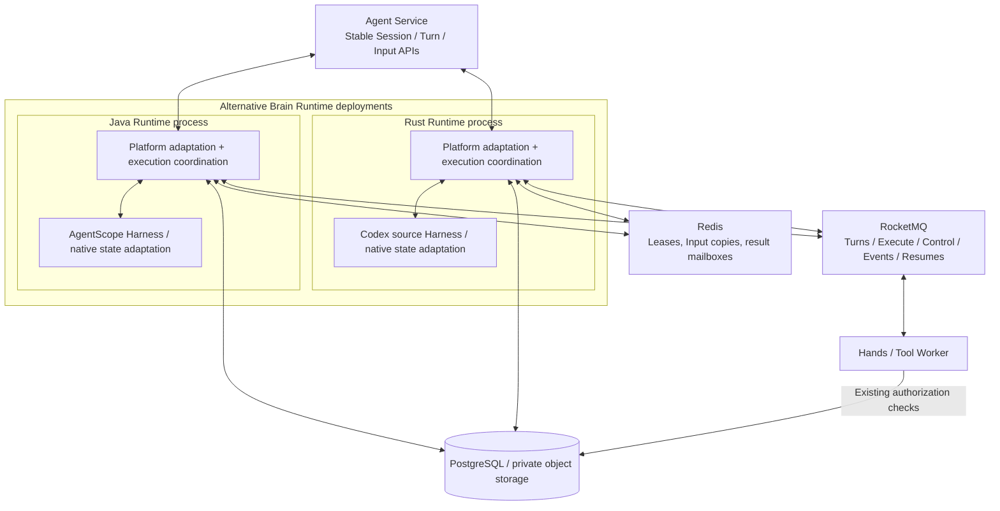
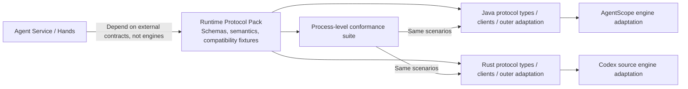
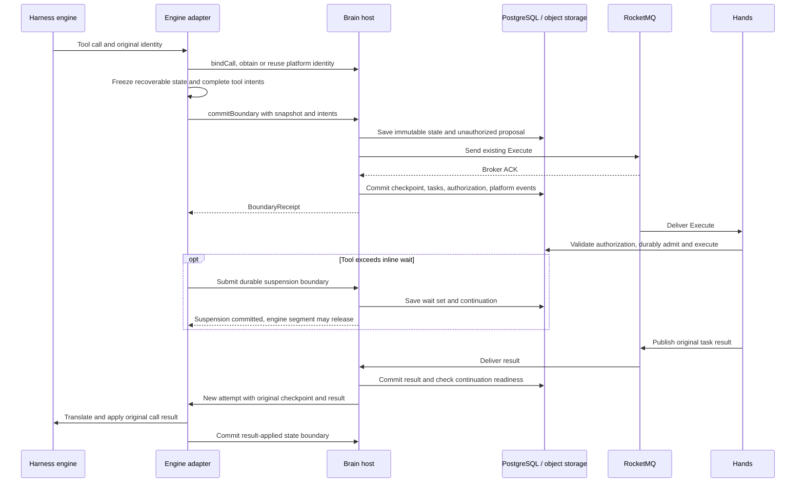

# Replaceable Brain Runtimes: decoupling the Harness through external contracts

> Update, 2026-10-28: use the [multilanguage Brain design](brain-runtime-layout-and-deployment.en.md) for source layout, language/process combinations and initial Session Service hosting. This document retains earlier candidate analysis; Rust Codex and per-Runtime storage transaction implementations are no longer the default route.

[中文](replaceable-harness-runtime.md)

Date: 2026-10-21. Status: design research and candidate architecture; not implemented.

This document examines the `master` working directory at `/Users/ken/agentcore/agentcore-managed-agents`. Brain means Agent Harness Runtime; Hands means Tool Worker. New modules, interfaces, and fields below are proposals, not existing APIs or changes to deployed database/message formats. This delivery changes documentation only, not application code, dependencies, configuration, or deployments.

The core premise is **replacing the entire Runtime process**: Java + AgentScope today, potentially a Rust process containing the Codex source Harness and its platform adaptation tomorrow. The platform fixes external contracts and execution semantics. It does not require a permanent Java host, embedding Rust into a JVM, or putting Codex behind an always-running Java service.

## Start with a ten-minute tool call

Suppose platform Turn T1 contains two tool calls. A returns quickly, while B takes ten minutes in Hands. Brain R1 has committed tool authorization and a checkpoint, then releases its execution resources after the inline wait expires. R1 subsequently exits, and R2 must recover T1. Meanwhile, the user supplies another Input and T2 is queued behind T1 in the same Session.

Whatever Harness R2 runs, the platform expects the same outcome: A is not executed again; B remains associated with its original execution; the additional Input follows existing semantics; T2 cannot overtake T1; and the original Turns message is acknowledged only after a complete durable terminal state. The frontend continues to see the same Session, Turn, tool, output, and interaction events.

That is the boundary that replaceability must preserve. Renaming a class or introducing a `run()` interface addresses entry points. How native logs are interpreted, how tool results are reattached, and whether another process can actually restore a checkpoint usually determine whether replacement works.

Organize each implementation into **platform protocol adaptation, execution coordination, and Harness engine**. Java and Rust can implement these responsibilities independently. Their common foundation is a versioned specification and conformance tests, not one shared runtime binary. Replacement preserves a platform contract rather than identical engine internals.

## Replacement describes several different capabilities

Selecting another engine for a new Session is the simplest capability. Restoring old state after an engine upgrade requires format compatibility. Moving a suspended AgentScope Turn to Codex additionally requires cross-engine state migration. These require different evidence and should not all be described as checkpoint support.

| Replacement scenario | Position in this design | Required evidence |
| --- | --- | --- |
| Replace Java/AgentScope Runtime with Rust/Codex Runtime | Primary deployment objective | New process independently preserves external protocols, shared state, and execution semantics without the Java Runtime remaining alive |
| Another engine for new Sessions | Primary execution objective | External APIs, tool collaboration, and platform lifecycle remain stable |
| Takeover by another replica of the same engine | Required execution capability | Original tool waits, Input position, and applied results survive process loss |
| Upgrade within one engine family | Explicit compatibility capability | Tested readers/restorers support the recorded state format |
| Migration of an idle Session across engines | Separate migration feature | Portable context/resources become a new baseline with documented semantic differences |
| Switching engines within an active or suspended Turn | No initial promise | Pending calls, private context, execution position, and Input application all have verified conversions |

A Session should therefore bind its engine type and compatible execution configuration. Changing a default affects new Sessions; old Sessions retain matching adapters. Even successful migration does not imply identical model behavior. The platform promises continuity of identity, authorization, state, and side-effect boundaries.

## The entry point is separated; the protocol is not yet separated

There is an existing foundation. [ManagedHarnessRuntimeTurns](../../agent-harness-runtime/java/adapter-agentscope/src/main/java/io/agentcore/managed/server/runtime/managed/ManagedHarnessRuntimeTurns.java) manages MQ callbacks, capacity, Redis leases, and database epochs, delegating execution through `Runner`. It supplies behavior to extract into a cross-language specification. Retaining MQ/Redis collaboration semantics does not let Rust reuse Java classes; a replacement process independently implements equivalent client behavior.

Coupling continues down the commit path. [ManagedRuntimeBatch](../../agent-harness-runtime/java/adapter-agentscope/src/main/java/io/agentcore/managed/server/runtime/managed/ManagedRuntimeBatch.java) contains `List<SessionEvent>`. [ManagedJournalStore](../../common/src/main/java/io/agentcore/managed/server/runtime/managed/ManagedJournalStore.java) updates platform facts by interpreting native events such as `model/dispatch`, `interaction/requested`, and `tool/dispatch`. [ManagedMqSessionLog](../../agent-harness-runtime/java/adapter-agentscope/src/main/java/io/agentcore/managed/server/runtime/managed/ManagedMqSessionLog.java) implements AgentScope's `SessionLog` SPI and connects SDK commits to platform transactions.

Tools and checkpoints have similar dependencies. [ManagedToolRequests](../../agent-harness-runtime/java/adapter-agentscope/src/main/java/io/agentcore/managed/server/runtime/managed/ManagedToolRequests.java) derives identity from `RuntimeContext`, `ToolUseBlock`, and operation counters. [ManagedToolRecovery](../../agent-harness-runtime/java/adapter-agentscope/src/main/java/io/agentcore/managed/server/runtime/managed/ManagedToolRecovery.java) reads native projections, recognizes calls/results in context, and reconstructs AgentScope state. [ManagedCheckpointOperations](../../agent-service/src/main/java/io/agentcore/managed/server/runtime/managed/ManagedCheckpointOperations.java) parses `AgentState` to check settlement and handle restore/fork baselines. These are useful AgentScope integration behaviors, but should not become mandatory formats for every engine.

The physical boundary also matters: [common/pom.xml](../../common/pom.xml) depends on AgentScope Core, Harness, RocketMQ, and Lettuce. Moving interfaces does not free Java platform modules from SDKs or make JVM objects reusable by Rust. Dependency cleanup improves the Java reference implementation; an independent external protocol is what validates whole-process replacement.

Several existing concepts are already close to the target: stable Scope, tool execution identities, database fencing, separate tool events, and public projections. Preserve these semantics while gradually removing framework-specific types and event interpretation.

## Replace the process; preserve the external contract

Java/AgentScope and Rust/Codex are independently deployable Brain implementations. Each receives platform commands, coordinates execution, connects Hands, persists state, and produces compatible projections. A host/coordinator can exist internally, but it is a responsibility rather than a mandatory Java service. Adaptation covers both native state/events and external platform protocols.



The diagram shows alternatives, not permission to place incompatible implementations in the same consumer group without routing. Java may be completely removed. Rust platform adaptation can be compiled directly into an executable built from the Codex source Harness; App Server, subprocess RPC, and FFI are not requirements.

Each Runtime's outer layer upholds Session/Turn lifecycle, Actor/permissions, leases, epochs, tool ledgers, suspension conditions, and terminal ACK. Engine completion remains a proposal requiring pending-tool, interaction, Input, and checkpoint checks. References to the host below denote this language-independent responsibility, implementable in Java or Rust.

Within either process, engine hooks should have restricted ports for intents, state, and completion rather than arbitrary database/Redis/MQ authority. The outer platform adapter does need those clients because it implements the complete Runtime. This restricts reasoning-engine access, not the Rust Runtime's infrastructure access.

### Share a protocol pack, not one language's modules

First establish a language-independent Runtime Protocol Pack containing schemas, lifecycle/transaction rules, authentication/errors, compatibility policies, existing message fixtures, and cross-language golden vectors. Java DTOs, Rust structs, and internal traits implement or derive from it; neither language is the sole source of truth.

| Deliverable boundary | Ownership and contents | Implementation form |
| --- | --- | --- |
| Runtime Protocol Pack | Identities, HTTP/MQ schemas, checkpoints/events, lifecycle/transactions, fixtures | Language-neutral specification, JSON Schema/OpenAPI, fixtures and tooling |
| Runtime conformance suite | External tests for admission, tools, recovery, cancellation, state/events | Executables/images and real shared dependencies; no in-JVM Provider requirement |
| Java Runtime outer layer | Coordination, clients, transactions, read models, protocol mapping | Refactor current Java; optional contracts/host/infrastructure Maven separation |
| Java engine adaptation | AgentScope context, SessionLog, tools, construction, state codec | AgentScope binaries and Java-internal SPI |
| Rust Runtime outer layer | Equivalent message/HTTP, Redis, database, ACK/recovery implementation | Rust crates/native async framework, no Java Runtime dependency |
| Rust engine adaptation | Codex source Harness tool, state, Input, log, completion hooks | Direct in-process integration; no mandatory RPC |
| Process composition/deployment | Implementation/build/protocol/state versions, capabilities, health, image choice, drain | Separate Java/Rust images deployed by verified binding/capabilities |

Sharing a few DTOs omits authorization tables, object encoding, and ACK rules; sharing Java helpers leaves the defining semantics in Java. Internal module separation remains useful for a clear reference implementation, not as a prerequisite for Rust to operate.



The final proof stops Java Brain, starts an independent Rust Brain, and completes supported Sessions through unchanged Agent Service, Hands, MQ/Redis, and platform read models. No JNI, Java sidecar, or remote Java coordinator should be required. Legacy Sessions may temporarily retain matching old Runtimes or offline codecs; that does not make Java a permanent dependency of all new implementations.

## Uniform interaction does not mean converting everything to HTTP

Brain participates in MQ, internal HTTP, Redis keys/scripts, shared SQL transactions, and persisted events. Specify those existing boundaries without introducing a Java forwarding layer or converting five topics to RPC solely to become language-independent.

| External collaboration surface | Required specification |
| --- | --- |
| Agent Service / Control Plane internal calls | Actual administration, file, trace, health routes; methods, paths, authentication, Actor, errors/streaming; not every Turn is an HTTP execution request |
| MQ and Hands | Existing five-channel responsibilities, bodies/properties, LiteTopic derivation, identities, proposals/authorization, retries, Suspend/ACK |
| Redis | Keys/hash tags, tokens, atomic Lua comparison, TTL, Input/mailbox structures; Rust need not reuse Lettuce |
| PostgreSQL / private objects | Table ownership, Session locks, epochs, atomic authorization/terminal commits, JSON/object formats, schema versions, recovery references |
| Events and queries | Existing public projections, identities/cursors, content/errors; native logs must not become frontend/Agent Service dependencies |
| Deployment/capabilities | runtimeImplementation/build, engine/state/protocol versions, capabilities, ready/drain/stop, metrics, credential injection |

Use OpenAPI for HTTP and JSON Schema, property definitions, and fixtures for existing MQ JSON. Protobuf may suit new interfaces, but whole-process replacement does not require rewriting every wire format. Start/Resume/Cancel/CommitBoundary initially denote logical actions: direct continuation can still scan the database inside Rust without another network message.

Proposed neutral event/checkpoint envelopes can be internal models. Where existing peers still read old fields, Rust must emit compatible formats or participate in an explicit version migration. Adding a new wrapper around an existing MQ message does not automatically preserve Hands compatibility.

### Shared storage and client behavior are protocols too

[ManagedToolCommitGate](../../common/src/main/java/io/agentcore/managed/server/runtime/managed/ManagedToolCommitGate.java) reads `ma.session`, `ma.turn`, `ma.tool_task`, and authorization receipts under the Session lock. Identical Execute JSON without equivalent transactional authorization is insufficient. Initial replacement includes shared schema, lock order, idempotency, field meanings, and commit ordering in the compatibility contract, not only HTTP/messages.

Turns suspension/proactive ACK also relies on SDK-internal adaptation in [ManagedLitePushConsumer](../../common/src/main/java/org/apache/rocketmq/client/java/impl/consumer/ManagedLitePushConsumer.java) and [RocketMqTurnReceipt](../../common/src/main/java/io/agentcore/managed/server/runtime/managed/RocketMqTurnReceipt.java). Rust must demonstrate LiteTopic Shared/wildcard, FIFO Suspend, receipt renewal, terminal cross-process ACK, expired receipts, and successor wakeup. This document does not assume equivalent Rust-client support or equate MQ connectivity with compatibility. Private receipt codecs need versions/migration rules.

[ManagedScope](../../common/src/main/java/io/agentcore/managed/server/runtime/managed/ManagedScope.java) currently prefixes values with Java `String.length()` before hashing UTF-8 bytes. That length counts UTF-16 code units, not Rust byte lengths or Unicode scalar counts. Scope/tool IDs, JSON strings, time units, Base64, numbers, and nulls need golden vectors including Chinese and emoji. Existing argument strings/digests cannot be silently normalized within the same protocol version.

A shared transaction service might later reduce duplicate implementations, but adds a service/dependency and changes today's database boundary. Initially each Runtime implements its own platform adaptation and transactional semantics; a new Java coordinator is not an implicit requirement.

## Derive internal interfaces from language-independent semantics

One platform Turn may contain multiple model calls, native engine Turns, suspensions, and Brain attempts. Platform identity must not be forced into a one-to-one mapping with engine thread/run/item IDs. Treat Session as a long-lived binding, segment as a period of active ownership, and boundary as a set of facts the host can commit.

The Java 17 sketch is one internal projection of the current implementation, not a process protocol or an interface Rust must implement. Rust can use its own traits, Futures, and channels while preserving externally observable semantics. Whole-process replacements need not contain these methods at all. DTO/error definitions are omitted; this is not directly compilable API.

```java
public interface HarnessProvider {
    EngineDescriptor descriptor();
    EngineStateCodec stateCodec();
    CompletionStage<HarnessSession> open(OpenSession request, HostServices host);
}

public interface HarnessSession {
    CompletionStage<SegmentResult> runSegment(SegmentCommand command);
    CompletionStage<ControlReceipt> control(ControlCommand command);
    CompletionStage<CapturedState> exportState(CaptureRequest request);
    CompletionStage<Void> close(CloseReason reason);
}

public interface HostServices {
    CompletionStage<CallBinding> bindCall(CallDeclaration declaration);
    CompletionStage<BoundaryReceipt> commitBoundary(BoundaryProposal proposal);
    CompletionStage<ToolAwaitResult> awaitTools(ToolWait request);
    CompletionStage<InputBatch> readInputs(InputQuery query);
    CompletionStage<ResourceView> resolveResource(ResourceRequest request);
}
```

`open` creates or loads an engine session. `SegmentCommand` explicitly carries the start/resume reason, checkpoint reference, pending results, and Inputs. `SegmentResult` means a segment has reached a durable handoff or completion proposal; normal method return is not Turn success. `close(YIELD)` releases memory/process resources only after a committed suspension receipt. A `control(CANCEL)` receipt acknowledges control handling, not physical termination of an external tool.

`exportState` runs at a boundary where the engine can guarantee consistency. The host cannot arbitrarily serialize context while model/tool threads mutate it. Controls may run concurrently with a segment, but the adapter must declare and implement capture/mutation concurrency rules. Engines without arbitrary snapshots must first reach a supported safe boundary.

`CompletionStage` is Java-specific; Rust uses its own runtime. Both isolate blocking operations, bound concurrency, propagate cancellation, and provide backpressure without blocking async scheduler threads. Bounded output commits can initially achieve this without an uncontrolled direct frontend channel.

Stable semantics require precise fields. Define language-independent schemas/state rules before Java DTOs or Rust structures, and specify mappings to actual HTTP/MQ/storage surfaces rather than assuming every object becomes another RPC.

| Object | Core fields and meaning |
| --- | --- |
| `OpenSession` | Platform Scope, engine binding, definition/tool catalog versions, required capabilities, resource references; the host chooses the binding |
| `SegmentCommand` | commandId, turnId, attemptId, trigger, expectedRevision, checkpointRef, result identities, Input position; repeated commands remain identifiable |
| `CallDeclaration` | Durable source anchor, engine session generation, original callId, operation key, tool/argument digest, decomposition version; the host returns validated mappings |
| `BoundaryProposal` | schemaVersion, boundaryId, expectedRevision, normalized facts, raw record references, checkpointRef, tool intents, Input receipts, transition; cannot suspend and terminate together |
| `BoundaryReceipt` | commitId, committed revision, event range, checkpointId, call/task mappings; identical retries or receipt queries resolve to the same fact |
| `ControlCommand` | controlId, type, target Turn/attempt, Input/cancellation fact reference; repeated controls create no new business action |
| `SegmentResult` | Last durable boundary, stop reason, retry information; distinguish suspension, committed terminal, retryable failure, and unknown outcome |

Restore errors should distinguish incompatible state, missing objects, revoked permissions, stale attempts, content conflicts, and temporary infrastructure failure. Only retryable errors enter retry scheduling; an incompatible checkpoint must not be hidden by endless retries or a new empty Session.

### Keep three kinds of context separate

Platform context carries trusted Scope, Turn, attempt, configuration versions, and restricted resource handles. Adapter context may contain Java RuntimeContext or Rust Harness state/handles; direct Codex source integration needs no RPC connection object. Engine recovery context contains messages, compaction, and private continuation state. Their lifetimes differ; runtime object graphs must not become checkpoints.

Host-issued `HostServices` handles are bound to the current attempt and retain fencing authority server-side; they are rebuilt after restart. An adapter cannot recover a Redis token from private state or choose a higher epoch. Resource access resolves restricted views or short-lived capabilities under current permissions, rather than expose Vault master keys, arbitrary database connections, or service credentials.

### Capabilities matter more than methods that always claim success

An implementation descriptor distinguishes runtimeImplementation/build, supported protocol ranges, engine/adapter versions, state formats, and capabilities such as `durableSuspend`, `crossProcessRestore`, `fork`, `steer`, `externalToolExecution`, and `preModelAdmission`. Publish it through a candidate capability interface or deployment manifest, then map internally to EngineDescriptor. Post-call usage alone cannot satisfy hard pre-dispatch budget reservation.

Validate capabilities before Session creation or recovery. A candidate without durable suspension may support an explicitly configured resident-process mode, but that is a different execution guarantee and must not silently replace replica takeover. Capability declarations need contract tests, not self-reported booleans alone.

## Tool calls are the most important durable boundary across engines

A tool contract cannot stop at `toolName + arguments → result`. The platform also needs provenance, authorization, dispatch status, the original result to await after takeover, and the relationship between one logical call and multiple Hands operations.

Distinguish platform logical `callId`, within-call `operationId`, Hands `taskId/executionId`, and adapter-private `engineCallId`. The host persists mappings anchored to original calls and content digests. Retrying with a new epoch or regenerated model call ID must not create another physical execution. Tool name and arguments alone are insufficient identity because identical operations may be requested legitimately twice.

`bindCall` registers or reuses identities without creating executable tasks. The adapter exports a snapshot containing complete call state and submits a `BoundaryProposal` with `ToolIntent` entries. The host checks schemas, permissions, configuration versions, and content consistency, then retains the verified submission protocol: save the complete unauthorized proposal, send Execute and obtain Broker ACK, then commit checkpoint, tasks, and authorization receipts under the Session row lock. Worker waits on unauthorized delivery rather than discard it because a task is temporarily absent.

This preserves Execute-before-authorization and **does not restore a background Execute outbox publisher**. Targeted proposal recovery, ambiguous sends, superseded epochs, and late results continue to resolve through durable facts. The proposed generic boundary is a host-side contract, not an immediate requirement for Hands to change deployed messages.



A committed result and a result applied inside the engine are different facts. The adapter updates private context, then submits a new checkpoint and applied receipt. A lost commit response resolves by the same boundary identity. Neither a successful RPC alone nor an uncertain result justifies clearing recovery records or re-executing a tool.

Batching is a scheduling/transport optimization, not every engine's reasoning model. The host retains one-to-many call/operation relationships and complete wait sets. Existing `mcp.batch` ordering, per-call results, and single completion notification remain intact. Batching eligibility follows parameters, permissions, and tool capabilities; Codex need not emulate AgentScope `Toolkit`. Current MCP completions use direct continuation while other tools/input waits retain Resumes; that distinction remains inside host scheduling rather than the engine SPI.

Business and managed-workspace side effects must map to the same authorization/audit boundary. Pure internal computation may stay inside the engine. Built-in shell, file changes, or MCP execution that bypass Hands must be bridged, disabled, or explicitly classified as an incompatible mode. Local child-agent planning belongs to the engine; platform child Session identities, quotas, cancellation propagation, and durable task relationships remain host-owned.

## Checkpoints: a common recovery promise with private state formats

A useful checkpoint is more than conversation history. For the ten-minute tool example, it must identify a safe engine position, B's original execution, whether A's result was applied, consumed Inputs, the relevant workspace image, and everything another replica needs to continue.

Use a common envelope with a private payload. The envelope is host-verifiable platform protocol; the adapter interprets the payload, which may contain AgentScope state, engine log segments/indexes, or a validated external session reference. The envelope need not understand compaction, message classes, or planners, but cannot be merely an unverifiable string.

This candidate envelope uses placeholder versions. It is not an existing database format.

```json
{
  "schemaVersion": 1,
  "checkpointId": "cp_T1_b17",
  "scope": {"tenant": "tenant-a", "namespace": "default", "sessionId": "S1"},
  "turnId": "T1",
  "parentCheckpointId": "cp_T1_b16",
  "engine": {
    "id": "agentscope",
    "engineVersion": "pinned-build",
    "adapterVersion": "adapter-build",
    "stateFormat": "agentscope-state",
    "stateVersion": 1
  },
  "boundary": {
    "id": "b17",
    "revision": 17,
    "domainEventThrough": 126,
    "captureReason": "WAIT_TOOLS"
  },
  "continuation": {
    "phase": "APPLY_TOOL_RESULTS",
    "pendingOperationIds": ["op-B"],
    "pendingActionIds": [],
    "inputAppliedThrough": 8,
    "appliedToolResults": [{"operationId": "op-A", "resultRevision": 1}]
  },
  "privateState": {
    "mode": "PORTABLE_SNAPSHOT",
    "storageRef": "private-object:state-T1-b17",
    "digestAlgorithm": "SHA-256",
    "digest": "aaaaaaaaaaaaaaaaaaaaaaaaaaaaaaaaaaaaaaaaaaaaaaaaaaaaaaaaaaaaaaaa",
    "sizeBytes": 48192
  },
  "nativeLog": {"manifestRef": "private-object:log-manifest-T1-b17", "through": "opaque-cursor"},
  "resources": {"manifestRef": "private-object:resources-T1-b17"},
  "restoreRequirements": ["cross-process-restore", "external-tools"]
}
```

`revision` is a platform commit position, `domainEventThrough` a platform event watermark, and `nativeLog.through` an adapter-private position. They are not interchangeable. Input positions follow current ordering and receipt semantics; non-contiguous application requires explicit receipts rather than treating the largest sequence as complete coverage. Tool results have no inherent global sequence, so the example records operation/result-revision identities. Large sets may use integrity-protected manifest references.

The originating epoch may be retained as provenance, but old leases grant no new authority. Checkpoints must not contain reusable Redis tokens, active callbacks, connections, memory addresses, or complete runtime service objects. Restore first obtains a new lease/epoch and recreates restricted HostServices. Historical identities in private state support reconciliation only.

### When is a checkpoint actually restorable?

After freezing state at a safe boundary, the adapter uploads immutable state and dependency manifests. The host validates ownership, digests, format, and compatibility, then associates the envelope, tool/Input facts, suspension, and public projections in the commit transaction. An uploaded object without a committed reference is not yet a checkpoint. Conversely, restore readiness cannot be announced before asynchronously uploading the only state file.

This does not enroll object storage in a distributed database transaction. Durable objects precede reference commits. Unreferenced objects are collected through retention/reference scanning; objects referenced by current state, historical checkpoints, restore/fork operations, or audit retention remain protected. Pending boundary objects need temporary pins to avoid racing proposal recovery with GC.

`EXTERNAL_SESSION_REFERENCE` additionally requires explicit ownership, expiry/location, cross-node access, backup/deletion rules, and a version tied to the platform boundary. A threadId alone is at most a locator. If engine storage cannot atomically commit with platform storage, the adapter needs persistent request identities, versioned state positions, and reconnection/reconciliation. A boundary is not ready until reconciliation establishes its recoverability.

Workspace state is a separate dependency. Context snapshots are not filesystem snapshots, and today's working directory is not a historical checkpoint image. Restore/fork management coordinates workspace references and engine state while retaining existing holds and execution isolation; otherwise an old context can resume against changed files.

### Compatibility must be allowed to fail

State reading and administration need a codec independent of a running engine instance. Querying or validating checkpoints should not start model inference just to read a format. A candidate interface is:

```java
public interface EngineStateCodec {
    CompletionStage<StateInspection> inspect(StateReference state, StateAccess access);
    CompletionStage<RestorePlan> planRestore(RestoreRequest request, StateAccess access);
    CompletionStage<ForkPlan> planFork(ForkRequest request, StateAccess access);
}
```

A matching adapter version implements the codec. It reads authorized objects or produces immutable transformation artifacts/plans; it does not authorize tools, mutate platform Sessions, or call models. `StateInspection` returns limited facts such as compatibility, internal pending calls, and resource requirements. The host reconciles them with durable ledgers and mappings. Platform management use cases still decide admission, workspace coordination, and baseline activation. Unsupported fork returns a capability error. Cross-engine migration uses an explicit migrator, not a `planRestore` that pretends universal compatibility.

This remains an internal responsibility sketch. Rust can implement its codec in-process. Agent Service requests versioned management actions/references rather than loads Java codecs or parses Codex logs. Management identities, errors, and durable receipts belong in the external contract.

Envelope, event protocol, engine state, adapter, and Hands wire versions evolve separately. Adjacent engine version numbers do not establish state compatibility; tested readers and matrices do. Missing Providers, incompatible state, or missing dependencies produce explicit restore errors, not a new empty session masquerading as takeover.

Legacy AgentScope checkpoints can first be wrapped through a legacy reader without rewriting history. Cross-engine migration creates a new baseline with provenance/conversion information using platform messages, resources, and settled results. Initially, migrate only idle Sessions with settled tools/interactions. Reissuing an unfinished call in the new engine is not migration.

## Events: separate public semantics from native logs

Public events already pass through [CommittedSessionEventProjector](../../agent-harness-runtime/java/adapter-agentscope/src/main/java/io/agentcore/managed/server/web/managed/CommittedSessionEventProjector.java) and [ManagedSessionProtocol](../../common/src/main/java/io/agentcore/managed/server/runtime/managed/ManagedSessionProtocol.java). Protecting the frontend does not require replacing all event names; first move interpretation into the correct owner.

AgentScope Adapter continues to read native `SessionEvent` records and translates them into platform facts. Codex Adapter supplies its own mapping. The host accepts explicit messages, tool declarations, interactions, Input receipts, usage, and transition proposals rather than infer private semantics from a generic Map. This candidate internal envelope illustrates the separation; existing projections preserve public HTTP/SSE payloads.

```json
{
  "schemaVersion": 1,
  "eventId": "evt-T1-msg7-completed",
  "scope": {"tenant": "tenant-a", "namespace": "default", "sessionId": "S1"},
  "turnId": "T1",
  "boundaryId": "b17",
  "type": "message.completed",
  "source": {
    "engineId": "agentscope",
    "engineSessionGeneration": "g1",
    "nativeRecordId": "adapter-private-record-42"
  },
  "causationId": "input-8",
  "payload": {
    "messageId": "msg7",
    "role": "assistant",
    "content": [{"type": "text", "text": "已完成检查。"}]
  }
}
```

Event identity derives from durable logical identity or a frozen boundary, not a fresh UUID on every replay. A body hash cannot collapse two legitimately identical messages. The host checks identity/content conflicts and assigns platform sequences at commit. MQ offsets, Redis Stream IDs, and native log cursors do not become frontend reconnection positions.

| Fact source | Platform interpretation | Invalid inference |
| --- | --- | --- |
| Engine output deltas, messages, context summaries | Adapter mapping, host commit, public projection | Stream termination or message completion proves Turn success |
| Tool intent | Host identity, arguments, permissions, authorization | An engine's dispatched record proves Hands admission |
| Confirmed Hands result | Commit against original task/execution identity | Engine-local completion can override the physical execution outcome |
| Applied Inputs and interaction answers | Explicit receipts checked against admission records | Reading a Redis Stream applies an Input |
| Usage and budgets | Normalize dimensions; capability-based pre-call reservation/post-call settlement | Missing cache/reasoning usage may be fabricated as zero |
| Engine completion proposal | Host validation, platform terminal commit, ACK intent | `runSegment` return or SDK run completion is the platform terminal |

Platform facts and raw engine logs have distinct authority. Platform facts drive lifecycle/public read models; native records describe internal engine history and aid diagnosis. Recovery reconciles private state against platform tools, Inputs, and epochs instead of choosing one source exclusively. Boundary identities and raw record references connect them. Uncorrelated asynchronous log writes would create two histories that cannot be explained after failure.

Raw records can remain opaque chunks/manifests with format versions. Adapters handle encoding/replay, while the host maintains length, digests, ownership, and committed prefixes. AgentScope's SessionLog remains a valid adapter-internal SPI without requiring all engines to implement that Java interface.

Output deltas may use lightweight commits without a new checkpoint; dispatch, suspension, and terminal boundaries need stronger recovery guarantees. The initial refactor introduces no uncommitted frontend bypass. Any later preview stream must be explicitly distinguished from durable events and define reconnection/correction behavior. Unknown optional diagnostics may remain private extensions; unknown required state facts must be rejected or require a compatible reader rather than silently skipped.

## A commit boundary replaces accidental coordination between callbacks

A generic `BoundaryProposal` can contain identity, expected revision, normalized facts, Input receipts, tool intents, checkpoint references, native log manifests, and suspension/terminal proposals. The host supplies attempt/fencing information; adapters cannot select tokens. A receipt returns the committed revision, event range, checkpoint, and tool mappings, establishing a deterministic next starting point.

Repeating a boundary ID with identical content returns the same outcome; different content conflicts. A successful commit whose response was lost resolves through retry/receipt lookup, not a new boundary ID. Database epochs reject new writes from stale attempts, while committed idempotent receipts remain queryable. A genuine Hands result may arrive after Brain takeover and validates against its stable execution identity rather than be mistaken for a stale Brain state write.

Digests need cross-language encoding rules: SHA-256 over actual object bytes, and versioned canonical encoding for JSON proposals/arguments with specified key order, numbers, nulls, and content-block order. Replay reuses frozen occurrence times/source identities. Host-assigned event sequences and current attempt credentials do not enter logical content hashes; private-object and authorization-configuration digests do. Java `hashCode()` is not a protocol digest.

Canonical encoding applies to explicit new contract versions. Existing messages, command ledgers, and digests first require existing byte/identity rules. Moving to canonical encoding is a migration, not a unilateral Rust serialization improvement.

Checkpoint indexes, platform facts, authorization, Input application receipts, suspension/terminal state, and public projections retain one logical commit boundary. Moving projection to asynchronous consumers later would require durable transactional publication; this refactor should not also change read-model consistency. The original Turns ACK intent remains coupled to the full terminal commit. Redis renewal, Control ACK, tool event ACK, and Resume ACK cannot replace it.

Removing native interpretation does not remove validation. Existing tool/result closure checks should become platform pending-fact validation plus adapter-private state completeness checks, connected through the boundary manifest. Merely replacing `AgentState` with `byte[]` would create a nominal boundary while losing recovery safety.

## Where existing classes belong

Names below identify Java reference code and proposed responsibility ownership, not classes Rust must port or invoke. Java may refactor while Rust organizes independent modules around the same contract. Extract behavior from Journal, execution context, and checkpoint management before moving code: they also enforce platform correctness.

| Existing class/group | Target owner | Responsibilities retained or extracted |
| --- | --- | --- |
| `ManagedHarnessRuntimeTurns` | Runtime outer coordination | Java can use SPI; Rust independently implements consumption, capacity, leases, epochs, segment semantics |
| `ManagedHarnessRuntimeConfiguration` | Application composition + AgentScope composition | Common loops/infrastructure remain in the app; RuntimeContext, builder, Toolkit, middleware construction moves into the adapter |
| `HarnessAgentBuildService` | Split | Neutral definition/resource spec resolution; AgentScope construction, registration, SDK options/caches stay adapter-owned |
| `ManagedHarnessTurns` | AgentScope Adapter | Native run loop, SDK events, Input injection, interruption; platform terminal checks remain host-owned |
| `ManagedTurnExecution` | Split | Narrow identity and HostServices become contracts; local native journal, SDK state, caches no longer escape through host interfaces |
| `ManagedRuntimeBatch` | Split | Neutral BoundaryProposal becomes a contract; SessionEvent lists become AgentScope-private raw records |
| `ManagedRuntimeWriter` | Host | Retain guard, publication, commit, receipt ordering; accept neutral boundaries |
| `ManagedJournalStore` | Split | Transactions, fencing, task/Input facts, indexes, public projections stay host/repository-owned; SDK event/state interpretation moves into the adapter |
| `ManagedMqSessionLog`, `ManagedSessionLogStore` | AgentScope Adapter + generic storage ports | AgentScope SessionLog implementation stays in the adapter; infrastructure persists raw records |
| `ManagedLocalJournal` | Split | Reuse committed-prefix, retry, and caching mechanics where neutral; native interpretation/reasoning positions/state extraction stay adapter-owned |
| `ManagedCheckpointObjects` | Split | Ownership, digests, object references, GC in infrastructure; native event/state encoding and validation in adapter |
| `ManagedCheckpoints`, `ManagedCheckpointOperations` | Split | Queries, admission, holds, workspace coordination stay platform-owned; state settlement and restore/fork transforms invoke versioned adapter services |
| `ManagedToolRequests` | Split | Generic calls/waits in host; RuntimeContext/ToolUseBlock identity extraction in AgentScope Adapter |
| `ManagedToolRecovery` | Split | Original task/result lookup and recovery scheduling in host; SessionProjection/SessionRecovery/message reconstruction in adapter |
| `ManagedMcpBatchToolkit`, `ManagedMcpTool`, `ManagedRemoteFilesystem` | AgentScope Adapter | SDK tool entry points, result types, post-permission integration; invoke host tool ports |
| `ManagedMcpBatch`, `ManagedToolCommand`, `ManagedToolResult`, `ManagedToolEvent` | Platform/tool contracts | Preserve existing wire identities/fields; remove residual SDK JSON utilities/result wrapping without casually changing deployed formats |
| `ManagedToolTransport`, `ManagedToolCommitGate`, `ManagedToolWorkerCommands` | Host / Hands applications and infrastructure | Preserve proposals, authorization, admission, cancellation; add no engine dependency |
| `CommittedSessionEventProjector` | Split | Native-to-normalized translation moves to adapter; normalized-to-existing-public-payload mapping remains platform-owned |
| `ManagedSessionProtocol` | Platform read model | Preserve history/Input receipt semantics without reading new engine-private logs |
| `ManagedRuntimeInputMiddleware`, `ManagedNativeCancellation` | AgentScope Adapter | Translate platform Inputs/cancellation into SDK behavior |
| `ManagedFinalization`, `ManagedModelPolicy`, `ManagedBudgetStore` | Split | SDK lifecycle/model hooks in adapter; budget ledger, terminal constraints, usage semantics in host |
| `ManagedSubagents`, `ManagedSubagentExecution`, `ManagedSubagentExecutor`, `ManagedTaskRepository` | Split | Child Sessions, quotas, durable relationships in host; SDK child-agent/TaskRepository integration in adapter |
| `ManagedExecutionGuard`, `ManagedTurnAcknowledgements`, `ManagedSuspensions`, `ManagedContinuationLoop`, `ManagedResumePublisher` | Host | Keep ownership, original Turns ACK, recovery; neutral wait facts replace SDK-context interpretation |
| `RocketMqManagedMessageBus`, `RedisManagedInfrastructure`, result mailboxes | Infrastructure | Preserve five channels, LiteTopic routing, leases, notifications |
| `ManagedRedisMessageBus` | AgentScope Adapter + generic Redis ports | SDK MessageBus SPI in adapter; Redis List/Stream/PubSub in infrastructure; no SDK BusEntry in host |
| `ManagedInfrastructureConfiguration`, existing `common` | Progressive Java reference cleanup | Compose neutral use cases/infrastructure; external contracts are independently published, not defined solely by a Maven package |

Existing definition snapshots also contain ToolsConfig, model configuration, skills, memory, and permission options. Preserve their semantics through neutral definitions and namespaced engine options, translated and validated by adapters. Legacy definitions retain matching readers. Wrapping every existing field in arbitrary JSON does not establish cross-engine meaning.

## Codex tests the boundary; it is not a prevalidated equivalent

Official OpenAI documentation describes App Server thread/turn lifecycle, streaming, `thread/resume`, and client-executed dynamic tools; dynamic tools are experimental. [Official App Server documentation](https://learn.chatgpt.com/docs/app-server)

These are reference product interfaces, not the mandated integration. The preferred target directly integrates the Codex source Harness into Rust Runtime, adapting tool/state/run hooks rather than retaining Java Brain as an App Server client. Source or RPC integration must still prove T1: terminate the Runtime process, restore the original tool wait elsewhere, and apply the original Hands result.

Other questions include native log/session storage dependencies, routing built-in tools through platform execution, cancellation and additional Input mapping, usage/budget coverage, and one platform Turn spanning multiple native Turns. If public interfaces cannot provide current suspension guarantees, options are to add a bridge capability, isolate an explicitly resident-session mode, or withhold this candidate from that execution tier. Bypassing authorization/recovery rules is not an adapter strategy.

This also explains why MCP alone is not a complete engine protocol. It can carry tools/interactions without providing platform Turns, epochs, checkpoint transactions, or takeover. Conversely, treating the engine only as a pure `step()` could force the host to rebuild its model loop. Segment/boundary contracts retain the engine's loop while making durable handoff explicit.

## Process cutover: binding and drain precede mixed deployment

Identical messages do not imply that Java and Rust can restore each other's private checkpoints. Existing five-channel responsibilities do not provide engine-binding routing. Incompatible implementations sharing a consumer group may receive Sessions they cannot restore. Repeated Suspend is not routing, nor is an additional group consuming every message isolation.

Initially prefer whole-runtime cutover or an independently isolated scope. Stop affected Turn admission; drain publications, active work, continuations, and ACK work; explicitly keep old Sessions on the old Runtime, migrate them at a safe boundary, or disallow further execution; then switch image/startup configuration. Draining active Turns does not make idle legacy Sessions restorable by another engine.

Long-lived mixed deployments first need Session-to-implementation/state-format binding and verified delivery. Only then choose scheduling, topic partitioning, or another route. This is a separate protocol evolution, not an existing MQ capability. Rollback also checks state compatibility; old processes cannot blindly take Sessions advanced in a new format.

Image, executable, environment mapping, and resources may change at replacement. Health, ready/drain, authentication, observability, and management contracts remain compatible or explicitly versioned. Rust need not imitate Spring internally, but retained deployment probes require their actual paths/semantics.

## Evolution: fix external contracts, then verify another Runtime process

Begin with existing behavior rather than immediately add another engine. Freeze T1 and critical failure windows as regression evidence, recording public events, recovery, and tool protocols. Current closure checks, model budgeting, and terminal Input arbitration must be included; otherwise passing tests may simply mean previous guarantees were omitted.

Extract a Protocol Pack from current execution: HTTP, MQ, Redis, shared-table transactions, checkpoints, public events, and errors become independent specifications/fixtures. First pass external conformance with the Java reference process, distinguishing existing rules from proposed formats. Preserve behavior without simultaneously upgrading AgentScope or changing messages.

Java can use SPI/module cleanup to isolate native interpretation without making complete Maven extraction a prerequisite for Rust prototyping. Once native records and platform facts diverge, compare projections offline or through read-only shadows of one real execution stream. Shadows must not dispatch tools, call models, or create another authoritative state. Switch after differences are explained.

Then introduce checkpoint envelopes, legacy readers, dependency pinning, and GC incrementally. Prove cross-process restore using the same AgentScope format rather than an in-memory cache. New Sessions can opt into new formats/bindings; original Sessions retain their readers. Versions belong to Session/state bindings, so a global switch cannot change how suspended T1 is interpreted.

Start a second Runtime with a deterministic engine, then integrate the Rust Codex source Harness. The independent executable must connect real MQ/Redis/database and pass request, suspension, recovery, and terminal failures with Java Brain completely stopped. Validate cross-language identities and MQ client semantics early. Roll out by an isolated routable scope or whole cutover; declaring Session bindings alone does not implement delivery isolation.

| Phase | Reviewable deliverable | Exit condition | Rollback boundary |
| --- | --- | --- | --- |
| Behavior baseline | Protocol inventory, failure scenarios, event samples | Execution, Inputs, budget, recovery, public guarantees are explicit | Documentation/tests; no execution switch |
| Protocol baseline | Protocol Pack, golden vectors, external Java conformance | HTTP/MQ/Redis/transactions/public events externally verifiable | Original process keeps formats |
| Commit/event separation | Neutral boundary, projections, read-only shadow comparison | Equivalent facts/read models, no duplicate dispatch | Session-bound legacy writer; never two authoritative writers |
| Checkpoint separation | Envelope, legacy reader, compatibility matrix, object manifests | True cross-process restore, restore/fork, safe GC | Old Sessions keep readers; retain new readers after disabling writers |
| Rust Runtime | Independent outer adaptation, test engine, Codex source prototype | Original results, cancellation, process failures, MQ ACK pass with Java Brain stopped | Stop new assignment; retain old Runtime or migrate explicitly |
| Deployment and rollout | Capability manifest, cutover/drain, routing, observability, Java dependency cleanup | Independent executables pass one suite; mixed delivery isolation proved before rollout | Check binding/state formats; no blind old-binary rollback |

Each stage is independently reviewable. Maven separation improves the Java reference; another independent Rust process passing the same external contract proves replacement. Migrations remain additive/versioned with legacy native data/keys retained. Initially preserve topics, groups, LiteTopics, and Hands duties. Any routing changes for mixed deployment require separate design/migration rather than an assumption that existing protocols support them.

### Validate through failure, not demonstrations

| Failure window/capability | Required evidence |
| --- | --- |
| Repeated boundary, lost response | Same receipt, no duplicate authorization/public completion |
| Execute ACK before database authorization, then process loss | New attempt reuses complete proposal; Hands does not execute early |
| Authorization committed, Runtime response lost | Restore uses original task/execution, not another physical execution |
| A complete, B slow, original Brain process terminated | Another process retains A's application and awaits/reattaches B's result |
| Result committed, Redis mailbox lost | Durable facts repair delivery; MCP direct continuation has independent recovery scanning |
| Result injected, application-boundary response lost | Replay same boundary or reapply from old snapshot without external rerun |
| Lease expired, stale epoch emits/commits | Reject stale attempt writes; still accept trustworthy original late tool results |
| Cancellation races completion | Preserve cancellation facts and actual outcomes without inventing physical termination |
| Input refill/replay and late Input before terminal | Existing admission/application/rejection ordering preserved |
| Missing references, incompatible format, premature object deletion | Explicit failure rather than empty-context replay masquerading as recovery |
| Restore/fork, child Sessions, budget, permissions | Workspace, quota, Actor, call identity, and permission boundaries preserved |
| T1 suspended while T2 queued | No overtaking before T1's full terminal; distinct ACK ownership preserved |
| Java/Rust decode the same identities and parameters | Golden vectors for Chinese/emoji, numbers, nulls, Base64, digests, time, existing wire formats agree |
| Rust directly consumes MQ | Real LiteTopic, FIFO Suspend, receipt refresh, terminal cross-process ACK, expiry/successor wakeup verified |
| Incompatible Runtime enters a consumption scope | Reject at deployment/admission or route correctly; no probabilistic Suspend retries |

Java behavior samples include `ManagedToolSubmissionTest`, `ManagedPostgresToolSubmissionIntegrationTest`, `ManagedPostgresJournalIntegrationTest`, `ManagedPostgresToolEventsIntegrationTest`, `ManagedPostgresCheckpointOperationsIntegrationTest`, `ManagedSessionProtocolTest`, `ManagedHarnessIntegrationTest`, `ManagedMcpHttpIntegrationTest`, and `RocketMqTurnAcknowledgementsIntegrationTest`. Add a process-external suite for each executable, real dependencies, golden vectors, and unsupported-capability rejection. Java Provider tests alone do not certify Rust. This delivery runs/adds none of those tests.

Java changes use root-level `mvn -B -ntp -T1 clean verify`, `mvn -B -ntp -T1 spotless:check`, and dependency checks. Rust follows its project build/test conventions, then runs the same external suite. Mocked `resume()` cannot replace real dependencies/process loss. Run Control Plane/Console checks when those components actually change.

## Choices still needed before implementation

Whether private state stays in current object storage or some Providers retain separate session storage should follow recovery/deployment costs. Separate storage adds explicit adapter commitments for backup, reachability, deletion, tenant isolation, and versioned positions; these cannot remain informal operational assumptions.

Another choice is the initial execution tier. Durable suspension, cross-process restore, and externalized tools should define full Managed mode. Engines that require resident processes should be explicitly assigned another tier. Fork, steer, and pre-model budget checks can vary by capability, but APIs/UI must express unsupported behavior instead of acknowledge and ignore requests.

Cross-engine context migration also needs product semantics. Public conversation/workspace may survive while private compaction, plans, or model-specific state do not. Migration creates a new baseline with provenance and retains the old recovery/audit path. New-Session engine selection need not wait for universal migration of existing Sessions.

Judge this design by whether replacing the entire Java Runtime with Rust still upholds T1's tools, Inputs, state, and recovery through one external contract. Host code, language, and engine can all change. Authorization, durable fact acceptance, and the next Turn's advancement must remain explainable, recoverable, and testable.

## Reading guide and scope

Current protocols are documented in [runtime architecture (Chinese)](../managed-runtime-dataplane.md), [Agent Service architecture (Chinese)](../agent-service-architecture.md), [MCP batch recovery](../mcp-execution-recovery.en.md), [RocketMQ topics and Turn lifecycle](../rocketmq-topics-and-turn-lifecycle.en.md), and [Redis usage and Turn lifecycle](../redis-usage-and-turn-lifecycle.en.md). The [Harness² / Pi evaluation](../harness2-pi-brain-evaluation.en.md) is historical candidate research based on earlier code and does not cover every current Execute submission/direct-continuation change.

These feasibility judgments come from source inspection and the cited official interface material, not a Codex prototype, cross-engine migration test, or benchmark. This delivery contains bilingual Markdown design documents only: no new Maven modules, Java changes, database migrations, or deployment changes.
