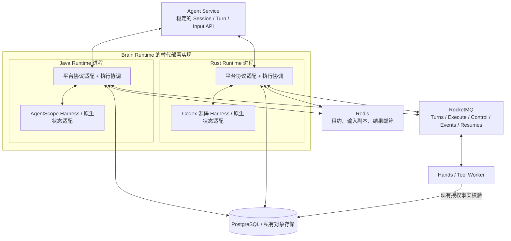
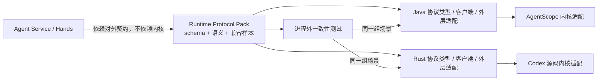
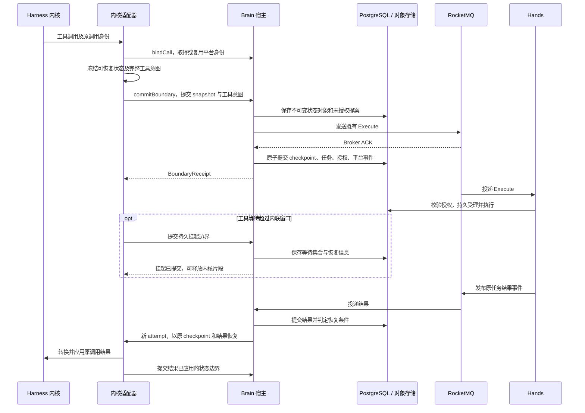

# 可替换的 Brain Runtime：用进程外契约解耦 Harness

> 2026-10-28 更新：目录组织、各 Brain 的语言与进程组合、Session Service 初期承载方式，以[多语言 Brain 方案](brain-runtime-layout-and-deployment.md)为准。本文保留早期候选方案分析；不再以 Rust Codex 或各 Runtime 重复实现存储事务作为默认路线。

[English](replaceable-harness-runtime.en.md)

日期：2026-10-21。状态：设计调研与候选方案，尚未实施。

本文基于 `/Users/ken/agentcore/agentcore-managed-agents` 主目录 `master` 工作区的实现。Brain 指 Agent Harness Runtime，Hands 指 Tool Worker。文中的新模块、接口和协议字段均为设计示意，不是当前已经提供的 API，也不构成数据库或线上消息格式的变更。本次仅编写文档，不修改业务代码、依赖、配置或部署。

核心前提是**整个 Runtime 进程可以替换**：当前可以部署 Java + AgentScope，未来可以整体部署 Rust + Codex 源码 Harness 与对应适配层。平台固定的是 Runtime 对外协议和执行语义，不要求保留 Java 宿主，不要求 Rust 嵌入 JVM，也不要求把 Codex 接到一个永久存在的 Java 服务后面。

## 从一次十分钟的工具调用说起

假设同一个平台 Turn T1 中，模型提出了两个工具调用：A 很快返回，B 要在 Hands 中执行十分钟。Brain R1 已经提交工具授权、保存 checkpoint，并在等待超时后释放执行资源。随后 R1 退出，R2 需要恢复 T1。用户这时又补充了一条输入，而 T2 已经在同一 Session 后面排队。

无论 R2 里面运行的是哪种 Harness，平台都希望得到相同的行为：A 不重复执行，B 继续关联原执行，补充输入按既有语义处理，T2 不能越过 T1，T1 只有在完整终态持久化后才能确认原 Turns 消息。前端继续看到同一套 Session、Turn、工具、输出与交互事件。

这才是“可以替换内核”需要守住的边界。换一个类名、封装一个 `run()` 方法，只解决了调用入口；原日志怎么解释、工具结果怎么接回、checkpoint 是否真能被另一进程恢复，往往才决定了替换能否落地。

本文主张把每一种 Brain 实现组织成**平台协议适配、执行协调、Harness 内核**。Java 与 Rust 可以分别实现这些职责；共同部分首先体现为版本化协议规范和一致性测试，而不是共享同一套运行时二进制。解耦的目标是替换进程后仍兑现同一份平台契约，而不是让不同内核内部变得一样。

## “替换”有几种不同的含义

新建 Session 使用另一种内核，是最容易提供的能力。同一内核升级后恢复旧状态，需要格式兼容承诺。把一个正在等待工具的 AgentScope Turn 交给 Codex，则进一步涉及跨内核状态迁移。这三件事需要不同的证据，不能共用一句“支持 checkpoint”概括。

| 替换场景 | 本设计的定位 | 需要证明什么 |
| --- | --- | --- |
| 整个 Runtime 由 Java/AgentScope 替换为 Rust/Codex | 主要部署目标 | 新进程独立兼容对外协议、共享状态和执行语义，不依赖原 Java Runtime 存活 |
| 新 Session 选择其他内核 | 主要执行目标 | 外部 API、工具链路和平台状态机不随内核变化 |
| 同内核另一副本接管 | 必须守住的执行能力 | 进程退出后仍能恢复原工具等待、输入位置和已应用结果 |
| 同内核版本升级 | 显式兼容能力 | 指定状态格式可由哪些已验证版本读取与恢复 |
| 空闲 Session 跨内核迁移 | 独立迁移功能 | 将可移植上下文与资源转换成新内核基线，标记语义差异 |
| 运行中或挂起中的 Turn 跨内核切换 | 首期不承诺 | 未完成调用、私有上下文、推理位置及输入应用语义均有可验证转换 |

因此 Session 应绑定内核类型和兼容执行配置。配置默认值改变只影响新 Session；旧 Session 由匹配的适配器恢复。即使某次迁移成功，模型行为也不可能因此被宣称完全等价。平台承诺的是身份、权限、状态与副作用边界的连续性。

## 当前实现：入口已经分开，协议还没有分开

当前实现并非从零开始。[ManagedHarnessRuntimeTurns](../../agent-harness-runtime/java/adapter-agentscope/src/main/java/io/agentcore/managed/server/runtime/managed/ManagedHarnessRuntimeTurns.java) 已经管理 MQ 回调、容量、Redis 执行租约和数据库 epoch，并通过 `Runner` 调用实际执行逻辑。它提供了可提炼为跨语言执行规范的行为样本。保留现有 MQ/Redis 的服务协作语义，不表示 Rust Runtime 可以直接复用 Java 类；新进程需要独立实现对应客户端行为。

耦合沿着提交路径继续向下延伸。[ManagedRuntimeBatch](../../agent-harness-runtime/java/adapter-agentscope/src/main/java/io/agentcore/managed/server/runtime/managed/ManagedRuntimeBatch.java) 直接携带 `List<SessionEvent>`；[ManagedJournalStore](../../common/src/main/java/io/agentcore/managed/server/runtime/managed/ManagedJournalStore.java) 根据 `model/dispatch`、`interaction/requested`、`tool/dispatch` 等原生事件更新平台事实；[ManagedMqSessionLog](../../agent-harness-runtime/java/adapter-agentscope/src/main/java/io/agentcore/managed/server/runtime/managed/ManagedMqSessionLog.java) 实现 AgentScope 的 `SessionLog` SPI，并把 SDK 的原生提交接到平台事务上。

工具与 checkpoint 同样如此。[ManagedToolRequests](../../agent-harness-runtime/java/adapter-agentscope/src/main/java/io/agentcore/managed/server/runtime/managed/ManagedToolRequests.java) 从 `RuntimeContext`、`ToolUseBlock` 和调用计数器取得身份；[ManagedToolRecovery](../../agent-harness-runtime/java/adapter-agentscope/src/main/java/io/agentcore/managed/server/runtime/managed/ManagedToolRecovery.java) 读取原生投影，识别上下文中的调用与结果，再恢复 AgentScope 状态。[ManagedCheckpointOperations](../../agent-service/src/main/java/io/agentcore/managed/server/runtime/managed/ManagedCheckpointOperations.java) 会解析 `AgentState` 来判定工具是否结算，并处理 restore/fork 基线。这些都是合理的 AgentScope 适配行为，但不适合成为所有内核都必须遵循的平台格式。

连物理依赖边界也值得注意：[common/pom.xml](../../common/pom.xml) 同时依赖 AgentScope Core、Harness、RocketMQ 和 Lettuce。只移动接口所在的包，既不能证明 Java 平台模块已摆脱 SDK，也不能让 Rust 直接复用 JVM 对象。编译依赖清理是当前 Java 实现的工程工作，跨进程协议独立才是整个 Runtime 可替换的验收标准。

当前有些结构已经接近目标，例如稳定的 Scope、工具执行身份、数据库 fencing、独立的工具事件与公开投影。应保留这些语义，再逐渐移走其中对特定 SDK 类型和事件名称的解释。

## 替换的是整个进程，稳定的是外部契约

Java/AgentScope Runtime 和 Rust/Codex Runtime 是两种可独立部署的 Brain 实现。每种实现都要接收平台命令、参与执行协调、接通 Hands、保存持久状态并产生兼容投影。内部可以有执行宿主或 coordinator，但它是一个职责，不是所有实现都必须调用的 Java 服务。内核适配既包括原生事件与状态翻译，也包括当前实现与外部协议之间的映射。



图中两种 Runtime 表示可选实现，不表示可以不加路由地同时加入同一业务消费组。它们使用同一份外部契约，Java 进程可以被完整替换；Rust 适配层可以直接编入 Codex 源码 Harness 的可执行程序，不强制使用 App Server、子进程 RPC 或 FFI。

每种 Runtime 的外层都要兑现 Session/Turn 生命周期、原始 Actor 与权限、执行租约、数据库 epoch、工具账本、挂起条件和终态 ACK。内核产生“我已经完成”事件后，外层仍须检查待完成工具、交互、输入仲裁和 checkpoint，才能把平台 Turn 置为终态。后文的“宿主”均指这种语言无关的逻辑职责，Java 与 Rust 可以分别实现。

同一个 Runtime 内部也应约束依赖：内核 hook 只通过受限端口发出工具意图、状态和完成提议，不拿到任意数据库、Redis 或 MQ 操作权。进程外适配层当然需要这些客户端，因为它承担完整 Runtime 职责；这里限制的是推理内核的访问范围，不是禁止 Rust Runtime 自己访问基础设施。

### 统一的是协议包，不是某种语言的模块

建议先建立语言无关的 Runtime Protocol Pack，包含 schema、状态转换与事务规范、认证和错误语义、兼容策略、现有消息样本及跨语言黄金测试向量。Java DTO、Rust struct 或内部 trait 都是它的实现或生成产物，规范不以其中任意一个为唯一来源。

| 交付边界 | 所有权与内容 | 实现形式 |
| --- | --- | --- |
| Runtime Protocol Pack | 平台身份、HTTP/MQ schema、checkpoint/event 格式、状态与事务语义、黄金样本 | 语言无关文本规范、JSON Schema/OpenAPI、fixtures 与测试工具 |
| Runtime 一致性测试 | 从进程外验证受理、工具协作、恢复、取消、状态与事件 | 启动可执行程序或镜像，使用真实共享依赖，不依赖 JVM 内 Provider |
| Java Runtime 外层 | 执行协调、既有客户端、事务、读模型与协议映射 | 当前 Java 实现重构；可按 contracts/host/infrastructure 拆 Maven 模块 |
| Java 内核适配 | AgentScope 构建、context、SessionLog、工具 hook、状态 codec | AgentScope 二进制依赖及当前 Java SPI |
| Rust Runtime 外层 | 同一协议的消息/HTTP、Redis、数据库、ACK 和恢复实现 | Rust crate 与原生异步执行框架；不依赖 Java Runtime |
| Rust 内核适配 | Codex 源码 Harness 的工具、状态、输入、日志和终态 hook | 可直接在同一 Rust 可执行程序中调用，不要求额外 RPC |
| 进程装配与部署 | Runtime 标识、协议/状态版本、能力、健康检查、镜像选择与停机排空 | Java 与 Rust 各自镜像，平台按已验证能力与绑定部署 |

规范的成熟度决定解耦程度。只共享几个消息 DTO，仍会遗漏数据库授权、私有对象编码或 ACK 规则；只共享一套 Java helper，则只是把核心约束保留在 Java 中。Java 内部模块拆分仍然有价值，但它的角色是让参考实现更清晰，而非成为 Rust 实现的运行前提。



最终验证应当能够停掉 Java Brain，启动独立 Rust Brain，仍由原 Agent Service、Hands、MQ/Redis 和平台读模型完成受支持 Session 的执行。没有 JNI、Java sidecar 或远程 Java coordinator，是这里应明确验证的一项部署条件。旧 Session 若仍需 AgentScope 状态解释，可在迁移期间保留匹配的旧 Runtime 或离线 codec；这不意味着所有新 Runtime 永久依赖 Java。

## 统一交互格式不等于把一切改成 HTTP

当前 Brain 参与的是多种协作面：MQ 消息、内部 HTTP、Redis key/脚本、共享 SQL 事务及持久事件。统一规范应覆盖这些既有边界，不增加一个“所有交互先转发到 Java”的中间层，也不为了语言无关而强制把五个 Topic 改成 RPC。

| 对外协作面 | 规范需要固定的内容 |
| --- | --- |
| Agent Service / Control Plane 内部调用 | 实际使用的管理、文件、trace、健康等接口；方法、路径、认证、原 Actor、错误和流式行为；不把所有 Turn 都假设为 HTTP 执行请求 |
| MQ 与 Hands | 五通道的既有 Topic/消费组职责、消息体和属性、LiteTopic 派生、执行身份、提案/授权规则、重试、Suspend 与 ACK |
| Redis | key 派生、hash tag、token、Lua 原子比较、TTL、输入副本和结果邮箱结构；不要求 Rust 复用 Lettuce |
| PostgreSQL / 私有对象 | 共享表读写归属、Session 行锁、epoch、授权/终态原子提交、JSON/对象格式、schema 版本与恢复引用 |
| 事件与查询 | 已有公开投影、事件身份和 cursor、消息内容与错误；原生日志不能成为前端或 Agent Service 的解析前提 |
| 部署与能力 | runtimeImplementation、runtimeBuild、engine/state/protocol 版本、支持能力、ready/drain/stop、监控含义与凭据注入 |

HTTP 用 OpenAPI 描述，已有 MQ JSON 用 JSON Schema、消息属性定义及样本固定。必要时可为新增接口选择 Protobuf，但不要求为了替换进程先改所有 wire format。规范中对 `Start`、`Resume`、`Cancel`、`CommitBoundary` 的命名首先是逻辑动作：direct continuation 仍可由新 Runtime 在内部扫描数据库触发，并不要求额外发送一条新的网络消息。

新事件 envelope 与 checkpoint envelope 可以作为将来的中立内部模型；若现有外围仍读取旧字段，Rust 外层需要生成兼容格式或在版本化迁移后切换。不能直接往既有 MQ 消息外套新 envelope，就假定 Hands 不需要变化。

### 共享存储与客户端行为也是协议

现有 [ManagedToolCommitGate](../../common/src/main/java/io/agentcore/managed/server/runtime/managed/ManagedToolCommitGate.java) 会在 Session 行锁下读取 `ma.session`、`ma.turn`、`ma.tool_task` 和授权回执。Rust Runtime 若只发送相同 Execute JSON，却没有以相同事务语义形成授权事实，Hands 仍不能正确执行。因此首期整体替换应将共享 schema、锁顺序、幂等条件、字段语义和提交顺序纳入兼容规范；不只规范 HTTP 与消息。

当前 Turns 的挂起与主动 ACK 还使用 [ManagedLitePushConsumer](../../common/src/main/java/org/apache/rocketmq/client/java/impl/consumer/ManagedLitePushConsumer.java) 和 [RocketMqTurnReceipt](../../common/src/main/java/io/agentcore/managed/server/runtime/managed/RocketMqTurnReceipt.java) 的 SDK 内部适配。Rust 候选必须实测 LiteTopic Shared/wildcard、FIFO Suspend、收据更新、终态跨进程 ACK、过期收据和后继消息唤醒。这里不假定 Rust 客户端已经等价支持，也不把“能连接 RocketMQ”当作完成兼容；私有收据格式需要明确 codec/version 与迁移规则。

跨语言身份尤其容易被忽视。[ManagedScope](../../common/src/main/java/io/agentcore/managed/server/runtime/managed/ManagedScope.java) 当前用 Java `String.length()` 构造长度前缀，再对 UTF-8 字节取摘要。这个长度是 UTF-16 code unit 数，Rust 的字节长度和 Unicode 字符计数都不能直接替代。Scope、工具 ID、JSON 字符串、时间单位、Base64、数值和 null 处理应有覆盖中文、emoji 与边界值的黄金向量。现有消息里的参数字符串或摘要算法也不能在同一协议版本中悄悄规范化重算。

未来可以选择把公共事务能力提取为独立协调服务，以降低多语言重复实现成本，但那会新增服务与依赖，并改变当前直接共享数据库的边界。本文首期采用“每种 Runtime 自己实现外层协议和事务”的方案，不把新增 Java 协调服务作为隐含前提。

## 从语言无关的语义定义内部接口

一个平台 Turn 可能包含多次模型推理、多个内核原生 Turn、多次挂起和多个 Brain attempt。平台身份不应与任何内核的 thread、run 或 item ID 强行一一对应。建议把 Session 视为长期绑定，把 segment 视为一次持有执行权的活动片段，把 boundary 视为可以由宿主提交的事实集合。

以下 Java 17 风格片段只是当前实现内部的一种参考投影，省略 DTO 定义与异常封装，不是跨进程协议，不要求 Rust 实现 Java interface。Rust 可采用自己的 trait、Future 和通道，只要进程外可观测行为满足同一规范。对整个 Runtime 替换而言，这些方法可以完全不存在。

```java
public interface HarnessProvider {
    EngineDescriptor descriptor();
    EngineStateCodec stateCodec();
    CompletionStage<HarnessSession> open(OpenSession request, HostServices host);
}

public interface HarnessSession {
    CompletionStage<SegmentResult> runSegment(SegmentCommand command);
    CompletionStage<ControlReceipt> control(ControlCommand command);
    CompletionStage<CapturedState> exportState(CaptureRequest request);
    CompletionStage<Void> close(CloseReason reason);
}

public interface HostServices {
    CompletionStage<CallBinding> bindCall(CallDeclaration declaration);
    CompletionStage<BoundaryReceipt> commitBoundary(BoundaryProposal proposal);
    CompletionStage<ToolAwaitResult> awaitTools(ToolWait request);
    CompletionStage<InputBatch> readInputs(InputQuery query);
    CompletionStage<ResourceView> resolveResource(ResourceRequest request);
}
```

`open` 创建或加载内核会话，`SegmentCommand` 显式携带启动或恢复原因、checkpoint 引用、待应用工具结果和输入。`SegmentResult` 表示该片段已经形成持久交接或终态提议，而不是把方法正常返回解释为 Turn 成功。`close(YIELD)` 只有在挂起边界得到宿主提交回执后才能释放内存或进程；`control(CANCEL)` 的回执也只表示接收或处理了控制，不是外部工具已经停止。

`exportState` 需要在内核可证明一致的边界执行。不能一边让模型或工具线程修改上下文，一边由宿主任意序列化内部对象。运行中的控制命令可以与片段执行并发，但 capture 与状态修改的并发规则必须由适配器声明并实现。对不支持任意时刻快照的内核，宿主只能要求其到达一个支持的安全边界。

`CompletionStage` 只是 Java 侧的异步表达；Rust 使用自己的运行时。两种实现都需要隔离阻塞操作、限定并发、传递取消并提供背压，不能让阻塞数据库或模型调用占用异步调度线程。首次版本可以通过有界批次提交输出来实现，不另开一个不受控的“输出直写前端”通道。

公共语义的稳定性依赖参数含义。建议先将以下字段组写成语言无关的 schema 和状态规则，再分别实现 Java DTO 与 Rust 数据结构；它们在现有 HTTP/MQ/存储面上的映射需明确，不能默认每个对象都对应一个新 RPC。

| 对象 | 核心字段及语义 |
| --- | --- |
| `OpenSession` | 平台 Scope、engine binding、定义/工具目录版本、所需能力和资源引用；宿主决定绑定，适配器不能擅自换内核 |
| `SegmentCommand` | commandId、turnId、attemptId、trigger、expectedRevision、checkpointRef、待应用结果身份与输入位置；同 command 重试必须可识别 |
| `CallDeclaration` | 持久来源锚点、内核会话代次、原 callId、操作键、工具/参数摘要和分解版本；宿主校验后返回平台映射 |
| `BoundaryProposal` | schemaVersion、boundaryId、expectedRevision、规范事实、原始记录引用、checkpointRef、工具意图、输入回执及 transition；不能同时挂起和终结 |
| `BoundaryReceipt` | commitId、已提交 revision、事件范围、checkpointId 与调用/任务映射；查询或同内容重试得到同一事实 |
| `ControlCommand` | controlId、控制类型、目标 Turn/attempt、输入或取消事实引用；重复控制不得新建业务动作 |
| `SegmentResult` | 最后持久 boundary、停止原因及重试信息；区分已挂起、已提交终态、可重试失败和结果未知 |

恢复失败还应区分状态不兼容、对象缺失、权限撤销、旧 attempt、内容冲突和基础设施暂不可用。只有适合重试的错误才进入重试调度；不兼容状态不能通过无期限重试或启动空 Session 掩盖。

### 三类上下文不要装进同一个 Map

平台执行上下文应包含可信 Scope、Turn、attempt、配置版本和受限资源句柄。适配器执行上下文可以是 Java 的 `RuntimeContext`，也可以是 Rust 内部的 Harness 状态与句柄；直接集成 Codex 源码时不需要存在 RPC 连接对象。内核恢复上下文包含消息、压缩结果和推理继续所需的私有状态。它们有不同生命周期，不能把整个运行时对象图序列化进 checkpoint。

宿主发出的 `HostServices` 句柄绑定当前 attempt，在服务端持有 fencing 信息；重启后重新创建。适配器不能从自己的 state payload 中恢复 Redis token 或给自己提升 epoch。资源接口返回按当前权限解析的受限视图或短期能力，不把 Vault 主密钥、任意数据库连接及原始服务凭据交给内核。

### 能力声明比一组始终返回成功的方法更重要

实现描述至少区分 `runtimeImplementation`、`runtimeBuild`、支持的协议范围、内核与适配器版本、state format，以及 `durableSuspend`、`crossProcessRestore`、`fork`、`steer`、`externalToolExecution`、`preModelAdmission` 等能力。它可以通过候选能力接口或部署 manifest 对外发布，内部再映射为 `EngineDescriptor`。硬预算若要求模型调用前预留，而内核只能在结束后上报 usage，就不能宣称等价支持该预算模式。

这些能力应在 Session 建立或恢复前校验，而不是运行到一半才降级。不能持久挂起的候选可以用于明确配置的常驻进程模式，但这属于另一种运行保证；不能静默替代现有跨副本恢复模式。能力描述需要由契约测试约束，不能只是 Provider 自报的一份布尔配置。

## 工具调用是跨内核最重要的持久边界

工具调用不能仅抽象成 `toolName + arguments → result`。平台还要知道调用来自哪里、是否授权、是否已经派发、接管后该等待哪个原结果，以及一个模型调用内部是否包含多个 Hands 操作。

建议区分四类身份：平台逻辑 `callId`、调用内部的 `operationId`、Hands 的 `taskId/executionId`，以及适配器私有的 `engineCallId`。宿主持久保存映射，映射绑定原调用锚点和内容摘要。重试不能用新 epoch 或重新生成的模型调用 ID 重新分配物理执行；相同工具名和参数也不能单独作为身份，因为用户可能合法地请求两次相同操作。

`bindCall` 只登记或复用身份，不创建可执行任务。适配器随后导出包含完整调用状态的 snapshot，形成带 `ToolIntent` 的 `BoundaryProposal`。宿主统一验证 schema、权限、配置版本及内容一致性，再走当前已经验证的提交协议：先保存完整未授权提案，发送 Execute 并取得 Broker ACK，最后在 Session 行锁事务中提交 checkpoint、任务及授权回执。Worker 收到未授权消息时等待，不能把“暂时查不到任务”当作废弃依据。

这一设计保留“Execute 先 MQ、后授权”的现有语义，**不会因为抽象适配器而改回后台 Execute outbox 扫描发布**。未授权提案的定向恢复、Broker 响应不明、旧 epoch 被替换和迟到结果仍按持久事实处理。新的通用 `BoundaryProposal` 是将来宿主内部契约，不是要求 Hands 立即更换线上消息格式。



结果持久提交与“内核已经应用结果”是两件事。适配器先将结果写入私有上下文，再通过新 checkpoint 和 applied receipt 提交；提交响应丢失时，按原 boundary 身份查询或重试。宿主不能根据某次 RPC 返回成功就清空恢复记录，更不能在结果未知时重新执行工具。

批次是调度和传输优化，不应成为所有内核的推理模型。宿主继续支持一个逻辑调用对应多个操作，完整等待集合仍由平台掌握。现有 `mcp.batch` 的顺序、逐调用结果与一次完成通知保留；是否可组批由参数、权限及工具能力共同决定，不让 Codex 去模拟 AgentScope 的 `Toolkit`。当前 MCP 批次完成使用 direct continuation，其他工具和输入等待仍使用 Resume Topic，这个差异留在宿主调度内部，不进入内核 SPI。

所有会影响业务或受管工作区的副作用，都要能映射到同一执行授权与审计边界。内核内部纯计算可以留在内核；若内置 shell、文件修改或 MCP 执行绕过 Hands，则必须桥接、禁用，或明确声明为不兼容的执行模式。子 Agent 的本地规划属于内核，平台子 Session 身份、额度、取消传播与持久任务关系仍由宿主维护。

## checkpoint：统一恢复承诺，保留私有状态格式

一个有用的 checkpoint 不是聊天记录的另一种叫法。对十分钟工具调用的例子，它必须同时回答：内核停在哪个安全位置、B 的原执行身份是什么、A 的结果是否已经应用、哪些输入已消费、工作区属于哪一份恢复依赖，以及新副本如何重建继续执行所需的状态。

建议使用统一外壳加私有载荷。外壳是宿主可验证的平台协议；私有载荷由适配器解释，可以是 AgentScope 状态对象、内核日志分段及索引，或者经过验证的外部会话引用。外壳不要求知道压缩策略、内部消息类或规划器结构，但也不能只保存一个无法验证的字符串。

下面是候选 envelope 的示意。`engineVersion` 等值为占位符；字段不表示当前数据库已经支持该格式。

```json
{
  "schemaVersion": 1,
  "checkpointId": "cp_T1_b17",
  "scope": {"tenant": "tenant-a", "namespace": "default", "sessionId": "S1"},
  "turnId": "T1",
  "parentCheckpointId": "cp_T1_b16",
  "engine": {
    "id": "agentscope",
    "engineVersion": "pinned-build",
    "adapterVersion": "adapter-build",
    "stateFormat": "agentscope-state",
    "stateVersion": 1
  },
  "boundary": {
    "id": "b17",
    "revision": 17,
    "domainEventThrough": 126,
    "captureReason": "WAIT_TOOLS"
  },
  "continuation": {
    "phase": "APPLY_TOOL_RESULTS",
    "pendingOperationIds": ["op-B"],
    "pendingActionIds": [],
    "inputAppliedThrough": 8,
    "appliedToolResults": [{"operationId": "op-A", "resultRevision": 1}]
  },
  "privateState": {
    "mode": "PORTABLE_SNAPSHOT",
    "storageRef": "private-object:state-T1-b17",
    "digestAlgorithm": "SHA-256",
    "digest": "aaaaaaaaaaaaaaaaaaaaaaaaaaaaaaaaaaaaaaaaaaaaaaaaaaaaaaaaaaaaaaaa",
    "sizeBytes": 48192
  },
  "nativeLog": {"manifestRef": "private-object:log-manifest-T1-b17", "through": "opaque-cursor"},
  "resources": {"manifestRef": "private-object:resources-T1-b17"},
  "restoreRequirements": ["cross-process-restore", "external-tools"]
}
```

`revision` 是平台提交位置，`domainEventThrough` 是平台事件水位，`nativeLog.through` 是适配器私有位置，三者不能互相冒充。输入水位应遵循现有业务顺序与回执规则；如果允许非连续处理，就要补充显式 receipt 集合，不能把最大输入序号当作此前全部已应用。工具结果也不天然存在一个全局序号，因此示例按 operation 与 result revision 记录应用身份；大集合可以转为受摘要保护的清单引用。

原始 execution epoch 可以作为来源元数据留档，但历史租约不能赋予新执行权。checkpoint 不保存可复用的 Redis token、活动回调、连接、内存地址或完整运行时服务对象。恢复时宿主先获取新的租约、建立新 epoch，再重建受限 `HostServices`。私有状态中的历史身份只能用于对账。

### 一个 checkpoint 何时才算可恢复

适配器在安全边界冻结状态后，先上传不可变私有对象及依赖清单，宿主验证归属、摘要、格式和兼容能力，再在提交事务中关联 envelope、工具与输入事实、挂起状态和公开投影。对象写入成功而数据库事务未提交时，它只是未被引用的对象；反过来，不能先对外宣布 checkpoint 可恢复，再异步补传唯一状态文件。

这不是让对象存储参加数据库分布式事务，而是用“对象先持久、引用后提交”的顺序建立可达性。未引用对象由保留期及引用扫描回收；已被当前状态、历史 checkpoint、restore/fork 操作或审计保留引用的对象不可提前删除。待提交边界的对象也应持有短期 pin，避免 GC 与提案恢复竞争。

对于 `EXTERNAL_SESSION_REFERENCE` 模式，还必须说明状态由谁持久化、引用的有效期与可见位置、是否可跨节点访问、备份和删除规则，以及与平台 boundary 的对应版本。只有内核 threadId 而没有这些保证，最多是一个定位线索，不是可跨副本恢复的 checkpoint。若内核存储无法与平台事务原子更新，适配器需要持久的请求身份、版本化状态位置和重连对账能力，未完成对账的边界不能报告为 ready。

workspace 是另一类恢复依赖。内核上下文快照不自动等于文件系统快照，当前工作目录也不能冒充历史 checkpoint 的工作区。restore/fork 应通过平台管理操作协调工作区引用与内核状态，保留现有并发占用和物理执行隔离，避免恢复旧上下文却继续使用已经变化的文件。

### 兼容性必须能被拒绝

状态读取与管理操作需要一个独立于运行实例的 codec 服务，以免 Agent Service 查询或 checkpoint 验证为了读取格式而启动模型循环。候选接口可以是：

```java
public interface EngineStateCodec {
    CompletionStage<StateInspection> inspect(StateReference state, StateAccess access);
    CompletionStage<RestorePlan> planRestore(RestoreRequest request, StateAccess access);
    CompletionStage<ForkPlan> planFork(ForkRequest request, StateAccess access);
}
```

codec 由匹配版本的适配器实现，只读取授权状态对象或产生不可变转换产物与计划，不直接授权工具、修改平台 Session 或执行模型调用。`StateInspection` 返回格式兼容性、内部待完成调用与资源要求等有限事实，宿主用持久账本和映射验证；restore/fork 是否允许、工作区如何协调以及何时切换基线仍由平台管理用例决定。不支持 fork 的内核明确返回能力错误，跨内核迁移另用显式 migrator，不放进一个默认成功的 `planRestore`。

这同样是语言内部的职责示例。Rust Runtime 可以在本进程实现对应状态 codec；若 Agent Service 需要请求状态管理，应通过版本化管理动作和引用获得结果，而不是加载 Java codec 或解析 Codex 原生日志。管理动作的身份、错误与持久回执需要进入外部契约。

平台 envelope 版本、事件协议版本、内核 state version、适配器版本及 Hands 线上消息版本分别演进。`engineVersion` 的版本号相邻不代表状态兼容，应以经过验证的格式读取器和测试矩阵决定。恢复加载不到匹配 Provider、状态不兼容或依赖对象丢失时，返回明确的恢复错误，不能自动开始一个空会话冒充成功接管。

旧 AgentScope checkpoint 可先由 legacy reader 包装为新的外层描述，不批量重写历史内容。跨内核迁移则生成带来源与转换信息的新基线，通过平台消息、资源和已结算结果建立新上下文。首期建议只允许 Session 空闲、工具与交互已结算时迁移；未完成调用不能通过在新内核中重新发起同名调用来“迁移”。

## 事件协议：把公共语义从原生日志中取出来

当前公开事件已经经过 [CommittedSessionEventProjector](../../agent-harness-runtime/java/adapter-agentscope/src/main/java/io/agentcore/managed/server/web/managed/CommittedSessionEventProjector.java) 和 [ManagedSessionProtocol](../../common/src/main/java/io/agentcore/managed/server/runtime/managed/ManagedSessionProtocol.java) 转换。这意味着保护前端不需要重新设计所有事件名称；首先要把“谁解释内核事件”移到正确的位置。

AgentScope Adapter 可以继续读取原生 `SessionEvent`，将其翻译为平台事实；Codex Adapter 提供自己的映射。宿主只接受明确的消息内容、工具声明、交互、输入回执、usage 和状态转换提议，不根据一个通用 `Map` 里的 `type` 去猜私有语义。下列 envelope 展示平台内部事实的候选结构，公开 SSE/HTTP payload 仍通过现有投影兼容输出。

```json
{
  "schemaVersion": 1,
  "eventId": "evt-T1-msg7-completed",
  "scope": {"tenant": "tenant-a", "namespace": "default", "sessionId": "S1"},
  "turnId": "T1",
  "boundaryId": "b17",
  "type": "message.completed",
  "source": {
    "engineId": "agentscope",
    "engineSessionGeneration": "g1",
    "nativeRecordId": "adapter-private-record-42"
  },
  "causationId": "input-8",
  "payload": {
    "messageId": "msg7",
    "role": "assistant",
    "content": [{"type": "text", "text": "已完成检查。"}]
  }
}
```

事件身份来自持久逻辑身份或已冻结的 boundary，不能在每次重放时重新生成 UUID，也不能用正文摘要去重两条合法相同消息。宿主校验身份冲突和内容摘要，在提交时分配平台序列；MQ offset、Redis Stream ID 和原生日志 cursor 都不能作为前端重连序列。

| 事实来源 | 平台如何解释 | 不应推导的结论 |
| --- | --- | --- |
| 内核输出增量、消息及上下文摘要 | 适配器映射，宿主持久提交并生成公开投影 | 断流或消息结束就等于 Turn 成功 |
| 工具调用意图 | 进入宿主的身份、参数、权限及授权流程 | 内核声明“已派发”就代表 Hands 已受理 |
| Hands 确认结果 | 宿主按原 task/execution 身份提交结果 | 内核本地日志中的工具完成可覆盖真实执行结果 |
| 输入应用、交互答复 | 在边界提交显式 receipt，并与受理记录校验 | 读取 Redis Stream 就表示输入已经应用 |
| usage 与预算 | 规范化统计维度，按能力接入调用前预留和调用后结算 | 缺失的 cache/reasoning token 可伪造为零 |
| 内核完成提议 | 宿主校验后提交平台终态及 ACK 意图 | `runSegment` 返回或 SDK run 结束就是平台终态 |

平台事实与原始内核日志有不同的权威范围。前者决定平台状态和公共读模型，后者决定对应内核如何解释其内部执行历史，也用于诊断。恢复始终需要将私有状态与平台工具、输入及 epoch 对账，不能二选一。它们通过 boundary 和原始记录引用关联；把原始日志单独异步写入、却没有对应提交位置，会在故障后形成无法解释的两段历史。

原始记录可以保存为带 format/version 的不透明 chunk 和 manifest，由适配器处理编码与回放。宿主维护长度、摘要、归属和已提交前缀，保留现有日志完整性保障。AgentScope 的 `SessionLog` 接口仍可在适配器内部存在，但宿主不再要求所有引擎实现这个 Java SPI。

输出增量可以使用不含新 checkpoint 的轻量边界提交；工具派发、挂起和终态等恢复关键边界则必须满足更强状态要求。首次改造不引入未提交事件直达前端的旁路。以后若增加低延迟预览，应显式区分预览与持久事件，并定义重连修正，不能悄悄改变当前公开事件承诺。未知的非关键诊断事件可保留为私有扩展；未知但标记为 required 的状态事实必须拒绝或要求兼容 reader，不能静默跳过。

## 把边界放进一次提交，而不是依靠几条回调碰巧同时成功

通用 `BoundaryProposal` 可以包含 boundary 身份、期望 revision、规范化事实、输入回执、工具意图、checkpoint 引用、原生日志 manifest，以及挂起或终态提议。平台绑定的 attempt 信息由宿主补入，适配器不能任意指定 fencing token。`BoundaryReceipt` 返回已提交 revision、事件范围、checkpoint 与工具映射，形成下一次运行的确定起点。

同一 boundaryId 加相同内容重复提交应返回同一结果；同 ID 不同内容必须报冲突。提交已经成功但响应丢失时，通过重试或查询 receipt 收敛，不能换新 boundaryId 再提交。历史 attempt 的新写入被 epoch 拒绝；对已经提交的幂等回执可以查询。Hands 的原执行结果可能在 Brain 换代后才到达，它按稳定 execution 身份验证，不能被误当成旧 Brain 的非法状态写入。

内容摘要也需要跨语言一致的编码规则：对象字节按实际内容计算 SHA-256，JSON 提案与参数则使用版本化的规范编码，固定键排序、数值、空值和内容块顺序。重放必须复用冻结的发生时间与来源身份，不重新生成。宿主分配的事件序列及当前 attempt 凭据不混入逻辑内容摘要，私有对象摘要与授权配置摘要则必须参与一致性校验；不能用 Java 对象的 `hashCode()` 作为协议摘要。

上述规范编码用于新契约的明确版本。兼容已有消息、命令账本和摘要时，首先复现既有字节与身份规则；从旧编码升级到新编码是显式迁移，不是 Rust 端“更标准”的序列化选择。

在数据库内部，checkpoint 索引、平台事实、工具授权、输入应用回执、挂起或终态状态与公开投影保持同一个逻辑提交边界。若未来投影拆成异步消费者，必须通过事务内持久发布记录保持同样语义；本轮不顺便改变读模型一致性。原 Turns 的 ACK 意图仍与完整终态一起提交，Redis 续期、MQ 控制消息 ACK、工具事件 ACK 或 Resume ACK 都不能替代它。

把“宿主可验证的业务状态”从原生日志中抽出来，并不意味着去掉旧代码已有的校验。当前检查原生调用与结果是否闭合的逻辑，应该拆为平台待完成事实检查与适配器状态完整性检查；两者分别负责自己理解的部分，再通过 boundary manifest 校验对应关系。否则只把 `AgentState` 改成 `byte[]`，会得到形式上解耦、实际上丢失恢复安全性的实现。

## 现有类应如何拆分归属

下面的名称是 Java 参考实现，目标列描述职责归属；不表示 Rust 必须逐类移植或调用这些类。Java 可以重构后继续运行，Rust 可以按同一协议重新组织模块。特别是 Journal、执行上下文和 checkpoint 管理同时承担平台正确性，需先提炼行为规范，再决定代码如何拆分，而不能只把整类搬进某个内核适配器。

| 现有类或类组 | 目标归属 | 保留或拆出的职责 |
| --- | --- | --- |
| `ManagedHarnessRuntimeTurns` | Runtime 外层执行协调 | Java 可用 SPI 消除 SDK 依赖；Rust 独立实现消费、容量、租约、epoch 和片段调度的同等语义 |
| `ManagedHarnessRuntimeConfiguration` | 应用装配 + AgentScope Adapter 装配 | 公共循环与基础设施留在应用；`RuntimeContext`、builder、Toolkit、中间件的创建移入适配器 |
| `HarnessAgentBuildService` | 拆分 | 平台定义/资源解析形成中立 spec；AgentScope 构建、工具注册、SDK 配置与缓存留在适配器 |
| `ManagedHarnessTurns` | AgentScope Adapter | 原生运行循环、SDK 事件解释、输入注入、run 中断；平台终态校验留在宿主 |
| `ManagedTurnExecution` | 拆分 | 窄执行身份与 HostServices 属于契约；本地原生日志、SDK state 和适配器缓存不再暴露给宿主接口 |
| `ManagedRuntimeBatch` | 拆分 | 中立 `BoundaryProposal` 进入契约；`SessionEvent` 列表变为 AgentScope 私有原始记录 |
| `ManagedRuntimeWriter` | 宿主 | 保留 guard、工具发送、提交及回执顺序，接收中立 boundary |
| `ManagedJournalStore` | 拆分 | 事务、fencing、任务/输入事实、索引和公开投影属宿主/Repository；SDK 事件解释与状态语义移入适配器 |
| `ManagedMqSessionLog`、`ManagedSessionLogStore` | AgentScope Adapter + 通用存储端口 | 实现 AgentScope SessionLog SPI 的部分留在适配器；持久原始记录存储由基础设施实现 |
| `ManagedLocalJournal` | 拆分 | 本地提交前缀、重试与缓存机制可在宿主复用；原生事件解释、推理位置及状态提取属于适配器 |
| `ManagedCheckpointObjects` | 拆分 | 归属、摘要、对象存储、引用与 GC 属基础设施；原生 event/state 编解码与验证属适配器 |
| `ManagedCheckpoints`、`ManagedCheckpointOperations` | 拆分 | 查询、准入、hold、工作区协调留在平台；state settled、restore/fork 状态转换调用版本化适配器服务 |
| `ManagedToolRequests` | 拆分 | 通用工具调用/等待端口留在宿主；从 `RuntimeContext`、`ToolUseBlock` 读取身份的代码留在 AgentScope Adapter |
| `ManagedToolRecovery` | 拆分 | 查询原任务、结果及恢复调度留在宿主；`SessionProjection`、`SessionRecovery` 和消息结果重建移入适配器 |
| `ManagedMcpBatchToolkit`、`ManagedMcpTool`、`ManagedRemoteFilesystem` | AgentScope Adapter | SDK 工具入口、返回类型和权限后边界适配；调用宿主工具端口 |
| `ManagedMcpBatch`、`ManagedToolCommand`、`ManagedToolResult`、`ManagedToolEvent` | 平台契约/工具协议 | 保持既有 wire 身份与字段；移走残留 SDK JSON 工具、工具返回包装等依赖，不随意改线上格式 |
| `ManagedToolTransport`、`ManagedToolCommitGate`、`ManagedToolWorkerCommands` | 宿主 / Hands 各自应用与基础设施 | 保持 Execute 提案、授权、Worker 受理和取消规则；不引入内核依赖 |
| `CommittedSessionEventProjector` | 拆分 | 原生日志到规范事实的转换移入适配器；事实到现有公开 payload 的转换留在平台 |
| `ManagedSessionProtocol` | 平台读模型 | 继续维护 API 历史和输入回执语义，避免读取新内核私有日志 |
| `ManagedRuntimeInputMiddleware`、`ManagedNativeCancellation` | AgentScope Adapter | 把平台输入/取消翻译成对应 SDK 行为 |
| `ManagedFinalization`、`ManagedModelPolicy`、`ManagedBudgetStore` | 拆分 | SDK 生命周期与模型 hook 在适配器；预算账本、终态约束与用量语义在宿主 |
| `ManagedSubagents`、`ManagedSubagentExecution`、`ManagedSubagentExecutor`、`ManagedTaskRepository` | 拆分 | 平台子 Session、配额和持久任务关系留在宿主；SDK 子 Agent/TaskRepository 实现留在适配器 |
| `ManagedExecutionGuard`、`ManagedTurnAcknowledgements`、`ManagedSuspensions`、`ManagedContinuationLoop`、`ManagedResumePublisher` | 宿主 | 保留执行权、原 Turns ACK 和恢复机制；等待集合改用中立事实，不解释 SDK context |
| `RocketMqManagedMessageBus`、`RedisManagedInfrastructure`、结果邮箱 | 基础设施 | 保留五通道、LiteTopic 路由、租约和通知语义 |
| `ManagedRedisMessageBus` | AgentScope Adapter + Redis 通用端口 | SDK MessageBus SPI 在适配器，Redis List/Stream/PubSub 实现在基础设施；不让宿主依赖 SDK BusEntry |
| `ManagedInfrastructureConfiguration`、现有 `common` | Java 参考实现渐进拆分 | 按角色装配中立用例/基础设施，移出内核依赖；跨语言规范独立发布，不以 Maven 包作为唯一契约 |

定义快照中现有的 `ToolsConfig`、模型配置、skills、memory 和权限参数也不能遗漏。平台可持久保存中立定义与有命名空间的引擎选项，由适配器翻译并校验；历史定义继续由对应版本解读。不能简单把所有旧字段装进任意 JSON，再宣称它们都已具备跨内核语义。

## Codex 是检验边界的候选，不是先写好的等价实现

官方 OpenAI documentation 提供 App Server 的 thread/turn、事件流、`thread/resume` 和客户端动态工具调用接口；动态工具接口标注为实验性。[官方 App Server 文档](https://learn.chatgpt.com/docs/app-server)

这些接口是可参考的产品接口边界，不是本设计要求采用的接入方式。当前目标优先考虑 Rust Runtime 直接集成 Codex 源码 Harness，在内核工具、状态和运行 hook 上实现平台适配，而非保留 Java Brain 再经 App Server 控制 Codex。无论走源码集成还是将来选择 RPC，仍需原型证明开头的 T1：原 Runtime 进程真正退出，另一进程恢复原调用等待并接回 Hands 的原结果。

验证还应覆盖原生日志和会话存储依赖、内置工具是否可统一外置、取消与补充输入如何映射、usage 能否支撑当前预算、一次平台 Turn 与多个原生 Turn 的关系。若公共接口不足以提供当前的持久挂起保证，选项是补充内核桥接能力、采用明确隔离的常驻会话模式，或暂不把该候选用于这个运行等级，而不是让宿主绕开授权和恢复规则。

这也解释了为什么不把 MCP 本身作为完整内核协议。MCP 可以承载工具调用和交互，但不会自动提供平台 Turn、执行 epoch、checkpoint 事务与故障接管语义。另一方面，只把内核当成一个纯 `step()` 函数，可能迫使宿主重新实现模型循环。本文选择的片段与边界契约允许内核保留自己的循环，同时将持久交接显式化。

## 整进程切换：先解决绑定和排空，再讨论混合部署

即使消息格式完全相同，Java 与 Rust 也未必能恢复彼此的私有 checkpoint。当前五通道消费分工不等于按 engine 绑定路由；把两个不兼容 Runtime 直接加入同一消费组，消息可能落到不能恢复该 Session 的实例。收到后不断 Suspend 不是路由，换一个消费组全量订阅也不是正确隔离。

首期建议整体切换或按独立运行范围隔离：停止受影响范围的新 Turn 准入，排空待发布、活动任务及相关恢复/ACK 工作；对旧 Session 明确选择继续留在旧 Runtime、在安全边界迁移，或暂不允许再执行，然后切换该范围的 Runtime 镜像与启动配置。不能只排空当前活动 Turn，就认定所有空闲旧 Session 都能交给新内核恢复。

需要 Java/Rust 长期混合运行时，必须先建立 Session 到 Runtime 实现/状态格式的绑定和可验证的投递策略，再决定是否增加调度、Topic 分区或其他路由。它是独立的协议演进，不假定现有 MQ 已支持。回退同样检查状态兼容性，不能将已经由新格式推进的 Session 交给不认识它的旧进程。

部署替换允许改镜像、可执行文件、环境变量映射和资源配置，但对平台承诺的健康、ready/drain、认证、观测与状态接口需要保持兼容或明确版本化。不要求 Rust 模仿 Spring 内部实现；若继续使用现有部署探针，就需要提供其实际检查的路径和语义。

## 演进路线：先固化外部协议，再验证另一种 Runtime 进程

第一阶段应从已有行为出发，而不是立即加入第二种内核。先将开头的 T1 场景和关键故障窗口固定为回归证据，明确当前公开事件、恢复和工具协议。SDK 当前承担的闭合性校验、模型预算、输入终态仲裁都需要记录下来，否则“改造后测试通过”可能只证明少测了旧约束。

随后从当前运行样本中提取 Protocol Pack：HTTP、MQ、Redis、共享表事务、checkpoint、公开事件及错误语义都形成独立规范和 fixtures。以 Java 参考进程先通过外部一致性测试，区分既有规则和拟议的新格式。这个阶段追求行为保持，不同时升级 AgentScope 或改消息格式。

Java 内部可以用前述 SPI 和模块清理来隔离原生状态解释，但不把完成整套 Maven 拆分作为 Rust 原型的前置条件。原生事件与平台事实分开后，应对已提交日志做离线投影比较，或者对真实执行的一份输入流计算只读影子投影。影子路径不得再次发送工具、调用模型或写第二份权威状态。只有历史、工具状态、交互、usage 和公开序列的差异可解释，才把中立提交切为主路径。

checkpoint envelope、旧格式读取器及依赖 pin/GC 在这之后逐步接入。先使用同一 AgentScope 格式做跨进程恢复，证明确实是从持久状态继续，而不是命中了进程缓存。新 Session 再选择新的格式或内核绑定，原 Session 保留原 reader。协议版本应落在 Session/状态绑定上；全局开关不应改变正在挂起的 T1 的解释方式。

第二种 Runtime 可以先接确定性测试内核，再接 Rust Codex 源码 Harness。它必须作为独立可执行进程接通真实 MQ、Redis 与数据库，主动停在工具请求、挂起、恢复和终态窗口，并在 Java Brain 完全停止的条件下通过测试。跨语言身份和 RocketMQ 客户端行为应优先做可行性验证，避免最后才发现收据或 LiteTopic 语义不兼容。灰度按前述可路由范围或整体切换进行，不能仅因标注 Session 绑定就默认具备投递隔离。

| 阶段 | 可审查的产物 | 退出条件 | 回退边界 |
| --- | --- | --- | --- |
| 行为基线 | 当前协议清单、故障场景与事件样本 | 明确执行、输入、预算、恢复和公开事件保证 | 文档与测试，无运行切换 |
| 协议基线 | Protocol Pack、黄金向量、Java 进程外一致性测试 | HTTP/MQ/Redis/事务和公开事件均可从进程外验证 | 原进程继续使用既有格式 |
| 提交与事件解耦 | 中立 boundary、事实投影、只读影子比较 | 平台事实和公开读模型等价，工具无重复派发 | 按 Session 保持旧 writer，禁止两套同时写 |
| checkpoint 解耦 | envelope、legacy reader、兼容矩阵、对象清单 | 真正跨进程恢复、restore/fork 和 GC 安全通过 | 旧 Session 使用旧 reader；新格式 writer 禁用后 reader 保留 |
| Rust Runtime | 独立外层适配、测试内核、Codex 源码集成原型 | Java Brain 停止时，原工具结果接回、取消、进程故障及 MQ ACK 场景通过 | 停止新分配，保留旧 Runtime 或显式迁移 |
| 部署与灰度收敛 | 能力 manifest、切换/排空策略、路由与观测、Java 依赖清理 | 独立进程通过同一测试包，混合运行仅在投递隔离已证明时启用 | 检查绑定和状态格式，不能盲回退旧二进制 |

这条路线允许每个阶段独立审查。Maven 拆分是 Java 参考实现的质量目标，独立 Rust 进程通过同一外部契约才证明替换目标达成。数据库迁移采用追加与版本化方式，保留旧 native 数据和 metadata key；首期尽量保持五个业务 Topic、消费组、Session LiteTopic 和 Hands 职责。若混合部署确需改变路由，则单独设计和迁移，不假装既有协议已经具备该能力。

### 用故障而不是演示验证边界

| 故障窗口或能力 | 期望证据 |
| --- | --- |
| 同一 boundary 重复提交、响应丢失 | 返回同一回执，不重复授权或生成公开完成事件 |
| Execute 已 ACK、数据库授权尚未提交时进程退出 | 新 attempt 复用完整提案，Hands 不提前执行 |
| 授权已提交、Runtime 响应丢失 | 恢复关联原 task/execution，不再创建物理执行 |
| A 完成、B 长耗时，原 Brain 进程退出 | 新进程保留 A 已应用状态，等待/接回 B 原结果 |
| 工具结果已提交，Redis 邮箱丢失 | 从持久结果修复；MCP direct 恢复不依赖邮箱唯一唤醒 |
| 结果注入内核后、应用边界回执丢失 | 重放同一边界或从旧快照重新应用，不重新调用外部工具 |
| 租约过期、旧 epoch 继续产生输出/提交 | 旧尝试被隔离；原外部执行的可信迟到结果仍可接收 |
| 用户取消与结果到达竞争 | 保留取消事实和真实工具结果，不能虚构物理停止 |
| 输入补投、重放、终态前补充输入 | 受理/应用/拒绝语义及顺序与现有实现一致 |
| checkpoint 引用缺失、格式不兼容、对象被误删 | 明确报错，不以空上下文重跑冒充恢复 |
| restore/fork、子 Session、预算与权限 | 工作区、配额、原 Actor、原调用身份及权限边界保持 |
| T1 挂起且 T2 已排队 | T1 完整终态前 T2 不得越过；所有 ACK 角色明确 |
| Java/Rust 编解码相同 Scope、参数和身份 | 中文、emoji、数值、null、Base64、摘要、时间与既有 wire 样本逐项相同 |
| Rust 进程直接接入 MQ | LiteTopic、FIFO Suspend、收据刷新、终态跨进程 ACK、过期与后继唤醒通过真实验证 |
| 不兼容 Runtime 混入消费范围 | 在准入/部署时拒绝或正确路由，不靠重复 Suspend 碰运气 |

现有测试可作为 Java 行为样本，包括 `ManagedToolSubmissionTest`、`ManagedPostgresToolSubmissionIntegrationTest`、`ManagedPostgresJournalIntegrationTest`、`ManagedPostgresToolEventsIntegrationTest`、`ManagedPostgresCheckpointOperationsIntegrationTest`、`ManagedSessionProtocolTest`、`ManagedHarnessIntegrationTest`、`ManagedMcpHttpIntegrationTest` 和 `RocketMqTurnAcknowledgementsIntegrationTest`。后续建立对每种 Runtime 可执行程序运行的进程外测试包，覆盖真实依赖、黄金向量和不支持能力时的拒绝语义；只测 Java Provider 接口不算 Rust 兼容认证。本文没有新增或运行这些测试，也不将它们列为本次验证结果。

真正实施 Java 改造时，从项目根目录按现有约定运行 `mvn -B -ntp -T1 clean verify` 与 `mvn -B -ntp -T1 spotless:check`，并补充模块依赖检查。Rust 实现按其项目约定构建和测试，再运行同一进程外测试包；普通 mock 的 `resume()` 成功不能替代真实依赖与进程退出证据。只有后续确实改动 Control Plane 或 Console 时，才相应执行其 Go 与前端检查。

## 在着手实施前，还需要作出的几个选择

内核私有状态默认继续放在现有私有对象存储，还是允许某些 Provider 保留独立会话存储，应由恢复与部署成本决定。若选择后者，备份、可达性、删除、租户隔离和版本位置都必须进入适配器的承诺，不能成为运维口头约定。

另一个选择是首次支持的运行等级。建议先把“可持久挂起、可跨进程恢复、工具统一外置”作为完整 Managed 模式的准入条件，将只能常驻运行的内核显式标为另一个等级。fork、steer 和模型调用前预算拦截可以按能力限制，但界面与 API 需要能表达“不支持”，而不是返回成功后忽略请求。

最后，跨内核上下文迁移应有自己的产品语义。它可能保留公开对话与工作区，却丢失私有压缩、内部计划或模型专属状态。迁移结果应形成带来源的新基线，保留旧内核恢复路径和审计信息。能替换新 Session 的内核，并不要求先解决所有存量 Session 的语义迁移。

这份设计的成败，应以“Java Runtime 被整个 Rust Runtime 替换后，T1 的工具、输入、状态与恢复保证是否仍由同一份外部契约兑现”衡量。宿主代码、语言和内核都可以变化；平台何时授权执行、何时承认一个事实、何时允许下一个 Turn 前进，需要保持可解释、可恢复和可验证。

## 阅读线索与范围说明

运行协议与当前恢复细节参见 [运行架构](../managed-runtime-dataplane.md)、[Agent Service 架构](../agent-service-architecture.md)、[MCP 批次与恢复](../mcp-execution-recovery.md)、[RocketMQ Topic 与 Turn 生命周期](../rocketmq-topics-and-turn-lifecycle.md)、[Redis 用途与 Turn 生命周期](../redis-usage-and-turn-lifecycle.md)。[Harness² / Pi 补充调研](../harness2-pi-brain-evaluation.md) 可作为候选比较的历史材料，其描述基于更早源码，不覆盖当前 Execute 提交和 MCP direct continuation 的全部演进。

本文的可行性判断来自当前源码阅读与前述官方接口材料，尚无 Codex 适配原型、跨内核迁移测试或性能数据。本次交付仅为中英文 Markdown 设计文档；没有建立新 Maven 模块、修改 Java、执行数据库迁移或变更部署。
