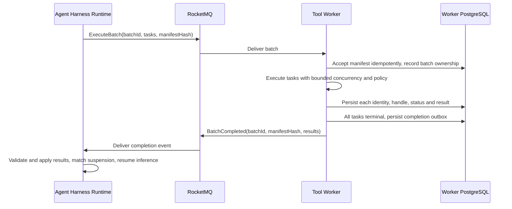

# Tool call batch dispatch design analysis

[中文](tool-call-batch-dispatch.md)

Date: 2026-10-19. Status: candidate design analysis; implementation deferred.

This note records the discussion of dispatching one round of tool calls to Tool Worker as a batch,
on top of the existing segmented suspension implementation. Brain means Agent Harness Runtime.
The user explicitly requested no change to the current version. This note is not an implementation
decision: it changes no message protocol, Topic, database structure, execution responsibility or
deployment configuration, and does not claim that a prototype has been validated.

## 1. Current implementation and premises

- One model response may contain multiple tool calls. A platform Turn may contain multiple model
  responses; these are different boundaries.
- The Runtime commit structure permits multiple `ToolIntent` entries, but creates a `ToolTask` and
  Execute outbox entry for each. One MQ Execute message carries one task, not the round's call list.
- Worker processes tasks and publishes results individually. Its current completion notifications
  are also per task, not proof that the entire round is complete. Different Worker instances may
  process different tasks, and ownership can change during recovery.
- Worker instances share their database and can query persisted states of received tasks. Commands
  currently contain no sealed batch manifest, so completing all observed tasks cannot prove that
  all tasks in a round have completed.
- Runtime owns the current suspension's `pending_tasks` and checkpoint, giving it the expected
  wait set. Suspension releases active execution resources; the original Turn retains FIFO ordering
  and is acknowledged only after a durable terminal state.
- Model tool calls and Worker operations need not map one to one. A call may produce several remote
  operations, with later operations depending on earlier results. Runtime currently orchestrates
  `subagent.call`.

Source references:
[command structure](../../common/src/main/java/io/agentcore/managed/server/runtime/managed/ManagedToolCommand.java),
[intent commit](../../common/src/main/java/io/agentcore/managed/server/runtime/managed/ManagedJournalStore.java),
[command publication](../../common/src/main/java/io/agentcore/managed/server/runtime/managed/ManagedToolTransport.java),
[operation identity and requests](../../agent-harness-runtime/java/adapter-agentscope/src/main/java/io/agentcore/managed/server/runtime/managed/ManagedToolRequests.java),
and [suspension and result aggregation](../../common/src/main/java/io/agentcore/managed/server/runtime/managed/ManagedSuspensions.java).

## 2. Candidate and benefits

The candidate is batch dispatch, durable execution per task, and a batch completion notification.
Runtime seals an authorized, executable task manifest and submits it once. One Worker owns the batch
and executes its tasks with bounded concurrency, then reports the aggregate result. Another Worker
can recover unfinished items from durable state after failure. The initial candidate does not add
distributed scheduling of tasks from one batch across multiple Workers.

Message names and fields in the diagram illustrate intent; they are not an existing or finalized
protocol. Result consumption and inference recovery may occur on different Runtime instances,
using shared checkpoints, state and execution ownership checks rather than the original instance's memory.

Main benefits:

1. Worker knows the expected task set and can determine completion without guessing whether more
   commands are still in transit.
2. N task commands can become one batch submission, with one completion notification per batch.
3. Batch ownership, progress, cancellation and result aggregation become explicit, reducing Brain's
   aggregation of scattered completion notifications.
4. A Worker owning a batch may reuse suitable environments and connections while preserving isolation.

Completion means definite terminal outcomes such as success, failure or cancellation, not universal
success. Unknown external side effects are neither confirmed completion nor proof that retry is safe.
If Brain already waits for the entire set, batching does not inherently add a wait for the slowest task.
Progress, incremental output and large-result references may still travel separately; total traffic
does not necessarily become just two messages.

## 3. Tradeoffs against individual task dispatch

| Dimension | One Worker owns a batch | Current task dispatch |
| --- | --- | --- |
| Normal coordination | Complete manifest and one aggregate completion | Aggregate independently executed tasks |
| Concurrency and balance | Bounded local concurrency; large batches can concentrate load | Distribute tasks across instances |
| Failover | Recover batch ownership, resume individual items | Recover unfinished tasks individually |
| Durable state | Add batch state while retaining task state | Primarily task state |
| Cancellation | Batch cancellation possible; item cancellation still needs taskId | Naturally per task |
| Output and progress | Can stream without holding everything in memory until completion | Independent output per task |
| Integration | Requires a sealed boundary and executable manifest | Fits remote operations generated incrementally |

### Partial success must not cause whole-batch re-execution

Suppose A sent an email, B completed a query, and C is still running a script when the Worker crashes.
Its replacement must reuse A/B's confirmed results and query or take over C's original execution.
Redelivery of the batch must not resend A's email or rerun B unnecessarily.

Stable task identities, content checks, external handles, durable results, execution ownership and
fencing of stale writes remain necessary. A batch is a transport and aggregation unit, not an atomic
transaction over external side effects. A batch lease cannot replace individual execution records.
Lease granularity and integration with existing Redis Guards and database fencing remain to be designed.

See the existing [execution and recovery logic](../../tool-worker/src/main/java/io/agentcore/managed/server/runtime/managed/ManagedAsyncToolExecution.java).

### Preserve concurrency, cancellation and failure semantics

Calls in one round are not necessarily safe to parallelize. Writes in a shared environment may
require the existing ordering and tool concurrency policy. Define whether an item failure stops other
items, how to cancel unstarted items, how to confirm running items stopped, and how to retain unknown
outcomes. Derive completion from durable item states, not an instance-local counter.

Cancellation and replay still need a reachable control path independent of execution. A cancellation
command must not sit behind the same FIFO execution message that is waiting to finish. Batching alone
does not decide whether to retain `ma_tool_control_v1` and does not remove Redis dependencies.

## 4. Choose the batch boundary first

| Candidate boundary | Benefit | Unresolved issue |
| --- | --- | --- |
| Batch already-generated Worker operations | Reuse task executors with relatively local changes | Incrementally generated operations may not cover the model's whole round |
| Batch the model round's tool calls | Worker can orchestrate the round's execution and results | Adapt tool entrypoints, permissions, context, subagents and multistep remote operations; larger responsibility change |

Changing `ToolTask` into a list is insufficient to move an entire round. Establish which calls can
finish validation and authorization before dispatch, which require user replies, which execute locally
in Runtime, and which are subagent orchestration. If a batch contains only the Worker subset, make
that scope explicit: completing that subset does not imply completing Runtime's entire wait set.

See [filesystem adaptation](../../agent-harness-runtime/java/adapter-agentscope/src/main/java/io/agentcore/managed/server/runtime/managed/ManagedRemoteFilesystem.java),
[MCP adaptation](../../agent-harness-runtime/java/adapter-agentscope/src/main/java/io/agentcore/managed/server/runtime/managed/ManagedMcpTool.java),
and the [subagent entrypoint](../../agent-harness-runtime/java/adapter-agentscope/src/main/java/io/agentcore/managed/server/runtime/managed/ManagedSubagentExecution.java).

## 5. Protocol and reliability requirements to design

- Use stable batch identity bound to Session, Turn, native call identity and a sealed manifest.
  Physical instances and lease tokens are not logical identities. Turn ID alone cannot identify its
  multiple tool rounds. Reject conflicting content under the same identity.
- Seal the task count, item identities, required configuration and ordering/concurrency policy.
  Persist batch acceptance and task records reliably; redelivery must not duplicate side effects.
- Keep checkpoint, dispatch intent and suspension wait set consistent with existing transaction requirements.
- Tie ACK to a durable handoff. ACK on acceptance requires a reliable durable execution driver;
  ACK on completion requires validated segmented suspension and takeover for long batches. An
  in-memory execution queue after ACK is insufficient.
- Commit batch completion and its publication outbox atomically; retries retain the same identity.
  Runtime atomically applies results and records receipt, validating manifest, result coverage and
  suspension generation to prevent duplicate or stale recovery.
- Completion can precede Runtime suspension. Persist results and recheck readiness when committing
  suspension so that this ordering cannot lose a wakeup.
- Bound batch and result sizes against message limits; use private durable references when needed.
  Exact limits and encoding remain undecided.

## 6. Relationship to Topic simplification

A batch completion event can carry both results and the fact that the batch has ended, potentially
replacing Worker's current per-task completion notification chain. This does not automatically merge
`tool_events` with `turn_resumes`, which actually drives inference: event handling commits results,
whereas recovery can occupy a callback for a longer reasoning segment. Separate capacity and ACK
boundaries can still be valuable.

The previously discussed alternative, Runtime generating Resume from individual task results, retains
per-task dispatch. It is not a prerequisite already chosen for batching. Both candidates must handle
results before or after suspension, duplicate delivery and recovery across instances. If future batch
completion coexists with Resume, give each one clear responsibility rather than recreating duplicate
completion protocols. Consolidating depth-specific Turn Topics is a separate capacity validation topic;
this note changes no Topic inventory.

## 7. Future evaluation and verification

If design work resumes, first evaluate a sealed batch owned by one Worker, bounded local execution,
durable item states and takeover of unfinished items. Do not initially expand to distributed scheduling
within a batch. Resolve the boundary in section 4 before finalizing messages and state models.

At minimum, verify:

1. Parallel tools, tools requiring serial execution, and mixtures of short and long tasks.
2. Crashes after an external side effect but before saving its handle, crashes after partial result
   persistence, and redelivery of the entire batch.
3. Batch and item cancellation, control arriving first, and unknown execution outcomes.
4. Completion before or after suspension, duplicate and stale completion, missing results and content conflicts.
5. Original Runtime exit, another instance applying results and restoring the checkpoint, and T2 never
   overtaking T1 before T1's durable terminal state.
6. Result/progress replay, large-message references, lease loss, rejection of stale writes and shared capacity saturation.
7. Preservation of tool permissions, confirmation, native tool call mapping and public event semantics.

These are future verification requirements, not tests already run or passed. The current version
continues to use the existing per-task protocol.
