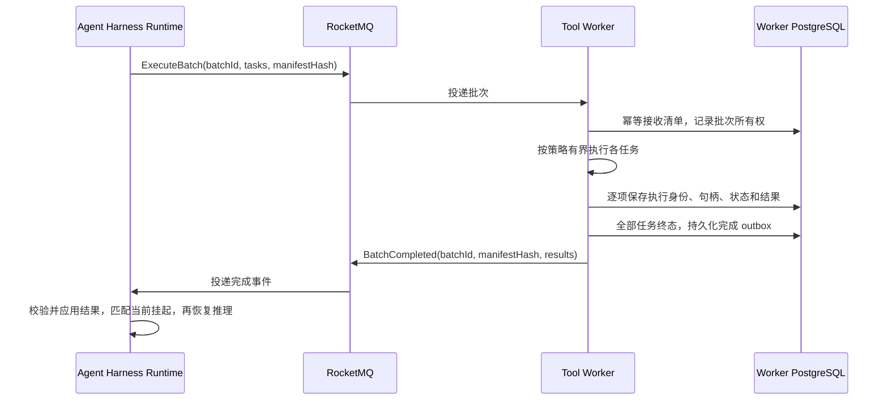

# 工具调用批量提交设计分析

[English](tool-call-batch-dispatch.en.md)

日期：2026-10-19。状态：备选设计分析，暂缓实施。

本文记录在现有分段挂起实现之上，将同一轮工具调用批量提交给 Tool Worker 的讨论。
Brain 指 Agent Harness Runtime。用户明确要求当前版本先不改：本文不构成实施决定，
不改变现有消息协议、Topic、数据库结构、执行职责或部署配置，也不表示已经完成原型验证。

## 1. 当前实现与讨论前提

- 模型一次响应可以包含多个 tool call；一个平台 Turn 可以包含多次模型响应，二者不能混用。
- Runtime 提交批次的数据结构允许多个 `ToolIntent`，但提交时逐项创建 `ToolTask` 和
  Execute outbox；一条 MQ Execute 消息携带一个任务，不是整轮调用列表。
- Worker 按任务处理和发送结果，当前 Worker 完成通知也是逐任务的，不表示整轮完成。
  不同任务可由不同 Worker 实例处理；实例接管后也可能变化。
- Worker 实例共享其数据库，可以查询已接收任务的持久状态，但当前命令没有封存的整批清单，
  因此不能从“已看到的任务都完成”推断“本轮所有任务都完成”。
- Runtime 保存当前挂起的 `pending_tasks` 和 checkpoint，具备本次等待集合的视图。
  分段挂起后释放活动执行资源，原始 Turn 仍保留 FIFO 顺序，直到持久终态才确认。
- 模型 tool call 与 Worker 操作未必一一对应。一个调用内部可能依次产生多个远程操作，
  后续操作还可能依赖前一步结果；`subagent.call` 当前由 Runtime 编排。

源码依据：
[命令结构](../../common/src/main/java/io/agentcore/managed/server/runtime/managed/ManagedToolCommand.java)、
[意图提交](../../common/src/main/java/io/agentcore/managed/server/runtime/managed/ManagedJournalStore.java)、
[命令发布](../../common/src/main/java/io/agentcore/managed/server/runtime/managed/ManagedToolTransport.java)、
[操作身份与请求](../../agent-harness-runtime/java/adapter-agentscope/src/main/java/io/agentcore/managed/server/runtime/managed/ManagedToolRequests.java)、
[挂起与汇合](../../common/src/main/java/io/agentcore/managed/server/runtime/managed/ManagedSuspensions.java)。

## 2. 候选方案与收益

候选方向是“批量下发、逐任务持久执行、批次完成通知”：Runtime 封存一份已授权、可执行的
任务清单，一次提交给 Worker；一个 Worker 持有批次，在内部有界并行执行，汇总后通知 Runtime。
实例故障时，其他 Worker 从持久状态接管未完成项。第一版候选不引入跨 Worker 的批次拆分调度。

图中的消息名和字段仅表达设计意图，不是已存在或已定稿的协议。Runtime 的结果消费与后续恢复
可以发生在不同实例上，依赖共享 checkpoint、状态及执行权校验，而非原实例的内存。

主要收益：

1. Worker 有明确的预期任务集合，可以判断本批是否全部结束，而不必猜测是否还有命令未到。
2. N 个任务的命令可由 N 条收敛为一次批量提交，并按批次发布一次完成通知。
3. 批次归属、进度、取消和结果汇总更直观，Brain 侧的分散完成通知汇合可以减少。
4. 一个批次使用同一 Worker 时，可以复用适用的环境与连接，但仍需遵守资源隔离。

“全部结束”指成功、失败、取消等确定终态，不要求全部成功。外部副作用结果未知不能直接当作
已结束或安全重试。若 Brain 原本就等待整组结果，批量汇总并不会额外增加等待最慢任务的时间。
工具进度、增量输出和大结果引用仍可单独发送，消息总量不会因此必然变成两条。

## 3. 与逐任务发送的取舍

| 维度 | 整批交给一个 Worker | 当前逐任务提交 |
| --- | --- | --- |
| 正常协调 | 完整清单，一次汇总 | 分散执行后汇合 |
| 并行与均衡 | 实例内有界并行，大批次可能集中负载 | 可按任务分散到多个实例 |
| 故障接管 | 接管批次，仍逐项恢复 | 分别接管未完成任务 |
| 持久状态 | 新增批次状态，保留任务状态 | 主要维护任务状态 |
| 取消 | 可提供批次取消，单项取消仍需 taskId | 天然按任务控制 |
| 输出与进度 | 可持续发送，不必缓存在内存等整批结束 | 每项独立输出 |
| 接入成本 | 需要封存批次边界及可执行清单 | 适合逐步产生的远程操作 |

### 部分成功不能导致整批重跑

例如 A 发邮件成功、B 查询成功、C 脚本运行中，Worker 此时崩溃。接管实例必须复用 A/B 的
已确认结果，查询或接管 C 的原执行；不能因为重投整条批次消息就重跑 A/B。

因此任务级稳定身份、内容一致性校验、外部句柄、结果持久化、执行所有权和过期执行写入隔离
仍然需要。批次是传输与汇总单位，不是外部副作用的原子事务。一个批次租约也不能替代每项
执行状态；具体租约粒度与现有 Redis Guard、数据库 fencing 的适配仍待设计。

参考现有[执行与恢复逻辑](../../tool-worker/src/main/java/io/agentcore/managed/server/runtime/managed/ManagedAsyncToolExecution.java)。

### 并行、取消和失败策略不能隐式改变

同轮调用不等于都可并行。同一环境中的写入等操作可能需要保留原有顺序及工具并发策略。
要明确单项失败后是否继续其他项、未开始任务如何取消、已运行任务如何确认停止，以及未知结果
如何保留。完成状态应从各项持久终态推导，不能只依赖实例内的计数器。

取消、重放仍需要独立于执行的可达控制路径，不能把取消命令放到正在等待完成的同一 FIFO
执行队列后面。批量协议本身不决定是否保留 `ma_tool_control_v1`，也不会自动消除 Redis 依赖。

## 4. 批次边界需要先选定

| 候选边界 | 优点 | 未解决的问题 |
| --- | --- | --- |
| 批量发送已生成的 Worker 操作 | 可复用现有任务执行器，改动相对局部 | 操作逐步产生时，一批未必覆盖模型整轮 |
| 批量发送模型整轮 tool call | Worker 可统一编排该轮执行和结果 | 需适配工具入口、权限、上下文、子 Agent 及多步远程操作，职责变化较大 |

不能只把 `ToolTask` 改成列表就认为整轮迁移完成。需要先确认哪些工具可以在派发前完成
参数校验和授权、哪些仍需用户答复、哪些在 Runtime 本地执行，以及哪些属于子 Agent 编排。
如果只提交 Worker 子集，要显式标明批次范围；Worker 子集完成不代表 Runtime 的整个等待集合完成。

参考[文件操作适配](../../agent-harness-runtime/java/adapter-agentscope/src/main/java/io/agentcore/managed/server/runtime/managed/ManagedRemoteFilesystem.java)、
[MCP 适配](../../agent-harness-runtime/java/adapter-agentscope/src/main/java/io/agentcore/managed/server/runtime/managed/ManagedMcpTool.java)、
[子 Agent 入口](../../agent-harness-runtime/java/adapter-agentscope/src/main/java/io/agentcore/managed/server/runtime/managed/ManagedSubagentExecution.java)。

## 5. 协议与可靠性要求（待设计）

- 批次需要稳定身份，绑定 Session、Turn、原生调用身份和封存清单；不能用物理实例或租约 token
  作为逻辑身份，也不能只用 Turn ID 表示其多轮工具批次。重复身份携带不同内容必须拒绝。
- 封存清单应明确任务数量、各项稳定身份、执行所需配置及顺序/并行策略。批次接收及其任务记录
  应可靠持久化，消息重投不得重复创建副作用。
- checkpoint、批次派发意图和挂起等待集合必须保持一致，复用当前事务边界要求。
- ACK 必须对应持久交接：若接收即 ACK，后续执行必须有可靠持久驱动；若完成才 ACK，需验证
  长批次的分段挂起与接管。不能 ACK 后只留一个内存执行队列。
- 批次完成状态和发送 outbox 应原子提交；重发使用相同身份。Runtime 在同一事务应用结果并
  记录接收状态，校验清单、结果覆盖及当前挂起代次，防止重复或过期恢复。
- 完成通知可能先于 Runtime 挂起到达，需先保存结果，再在挂起提交时重新判断就绪，避免丢唤醒。
- 大批次或大结果需受消息大小限制约束，必要时使用私有持久引用；具体限额和格式待定。

## 6. 与 Topic 简化讨论的关系

批量完成事件可以同时承载结果与“本批已结束”的事实，有条件替代 Worker 当前逐任务的完成通知链。
但这不自动决定 `tool_events` 与真正驱动推理的 `turn_resumes` 是否合并：前者处理结果入库，
后者可能占用回调执行较长推理片段，仍有独立容量及 ACK 边界的价值。

此前讨论的“Runtime 根据逐任务结果生成 Resume”是另一种保留逐任务派发的备选方案，
不是批量方案的既定前提。两种方案都要处理结果先到、挂起先到、重复投递和跨实例恢复。
若未来同时实现批次完成与 Resume，必须明确各自唯一职责，避免再次制造两套重复完成协议。
根/子 Agent 深度 Topic 是否合并是独立的容量验证议题，本文不修改 Topic 清单。

## 7. 后续评估入口与验证场景

若重启设计，优先评估一个 Worker 持有封存批次、实例内有界执行、逐任务落盘、故障后接管
未完成项的版本，先不扩展跨实例批次调度。先明确第 4 节的批次边界，再确定消息与状态模型。

至少需要验证：

1. 多个工具并行、需要串行的工具，以及短任务与长任务混合。
2. 副作用成功后、执行句柄写入前崩溃；部分结果落盘后崩溃；整条批次重投。
3. 批次取消、单项取消、控制消息先到，以及未知执行结果。
4. 完成事件先于挂起、晚于挂起、重复到达、过期到达及结果缺项/内容冲突。
5. 原 Runtime 退出，由其他实例应用结果并恢复 checkpoint；T1 终态前 T2 不得越过。
6. 结果/进度重放、大消息引用、租约丢失、过期执行写入被拒绝和共享容量饱和。
7. 工具权限、确认流程、原生 tool call 对应关系和公共事件语义保持一致。

这些是未来方案的验证要求，不是已执行或已通过的测试。当前版本继续使用现有逐任务协议。
