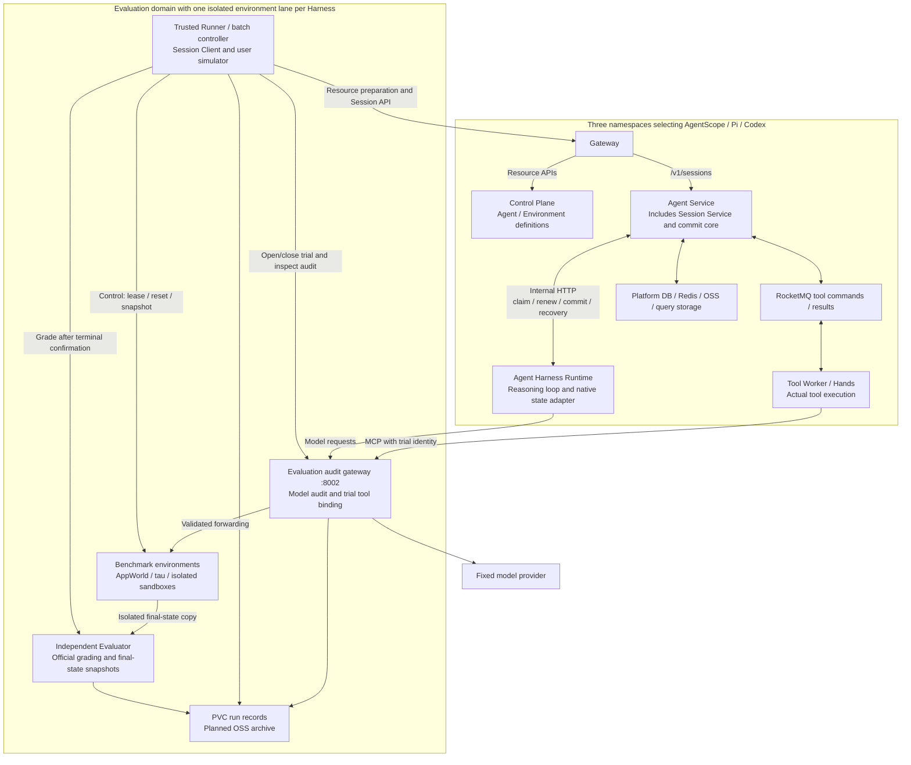
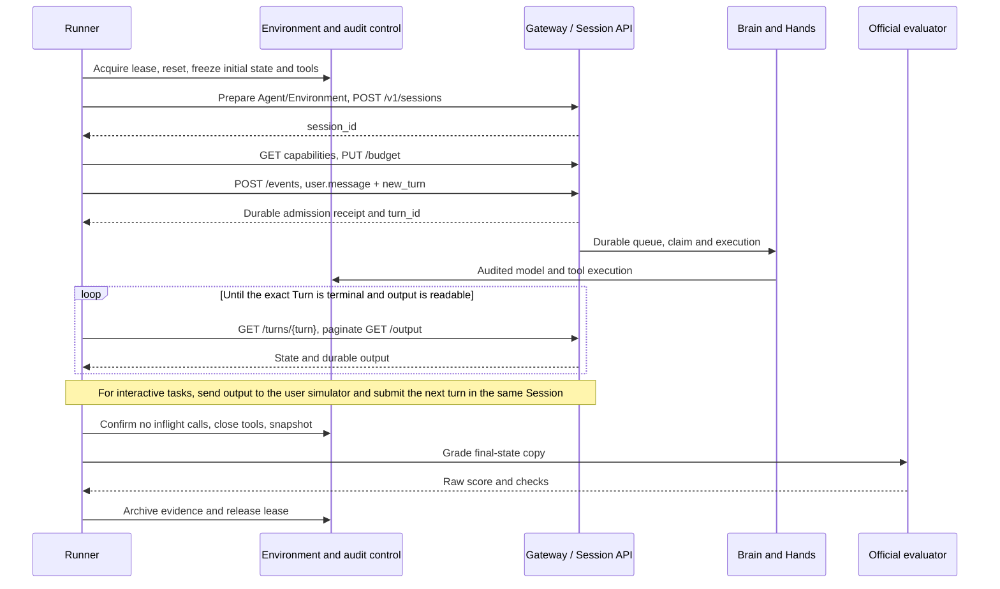

# Managed Agents Harness Evaluation Implementation Guide

Date: 2026-11-02. [中文](harness-selection-evaluation-implementation.md) · First document: [Objectives and selection research](harness-selection-evaluation-plan.en.md)

This guide focuses on **using the existing Managed Agents ACS deployment and public Session API to evaluate the Harness effectiveness and capabilities defined in Part One of the first document**. All three Harnesses execute inside the existing service chain. Evaluation components prepare tasks, control conditions, observe execution and grade outcomes; the tested Harness owns reasoning and tool decisions.

Capability evaluation and platform validation are separate workstreams with separate reports. The shared deployment and API form the experimental environment, not a capability score. Minimum platform checks establish trustworthy conditions; fault, recovery, authorization and capacity experiments run separately from ordinary capability batches and do not enter capability aggregates.

**Suggested reading order: Section 1 for boundaries, Section 4 for experiments, Sections 5–7 for execution/adapters/grading, and Section 9 for delivery. Sections 2–3 prepare the shared environment; Section 8 covers platform tests.** Existing AppWorld/original τ workflows are distinguished from planned capabilities. Commands describe procedures; this document revision does not imply deployment or test execution.

## 1 Implementation scope, conclusion boundaries and existing foundation

### 1.1 Mapping the two objectives to implementation

| Objective | Implementation in the existing environment | Separate output |
| --- | --- | --- |
| Harness effectiveness and capabilities, the main workstream | Submit matched tasks and conditions through the same public Session API; collect model/tool audit and final state, use official graders and paired analysis | Capability dimensions, mechanism gains, difficulty limits and task consumption, Sections 4–7 |
| Managed Agents platform requirements | First check protocols, configuration and accounting; separately use deterministic fixtures for faults, isolation, recovery, cancellation and capacity | Admission matrix, defects and operating boundaries, Sections 3.3 and 8 |

All A/B/C capability lanes follow `Runner → Gateway → Session API → Agent Harness Runtime → Tool Worker → task environment`. Harbor/Inspect connect through remote Session adapters. They do not run another Agent loop inside the Runner or directly invoke a bare Harness SDK/CLI to produce formal scores.

Conclusions therefore concern a particular Harness version under the Managed Agents shared contract. That tool contract may constrain native capabilities: mark unintegrated features as unsupported/untested, and separately attribute tool-format or adapter defects. These results do not establish the bare kernel's full capabilities.

### 1.2 Existing evidence and limitations

This snapshot combines November 1 acceptance and November 2 repository progress, from the [Hangzhou acceptance report](../tests/general-agent-eval/reports/hangzhou-consistency-20261101.md), [formal business batch](../tests/general-agent-eval/reports/formal-business-20261101-182203/README.md) and [Runner documentation](../tests/general-agent-eval/README.md).

| Area | Existing evidence | Implementation treatment |
| --- | --- | --- |
| Three platform installations | `agencore-ma`, `agencore-ma-pi`, `agencore-ma-codex`; five components with two replicas each, 30 main containers in total | Reuse them; freeze shared component digests and record each Brain digest |
| Engineering acceptance | 21 checks passed across the three installations, covering tool envelopes, budgets, 429, stream interruption, restart during a write tool, and long-call lease renewal | An established starting point; repeat after a new release and extend the fault matrix |
| Official environments | AppWorld HTTP MCP/content_only and original τ-bench, with official grading, environment leases, audit and batch continuation | Extend the existing Runner instead of introducing a competing controller |
| Formal tasks | Original τ retail: 20 tasks × 3 repeats × 3 Harnesses completed; AppWorld moved from 36 serial attempts to three lanes for the remaining 144 trials, 48 per lane; the batch remained incomplete | Preserve the batch and finish the baseline; do not count unattempted trials as task failures |
| Model and tool contract | qwen3.8-max / OpenAI Responses, short context, MCP-only, common budgets | Controlled comparison lane, backed by actual requests and returned model information |
| Open issue | Several Codex AppWorld trials hit `usage_unavailable`; complete provider responses and platform usage accounting disagree, with root cause unresolved | Track as an accounting/platform-adapter issue; preserve failures and use a new batch after repair, rather than attributing it to reasoning quality |

The τ stage recorded **48/60** end-to-end successes for AgentScope, **50/60** for Pi and **49/60** for Codex. Pi and Codex each had one provider failure without an official score. Twenty fixed tasks and their repeated attempts do not establish a ranking. The first 20 sorted AppWorld IDs also contain template variants, rather than 20 independent task types.

Current Codex is a standalone Rust Brain directly linking the pinned kernel, without Node/app-server. All three Brains access authoritative platform state through internal Session Service, which shares the Agent Service process. Earlier Shanghai plans and process arrangements do not define current deployment.

## 2 Test architecture and components

### 2.1 Execution and scoring



Preserve three boundaries:

1. **Public Session API versus internal Session Service.** The Runner calls `/v1/sessions` through Gateway. `/internal/session-service/v0` is for Brain access. Control Plane manages definitions rather than inference or step execution.
2. **Platform Gateway versus evaluation audit gateway.** The former serves product APIs. The latter checks actual model requests, MCP catalogs and trial bindings; it does not implement the agent loop, plan for the Harness or inject answers.
3. **Benchmark state versus platform state.** Application databases belong to the benchmark. Session/Turn/tool ledgers belong to Agent Service/Hands. Brain persists native state through Session Service and does not regain DB/MQ/OSS credentials for evaluation.

In capability experiments, the Runner supplies only benchmark-permitted inputs, official user simulation and environment control. It must not add hints after intermediate failures, choose the next tool or repair answers for the Harness. Ordinary tool observations reach the Harness through server-side execution; grader answers, tests and criteria remain in the isolated control domain.

Java can receive a Service task hint before claiming work; Pi/Codex retain their existing discovery/claim paths. They share lease and commit contracts, not necessarily notification implementations. Tool commands/results keep their reliable handoff path. Brain termination does not establish that tools have stopped.

### 2.2 Test component inventory

| Component | Current entry point/location | Responsibility and data boundary |
| --- | --- | --- |
| Batch orchestration and Runner | `run_tau.py`, `run_appworld.py`; each environment's runner container | Freeze plans, create Sessions, drive user interaction, collect traces and invoke graders; no evaluated agent loop |
| Session client | `session_client.py` | Creation, messaging, state/output, cancellation and idempotency identities |
| Environment and lease control | `tau_environment.py`, `environment_leases.py`; control port 8001 | Reset, unique ownership, stale-trial rejection and unknown-outcome retention |
| Evaluation audit gateway | `evaluation_gateway.py`, 8002 | Forward model/MCP requests, check schemas/policy and record usage; independent SQLite per lane |
| τ business tools | `tau_environment.py`, MCP 8000 | Official business state, actions and rewards |
| AppWorld environment | `appworld_api.py`, API 9000; official HTTP MCP 10000 | Business databases, tools and controlled reset; control endpoints are not Agent tools |
| User simulator | Official simulator integration in `run_tau.py` | Private user intent and next messages; its private instructions/credentials are withheld from the Agent |
| Grading process | `appworld_process.py` / official τ environment | Official grading; isolate AppWorld's simulated clock from Runner timing |
| Synthetic fault fixtures | `acceptance_tools.py`, MCP 8003; `acceptance.py` | Tool format, budgets, 429, disconnect, restart and lease renewal, separate from benchmark scores |
| Reporting and resources | `report.py`, `metrics.py` | Per-task/aggregate results, usage coverage and resource observations; no reward rewriting |
| Lifecycle | `supervise_environment.py`, `deploy_environment.py` | Service processes and ConfigMap/Secret/Deployment/Service resources; does not create ACS or PVCs |
| Continuation and lanes | `continue_batch.py`, `parallel_batch.py` | Validate plans/attempt prefixes and execute only untouched entries; do not replace terminal/safety checks |
| New benchmark components | Harbor remote Session adapter, sandbox pool and grader wrappers | Planned Terminal/SWE/Skills support; not already deployed |
| Capability experiments and offline analysis, planned | Explicit task manifests, paired-condition validation, difficulty tags, mechanism-switch checks and task-group statistics | Implements Section 4 experiments and Section 7 capability reports beyond current basic reporting |

All files are under [general-agent-eval](../tests/general-agent-eval/README.md). Only the audit gateway on 8002 is exposed through this environment's cluster Service; other ports serve same-Pod tool/control paths. Runner mounts platform/simulator private configuration. The environment receives control/tool keys; provider credentials are forwarded only to the designated upstream and not persisted.

### 2.3 Resources and parallel deployment

| Resource | Recorded configuration | Requirement |
| --- | --- | --- |
| Agent Service / Brain / Tool Worker per installation | Two replicas each, 4 CPU / 8 GiB per replica | Freeze resources, compute class, QoS, concurrency and common component versions |
| Gateway / Control Plane per installation | Two replicas each, 2 CPU / 4 GiB per replica | Identical common component images across candidates |
| AgentScope evaluation lane | Namespace `managed-agents-eval`; environment/runner each 2 CPU / 4 GiB; 40 GiB PVC | Reuses the original environment; sequential execution within the lane |
| Pi evaluation lane | Namespace `agencore-ma-pi`; equivalent evaluation Pod and separate 40 GiB PVC | Independent API/MCP, business state, audit, leases and gateway address |
| Codex evaluation lane | Namespace `agencore-ma-codex`; equivalent evaluation Pod and separate 40 GiB PVC | Same independent-lane requirements as Pi |
| Shared infrastructure | DB, Redis, MQ and object/query storage under existing isolation rules | Unique databases/tables/topics/groups/scopes; namespaces are not independent cloud-account/IAM boundaries |

Platform main-container requests total **96 CPU / 192 GiB**. With one evaluation environment the total is **100 CPU / 200 GiB**; the three-lane configuration recorded on November 2 totals **108 CPU / 216 GiB**, with **120 GiB** of evaluation PVCs. This excludes init/system containers, new sandboxes and managed databases, and is not measured utilization. See the [parallel deployment record](../tests/general-agent-eval/reports/formal-business-20261101-182203/README.en.md).

AppWorld currently uses one trial per lane and three overall. Admit new benchmarks sequentially before scaling isolated slots; do not replicate Runners against one writable AppWorld API. Preserve serial-prefix and parallel-suffix phase identifiers. Shared provider load changed, so the whole historical batch cannot establish controlled latency rankings. Align Tool Worker DB pools and inflight capacity separately for capacity tests.

Runners execute in Deployment containers rather than creating a Job per task. A local controller still owns some preflight, fragment launch and recovery work. Moving it into cluster Jobs/services requires separate continuation, credential and single-scheduler validation. Evidence currently lives on each lane's PVC; OSS archiving remains to be implemented.

### 2.4 Isolation and environment admission

- The current environment and Runner share a Pod/PVC and are suitable for trusted official tool services. Do not place arbitrary agent-controlled Shell execution there. Terminal-Bench, SWE and Skills tasks need separate sandbox Pods/VMs without Runner credentials, answers, verifiers, control sockets or the full evaluation PVC.
- The Runner/evaluator owns control privileges; the Agent receives only task tools. Bind tools to authenticated trial leases and reject closed cases, stale owners and late requests, rather than trusting model-supplied task IDs.
- Freeze research tools and egress. Restrict SWE networking according to the selected protocol, preload dependencies and regrade patches on clean images. Validate ACS compatibility before choosing Docker, privileged operations or virtualization; use a dedicated same-VPC pool when needed, not assumed Docker-in-Docker support.
- Browser contexts alone do not isolate writable website databases. Restore VM snapshots per desktop trial. Use dedicated test accounts/data for external SaaS and prefer self-hostable subsets.
- Expired leases and client timeouts require quarantine and inflight-state confirmation. Unknown non-idempotent effects cannot be automatically replayed; TTL cleanup must not erase that quarantine state.

## 3 Reusing deployments and preparing evaluation environments

The three existing Managed Agents installations are the fixed execution foundation. Verify and reuse them first; deployment commands below add evaluation environments or switch profiles during planned maintenance. Each condition uses its versioned Agent definition and new Sessions. Session metadata correlates evidence; it does not switch Harness, model or tool configuration.

### 3.1 Inputs and permissions

| Input | Requirement |
| --- | --- |
| ACS and platform foundation | Existing namespaces, five-component platform, DB/MQ/Redis/object storage and migrations, with versioned Helm values. Follow [platform deployment](../deploy/README.md) for a new installation |
| Release manifest | Full digests for three Brains and common components; `release.json` keys match target namespaces/components |
| Model and evaluation profiles | [qwen38-eval.json](../deploy/profiles/qwen38-eval.json), [short-context](../tests/general-agent-eval/evaluation-profile.json) or [native-context](../tests/general-agent-eval/evaluation-native-profile.json) profile |
| Private configuration per lane | Target name/namespace/Session `cluster_url`/auth headers; simulator endpoint/key; control/tool keys; benchmark commits; control/audit addresses |
| Storage and dependencies | Separate `eval-state-v2` PVC per lane, pinned Linux image, locked Python environments and official source/data |
| Kubernetes access | Deployment operators manage the relevant namespaces; preflight reads Deployments/Pods, while restart tests need limited Pod operations. Ordinary Runner does not automatically mount a Kubernetes ServiceAccount token |

Keep private configuration outside Git with restricted permissions, not in source, result manifests or shared PVCs. In-cluster Runner uses same-Pod localhost for `control_url` and `evaluation_gateway_url`. Use `http://eval-gateway.<namespace>.svc.cluster.local:8002` for that lane's `evaluation_gateway_cluster_base`. Session `cluster_url` points to product Gateway, not the Kubernetes API Server.

Each isolated-lane configuration contains only its own Harness target and gateway address. A single-environment sequential configuration may contain all three targets; do not mix the two. Agent MCP URLs must be resolvable from the server, not the operator's localhost.

### 3.2 Prepare data and deploy services

For an **idle new environment or a scheduled maintenance window**:

1. Prepare namespace, PVC, image pulls and networking; verify product Gateway, model provider and dataset download reachability.
2. Install pinned dependencies and data on the PVC. Preserve existing runtime state. On a new disk, a Linux initializer mounting it can provide `/eval/uv` and matching evaluation source/lock files, then run `bootstrap_environment.py --root /eval`.
3. Alternatively use the implemented `deploy_environment.py --seed-url ... --seed-sha256 ...` initializer with a trusted dependency archive. The PVC must be empty; exclude credentials, audit/lease databases and prior results. Never clone an active environment's mutable state into another lane.
4. Run `deploy_environment.py` to create services and credential projections; wait for readiness and check source, dependency and data hashes.
5. Apply lane-specific model/evaluation settings, export Helm overlays, then run preflight and engineering acceptance.

The following controller-side example starts in the repository root. Replace paths, private configuration and image digest. Repeat for Pi/Codex with their namespaces/configurations; the script does not create their PVCs.

```bash
cd managed-agents/tests/general-agent-eval

python deploy_environment.py --kubeconfig /private/kubeconfig \
  --namespace managed-agents-eval --config /private/agentscope-runner.json \
  --image '<registry>/evaluation-runtime@sha256:<verified-digest>' \
  --evaluation-profile evaluation-profile.json

python apply_model_profile.py --kubeconfig /private/kubeconfig \
  --profile ../../deploy/profiles/qwen38-eval.json \
  --evaluation-profile evaluation-profile.json \
  --config /private/agentscope-runner.json --images /private/release.json \
  --namespaces agencore-ma --overlay-dir /results/helm-values
```

`apply_model_profile.py` mutates existing test deployments and projects credentials from the existing model Secret. It is neither a dry run nor a platform installer. Apply it per lane for isolated deployment; do not overwrite all installations with one lane's gateway. Use new Agents/Sessions after configuration changes and preserve infrastructure and Secret references.

### 3.3 Preflight for capability experiments and separate engineering acceptance

Controller-side configuration must reach control/audit endpoints. A local controller uses port forwarding to the same environment while Agent-facing cluster URLs remain unchanged.

Create the batch output directory first. The preflight output file must not already exist; the script creates it exclusively.

```bash
mkdir -p /results/new-run
python preflight.py --kubeconfig /private/kubeconfig \
  --config /private/agentscope-runner.json \
  --model-profile ../../deploy/profiles/qwen38-eval.json \
  --evaluation-profile evaluation-profile.json \
  --release-manifest /private/release.json --output /results/new-run/preflight.json

python acceptance.py --kubeconfig /private/kubeconfig \
  --config /private/agentscope-runner.json \
  --model-profile ../../deploy/profiles/qwen38-eval.json \
  --profile evaluation-profile.json --output /results/new-run/acceptance
```

Preflight verifies images, resources/replicas, model catalogs, mock settings, audit source/policy hashes and readiness. Each batch requires matching evidence passed within the previous hour. Recheck after release/configuration changes.

Before first use or after release/profile changes, complete preflight and relevant engineering acceptance. Run capability batches under that frozen configuration without repeating fault injection between tasks. Acceptance uses real Sessions and synthetic fixtures, including restarts and faults; run only while the candidate's test deployment is idle. Existing seven scenarios cover text, tool results, multi-turn budgets, 429, disconnect, restart during a write tool and lease renewal during a 75-second model wait. Section 8 defines the broader fault matrix. Start official tasks only after acceptance.

## 4 Harness capability experiments and frozen conditions

### 4.1 Mapping capability dimensions to Session experiments

Start each experiment by specifying the mechanism being compared, the shared conditions and the result used for judgment. Each task gets a new Session; interactive turns retain it. Task environments, tool state and graders are prepared independently of Session lifecycle.

| Capability dimension | Experiment in this environment | Observation and judgment |
| --- | --- | --- |
| Planning and decomposition | Matched AppWorld/τ/MCPMark tasks, initial state and tools; stratify by dependency steps and tool count | Official final state, action order, ineffective/repeated actions and consumption; more actions alone do not prove poor planning |
| Tool selection and invocation | Expose official tools through Hands/MCP; verify equivalent actual model-visible schemas and result envelopes | Tool/argument errors, correction and final state; distinguish Harness decisions from fields lost in adaptation |
| Context and memory use | Gradually deliver long-task/interactive inputs within Sessions; use fixed materials and retrieval tools for history retrieval tasks | Fact retention, updates, retrieval and final answers; observable context lengths, auxiliary calls and lost facts |
| Feedback-driven correction | Identical initial Terminal/SWE workspaces with matching failing tests or command feedback | Diagnosis, action revision and verifier success; the Runner supplies no repair advice |
| Skills and collaboration | In C, pair with/without Skills or single/multiple Agents under fixed models, tools and total budgets | Official quality gains, extra calls and use of delegated results; mechanisms must actually be enabled |
| Instruction and constraint adherence | Paired clean/injected AgentDojo tasks, injection only at the prescribed tool-observation point and fixed task rules | Official utility, attack success and rule violations; no injection into system messages |
| Result quality and efficiency | GAIA/research/analysis/artifact tasks with identical materials/tools, sending answers or artifacts to official graders | Raw scores, usable artifacts, results by difficulty and budget curves |

Assign capability and difficulty tags before seeing outcomes. A task can inform multiple dimensions without multiplying its contribution to aggregate scores. Diagnostic traces use observable inputs, model-request metadata, tool actions, outputs and grading evidence. They require neither hidden reasoning traces nor model self-explanations as mechanism evidence.

### 4.2 A/B/C configurations and controlled mechanism comparisons

| Configuration | Current availability | Implementation and interpretation |
| --- | --- | --- |
| A Common tools/short context | Existing `evaluation-profile.json` | Same model, MCP-only tools, text JSON results, input guard and budgets; basic effectiveness within that common tool surface |
| B Native context | Existing `evaluation-native-profile.json` | Still MCP-only; allows native compaction/pruning and auxiliary requests; compares native-context configurations |
| C Native capability combinations | New profile, feature integration and audit rules required | Explicitly inventory enabled Skills, Shell/files, subagents and other mechanisms; unsupported cells are N/A |
| Single-mechanism on/off | Separate configurations and verification required | Switch only the tested mechanism within one Harness while holding other conditions fixed; without a controllable switch, report configuration comparisons only |

**Existing A and B change more than one variable.** A has `maxContextBytes=600000`; B uses `null` and allows native auxiliary requests. Direct comparison establishes a configuration difference, not the isolated gain from compaction.

For context-mechanism gains, create paired configurations with identical external input guards, model/tool/total budgets, histories and tool-result limits, varying only the context strategy. Both permit request forms needed by the mechanism; all actual auxiliary calls count against the same budget. Verify that the switch changes actual request behavior before treating it as an intervention. Tasks beyond the common input range form separate boundary experiments. Retain attempts rejected by A's guard, but do not present them as paired quality comparisons within both configurations' supported range.

Skills comparisons fix Skill content/version, task state and base tools. Collaboration fixes total budgets, with subagent calls consuming the same allowance. If C changes tools or permissions, record every difference and limit conclusions to the combined configuration. Drain a test deployment before changing global profiles; parallel conditions need independently frozen deployments, not changes beneath active Sessions.

### 4.3 Controlled variables and actual-request verification

| Variable | Frozen evidence | Verification |
| --- | --- | --- |
| Harness and shared services | Release manifests, image digests and source/artifact hashes | Same shared component versions, recorded Brain versions; Git HEAD alone is insufficient with uncommitted changes |
| Model behavior | Model profile and audit gateway | Actual model, temperature, top_p, reasoning, output limit and parallel_tool_calls; returned model, time and cache observations |
| Tasks and instructions | Benchmark version, task manifest and Agent definition | Same task text/attachments, complete rules and termination conditions; archive necessary native protocol prompts |
| Tools and observations | MCP catalogs, schemas, result envelopes and sandbox versions | Audit requests after SDK formatting; only reversible name/address mappings, no silent truncation or extra tools |
| Initial state and materials | Per-trial reset records and file/database fingerprints | Identical starting state for matched conditions; credentials, control interfaces and graders excluded from Agent-visible data |
| Execution budgets | Session budgets, tool timeouts and profiles | Verify server-accepted limits and model/tool/auxiliary totals; one budget across interactive turns |
| External users and graders | Separate simulator/judge configuration | Frozen versions, prompts and parameters; separate usage; private user goals only to the simulator and answers only to graders |
| Scheduling | Frozen plan, lane, concurrency and time block | No concurrent fault/capacity experiments; retain queueing, provider errors and execution phases |

The current model baseline is qwen3.8-max. A provider alias does not pin weights, and returned names do not eliminate drift. Pair tasks, rotate candidate order and use nearby time blocks; confirm important findings with a second model supported by all candidates. Current three-lane execution is serial within each candidate. Preserve phase/provider-load evidence; stitched historical serial/parallel results cannot establish controlled latency rankings.

For matched Agent-definition comparisons, normalize only known identity differences such as trial URLs and environment IDs. Retain original definitions, normalization rules and separate identity-binding evidence. If real tools, instructions or initial states differ, stop the affected comparison, repair configuration and start a new batch; labels alone cannot establish fairness.

### 4.4 Task manifests, paired units and evidence correlation

The new experiment manifest must include `experiment_id / lane / condition_id / benchmark / task_id / template_id / capability_tags / difficulty / target / repeat / model_profile_hash / tool_contract_hash / grader_version`, plus starting state, ordering, budgets and the tested mechanism. This is a **planned manifest contract**, not a set of CLI arguments already accepted by existing scripts.

Cross-Harness pairing uses benchmark, task, repeat, model configuration and experimental condition. On/off comparisons pair the same task/repeat within one Harness. Matching task IDs do not establish a valid pair if tools or initial states differ. Statistical units are tasks/templates, not Turns or tool calls.

Existing `manifest.json`, per-trial JSON, `results.jsonl` and audits capture part of this identity/hash chain. New analysis correlates `trial → Session → Turn → model/tool calls → grading record`. Add conditions, tags, difficulty, attribution and grading revisions in a derived index without overwriting original results.

Use separate protocol-compatibility `official-compatible/adapted` and sample-scope `full/subset` fields. A fixed subset can follow an official-compatible protocol; disclose both dimensions rather than using one as a substitute for the other.

### 4.5 Sampling, scheduling and execution discipline

1. Smoke-test five tasks per suite to close the input/tool/Session-output/official-grading loop. Tune common budgets on development/pilot data, then seal a decision set not used for tuning.
2. Stratify by difficulty, action-chain length, tool count, context length and template. AppWorld currently slices sorted IDs; explicit task manifests remain to be implemented. The first 20 tasks are neither a random sample nor 20 independent templates.
3. Give candidates equal tuning attempts/engineering time. Do not repeatedly tune prompts, select seeds or retain only favorable reruns on formal data. Zero temperature does not guarantee deterministic outputs.
4. Give each trial a new Session and clean workspace/task state; interactive turns retain the task's Session. Memory experiments use isolated controlled groups without prior-task residue.
5. Single-lane runs use task → repeat → rotating targets. Three lanes retain internal order, phase and dispatch manifests. Exact randomized blocks or cross-condition scheduling require orchestration extensions; existing parallel control is not a general experiment-matrix scheduler.
6. Continue only unattempted items after confirming terminal state and environment reusability. Repairs, budget/tool/profile changes require new batches. Revalidation runs complete matched blocks and preserves original failures.

### 4.6 Trial counts and budgets

The existing two-suite baseline is `2 × 20 tasks × 3 Harnesses × 3 repeats = 360 trials`. An exploratory expansion can use GAIA 50, Terminal-Bench 40 and MCPMark 30 tasks, each with three candidates/repeats: **1,080 trials**. AgentDojo's 50 clean/injected scenario pairs add `50 × 2 × 3 × 3 = 900 trials`. Total: **1,980 trials**, archived separately. These counts cover one specified configuration; B/C, budget levels and mechanism conditions add experimental cells rather than automatically launching a full Cartesian product.

Existing τ/AppWorld limits are 180-second model requests, 8,192 output tokens, temperature 0.2 and serial tools; 900 seconds, 60 model requests, 8M total tokens and two recovery attempts per case; τ also has 30 actions, AppWorld 60 tool calls. A's 600,000-byte input guard and 65,536-byte result limit are not token counts. Current deadlines start at the Runner's trial timestamp, including preparation. Keep that rule consistent and separately record preparation, queueing and execution.

Measure actual tokens, duration, reset and grading costs for new categories before freezing common budgets. Five tasks support rough estimates, not reliable p95 estimates or final sample-size decisions. Fixed-budget quality comparisons and multiple-budget curves run as separate batches. After major budget changes, verify that native iteration guards do not terminate work prematurely.

`Estimated cost = model input/cache/output + auxiliary/subagent + simulator + judge`; `estimated wall time ≈ Σ(execution + reset + grading) / effective concurrency`, plus quota and isolation waits. Without verified tariffs, estimate usage rather than money. Effective concurrency is limited jointly by environment slots, provider quotas and service capacity.

## 5 Starting tests and Session API workflow

This workflow follows the [public protocol](../../docs/v2/en/service/claude-session-api.md), [SessionClient](../tests/general-agent-eval/session_client.py) and [budget implementation](../tests/general-agent-eval/evaluation.py). New benchmark adapters still require implementation.

### 5.1 Trial sequence



1. **Prepare.** Acquire a unique environment owner, reset and hash state. Prepare definitions through existing `/api/v1/agents` and `/api/environments` resource APIs. Put the trial MCP URL in the server-side Agent definition; Session metadata cannot alter tool configuration.
2. **Create.** Persist the request body and `Idempotency-Key` before `POST /v1/sessions`. Use a fixed Agent version, `environment_id` and string metadata; inspect capabilities and required extensions.
3. **Budget.** Send `Managed-Agents-Extensions: turn-inputs-v1,session-budgets-v1` and `PUT /v1/sessions/{session}/budget` before the first message. Model/tool/recovery limits and deadline apply across the case's turns.
4. **Execute.** Post explicit `new_turn` through `/v1/sessions/{session}/events`. Read the Turn ID from `data[0].managed_agents.receipt.id`. HTTP 200 indicates admission. For uncertain responses, reconcile/retry the original body and key rather than creating a replacement Turn.
5. **Read.** Poll the exact Turn and paginate `/turns/{turn}/output` after termination, checking `output_available` and retryable projection 503 responses. SSE supports previews/latency observation; disconnect is neither completion nor cancellation.
6. **Interact.** Feed outputs into the official τ user simulator. τ² additionally needs user-side tool and state-action bridging, not merely a new prompt. Account for simulator usage separately.
7. **Finish.** Apply the official task termination condition. Confirm Turn termination, settled tool requests and quiescent environment; close access, snapshot, grade, archive and release. One completed Turn is not necessarily a completed interactive task.
8. **Handle failure.** On timeout, submit `user.interrupt` against the original turn_id and wait for actual cancellation/tool convergence. Preserve the lease and stop slot reuse if state remains uncertain; other isolated slots may continue. Do not replay uncertain writes.

Message examples:

```json
{
  "events": [{
    "type": "user.message",
    "content": [{"type": "text", "text": "<official task or next simulated user message>"}],
    "managed_agents": {"intent": "new_turn"}
  }]
}
```

```json
{
  "events": [{
    "type": "user.interrupt",
    "managed_agents": {"intent": "cancel", "turn_id": "<original Turn ID>"}
  }]
}
```

The public API does not accept client-supplied tool results. Tools must execute through the server-side path. Do not invent `POST /turns/{id}/inputs`, arbitrary Session overrides, public Session deletion or unverified file uploads. Preload attachments through the environment preparer and verify capabilities before enabling new file APIs. SSE has no history replay or `Last-Event-ID`; reconnect by buffering a new stream, reading history and deduplicating Event IDs.

### 5.2 Mapping tasks to Session inputs and grading materials

| Task form | Content sent to the Session | Control-side materials and termination |
| --- | --- | --- |
| Single-goal tool tasks, such as AppWorld/MCPMark | Official instructions and permitted account/material descriptions; Agent tools bound to the trial | Initial state, leases, reference answers and grading logic; grade after official completion conditions and quiescence |
| Interactive tasks, such as τ | Current message from the official user simulator; retain the Session across turns | Private goals remain with the simulator; Runner relays outputs and follows official interaction/termination rules |
| Files/terminal/coding | Task, workspace location and permitted-tool descriptions | Materials/repository preloaded into an isolated workspace; trusted file/patch export and independent grading |
| Long history/memory | Actual user inputs delivered over time, or a declared fixed-history retrieval tool | No arbitrary assistant-history injection through the public API; report retrieval adaptations and real multi-turn context experiments separately |
| Injection tasks | Original user objective unchanged | Attacker changes only the prescribed tool observation; fresh Sessions and identical starting state for clean/attacked runs |

Freeze the Agent's model, instructions, tools and Environment reference before creating the Session. Current Runners create a separate Agent for each trial and save a definition hash; they do not provide generic automatic capability deployment by condition_id. A new experiment orchestrator must resolve each condition to verified definitions/profiles before Session creation, rather than placing switches in metadata.

Final Session text can support answer grading, but files, patches and business state require trusted environment export. A temporary container path is not a durable artifact; the Runner must not finish writing artifacts on the Harness's behalf. Intermediate observations and simulator state must not expose reference answers.

### 5.3 Launch batches in the cluster Runner

Tasks run through `run_tau.py` and `run_appworld.py` using the Python environments in each lane's runner container. Copy that lane's preflight result into a readable location such as `/eval/results/new-run/preflight.json` and verify profile hashes. Provide the model profile from the matching deployment input/source manifest.

Start with five smoke tasks per suite. Execute these commands sequentially **inside the lane's runner container**, using Secret-mounted configuration; its targets determine the Harness. The example assumes the read-only model profile has been prepared at `/eval/config/qwen38-eval.json`; the deployment script does not automatically promise that file.

```bash
/eval/venvs/tau-bench/bin/python /eval/code/run_tau.py \
  --config /run/evaluation/config.json --model-profile /eval/config/qwen38-eval.json \
  --evaluation-profile /eval/code/active-evaluation-profile.json \
  --preflight /eval/results/new-run/preflight.json \
  --output /eval/results/new-run/tau-smoke --tasks 0 1 2 3 4

/eval/venvs/appworld/bin/python /eval/code/run_appworld.py \
  --config /run/evaluation/config.json --model-profile /eval/config/qwen38-eval.json \
  --evaluation-profile /eval/code/active-evaluation-profile.json \
  --preflight /eval/results/new-run/preflight.json --root /eval/appworld-root \
  --output /eval/results/new-run/appworld-smoke --count 5
```

Output directories must not already exist. Formal batches use new directories and `--formal`, selecting the profile's three repeats. Explicitly list original τ tasks 0–19 for that 20-task set; AppWorld uses `--count 20`. AppWorld currently selects sorted IDs, so stratification requires explicit task-manifest support; the first 20 are not a random sample.

Operators may launch through `kubectl exec`, but long batches need a controller with exit records, a frozen plan and duplicate-start protection. Terminal disconnection does not establish safe completion. Existing formal batches use frozen source and continuation/parallel controllers; these new-batch commands do not restart them.

### 5.4 Observe resources and export results

Run `metrics.py` on the controller before and after execution, then run `report.py` where the result directory is accessible.

```bash
python metrics.py --kubeconfig /private/kubeconfig --config /private/agentscope-runner.json \
  --output /results/new-run/metrics-before.json

python metrics.py --kubeconfig /private/kubeconfig --config /private/agentscope-runner.json \
  --before /results/new-run/metrics-before.json --output /results/new-run/metrics-after.json
```

```bash
/eval/venvs/tau-bench/bin/python /eval/code/report.py /eval/results/new-run/tau-smoke
/eval/venvs/appworld/bin/python /eval/code/report.py /eval/results/new-run/appworld-smoke
```

The two metrics commands bracket the actual workload; running them consecutively without work is not a load observation. Generate per-lane reports. The existing formal batch can use dedicated `merge_parallel_results.py` to validate its full 360-item archive and phase provenance; it is not a generic multi-benchmark/multi-condition aggregator. Before cross-lane/fragment aggregation, validate unique `target/task/repeat` planned keys, original order and provenance, then create a separate derived aggregate. Do not concatenate different settings or select the best duplicate.

### 5.5 Moving from existing A batches to B/C comparisons

1. Use the implemented Section 5.3 entry points for A smoke tests and frozen baselines, retaining actual requests, initial state and grading evidence.
2. Treat B as a separate configuration: drain the test deployment, switch deployment and audit profiles together to `evaluation-native-profile.json` under Section 3, and rerun preflight. The Runner uses the matching new profile hash, new Sessions and new output directories. Changing Runner arguments alone does not reconfigure deployed Brains/gateways.
3. Run matched tasks/repeats in B and initially analyze whole-configuration differences. Isolated context gains require the matched configurations described in Section 4.2.
4. For C, integrate the relevant tools, Skills/subagents and capability auditing before reusing the Session lifecycle. No generic executable C launch command exists yet.
5. Check provenance after every condition switch so modes, models, concurrency phases and task sets do not enter one capability difference unnoticed.

## 6 Extending adapters for capability experiments

### 6.1 Common adapter contract

Extract a common interface in the existing evaluation directory. These proposed method names are not existing APIs:

| Interface | Output and constraint |
| --- | --- |
| `prepare(task, trial)` | Reset environment, initial fingerprint, tool contract, input and official termination rules; no answer exposure |
| `build_agent(target, prepared)` | Equivalent task instructions and constraints, fixed model, authorized tools and trial binding, with necessary native protocol differences |
| `next_user(observation)` | Official user simulation only; never plan for the evaluated Agent |
| `quiesce(trial)` | Exact Session/Turn/tool state and quiescence evidence; quarantine unknown outcomes |
| `grade(snapshot, transcript)` | Raw official result, version and scoring coverage; distinguish grader failure from task zero |
| `archive_and_release(trial)` | Hash manifest, results and cleanup receipts; reuse only after safe confirmation |

Validate adapters with official reference solutions/known successful trajectories and known failures, reset fingerprints, rejection of late calls and answer isolation. Adapter validation must not depend on a tested Harness happening to solve the task.

If only grading fails, regrade the same saved final state with a separate grading-revision record. Preserve the initial failure without replaying models or business tools, and do not count regrading as a new successful Agent attempt.

LongMemEval needs an explicit history/retrieval protocol: the public Session API does not import arbitrary assistant history. Preparing history through a controlled memory/retrieval tool defines an adapted lane; account separately for indexing and memory writes. SkillsBench requires actual Skill loading, and MultiAgentBench requires actual delegation. The Runner cannot manufacture answers to compensate for missing capabilities.

### 6.2 Connecting new benchmarks to the existing execution chain

Add the following environment adapters. The Runner owns evaluation lifecycle; the Harness behind the Session still performs all evaluated reasoning:

| Environment type | Required implementation |
| --- | --- |
| Terminal / SWE / Skills | Map Harbor task lifecycle to remote Sessions. Expose persistent workspaces, commands, deadlines and PTY where needed through Hands, retaining one filesystem across task calls. Start verifiers separately; export only the SWE patch for clean-environment grading |
| GAIA / research | Search, page reading, attachment and PDF/spreadsheet tools with common paths and artifact collection. Use a fixed BrowseComp-Plus index; preserve permitted web evidence and access times for live tasks |
| MCPMark / AgentDojo | Thin wrappers around official tools and final-state export. Inject AgentDojo attacks at designated tool observations, preserving original state transitions and grading rather than inserting attacks into system instructions |
| Long history / Skills | Explicit history preparation, indexing, compaction and Skill-loading boundaries/accounting; paired manifests with/without capabilities, excluding answers and future-session information from early inputs |

Reuse existing lease and audit contracts first. Harbor/Inspect must not independently retry failed trials selectively; the main Runner's single ledger owns recovery and continuation.

### 6.3 Additional implementation for mechanism experiments

| Experiment | Required implementation | Validity check |
| --- | --- | --- |
| Context strategy on/off | Paired configurations, actual strategy-trigger evidence and auxiliary accounting; disclose missing switches | Same external input guards and budgets; a profile name does not establish activation |
| Long history/memory | Fixed history/query splits, corpus, index version, task isolation and history visibility | No future information before queries; same external retriever to avoid attributing retrieval implementation differences to the Harness |
| Skills | Versioned distribution/discovery/loading, verified on/off configurations and loading evidence | Runner must not paste complete Skill answers into user messages unless explicitly reported as a separate Skill-content-in-prompt adaptation |
| Subagent collaboration | Actual delegation, child-call correlation, total accounting and return of child results | Runner does not plan as a subagent; single/multi-agent conditions share the total budget |
| Tool-scale/error-feedback diagnostics | Resettable tool catalogs or fixed error scripts and single-factor variant IDs | Keep tasks solvable and tool semantics stable; artificial errors belong to diagnostic sets, not original official scores |

For terminal tasks, first expose the same Shell/file tools to all candidates, then compare native tool combinations separately. Native tools that bypass the common MCP entry point need equivalent call, usage and trial evidence before contributing trustworthy C results. Tool bridges handle transport and environment operations without rewriting Harness action strategies.

## 7 Harness grading, attribution and comparison reports

### 7.1 Preserve official scores separately from execution state

Grading has three layers: official evaluators judge task outcomes, the Runner preserves execution/evidence, and offline analysis compares capabilities, mechanisms and consumption. HTTP 200, a completed Turn, an assistant's completion claim or model self-evaluation cannot create official reward. Turn completion establishes only that the turn has ended.

| Dataset/type | Input and method | Status |
| --- | --- | --- |
| Original τ-bench | Official environment computes reward/reward_info from business state and interaction; Runner reads that outcome | Implemented; private simulator goals are not Agent input |
| AppWorld | `AppWorldProcess.evaluate()` saves state and invokes the official evaluator, retaining success and passed/failed checks | Implemented in an isolated process to avoid simulated-clock/module conflicts |
| MCPMark / WebArena | Final app/filesystem/database state or browser network evidence with the pinned official checker | Planned; prose claims cannot replace state checks |
| Terminal / SWE / Skills | Official verifier in a controlled environment; clean-image patch regrading for SWE and paired Skills variants | Planned; separate grading privileges from Agent workspaces |
| GAIA / BrowseComp-Plus / DABstep | Final answers checked under each official rule with original and normalized answers retained | Planned; use the benchmark's exact rules or designated judge, not a generic replacement |
| Research / GDPval / memory | Pinned rubrics/judges or official checks with inputs, citations/artifacts and decision evidence | Planned; blind review of disputes/random samples and grader cost accounting |
| AgentDojo / OSWorld / multi-agent | Retain official attack/utility, complete/partial completion or collaboration-milestone metrics | Planned; heterogeneous metrics are not one interchangeable reward |

Configure model judges separately from the tested model. Freeze judge version, prompts and parameters; hide candidate identity and randomize ordering for applicable paired comparisons. If the official judge is unavailable, label custom-rubric results separately rather than claiming official equivalence.

### 7.2 Capability metrics and denominators

| Metric | Definition and interpretation |
| --- | --- |
| Official task outcomes | Raw rewards, checks, rubrics or patch-test results; report heterogeneous metrics separately |
| End-to-end success over attempted trials | Official successes / all attempted trials; describes this configuration on the actual service chain, not reasoning alone |
| Performance on scored trials | Official successes / officially scored trials, with scoring coverage, common valid samples and failure causes to expose selective missingness |
| Repeat performance | Fraction succeeding on all k attempts, disclosing both fully scored tasks and all planned tasks; current empirical statistics are not arbitrary official `pass^k` implementations, and `pass@k` is not a substitute |
| Difficulty and mechanism effects | Paired task/template comparisons within predefined difficulty strata; on/off quality/call differences and uncertainty |
| Instruction adherence | Clean utility, attacked utility and attack success under fixed attacks/budgets, retaining utility losses |
| Task efficiency | Model/tool calls, observable repeated decisions, tokens and actual execution duration; cost per success includes failed-attempt consumption |
| Coverage and evidence completeness | Planned, attempted, unattempted and scored counts, missing tool/usage evidence and non-comparable cells; missing is not zero |

Record main-model, summary, subagent, simulator and judge usage separately. Distinguish Harness task consumption from total experimental cost, preserving missing/lower-bound usage markers. Current zero prices are placeholders; without verified tariffs or billing, monetary cost remains N/A.

Separate preparation, Session admission/queueing, model/tool requests, termination-to-readable-output and grading/cleanup. Current two-second polling and partial server timestamps support only measured phases, not precise projection latency. With parallel requests, summed call durations are not wall time. Keep resources, concurrency and time blocks comparable for capability-efficiency analysis; capacity throughput belongs to Section 8.

For example, 50 official successes, nine official failures and one execution failure among 60 attempts gives 50/60 end-to-end success, 50/59 scored success and 59/60 scoring coverage. The execution failure retains official reward `null`: actual non-success and absence of an official score are both preserved.

### 7.3 Attribute failures to explainable layers

Add analysis labels and evidence references alongside original `status/error/reward`, without rewriting them. The following taxonomy is a planned analysis contract, not an existing automatically accurate Runner classifier.

| Situation | Capability interpretation | Treatment |
| --- | --- | --- |
| Normal execution, official failure | Possible planning, tools, context or constraint error | Locate failure using observable actions/checks; unverified internal explanations remain hypotheses |
| Actual model/tool budget exhaustion | Non-completion under a fixed budget can show efficiency or capability limits | Preserve available/missing official score and stopping cause; include in budget curves |
| Input beyond a configuration's declared range | A configuration boundary | Retain overall non-success/range records and report separately from isolated gains on jointly supported samples |
| Schema/result conversion errors, extra tools or mismatched initial states | Invalid controlled conditions, not directly attributable to reasoning | Mark contract violations, stop affected blocks and validate repairs in new batches |
| Platform accounting, queue/storage or provider failures | Execution-chain anomaly | Platform report retains layer/evidence; capability report discloses coverage loss without inferring mechanism quality |
| Grader failure only | No trustworthy task score yet | Regrade the same saved state with a revision record; never rerun the Agent to select a better result |
| Unknown cause | Insufficient evidence for a mechanism claim | Preserve uncertainty rather than forcing a Harness/platform/provider label |

Current `budget_exceeded` can reflect actual limits, waiting deadlines or triggers such as `usage_unavailable`. The string alone does not prove excessive tokens. Correlate Session budget denials, complete model responses/usage, tool records and timing; retain uncertainty where evidence is incomplete.

The common scored subset supports paired diagnosis but may exclude the hardest or most failure-prone tasks. It cannot be the only ranking. Show all attempts and failure/missingness distributions, add prespecified sensitivity analysis where needed, and confirm repairs in new complete matched blocks. Do not discard failures to manufacture a “pure capability” winner.

Also handle scoring followed by cleanup failure: the Runner reads budgets after grading, and an accounting-read failure can change status to `infrastructure_error`; current `report.py` defines scored trials by `status=completed`. New analysis must independently verify whether an official score exists and is valid, retaining execution-failure state and existing reports. Neither erase an existing score nor hide cleanup failure as fully normal execution.

### 7.4 Statistics, mechanism attribution and capability findings

Resample **independent task/template groups**, aggregating repeats within groups before paired bootstrap 95% intervals on matched tasks/conditions. Report difficulty strata separately; Turns, tool calls and repeats do not increase the independent task count. Report effect sizes and intervals before significance, and prespecify correction for multiple candidates/mechanisms. Estimate sample size from variance and meaningful effect sizes; five smoke tasks or 20 exploratory tasks do not assure stable rankings.

Mechanism gain is the quality/consumption difference between on/off conditions for the same Harness and task groups. Attribute it to that mechanism only when it is the single prespecified change. Whole A/B configurations, different tool surfaces and different models form separate comparisons. When quality and consumption both rise, report quality–budget curves. Paired speed comparisons must not select different successful tasks for each candidate.

Default to a candidate × capability × configuration/budget matrix and Pareto comparisons. If a capability aggregate is necessary, freeze dimension weights and metric normalization beforehand, retain raw scores and avoid counting a task repeatedly through multiple tags. Capability aggregates cover task effectiveness and mechanism performance; platform recovery, maintenance and capacity scores do not enter them.

This chapter concludes which dimensions are stronger, which mechanisms show reproducible gains and their resource consumption. Deployment defaults or workload-specific selection then review capability findings alongside the independent Section 8 platform report. Do not prescribe business weights, replacement percentage-point thresholds or one universal winner here.

### 7.5 Current reporting and remaining work

| Analysis capability | Current state |
| --- | --- |
| Per-task results, planned/attempted/scored counts, success, Wilson intervals and empirical repeat performance | Implemented by `report.py`; preserve its original semantics |
| Audited usage coverage, observed tokens, simulator usage, partial phase timing and repeated tool decisions | Basic fields exist; repeated decisions are not automatically errors or duplicate external side effects |
| Serial/parallel archive merging and hash validation for the existing formal batch | Implemented by `merge_parallel_results.py`, requiring that batch's complete plan and fragment provenance |
| Unified condition/capability/difficulty index, switch verification and cross-Harness context-trigger capture | Planned; disclose evidence limitations when common observable events are absent |
| Task/template paired bootstrap, sensitivity analysis, budget curves, general p95 and currency pricing | Planned offline analysis, not current script output |
| Single-mechanism attribution and cross-benchmark capability matrix | Requires matched experiments and the above index; cannot be inferred automatically from a current single-batch report |

## 8 Separate platform acceptance and execution recovery

This section implements Part Two of the first document. Platform correctness checks establish experimental conditions; fault/capacity experiments use separate batches and time windows, producing a platform report. Incidental platform failures in capability batches remain in execution/attribution records, without becoming official task zeros or adding recovery, operations or throughput metrics to capability scores.

### 8.1 Mandatory platform gates

| Area | Experiments | Required result |
| --- | --- | --- |
| Configuration and semantic fidelity | Actual model requests, full policy, schema nulls/large integers, errors/overflow and capability switches | No silent field loss/truncation or extra tools; explain and archive differences |
| Commit and recovery | Lost claim/commit responses; restart Brain at model/tool boundaries; Service/Hands restart and short network faults | Recover original identities and committed state; fence stale owners; each expected-once external effect occurs once |
| Unknown non-idempotent effects | Interrupt after an external write but before persisting its result | Mark unknown, retain evidence and quarantine rather than replaying; do not claim exactly-once execution for arbitrary external services |
| Cancellation and drain | Model stream, tool wait/unavailable tool, queued work and lost-lease cancellation | Actual terminal/inflight evidence and usable subsequent Turns; admission alone is insufficient |
| Usage and budgets | Complete/incomplete streams, summaries, multi-turn/subagent work and recovery | Reconcile provider observations, gateway audit and platform ledger; unknown usage remains unknown |
| Events and output | SSE disconnect/slow consumer/reconnect, duplicate/late events and projection faults | Durable output remains recoverable without duplicate application; previews may be lost |
| Permissions and isolation | Cross-tenant/Session/trial requests, expired credentials, tool overreach, answer access and injection | Zero boundary violations and enforcement at execution; fixture `always_allow` does not validate production authorization |
| Capacity and resources | Warm-up, concurrency 1/2/4/8…; mixed task lengths and suspended long tools | Throughput/tail latency/error curves, fairness and saturation; do not attribute provider throttling directly to Harness capacity |

Run disruptive tests first with synthetic fixtures in isolated test namespaces. Repeat critical boundaries at least ten times per candidate as an initial plan, and report real-model confirmation separately. A permission violation, lost durable state, confirmed duplicate effect or false successful completion blocks that candidate from selection until repaired and regression-tested. Zero observed failures in a finite test is not 100% production reliability.

Platform authorization/tenant-isolation bypasses are hard gates. AgentDojo attack success and utility are separate model/Harness safety outcomes. Report them separately; zero platform boundary violations does not mean every public attack benchmark must achieve zero attack success.

### 8.2 Interruptions, unknown outcomes and continuation

| Condition | Procedure |
| --- | --- |
| Uncertain Session admission | Retain original body/key and reconcile the original identity; never create a replacement under a new key |
| Provider disconnect or missing usage | Preserve failure and observed usage lower bounds; inspect exact Turn/tools and keep unknowns unknown |
| Unknown non-idempotent effect | Quarantine and retain evidence; no automatic replay/reset. Other isolated slots may continue |
| Grader-only failure | Regrade the saved final state and append a grading revision without rerunning models/tools |
| Runner/controller interruption | Verify plan, source, unique attempted prefix, exit records and lease; continue only untouched entries after safe confirmation |
| Concurrency/configuration changes | Drain/confirm no inflight work; new configuration means a new batch. Even a valid serial-to-parallel handoff preserves phase identifiers |

`continue_batch.py` only resumes an unattempted suffix; it does not cancel, release uncertain leases or reset state. `parallel_batch.py` validates allocations and resumes each lane's untouched work. `recover_appworld_case.py` is currently restricted to the known Codex `usage_unavailable` signature in the existing formal batch, not a general recovery mechanism. See the [Runner instructions](../tests/general-agent-eval/README.md) for state/evidence requirements.

## 9 Delivery sequence, implementation gaps and acceptance

### 9.1 Sequence centered on capability evaluation

| Step | Work | Exit and dependencies |
| --- | --- | --- |
| 1. Freeze the existing execution baseline | Reuse three ACS deployments, audit lanes and SessionClient; verify actual models/tools/profiles | Section 3 preflight/relevant acceptance; five-task A input/grading loop and explicit defect categories |
| 2. Establish comparable experiments and result indexes | Implement task/condition/template manifests, pairing checks and capability/difficulty tags over existing raw files | Verifiable initial states, tools, inputs and budgets without mixed configurations |
| 3. Establish core capability coverage | AppWorld/τ baseline; add GAIA, MCPMark and AgentDojo, then Terminal-Bench once isolated sandboxes are ready | Each adapter passes reference-success/failure grading checks, then runs through public Sessions and is frozen |
| 4. Compare context and native mechanisms | Run separate B configurations; add controlled context on/off, then Skills/collaboration C incrementally | Observable switches/calls, matched tasks and explicit tool/budget differences |
| 5. Expand samples and analyze | Seal decision data, stratify by template/difficulty and calculate paired intervals, consumption and budget curves | Traceable attempts and reproducible capability findings/uncertainty |
| 6. Combine separate conclusions | Independently complete platform tests and maintenance assessment | Separate capability and platform reports supporting selection |

The minimum deliverable is a matched three-candidate A comparison on AppWorld/τ with official scores/coverage, failure attribution, per-task evidence and a capability report explaining its limits. It does not cover every capability in the first document. New benchmarks, C mechanisms, statistics and the full platform matrix follow dependencies; missing work is not assigned zero to fill an aggregate.

### 9.2 Minimum modules to implement

- **Experiment manifests and orchestration extensions:** explicit task IDs, templates/difficulty, conditions, frozen scheduling and mechanism pairs, reusing the unique-attempt ledger.
- **Task adapters and environments:** the Section 6.1 interface, Harbor remote Sessions, isolated sandboxes/workspaces, answer/artifact export and grader wrappers.
- **Mechanism evidence and budget checks:** actual context/Skills/subagent activation, auxiliary/child accounting and actual model/tool contract verification.
- **Offline capability analysis:** read-only index merging, evidence-backed analysis labels over original states, task-group statistics and capability matrices without changing official Runner rewards.

These are planned implementations, not code delivered by this document update. Existing `run_tau.py/run_appworld.py/report.py` support basic batches; their presence does not make new suites or every mechanism experiment immediately runnable.

### 9.3 Deliverables and acceptance

| Deliverable/exit | Acceptance evidence |
| --- | --- |
| Reproducible environment and experiment definitions | Release/profile/tool/data/grader hashes, stratified manifests, switches, pairings and preflight receipts |
| New benchmark integration | Official reference successes/failures, consistent reset, answer isolation and complete Session execution with independent grading |
| Complete batch evidence | Planned coverage, trial/Session/Turn/call links, raw states and scores, terminal/cleanup receipts |
| Harness capability report | Separate A/B/C results, capability/difficulty/mechanism matrices, effect intervals, consumption, coverage and attribution; no platform scores |
| Platform report | Configuration consistency, faults/recovery, authorization/isolation, accounting, capacity and maintenance; no claims of superior task capability |
| Selection and regressions | Both reports support conclusions; retain roughly 20–30 representative capability regressions and maintain platform fault fixtures separately |

Archive under `experiment / condition / benchmark / target / fragment / trial`, retaining manifests, raw results, trajectories/audits, initial/final states, grading revisions, derived analysis, resources and continuation provenance. Reference existing directories through derived indexes without moving active batches. Keep raw prompts, parameters and private data in controlled storage; share redacted evidence. OSS archival still needs object hashes and upload receipts.

## 10 Implementation references

- [Part one: Evaluation Objectives and Selection Research](harness-selection-evaluation-plan.en.md).
- [Runner instructions](../tests/general-agent-eval/README.md), [consistency implementation](../tests/general-agent-eval/consistency-implementation.md), [formal batch and parallel handoff](../tests/general-agent-eval/reports/formal-business-20261101-182203/README.en.md).
- [Session API](../../docs/v2/en/service/claude-session-api.md), [internal implementation](../agent-harness-runtime/protocol/implementation-map.en.md), [environment deployment script](../tests/general-agent-eval/deploy_environment.py), [report implementation](../tests/general-agent-eval/report.py).
- The [earlier general evaluation plan](general-agent-evaluation-plan.en.md) retains historical scope; subsequent selection follows these two documents.
