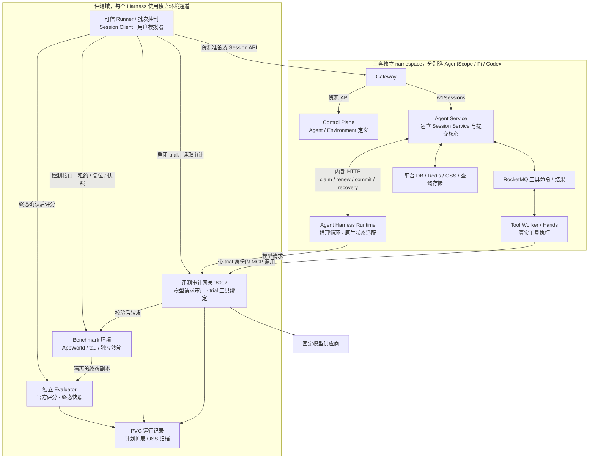
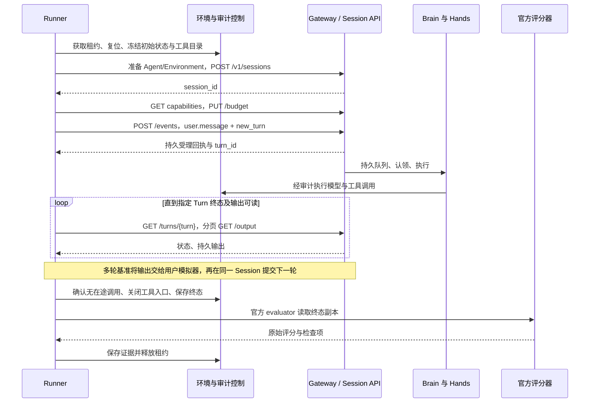

# Managed Agents Harness 评测实施方案

日期：2026-11-02。[English](harness-selection-evaluation-implementation.en.md) · 第一篇：[评测目标与选型调研](harness-selection-evaluation-plan.md)

本篇重点回答：**如何直接使用 Managed Agents 的 ACS 部署架构和公开 Session API，完成第一篇第一部分的 Harness 效果与能力评测。** 三种 Harness 均在现有服务链路内执行；评测端负责准备任务、控制变量、观察过程和评分，推理与工具决策由被测 Harness 完成。

实施工作分为能力评测和平台验证两条线，分别产出报告。共同部署与 API 是实验环境，不作为 Harness 能力得分。平台最小检查先保证实验可信；故障、恢复、权限和容量专项独立运行，不注入正常能力批次，也不混入能力总分。

**建议阅读顺序：第 1 节确认边界，第 4 节设计能力实验，第 5–7 节执行、适配与评分，第 9 节安排实施；第 2–3 节提供共享环境准备，第 8 节承接平台专项。** 已有 AppWorld/原版 τ 流程与待开发能力明确区分。本文命令为操作方案，本次文档修订不代表已部署或启动测试。

## 1 实施范围、结论边界与已有基础

### 1.1 两部分目标在本方案中的落点

| 目标 | 在现有环境中的实施方式 | 独立产出 |
| --- | --- | --- |
| Harness 效果与能力，主线 | 通过同一公开 Session API，把同题同条件交给各 Harness；采集模型/工具审计与终态，使用官方 grader，再做配对分析 | 能力维度、机制增益、难度边界和任务消耗，见第 4–7 节 |
| Managed Agents 平台要求 | 先检查协议、配置和计量；另用确定性夹具做故障、隔离、恢复、取消及容量实验 | 平台准入矩阵、缺陷和运营边界，见第 3.3、8 节 |

所有能力赛道 A/B/C 均经过 `Runner → Gateway → Session API → Agent Harness Runtime → Tool Worker → 任务环境`。Harbor/Inspect 通过远程 Session 适配接入，不在 Runner 内启动另一套 Agent loop，也不直接调用裸 Harness SDK 或 CLI 来生成正式成绩。

因此结论是“该版本 Harness 在 Managed Agents 公共契约下的表现”。公共工具面可能限制某些原生能力：未接入的能力标为不支持/未评测；工具格式或适配缺陷单独归因。不能由这种结果直接推断裸内核的全部能力。

### 1.2 已有证据与当前限制

以下为 2026-11-01 验收与 11 月 2 日仓库记录的状态快照，依据[杭州一致性验收](../tests/general-agent-eval/reports/hangzhou-consistency-20261101.md)、[正式业务批次](../tests/general-agent-eval/reports/formal-business-20261101-182203/README.md)及[Runner 说明](../tests/general-agent-eval/README_zh.md)。

| 项目 | 已有证据 | 实施处理 |
| --- | --- | --- |
| 三套平台 | `agencore-ma`、`agencore-ma-pi`、`agencore-ma-codex`；每套五组件、各 2 副本，共 30 个主容器 | 直接复用，冻结公共组件 digest，分别记录 Brain digest |
| 工程验收 | 三套共 21 项通过，包括工具信封、预算、429、断流、写工具期间重启及长调用续租 | 作为已完成起点；新发布后重跑，不能代替完整故障矩阵 |
| 官方工具环境 | AppWorld HTTP MCP/content_only 与原版 τ-bench 已接入；官方评分、环境租约、审计、断点续批已实现 | 扩展现有 Runner，不重新建设一套并行控制器 |
| 正式任务 | 原版 τ retail 20 题 × 3 次 × 3 Harness 已完成；AppWorld 在 36 次串行尝试后将剩余 144 次分为三路，每路 48 次；批次尚未完成 | 保留原批次；补齐后形成业务基线，不把未运行项算成任务失败 |
| 模型及工具契约 | qwen3.8-max / OpenAI Responses；短上下文、MCP-only；三套共同预算 | 用作控制变量赛道，固定实际请求和模型返回信息 |
| 开放问题 | AppWorld 中 Codex 多次触发 `usage_unavailable`；供应商完整响应与平台用量入账不一致，根因未确定 | 单列平台/适配用量问题；原失败保留，修复后另建批次，不归因为任务推理错误 |

τ 阶段端到端成功数为 AgentScope **48/60**、Pi **50/60**、Codex **49/60**；Pi/Codex 各有一次供应商失败未获官方评分。20 道固定题及重复尝试不足以证明排名。AppWorld 当前前 20 个排序 ID 还包含同模板变体，不能将其视为 20 个独立任务类型。

当前 Codex 是独立 Rust Brain，直接链接固定版本内核，不使用 Node/app-server。三类 Brain 均通过内部 Session Service 访问权威平台状态，Agent Service 与 Session Service 仍在同一进程。更早的上海资源规划及进程组合不作为当前部署依据。

## 2 测试架构与组件

### 2.1 执行与评分链路



三个边界必须保持：

1. **公开 Session API 与内部 Session Service 分开。** Runner 通过 Gateway 调用 `/v1/sessions`；内部 `/internal/session-service/v0` 仅供 Brain 使用。Control Plane 管资源定义，不承担 Agent 推理或逐步执行。
2. **平台 Gateway 与评测审计网关分开。** 前者承载产品 API；后者检查实际模型请求、MCP 工具目录和 trial 绑定，不实现 Agent loop、不替 Harness 规划，也不把标准答案注入请求。
3. **业务环境与平台持久状态分开。** AppWorld/τ/MCPMark 的数据库归 benchmark；平台 Session/Turn/工具账本归 Agent Service/Hands。Brain 通过 Session Service 保存原生状态，不为评测重新获得平台 DB/MQ/OSS 凭据。

能力实验中，Runner 只能提供基准允许的任务输入、官方用户模拟及环境控制；不能根据中间失败补提示、选下一步工具或代替 Harness 修复答案。普通工具返回全部沿服务端工具路径进入 Harness，评分器的答案、测试和判据位于隔离的控制侧。

Java 当前可由 Service 发任务提示后再 claim；Pi/Codex 使用其现有发现与认领路径。三者共同遵守执行租约和提交契约，不假定通知方式完全相同。工具命令和结果继续经过可靠交接；Brain 退出不意味着工具执行已经停止。

### 2.2 测试相关组件清单

| 组件 | 当前入口与位置 | 职责与数据边界 |
| --- | --- | --- |
| 批次编排与 Runner | `run_tau.py`、`run_appworld.py`；各环境的 runner 容器 | 冻结计划、创建 Session、驱动用户交互、收集轨迹和调用评分器；不实现被测 Agent loop |
| Session 客户端 | `session_client.py` | 创建/发送/查询/取消、幂等身份和分页输出 |
| 环境与租约控制 | `tau_environment.py`、`environment_leases.py`，控制端口 8001 | 复位、唯一 owner、拒绝旧 trial、保留未知结果 |
| 评测审计网关 | `evaluation_gateway.py`，8002 | 转发模型与 MCP，校验实际 schema/policy，记录用量和请求；每通道独立 SQLite |
| τ 业务工具 | `tau_environment.py`，MCP 8000 | 原版官方业务状态、工具操作与 reward |
| AppWorld 环境 | `appworld_api.py`，API 9000；官方 HTTP MCP 10000 | 业务数据库、工具访问、受控制凭据保护的复位；控制接口不对 Agent 暴露 |
| 用户模拟器 | `run_tau.py` 中的官方模拟器集成 | 模拟用户意图与下一轮对话；其私有指令和凭据不传给 Agent |
| 评分进程 | `appworld_process.py` / τ 官方环境 | 使用官方评分；AppWorld 模拟时钟隔离在子进程内，不污染 Runner 真实计时 |
| 合成故障夹具 | `acceptance_tools.py`，MCP 8003；`acceptance.py` | 工具格式、预算、429、断流、重启及续租验收；与官方数据集成绩分开 |
| 汇总与资源观测 | `report.py`、`metrics.py` | 逐题/汇总报告、用量覆盖、资源采样；不反向修改官方 reward |
| 生命周期管理 | `supervise_environment.py`、`deploy_environment.py` | 启停环境进程，部署 ConfigMap/Secret/Deployment/Service；不创建底层 ACS 集群或 PVC |
| 续批与通道调度 | `continue_batch.py`、`parallel_batch.py` | 校验计划及已尝试前缀，只接续未尝试项；不代替终态与环境安全检查 |
| 新基准组件，待接入 | Harbor 远程 Session 适配器、沙箱执行池、新 grader 包装 | 支持 Terminal/SWE/Skills 等；本表不表示这些新组件已经部署 |
| 能力实验与离线分析，待补 | 显式任务清单、配对条件校验、难度标签、机制开关核验、任务组统计 | 将第 4 节实验设计与第 7 节能力报告落地；与当前基础报告能力分开 |

上述文件均位于 [general-agent-eval](../tests/general-agent-eval/README_zh.md)。只有 8002 审计网关作为该环境的集群 Service 暴露；其余端口用于同 Pod 的工具和控制链路。Runner 挂载平台/模拟用户私有配置；环境容器只取得控制/工具密钥，模型供应商凭据经既定上游转发且不落盘。

### 2.3 资源与并发部署

| 资源 | 已记录配置 | 实施要求 |
| --- | --- | --- |
| 每套 Agent Service / Brain / Tool Worker | 各 2 副本，每副本 4 CPU / 8 GiB | 固定资源、compute-class、QoS、并发及公共组件版本 |
| 每套 Gateway / Control Plane | 各 2 副本，每副本 2 CPU / 4 GiB | 三套共享组件镜像保持一致 |
| AgentScope 评测通道 | namespace `managed-agents-eval`，environment/runner 各 2 CPU / 4 GiB；40 GiB PVC | 复用原环境，每路内部串行 |
| Pi 评测通道 | namespace `agencore-ma-pi`，同等评测 Pod 和独立 40 GiB PVC | 独立 API/MCP、业务状态、审计、租约和网关地址 |
| Codex 评测通道 | namespace `agencore-ma-codex`，同等评测 Pod 和独立 40 GiB PVC | 与 Pi 相同的独立通道约束 |
| 共享基础设施 | DB、Redis、MQ、对象/查询存储按既有规则隔离复用 | 不冲突的库/表/Topic/消费组和 scope；namespace 不等于独立云账号/IAM 边界 |

平台主容器 requests 合计 **96 CPU / 192 GiB**；单评测环境时合计 **100 CPU / 200 GiB**，11 月 2 日记录的三通道配置合计 **108 CPU / 216 GiB**，评测 PVC 共 **120 GiB**。该汇总不含初始化/系统容器、新沙箱和云托管数据库，也不等于实际使用率。资源与切换证据见[并行部署记录](../tests/general-agent-eval/reports/formal-business-20261101-182203/README.md)。

当前三路 AppWorld 每路并发 1，整体并发 3。新基准先单路串行验收，再扩独立槽位；不能复制 Runner 共享一个可写 AppWorld API。现有串行前缀与并行后缀分别留存阶段标识，共享供应商负载已变化，整个历史批次不能用于受控耗时排名。容量测试另外对齐 Tool Worker DB 连接池和在途容量。

Runner 当前在 Deployment 的容器中执行，不是每题自动生成一个 Job；本地编排控制器仍负责部分预检、分片启动和恢复。后续可将控制器迁为集群 Job/服务，但需要独立验证接续、控制凭据和唯一调度权。运行记录先写各通道 PVC，OSS 归档仍为待补能力。

### 2.4 隔离与环境准入

- 当前 environment/runner 同 Pod 且共享 PVC，适用于可信官方工具环境，不能直接承载 Agent 可执行的任意 Shell。Terminal-Bench、SWE、Skills 等新增任务必须放入独立沙箱 Pod/VM，不挂载 Runner 凭据、答案、verifier、控制 socket 或整块评测 PVC。
- Runner/评分器持有控制权限；Agent 只获得必要工具能力。工具端根据已认证的 trial 租约绑定环境，拒绝关闭 case、旧 owner 和迟到请求，不仅依赖模型传入的 task ID。
- 搜索/研究使用固定出口和工具服务；SWE 按选定协议限制网络，依赖提前准备，patch 在干净镜像重新评分。无法在 ACS 普通容器满足的 Docker/特权/虚拟化需求先做兼容性验证，再使用同 VPC 专用执行池；不默认采用 Docker-in-Docker。
- 浏览器并发不仅隔离 browser context，还要隔离可写站点状态。桌面每 trial 恢复 VM 快照。外部 SaaS 只使用专门测试账户和测试数据，优先选可自托管子集。
- 租约过期或客户端超时后，环境先隔离并确认在途执行；结果未知的非幂等动作不能自动重放。TTL 清理不能覆盖“仍有未知副作用”的隔离状态。

## 3 复用部署与准备评测环境

已有三套 Managed Agents 部署是本方案的固定执行基础。优先核验并复用；以下部署命令用于补建评测环境或经计划切换 profile。每个实验条件使用对应的版本化 Agent 定义和新 Session，Session metadata 仅关联证据，不能充当 Harness/模型/工具配置开关。

### 3.1 准备输入与权限

| 输入 | 内容及要求 |
| --- | --- |
| ACS 与平台基础 | 已有 namespace、五组件平台、DB/MQ/Redis/对象存储及迁移；复用版本化 Helm values。新环境先按[平台部署文档](../deploy/README.md)完成基础安装 |
| 发布清单 | 三个 Brain 与公共组件的完整镜像 digest；`release.json` 键与目标 namespace/组件匹配 |
| 模型与评测 profile | [qwen38-eval.json](../deploy/profiles/qwen38-eval.json)、[短上下文](../tests/general-agent-eval/evaluation-profile.json)或[原生上下文](../tests/general-agent-eval/evaluation-native-profile.json)配置 |
| 每通道私有配置 | `targets` 的 name/namespace/Session `cluster_url`/认证 headers；模拟用户地址及密钥；控制与工具密钥；benchmark commit；控制和审计地址 |
| 存储与依赖 | 每通道独立 `eval-state-v2` PVC；固定 digest 的 Linux 镜像；锁定 Python 环境、官方源码和数据 |
| Kubernetes 权限 | 部署操作者拥有对应 namespace 的资源管理权限；预检需要读取 Deployment/Pod，重启验收另需限定的 Pod 操作权限。普通 Runner 不自动挂载 Kubernetes ServiceAccount token |

私有配置置于 Git 外并限制文件权限，不写入源码、结果清单或共享 PVC。集群内 Runner 的 `control_url`、`evaluation_gateway_url` 使用同 Pod localhost；`evaluation_gateway_cluster_base` 使用该通道的 `http://eval-gateway.<namespace>.svc.cluster.local:8002`。Session `cluster_url` 指向产品 Gateway，不是 Kubernetes API Server。

三路配置每份只含对应 Harness 的 target，且各自审计网关地址不同。单环境串行比较可以含三个 target；两种配置不能混用。Agent 的 MCP URL 始终可从服务端解析，不使用操作者本机 localhost。

### 3.2 准备环境数据并部署服务

按以下顺序处理**空闲的新环境或计划维护的环境**：

1. 建立 namespace、PVC、镜像拉取条件和网络；验证平台 Gateway、模型供应商和数据下载地址连通。
2. 将锁定的依赖、官方数据准备到该 PVC。已有环境保留运行态；新盘可在挂载它的 Linux 初始化容器提供 `/eval/uv` 和同版评测源码/lock 文件，执行 `bootstrap_environment.py --root /eval`。
3. 也可使用 `deploy_environment.py --seed-url ... --seed-sha256 ...` 的已实现初始化器导入可信依赖归档；必须是空盘，归档不包含凭据、租约/审计数据库或历史结果，不能复制一套活动环境作为另一通道状态。
4. 通过 `deploy_environment.py` 创建环境服务和凭据投影，等待服务 Ready，并核对源码、依赖及数据哈希。
5. 应用各通道对应的模型/评测配置，导出后续 Helm 升级使用的 overlay，再进行预检和工程验收。

以下控制端示例从仓库根目录进入测试目录。路径、镜像 digest 和私有配置必须替换为实际值。Pi/Codex 分别使用其 namespace 与配置重复部署；脚本不会为它们自动创建 PVC。

```bash
cd managed-agents/tests/general-agent-eval

python deploy_environment.py --kubeconfig /private/kubeconfig \
  --namespace managed-agents-eval --config /private/agentscope-runner.json \
  --image '<registry>/evaluation-runtime@sha256:<verified-digest>' \
  --evaluation-profile evaluation-profile.json

python apply_model_profile.py --kubeconfig /private/kubeconfig \
  --profile ../../deploy/profiles/qwen38-eval.json \
  --evaluation-profile evaluation-profile.json \
  --config /private/agentscope-runner.json --images /private/release.json \
  --namespaces agencore-ma --overlay-dir /results/helm-values
```

`apply_model_profile.py` 会修改现有测试部署，并从现有模型 Secret 配置所需凭据投影；它不是 dry run，也不负责全新安装平台。三路隔离时逐路调用，不能拿一个通道的网关配置覆盖三套部署。配置变更后使用新 Agent/Session，并保留已有基础设施和 Secret 引用。

### 3.3 能力实验前的预检与独立工程验收

控制端配置应使用可访问的控制/审计地址；在本地执行时通过端口转发访问同一环境，Agent 使用的集群地址保持不变。

先建立批次输出目录；预检输出文件必须尚不存在，脚本会以排他方式创建它。

```bash
mkdir -p /results/new-run
python preflight.py --kubeconfig /private/kubeconfig \
  --config /private/agentscope-runner.json \
  --model-profile ../../deploy/profiles/qwen38-eval.json \
  --evaluation-profile evaluation-profile.json \
  --release-manifest /private/release.json --output /results/new-run/preflight.json

python acceptance.py --kubeconfig /private/kubeconfig \
  --config /private/agentscope-runner.json \
  --model-profile ../../deploy/profiles/qwen38-eval.json \
  --profile evaluation-profile.json --output /results/new-run/acceptance
```

预检验证镜像、实际资源与副本、模型目录、mock 开关、审计源码/策略哈希及就绪状态。每个批次引用最近一小时内通过且与本批配置一致的结果；配置或发布变化后重新预检。

首次使用或发布/profile 变化后，先完成预检及对应工程验收；之后在同一冻结配置内执行能力批次，不在每道题之间重复故障注入。验收使用真实 Session 和合成夹具，包含重启及故障注入，只在该候选的测试部署空闲时运行。既有七项覆盖普通文本、工具结果、多轮预算、429、断流、写工具期间重启、75 秒模型等待期间续租；更完整的故障矩阵见第 8 节。通过后才启动官方任务批次。

## 4 Harness 能力实验设计与条件冻结

### 4.1 将能力维度落实为 Session 实验

每个实验先写出“要比较什么机制、哪些条件相同、用什么结果判断”。一题对应一个新 Session；多轮题在同一 Session 内继续。题目环境、工具状态和评分器独立于 Session 生命周期准备。

| 能力维度 | 如何在本环境中构造实验 | 观察与判定 |
| --- | --- | --- |
| 规划与任务分解 | AppWorld/τ/MCPMark 同题、同初态、同工具目录；按依赖步骤和工具数量分层 | 官方终态、工具调用顺序、无效/重复动作及完成消耗；动作多不自动等于规划差 |
| 工具选择与调用 | 将官方工具通过 Hands/MCP 暴露；三候选实际发给模型的 schema 与结果信封校验等价 | 参数/工具选择错误、错误后是否修正、最终状态；区分 Harness 选择错误与适配丢字段 |
| 上下文与记忆利用 | 长任务/多轮输入在 Session 内逐步到达；长历史检索任务走固定资料与检索工具 | 事实保留、更新、检索和最终答案；记录压缩前后可观察长度、辅助调用及遗漏事实 |
| 反馈纠错 | Terminal/SWE 的同一初始工作区提供相同失败测试或命令反馈 | 是否定位问题、调整动作、通过 verifier；Runner 不提供修复建议 |
| Skills 与协作 | C 赛道中对同题固定模型、工具与总预算，做有/无 Skills 或单/多 Agent 配对 | 官方结果增益、调用增量、子任务结果利用；机制必须确实启用 |
| 指令与约束遵循 | AgentDojo 干净/注入成对，攻击只进入指定工具观察位置；固定任务规则 | 官方任务效用、攻击成功率与规则违规；不把注入放到系统消息 |
| 结果质量与完成效率 | GAIA/研究/分析/产物任务提供同一材料与工具；答案或产物送官方 grader | 原始任务分、可用产物、按难度的效果和预算曲线 |

能力标签和难度标签在看结果前确定；同题可映射多个能力，但不因标签多而重复放大总分。诊断轨迹使用可观察的输入、模型请求元数据、工具动作、输出和评分证据，不要求导出隐藏思维链，也不以模型自述代替机制证据。

### 4.2 A/B/C 配置与真正的机制对照

| 实验配置 | 当前可用性 | 实施方式与结论边界 |
| --- | --- | --- |
| A 共同工具/短上下文 | 已有 `evaluation-profile.json` | 三候选同模型、MCP-only、文本 JSON 结果、输入门槛与预算；比较该共同工具面内的基础效果 |
| B 原生上下文 | 已有 `evaluation-native-profile.json` | 仍为 MCP-only，允许各自上下文压缩/裁剪及辅助请求；比较原生上下文配置表现 |
| C 原生能力组合 | 待新增 profile、能力接入与审计规则 | 显式列出 Skills、Shell/文件、子 Agent 等已启用机制；没有实际支持的单元格标 N/A |
| 单机制有/无对照 | 待补独立配置与核验 | 在同一 Harness 内只切换待测机制，其他实验条件一致；无可控开关时只能报告配置比较 |

**现有 A 与 B 不是只改一个变量。** A 的 `maxContextBytes=600000`，B 为 `null`，且 B 允许原生辅助请求。直接比较两者只能说明整套配置差异，不能直接归因于“压缩带来多少净收益”。

要测上下文机制净收益，需在新的成对配置中固定相同外部输入门槛、模型/工具/总预算、输入历史和工具结果上限，仅改变上下文策略；两侧都允许机制所需请求形态，所有实际辅助调用计入同一总预算。确认开关改变了实际请求行为后再计入对照。超出共同输入范围的长任务另列能力边界实验；触发 A 门槛的尝试保留，但不冒充两侧均可处理样本的配对质量分。

Skills 对照使用同一版本 Skill 内容、同一任务初态和基础工具；协作对照固定总预算，子 Agent 调用不得成为额外免费额度。C 若改变工具集合或权限，记录完整差异，结论限定为配置组合效果。改变全局 profile 前排空该测试部署；并行对照须使用独立冻结部署，不能在活动 Session 中改配置。

### 4.3 固定条件与实际请求核验

| 变量 | 冻结位置 | 如何确认真正相同 |
| --- | --- | --- |
| Harness 与共享服务 | 发布清单、镜像 digest、源码/制品哈希 | 公共组件同版本，记录每种 Brain 版本；存在未提交改动时不能只记录 Git HEAD |
| 模型行为 | 模型 profile 与审计网关 | 核对实际 model、temperature、top_p、reasoning、输出上限、parallel_tool_calls；记录返回模型、时间和缓存 |
| 任务与指令 | benchmark 版本、task manifest、Agent 定义 | 任务文本/附件、完整规则和终止条件一致；原生协议提示保留并归档 |
| 工具与观察 | MCP 目录、schema、工具结果信封、沙箱版本 | 审计 SDK 格式化后的请求；只允许可逆名称/地址映射，不静默截断或增加工具 |
| 初始状态与材料 | 每 trial 环境复位记录和文件/数据库指纹 | 同题同条件的候选获得相同初态；凭据、控制接口和 grader 不进入 Agent 可见区域 |
| 执行预算 | Session budget、工具超时与 profile | 核对服务端接受值、模型/工具/辅助调用总消耗；多轮共用预算 |
| 外部用户与裁判 | simulator/judge 独立配置 | 固定版本、提示和参数，分别记录调用；私有用户目标仅交模拟器，答案仅交 grader |
| 调度条件 | 冻结计划、通道、并发与时间区块 | 正常能力批次不同时做故障或容量测试；保留排队、供应商错误和执行阶段 |

当前模型基线为 qwen3.8-max；供应商别名不能固定权重，记录返回名称也不能消除版本漂移。采用任务配对、轮换候选顺序和临近时间区块降低偏差；关键结论在所有候选兼容的第二模型上复核。当前三路并行各候选内部串行，保留阶段与供应商负载证据；历史串行/并行拼接不能产生受控耗时排名。

同题 Agent 定义比较时，只归一化已知不同的 trial URL、环境 ID 等身份字段；原始定义、归一化规则及独立身份绑定证据均保留。真实工具面、指令或初态不等价时暂停该比较，修正配置后另建批次，不能靠报告中的标签宣称公平。

### 4.4 任务清单、配对单元与证据关联

新增的实验清单至少包含：`experiment_id / lane / condition_id / benchmark / task_id / template_id / capability_tags / difficulty / target / repeat / model_profile_hash / tool_contract_hash / grader_version`，以及初态、排序、预算和对照机制。上述为**待实现的统一清单契约**，不是现有脚本已经接受的 CLI 参数。

跨 Harness 配对键为“benchmark、task、repeat、模型配置、实验条件”；机制有/无比较在同一 Harness 内按同题同 repeat 配对。若工具集合或初态不同，不能靠相同 task ID 配成同一对照。统计独立单位为 task/template，不把 Turn 或工具调用当成独立题。

当前 `manifest.json`、逐题 JSON、`results.jsonl` 和审计已记录部分身份与哈希。新分析层通过 `trial → Session → Turn → 模型/工具调用 → 评分记录` 关联；新增条件、能力标签、难度、归因及评分修订写入派生索引，不覆盖原始结果。

任务协议另设两个独立字段：协议兼容性 `official-compatible/adapted` 和样本范围 `full/subset`。固定子集可以同时是官方协议兼容，不能把这两个维度互相替代；对外引用同时披露两者。

### 4.5 抽样、排程与运行纪律

1. 每集先 5 题冒烟，确认输入、工具、Session 输出与官方评分闭环；再用 dev/pilot 调整统一预算，封存未用于调参的决策集。
2. 按问题难度、执行链长度、工具数量、上下文长度及模板分层抽样。当前 AppWorld 按排序 ID 截取，显式 task manifest 仍需开发；前 20 题不能表述为随机或 20 个独立模板。
3. 各 Harness 获得相同调参次数/工程时间上限；正式集不反复调提示、选择随机种子或择优重跑。温度为零也不能保证模型完全确定。
4. 每 trial 新 Session、干净工作区/任务状态；多轮同题延续原 Session。跨会话记忆实验使用独立受控组，不复用上一题留下的记忆。
5. 单路采用 task → repeat → 轮换目标顺序；三路保留各自顺序、并发阶段和分派清单。需要精确随机区块/交叉条件调度时补编排器，不把现有并行程序描述为已支持任意实验矩阵。
6. 仅在确认终态和环境可复用后继续未尝试项。修复版本、改预算、换工具或改 profile 均新建批次；重新验证时运行完整匹配区块，原失败继续保留。

### 4.6 数量与预算估算

现有两集基线为 `2 × 20 题 × 3 Harness × 3 repeats = 360 trials`。新增探索批次可按 GAIA 50 题、Terminal-Bench 40 题、MCPMark 30 题规划，三候选、每题三次合计 **1080 trials**；AgentDojo 50 个场景的干净/注入配对为 `50 × 2 × 3 × 3 = 900 trials`。合计 **1980 trials**，与既有批次分开。数字仅针对一个指定配置，新增 B/C、预算档或机制开关按实验单元额外计数，不默认全部笛卡尔积开跑。

现有 τ/AppWorld 基线为模型请求 180 秒、输出上限 8192 token、temperature 0.2、串行工具；每 case 900 秒、60 次模型请求、8M 总 token、2 次异常恢复，τ 另有 30 动作限制，AppWorld 为 60 次工具调用。A 的 600000 字节输入门槛与 65536 字节工具结果上限不是 token 数。当前 case 截止时间从 Runner 的 trial 起点计算，包含准备开销；保持相同规则，并分项记录准备、排队与执行时间。

新类别先测实际 token、耗时、复位和评分成本，再冻结所有候选共同预算。5 题只用于粗估，不能据此可靠估计 p95 或决定最终样本量。固定预算质量比较与多档预算曲线分别成批；大幅改变模型/工具预算时重新核对原生迭代上限不会提前截断。

`预计费用 = 模型输入/缓存/输出费用 + 辅助/子 Agent + simulator + judge`；`预计墙钟时长 ≈ Σ(执行 + 复位 + 评分时间) / 有效并发`，另计配额和隔离等待。模型单价未核实时只估用量，不生成金额。有效并发由环境槽、供应商配额与服务容量共同决定。

## 5 发起测试与 Session API 流程

依据[公开协议](../../docs/v2/en/service/claude-session-api.md)、[SessionClient](../tests/general-agent-eval/session_client.py)和[预算实现](../tests/general-agent-eval/evaluation.py)。以下是评测契约，新增 benchmark 适配器仍需实现。

### 5.1 单次 trial 时序



1. **准备。** 环境控制器取得唯一 owner，恢复初始状态并计算哈希。用已有 `/api/v1/agents`、`/api/environments` 资源接口准备定义和环境引用，将该 trial MCP URL 放入服务端 Agent 定义；不能靠 Session metadata 修改工具配置。
2. **创建。** 客户端先持久保存请求体与 `Idempotency-Key`，再 `POST /v1/sessions`。传入固定 Agent 版本、`environment_id` 和字符串 metadata；获取 capabilities 并核对所需扩展。
3. **预算。** 使用 `Managed-Agents-Extensions: turn-inputs-v1,session-budgets-v1`，在第一次消息之前 `PUT /v1/sessions/{session}/budget`。模型、工具、恢复次数及截止时间共同生效，多轮复用同一 case 总预算。
4. **执行。** `POST /v1/sessions/{session}/events` 提交显式 `new_turn`。从 `data[0].managed_agents.receipt.id` 取得 Turn ID；HTTP 200 是受理，不是执行完成。请求结果不确定时保留原键和原体查证/重试，不能换键创建替代 Turn。
5. **读取。** 查询指定 Turn，终态后分页读取 `/turns/{turn}/output`；检查 `output_available`，处理投影暂不可用的 503。SSE 只用于预览与延迟观测，断流不等于任务完成，也不自动取消。
6. **交互。** τ 使用官方用户模拟器推动下一轮；τ² 还需桥接用户侧工具/状态变更，不能只把旧 τ 的 prompt 换掉。所有 simulator 用量单列。
7. **结束。** 以官方任务终止条件判断整道题结束。确认 Turn 终态、工具请求结清及环境静止后，关闭入口、快照、评分、保存证据、释放环境；一次 Turn 完成不等于整道多轮任务完成。
8. **失败。** 超时发送 `user.interrupt`，指定原 turn_id；等待取消实际应用及工具收敛。无法确认时保留租约并停止槽位复用，允许继续其他独立槽，不自动重放写操作。

关键消息示例：

```json
{
  "events": [{
    "type": "user.message",
    "content": [{"type": "text", "text": "<官方任务或模拟用户的下一条消息>"}],
    "managed_agents": {"intent": "new_turn"}
  }]
}
```

```json
{
  "events": [{
    "type": "user.interrupt",
    "managed_agents": {"intent": "cancel", "turn_id": "<原 Turn ID>"}
  }]
}
```

当前公共 API 不接受客户端工具结果回填；工具必须接入服务端执行路径。不要设计 `POST /turns/{id}/inputs`、任意 Session 覆盖配置、公开 Session 删除或未验收文件上传流程。附件由环境准备器预装到 trial 工作区；新文件能力先核对 capabilities。SSE 不支持历史重放及 `Last-Event-ID`；重连采用新流缓冲、历史读取与 Event ID 去重。

### 5.2 将任务变成 Session 输入与评分材料

| 基准形态 | 提交给 Session 的内容 | 留在控制侧的内容与结束方式 |
| --- | --- | --- |
| 单目标工具任务，如 AppWorld/MCPMark | 官方任务描述、允许的账户/资料说明；工具在 Agent 定义中绑定到本 trial | 初态、租约、参考答案与评分逻辑；官方完成条件满足且执行静止后评分 |
| 交互任务，如 τ | 官方用户模拟器给出的当前用户消息；多轮复用 Session | 私有用户目标由模拟器持有；Runner 只转交输出、按官方规则决定下一轮和终止 |
| 文件/终端/编码任务 | 题目、工作区位置及允许的工具说明 | 资料/仓库预装到隔离工作区；通过可信导出收集文件/patch，grader 在独立环境运行 |
| 长历史/记忆 | 分阶段真实用户输入，或协议声明的固定历史检索工具 | 公共 API 不支持任意注入 assistant 历史；检索适配与真实多轮上下文实验分别报告 |
| 注入任务 | 原始用户目标保持不变 | 攻击器只修改基准指定的工具观察；干净/攻击两侧各用新 Session 和相同初态 |

创建 Session 前先固定 Agent 的模型、指令、工具及 Environment 引用。当前 Runner 为 trial 创建独立 Agent，并保存定义哈希；它并未提供通用的“按 condition_id 自动部署能力配置”功能。新增实验编排器需将条件解析为已验收定义/profile，再创建 Session，而不是向 metadata 写开关。

Session 返回的最终文本可用于答案类评分，但文件、patch 和业务状态需通过任务环境的可信导出取得。不能把临时容器路径当成持久产物，也不能让 Runner 替 Harness 补写产物。中间工具观察和用户模拟器状态不泄露到参考答案字段。

### 5.3 在集群 Runner 发起批次

实际任务使用各通道 runner 容器中的 Python 环境，启动入口是 `run_tau.py` 和 `run_appworld.py`。控制端将本通道预检 JSON 放入容器可读路径，例如 `/eval/results/new-run/preflight.json`，并核对 profile 哈希；模型 profile 可从同版部署输入或源码清单提供。

先每集执行 5 题冒烟。下面两条命令在该通道的 **runner 容器内** 顺序执行，使用 Secret 挂载的配置；该配置的 targets 决定运行哪一个 Harness。示例要求只读模型 profile 已放在 `/eval/config/qwen38-eval.json`，路径不是部署脚本自动生成的承诺。

```bash
/eval/venvs/tau-bench/bin/python /eval/code/run_tau.py \
  --config /run/evaluation/config.json --model-profile /eval/config/qwen38-eval.json \
  --evaluation-profile /eval/code/active-evaluation-profile.json \
  --preflight /eval/results/new-run/preflight.json \
  --output /eval/results/new-run/tau-smoke --tasks 0 1 2 3 4

/eval/venvs/appworld/bin/python /eval/code/run_appworld.py \
  --config /run/evaluation/config.json --model-profile /eval/config/qwen38-eval.json \
  --evaluation-profile /eval/code/active-evaluation-profile.json \
  --preflight /eval/results/new-run/preflight.json --root /eval/appworld-root \
  --output /eval/results/new-run/appworld-smoke --count 5
```

冒烟输出目录必须不存在。正式批次使用新目录，加 `--formal`，采用 profile 冻结的 3 次重复；需要覆盖 20 道原版 τ 时显式提供 0–19，AppWorld 用 `--count 20`。当前 AppWorld 按排序 ID 选题，分层抽样需要补显式 task manifest，不能将前 20 题描述为随机样本。

操作者可经 `kubectl exec` 在 runner 中发起命令，但长期批次应由有退出记录、冻结计划和重复启动保护的控制器托管；不要把交互终端退出当作批次已经安全结束。现有正式批次使用冻结源码及续批/并行控制程序，本节新批次命令不用于重新启动该批次。

### 5.4 采样观测并导出结果

批次前后在控制端运行 `metrics.py`；批次结束后在能读取结果目录的环境运行 `report.py`。

```bash
python metrics.py --kubeconfig /private/kubeconfig --config /private/agentscope-runner.json \
  --output /results/new-run/metrics-before.json

python metrics.py --kubeconfig /private/kubeconfig --config /private/agentscope-runner.json \
  --before /results/new-run/metrics-before.json --output /results/new-run/metrics-after.json
```

```bash
/eval/venvs/tau-bench/bin/python /eval/code/report.py /eval/results/new-run/tau-smoke
/eval/venvs/appworld/bin/python /eval/code/report.py /eval/results/new-run/appworld-smoke
```

两个 metrics 命令分别位于执行窗口前后，不应在没有运行任务的情况下连续调用并当作负载观测。三路各自生成报告；现有正式批次可使用专用 `merge_parallel_results.py` 验证完整 360 项归档及阶段来源，它不是通用多基准/多条件聚合器。需要跨通道/分片汇总时，先校验唯一的 `target/task/repeat` 计划项、原始顺序与 provenance，再生成独立派生汇总，不能简单拼接不同配置或择优选取重复结果。

### 5.5 从现有 A 批次推进到 B/C 对照

1. 先用第 5.3 节已实现的入口完成 A 冒烟和冻结基线；保存实际请求、初态与评分证据。
2. B 作为独立配置：排空测试部署，按第 3 节将部署与审计 profile 一起切换为 `evaluation-native-profile.json`，重新预检；Runner 使用对应哈希的新 profile、新 Session 和新输出目录。仅更换 Runner 参数不会改变已部署的 Brain/网关配置。
3. 使用同题同 repeat 运行 B，并先按“整配置对照”分析。单独验证上下文策略收益时，按第 4.2 节开发匹配配置后再运行。
4. C 先完成相关工具、Skills/子 Agent 支持及能力审计，再复用相同 Session 生命周期；当前没有可直接执行的通用 C 启动命令。
5. 每次条件切换检查来源清单，避免把不同模式、模型、并发阶段或任务集合混入同一能力差值。

## 6 围绕能力实验扩展适配器

### 6.1 公共适配契约

在现有测试目录中抽取统一接口，以下方法名为实施建议，不表示已经存在：

| 接口 | 输出和约束 |
| --- | --- |
| `prepare(task, trial)` | 已恢复环境、初始指纹、工具契约、任务输入及官方终止规则；无答案泄露 |
| `build_agent(target, prepared)` | 等价任务指令与约束、固定模型、获准工具、trial 绑定；保留必要原生协议差异 |
| `next_user(observation)` | 仅交互任务使用官方模拟用户；不替被测 Agent 决策 |
| `quiesce(trial)` | 精确 Session/Turn/工具状态及环境静止证据；未知结果保持隔离 |
| `grade(snapshot, transcript)` | 官方 grader 原始结果、版本和评分覆盖；评分失败与任务零分分开 |
| `archive_and_release(trial)` | 哈希清单、结果和清理回执；安全确认后才复用槽位 |

每个适配器需通过官方参考解/已知成功轨迹与已知失败结果的评分检查，以及 reset 指纹一致、迟到调用拒绝、答案不可见检查。适配器检查不能依赖某个被测 Harness 恰好成功。

若仅评分器失败，可对已经保存的同一终态补评分，并关联独立评分修订记录；保留最初失败，不重放模型和业务工具，也不把补评分记成一次新的 Agent 成功尝试。

LongMemEval 尤其需要定义历史导入和检索协议：公共 Session API 不提供任意 assistant 历史导入，可通过受控 memory/检索工具准备历史，但这属于指定的适配赛道；索引构建及记忆写入成本单列。SkillsBench 需要真实加载机制，MultiAgentBench 需要真实委派链路，不能由 Runner 拼出答案来弥补缺失能力。

### 6.2 新基准如何接入现有执行链

首轮补齐以下环境适配。Runner 负责评测生命周期，所有被测推理仍由 Session 对应的 Harness 完成：

| 环境类型 | 需要补齐的实现 |
| --- | --- |
| Terminal / SWE / Skills | Harbor 任务生命周期与远程 Session 的映射；通过 Hands 暴露持久工作区、命令执行、超时和需要时的 PTY；同题多次工具调用复用同一文件系统。verifier 单独启动，SWE 仅传出 patch 后在干净环境评分 |
| GAIA / 研究检索 | 搜索、页面读取、附件与 PDF/表格解析工具；统一文件路径及产物收集。BrowseComp-Plus 使用固定语料索引；实时网页题保存可保留的访问证据和时间 |
| MCPMark / AgentDojo | 官方环境的薄工具封装和终态导出；AgentDojo 在指定工具观察位置注入攻击，保留原工具状态转移及官方评分，不把攻击文本放入系统指令 |
| 长历史 / Skills | 明确历史准备、索引、压缩和 Skill 加载的边界及账本；保存有/无能力配置的成对 manifest，避免把完整答案或后续会话信息提前提供给 Agent |

这些适配器先复用现有环境租约和审计契约。Harbor/Inspect 不再自行择优重跑失败 trial；恢复与续批由主 Runner 的唯一账本决定。

### 6.3 机制实验需要额外实现的能力

| 实验 | 必须补齐的实现 | 防止结论失真的检查 |
| --- | --- | --- |
| 上下文有/无策略 | 成对配置、实际策略触发记录、辅助调用计量；不支持开关时标注限制 | 外部输入门槛和预算一致；仅看到 profile 名称不算策略已生效 |
| 长历史与记忆 | 固定历史/查询切分、检索语料、索引版本、逐题隔离和历史可见性 | 查询之后的信息不可提前进入上下文；外部检索器相同，避免把检索实现差异归给 Harness |
| Skills | 版本固定的 Skill 分发/发现/加载，能够验证有/无配置及加载证据 | 不通过 Runner 直接把完整 Skill 答案拼入用户消息，除非这是另列的“将 Skill 内容作为提示提供”的适配实验 |
| 子 Agent 协作 | 真实委派入口、子调用关联、总预算汇总、子结果回传 | 不由 Runner 扮演子 Agent 规划任务；单/多 Agent 对照共享相同总预算 |
| 工具规模/错误反馈诊断 | 可复位的工具集合或固定错误脚本，单因素变体标识 | 维持实际可解任务和工具语义；人工增加的错误属于能力诊断集，不混入原始官方成绩 |

终端类先实现“三候选使用同一 Shell/文件工具”的可比基线，再单独比较各自原生工具组合。自带工具若绕过统一 MCP 入口，需有等价的调用、用量与 trial 证据；未满足前不把该组合纳入 C 的可信结果。工具转接只做传输与环境操作，不改写 Harness 的动作策略。

## 7 Harness 效果评分、归因与比较报告

### 7.1 官方评分与实验状态分开保存

评分分三层：官方 evaluator 判断任务结果；Runner 保存实际执行与证据；离线分析比较能力、机制和消耗。官方 reward 不由 HTTP 200、Turn completed、助手的完成声明或模型自评生成。Turn 完成只说明本轮执行结束。

| 数据集/类型 | 评分输入与方法 | 实施状态 |
| --- | --- | --- |
| 原版 τ-bench | 官方环境根据业务状态和交互动作计算 reward/reward_info；Runner 读取环境结果 | 已实现；模拟用户私有目标不作为 Agent 输入 |
| AppWorld | `AppWorldProcess.evaluate()` 保存运行态并调用官方 evaluator，保留 success、通过/失败检查项 | 已实现；独立子进程避免模拟时钟和模块命名影响 |
| MCPMark / WebArena | 最终应用状态、文件/数据库或浏览器网络证据，使用选定版本官方检查器 | 待接入；不能用自然语言“完成说明”替代状态检查 |
| Terminal / SWE / Skills | 受控环境中的官方 verifier；SWE patch 在干净镜像重评分；Skills 同题有/无配对 | 待接入；评分权限与 Agent 工作区分开 |
| GAIA / BrowseComp-Plus / DABstep | 最终答案按各官方规则检查，保留原文与归一化结果 | 待接入；按具体基准使用精确规则或其指定 judge，不统一改为通用 LLM 评分 |
| 研究报告 / GDPval / 记忆 | 固定版本 rubric/judge 或官方判定，并保留输入、引用/产物与裁决依据 | 待接入；盲审争议和随机抽样，记录 grader 成本 |
| AgentDojo / OSWorld / 多 Agent | 分别保留攻击与任务效用、完整/部分完成、协作里程碑等官方指标 | 待接入；不把异质指标直接合并为单一 reward |

模型裁判与被测模型分开配置；同一批次固定裁判版本、提示词和参数，隐藏候选身份并对需要的成对比较随机化顺序。若官方裁判不可用，另报自定义 rubric 结果，不标为官方同等成绩。

### 7.2 能力报告的指标与分母

| 指标 | 统计口径及解释 |
| --- | --- |
| 官方任务结果 | 原始 reward、检查项、rubric 或 patch 测试结果；异质指标分别报告 |
| 已尝试任务的端到端成功率 | 官方成功数 / 全部已尝试数；反映该配置在实际链路中的结果，不能单独归因为 Harness 推理能力 |
| 可评分样本效果 | 官方成功数 / 有官方评分数；同时给出评分覆盖、共同有效样本和失败原因，防止选择性缺失掩盖问题 |
| 重复表现 | 同题 k 次均成功比例，披露完整评分题与全部计划题两个分母；当前经验统计不冒充任意官方 `pass^k` 实现，`pass@k` 也不能替代 |
| 难度与机制效应 | 按任务/template 和预先定义的难度层比较；有/无机制给出配对质量差、调用差和不确定性 |
| 指令遵循 | 干净效用、受攻击效用、攻击成功率；固定攻击集/预算，保留任务效用损失 |
| 任务效率 | 模型/工具调用、可观测重复决策、token、实际执行耗时；成功任务成本包含失败尝试消耗 |
| 覆盖与证据完整性 | 计划、已尝试、未运行、可评分数，工具/用量缺失和不可比较的实验单元；缺失不记成零 |

主模型、摘要辅助调用、子 Agent、simulator 与 judge 分项记录。Harness 完成任务所需消耗与整个实验费用分别汇总；未知 usage 保留缺失/下界标记。当前价格配置中的零为占位，未核实单价/账单时货币成本为 N/A。

耗时分为任务准备、Session 受理/排队、模型与工具请求、Turn 终结到输出可读、评分/清理。当前 2 秒轮询与部分服务器时间只能支持已采集的阶段，不能精确推导投影耗时；并行请求时各调用耗时之和也不是墙钟总时长。能力效率比较保持资源、并发和时间区块可比，容量吞吐另放第 8 节。

例如 60 次已尝试中 50 次官方成功、9 次官方失败、1 次执行失败，则端到端为 50/60，可评分样本为 50/59，评分覆盖为 59/60。执行失败的官方分仍是 `null`；在实际链路中未成功的事实和未获得官方任务分的事实同时保留。

### 7.3 把失败归因到可解释的层次

在原始 `status/error/reward` 之外新增独立分析标签与证据引用，不重写旧结果。以下标签是待实现的分析契约，不是现有 Runner 已能自动准确分类的结果。

| 情况 | 能力解释 | 处理方式 |
| --- | --- | --- |
| 正常执行且官方失败 | 可能是规划、工具、上下文或约束错误 | 从可观察动作与检查项定位失效点；内部原因未证实时写假设 |
| 真实模型/工具额度耗尽 | 固定预算下未解决任务，可构成效率或能力边界证据 | 保留官方有/无评分；单列停止原因，进入预算曲线 |
| 输入超过该配置声明范围 | 该配置的处理范围受限 | 保留整体非成功/范围记录，单列边界；不混入共同支持样本的机制净收益 |
| schema/工具结果转换错误、额外工具、初态不一致 | 对照条件不成立，无法直接归因为推理 | 标记契约违规，暂停受影响区块，修复后新批次验证 |
| 平台用量入账异常、队列/存储错误、供应商失败 | 运行链路异常 | 平台报告保留责任层与证据，能力报告披露覆盖损失，不据此判断机制优劣 |
| 仅 grader 异常 | 暂无可信任务分 | 对同一保存终态补评分并记录修订；不重跑 Agent 来挑较好结果 |
| 根因不明 | 不足以形成机制结论 | 保留未知，不强行分到 Harness、平台或供应商 |

当前 `budget_exceeded` 可能来自真实额度、等待截止或 `usage_unavailable` 等不同触发，不能只按字符串认定“用了太多 token”。应关联 Session budget 拒绝原因、完整模型响应/usage、工具账本与时间阶段；证据不全则不确定归因。

三候选的共同可评分集合可用于配对诊断，但它可能排除了最难/最易失败的题，不能作为唯一排名。报告同时展示全部尝试与失分/缺失分布；必要时对缺失样本做预先约定的敏感性分析，并在修复后的新完整匹配区块复核。不得删除失败后重算“纯能力冠军”。

还需处理“已评分但收尾失败”的情况：当前 Runner 在评分后读取 budget，若对账读取失败可能把状态改为 `infrastructure_error`；当前 `report.py` 以 `status=completed` 判定可评分集合。新增分析应独立校验官方分是否已经产生且有效，同时保留运行失败状态及现有报告，不能抹掉已产生的分，也不能把收尾失败隐藏成完全正常执行。

### 7.4 统计、机制归因与能力结论

以**独立 task/template 组**为重采样单位：先在组内汇总重复，再按同题同条件做 paired bootstrap 的 95% 区间。难度层分别报告，不把 Turn、工具调用和重复试次扩充为独立题。先报告效应大小与区间，再判断显著性；多候选/多机制比较预先约定校正方法。样本量由方差和最小有意义差异估算，5 题冒烟或 20 题探索不足以保证排名稳定。

机制增益定义为同一 Harness、同一任务组在“开/关”条件下的质量差与消耗差；只有一个预定机制变化时，才作相应机制解释。A/B 整配置比较、不同工具面或不同模型的差值另列，不冒充单因素收益。成功率高但消耗也高时给出质量—预算曲线；配对速度比较不能只挑各自成功的不同题。

默认输出“候选 × 能力维度 × 配置/预算”的分项矩阵和 Pareto 比较。若确需汇总能力分，先固定能力维度权重与每个指标的归一化口径，保留原始分，不把一个任务在多个标签下反复累加。能力汇总限于任务效果与机制表现；平台恢复、维护、容量分不进入能力分。

本章形成三类结论：哪些维度更强、哪些机制有可复核增益、收益消耗多少资源。部署默认内核或按业务选择的决策，再将能力报告与第 8 节独立的平台报告并列审查；不在这里预设业务权重、替换百分点阈值或单一冠军。

### 7.5 当前报告能做什么、还需补什么

| 分析能力 | 当前状态 |
| --- | --- |
| 逐题结果、计划/尝试/可评分数、成功率、Wilson 区间、经验重复表现 | `report.py` 已实现，保留其原始语义 |
| 请求审计用量覆盖、已观测 token、simulator 用量、部分阶段耗时、重复工具决策 | 已有基础字段；重复决策不等于错误或重复外部副作用 |
| 既有正式批次的串行/并行归档合并与哈希核验 | `merge_parallel_results.py` 已实现，要求该批次的完整计划与分片来源 |
| 统一条件/能力/难度索引、机制开关核验、上下文策略触发的跨 Harness 采集 | 待开发，缺少统一可观察事件时明确能力证据限制 |
| task/template 配对 bootstrap、敏感性分析、预算曲线、通用 p95 和货币计价 | 待开发离线分析，不能声称当前脚本已经产出 |
| 单机制归因和跨基准能力矩阵 | 待有匹配实验与上述索引后生成；不能由当前单批报告自动推断 |

## 8 独立的平台验收与运行异常处理

本节对应第一篇第二部分。平台正确性检查保障实验条件；专项故障/容量使用独立批次与时间窗口，产出平台报告。能力批次中偶发的平台问题保留在运行结果和归因记录里，不转成官方任务零分，也不将平台恢复、运维或吞吐指标加入能力评分。

### 8.1 必须通过的平台门禁

| 专项 | 核心实验 | 通过条件 |
| --- | --- | --- |
| 配置与语义一致性 | 实际模型请求、完整 policy、schema 空值/大整数、工具错误和溢出、能力开关 | 没有静默丢字段/截断或额外工具；差异可解释并归档 |
| 提交与恢复 | claim/commit 丢响应；模型/工具各边界重启 Brain；Service/Hands 重启；短暂断网 | 原身份和已提交状态可恢复；旧 owner 被 fencing 拒绝；每项应发生一次的外部副作用实际只发生一次 |
| 非幂等动作未知结果 | 外部写入后、结果持久化前中断 | 标记 unknown、保留审计并隔离，不把无法确认等同失败后重做；不宣称任意外部服务具备 exactly-once |
| 取消与排空 | 模型流、工具等待、不可用工具、队列中任务、失租期间取消 | 有实际终态和在途工具证据；后续 Turn 可用；不得仅凭取消受理判定成功 |
| 用量与预算 | 完整/不完整响应、摘要辅助调用、多轮/子 Agent、恢复重试 | 供应商观测、网关审计、平台账本可关联对账；未知用量保持未知，不是零 |
| 事件与输出 | SSE 断连、慢消费者、重连、重复/迟到事件、投影故障 | 持久输出不丢、不重复生效；预览可丢而最终结果可恢复 |
| 权限与隔离 | 跨租户/Session/trial、过期凭据、工具越权、答案读取、提示注入 | 边界违规为零；安全策略在实际执行端生效。现有 fixture 的 `always_allow` 不能证明生产权限策略 |
| 容量与资源 | 先预热，再并发 1/2/4/8…阶梯；长短任务混合、长工具挂起 | 输出吞吐/尾延迟/错误率曲线、排队公平性和饱和点；不以供应商限流直接判断 Harness 容量 |

每项破坏性故障先在隔离测试 namespace 中使用合成夹具，关键边界建议每候选至少重复 10 次；实际模型确认组另报。平台权限、持久状态丢失、已确认重复副作用或错误成功判定出现一次即暂停该候选进入选型，修复并补回归后再纳入。有限次数零失败只是本次门禁通过，不代表生产可靠性概率为 100%。

平台权限/租户隔离绕过属于硬门禁；AgentDojo 的攻击成功率和效用属于独立的模型/Harness 安全结果。二者分别报告，不把平台门禁的“零违规”泛化成公开攻击基准必须达到零攻击成功率。

### 8.2 中断、未知结果与续批

| 情况 | 处理流程 |
| --- | --- |
| Session 受理结果不确定 | 保留原请求体/幂等键，查证原身份；不换键重新创建任务 |
| 供应商断流或 usage 缺失 | 保留原失败和已观测用量下界；读取精确 Turn/工具状态，不把未知补成零 |
| 非幂等工具结果未知 | 隔离该环境并保存证据，禁止自动重放或复位；其他独立槽可继续 |
| 仅评分器失败 | 对保存的同一终态补评分，追加评分修订记录，不重跑模型/工具 |
| Runner/控制器中断 | 核验计划、源码、已尝试唯一前缀、退出记录及租约；安全后只续未尝试后缀 |
| 改变并发或配置 | 排空/确认无在途任务后切换；新配置新批次，合法串行到并行交接也必须保留阶段标识 |

`continue_batch.py` 只接续原计划未尝试后缀，不自动取消、释放未知租约或复位业务状态。`parallel_batch.py` 校验每路分派和原计划，只接续本路未尝试项。`recover_appworld_case.py` 目前仅适用于既有正式批次中已确认的 Codex `usage_unavailable` 故障签名，不可作为任意故障的通用自动修复器。具体状态与证据要求见[Runner 说明](../tests/general-agent-eval/README_zh.md)。

## 9 实施顺序、待开发项与交付验收

### 9.1 以能力评测为主线的实施顺序

| 顺序 | 具体工作 | 出口与依赖 |
| --- | --- | --- |
| 1. 固定现有执行基线 | 复用三套 ACS 部署、审计通道与 SessionClient；核验实际模型/工具/profile | 第 3 节预检和相应验收通过；A 的 5 题任务/评分闭环，缺陷分类明确 |
| 2. 固化可比实验与结果索引 | 开发 task/condition/template 清单、配对检查、能力/难度标签；复用现有原始文件 | 同题初态、工具、输入与预算可核验；不会把不同配置混合 |
| 3. 建立核心能力面 | AppWorld/τ 基线；先接 GAIA、MCPMark 与 AgentDojo；独立沙箱就绪后接 Terminal-Bench | 每个新适配器通过参考成功/失败评分检查，再经公开 Session 跑通并冻结 |
| 4. 比较上下文与原生机制 | 先运行独立 B 配置；补真正的上下文有/无对照；再逐项接入 Skills/协作 C | 实际开关及调用可观察，同题配对，工具和预算差异明确 |
| 5. 扩样与统计 | 封存决策集，按 template/难度分层；生成配对区间、消耗与预算曲线 | 全部尝试有出处，能力结论及不确定性可复核 |
| 6. 汇合两份结论 | 独立完成平台专项和维护评估，审查能力收益与平台条件 | 分别交付能力报告和平台报告，再形成选型决策 |

最小可交付范围是：三候选在 A 的 AppWorld/τ 同题比较、官方结果与覆盖、失败归因、逐题证据和一份解释局限的能力报告。它不等于第一篇全部能力已覆盖。新基准、机制 C、统计模块和平台完整矩阵按依赖推进，不为了凑总分把缺项记零。

### 9.2 需要开发的最小模块

- **实验清单与编排扩展**：显式 task IDs、模板/难度、条件组、冻结排程、相同题的机制配对；复用唯一尝试账本。
- **任务适配与执行环境**：统一第 6.1 节接口、Harbor 远程 Session 接入、隔离沙箱/工作区、答案或产物导出及 grader 封装。
- **机制证据与预算核验**：上下文/Skills/子 Agent 实际启用证据、辅助和子调用计量、实际模型请求与工具契约检查。
- **离线能力分析**：只读合并索引、原始状态到分析标签的证据化映射、任务组统计与能力矩阵；不改变 Runner 的官方 reward。

这些模块是实施计划，不是本次文档更新已交付的代码。已有 `run_tau.py/run_appworld.py/report.py` 可用于基础批次，不能据此声称新集和所有机制实验已可直接启动。

### 9.3 交付物与验收

| 交付物/出口 | 验收证据 |
| --- | --- |
| 可复现环境与实验定义 | 发布/profile/工具/数据/grader 哈希、分层清单、配置开关、配对关系与预检收据 |
| 新基准适配 | 官方参考成功/失败用例、复位一致、答案不可见、经 Session 的完整执行与独立评分 |
| 完整批次证据 | 计划项覆盖、trial/Session/Turn/调用关联、原始状态与官方分、终态与清理回执 |
| Harness 能力报告 | A/B/C 分开，能力/难度/机制矩阵、效果区间、任务消耗、覆盖和失败归因；不含平台评分 |
| 平台报告 | 配置一致性、故障/恢复、权限/隔离、用量、容量和维护证据；不宣称任务能力优越 |
| 选型与持续回归 | 两份报告共同支持结论；保留约 20–30 个代表性能力回归案例，平台故障夹具独立维护 |

建议按 `experiment / condition / benchmark / target / fragment / trial` 归档，保留 manifest、原始 results、轨迹/审计、初态/终态、评分修订、派生分析、资源采样和续批来源。已有目录通过派生索引引用，不搬改正在使用的批次。原始提示、参数和私有数据放在受控存储，分享报告使用脱敏证据；OSS 归档仍需补对象哈希与上传回执。

## 10 实施参考

- [第一篇 评测目标与选型调研](harness-selection-evaluation-plan.md)。
- [Runner 说明](../tests/general-agent-eval/README_zh.md)、[一致性实施记录](../tests/general-agent-eval/consistency-implementation.md)、[正式批次及并行切换](../tests/general-agent-eval/reports/formal-business-20261101-182203/README.md)。
- [Session API 协议](../../docs/v2/en/service/claude-session-api.md)、[内部协议与实现](../agent-harness-runtime/protocol/implementation-map.md)、[环境部署脚本](../tests/general-agent-eval/deploy_environment.py)、[现有报告实现](../tests/general-agent-eval/report.py)。
- [早期通用评测计划](general-agent-evaluation-plan.md)保留历史范围；后续选型按这两篇文档的分工推进。
