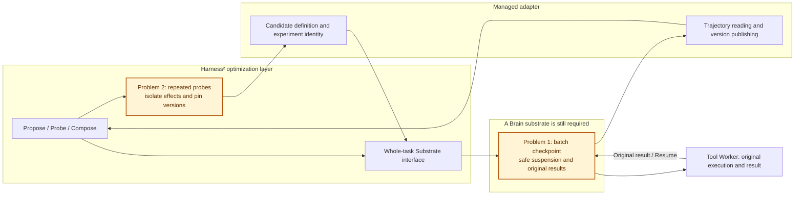
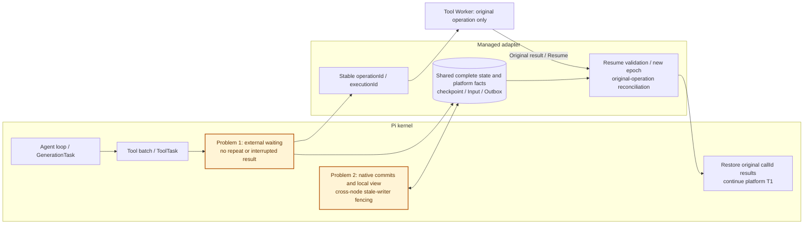

# Additional Managed Agents Harness kernel research

[中文](harness2-pi-brain-evaluation.md)

This supplement follows the evaluation goal, example, and section numbering of `~/agentscope-3/agentscope-java/docs/v2/zh/blogs/harness-design.md`: select a lightweight, maintainable Brain kernel for general Managed Agents, emphasizing external tools, complete checkpoints, cross-node recovery, in-turn inputs, and Java porting cost. Sections 4.7 and 4.8 continue the original six framework reviews; 1.3 and 5.1 extend its adapter table and selection conclusion.

Source snapshots reviewed on 2026-10-19: Harness² [`1cfe254`](https://github.com/google-research/harness2/tree/1cfe254e8d25b15f37048c3730134686abe60335), Pi [`d2e7d8b`](https://github.com/earendil-works/pi/tree/d2e7d8b7c1d31d3661f769d5caef7ba8d50c3e03). No cross-process recovery prototype was completed for either framework. Existing capabilities and proposed adaptations are distinguished below.

Use this repository's current [runtime architecture](managed-runtime-dataplane.md). Brain means Agent Harness Runtime; Tool Worker owns physical Hands execution. Runtime transactionally commits native logs, checkpoints, tool intents, and Execute Outbox. Tool events enter its Inbox, and Resume validates the current suspension and complete pending set. Suspension releases the Harness, Redis token, and MQ callback while retaining the original FIFO head. The original document's older runtime-event topic and Hands database ownership do not describe this project.

## 1.3 Outer adapter and framework kernel

These rows extend the original adapter/kernel table. Pi's two kernels need separate cost assessments.

| Candidate | Keep in the outer adapter first | Most likely kernel work |
| --- | --- | --- |
| Harness² | Managed editable surface, rollouts and trajectories, configuration and experience versions | Not a complete execution kernel; choose a substrate and add checkpoint/external-wait/recovery seams there |
| Pi agent-core | Models, managed tool proxies, identity, storage, inputs and event mapping | Tool-batch continuation, safe suspend/resume, durable queues and final input arbitration; alternatively build an outer durable executor |
| Pi durable | PostgreSQL Storage, epoch validation, original-operation reconciliation, transactional logs/Outbox, definition pinning | External waiting and original results; extend ToolTask if a safe bridge and close/reopen cannot express safe suspension |

## 4. Harness framework research

Use the original example: platform Turn T1 requests call-1 and call-2 in one step. The first finishes quickly; the second runs for ten minutes on Tool Worker. The user adds a Windows requirement. Brain A times out and exits; Brain B must continue T1 with original call IDs, received/applied result state, and input position, without executing call-2 again. Orange diagram nodes identify adaptation or validation work.

### 4.7 Google Harness² Python optimizes a harness while its substrate owns recovery

**Existing capability and role.** Harness² keeps model weights fixed and uses Propose–Probe–Compose to edit configuration, probe the task, compare behavior, and compose a harness. Later tasks reuse adopted configurations and supported lessons. Editable components cover prompts, guardrails, memory, tool guidance, subagents, skills, scripts, and plugins. Method, substrate, and benchmark adapter are separate; current substrates are OpenCode and Codex. This is a method for improving a harness, rather than an equivalent replacement for a kernel that executes T1. [Overview](https://github.com/google-research/harness2/blob/1cfe254e8d25b15f37048c3730134686abe60335/README.md)

**Problem one: experiment resume does not restore the original Turn's pending tools; a Brain replacement still needs an execution kernel, at high cost.** Substrate exposes editable configuration, materialization, complete task execution, and trajectory reading, without tool-batch continuation or external-result injection. When call-2 is still running, Harness² cannot identify its native recovery boundary. Cached summaries, artifacts, and adopted configurations do not reconnect that physical execution. A Managed substrate can delegate rollouts to the current AgentScope Brain, leaving recovery there. Choosing Codex or OpenCode instead retains the adaptation costs of that execution kernel. [Substrate](https://github.com/google-research/harness2/blob/1cfe254e8d25b15f37048c3730134686abe60335/harness2/substrate/base.py), [experiment resume](https://github.com/google-research/harness2/blob/1cfe254e8d25b15f37048c3730134686abe60335/harness2/core/schedule.py)

**Problem two: repeated probes have different side-effect boundaries from one business Turn; outer adaptation costs are medium and exceed event conversion.** Each mode budgets 4K executions and 3K improvement stages, excluding selection, reflection, and retries; K=1 already executes four tasks. Repeating T1 can repeat real tests, file writes, sends, or business mutations. Give each probe an experiment identity, resettable workspace, and controlled tools. Publish adopted configuration instead of mixing candidate trajectories into T1. Keep hard permissions and approvals in the platform, and scope experience by tenant, Agent, model, and tool versions. The Codex substrate bypasses approvals and sandboxing, so it cannot directly supply controlled execution. This work can remain outside AgentScope's model loop. [Ledger](https://github.com/google-research/harness2/blob/1cfe254e8d25b15f37048c3730134686abe60335/harness2/core/ledger.py), [library](https://github.com/google-research/harness2/blob/1cfe254e8d25b15f37048c3730134686abe60335/harness2/core/library.py), [Codex substrate](https://github.com/google-research/harness2/blob/1cfe254e8d25b15f37048c3730134686abe60335/harness2/substrate/codex.py)

**Java port and maintenance.** Porting recursive optimization does not produce Agent Loop, Session/Turn/Step, tool waiting, or a recovery kernel. Keep the Java Brain and integrate isolated optimization first. Configuration search, trajectory comparison, and lessons can be ported separately if operational requirements justify it. Following original section 3.5, richer effectiveness strategies should not determine the basic kernel choice.

### 4.8 Pi TypeScript has a compact loop and a durable kernel needing remote-tool adaptation

**Separate existing capabilities.** Agent-core provides a compact loop, native call IDs, tool scheduling, steer/follow-up, and request/tool hooks. Coding-agent adds SessionManager, compaction, skills, extensions, and CLI/RPC. The repository also contains experimental pi-durable: generation and tools are persistent tasks with phases, checkpoints, atomic entry/document/task writes, durable inputs, children, and recovery scheduling. GenerationTask retains the assistant, ToolTasks, and pending batch. A message-only description of Pi therefore does not cover durable. [Agent](https://github.com/earendil-works/pi/blob/d2e7d8b7c1d31d3661f769d5caef7ba8d50c3e03/packages/agent/src/agent.ts), [GenerationTask](https://github.com/earendil-works/pi/blob/d2e7d8b7c1d31d3661f769d5caef7ba8d50c3e03/packages/durable/src/harness/generation.ts)

**Problem one: neither ordinary loop continuation nor default ToolTask recovery directly reattaches call-2; adaptation costs are high, with more reusable state in durable.** Agent-core keeps runtime control, pending calls, and queues in memory; agentLoopContinue rejects an assistant-tail context. Durable persists final arguments and replay policy, but recovery reruns only tools whose stored and current policies both say safe; others produce interrupted results. Neither default represents a remote call still running. Persist callId → operationId → executionId, received/applied batch state, and input position. Query original operations, preserve unknown, and reconstruct replies under original IDs. First validate an outer safe bridge that only reconciles. If close/reopen cannot preserve a long external wait, extend ToolTask waiting and injection seams. Do not mark physical shell/MCP calls safe or settle waiting as an ordinary tool error. [Agent loop](https://github.com/earendil-works/pi/blob/d2e7d8b7c1d31d3661f769d5caef7ba8d50c3e03/packages/agent/src/agent-loop.ts), [ToolTask recovery](https://github.com/earendil-works/pi/blob/d2e7d8b7c1d31d3661f769d5caef7ba8d50c3e03/packages/durable/src/harness/tool.ts)

**Problem two: single-process commits and local views need shared platform commits and stale-writer fencing; costs are medium to high.** Durable has Memory, SQLite, JSONL, and Cloudflare storage, but requires one process per storage and supplies no cross-process lock. A PostgreSQL adapter must also commit native task/checkpoint state with platform intents, Execute Outbox, Input receipts, and terminal facts, validating epoch on every write. Losing Redis ownership must prevent old commits. Brain B reconstructs from committed head rather than stale caches. SessionManager conversation persistence does not implement this protocol either. Pi's turn is one model response plus tools; its run more closely matches T1. Map platform runId/epoch separately and retain subsequent platform Turns in MQ rather than creating another follow-up scheduler. [Storage and ownership](https://github.com/earendil-works/pi/blob/d2e7d8b7c1d31d3661f769d5caef7ba8d50c3e03/packages/durable/README.md), [Storage and Task contracts](https://github.com/earendil-works/pi/blob/d2e7d8b7c1d31d3661f769d5caef7ba8d50c3e03/packages/durable/src/types.ts), [authoritative SessionManager context](https://github.com/earendil-works/pi/blob/d2e7d8b7c1d31d3661f769d5caef7ba8d50c3e03/packages/coding-agent/docs/sdk.md)

**Context, input, and event boundaries.** Durable has a persisted inbox: steer applies after a tool round, while follow-up starts later work after the run. Reuse these seams while committing platform input receipts and terminal arbitration consistently. Pin prompts, schemas, skills, extension code, cwd/workspace, and child resources across recovery instead of resolving hot-reloaded versions. Permission hooks depend on extension selection, so retain mandatory platform authorization. Watches can replace intermediate frames with snapshots; project public events from authoritative history rather than treating watches as audit logs. Built-ins, MCP, codemode, and subagents must route physical execution through Tool Worker. [Specification](https://github.com/earendil-works/pi/blob/d2e7d8b7c1d31d3661f769d5caef7ba8d50c3e03/packages/durable/docs/spec.md), [event projection](https://github.com/earendil-works/pi/blob/d2e7d8b7c1d31d3661f769d5caef7ba8d50c3e03/packages/durable/src/harness/events.ts)

**Java port and maintenance.** Agent-core is useful for studying the original lightweight-kernel goal: borrow the loop, tool ports, context hooks, and input safe points without TUI or the complete coding stack. Adding durable continuation still means maintaining an execution kernel; loop line count is not a cost estimate. A full durable port also includes scheduling, transaction documents, branching, migrations, compaction, and cancellation ownership, at high to very high cost, with an experimental API. If Node is acceptable, test a second kernel. For a quick coding-agent trial, implement Hosted Runtime / External RPC integration, which does not establish Native recovery. [CLI integration](https://github.com/earendil-works/pi/blob/d2e7d8b7c1d31d3661f769d5caef7ba8d50c3e03/packages/coding-agent/docs/cli-integration.md)

## 5.1 Additional selection conclusion

The original distinction between basic kernel and effectiveness strategy still applies. These additions compare new candidates with the existing AgentScope baseline; the earlier six prototypes were not rerun.

| Option | Fit with lightweight Managed Brain | Adaptation or porting cost | Decision |
| --- | --- | --- | --- |
| Current AgentScope Java | Native state, tool bridge, Managed recovery seams, JVM operations | Lowest incremental cost here; continue implementation acceptance | Keep foundation |
| Harness² | Configuration/effectiveness optimizer, without an independent recovery kernel | Medium Managed optimizer adapter; a substrate is still needed | Exclude as direct Brain replacement; retain optimization methods |
| Pi agent-core | Compact loop and clear interface boundaries | High for complete recovery/input; selective Java borrowing preferable | Study selected seams without replacing merely for brevity |
| Pi durable | Persistent tasks closer to recovery requirements | High Native adaptation; high to very high complete Java port | Optional comparison prototype, not replacement yet |

Continue lightweight extensions around AgentScope Java, preserving customizable models/context, definition loading, tool interception, input safe points, and recovery ports. Harness² can test optimization outside the stable kernel; Pi can inform loop and durable state-machine design. Do not assume every framework requires a Core fork: validate outer tools/storage/commit adapters first, modifying the kernel only where safe suspension cannot be expressed.

Costs are engineering judgments, not staffing estimates. AgentScope remains a separately versioned Maven dependency through agentscope.version. This repository owns platform adapters, not binary Core/Harness internals. [Execution seam](../agent-harness-runtime/java/adapter-agentscope/src/main/java/io/agentcore/managed/server/runtime/managed/ManagedHarnessTurns.java), [original-result reconciliation](../agent-harness-runtime/java/adapter-agentscope/src/main/java/io/agentcore/managed/server/runtime/managed/ManagedToolRecovery.java), [implementation status](agent-service-implementation-status.md)

## Recovery prototype validation

Use the original dual-tool example: exit A after receiving but before applying call-1, while call-2 is dispatched and unfinished. B must retain T1, original callId/executionId, and the Windows input, and supply the complete real result batch to the model. Also test lost Execute acknowledgements, early/duplicate/stale Resume, unknown outcomes, stale epoch writes, uncertain commits, approvals/cancel, children, and workspace recovery. Long waiting must release execution and MQ callbacks while retaining the original FIFO head; public events must support durable cursor catch-up. Record source capabilities, adapter feasibility, and prototype acceptance separately. Conversation persistence or SQLite reopen alone cannot establish recovery correctness.
