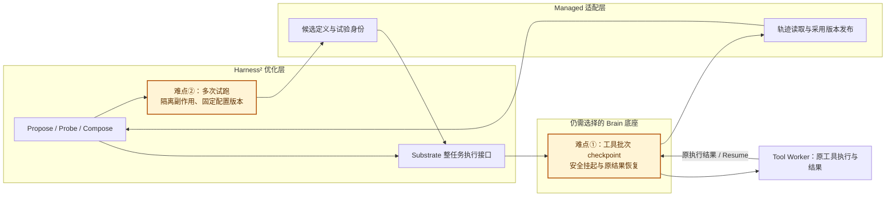
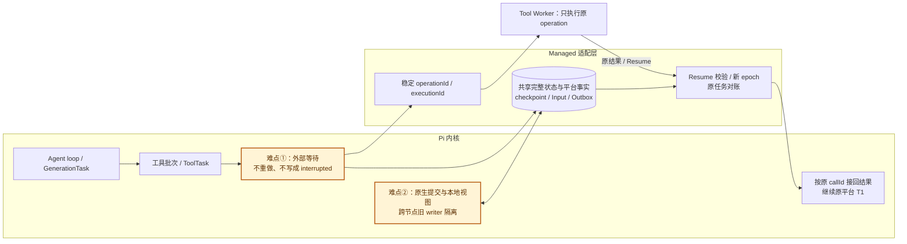

# Managed Agents Harness 内核补充调研

[English](harness2-pi-brain-evaluation.en.md)

本补充沿用 `~/agentscope-3/agentscope-java/docs/v2/zh/blogs/harness-design.md` 的评价目标、任务示例和章节编号：为通用 Managed Agents 选择边界清楚、可长期维护的轻量 Brain 内核，重点比较工具外置、完整 checkpoint、跨节点恢复、轮内输入和 Java 移植成本。以下 4.7、4.8 接续原文的六个框架，1.3 与 5.1 分别补充原文的适配表和选型结论。

分析基于 2026-10-19 源码：Harness² [`1cfe254`](https://github.com/google-research/harness2/tree/1cfe254e8d25b15f37048c3730134686abe60335)，Pi [`d2e7d8b`](https://github.com/earendil-works/pi/tree/d2e7d8b7c1d31d3661f769d5caef7ba8d50c3e03)。本次为源码调研，未完成两者的跨进程恢复原型；下文区分已提供的能力和仍需验证的适配方案。

平台协议以当前项目的[运行架构](managed-runtime-dataplane.md)为准：Brain 即 Agent Harness Runtime，Hands 的物理执行职责由 Tool Worker 承担。Runtime 直接事务提交原生日志、checkpoint、工具意图和 Execute Outbox；工具事件进入 Runtime Inbox，Resume 校验当前挂起及全部 pending 条件。挂起释放 Harness、Redis token 和 MQ 回调，原 Turn 保留 FIFO 队头。原文旧版运行事件 Topic 和 Hands 落库分工不套用到本项目。

## 1.3 外层适配与框架内核

以下三行补充原文“先放在外围适配 / 最可能需要进入内核”的比较表。Pi 两种内核的恢复能力不同，应分别计算成本。

| 候选 | 先放在外围适配的部分 | 最可能需要进入内核的部分 |
| --- | --- | --- |
| Harness² | Managed 定义的 editable surface、任务试跑与轨迹适配、配置及经验版本管理 | 自身不是完整 Brain 执行内核；需另选底座，并在该底座补齐 checkpoint、工具等待和恢复接口 |
| Pi agent-core | 模型接入、受管工具代理、身份、持久存储、Input 与事件映射 | 工具批次 continuation、安全挂起/恢复、持久轮内队列和终态前输入仲裁；或由外层重建持久执行器 |
| Pi durable | PostgreSQL Storage、平台 epoch 校验、原任务对账、日志/Outbox 事务适配、定义版本固定 | 外部工具等待与原结果接回；若 safe bridge 和关闭/重开无法表达安全挂起，则扩展 ToolTask 状态与恢复入口 |

## 4. Harness 框架调研

沿用原文场景：平台 Turn `T1` 的同一 step 提出 `call-1`、`call-2`；前者很快完成，后者在 Tool Worker 执行十分钟。用户中途补充“也检查 Windows 平台”。Brain A 等待超时后退出，Brain B 必须继续原 T1，保留原调用 ID、整批已收/已应用结果和输入位置，不能重新执行 call-2。图中橙色节点表示需要改造或验证的位置。

### 4.7 Google Harness²（Python）：优化 Harness 的外层系统，执行恢复仍由底座负责

**已有能力与定位。** Harness² 固定模型权重，通过 Propose–Probe–Compose 提出配置修改、在当前任务试跑、比较行为并组合结果；后续任务可复用采用的配置和有证据的经验。可编辑对象包括 prompt、guardrails、memory、工具指引、子 Agent、skills、scripts 和 plugins。源码把递归优化方法、执行底座和 benchmark 适配分开，当前执行底座为 OpenCode / Codex。因此它提供的是如何改进 Harness 的方法，不能与一个可直接运行 T1 的 Brain 内核视为同等替代项。[项目说明](https://github.com/google-research/harness2/blob/1cfe254e8d25b15f37048c3730134686abe60335/README.md)

**问题一：实验 resume 不等于恢复原 Turn 的工具等待；作为 Brain 替代仍需建设执行内核，成本高。** `Substrate` 只要求可编辑配置描述、配置安装、整次任务执行和轨迹读取，没有导出工具批次 continuation 或按原调用 ID 注入外部结果的接口。T1 的 call-2 已在 Tool Worker 运行时，Harness² 自身不知道应从哪个工具边界恢复；其缓存恢复检查汇总、产物和已采用 Harness，不能接回这次物理执行。Managed 适配可以新增 substrate，把一次试跑交给当前 AgentScope Brain；此时 T1 的 checkpoint 与恢复仍由 AgentScope 和现有平台承担。如果选择 Codex / OpenCode，则需另行改造对应内核，不能把这部分成本归零。[Substrate 接口](https://github.com/google-research/harness2/blob/1cfe254e8d25b15f37048c3730134686abe60335/harness2/substrate/base.py)、[实验恢复](https://github.com/google-research/harness2/blob/1cfe254e8d25b15f37048c3730134686abe60335/harness2/core/schedule.py)

**问题二：多次试跑与一次真实业务 Turn 的副作用边界不同；外层适配成本中，不能仅转换事件格式。** 默认预算每个模式为 `4K` 次任务执行和 `3K` 个改进阶段，选择、反思和重试另计；K=1 已有四次执行。若将 T1 原样多次 probe，真实测试、文件修改、发送或业务写入也可能多次发生。每个 probe 应有独立试验身份、可重置 Workspace 和受控工具，采用后的配置通过平台发布，不将候选轨迹直接混进原 T1。硬权限和审批留在平台，模型不能修改这些约束；跨任务经验固定租户、Agent、模型和工具版本。当前 Codex 底座还带有绕过审批及 sandbox 的启动参数，不能直接作为受管工具通道。上述工作可先在优化适配层完成，不需要为此修改 AgentScope 的模型循环。[预算账本](https://github.com/google-research/harness2/blob/1cfe254e8d25b15f37048c3730134686abe60335/harness2/core/ledger.py)、[经验库](https://github.com/google-research/harness2/blob/1cfe254e8d25b15f37048c3730134686abe60335/harness2/core/library.py)、[Codex 底座](https://github.com/google-research/harness2/blob/1cfe254e8d25b15f37048c3730134686abe60335/harness2/substrate/codex.py)

**Java 移植与维护判断。** 如果目的是选择轻量 Java Brain，移植 Harness² 的递归方法并不会得到 Agent Loop、Session/Turn/Step、工具等待和恢复内核。应先保留现有 Java Brain，将 Harness² 作为隔离优化任务接入；以后若要统一运维，可单独移植配置搜索、轨迹比较和经验复用。其效果策略有借鉴价值，但按原文 3.5 的标准，不应以效果策略的丰富程度决定基础内核选型。

### 4.8 Pi（TypeScript）：轻量循环易拆分，持久内核仍需接通远端工具恢复

**已有能力要分开看。** `pi-agent-core` 提供小型模型/工具循环、原调用 ID、并行或顺序工具、steer/follow-up、请求和工具前后 Hook；`pi-coding-agent` 在上面增加 SessionManager、压缩、skills、扩展和 CLI/RPC。当前仓库还提供实验性的 `pi-durable`：generation 和 tool 已是持久任务，具有显式 phase/checkpoint、原子 entries/documents/tasks 提交、持久输入、子任务与重启调度。GenerationTask 记录 assistant、对应 ToolTask 和 pending 批次，并等待工具完成。因此“Pi 只保存聊天历史”仅描述部分路径，不能覆盖 durable。[Agent 实现](https://github.com/earendil-works/pi/blob/d2e7d8b7c1d31d3661f769d5caef7ba8d50c3e03/packages/agent/src/agent.ts)、[GenerationTask](https://github.com/earendil-works/pi/blob/d2e7d8b7c1d31d3661f769d5caef7ba8d50c3e03/packages/durable/src/harness/generation.ts)

**问题一：恢复普通 loop 或默认 ToolTask，都不能直接接回仍在运行的 call-2；改造成本高，durable 可复用更多已有状态。** agent-core 的运行控制、pending calls、steer/follow-up 队列是进程内状态，`agentLoopContinue()` 还拒绝 assistant 结尾的上下文；仅保存消息不足以从“工具已派发但尚未返回”继续。durable 虽在执行前保存最终参数和 replay 策略，但恢复时只对持久策略与当前声明同时为 safe 的工具重入执行，其余生成 interrupted 结果。T1 的 call-2 仍在 Tool Worker 运行时，这两种默认分支都不是“等待原执行结果”。应固定 `callId → operationId → executionId`、整批已收与已应用状态和输入游标；恢复先查询原任务，unknown 保持 unknown，再按原 ID 合成回复。先验证外围 safe bridge 能否只重入对账而不重复物理调用；长期挂起若不能在关闭/重开时保留等待，则需扩展 ToolTask 的外部等待状态和结果注入接缝。不能把真实 shell/MCP 调用直接标 safe，也不能把等待异常当普通工具错误结算。[agent-loop](https://github.com/earendil-works/pi/blob/d2e7d8b7c1d31d3661f769d5caef7ba8d50c3e03/packages/agent/src/agent-loop.ts)、[ToolTask 恢复分支](https://github.com/earendil-works/pi/blob/d2e7d8b7c1d31d3661f769d5caef7ba8d50c3e03/packages/durable/src/harness/tool.ts)

**问题二：单进程事务与本地视图，需要接到平台共享提交和旧 writer 屏障；改造成本中到高。** durable 提供 Memory、SQLite、JSONL 和 Cloudflare 存储，但同一存储要求单进程独占，没有跨进程锁。替换为 PostgreSQL Storage 后，仍需让原生 task/checkpoint 与平台工具意图、Execute Outbox、Input 回执和终态组成同一提交边界，并对每次写入校验 epoch；Redis token 丢失后旧实例不得继续提交。Brain B 应从已提交 head 重建视图，不能以共享数据库就绪为由继续使用旧缓存。SessionManager 会话持久化同样不能直接代替这层协议。Pi 的 turn 是一次模型响应及工具，其 run 更接近平台 T1，平台 runId/epoch 还需独立映射；后续平台 Turn 留在 MQ，避免形成第二套 follow-up 调度。[存储与单 owner 约束](https://github.com/earendil-works/pi/blob/d2e7d8b7c1d31d3661f769d5caef7ba8d50c3e03/packages/durable/README.md)、[Storage 与 Task 合约](https://github.com/earendil-works/pi/blob/d2e7d8b7c1d31d3661f769d5caef7ba8d50c3e03/packages/durable/src/types.ts)、[SessionManager 权威上下文](https://github.com/earendil-works/pi/blob/d2e7d8b7c1d31d3661f769d5caef7ba8d50c3e03/packages/coding-agent/docs/sdk.md)

**上下文、轮内输入与事件的补充边界。** durable 已有持久 inbox，steer 在工具轮后应用，follow-up 在运行结束后开始后续工作；这些接缝值得复用，但还需将平台 Input 回执与终态仲裁一并提交。恢复时固定 prompt、工具 schema、skills、扩展代码、cwd/Workspace 和子任务资源版本，不能解析成当前热更新版本。权限 Hook 会受 conversation 扩展选择影响，应保留平台强制权限链。watch 可在积压时用最新 snapshot 代替中间帧，公开事件应从权威持久日志投影，不能直接将 watch 当作可审计 SessionLog。内置工具、MCP、codemode 和子 Agent 的真实执行均要经过 Tool Worker。[Durable 规范](https://github.com/earendil-works/pi/blob/d2e7d8b7c1d31d3661f769d5caef7ba8d50c3e03/packages/durable/docs/spec.md)、[事件投影](https://github.com/earendil-works/pi/blob/d2e7d8b7c1d31d3661f769d5caef7ba8d50c3e03/packages/durable/src/harness/events.ts)

**Java 移植与维护判断。** Pi agent-core 对原文“轻量、可掌控”的目标有参考价值：可以只借鉴 loop、工具端口、上下文 Hook 和输入安全点，不必移植 TUI 与全部编码工具。但补齐持久 continuation 后，已经是在维护自己的执行内核，不能按循环代码行数估算成本。完整移植 durable 还包括任务调度、事务文档、分支、迁移、压缩和取消归属，成本高到很高；其 API 仍为实验状态。若接受 Node，可先做第二内核原型；如果希望快速使用 Pi 的编码体验，可走 Hosted Runtime / External 的 RPC 适配，但这不证明已满足 Native Brain 恢复。[CLI 接入](https://github.com/earendil-works/pi/blob/d2e7d8b7c1d31d3661f769d5caef7ba8d50c3e03/packages/coding-agent/docs/cli-integration.md)

## 5.1 选型结论补充

原文将基础内核与效果策略分开，这一点在新增两个候选后仍适用。以下只补充新增框架与现有 AgentScope 基线的关系，原有六个框架没有重新执行原型验证。

| 方案 | 与轻量 Managed Brain 目标的关系 | 改造或移植成本 | 结论 |
| --- | --- | --- | --- |
| AgentScope Java 现有基础 | 已有原生状态、工具桥与 Managed 恢复接缝，符合 Java 运维要求 | 本项目增量最低，仍按实施状态继续验收 | 保持基础内核 |
| Harness² | 配置和效果优化层，未提供独立执行恢复内核 | 新增 Managed 优化适配中；仍需建设或选择底座 | 不作为直接 Brain 候选，方法留作后续效果拓展 |
| Pi agent-core | loop 清晰、接口小，适合研究最小内核边界 | 补完整恢复与输入协议高；选择性 Java 借鉴优于全量移植 | 可借鉴，不因代码短就替换现有基础 |
| Pi durable | 已有持久任务状态机，比普通 Pi loop 更接近恢复需求 | Native 适配高；完整 Java 移植高到很高 | 可作第二内核对照原型，暂不替换 |

因此，补充两个框架后，仍优先沿 AgentScope Java 的轻量扩展路线推进：保留可定制的模型/上下文、定义装载、工具拦截、输入安全点和恢复接口。Harness² 可在稳定内核之外验证优化方法，Pi 可帮助审视 loop 与持久状态机的设计。不能推断所有框架都一定要改 Core：先以工具、存储和提交端口验证外围适配，确实无法表达安全挂起时再修改内核。

这些成本为工程判断，尚未估算人日。当前 AgentScope 版本由独立的 `agentscope.version` Maven 依赖固定；本仓库只能修改平台适配，不能直接修改二进制 Core/Harness。[当前执行接缝](../agent-harness-runtime/java/adapter-agentscope/src/main/java/io/agentcore/managed/server/runtime/managed/ManagedHarnessTurns.java)、[原工具结果对账](../agent-harness-runtime/java/adapter-agentscope/src/main/java/io/agentcore/managed/server/runtime/managed/ManagedToolRecovery.java)、[实施状态](agent-service-implementation-status.md)

## 恢复原型的验证重点

按原文双工具场景，下一步至少验证：call-1 已收到但未应用、call-2 已派发但未完成时退出 A；B 使用同一 T1、原 callId 与 executionId 接回，Windows 补充输入仍在，模型能收到整批真实结果。再覆盖 Execute 回执丢失、Resume 先到/重复/迟到、unknown 结果、旧 epoch 提交、事务结果未知、审批/cancel、子 Agent 与 Workspace 恢复。长期等待必须释放执行及 MQ 回调，同时保持原 Turn 队头；公开事件须能从持久游标补读。源码能力、外围适配可行性和原型通过情况应分别记录，不能以保存聊天历史或成功重开 SQLite 代替这组验收。
