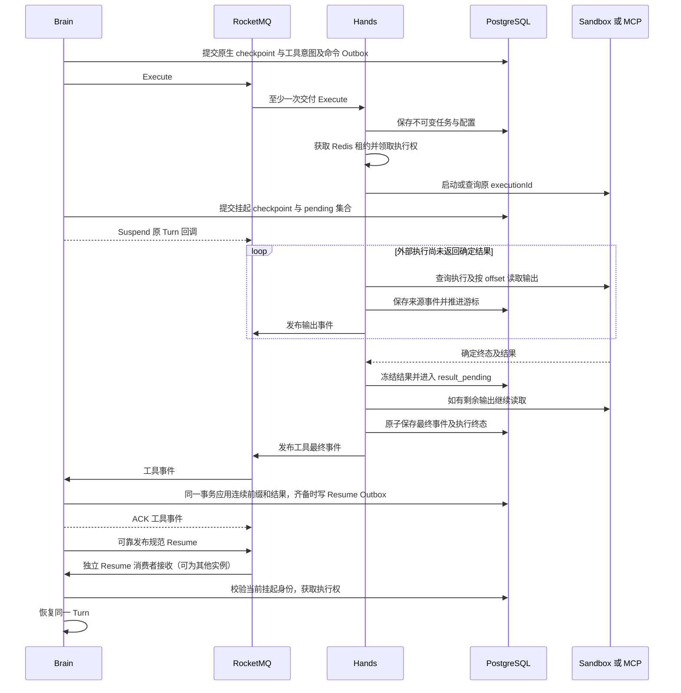
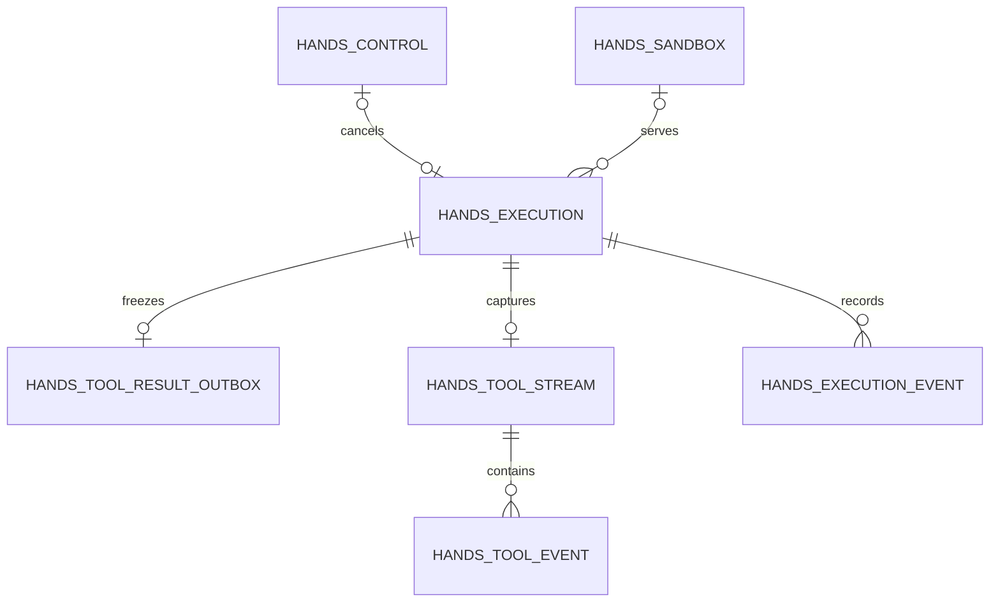

# AgentScope Service Hands 设计与工作流程

Hands 是 Managed Agent 的工具执行组件，负责外部工具调用、执行与输出事实持久化，以及可靠的工具事件发布。Brain 负责结果齐备判定、持久恢复调度（MCP 批次直接唤醒，其他路径发布 Resume）、推理、原生运行日志、checkpoint、Suspend、恢复和 Turn 终态；Session Portal 负责流量准入、身份权限及配额检查。

本文说明 2026 年 10 月 19 日当前分支的实现。Hands 当前使用七张自有表，历史 `hands_resume_outbox` 保留但不再读写，执行历史表保留，未使用的 `hands_tool_event_conflict` 已从源码清理。`hands_tool_result_outbox` 仍是独立表；合入执行表的建议放在最后一节，不代表已经实施。

2026-10-21 的 MCP 批次扩展见 [MCP 执行批次与恢复](mcp-execution-recovery.md)：一次 `TOOL_EXECUTE` 受理整轮调用，Worker 内部保存逐调用状态，只有父批次发布完成事件；下文独立 Resume 通道继续用于兼容路径。

## 职责边界

| 组件 | 负责的工作 | 与 Hands 的关系 |
| --- | --- | --- |
| Session Portal | Session、Turn、Input 准入，身份权限及配额检查，查询和 SSE | 不参与工具执行回调，不为 Hands 提供运行时反向查询接口 |
| Brain Dataplane | 运行 Harness，调用模型，执行原生权限链，提交运行日志与 checkpoint，持久化工具意图和挂起条件，恢复及提交 Turn 终态 | 通过 MQ 发出 Execute、Cancel、Replay，消费工具事件，统一判定并发布/消费 Resume |
| Hands | 接收不可变执行命令，调用 Sandbox 或 MCP，保存执行与输出事实，可靠发布工具事件 | 不运行 Harness，不校验整个 Turn 的挂起条件，不读取 Brain checkpoint |
| self-hosted Worker | 在指定用户环境中领取物理操作，执行命令、采集输出和上报结果 | 通过 Hands 的统一 tool-tasks HTTP 协议协作 |
| Control Plane | 管理 Environment 等配置资源，校验 Worker 环境密钥 | Hands 的 Worker 接入服务会调用其 verify-key 接口 |

Brain 决定是否允许发起一个逻辑工具调用，Hands 根据已准入、封存的执行配置实施调用，并继续校验目标、执行身份和 Worker 凭证。两者的权限检查作用于不同边界。

工作区快照、导入、Fork 和资源清理由 Brain 协调，物理动作通过同一工具协议交给 Hands。`hands_sandbox` 保存物理绑定和重连信息，不保存 Brain 的原生 checkpoint。子 Agent 编排由 Brain 的子调用执行器处理，不能把所有内部工具名都解释为 Sandbox 命令。

## 组件依赖

```mermaid
flowchart LR
    Session Portal[Session Portal] -->|Turn 与 Input 准入| Brain[Brain Dataplane]
    Brain -->|Execute Control 与 Resume Outbox| MQ[RocketMQ]
    MQ -->|Execute 与 Control| Hands[Hands]
    Hands -->|工具事件| MQ
    MQ -->|事件 Inbox 与恢复通知| Brain
    Brain -->|日志 checkpoint 挂起及终态| DB[(PostgreSQL)]
    Hands -->|执行 输出 结果及 Outbox| DB
    Hands -->|执行与采集租约| Redis[(Redis)]
    Hands -->|命令执行与重连| Sandbox[Sandbox]
    Hands -->|真实调用| MCP[MCP Server]
    Brain -->|只读工具发现| MCP
    Worker[self-hosted Worker] -->|领取 续租 输出 结果| Hands
    Worker -->|连接已有实例| Sandbox
    Hands -->|Worker 环境密钥校验| CP[Control Plane]
```

图中的 Session Portal 到 Brain 表示逻辑准入关系；实际 Turn 交付使用 MQ，Input 先持久化并通过通知加速。Brain 与 Hands 不依赖对方 Pod 地址交接工作。

### 基础设施分别承担什么

| 依赖 | Hands 的使用方式 | 不承担的保证 |
| --- | --- | --- |
| PostgreSQL | 持久去重、执行身份、状态、采集游标、确定结果和事件待办，以及短事务行锁 | 不直接证明外部副作用是否发生 |
| RocketMQ | 接收 Execute/Control、发布工具事件，按 operation 分组；Resume 由 Runtime 发布 | 不提供跨 Topic 的先后顺序，也不能替代业务幂等 |
| Redis | 可续租的工具执行与采集租约、Sandbox 创建互斥 | 不保存结果真相；租约消失不能授权重做外部副作用 |
| Sandbox 文件系统 | 按 executionId 保存进程证据、原始输出和确定结果，供原执行查询与按偏移续读 | Sandbox 丢失后不能仅靠数据库游标还原未采集输出 |
| MCP Server | 工具发现和实际 RPC；HTTP、SSE 或显式 local Environment 下的 stdio | 普通 MCP 调用没有统一的持久结果查询和幂等重放保证 |
| VaultCrypto | 解密执行命令中的封存配置和 Sandbox 重连信息 | 配置加密不替代调用身份、工具描述和权限检查 |
| Control Plane | 校验 self-hosted Worker 的 Environment 密钥 | 不负责 Brain 的 checkpoint 或工具执行状态机 |

### 数据库与大消息依赖

Hands 使用自己的 Spring DataSource，配置入口是 `BUILDER_HANDS_DB_URL`、`BUILDER_HANDS_DB_USER`、`BUILDER_HANDS_DB_PASSWORD`，业务表位于 `ma` schema。默认可以与 Brain 使用同一个 PostgreSQL 实例和数据库，但表的逻辑归属分离。隔离数据库的故障测试用于验证 Hands 不依赖 Brain 的私有运行记录。

生产 `ManagedBatchCodec` 使用 PostgreSQL 的 `ma.private_object` 存储超出内联阈值的消息体，通过内容 hash 引用并校验。当前内联阈值为 128 KiB，内容上限为 64 MiB；Broker 消息体接口上限为 512 KiB。Hands 因而还使用共享私有对象设施，不能把“七张活动自有表”理解成它只会访问七张表。

如果把 Brain 与 Hands 配置为不同数据库，大消息引用仍需在收发两端可访问。当前默认对象存储绑定各自 DataSource，仅改变 DB URL 并不能自动打通跨库对象引用。小消息下的数据库隔离验证不等于大消息跨库部署已经具备共享对象通道。

服务启动验证版本化 schema；生产建表由迁移任务负责，不由普通副本自动建表。当前 schema 基线不接管旧运行结构和历史回填。

## Hands 内部组件

| 组件 | 职责 |
| --- | --- |
| `ManagedHandsConfiguration` | 装配消费者、执行器、发布器与提供方，按工具类型选择 MCP、Sandbox 或清理执行器 |
| `ManagedHandsCommands` | 解码命令，校验消息通道，先持久化接收事实，再启动或继续原执行；处理 Cancel 和 Replay |
| `ManagedHandsStore` | 七张活动自有表中的执行、控制、结果和历史事务；提供待恢复任务及待发布记录查询 |
| `ManagedToolExecutions` | 获取与续租 Redis token，领取执行权，启动、查询、取消原执行，采集输出和提交确定结果 |
| `ManagedToolEvents` | 输出模式与游标、采集者 fencing、来源事件生成及发布状态；共享实现也用于 Brain Inbox |
| `ManagedToolResultPublisher` | 冻结确定结果，输出覆盖完成后封口，向 MQ 发布工具事件，并扫描修复未完成待办 |
| `ManagedHandsCatalog` | 解析执行记录中的加密封存目标，不向 Session Portal 获取运行配置 |
| `ManagedSandboxProviders` | 物理 Sandbox 创建、重连、实例缓存、定义文件准备和清理 |
| `ManagedSandboxToolExecutor` 与 `managed-tools.py` | 基于稳定 executionId 实现 Sandbox 内部 start、query、cancel 和 output 协议 |
| `ManagedMcpExecutors` | MCP 调用连接管理、描述校验和实际调用，保存确定 RPC 结果；旧目录任务仅用于升级期间排空 |
| `ManagedWorkerService` 与 `ManagedWorkerController` | self-hosted Worker 认证、领取、续租、启动确认、unknown、输出和结果接收 |
| `ManagedWorkerRequestLimits` | JSON 请求体解码前认证及限流，隔离大请求与续租等控制请求容量 |
| `ManagedEnvironmentWorker` | 环境侧执行、输出上传、结果本地持久化和 HTTP 重试 |

Hands 角色不装配 Brain 的原生 Journal、checkpoint 对象协调器和生命周期协调器。共享 Java 类型或 JDBC 工具类不代表运行时职责或数据库所有权共享。

## 消息通道与执行身份

### MQ 通道

| 逻辑通道 | 默认父 Topic | 发布方 | 消费方与默认消费组 |
| --- | --- | --- | --- |
| Turn | `ma_turns_v3`（所有深度共享） | Session Portal、子调用准入链路 | Brain，`ma_brain_v3`（共享回调池） |
| Execute | `ma_tool_execute_v1` | Brain | Hands，`ma_hands_execute_v1` |
| Control | `ma_tool_control_v1` | Brain | Hands，`ma_hands_control_v1` |
| 工具来源事件 | `ma_tool_events_v3` | Hands；Brain 的内部工具执行路径也可发布 | Brain，`ma_brain_tool_events_v3` |
| Resume | `ma_turn_resumes_v3` | Brain 根据结果齐备或输入就绪统一发布的 Session 级恢复请求 | Brain，`ma_brain_resumes_v3` |

Turn 使用 Session 级 LiteTopic 保持 FIFO；工具命令、工具事件和 Hands 完成通知使用 operation 级 LiteTopic，使一个长工具不阻塞同 Session 的其他工具。Execute 与 Control 独立，取消不必排在原 Execute 回调后。

不同通道没有到达顺序保证。Cancel 可以早于 Execute，工具完成可以早于 Brain 提交 Suspend；Runtime 在结果应用和挂起提交两处检查就绪条件。这些情形由数据库事实和消费端校验处理。

### 身份与代次

| 身份 | 作用 |
| --- | --- |
| scope | tenant、namespace、sessionId 的完整组合，派生 `scope_key` 和 Redis key，隔离不同 Session |
| taskId | 逻辑工具操作的稳定身份；命令、结果和通知关联同一任务 |
| executionId | 原物理执行身份，接管不生成新身份；当前命令协议要求它等于 taskId |
| commandId | Execute、Cancel、Replay 命令身份，用于可靠重发 |
| source_sequence | 单次工具执行内的来源事件序号，用于连续覆盖和乱序恢复 |
| worker_token | 当前执行或采集者的 Redis 租约身份，并写入数据库作为 fencing 条件 |
| owner_generation | 每次数据库领取递增的接管代次，用于执行历史和排障 |
| notificationId | 根据 scope、taskId、executionId 稳定生成的完成通知身份 |

工具执行身份不包含 Brain 的活动租约 token。Brain 换实例、换 execution epoch 后，原工具的确定结果仍可被接收。

## 一次完整工具调用



图中的数据库是逻辑事实集合；Hands 的事务仅操作自己的执行事实和共享对象，不跨组件锁定 Brain 运行记录。Execute、Suspend 与工具完成存在并发，图中排列不是跨 Topic 顺序保证。

### 接收与领取

Hands 收到 Execute 后向 `hands_execution` 插入任务，重复消息保留原记录并校验已有执行内容。之后先尝试复用已冻结结果，再解析执行目标和选择提供方。

执行器获取工具级 Redis 租约，在数据库中领取任务，设置 worker_token、递增 owner_generation。首次领取把 `ready` 改为 `starting`；接管已有任务不意味着首次启动。启动返回的句柄写入 process_handle，状态转为 `running`。

默认工具租约为 60 秒，每 15 秒续租。租约失效后执行或采集线程停止继续推进；数据库 token 校验拒绝旧采集者写入。新持有者查询原 executionId，不能把 Redis 丢失解释成原副作用没有发生。

### 确定结果与输出收尾

“结果已确认”指外部调用已有确定的 succeeded、failed 或 cancelled 结果。对于 Sandbox 命令，进程已经结束；但输出采集器可能尚未把输出文件全部搬入数据库。

当前实现先把完整 `ManagedToolResult` 和 hash 写入 `hands_tool_result_outbox`，同时更新执行状态为 `result_pending`。随后继续采集剩余输出。重启后优先读取这份冻结结果，不重新调用工具，也不依赖再次查询得到相同结果。

`result_pending` 应读作“结果已确定，等待输出收尾和完成封口”。没有流式输出的工具使用 `mode=none`，可以立即完成覆盖；流式工具要求读到终态输出末尾，或者明确保存输出缺口。

### 完成事务与发布

输出覆盖完成后，`ManagedHandsStore.complete()` 在一个 PostgreSQL 事务内完成以下操作：

1. 锁定执行行，验证调用方结果与冻结结果完全一致。
2. 生成最终 `tool.result` 来源事件，保存 stream 的 final_sequence。
3. 更新执行终态和 result，记录执行阶段历史。
4. 设置结果暂存记录的 committed_at。
Worker 不再插入 `hands_resume_outbox`。

`mcp.describe` 和 turnId 为 administrative 的物理维护操作通过各自协调路径等待结果，不生成普通 Turn 的恢复请求。

MQ 发送在事务外进行。工具事件按来源序号发布；此前事件尚未确认进入 Broker 时，不跳过它发送后续来源。Broker 已接收但回执丢失时允许重复发布。数据库状态驱动重试，不重新运行外部工具。

### Brain 校验与 FIFO

Brain 将工具事件持久写入自己的 Inbox。未来序号可以先保存并 ACK，只有从当前连续前缀开始的事件才应用到结果和公开日志，避免缺口堵住 MQ 队头。

Brain 在应用最终事件的事务内保存工具结果，并检查当前挂起的全部 pending 条件；齐备时生成绑定 suspension 身份、代次与 publication sequence 的唯一 Resume Outbox。独立发布器和消费者继续负责可靠交接及 checkpoint 恢复，不在工具事件回调内运行推理。

Hands 不判断整个挂起条件是否满足，也不发布完成通知。多个工具并行时由 Runtime 使用共享持久结果汇合；结果先于挂起时在挂起事务重新检查。升级期间的旧 Worker 通知只用于校验历史结果并补发规范 Resume，不直接运行推理。重复或过时 Resume 继续由 Runtime 校验。

原 Turn 挂起时释放 Harness、执行 token 和回调线程，向 MQ 返回 Suspend，原消息仍保留 Session FIFO 队头。工具完成和 Resume 不会直接放行后续 Turn；只有 Brain 提交原 Turn 终态后，原消息才可成功 ACK。

## 工具状态机

| 状态 | 事实含义 | 恢复动作 |
| --- | --- | --- |
| ready | Execute 已持久接收，尚未领取首次启动 | 领取后检查取消，再启动 |
| starting | 首次启动权已领取，外部启动可能已发生 | 查询原 execution，不能直接换身份重启 |
| running | 已保存原执行句柄或确认其运行 | 查询、取消、采集原输出 |
| unknown | 无法确认外部副作用或原进程结果 | 保持待核实，接受原执行迟到的确定结果 |
| result_pending | 已冻结确定结果，尚未完成输出与最终事件封口 | 复用结果，补齐输出，再重试完成事务 |
| succeeded / failed / cancelled | Hands 已原子完成最终来源事件及执行终态 | 继续未完成发布或按需 Replay，不重执行工具 |

主要路径为 `ready → starting → running → result_pending → 终态`。启动前取消可以从 starting 直接形成取消结果；starting/running 也可以进入 unknown。unknown 不是失败终态，不能据此构造失败结果或宣告完成。

确定结果可以在 Worker token 过期后迟到，但必须匹配原 execution。输出采集则必须由当前 token 持有者推进。这一区别使原结果不会因为接管而丢失，同时防止两个采集者交叉写游标。

## Sandbox 输出与恢复协议

### 数据实际保存在哪里

`ManagedSandboxToolExecutor` 通过短时 `Sandbox.exec()` 调用内置 Python 控制程序。业务命令作为独立进程执行，stdout 和 stderr 合并写入 Sandbox 工作目录：

```text
<workspace>/.managed-tools/<executionId>/
  request.json     原始工具与参数
  launcher.json    后台 runner 的启动身份
  owner.json       runner 的进程身份
  process.json     业务命令的进程身份
  output           合并的原始输出
  result.json      确定结果及最终输出大小
  cancel           取消意图标记
```

其中部分文件按执行阶段出现。query 优先读取 result.json；没有确定结果时根据进程身份判断运行证据。没有可确认结果和存活证据时返回 unknown。启动目录已存在时校验原请求，不把它作为重新执行的授权。

### 按偏移读取

Hands 从数据库获取 output_offset，调用 `executor.output(scope, task, offset)`。Python 对 output 文件 seek 后读取最多 16 KiB，返回 Base64 数据、nextOffset、size、terminal 和 gap。每次读取都是控制请求，不会重新执行原业务命令。

Hands 在同一事务中保存 `tool.delta` 并推进游标。`terminal=true` 只说明 result.json 已存在；同时满足 `nextOffset == size` 才标记 capture_complete。

事件采集最多覆盖 16 MiB 原始输出，超过上限通过 `output_limit` 明确记录缺口。确认终态后发现源文件不可用或截断，也通过相应 gap 表达。确定结果中的 output 是最多 1 MiB 的预览，不能代替来源事件的输出覆盖记录。16 MiB 是采集上限，不是 Sandbox output 文件的写入大小限制。

已采集事件在 PostgreSQL 中可重放；尚未采集的字节依赖原 Sandbox 文件仍然存在。Workspace 快照排除 `.managed-tools` 等私有运行目录，不能把克隆后的工作区当成原 execution 的恢复证据。

### 对 Sandbox 实现的要求

当前生产适配使用 E2B 客户端，控制层调用 `sandbox.exec(null, command, 30)`。本地测试模式以本地 shell 执行同一 Python 协议。

它没有使用供应商专门的历史日志 API，但依赖 shell、Python 3、文件读写、后台进程，以及跨控制请求保留的同一工作目录。只实现一次性 exec 接口并不足以支持这套恢复语义。请求结束就清理目录或终止后台进程的 Sandbox，需要另行适配。

### Sandbox 绑定生命周期

平台创建 Sandbox 前写入 `hands_sandbox` 的 creating 意图，获得实例身份后保存加密状态并置 active。后续重新连接原实例。若只留下 creating 而没有可重连状态，返回 sandbox_creation_unknown，不能自动再创建一个替代实例。

self-hosted 环境提供已有 Sandbox ID，Hands 用 borrowed_identity 唯一约束独占借用。资源释放只解除借用关系，不替用户删除已有实例。平台创建的实例则在协调清理时调用 shutdown，再标记 released。

## self-hosted Worker 接入

Worker 使用 `/v1/handss/environments/{environmentId}/tool-tasks/` 下的统一协议，不使用独立 workspace-tasks 协议。

| 操作 | 用途 |
| --- | --- |
| claim | 获取当前环境匹配的执行，领取 Redis token，返回首次启动标志、原句柄、定义文件与连接配置 |
| renew | 续租，获取取消意图、执行状态和输出游标 |
| started | 确认已启动，保存执行句柄 |
| unknown | 上报外部结果无法确认 |
| output | 上传一页输出，由 Hands 校验 token 并原子保存事件和游标 |
| result | 上报原执行的确定结果，Hands 持久冻结后返回 captured |

Worker 携带 `X-Builder-Environment-Key`。Hands 调用 Control Plane 的 `/api/internal/environments/{id}/verify-key` 校验凭证，并核对任务封存配置中的 Environment 与请求一致。HTTP 安全配置允许路由进入应用层，不表示接口匿名执行。

入口在请求体解码前进行认证和并发限制：大请求通道默认 2 个名额，renew/started/unknown 控制通道独立 64 个名额，避免工作区大包阻塞续租。阻塞 JDBC、认证和远端执行使用适当的工作线程，不占用 Reactor 事件循环。

Worker 连接已有 Sandbox，执行与云端相同的稳定执行及分页输出协议。首次启动以外的领取只查询原执行。输出经 HTTP 进入 Hands 事件 Outbox，再由 Hands 统一发布 MQ。

这条路径与云端的结果落盘时机有区别：Worker 确认结果后先以 fsync 和原子改名保存到本地结果目录，继续上传剩余输出，并上报确定结果。独立重试扫描也会重发本地结果；Hands 可能先冻结结果，等待其他执行段补齐输出。Worker 仅在收到 captured 回执后删除本地文件。captured 表示 Hands 已持久接收，不表示 Brain 已恢复。

## MCP 发现与调用

Managed MCP 的只读 `listTools` 发现由 Brain 直接完成，真实 `callTool` 在平台 Hands 内异步执行。self-hosted Sandbox Worker 不承担 MCP 调用。

1. Brain 在有界阻塞线程上直接连接服务、读取工具描述并关闭连接；相同 Turn 复用自己的不可变快照，后续 Turn 重新发现。
2. Runtime 应用启用与禁用规则，校验只读恢复查询工具并记录不可用的可选服务；该阶段不创建 Worker 命令，也不依赖 Turn 重投。
3. Brain 注册代理工具，保留原生权限链；实际调用意图携带服务名、原工具名、参数、元数据和 descriptor_hash。
4. Hands 验证服务与工具准入规则，比较实际描述 hash，然后才执行 callTool。
5. 确定结果保留 MCP 原始返回内容与 isError，通过统一结果冻结及最终事件交付，Runtime 按挂起条件生成 Resume。

普通 MCP 调用默认没有 replayable 输出，使用 mode=none。HTTP 和 SSE 连接可访问远端服务；stdio 在发现端 Runtime 或调用端 Hands 的进程环境启动子进程，均要求显式 local Environment，不会自动进入远端 Sandbox。

连接缓存有界，默认最多 1024 个客户端，仍在调用中的连接不被驱逐。并发调用在进程内保留原执行 promise；确定结果及时写入数据库。RPC 已发出后断连、进程丢失或无法确定结果时保留 unknown，不盲目重调。关闭连接也不代表远端副作用已停止。

旧版本在途 `mcp.describe` 任务仅保留升级排空兼容，新请求不再创建该任务。普通 `mcp.call` 不具备可安全重复调用的默认保证。当前没有统一的 MCP 服务端执行结果查询或事后核实协议，因此 unknown 的普通调用可能需要人工或服务特定方式确认。

## 数据库设计

### 七张活动自有表与一张历史保留表

| 表 | 主键或唯一约束 | 主要数据 | 使用环节与必要性 |
| --- | --- | --- | --- |
| `hands_execution` | PK(scope_key, task_id) | 原任务和加密配置、状态、worker_token、owner_generation、process_handle、最终 result、调度时间 | 接收去重、启动、接管、恢复的权威记录，核心职责必需 |
| `hands_control` | PK(scope_key, task_id) | cancel_requested | 持久取消墓碑，覆盖 Cancel 早于 Execute；当前还复用 sandbox-binding 哨兵行进行绑定事务互斥 |
| `hands_tool_result_outbox` | PK(scope_key, task_id)，FK 指向 execution | execution_id、完整结果 payload、result_hash、next_attempt_at、committed_at | 先冻结确定结果，再补齐输出和封口；职责必需，但不要求独立成表 |
| `hands_tool_stream` | PK(scope_key, task_id)，FK 指向 execution | 输出模式、来源与 chunk 序号、字节游标、覆盖完成及缺口、final_sequence | 断点续采及最终事件封口；无输出工具也创建 mode=none 记录 |
| `hands_tool_event` | PK(scope_key, task_id, source_sequence)，UNIQUE(scope_key, event_id)，FK 指向 stream | 不可变事件、内容 hash、重试时间、broker_at | 工具源日志与 MQ 事件 Outbox，支持重复发布和 Replay |
| `hands_resume_outbox`（历史保留） | PK(notification_id) | 历史完成通知记录 | 新 Worker 不再读写，保留迁移和既有数据 |
| `hands_sandbox` | PK(scope_key)，UNIQUE(borrowed_identity) | creating/active/borrowed/released、creation_token、encrypted_state、借用身份 | 每 Session 的物理 Sandbox 生命周期，纯 MCP 调用不使用 |
| `hands_execution_event` | PK(scope_key, task_id, owner_generation, phase) | 阶段、时间和 detail | 审计和排障，保留；执行恢复不以它重建状态 |

execution_event 是按代次和阶段去重的执行历史，不是每次观测都无限追加，也不是 Brain 的原生运行日志。hands_tool_event 承载的是工具来源事件，两者用途不同。

stream 的 consumed_*，以及 event 的 received_at、applied_at 字段来自共享来源日志模型。Hands 生产发布路径主要使用采集游标、final_sequence 和 broker_at；消费连续前缀与 applied 状态由 Brain 自己的表负责，不能从 Hands 的这些列推断 Brain 已消费。

`hands_tool_event_conflict` 已清理；重复来源内容冲突由 Brain 的 `tool_event_conflict` 记录。七张活动表中，执行历史属于可观测能力，Sandbox 绑定属于条件能力，其余五张承载当前核心协议状态。必要的是持久事实和事务保证，不是表数量本身。

### 逻辑关系



图中包含逻辑关联，只有表格明确标注的关系具备数据库外键。Control 可以早于 execution，Sandbox 按 scope 共享；执行历史不依靠外键创建时序维持语义；历史 Resume 表不参与新流程。

### Brain 的相关表

| Brain 表 | 与 Hands 的协作 |
| --- | --- |
| `tool_task`、`tool_command_outbox` | 保存逻辑工具意图，与 Brain 提交边界绑定并可靠发布 Execute/Control |
| `tool_stream`、`tool_event`、`tool_event_conflict` | 接收、去重、缓存乱序来源事件，校验连续覆盖，应用工具结果和公开日志 |
| `tool_resume_inbox`（历史保留） | 新路径不再写入，升级期间旧通知只校验持久结果并补发规范 Resume |
| `turn_suspension`、`turn_resume` | 保存当前挂起条件、原生 checkpoint 恢复身份和恢复进度 |
| `mcp_catalog` | 保存每 Turn 的 MCP 描述 |
| `admin_tool_operation` | 工作区及生命周期物理操作的协调事实 |

部分 Brain 表与 Hands 表在同一个 `managed-hands.sql` 文件声明。DDL 文件名不是表归属依据，职责以生产读写路径为准。

### 发布与完成标记

| 标记 | 已证明的事实 | 尚未证明的事实 |
| --- | --- | --- |
| result outbox 的 committed_at | Hands 已完成内部输出封口和最终事实提交 | MQ 已接收全部事件、Brain 已提交或恢复 |
| tool event 的 broker_at | Broker 已接收该来源事件 | Brain 已按连续前缀应用该事件 |
| Runtime `turn_resume` 的 broker_message_id | Broker 已接收规范恢复请求 | 恢复已完成或 Turn 已终态 |

当前索引分别覆盖执行状态及调度时间、结果封口待办、事件发布待办；历史 Resume 索引保留但不再使用。执行扫描用于恢复物理工具，不用于调度 Brain 的 accepted Turn。

## 重复 乱序与故障恢复

### 取消与重放

Cancel 到达后先保存 hands_control 墓碑。首次启动前发现取消就直接形成确定取消结果，不启动外部工具。已启动时查询原执行并请求取消；只有确认外部终态后才完成，取消请求本身不是停止证据。

unknown/not_found 仍可以向原执行请求停止，但取消后不能重启工具。原执行的确定结果优先于迟到取消；取消不能把已经确认的成功结果覆盖成 cancelled。

Replay 只重置已有来源事件和完成通知的发布标记，不创建缺少 Execute 的执行记录，不启动工具，也不修改原结果。Replay 早于 Execute 不产生物理副作用。

### 故障矩阵

| 场景 | 持久依据与处理 |
| --- | --- |
| Execute 重复 | 复用 execution，校验原任务内容，已冻结结果优先复用 |
| Cancel 先于 Execute | control 墓碑保留意图，随后首次启动检查它 |
| 启动请求响应丢失 | 查询相同 executionId 和原 Sandbox 进程证据，不把缺少响应当作未执行 |
| Redis token 过期或 Redis 重启 | 停止旧持有者推进；新持有者领取后查询原执行，数据库保留身份与状态 |
| 旧采集者迟到 | worker_token fencing 拒绝继续写输出；原执行的确定结果可独立接收 |
| 结果已冻结，进程随后重启 | 复用冻结结果，从 output_offset 继续采集，不重跑工具 |
| 输出超限或原输出缺失 | 能确认终态覆盖时记录明确 gap；不能伪造完整日志 |
| 完成事务失败 | 最终事件、执行终态和 committed_at 共同回滚，保留结果供重试 |
| Broker 接收但响应丢失 | 用相同身份重发，消费端幂等处理 |
| 来源事件乱序 | Brain 先持久保存未来事件，只应用连续前缀，缺口补齐后继续推进 |
| 结果早于 Suspend 或重复结果 | Runtime 在相同 Session 事务下检查挂起条件，生成唯一恢复意图；领取恢复权仍校验当前代次 |
| 创建 Sandbox 的结果不明 | 保留 creating，要求核实原创建，不自动创建替代实例 |
| MCP 调用结果不明 | 普通调用保持 unknown，不把关闭连接解释成取消成功，不自动再次调用 |
| Worker 结果 HTTP 响应丢失 | 本地结果继续保留并重试；Hands 校验同一结果幂等接收 |

外部副作用与 PostgreSQL 之间没有分布式事务。对于不可查询、不可幂等的提供方，副作用发生后但确定结果尚未落库的崩溃窗口，不能靠 MQ、Redis 或多一张表消除。当前选择保留 unknown，并等待原结果或显式核实。

## 运行配置与边界

| 项目 | 当前默认值或入口 |
| --- | --- |
| Hands HTTP 端口 | 8085，可通过 BUILDER_HANDS_PORT 配置 |
| JDBC 连接池 | 16，可通过 BUILDER_HANDS_DB_POOL_SIZE 配置 |
| Execute 并发 | builder.managed.tool-concurrency，默认 16 |
| Control 并发 | builder.managed.tool-control-concurrency，默认 4 |
| 工具租约与续租 | 60 秒租约、15 秒续租；self-hosted Worker 同样按此维护 |
| 结果与事件修复扫描 | 默认每 500 毫秒执行，单次有界扫描 |
| Resume 发布扫描（Runtime） | Worker 不再装配；Runtime 默认每秒扫描自身 outbox，使用 60 秒发布租约 |
| MCP 客户端容量 | builder.managed.mcp.cached-clients，默认 1024 |
| Redis 地址 | BUILDER_MANAGED_REDIS_URI 或对应 builder.managed 配置 |
| MQ 地址 | BUILDER_MANAGED_MQ_ENDPOINTS 或对应 builder.managed.mq 配置 |

Outbox 持久化支持进程重启后的发布恢复，但不等于无限保存所有历史数据。执行历史、原始输出、事件、私有对象和 Sandbox 的留存与清理需要遵守仍可 Replay、仍待发布、仍有恢复引用的约束，不能用 Redis TTL 代替数据库生命周期。

## 结果表合并建议

本节为尚未实施的结构调整。当前仍使用独立 hands_tool_result_outbox。

### 合并理由

结果暂存与 execution 是一对一关系，冻结结果本来就先锁执行行，没有独立消费身份或不同保留周期。它承担的是“确定结果保存及完成封口待办”，Worker 真正向 MQ 发送的 Outbox 已由事件表承担，Resume 表位于 Runtime。合入 execution 可以减少一次插入和关联查询，并减少结果重复存储的一致性维护。

### 必须保留的语义

合表只改变物理存储，不合并“结果冻结”和“输出完成封口”两个阶段。建议在 execution 中保存完整 confirmed_result、完整封装的 hash、result_finalized_at 和 result_next_attempt_at。冻结事务仍记录 result_pending，完成事务仍原子写最终事件、终态和历史；Runtime 单独事务提交结果与 Resume 意图。

相同确定结果重复上报应幂等；不同结果或不同终态必须拒绝覆盖。hash 应覆盖结果身份、终态和内容，沿用当前序列化与校验规则，不能只比较返回字符串。当前独立结果表的不可变性也是由行锁、首次写入和 hash 校验实现，并非独立建表天然保证不可修改。

现有 execution.result 非空被执行器、Worker 和输出 fencing 视为“已封口”。不能在冻结时提前填它，否则可能停止剩余输出采集。最终应只有一份权威冻结结果，向 ToolTask 暴露的已完成 result 在封口后派生；若保留投影列，也不能让它独立修改原结果。

### 代价与验收范围

合表后重试时间更新会与执行领取、输出采集争用执行行，大结果也可能被 SELECT * 反复读取。应保留短事务，按明确列投影读取执行元信息，并为“已有冻结结果且未封口”建立修复扫描索引。

实施时需迁移 store 的 stage/read/complete/repair SQL，调整执行器、Worker 和采集 fencing 对完成状态的判断，更新 schema 及相关测试。hands_tool_event 继续承担发布；历史 hands_resume_outbox 保留但不读写。

回归应覆盖冻结后崩溃及续采、封口事务整体回滚、并发相同与冲突结果、旧 token 的迟到确定结果、取消与结果竞态、MQ 回执丢失、结果先于挂起，以及 MCP 与 self-hosted Worker 两条结果路径。不能以减少表数量替代这些恢复保证。

## 代码与回归索引

| 主题 | 入口 |
| --- | --- |
| 服务启动与依赖装配 | [ManagedHandsApplication]($REPO_ROOT)、[ManagedHandsConfiguration]($REPO_ROOT) |
| 基础设施角色与 MQ 配置 | [ManagedInfrastructureConfiguration]($REPO_ROOT) |
| 命令接收与执行状态 | [ManagedHandsCommands]($REPO_ROOT)、[ManagedHandsStore]($REPO_ROOT)、[ManagedToolExecutions]($REPO_ROOT) |
| 输出与发布 | [ManagedToolEvents]($REPO_ROOT)、[ManagedToolResultPublisher]($REPO_ROOT)、[ManagedResumePublisher]($REPO_ROOT) |
| Sandbox 控制与文件协议 | [ManagedSandboxToolExecutor]($REPO_ROOT)、[managed-tools.py]($REPO_ROOT)、[ManagedSandboxBindings]($REPO_ROOT) |
| MCP | [ManagedMcpExecutors]($REPO_ROOT) |
| Worker | [ManagedWorkerService]($REPO_ROOT)、[ManagedEnvironmentWorker]($REPO_ROOT) |
| Brain 事件接收与恢复校验 | [ManagedBrainToolEvents]($REPO_ROOT)、[ManagedToolTransport]($REPO_ROOT)、[ManagedSuspensions]($REPO_ROOT) |
| 表定义 | [managed-hands.sql]($REPO_ROOT)、[managed-runtime-v2.sql]($REPO_ROOT) |
| 跨库恢复与 Resume 原子性 | [ManagedHandsReliabilityTest]($REPO_ROOT) |
| 输出覆盖与事件顺序 | [ManagedToolEventsTest]($REPO_ROOT) |
| 执行与取消恢复 | [ManagedToolExecutionsTest]($REPO_ROOT) |
| 当前表基线 | [ManagedSchemaMigrationIntegrationTest]($REPO_ROOT) |
