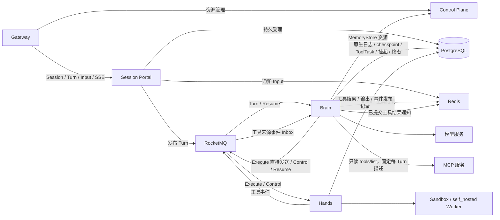
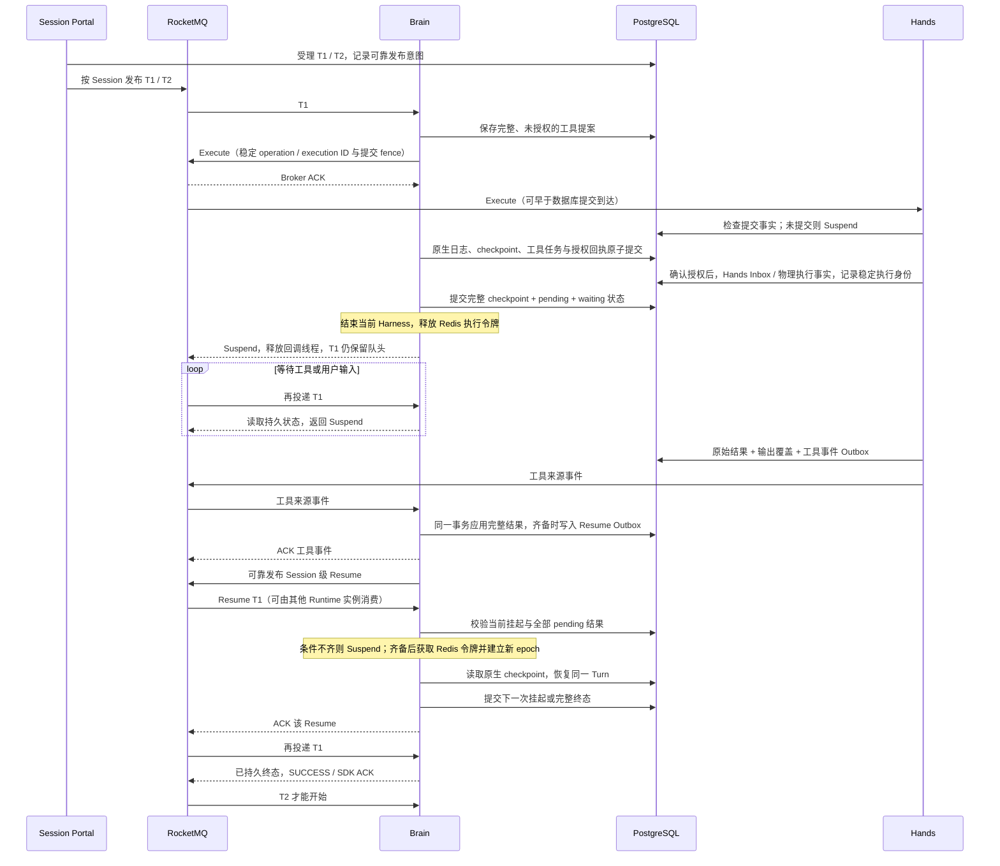

# AgentScope Service 运行架构

Session Portal 统一受理 Session、Turn 和 Input，执行端不反向依赖 Session Portal。
Brain 运行 HarnessAgent，并直接提交原生 SessionLog、checkpoint、挂起和终态；
Hands 执行工具、持久保存工具结果并发布工具事件；Runtime 统一判定结果齐备。MCP 批次直接调度持久恢复意图，其他工具和输入等待保留可靠 Resume 发布。
实施过程和验收证据见[实施记录](managed-mq-redis-refactoring-plan.md)。

MCP 一轮一批、逐调用状态和统一完成通知的当前实现见 [MCP 批次与恢复](mcp-execution-recovery.md)。本文下列独立 Resume Topic 时序继续适用于旧工具任务、非批次工具及输入等待；MCP 批次使用 `dispatch_mode=direct`，不额外发送 Resume 消息。

## 部署组件与依赖

当前源码独立部署 Control Plane、Gateway、Session Portal、Brain Dataplane、Hands 五个组件。
Control Plane 已合并原 Scheduler / Orchestration 的后台职责，不能同时启动旧部署认领相同工作。
Session Portal、Brain、Hands 共享 PostgreSQL、Redis 和 RocketMQ，不通过实例地址交接 Session。

MQ 有 Turn、Execute、Control、工具事件、Resume 五条逻辑通道，各使用一个父 Topic 和消费组，
共 5 个静态父 Topic / 消费组；根和所有子深度共享 Turn Topic 与回调池，采用
FIFO / Shared / wildcard。Turn 和 Runtime Resume 使用 Session LiteTopic；物理工具命令、来源事件使用
operation LiteTopic，不让长工具阻塞同一 Session 的其他工具或取消。Brain 消费
Turn / Resume / 工具来源事件，发布工具 Execute / Control 与 Resume；Hands 消费 Execute / Control，
只发布工具来源事件。工具事件消费组统一为 `ma_brain_tool_events_v3`，
启动前由 MQ 初始化脚本创建，不提供旧组名别名或消费位点迁移。旧运行事件 Topic 不再发布或消费。

当前源码只保留 Execute/Control、工具来源事件与 Resume 协作链路。旧 Session Portal Hands HTTP
代理、tool-grants/hands-results 回调和独立 workspace-tasks 协议已删除；Workspace
操作由 Brain 协调，通过同一工具协议交给 Hands/外部 Worker。物理 Sandbox 绑定仅保存在
`ma.hands_sandbox`，Brain 依据自己的逻辑工具事实与已准入的 self_hosted 配置判断 Workspace 需求；
即使尚未调用工具，已有用户实例也必须保留目录快照。Session Portal 不预留物理绑定，Fork 两端配置
指向同一实例时直接拒绝；Hands 在执行阶段独占借用实例。
Managed schema 直接创建当前结构，不保留旧 runtime_commit、writer_seal、callback mailbox、
ma.sandbox 或历史回填；旧 migration ledger 不自动接管，使用新的运行数据空间。

Redis 保护活动物理执行，提供 Input 与工具结果通知；PostgreSQL 保存持久事实和单调 epoch。
checkpoint 和超过 MQ 内联大小的大对象存入 `ma.private_object`，不依赖 NAS。
关闭 `userFilesEnabled` 时不开放用户文件、Shell、Artifact 工具，各 Pod 只使用临时工作目录；
Harness 内部工作数据继续使用 PostgreSQL KV 存储。公开文件功能开放后另行提供共享存储。

## Hands 表归属、状态与 MCP

| 归属 | 持久表 | 职责 |
| --- | --- | --- |
| Brain | `ma.tool_task`、`ma.tool_command_outbox` | 完整调用提案与授权回执；Execute 先取得 MQ ACK，再与 checkpoint 原子授权 |
| Hands | `ma.hands_execution`、`ma.hands_execution_event` | 去重 Inbox、物理执行状态、采集者代次与状态历史 |
| Hands | `ma.hands_control` | 取消墓碑，允许 Cancel 先于 Execute 到达 |
| Hands | `ma.hands_tool_stream`、`ma.hands_tool_event` | 输出覆盖、来源序号、事件 Outbox |
| Hands | `ma.hands_tool_result_outbox` | 原始已确认结果，重发不重新调用工具 |
| Hands | `ma.hands_sandbox` | Sandbox 物理创建意图、加密重连状态和借用绑定 |
| Brain | `ma.tool_stream`、`ma.tool_event`、`ma.tool_event_conflict` | 独立事件 Inbox、连续覆盖校验及冲突审计 |
| Brain | `ma.turn_suspension`、`ma.turn_resume` | 当前挂起条件、唯一恢复身份与可靠 Resume Outbox |
| Brain | `ma.mcp_catalog`、`ma.admin_tool_operation` | 每 Turn 的 MCP 描述，以及工作区/资源操作的远端协调事实 |

物理状态按 `ready → starting → running → result_pending → succeeded/failed/cancelled`
推进。`starting/running → unknown` 说明外部效果无法确认；Redis token 过期不会把它改回
`ready`。替换者查询原 execution，不盲目调用；原执行的确认结果即使迟到仍可持久接收。
`result_pending` 先冻结原始结果，再补齐输出的完整覆盖或明确缺口，原子保存完成与工具事件
意图。旧采集者不能继续追加输出；Brain 在事件 Inbox 中拒绝同一来源序号的不同内容，
并通过 `ma.tool_event_conflict` 保留冲突记录。

取消在查询原执行后处理，即使观察为 `unknown` / `not_found` 也向原提供方请求停止；
只有已确认终态才能完成并发布最终工具结果事件。没有停止证据时保留 `unknown`，取消后不重启工具，
已确认的原结果优先于迟到取消。取消扫描排除已转发任务，输入 Resume 优先发布以避免被工具恢复积压阻塞，
避免积压任务阻塞后续控制。Replay 先到不创建执行；重复工具意图复用第一次提交的命令和目标。
MCP 发现由 Runtime 直接完成，不进入工具命令/结果通道。旧版本在途 MCP 发现与维护操作没有输出流，允许先记录 unknown 进度，再接受任意合法来源序号的确认终态。
Sandbox 启动时同时记录 launcher 进程身份，覆盖 runner 尚未写入 owner 的窗口；丢失进程证据时仍保持 unknown，不重新启动。

Hands 无原生 Journal / checkpoint / 生命周期协调器 Bean；工作区快照、导入和资源清理由
Brain 协调，并通过同一 Execute/Control 通道交给 Hands。历史 `ma.sandbox` 保留兼容的逻辑工作区预约，
当前物理提供方只使用 `ma.hands_sandbox`；迁移复制已有 Sandbox 身份，避免创建替代实例。
运行端不读 Hands 物理表，Hands 仅读取共享 Session/Turn、工具任务及命令授权事实，不读取 checkpoint 内容。自建 Worker 的环境密钥仍由
Control Plane 校验，配置和调用目标由加密的不可变命令携带，不向 Session Portal 查询执行配置。

Managed MCP 的连接、`listTools` 和 `callTool` 都位于 Hands。Brain 在获取执行 epoch 前，通过
发现命令等待工具描述；相同 Turn 复用不可变描述，下一 Turn 重新发现。Brain 使用描述注册
代理工具并保留原权限链，调用意图固定服务、原工具名、参数、元数据和描述哈希。Hands 验证
配置及描述哈希后才发送 RPC。确认结果保留 MCP 原始内容和错误标志，Brain 恢复直接使用
原结果。RPC 发出后断连保持 `unknown`；仅发现操作可安全重试。HTTP/SSE 支持远端环境，
stdio 要求显式 local Environment。连接缓存有界，不驱逐仍在调用中的连接。

Redis 仅提供可续租的执行、采集和发布互斥，不承担结果真相、持久去重或重试历史。
MQ 使用至少一次交付；Execute 的 Broker 回执丢失时不授权任务，Runtime 接管保留原提案身份重新发送。Brain Inbox 保存乱序来源事件，仅应用连续前缀；
最终结果应用后，在同一 Session 事务内生成恢复意图，随后独立发布 Resume。

## Turn、挂起与 Resume

活动推理阶段仍由一次 MQ 回调承载；挂起阶段不跨等待保持原回调。
后续 Turn 始终留在 MQ，不扫描数据库来调度 accepted Turn，也没有本地持久 Turn 队列。
容量不足、令牌仍被其他执行者持有、原 Turn 正在挂起时，返回正常 Suspend，不按业务失败重试。
共享 Turn 回调默认 64、Resume 64；活动 Harness 容量独立有界，满时直接 Suspend。

Brain 沿用内核批量 SessionLog 提交，不为每个 token 增加事务。提交路径先检查活动 Guard，
在 Session 行锁保护的事务内校验 epoch、执行身份和日志位置，保存原生日志、公开投影、
Input 回执及工具任务。只有 committed 回执才能推进本地 head。checkpoint 对象先不可变保存，
再与挂起/终态原子关联；未被引用的对象不表示挂起成功。提交结果未知时停止本次执行，
后续由 MQ 重投获取新 epoch，从已提交 head、原生历史和 checkpoint 恢复，不查询旧批次回执。
当前执行仅缓存已明确成功的批次；Guard 失效后不得继续写入。SSE 通知只负责唤醒，丢失后从持久游标补读。

公开事件追加统一在 `ManagedJournalStore` 的事务内发送 PostgreSQL 通知，回滚不通知，
同一事务内同一 Session 的多条事件合并唤醒。Session Portal 先订阅再追赶，数据库监听重新建立后
立即追赶活跃 Session。每个 Session Portal 副本为同一 Session 共享实时增量读取与补偿定时器，
不同观察者保留独立游标和授权；慢观察者通过有界事件页及持久补读恢复，不阻塞其他连接。

恢复先扫描已提交事件元数据，仅加载最后一个有效 checkpoint 的状态对象；检查 Turn、待办和
失败决定不加载历史 checkpoint。工具 dispatch 在恢复投影的同一遍扫描中收集，Recorder 的
run/Turn 校验与历史消息 ID 收集也合并为一遍扫描。导入基线的历史消息仍需读取基线状态。
同一次执行中的日志包装器共享有界读取缓存（最多 2048 条、估算 4 MiB），超限时重新读取；
缓存不跨执行或 epoch，不授权提交，也不改变提交不确定时的失败退出行为。
工具结果补齐仍由内核获取 writer 后重新读取并事务提交，再由新的 Recorder 恢复；
原生 `readAfter` / `scan` 继续返回完整载荷。每个原生工具调用的 ToolTask 用一次查询取齐，
不再先查 ID 再逐条查询业务记录。

挂起事务不推进 Session 的 settled sequence，并清除活动执行身份。完整保存 pending 工具或
全部 pending action、恢复阶段和 checkpoint 后，Brain 才结束执行并释放令牌。
恢复仍获取 Redis 令牌并建立新 epoch；旧执行者即使迟到提交也会被数据库拒绝。
Brain 在完整应用工具来源序列后校验全部 pending 条件，在同一事务内将结果与恢复意图持久化；
Resume 绑定 Turn、当前挂起 ID、挂起代次和 publication sequence。下一次挂起或终态提交后，旧 Resume 可以 ACK；
重复或过时 Resume 不再启动 Harness。原 Turn 消息必须等整个逻辑 Turn 终态才能 ACK。

工具结果先于挂起到达，或 reply / cancel 先于 waiting_input 提交，都在相同 Session 锁下
重新检查就绪条件，避免丢失唤醒。Resume 到得比旧执行者清理更快时返回 Suspend，等待令牌释放。
结果 / Resume outbox 保留持久重发能力，Redis 丢失不能删除持久事实。
工具恢复查询稳定 execution ID，不把未知外部副作用当作未执行后重新启动。

原回调注册、完成通知、Redis 完成信箱和 `ManagedCallback*` 协议已删除。
当前 schema 不创建 callback 表，也不创建旧运行批次回执与永久 writer-seal 表。Managed
SessionLog 不再提供永久 `sealWriter`，沿用 Core 默认的不支持行为；当前执行交接后的本地禁止写入、
Redis Guard 和数据库 epoch 校验继续保留。Core SPI 及其他 SessionLog 后端不受影响。
工具结果去重由 `ma.tool_task.result_hash` 承担：摘要覆盖原始 scope/task/execution/status/result，
在 Artifact 转换前生成，与转换后的业务结果、公开投影、Outbox 关闭和恢复条件一起原子提交。
相同执行、相同摘要的重投直接确认；不同执行或内容冲突拒绝覆盖，已清理结果 Outbox 也不影响去重。
来源事件 Inbox 的序号和输出覆盖检查继续保留。

当前 schema 是完整的新基线；不自动转换或接管旧 Managed 数据空间，旧 migration ledger
的版本或校验和不匹配时明确拒绝启动。初始化及校验仍走统一 ServiceSchema 入口。

工具来源日志独立于 Core 原生 seq，沿用原有 `ma.tool_stream` / `ma.tool_event` 的连续前缀、
去重、结果水位和冲突处理，不在本轮重做工具流协议。

Broker 5.5.1 Lite 死信多重分发缺陷已完成隔离归因，按本轮范围暂不修复。
[隔离报告](../tests/managed-mq-redis/suspend-isolation/README.md)记录能力验证和已知故障，
不能用普通 Suspend 通过来宣称死信路径已通过。

## AgentTask 入口

Managed AgentTask 派发将 Attempt、固定输入和 `agent-task.dispatched.v1` Outbox 一起提交。
Outbox 使用同一 Attempt 的独立 Session、原始调用身份与幂等键向 Session Portal 受理原生 Turn，
保存真实 Turn ID。响应不确定时重试同一意图；不重排为新的 Attempt，也不调用旧
bootstrap、fence claim 或 wake HTTP 接口。

控制面通过原生 Turn 查询推进任务读模型。第一个 MCP 调用可以触发一次即时查询，
避免快速 `task.complete` 依赖周期扫描。取消使用原生 cancel Input；控制面宽限期不构成
物理停止证明，原生终态确认前保持取消中。其他执行后端继续使用各自的运行协议。

旧的 `/api/internal/runtime-sessions/{id}/start`、`heartbeat`、`events` 和产品 Session
`PATCH .../runtime` 已删除。控制面的 wake、旧工具确认推送、整 Session interrupt 与
物理 fence claim 也已移除；原生取消受理失败时不会回退到旧 DataPlane 转发。
产品迁移 `0006_remove_managed_runtime_markers` 删除四个重复的物理运行字段。

Java 的旧 Runtime 调度、DB 租约、bootstrap、HTTP 转发、旧 Worker 与同步 Agent/Session
接口已经移除；Dataplane 使用原生 ManagedSessionLogStore，不再回退到旧 SQL writer lease。
Brain 不再向控制面登记为一个同步 Runtime Protocol Agent，也不执行环境 Sandbox。MemoryStore 路由保留，
工具操作统一交给 Hands。新执行的预算超限通过原生持久事实与失败终态收敛；确认请求和 ASKING
状态原子提交，使用原生 reply 继续，不创建旧协调器票据。

数据面新建 schema 只运行重写后的 V0001，旧运行表与后续旧迁移集合已删除。Service 尚未发布
正式版本，本轮要求新数据空间，不转换旧数据或保留旧校验和。Hosted / External 的 Session Portal 与
Go 运行协议不受此次 Java 旧实现清理影响。源码清理后的最终全仓与冻结部署复验仍在进行。

Task 业务完成与原生 Turn 完成是两个事实：Job 发布终态前查询原生 Turn 的持久状态，
不再等待旧 HTTP 事件镜像。查询失败、回执身份不匹配或仍在执行时不能提前关闭结果流。
独立 Go 编排运行时通过内部 `settled` 接口查询同一判断；私有 Attempt 回执带协议版本。
Hosted / External 的拉取式工具确认保留，且决定提交后仍要等对应 Runtime 读取才恢复。

私有任务工具凭据签名绑定 Task、Attempt、代次和 Session，复用逻辑 Attempt 时不依赖封存
配置中的一小时过期时间。每次调用还必须检查当前 Attempt、Session、Agent / Binding 状态、
当前资源授权及原生执行。它是逻辑任务的工作负载身份，不持有或续租 Brain 的物理所有权。
配置中的业务执行超时先受理原生 cancel，停止证明到达后才结算为超时失败；控制面不靠
周期心跳重新派发。已经记录执行身份时，缺少会话元数据不构成停止证明。

共享 Run / Invocation 的 Managed Task 进度按原始 Attempt 读取原生 Public Event，保存
独立持久游标；公开项目和交互 ID 带对应执行作用域，跨 Turn 的事件不进入该结果流。
Required Action 回复走原 Session 的 reply Input，回执丢失复用命令身份，后续读取同一
Input 的 applied / rejected 结果。取消或被替换的 Attempt 拒绝迟到决定。此改动复用内部
执行投影，不重新开放已经退役的 Endpoint invoke 路由。

独立 Go 编排 Runtime 只运行私有执行职责，不认领公开 Invocation / Webhook 后台投递；
公开会话与发布结果的投影由资源控制面负责。

实际 Harness / MCP、180 秒本地工具、同 Turn 挂起 / Resume 及取消已通过双副本验收。
非 Leader 任务的终态 MCP 响应丢失时，可在原生 Turn 结束前只读重放已提交结果；不会
接受新结果或重新产生评论。实际代理重试和业务超时取消也已验收。Application / 委托来源、
任意 MCP 副作用的未知结果仍待专项验收；Java 旧执行链路与专属存储已清理。
Team、Workflow、Hosted 的能力扩展不在本轮范围，不能用单 Agent 的验收推断这些路径已
通过。测试中的实际中间件、显式模型夹具和未验证项目见实施记录。

## MemoryStore 资源访问

Managed Brain 的 MemoryStore 路由从封存 Session 配置核对 Session 身份、资源 owner、Store ID
集合与已解析 mount；不使用旧 cp.sessions 作为第二份会话事实。每次调用内部资源接口
`/api/internal/memory-stores/{id}/memories` 时携带既有内部服务凭据、资源 owner 和
`X-Builder-Internal-Environment`，Control Plane 检查当前 Store 归属 / 归档状态，以及当前
Environment 的 memoryAccess。用户和客户端仍使用已有公开资源接口；新增路径仅供内部服务。
旧 cp Session 的记忆访问保留给其独立执行后端，Managed 不走该分支，也不在失败时回退。

Managed 的 Turn 统一由 Session Portal 受理。Control Plane 旧会话接口不因缺少
RuntimeOwner 标记而建立第二条 Managed Turn 队列：只要封存 contract 为 Managed，旧入口
即返回 409。Hosted / External 的独立受理协议保持各自行为。

## Runtime 统一恢复决策（2026-10-19）

Hands 不再维护或发布独立的逐任务完成通知；Execute/Control 及逐任务事件格式保持不变。
Runtime 对普通工具、子 Agent 和输入统一发布持久 Resume，继续使用独立 Resume Topic 和消费容量。
消费工具结果只提交事实和恢复意图，不在该回调内运行推理。

历史迁移与 `ma.hands_resume_outbox`、`ma.tool_resume_inbox` 表保留；新 Worker 不读写旧完成表。
为接收升级期间已在 MQ 中的旧 Worker 通知，Runtime 保留载荷校验适配，只核对已应用的最终
事件和结果并生成/重排规范 Resume，不直接执行旧通知，也不再写旧 Resume Inbox。
先升级 Runtime 消费者/发布器，再移除 Worker 发布器；批量 tool call、本地直接恢复仍暂缓。
后续深度 Topic 收敛的切换要求见下节。

## Turn 深度 Topic 收敛（2026-10-19）

根和全部子 Session 的 Turn 使用 `ma_turns_v3` / `ma_brain_v3`，每个 Session 的 LiteTopic
继续由 tenant、namespace、sessionId 派生。深度仍来自冻结配置并通过 `ma_depth` 携带，
保留 16 层业务上限；消费端按消息校验深度，不再假定父 Topic 对应某个固定深度。
`child-turn-callbacks` 与部署中的子深度容量项已移除，统一使用 `turn-callbacks`。

父调用必须在持久挂起后返回 Suspend，释放共享回调和活动执行资源；子调用、其他 Session
以及独立 Resume 通道才能推进。不能把旧“持有父回调等待所有子层”的测试继续作为验收方式。
共享池测试覆盖单槽位 16 层分段等待和根 Session 下一 Turn 的 FIFO；实际 Harness 测试
覆盖单 Turn 回调、单活动 Harness 和单工具槽位下的父子完成及根取消。

部署先停止新的用户/根 Turn 准入，保留已有执行的子调用准入、输入/取消及恢复能力；
以旧版本排空所有已受理 Turn、子调用及工具/恢复消息，再停止旧消费者，
初始化新五条绑定、启动新版本后恢复准入。旧根消费者会拒绝根 Topic 中非零深度消息，
因此不能新旧生产者/消费者混跑。脚本不删除或转发旧深度 Topic，不会把改配置视为在途数据迁移。
