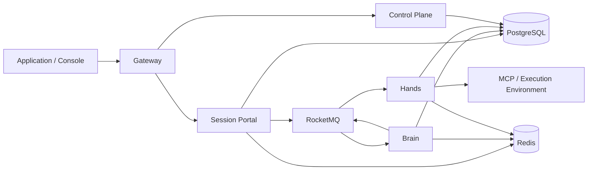

# AgentScope Service

[中文](platform-overview_zh.md) · [API quickstart](api-quickstart.en.md) · [API reference](api-reference.en.md) · [Deployment](../deploy/README.md)

**Run Agents as services. Define an Agent, open a Session, send a message, and receive results through APIs.**

AgentScope Service is a platform for building and operating Agent services on your own infrastructure. It brings Agent configuration, conversational execution, tool workers, access control, and operational visibility into one project. Applications integrate through HTTP APIs; developers and operators use the same resources through the web console.

Use it to add a specialist assistant to a product, investigate an incident with tools, process documents, or coordinate work across Agents. A Session keeps the conversation and execution context; each Turn represents one unit of work with its own status and output.

## What you can build

- **Conversational Agent services:** configure instructions and a model, create Sessions, and submit text messages from your application.
- **Agents that use tools:** connect HTTP MCP services and execution Environments; run physical tools separately from model reasoning.
- **Long-running work:** queue Turns, suspend while tools run, and continue the same logical Turn when confirmed results arrive. Execution state and results are persisted.
- **Interactive applications:** follow events through SSE, query history and final output, and explicitly steer, inject context into, or cancel a Turn.
- **Shared Agent operations:** manage identities, namespaces, Agent definitions and versions, resources, runtime hosts, Teams, and Workflows through the control plane and console.

The current Managed Session API supports text messages, interrupts, explicit Turn/Input intents, event history, future events over SSE, and independent final-output reads. Feature availability is returned by `GET /v1/sessions/{session_id}/capabilities`; see the [supported API surface](api-reference.en.md#supported-session-api). Control-plane Teams, Skills, Workflows, and other resources have their own contracts; their existence does not enable those capabilities in every Session protocol.

## Start with the API

With a running deployment and a configured model, the integration is:

```text
POST /api/v1/agents                       Prepare the Agent (platform management)
POST /v1/sessions                        Create a conversation
GET  /v1/sessions/{session_id}/events/stream
                                         Open the event stream first
POST /v1/sessions/{session_id}/events     Send user.message
GET  /v1/sessions/{session_id}/events     Read history
```

Open the Session stream first, then send an ordinary message to that Session:

```bash
curl --fail-with-body -sS "$BASE_URL/v1/sessions/$SESSION_ID/events" \
  -H "Authorization: Bearer $TOKEN" \
  -H 'Content-Type: application/json' \
  -H 'anthropic-version: 2023-06-01' \
  -H 'anthropic-beta: managed-agents-2026-04-01' \
  -H 'Idempotency-Key: hello-001' \
  --data '{"events":[{"type":"user.message","content":[{"type":"text","text":"Hello! Introduce yourself."}]}]}'
```

The response acknowledges acceptance. Streamed `agent.message` events carry the answer and `session.status_idle` marks a stopped interaction; also check for `session.error` and read history when needed. Retry an uncertain response with the same body/key. Send another ordinary message after the previous interaction is idle.

The [API quickstart](api-quickstart.en.md) follows the Claude Managed Agents Session/Events pattern, with creation, stream-first messaging, history and an official Python SDK example. Compatibility covers a verified subset: Agent/Environment setup uses this project's management APIs; Turn/Input queries, targeted controls and independent output reads are platform extensions. See [API layers](api-reference.en.md#api-layers). The [API reference](api-reference.en.md) also catalogs the wider platform API.

## Architecture



| Component under `agentscope-service/` | Responsibility |
| --- | --- |
| `service-gateway/` | Public entry and request routing |
| `service-controlplane/` | Agent catalog, configuration, identity, orchestration, scheduling, and console hosting |
| `service-session-portal/` | Session admission, caller authorization, public events and queries |
| `service-dataplane/` | Model reasoning, runtime commits, checkpoints, suspension and recovery |
| `service-hands/` | Physical tool execution, asynchronous MCP calls, and confirmed execution results |
| `service-common/` | Shared Java service implementation and execution protocols |
| `frontend/` | Web console source |
| `service-client/` | Java client; Python and TypeScript SDKs live under `service-controlplane/sdk/` |

PostgreSQL stores durable state and execution facts. RocketMQ carries ordered Turn commands and tool/resume messages. Redis provides renewable ownership tokens and transient input/result delivery. SSE disconnects do not cancel execution. An unknown external tool outcome requires reconciliation; a Worker restart does not authorize replaying the operation. See [runtime architecture](managed-runtime-dataplane.md) and [backport verification](master-sync-20261021.en.md).

## Run and deploy

Prepare Docker Compose v2, a model credential, and reachable Redis and RocketMQ services. From the repository root:

```bash
cd agentscope-service
export DASHSCOPE_API_KEY="YOUR_MODEL_API_KEY"
./deploy/init-env.sh 2.1.0-local agentscope-service-local
# Set the Redis URI and RocketMQ Proxy endpoints in deploy/.env.
# Prepare the required MQ topics/groups as described in the deployment guide.
export BUILDER_LOCAL_DEV=true
docker compose --env-file deploy/.env up -d --build --wait --wait-timeout 600
```

Open [the local console](http://localhost:18080), then follow the [API quickstart](api-quickstart.en.md). Explicit local development mode uses a development identity without login. Production uses configured user/Application credentials and resource permissions. Source builds require access to the compatible Java dependencies pinned in `pom.xml`.

Use the [deployment guide](../deploy/README.md) for infrastructure, migrations, credentials, and Compose setup; use the [Helm guide](../helm/agentscope-service/README.md) for Kubernetes. The chart expects external PostgreSQL, Redis, RocketMQ, and an explicitly configured image repository. Model and tool-provider credentials belong in deployment secrets or Vault.

## Develop

Toolchain: JDK 17+, Maven 3.9+, Go 1.26+, Node.js 22+, Python 3.9+, and Helm 3. Run Java checks from this repository root with `-T1`:

```bash
mvn -B -ntp -T1 clean verify
mvn -B -ntp -T1 spotless:check

(cd agentscope-service/service-controlplane && make build && GOFLAGS=-p=1 make test && go vet ./...)
(cd agentscope-service/frontend && npm ci && npm test && npm run lint && npm run build)
```

Edit `frontend/` source; its build generates `service-controlplane/ui/`. The CLI is `as`; Hosted processes use `agentscope-runtime-host`. Java modules use `io.agentscope`; the Python package is `agentscope-service-sdk` (`import agentscope_service`), and the TypeScript package is `@agentscope-service/dsh-controlplane`.

SDK and release-tool checks:

```bash
python3 -m venv .venv
.venv/bin/python -m pip install -e 'agentscope-service/service-controlplane/sdk/python[dev]'
.venv/bin/python -m pip install -r agentscope-service/release/requirements.txt
.venv/bin/python -m pytest -q agentscope-service/service-controlplane/sdk/python
.venv/bin/python -m unittest discover -s agentscope-service/release/tests
(cd agentscope-service/service-controlplane/sdk/dsh && npm ci && npm test && npm run build)
```

This monorepo builds Service with Core, Harness and extensions using the shared Maven `revision`. See [migration and verification notes](master-sync-20261021.en.md).

## Documentation

| Guide | Purpose |
| --- | --- |
| [API quickstart](api-quickstart.en.md) | Create an Agent and Session, send `user.message`, and read the answer |
| [Events and streaming](events-and-streaming.en.md) | Send, stream, reconnect, continue, and interrupt using the Session event API |
| [API reference](api-reference.en.md) | Session contracts, authentication, events, errors, and management routes |
| [Deployment](../deploy/README.md) | Configure and run the platform |
| [Kubernetes / Helm](../helm/agentscope-service/README.md) | Deploy the five components |
| [Runtime architecture](managed-runtime-dataplane.md) | Execution, persistence, and recovery boundaries |
| [HTTP MCP walkthrough](managed-mcp-long-tool-cluster-walkthrough.en.md) | Long tools, queued Turns, and injected input |
| [Protocol verification](../tests/session-protocol/README.md) | Reproducible protocol tests and implementation evidence |

## License

[Apache License 2.0](../../LICENSE).
