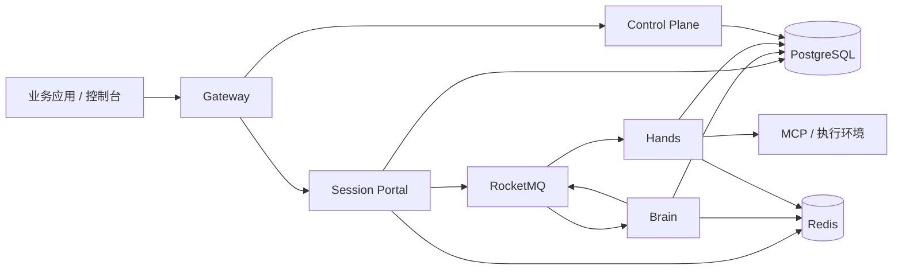

# AgentScope Service

[English](platform-overview.md) · [API 快速体验](api-quickstart.md) · [API Reference](api-reference.md) · [部署指南](../deploy/README.md)

**把 Agent 作为服务交付：定义 Agent，创建 Session，发送消息，通过 API 获取结果。**

AgentScope Service 是一个可部署在自有基础设施上的 Agent 服务平台，将 Agent 配置、会话执行、工具运行、权限控制与运行观察放在同一个项目中。业务应用通过 HTTP API 接入，开发者和运维人员通过 Web 控制台管理同一套资源。

你可以用它在产品中加入专业助手，让 Agent 调用工具排查问题、处理文档，或组织多个 Agent 协作。Session 保存对话和执行上下文；每个 Turn 对应一轮独立工作，拥有自己的状态和输出。

## 可以构建什么

- **对话式 Agent 服务**：配置指令和模型，创建 Session，从业务应用发送文本消息。
- **可调用工具的 Agent**：接入 HTTP MCP 服务和执行 Environment，将物理工具执行与模型推理解耦。
- **长时间运行的任务**：Turn 有序排队，等待工具时挂起，在收到确认结果后继续同一个逻辑 Turn，持久化执行状态与结果。
- **可交互的应用**：通过 SSE 观察事件，查询历史与最终输出，明确地引导执行、补充上下文或取消指定 Turn。
- **共享的 Agent 管理平台**：通过控制面和控制台管理身份、Namespace、Agent 定义与版本、资源、Runtime Host、Team 和 Workflow。

当前 Managed Session API 支持文本消息、中断、显式 Turn/Input 意图、事件历史、只观察未来事件的 SSE，以及独立的最终输出查询。实际能力由 `GET /v1/sessions/{session_id}/capabilities` 返回，详见[可用 API 范围](api-reference.md#supported-session-api)。控制面的 Team、Skill、Workflow 等资源有各自的协议；资源存在不代表每种 Session 协议均支持这些能力。

## 从 API 开始

准备好已运行的平台和模型配置后，接入流程是：

```text
POST /api/v1/agents                       准备 Agent（平台管理）
POST /v1/sessions                        创建会话
GET  /v1/sessions/{session_id}/events/stream
                                         先打开事件流
POST /v1/sessions/{session_id}/events     发送 user.message
GET  /v1/sessions/{session_id}/events     查询历史
```

先打开 Session 事件流，再向同一会话发送普通消息：

```bash
curl --fail-with-body -sS "$BASE_URL/v1/sessions/$SESSION_ID/events" \
  -H "Authorization: Bearer $TOKEN" \
  -H 'Content-Type: application/json' \
  -H 'anthropic-version: 2023-06-01' \
  -H 'anthropic-beta: managed-agents-2026-04-01' \
  -H 'Idempotency-Key: hello-001' \
  --data '{"events":[{"type":"user.message","content":[{"type":"text","text":"你好，请介绍一下自己。"}]}]}'
```

响应表示已受理。事件流中的 `agent.message` 提供答复，`session.status_idle` 标识交互停止；同时检查 `session.error`，需要时从历史补读。响应不确定时使用相同键和正文重试。上一段交互空闲后，可继续发送下一条普通消息。

[API 快速体验](api-quickstart.md)按 Claude Managed Agents 的 Session/Events 模式提供创建、开流、发送、历史和官方 Python SDK 示例。当前兼容范围是已验证子集；Agent/Environment 使用本项目管理接口，Turn/Input、定向控制和独立输出查询属于平台扩展，详见 [API 层级](api-reference.md#api-layers)。[API Reference](api-reference.md)同时覆盖完整平台接口目录。

## 架构



| 组件（位于 `agentscope-service/`） | 职责 |
| --- | --- |
| `service-gateway/` | 公共入口与请求路由 |
| `service-controlplane/` | Agent 目录、配置、身份、编排、调度与控制台托管 |
| `service-session-portal/` | Session 受理、调用者授权、公开事件和查询 |
| `service-dataplane/` | 模型推理、运行状态提交、checkpoint、挂起与恢复 |
| `service-hands/` | 物理工具执行、异步 MCP 调用与确定的执行结果 |
| `service-common/` | Java 服务共享实现及执行协议 |
| `frontend/` | Web 控制台源码 |
| `service-client/` | Java 客户端；Python、TypeScript SDK 位于 `service-controlplane/sdk/` |

PostgreSQL 保存持久状态与执行事实；RocketMQ 传递有序 Turn 命令、工具和恢复消息；Redis 提供可续租的所有权令牌及临时输入、结果传递。SSE 断开不会取消执行。外部工具结果未知时需要核对原执行，Worker 重启不代表可以重放操作。参见[运行架构](managed-runtime-dataplane.md)与[回迁验证](master-sync-20261021.md)。

## 运行与部署

准备 Docker Compose v2、模型凭据及可达的 Redis、RocketMQ 服务，从仓库根目录运行：

```bash
cd agentscope-service
export DASHSCOPE_API_KEY="YOUR_MODEL_API_KEY"
./deploy/init-env.sh 2.1.0-local agentscope-service-local
# 在 deploy/.env 中填写 Redis URI 和 RocketMQ Proxy 地址。
# 按部署指南准备所需的 MQ topic/group。
export BUILDER_LOCAL_DEV=true
docker compose --env-file deploy/.env up -d --build --wait --wait-timeout 600
```

打开[本地控制台](http://localhost:18080)，然后按 [API 快速体验](api-quickstart.md)操作。显式本地开发模式使用开发身份，无需登录；生产环境使用配置好的用户/Application 凭据和资源权限。源码构建需要能够解析 `pom.xml` 中固定的兼容 Java 依赖。

基础设施、迁移、凭据和 Compose 配置见[部署指南](../deploy/README.md)，Kubernetes 见 [Helm 指南](../helm/agentscope-service/README.md)。Chart 需要外部 PostgreSQL、Redis、RocketMQ 及显式指定的镜像仓库。模型和工具供应商凭据存放在部署 Secret 或 Vault 中。

## 开发

工具链：JDK 17+、Maven 3.9+、Go 1.26+、Node.js 22+、Python 3.9+、Helm 3。Java 校验从本仓库根目录运行并使用 `-T1`：

```bash
mvn -B -ntp -T1 clean verify
mvn -B -ntp -T1 spotless:check

(cd agentscope-service/service-controlplane && make build && GOFLAGS=-p=1 make test && go vet ./...)
(cd agentscope-service/frontend && npm ci && npm test && npm run lint && npm run build)
```

只修改 `frontend/` 源码，其构建会生成 `service-controlplane/ui/`。CLI 为 `as`，Hosted 进程使用 `agentscope-runtime-host`。Java 模块 groupId 为 `io.agentscope`；Python 包为 `agentscope-service-sdk`（`import agentscope_service`），TypeScript 包为 `@agentscope-service/dsh-controlplane`。

SDK 与发布工具校验：

```bash
python3 -m venv .venv
.venv/bin/python -m pip install -e 'agentscope-service/service-controlplane/sdk/python[dev]'
.venv/bin/python -m pip install -r agentscope-service/release/requirements.txt
.venv/bin/python -m pytest -q agentscope-service/service-controlplane/sdk/python
.venv/bin/python -m unittest discover -s agentscope-service/release/tests
(cd agentscope-service/service-controlplane/sdk/dsh && npm ci && npm test && npm run build)
```

本项目在同一 Maven reactor 内构建 Service、Core、Harness 和扩展，版本沿用共享的 `revision`。参见[迁移和验证记录](master-sync-20261021.md)。

## 文档导航

| 文档 | 用途 |
| --- | --- |
| [API 快速体验](api-quickstart.md) | 创建 Agent 和 Session，发送 `user.message` 并获取答复 |
| [事件与流式交互](events-and-streaming.md) | 按 Session 事件流程发送、开流、重连、继续和中断 |
| [API Reference](api-reference.md) | Session 契约、认证、事件、错误和管理路由 |
| [部署指南](../deploy/README.md) | 配置并启动平台 |
| [Kubernetes / Helm](../helm/agentscope-service/README.md) | 部署五个组件 |
| [运行架构](managed-runtime-dataplane.md) | 执行、持久化与恢复边界 |
| [HTTP MCP 操作指南](managed-mcp-long-tool-cluster-walkthrough.md) | 长工具、Turn 排队和输入注入 |
| [协议验证](../tests/session-protocol/README.md) | 可复现协议测试及实现证据 |

## 许可

[Apache License 2.0](../../LICENSE)。
