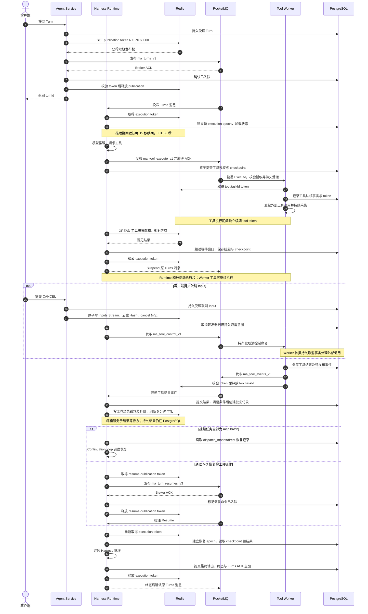

# Redis 用途与 Turn 生命周期

[English](redis-usage-and-turn-lifecycle.en.md)

本文基于 2026-10-22 `/Users/ken/agentcore/agentcore-managed-agents` 的 `master` 分支源码，按部署方式、服务组件和运行环节说明 Redis 用途。本次未查询线上 Redis 实时状态。RocketMQ 的对应关系见 [Topic 与 Turn 生命周期](rocketmq-topics-and-turn-lifecycle.md)。

## 哪些部署和组件使用 Redis

本地开发脚本、Compose 与 Kubernetes/Helm 部署均要求为 Managed 运行链路提供可达的 Redis，连接配置为 `managed-agents.runtime.redis-uri` / `MANAGED_AGENTS_RUNTIME_REDIS_URI`。正式部署依赖外部 Redis，Helm 不安装 Redis。

| 组件 | Redis 用途 |
| --- | --- |
| Agent Service | Turn 发布互斥；将已在 PostgreSQL 受理的 Input 投递到 Redis 输入副本，包含取消快速标记 |
| Agent Harness Runtime | Session 执行租约；输入补投与取消检测；工具结果邮箱写入、等待和修复；Resume 发布互斥；子 Agent 工具执行租约；checkpoint 管理与生命周期清理互斥；Harness MessageBus 接口 |
| Tool Worker | 工具执行租约与接管校验；为 self-hosted Worker 的领取、续约及相关回调校验 token；云 Sandbox 创建/重连互斥 |
| Gateway、Control Plane | 当前业务实现不直接访问上述 Redis 协议 |
| 外部 MCP 服务、self-hosted Worker | 不要求直接连接本项目 Redis；self-hosted Worker 通过 Tool Worker HTTP 协议领取、续约、上报 |

MCP、云 Sandbox、本地测试执行和 self-hosted 执行使用服务端的同一套协调基础设施；不同工具执行模式并不各自定义一套 Redis Topic。

应用 RPS 还使用 `ma:admission-rate:<quotaKey>:<unixSecond>`：应用级 Redis 计数器，有效期两秒，最多等待 200ms，限速故障时放行；它不经过 Session key 包装。详见[宽松应用额度](design/application-soft-quotas.md)。

## 各环节的用途和数据结构

以下 key 后缀均通过 `ManagedScope.key(...)` 包装，实际形式为 `ma:{scopeHash}:<suffix>`。`scopeHash` 来自 `tenant + namespace + sessionId`，花括号保留 Redis Cluster hash tag。

| 环节 | 使用方 | Key 后缀或通道 | Redis 结构 / 操作 | 用途 |
| --- | --- | --- | --- | --- |
| Turn 发布 | Agent Service | `publication` | String，`SET NX PX` | 同 Session 的短期发布互斥；默认 TTL 60 秒，发送前校验持有权，结束后释放 |
| Turn 推理与恢复 | Runtime | `execution` | String token；Lua 校验 token 后续期/删除 | 同 Session 活跃推理互斥；默认 TTL 60 秒、每 15 秒续期，配合数据库 execution epoch 隔离旧尝试 |
| Runtime Resume 发布 | Runtime | `resume-publication` | String，`SET NX PX` | 多副本扫描 Resume 待发布记录时取得短期发布权；TTL 60 秒 |
| 工具执行与接管 | Tool Worker；Runtime 的子 Agent 执行器 | `tool:<taskId>` | String token；持有权检查、续期和释放 | 同一任务的活动执行协调，默认 TTL 60 秒；服务内工具循环每 15 秒续期，self-hosted Worker 通过 HTTP 请求续约 |
| 用户 Input 通知副本 | Agent Service 写入、Runtime 补投与检查 | `inputs:<turnId>`、`input-seen:<turnId>`、`cancel:<turnId>` | Stream + Hash 去重索引 + String 取消标记；Lua 原子写入 | 保存 `STEER`、`INJECT`、`REPLY`、`CANCEL` 的通知副本和持久载荷引用；取消标记供运行控制循环快速检测 |
| 工具结果邮箱 | Runtime 写入/修复，Runtime 等待方读取 | `tool-result:<taskHash>` 及 `:identity` | 单结果 Stream（`MAXLEN=1`）+ 身份 String；`XREAD` | 将已提交的不可变工具结果通知给内联等待方；每次发布或修复刷新 5 分钟 TTL，多个等待方读取相同结果 |
| 云 Sandbox 创建/重连 | Tool Worker | `sandbox-create` | String，`SET NX PX` | 对同 Session 的云 Sandbox 创建/恢复加短期互斥；TTL 60 秒，完成后释放 |
| checkpoint 管理操作 | Runtime | `checkpoint:<operationId>` | 可续期 String token | 在副本间协调 checkpoint 管理操作；默认 TTL 60 秒、每 15 秒续期，实际工作按持久管理记录推进 |
| 生命周期清理 | Runtime | `lifecycle-cleanup` | 可续期 String token | 在副本间协调 Session 生命周期清理；默认 TTL 60 秒、每 15 秒续期 |
| Harness 内部 MessageBus | Runtime 中的 Harness/中间件 | `harness:queue:<hash>`、`harness:log:<hash>`、逻辑 `harness:broadcast:<hash>` | List 队列、Stream 日志、Pub/Sub | 提供 SDK 队列、可读消息日志和广播原语；物理 Pub/Sub 通道统一为 `ma:harness:notifications`，按逻辑 key 分发 |

输入 Stream 提供 `XREAD` 接口，但不能据此认为当前 Turn 主路径以 Stream 游标驱动所有输入。当前 Harness 从 PostgreSQL 按业务顺序读取待应用 Input，并在运行控制循环中检查 Redis 取消标记；约每 2 秒从持久输入记录补投，取消标记检查周期约 200ms。

普通 Tool Worker 使用持久化的 Control 命令/取消墓碑判定取消。`ManagedToolExecutions` 仅在非 `ManagedToolWorkerStore` 路径（例如 Runtime 子 Agent 工具）额外读取 Redis 取消标记，不能把普通 Worker 的取消链路画成只读 Redis 标记。

Harness MessageBus 在构建 Managed Harness 时注入，但具体操作取决于 SDK/中间件是否调用，并非每次 Turn 必然产生队列、日志和广播。其 Stream 消息日志也不是原生 SessionLog 或 checkpoint。Pub/Sub 广播没有持久重放保证。

## 一次长耗时工具调用的 Redis 时序

Runtime 和 Worker 均代表多副本服务。图中 MQ 用单一参与者合并展示 Topic；关注点是 Redis 的发布互斥、执行租约、通知和恢复时的再认领。

若工具快速完成，结果邮箱可以让 Runtime 在原执行尝试中继续，无需挂起。`mcp.batch` 的持久恢复由数据库记录驱动，Redis 邮箱不是其唯一恢复触发条件。事件回调唤醒失败后，后台扫描仍可重试直接恢复。

Sandbox 创建、checkpoint 管理、生命周期清理和 SDK MessageBus 的按需操作未展开为每个 Turn 的必经步骤。输入等待恢复仍走 Resumes Topic；它与工具结果恢复的共同点是恢复时重新取得 Session 执行租约。

## 持久性与故障边界

- PostgreSQL 保存 Turn/Input 受理事实、工具授权与结果、checkpoint、挂起、恢复记录和终态。Redis 租约不能代替数据库 epoch、授权检查或幂等校验。
- Input 通知副本和工具结果邮箱可以从 PostgreSQL 补建；Stream 游标不代表 Input 已应用，邮箱过期不代表工具失败。
- Redis 不可用或 token 失效时，不能继续按旧持有权安全执行。执行 guard 会使旧尝试失效并尝试中断；外部工具的真实结果仍需按持久事实和恢复协议确认，不能凭租约丢失盲目重跑。
- SDK 队列/日志及 Pub/Sub 不承诺像 Input 与工具结果邮箱一样自动从数据库重建。
- Redis token 的续期不等于 RocketMQ 消息续期或 ACK。Turn 挂起释放执行 token，原 Turns 消息仍等待终态。
- 控制连接和阻塞读连接分离，并发阻塞读默认上限为 64，避免 `XREAD` 阻塞租约续期连接。

## 实现入口

- [Redis 客户端、租约、输入副本和广播](../common/src/main/java/io/agentcore/managed/server/runtime/managed/RedisManagedInfrastructure.java)
- [公共 Redis 配置](../common/src/main/java/io/agentcore/managed/server/runtime/managed/ManagedInfrastructureConfiguration.java)
- [Turn 发布互斥](../common/src/main/java/io/agentcore/managed/server/runtime/managed/ManagedTurnPublisher.java)
- [Session 执行 guard](../common/src/main/java/io/agentcore/managed/server/runtime/managed/ManagedExecutionGuard.java)
- [输入投递和补建](../common/src/main/java/io/agentcore/managed/server/runtime/managed/ManagedInputDelivery.java)
- [Harness 取消检测与输入处理](../agent-harness-runtime/java/adapter-agentscope/src/main/java/io/agentcore/managed/server/runtime/managed/ManagedHarnessTurns.java)
- [工具执行与续约](../agent-service/src/main/java/io/agentcore/managed/server/runtime/managed/ManagedToolExecutions.java)
- [工具结果邮箱](../common/src/main/java/io/agentcore/managed/server/runtime/managed/RedisManagedToolResultDelivery.java)
- [工具结果邮箱修复](../agent-service/src/main/java/io/agentcore/managed/server/runtime/managed/ManagedToolResultRelay.java)
- [Runtime 各循环及结果通知装配](../agent-harness-runtime/java/brain-agentscope/src/main/java/io/agentcore/managed/server/runtime/ManagedHarnessRuntimeConfiguration.java)
- [self-hosted Worker 协议](../tool-worker/src/main/java/io/agentcore/managed/server/toolworker/ManagedWorkerService.java)
- [云 Sandbox 互斥](../tool-worker/src/main/java/io/agentcore/managed/server/toolworker/ManagedSandboxProviders.java)
- [Harness MessageBus](../agent-harness-runtime/java/adapter-agentscope/src/main/java/io/agentcore/managed/server/runtime/managed/ManagedRedisMessageBus.java)
