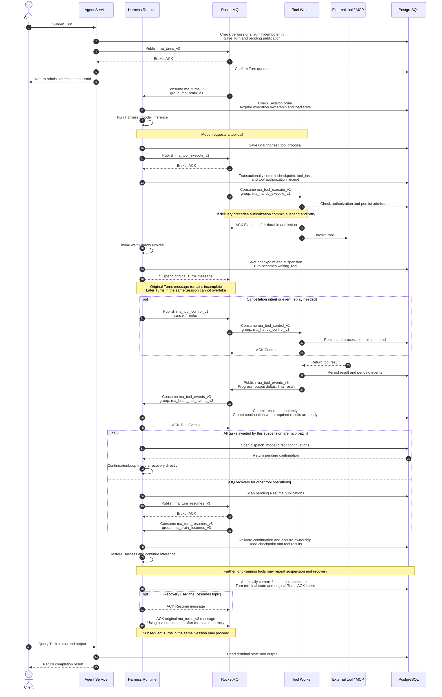

# RocketMQ topics and the Turn lifecycle

[中文](rocketmq-topics-and-turn-lifecycle.md)

This document describes business topics, producers, subscribers, and a Turn involving a long-running tool. It is based on the `master` source in `/Users/ken/agentcore/agentcore-managed-agents` on 2026-10-21. Names below are configuration defaults, not a live inspection of deployed MQ resources.

## Topics, producers, and subscribers

The implementation uses five LITE parent topics, each with a separate consumer group. Topic and group names are configurable.

| Parent topic | Logical channel | Producer | Subscriber | Default consumer group | Purpose |
| --- | --- | --- | --- | --- | --- |
| `ma_turns_v3` | `TURNS` | Agent Service | Agent Harness Runtime | `ma_brain_v3` | Accepted Turns that drive inference |
| `ma_tool_execute_v1` | `TOOL_EXECUTE` | Agent Harness Runtime | Tool Worker | `ma_hands_execute_v1` | Tool execution commands: `execute` |
| `ma_tool_control_v1` | `TOOL_CONTROL` | Agent Harness Runtime | Tool Worker | `ma_hands_control_v1` | Cancellation (`cancel`) and event replay requests (`replay`) |
| `ma_tool_events_v3` | `TOOL_EVENTS` | Tool Worker and Agent Harness Runtime | Agent Harness Runtime | `ma_brain_tool_events_v3` | Tool progress, output deltas, output gaps, and final results; Runtime also publishes events from child Agent execution |
| `ma_turn_resumes_v3` | `TURN_RESUMES` | Agent Harness Runtime | Agent Harness Runtime | `ma_brain_resumes_v3` | Scheduling suspended Turn recovery through MQ |

Gateway and Control Plane do not directly publish or subscribe to these business topics. The self-hosted MQ initialization script also creates `DefaultHeartBeatSyncerTopic` for Proxy heartbeats; it is not one of the five business topics. This project does not need to create that internal topic for cloud MQ.

## LiteTopics and ordering

- `TURNS` and `TURN_RESUMES` use a Session LiteTopic derived from `tenant + namespace + sessionId`. Root Turns and all child depths share the Turns parent topic.
- `TOOL_EXECUTE`, `TOOL_CONTROL`, and `TOOL_EVENTS` use an operation LiteTopic derived from the Session identity and `taskId`. Publication sets the route with `setLiteTopic(messageGroup)`.
- Replicas with the same role share consumer groups and distribute consumption through Shared / wildcard subscriptions. Recovery is not tied to the original Runtime instance.
- FIFO ordering applies within one LiteTopic under one parent topic. Cross-topic ordering depends on database state, authorization checks, and business idempotency.
- The original Turns message remains incomplete until the full Turn terminal state is committed. Suspension retains the FIFO head; terminal commit allows acknowledgement and subsequent Turns in the same Session to proceed.

## Two recovery paths after tool completion

Tool completion does not always pass through the Resumes topic:

- If every task awaited by the suspension is `mcp.batch`, Runtime commits the tool result and creates a durable continuation with `dispatch_mode=direct`. `ManagedContinuationLoop` resumes it directly without publishing to `ma_turn_resumes_v3`. Result notifications wake the executor, and a database scan every 500 ms repairs missed notifications and replica failure.
- Other tool operations and input waits retain MQ recovery: `ManagedResumePublisher` publishes to `ma_turn_resumes_v3`, which Runtime consumes to resume execution.

Both paths restore a durable checkpoint and reacquire execution ownership. Neither tool event ACK nor Resume ACK replaces the original Turn terminal commit.

## Complete Turn sequence

The diagram shows a tool exceeding the inline wait window and causing suspension. Runtime and Worker each represent a replica set; another Runtime replica may perform recovery. Gateway forwarding is omitted.

The diagram omits Redis execution leases and result notifications, MQ retries, and failure branches. Progress and output events may be published throughout tool execution; their publication and consumption are grouped here. `mcp.batch` uses the parent batch completion event. Fast tools may finish without suspension. If the initial Turns send fails or has an ambiguous response, the durable admission remains pending for publication retry.

The Execute Broker ACK proves only MQ admission. Worker must still check database authorization and persist admission before acknowledging Execute; physical execution can continue afterward. Control ACK means the command was processed, not that an external MCP operation stopped immediately. A Turn may finish as `succeeded`, `failed`, or `cancelled`.

## Implementation entry points

- [Topic defaults, role publication permissions, and consumer groups](../common/src/main/java/io/agentcore/managed/server/runtime/managed/ManagedInfrastructureConfiguration.java)
- [MQ publication and subscription](../common/src/main/java/io/agentcore/managed/server/runtime/managed/RocketMqManagedMessageBus.java)
- [Tool Execute / Control publication](../common/src/main/java/io/agentcore/managed/server/runtime/managed/ManagedToolTransport.java)
- [Worker authorization checks and command admission](../tool-worker/src/main/java/io/agentcore/managed/server/runtime/managed/ManagedToolWorkerCommands.java)
- [Continuation records and MQ / direct routing](../common/src/main/java/io/agentcore/managed/server/runtime/managed/ManagedSuspensions.java)
- [Direct continuation executor](../common/src/main/java/io/agentcore/managed/server/runtime/managed/ManagedContinuationLoop.java)
- [Resume publisher](../agent-service/src/main/java/io/agentcore/managed/server/runtime/managed/ManagedResumePublisher.java)
- [Terminal ACK for original Turns messages](../agent-harness-runtime/java/adapter-agentscope/src/main/java/io/agentcore/managed/server/runtime/managed/ManagedTurnAcknowledgements.java)
- [MCP batch execution and recovery](mcp-execution-recovery.en.md)
- [Cloud RocketMQ configuration](cloud-rocketmq.en.md)
