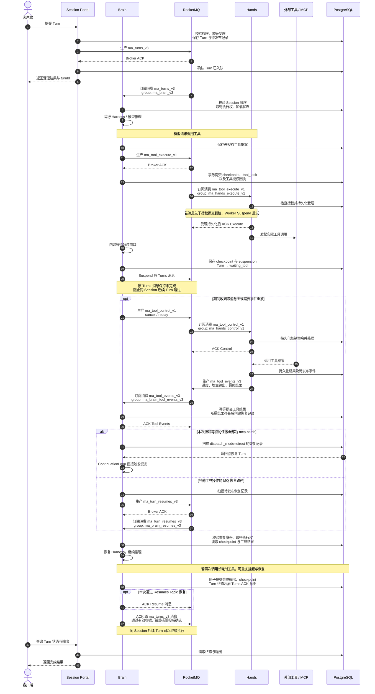

# RocketMQ Topic 与 Turn 生命周期

[English](rocketmq-topics-and-turn-lifecycle.en.md)

本文基于 2026-10-21 回迁后的 AgentScope Service 实现，梳理业务 Topic、生产订阅关系及一次长耗时工具调用的 Turn 时序。以下名称是配置默认值，不代表对线上 MQ 实时状态的查询结果。

## Topic 与生产订阅关系

当前业务使用 5 个 LITE 父 Topic，每个父 Topic 对应一个独立消费组。Topic 和消费组名称均可配置。

| 父 Topic | 逻辑通道 | 生产者 | 订阅者 | 默认消费组 | 用途 |
| --- | --- | --- | --- | --- | --- |
| `ma_turns_v3` | `TURNS` | Session Portal | Brain | `ma_brain_v3` | 已受理的 Turn，驱动推理执行 |
| `ma_tool_execute_v1` | `TOOL_EXECUTE` | Brain | Hands | `ma_hands_execute_v1` | 工具执行命令 `execute` |
| `ma_tool_control_v1` | `TOOL_CONTROL` | Brain | Hands | `ma_hands_control_v1` | 取消 `cancel`、事件重放请求 `replay` |
| `ma_tool_events_v3` | `TOOL_EVENTS` | Hands、Brain | Brain | `ma_brain_tool_events_v3` | 工具进度、增量输出、输出缺口和最终结果；Runtime 也发布子 Agent 执行产生的事件 |
| `ma_turn_resumes_v3` | `TURN_RESUMES` | Brain | Brain | `ma_brain_resumes_v3` | 通过 MQ 调度挂起 Turn 的恢复 |

Gateway 和 Control Plane 不直接生产或订阅这些业务 Topic。自建 MQ 初始化脚本还创建 `DefaultHeartBeatSyncerTopic`，用于 Proxy 内部心跳，不计入上述 5 个业务 Topic；云 MQ 不需要由本项目创建该内部 Topic。

## LiteTopic 与顺序约束

- `TURNS`、`TURN_RESUMES` 按 `tenant + namespace + sessionId` 的摘要划分 Session LiteTopic。根 Turn 与所有子深度共享同一个 Turns 父 Topic。
- `TOOL_EXECUTE`、`TOOL_CONTROL`、`TOOL_EVENTS` 按 Session 身份与 `taskId` 的摘要划分操作 LiteTopic。发送端通过 `setLiteTopic(messageGroup)` 指定路由。
- 同职责副本共享消费组，通过 Shared / wildcard 订阅分担消费。恢复不绑定原 Runtime 实例。
- FIFO 顺序限定于同一父 Topic 下的同一 LiteTopic；不同 Topic 之间的顺序依赖数据库状态、授权校验和业务幂等。
- 原 Turns 消息在 Turn 完整终态提交前保持未完成。挂起期间保留队头，终态提交后才允许确认原消息并推进同 Session 后续 Turn。

## 工具完成后的两条恢复路径

当前实现不能将所有工具完成都画成经过 Resumes Topic：

- 当本次挂起等待的任务全部为 `mcp.batch` 时，Runtime 提交工具结果并创建 `dispatch_mode=direct` 的持久恢复记录，通过 `ManagedContinuationLoop` 直接恢复，不发送 `ma_turn_resumes_v3`。结果通知会唤醒恢复执行器，500ms 周期数据库扫描负责补偿通知丢失或副本退出。
- 其他工具操作及输入等待继续通过 `ManagedResumePublisher` 发布 `ma_turn_resumes_v3`，由 Runtime 消费并恢复。

两条路径都从持久 checkpoint 恢复，并重新取得执行权；工具事件 ACK 或恢复消息 ACK 均不能代替原 Turn 的终态提交。

## 一次 Turn 的完整时序

下图展示工具耗时超过内联等待窗口、Turn 发生挂起的情形。Runtime、Worker 均代表一组副本，图中恢复动作可以由另一 Runtime 副本完成。客户端请求经过 Gateway 转发的细节省略。

时序图省略了 Redis 执行租约及结果通知、MQ 重试和各类故障分支。工具进度和增量输出可以在工具执行期间持续发布；图中将事件生产消费合并展示，`mcp.batch` 使用父批次完成事件。快速完成的工具不一定触发挂起。初次 Turns 发送失败或响应不明时，Session Portal 已持久受理的记录仍保留，由待发布记录重试。

Execute 的 Broker ACK 只证明消息已入队。Worker 仍需检查数据库授权，持久受理后才 ACK Execute，实际执行可以在其后继续。Control ACK 表示控制命令已处理，不保证外部 MCP 操作立即停止。最终 Turn 状态可以是 `succeeded`、`failed` 或 `cancelled`。

## 实现入口

- [Topic 默认值、角色生产权限与消费组](../service-common/src/main/java/io/agentscope/builder/runtime/managed/ManagedInfrastructureConfiguration.java)
- [MQ 消息发送与订阅](../service-common/src/main/java/io/agentscope/builder/runtime/managed/RocketMqManagedMessageBus.java)
- [工具 Execute / Control 发送](../service-common/src/main/java/io/agentscope/builder/runtime/managed/ManagedToolTransport.java)
- [Worker 授权检查与命令受理](../service-common/src/main/java/io/agentscope/builder/runtime/managed/ManagedHandsCommands.java)
- [恢复记录及 MQ / direct 路径选择](../service-common/src/main/java/io/agentscope/builder/runtime/managed/ManagedSuspensions.java)
- [直接恢复执行器](../service-common/src/main/java/io/agentscope/builder/runtime/managed/ManagedContinuationLoop.java)
- [Resume 发布器](../service-common/src/main/java/io/agentscope/builder/runtime/managed/ManagedResumePublisher.java)
- [原 Turns 消息终态 ACK](../service-common/src/main/java/io/agentscope/builder/runtime/managed/ManagedTurnAcknowledgements.java)
- [MCP 批次与恢复说明](mcp-execution-recovery.md)
- [云 RocketMQ 配置](cloud-rocketmq.md)
