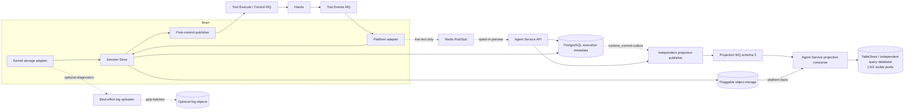
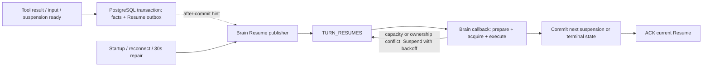

# Embedded Session Store and asynchronous projections

> This document describes the current embedded implementation. See the [multilanguage Brain layout and deployment design](design/brain-runtime-layout-and-deployment.en.md) for a logically separate Session Service initially hosted by an existing platform service. That migration is not implemented.

Current projection delivery uses schema 3. Dated sections below preserve historical iterations, not the current deployment contract. See the [execution/projection redesign](../../docs/execution-commit-and-projection-delivery-redesign.en.md) for implementation and acceptance status.

Session Store is an embedded Brain component. It freezes checkpoints and reliable execution facts in object storage, then advances the execution head, records a commit receipt and authorizes tool commands in one short PostgreSQL transaction. The kernel advances its durable head only after `committed`. Repeating the same scope/commit ID returns its original receipt, even after a lost response or epoch change; conflicting content is rejected.

Kernel adapters split native state save/restore from optional session logs. `ManagedCheckpointObjects` stores frozen state with content reuse and individual manifests/continuations. Reliable facts use `recovery_segment` references and `recovery_fact_identity`; raw chunks never enter these tables. Existing binary metadata names such as `native_sequence` remain, but count reliable facts rather than log completeness.

Kernel `scan/scanMetadata` uses a private latest-checkpoint/current-Turn fact view, without completed-Turn segment scans or obsolete checkpoint bodies. Execution position and `first_recovery_sequence` come from `ma.turn`. Ordinary `readAfter/readMetadataAfter` preserves paging identities/ranges, separate from bootstrap pruning. Required recovery content fails closed; optional log loss has no recovery effect.

## Atomic commit and tool handoff

Upload and validation happen before execution-row locks. Saving an object stages content; only the transaction registering its reference and receipt makes it recoverable. Failed commits may leave unreferenced objects; automatic garbage collection is disabled.

ToolTask, checkpoint references and authorized command Outbox entries commit together. Brain subsequently publishes Execute/Control; failures leave retryable work. Hands still checks durable authorization and owns physical execution idempotency. Tool Events return results to Brain; durable results precede waiter notifications and recovery scheduling. Removing Boundary submission does not remove tool/result/resume/Session Ready channels.

An MCP wave that failed before commit is not a recovery fact. Its already approved native call may recover individually before the kernel organizes the remaining batch. Call identities, committed results and effect deduplication remain stable; recovery may use more segments.

The standalone Session Store artifact, HTTP accepted endpoint, Boundary Topic/Inbox, polling and commit-mode opt-in are removed. PG no longer serves as a private object backend. The unreleased project uses a fresh target schema without old-format readers or data conversion.

## Agent Service projection ownership

Session accepted/commit prefixes advance in the existing execution transaction. Manifests and minimal publication state live in `ma.runtime_commit`. Separate `projection_commit`, `projection_source_head` and `projection_progress` tables are removed. `ma_session_projections_v3` carries self-contained consecutive commit references, not just a wakeup hint.

Agent Service supports `both` and `api-only`. Normal projection has no execution PostgreSQL IO or dedicated execution projection pool. Bounded consumers read objects, write TableStore/independent query storage, CAS the visible prefix, then ACK. Duplicate identity is verified in the query backend; gaps release receipts for retry. Commit hints and a short coalescing window drive publication; low-frequency indexed scans repair outbox delivery. SSE uses best-effort Redis broadcasts and cursor repair without SQL consumer-progress mirrors.

Projection retains fact `created_at`. History uses protocol sequence to break timestamp ties, keeping Turn completion before a successor running event when a batch is materialized within one millisecond.

The projection API works for every Session without a Session Store extension header. An unmet `minSequence` returns 202 + Retry-After. Public resources, snapshots, usage and cursors use the projected prefix; budget decisions and authoritative output sealing remain part of core commits.

## Platform fact packages: object content, SQL commit identities

A content-addressed `platform-facts` object is `{schemaVersion:1,scope,entries:[{type,payload}]}`. Packages target 4 MiB and at most 128 distinct entries; a single larger entry remains subject to the backend's 64 MiB limit. Different fact identities can reference the same content. Producers may freeze candidate control events before locking; only entries selected by committed SQL indexes belong to the accepted prefix.

Ranges, immutable references, ordinals and hashes live in the execution commit's `projection_manifest`; private-only commits have no public version. Cross-path tool completion keeps business identity deduplication. Brain and resource operations stage objects before locks; command/catalog facts instead commit bounded inline data and materialize objects outside SQL before publication. Object success does not imply execution commit, and automatic GC is disabled.

Normal consumption follows schema 3 references without execution-PG manifest, command-link or catalog queries. Required links and descriptors are reconstructed from command/catalog facts in query storage. Messages contain at most 32 commits, 1 MiB metadata and 64 MiB referenced content. Visibility CAS follows all writes; partial suffixes remain invisible. See the [execution/projection redesign](../../docs/execution-commit-and-projection-delivery-redesign.en.md) for fields, failure windows, rebuild, deployment and acceptance results.

## ModelCallResult: outcome durability and model completion share a commit

The model invocation adapter in `ManagedFinalization` uses `ManagedModelCapture` to directly aggregate provider text, tool arguments, usage and finishReason without log reads. Request/response capture has a 16 MiB limit. Successful completion freezes one complete semantic response; failed/cancelled outcomes contain no replayable partial text. `ManagedModelResults` saves private request/result objects before `model/end` commitment; recovery segments keep result references, without native-manifest/chunk scans during construction.

`model_call_result` is separate from billing and atomically registers request position, entry checkpoint, outcome reference, status and `replay_hash`. Raw request digests verify objects; normalized request digests match rebuilt calls, with frame/slot validation in finalization. Primary reasoning may reuse completed matching outcomes not yet absorbed by a checkpoint. Saved outcomes are not applied state: subsequent checkpoint/Head commits establish application. Missing required results never fall back to logs.

## Best-effort logs and online previews

`ManagedSessionLogArchive` uses a separate 4096-record/8 MiB queue and one uploader, batching gzip objects under `session-log`. Failed uploads are dropped without reconciliation, repair, uniqueness/ordering requirements or PG archive directories/progress. Logs are outside checkpoint roots and bypass core object caching. The module defaults on while raw model/tool chunks default off; disabling all logging never changes execution/recovery. `managed.agents.session.log.*` gauges expose buffered bytes, drops, uploads and errors without proving completeness.

Each authorized SSE connection opts in with `event_deltas[]=agent.message`. Model-start snapshots fix eligible connection tokens; leases store tokens only. Targeted node Redis Pub/Sub uses no reliable MQ/Redis Stream. A call selects at most 128 preview connections; omissions affect presentation only. Publisher queues cap at 256 frames, connections at 64 frames/256 KiB; gaps, slow readers or stale epochs stop the preview. Complete durable messages replace it, failed termination closes it, and the merged output filters late deltas again before delivery.

Public event_start/event_delta frames have no own SSE ID, fact bundle, public-event row, resource reducer or cursor position. Tool/thinking previews, Last-Event-ID and delta replay remain unsupported. History retains complete durable messages. The binary SPI name `SessionLog` does not make recovery ACKs lossy.

## Object backend configuration

Brain, Agent Service and Tool Worker must share a stable backend ID and durable content namespace. References from another backend are rejected. Objects are limited to 64 MiB and verified against raw SHA-256/size; state retains its content identity. The filesystem provider uses fsync and atomic no-overwrite publication, rejecting traversal and namespace symlinks. S3 uses conditional single PUT and probes conditional-write enforcement at startup. Native OSS uses forbid-overwrite and rejects enabled/suspended bucket versioning. No failure falls back to PG.

| Environment variable | Meaning |
|---|---|
| `MANAGED_AGENTS_OBJECT_STORE_PROVIDER` | `filesystem`, `s3` or `oss` |
| `MANAGED_AGENTS_OBJECT_STORE_BACKEND_ID` | Stable identity shared by replicas; default `runtime` |
| `MANAGED_AGENTS_OBJECT_STORE_ROOT` | Required filesystem root; shared durable storage for multiple nodes |
| `MANAGED_AGENTS_OBJECT_STORE_ENDPOINT/BUCKET` | S3 or OSS endpoint/bucket |
| `MANAGED_AGENTS_OBJECT_STORE_REGION` | S3 region; default `us-east-1` |
| `MANAGED_AGENTS_OBJECT_STORE_ACCESS_KEY/SECRET_KEY` | Inject using business Secrets |
| `MANAGED_AGENTS_SESSION_LOG_ENABLED` | Brain best-effort archive, default true; Helm `runtime.sessionLog.enabled` |
| `MANAGED_AGENTS_SESSION_LOG_CHUNKS_ENABLED` | Raw model/tool chunk archive, default false; Helm `runtime.sessionLog.chunksEnabled` |
| `MANAGED_AGENTS_PROJECTION_ROLE` | Agent Service `both` or `api-only` |
| `MANAGED_AGENTS_PROJECTION_CONCURRENCY` | MQ callback concurrency; default 4, range 1..32 |

Compose mounts a dedicated persistent `runtime-objects` volume. Helm defaults to S3; filesystem installations explicitly supply `objectStore.existingClaim` backed by suitable durable RWX storage. Disabling public workspaces/artifacts does not disable private recovery storage. Changing templates does not deploy them.

## Historical scope of the first object-store migration

That first iteration externalized checkpoint/state, complete native segments, platform fact bundles, model requests/results and large MQ payloads. PG retains execution metadata, fact identities/bundle indexes, required authoritative output/task content and public query views. At that point diagnostic archives were not yet separate and chunks still lived in private segments. Subsequent changes supersede that behavior: ModelCallResult is generated directly and logs are best effort. A projection-only deployment role and automatic GC remain disabled.

Local checks cover lost commit responses, conflicting identities, fencing, cross-Brain reads, deduplication, missing/corrupt objects, immutable writes, tool authorization/Broker outages, projection failure isolation, snapshot prefixes and real Harness recovery. S3 is checked through a local HTTP protocol endpoint; OSS tests validate SDK arguments/versioning. These checks do not establish cloud capacity. That iteration used bounded byte arrays without a global in-flight byte budget; budgets were subsequently added and deployed as described below. Streaming compression and bulk cold-recovery stress remain future work.

See the [full design](../../docs/session-store-oss-and-direct-commit-design.en.md).

## Earlier local iteration verification — 2026-10-23

Changes are in the primary project directory on `master`. Existing workspace changes are preserved; no commit, push or deployment was performed.

| Check | Result |
|---|---|
| Root `mvn -B -ntp -T1 clean verify` | Passed; 953 tests listed, 725 executed successfully, 228 conditional external/optional cases skipped |
| Root `mvn -B -ntp -T1 spotless:check` | Passed |
| PostgreSQL 17 acceptance | 37 passed, none skipped; direct commits, model-result atomicity, entry-checkpoint association, fact-package integrity, concurrent projections, object-IO/SQL transaction isolation, tool authorization and target schema |
| `python3 -m unittest discover -s managed-agents/release/tests` | 57 passed in the preceding iteration; MQ initialization, Helm rendering and shared object-volume constraints. Templates are unchanged in this iteration; this check was not repeated |

PostgreSQL acceptance selected `ManagedPostgresSessionStoreIntegrationTest`, `ManagedPostgresToolSubmissionIntegrationTest`, `ManagedSchemaMigrationIntegrationTest` and `ManagedPostgresArtifactsIntegrationTest` against a newly created temporary local PostgreSQL container, removed after testing. Full verification includes actual Harness/MCP SDKs and local HTTP fault scenarios. Conditional external MQ/Redis, official SDK-environment and cloud-credential tests were not all executed; no cloud capacity benchmark was run.

### Capacity budgets and targeted recovery

The object backend limits both connections and in-flight bytes (32 requests, 256 MiB, and a five-second admission wait by default). Projection has its own four-request, 128 MiB budget. A byte-bounded immutable content cache defaults to 64 MiB with a 256 KiB item limit. It caches only durable, hash-validated content, never execution heads or projection watermarks. The default 16384-entry state identity cache deduplicates checkpoint payloads without retaining full states. A projection callback drains pages toward the notified watermark within a time/batch budget and retries if more remain; repair scanning isolates failures per Session.

`finalization_frame` and `finalization_model` record capture references, completion sequences, model slots, and request digests atomically with execution commits. Recovery reads the matching capture and ModelCallResult directly instead of scanning native logs for frame or slot discovery. Object reads occur outside SQL transactions; indexes expose only committed prefixes. Metrics cover actual backend requests, bytes, waiting, failures, capacity timeouts, and cache hits. Automatic object GC remains disabled.

### Deployment settings and reproduction

The [10,000-inflight object-store overlay](../tests/pts/values-objects-10000.yaml) pins Java image digests and the separately retained Control Plane image, configures the object backend and seven topic/group bindings, and sets request/byte budgets plus Agent Service's dedicated projection pool. This explicit synthetic-model benchmark profile requires precreated private Secrets, a fresh data space, and provisioned cloud resources. Do not apply it to an old `ma` ledger. Only Agent Service, Brain, and Hands receive the object credential Secret. Business and migration connections use separate overrides; Control Plane catalog connections remain independent.

Helm exposes projection topic/group and connection, concurrency, and object budgets so a later deployment does not revert to default channels or shared capacity. Each of the four schema Jobs honors its component image override: dataplane migration needs the Brain JAR, while Runtime metadata migration uses the Agent Service JAR. Migration tasks and ordinary services always use separate credentials.

Projection wakeups coalesce per Session: continuous writes preserve the existing one-second cooldown, and a conditional update lets one Brain reserve each notification attempt. Reservations expire after a sender crash; watermark scanning repairs lost notices. This ownership is only a derived scheduling hint, never execution fencing or a prerequisite for commit/recovery. Consumers skip notifications already covered by the projected watermark before reading objects. These changes reduce notification/read amplification without changing authoritative facts or completed projection progress.

### Fixed two-replica capacity baseline

This release fixes Gateway, Control Plane, Agent Service, Brain and Tool Worker at two replicas each. The MCP fixture also uses two replicas; the observer and idle SSE test bridge are telemetry auxiliaries. PostgreSQL uses the original 12 CPU / 48 GiB baseline and 100 GiB general ESSD storage. Capacity will not be increased continuously to obtain a passing result. MQ has 4,000 base TPS and up to 2,000 elastic TPS; the cloud account rejected a fixed-specification upgrade. These capacity settings stay fixed during the test.

The earlier object-store iteration listed 967 tests (735 executed successfully, 232 conditionally skipped) and pass formatting. Four PostgreSQL 17 suites execute 41 tests successfully; release tooling passes 59 tests; PTS tooling lists 41 tests, with 40 passing and one optional JMeter case skipped. The real OSS immutable-write/cross-client contract passes. Replacing the Brain after tool suspension allows another instance to restore from objects and complete; queue withdrawal, conversion to steer and output verification pass. Automatic GC remains disabled.

Four independent drivers each maintain 2,500 inflight Turns. Their common hold-window intersection must last at least 300 seconds. A separate read-only SQL process samples the global nonterminal Turn count for the shared batch every 0.5 seconds. Raw sample failures are retained; no interpolation or sample-cadence relaxation is allowed. Actual concurrency, durable facts, physical tool effects and verified outputs jointly determine acceptance.

### Formal deployed result and cleanup

[The two-replica deployment and acceptance report](../tests/pts/report-20261023-10000-object-store.en.md) records a 310.469-second shared hold, with all 620 independent SQL samples at or above 9,987 inflight Turns. MQ returned `42901 LMQ_CONSUME_QUEUE_NUM_EXCEEDED`, tool publication stalled, and 9,981 terminal-deadline errors occurred: capacity acceptance failed. After recovery/draining, 11,613 Turns succeeded and one failed before MCP invocation; projections caught up approximately 10 minutes 45 seconds after core work drained. Lower CPU includes stalled execution and is not evidence of a same-throughput improvement.

After freezing evidence, explicitly tagged historical test Sessions were cleaned while unmarked Sessions and user/Agent/environment configuration were preserved. MQ was reset to seven empty current channels; legacy Boundary/Session Store channels were removed. Cleanup does not implement a sustainable MQ lifecycle: notification/subscription cardinality, acknowledgement, retirement and SQL republishing remain to be addressed. Automatic object GC stays disabled. Earlier local-iteration verification sections describe their historical point in time; the report records the deployed version.

The clean repeat on the same two-replica baseline held for 357.659 seconds, with 715 independent SQL samples and at least 9,977 inflight Turns. Of 18,184 admissions, 18,176 eventually succeeded and eight failed before MCP invocation. There were 390 client deadlines beyond 600 seconds; server p95/p99 terminal latency was 574.517/614.188 seconds. PG CPU averaged/peaked at 67.98%/78.34%, with WAL at 15.629 MiB/s. At 315 seconds after core drain, 1,382,194 facts remained unprojected. Catch-up time was not measured: temporary projections were removed after freezing this observation, which is not a catch-up pass. Strict acceptance fails.

Cleanup removed 136,734 temporary Sessions while preserving 59 unmarked old Sessions and configuration, removed 5,597 orphan Redis keys, reset seven current MQ bindings, and emptied the temporary object bucket while preserving its backend. Temporary delete permissions were revoked; automatic GC stays off. Final business Deployments are ready 2/2, PG remains 12 CPU/48 GiB, and only one successful final physical-tool/output/projection verification case remains.

## Current revision: recovery facts, best-effort logs and live deltas

The working tree removes chunk-dependent ModelCallResult construction and bootstraps kernels from a checkpoint/current-Turn fact view. Raw chunks and public deltas no longer enter durable projections. See the [design contract](../../docs/session-store-oss-and-direct-commit-design.en.md#recovery-state-session-logs-and-public-deltas-three-separate-paths). Session logs may be disabled, lost, duplicated or expired without affecting execution/recovery. New schemas use isolated test data spaces without historical log readers; automatic GC and log deletion remain disabled. The final root build passes 757 tests with 237 conditional skips (994 listed), plus a 50-case rerun (34 PostgreSQL integration, one Redis integration and 15 unit checks). Rollout finishes at two replicas per component. The [quick 10,000-concurrency report](../tests/pts/report-20261023-best-effort.en.md) records a 72.401-second shared window, 12686 successes and three MCP initialization failures from 12689 admissions; strict acceptance fails. Projection catches up about six minutes after core drain. Retired test data and the seven dedicated MQ bindings were cleaned, and a post-cleanup real-tool probe passes. Automatic GC remains off.

## Async Hands execution and thread budgets (deployed 2026-10-24)

The durable Hands loop no longer holds a concurrency semaphore for a tool's entire lifetime.
MCP calls and batches notify subsequent work through a local CompletionStage. Pending calls
hold no execution thread and do not poll result/batch SQL every second. Transport callbacks
only enqueue wakeups; blocking workers perform JDBC and result publication. Providers without
completion notifications use scheduled queries and release threads between polls.

`toolConcurrency` now limits short transition workers only; its default is now 700. MQ admission callbacks, lease renewals, and MCP initialization have separate thread
settings. The new `tests/pts/values-async-hands.yaml` overlay raises the previous benchmark's
768 to 1024 transition workers. That 1024-worker overlay was not deployed; the Oct 24 deployment uses 700 short-transition workers per instance, with results below. No active-tool
count limit is introduced. MCP cache pressure retires idle connections rather than rejecting
or closing active calls.

Owners continue renewing leases and recording recovery heartbeats. Control messages wake a
local owner; if another replica receives control, the owner checks durable cancellation on
its renewal cycle (15 seconds by default). Cancelling a Future does not prove an external side
effect stopped. Shutdown stops local ownership while execution IDs retain recovery identity.
Confirmed results persist before publication; worker queue saturation defers processing and
never justifies re-executing a tool. Automatic GC and log retention policies are unchanged.

The local root build `mvn -B -ntp -T1 clean verify` passed: 995 tests, 758 executed successfully and 237 conditionally skipped, with no failures. Regressions cover one worker managing 12 outstanding tools without result polling before notification, recovery of the original call after an async owner stops, and real MCP HTTP and sandbox integrations. All 59 release-script tests and Helm lint/render with the new override passed. These checks do not establish cluster capacity at 10,000 concurrent requests.

## MCP catalog reuse and asynchronous preparation (deployed 2026-10-24)

Brain MCP discovery no longer acquires a fixed pool of 16 concurrency permits. Independent catalog requests subscribe directly to the asynchronous MCP client; servers within one catalog run concurrently while preserving configuration order. The Session queue prepares catalogs asynchronously before submitting execution work. Resume MQ callbacks reuse asynchronous preparation and return Suspend until it completes. Network waiting retains no worker, execution epoch, or database transaction. Short SQL operations and Harness execution continue to use their respective worker pools.

Each Brain merges identical in-flight queries and briefly caches successful results in memory. Cache identity includes tenant, namespace, Session owner, Agent configuration, environment, and effective MCP configuration, including endpoint, credentials, headers, query parameters, and tool filters. Sharing never uses URL alone. Different Session/Turn IDs no longer inherently require fresh HTTP discovery; stdio additionally isolates by Session and workspace. Each Brain has its own cache, and callers receive independent copies to prevent one Turn from mutating shared content.

`managed-agents.runtime.mcp.discovery-cache-ttl` defaults to `60s`; `0s` disables successful-result reuse while retaining in-flight merging. `managed-agents.runtime.mcp.discovery-cache-entries` defaults to `4096` and limits only completed catalog retention, never in-flight queries. Failures and optional-server degradation are not cached as successful catalogs; successful servers remain independently reusable. Configuration or credential changes immediately select a different cache identity. Server-side catalog changes become visible to new queries after TTL expiry. Each Turn still pins its chosen catalog in PostgreSQL; recovery reads that snapshot regardless of cache eviction, refresh, or a replacement Brain's cache.

Cancellation belongs to the waiter: cancelling one Turn removes only its subscription, while the last waiter leaving cancels the shared transport. Pending waiters check durable cancellation once per second on blocking workers, and snapshot commit rechecks cancellation inside its transaction. Client creation, initialization, and listTools retain timeouts and resource cleanup. This reduces the previous 200 ms polling load without eliminating all SQL access. This initial local validation was followed by cluster rollout and sustained load testing; see the [2026-10-24 report](../tests/pts/report-20261024-resume-mq.en.md).

Local `mvn -B -ntp -T1 clean verify` passed: 1002 tests, 765 executed successfully and 237 conditionally skipped, with no failures. The 37 targeted tests cover 40 independent queries all starting before any completes, parallel discovery across 24 servers, one queue worker handling 32 unfinished catalog requests, independent cancellation, credential isolation and TTL, cross-Session reuse with immutable Turn snapshots, and real MCP HTTP calls and recovery.

## Unified Resume MQ dispatch (deployed 2026-10-24)

MCP batch packaging is retained: one eligible tool-call wave becomes a parent task with per-call identities and results. Batch completion, ordinary tool completion and accepted input that unblocks a suspension all create the same durable Resume intent. `ManagedContinuationLoop`, direct dispatch, `last_attempt_at` writes and the 500 ms continuation scan are removed. This does not change the separate new-Turn Session queue scheduler.

The result/ready transition and `ma.turn_resume` outbox row commit together. A transaction-scoped PostgreSQL `NOTIFY` wakes Brain publishers across processes, including when Agent Service accepts input; a local after-commit hint also wakes same-process publishers. Notifications contain only a Session scope key, never execution state. LISTEN waits for socket notifications rather than querying the outbox each second, and holds one database connection per Brain. Publishers use an isolated worker pool and coalesce hints by Session, recheck pending status under the publication lease, and send the stable identity to `TURN_RESUMES`. No notification directly invokes the Harness.

Lost hints, bounded publication-queue overflow and ambiguous sends leave the durable outbox pending. Startup, listener reconnection and low-frequency repair publish pending rows. `managed-agents.runtime.resume-repair-interval` defaults to `30s`; a repair pass drains batches and moves past unavailable rows rather than publishing only a fixed number per interval. A repair scan concerns unpublished messages; a queued Resume is retried by MQ. Missing notifications can therefore add one repair interval plus backlog/network time, not a strict 30-second latency bound.

A Resume callback ACKs only after the old suspension is superseded by a durable handoff or the Turn reaches a terminal state. Capacity exhaustion or an execution-lease conflict returns `Suspend(delay)`, releasing the callback thread and retaining the unacknowledged FIFO head. Backoff starts at 500 ms, grows exponentially with jitter, and caps at 10 seconds; longer shutdown delays are preserved. Suspend may not increment the broker attempt, so a bounded local cache tracks contention attempts. Losing this cache only resets the delay. Session leases, execution epochs and immutable Resume identities still fence duplicate delivery and process replacement.

MCP preparation reuses its asynchronous future across redeliveries; pending discovery returns Suspend without a blocking Future wait. Failed preparations can retry; ACK removes the entry, stale entries are cancelled on subsequent access after five idle minutes, and shutdown cancels remaining waiters. This is a local optimization, not recovery state.

The transport is at-least-once. A send accepted by MQ followed by a publisher crash can produce a duplicate with the same Resume identity; the consumer checks the suspension and terminal state before execution. Ordinary contention does not consume failure retries. Actual execution/transport failures retain the existing broker failure policy and require dead-letter monitoring; this change does not automatically replay dead letters.

Local validation: root `mvn -B -ntp -T1 clean verify` passed for all eight modules: 1009 tests, 771 passed, 238 conditionally skipped, zero failures. An additional 13 suspension-transaction and cross-connection notification tests passed against an isolated local PostgreSQL database, which was then removed. Coverage includes both batch-result/suspension arrival orders, capacity and ownership Suspend, duplicate Resume delivery, instance replacement, rollback, missed hints and ambiguous publication, asynchronous discovery reuse, and actual HTTP MCP execution. The parent/child cancellation fixture submits cancellation after the child is durably suspended to explicitly exercise MQ recovery. These are the initial local validation records. Subsequent cluster rollout, remote MQ recovery checks and sustained load results are documented in the [2026-10-24 report](../tests/pts/report-20261024-resume-mq.en.md).

## Projection batches and API lookup optimization (2026-10-24)

The projection consumer commits one page of Session facts in a single transaction. It inserts `public_event` rows with a JDBC batch, creates/locks `protocol_session` once, allocates consecutive protocol sequence numbers in memory, and updates the protocol watermark once at the end. Protocol events themselves are inserted in order, preserving read-your-writes for subsequent model completion, tool results, and messages in the same batch. Duplicate facts do not duplicate protocol events. Batch context is restricted to the current thread, datasource transaction, and Session and is cleared on exit; failures roll back the entire transaction. Execution state does not depend on this asynchronous projection transaction.

A nonunique `ma_session_id` index supports public API lookup by Session ID. It preserves cross-tenant duplicate-ID detection rather than imposing global uniqueness. These changes reduce repeated SQL round trips and row-version writes; their impact is measured with the same two-replica capacity baseline.

### Short backoff after cluster validation

During the 2026-10-24 cross-instance check, the next visible Resume callback arrived roughly two minutes after a surviving instance returned SDK `ConsumeResultSuspend(500ms)`. A process was replaced and the broker attempt changed from 1 to 3; the available logs cannot exclude an intermediate delivery and a longer shutdown Suspend. This does not establish that the broker always turns 500 ms into two minutes. To keep short retries on a surviving instance independent of broker redelivery timing, a Resume-specific SDK adapter retains the unacknowledged FIFO head inside the consume service and schedules the next invocation of the same MQ callback. Waiting occupies no callback worker, consumes no business-failure retry attempt, and provides no direct Harness entry point. Only a real success or failure returns to the SDK ACK/failure policy. The durable receipt ACK mechanism for TURNS is unchanged.

The SDK message cache bounds retained waits. Closing an instance cancels its waits; the broker redelivers unacknowledged messages. Local timers are not durable facts: losing them permits redelivery and a longer failure-recovery delay. Session leases, execution epochs, and stable Resume identities continue fencing duplicate execution. Low-frequency SQL repair only republishes unpublished outbox records; it must not hide long waits in the normal MQ continuation path.

### MCP transport workers and short SQL waits in the load fixture

Cluster ramp samples on 2026-10-24 showed over eight thousand Hands threads per instance, mostly default workers created by individual MCP HttpClients. Brain discovery and Hands HTTP/SSE clients now share 64 process-lifetime daemon transport workers. Only short I/O continuations share an executor: MCP sessions, HTTP clients, authentication headers and execution identities remain separate. This is not a limit of 64 in-flight tools or discovery requests. Each HttpClient still owns a selector thread; continue measuring connections, threads and memory rather than claiming that all network threads are bounded by 64.

The same run exposed `the pool 'pool-1' has already 256 requests waiting` in the external long-tool fixture. Its database pool remains at 16 connections per instance. Short SQL operations now await an asynchronous semaphore before borrowing from psycopg; the physical 30-second execution holds neither a connection nor a permit. Cancelled waiters release capacity, and result capture uses the same path, avoiding a permanently running fixture execution after waiter-queue rejection. This fixture fix is not an improvement to Brain/Hands database throughput itself.

## Sustained test outcome, 2026-10-24

Async Hands, catalog reuse, unified Resume MQ, projection batching and the lookup index are deployed with two replicas per business component. The shared full-load window was 419.687 seconds with a measured peak of 10000. Admission p95 fell to 59ms, full-run PG CPU averaged approximately 24.6%, and projections caught up. However, 2412 requests exceeded the 600-second client deadline and eleven Turns remained suspended at the formal cutoff, so overall acceptance failed. After a subsequent Brain rolling restart, seven succeeded and four failed with the cause not yet established; that does not turn the load run into a pass. Completed server samples have approximately 652s p95; result application to resume is approximately 577s p95, requiring further investigation of MQ delivery and consumer scheduling. WAL did not decrease. See the [sustained-test report](../tests/pts/report-20261024-resume-mq.en.md) for evidence, comparison limits and recovery verification.
