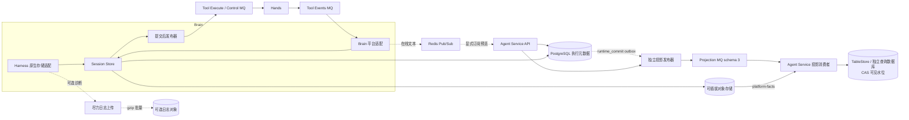
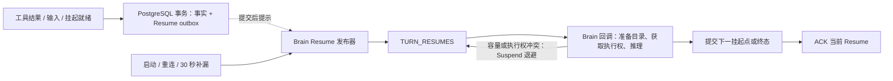

# 嵌入式 Session Store 与异步投影

> 本文描述当前内嵌实现。面向多语言 Brain 的目标方案见[目录组织与部署](design/brain-runtime-layout-and-deployment.md)：Session Service 逻辑独立，初期可由现有平台服务承载；该迁移尚未实施。

当前投影协议为 schema 3；文末带日期章节保留历史演进，不代表当前部署契约。最新实现与验收见[执行提交与投影交付改造](../../docs/execution-commit-and-projection-delivery-redesign.md)。

Session Store 是 Brain 内部的提交组件。一次提交先将 checkpoint 与可靠执行事实内容冻结到对象存储，再以短 PostgreSQL 事务推进执行 Head、记录提交回执并授权工具 Outbox。Brain 只有拿到 `committed` 才推进内核 durable head。相同 scope + commitId 的重试返回原回执，包括提交成功后响应丢失、执行 epoch 已变化的情况；不同内容复用同一身份会被拒绝。

原生 context 的保存/还原与可丢 session log 在 Harness 适配层分流。`ManagedCheckpointObjects` 外置冻结状态并按内容复用，每次捕获有独立 manifest/continuation。可靠事实按 `recovery_segment` 存对象引用，以 `recovery_fact_identity` 保留必要身份；原始 chunk 不写恢复表。`native_sequence` 等既有二进制元数据名称保留，但计数只包含可靠事实，不表示日志完整度。

内核恢复通过私有 `scan/scanMetadata` 视图读取最新 checkpoint 与本 Turn 的必要控制/交接事实，不扫描已结束 Turn 的事件段，也不加载被覆盖的 checkpoint 正文。执行位置从 `ma.turn` 的迭代/应用位置和 `first_recovery_sequence` 恢复。普通事实 `readAfter/readMetadataAfter` 分页保持原有范围和身份；trace/历史不与内核启动裁剪混用。必需恢复内容缺失明确失败，可选日志丢失不影响恢复。

## 事务与工具交接

对象上传和验证在执行提交事务之前完成。上传成功本身不代表可恢复的 checkpoint；只有同一事务中登记引用、推进 Head 并保存回执后才成为已提交状态。事务失败产生的暂存对象不会被恢复读取，也没有启用自动 GC。

工具不等待公开视图。ToolTask、checkpoint 引用和已授权命令 Outbox 原子提交，Brain 发布器随后发送 Execute/Control；发送失败保持待办，可重试，Hands 继续使用数据库授权门禁和自己的执行幂等账本。工具结果通过原有 Tool Events 链路回到 Brain，耐久结果先提交，再通知等待者或安排恢复。移除的是 Boundary 的登记、MQ 提交和状态轮询，并未移除工具、结果、恢复或 Session Ready 通道。

提交前崩溃的 MCP 批次不是恢复事实；已批准的原生调用可以先作为单调用恢复，再由内核组织剩余批次。调用身份、已提交结果和副作用去重保持稳定，恢复段数可能增加。

不再有独立 Session Store Maven 产物、HTTP accepted 入口、Boundary Topic、Inbox、commit-mode opt-in 或 PostgreSQL 私有大对象后端。项目尚未发布，开发数据库按目标 schema 新建；没有旧数据转换或旧协议分支。

## Agent Service 承载投影

Session 的 accepted/commit 前缀在已有执行事务内更新；事实 manifest 和最小待发布状态合入 `ma.runtime_commit`。独立 `projection_commit`、`projection_source_head`、`projection_progress` 已移除。`ma_session_projections_v3` 携带自包含的连续 commit 引用批次，不再只发送唤醒通知。

Agent Service 支持 `both`（API + projection）或 `api-only`，正常投影不读写执行 PostgreSQL，也没有专用执行投影连接池。消费者有界读取对象并写 TableStore/独立查询库，CAS 推进连续可见水位后才 ACK；重复提交核对查询端身份，缺口释放 receipt 退避。发布器由提交信号与短批处理窗口驱动，低频索引扫描只补发 outbox。SSE 用尽力 Redis 广播与游标补读，不回写 SQL 消费进度。

投影保留事实的 `created_at`；协议历史按时间排序时，用协议 sequence 处理同时间事件，避免批量物化时的随机 ID 顺序颠倒 Turn 完成与后继运行。

`projection` API 对所有 Session 可用，不再要求 Session Store 扩展头。`minSequence` 尚未可见时返回 202 + Retry-After。公开资源、snapshot、usage 和 cursor 读取 projected 前缀，权威输出封口与预算判断仍使用核心提交数据。

## 平台事实包：内容在对象层，提交身份在 SQL

`platform-facts` 对象为 `{schemaVersion:1,scope,entries:[{type,payload}]}`，按内容 SHA-256 寻址。常规包最多 128 个不同内容项，目标大小 4 MiB；单个大项仍受后端 64 MiB 上限约束。相同 payload 可供多个事实身份引用，生产端也可预先冻结候选控制事件；只有 SQL 已登记的项才属于 accepted 前缀，包中未选中的候选项不会公开。

公开范围、对象引用、ordinal 和摘要都在执行 commit 的 `projection_manifest` 内；纯私有提交不分配公开版本。工具完成跨路径去重保留业务身份。Brain 和资源入口在锁前准备对象；命令/目录事实在同一提交中保存有界 inline 内容，由发布器在 SQL 事务外物化对象后发送。对象成功不等于执行提交成功，自动 GC 关闭。

正常消费直接用 schema 3 消息读取对象，不回查 PG manifest/命令链接/工具目录；所需关联由命令事实和目录事实构建到查询后端。单消息最多 32 个连续 commit、1 MiB 元数据和 64 MiB 引用内容，目标水位最后 CAS，部分成功不可见。具体字段、故障边界、重建、部署配置和验收结果见[执行提交与投影交付改造](../../docs/execution-commit-and-projection-delivery-redesign.md)。

## ModelCallResult：模型完成与恢复结果一起提交

`ManagedFinalization` 的模型调用适配器通过 `ManagedModelCapture` 直接汇总 provider 响应，合并文本、工具参数及 usage/finishReason；不读取 session log。每次请求/响应捕获有 16 MiB 上限。正常完成冻结一个完整语义响应，失败/取消结果不含可重放的部分文本。`ManagedModelResults` 在 `model/end` 提交前保存 `model-request/model-result` 对象，恢复段只保留结果引用；结果构造阶段没有 native manifest/chunk 扫描。

`model_call_result` 与预算账本分开，原子登记请求位置、入口 checkpoint、结果引用、完成状态和 `replay_hash`。完整请求字节摘要用于验证对象，规范化请求摘要用于重建时匹配；finalization 还校验 frame/slot。普通推理可以重用 checkpoint 尚未吸收且摘要匹配的完成结果。对象已保存不等于结果已应用，后续 checkpoint/Head 才决定应用进度；必需结果缺失不回退到日志重放。

## 尽力日志归档与在线预览

`ManagedSessionLogArchive` 使用独立的 4096 条/8 MiB 队列和一个后台上传线程，批量 gzip 到对象存储的 `session-log` 前缀。上传失败直接丢弃，不对账、不补偿、不要求唯一或有序，也不写 PG 日志目录/水位。日志不进入 checkpoint 引用根，且不占用核心对象缓存。默认开启归档模块，关闭原始 model/tool chunk 保存；可以整体关闭，执行与恢复行为不变。缓冲字节、丢弃、成功上传与错误数量通过 `managed.agents.session.log.*` 指标观察，指标不构成日志完整性承诺。

`event_deltas[]=agent.message` 在每个鉴权 SSE 连接上显式启用公开文本预览。模型开始时固定合格连接 token，兴趣租约仅存 token；按节点定向 Redis Pub/Sub，不使用可靠 MQ/Redis Stream。每次模型调用最多选择 128 个预览连接；遗漏只影响展示。生产队列最多 256 帧，每连接最多 64 帧/256 KiB；缺口、慢连接或晚到跨 epoch 数据停止对应预览。完整持久消息覆盖预览，失败终结也能关闭它，合并流在写出前再次过滤晚到 delta。

公开 event_start/event_delta 不带自己的 SSE ID，不进入事实包、公开事件表、资源 reducer 或 cursor。工具、thinking、Last-Event-ID 和断线 delta 补发不支持；历史查询仍提供完整持久消息。现有 `SessionLog` SPI 名称来自二进制依赖，不代表其恢复 ACK 也可丢弃。

## 对象后端配置

Brain、Agent Service 和 Tool Worker 必须指向同一 backend ID 和耐久内容空间；不同 backend ID 的引用会被拒绝。单对象上限 64 MiB，读取校验原始 SHA-256 与大小；state 使用自身内容身份。文件后端采用 fsync + 原子禁止覆盖发布并拒绝路径穿越和作用域符号链接。S3 后端使用条件单次 PUT，启动时实际探测端点是否遵守禁止覆盖；OSS 原生使用 forbid-overwrite，并拒绝启用/暂停版本控制的 bucket。失败不会切回 PG。

| 环境变量 | 含义 |
|---|---|
| `MANAGED_AGENTS_OBJECT_STORE_PROVIDER` | `filesystem`、`s3`、`oss` |
| `MANAGED_AGENTS_OBJECT_STORE_BACKEND_ID` | 所有副本一致的稳定身份，默认 `runtime` |
| `MANAGED_AGENTS_OBJECT_STORE_ROOT` | filesystem 必填；多机必须共享耐久目录 |
| `MANAGED_AGENTS_OBJECT_STORE_ENDPOINT/BUCKET` | S3 或 OSS 地址与 bucket |
| `MANAGED_AGENTS_OBJECT_STORE_REGION` | S3 region，默认 `us-east-1` |
| `MANAGED_AGENTS_OBJECT_STORE_ACCESS_KEY/SECRET_KEY` | 从业务 Secret 注入 |
| `MANAGED_AGENTS_SESSION_LOG_ENABLED` | Brain 尽力归档模块，默认 true；Helm `runtime.sessionLog.enabled` |
| `MANAGED_AGENTS_SESSION_LOG_CHUNKS_ENABLED` | 原始 model/tool chunk 归档，默认 false；Helm `runtime.sessionLog.chunksEnabled` |
| `MANAGED_AGENTS_PROJECTION_ROLE` | Agent Service 的 `both` 或 `api-only` |
| `MANAGED_AGENTS_PROJECTION_CONCURRENCY` | MQ 回调并发，默认 4，范围 1..32 |

Compose 使用独立的共享 `runtime-objects` 持久卷。Helm 默认 S3 配置；filesystem 必须显式指定 `objectStore.existingClaim`，由运维提供满足共享耐久契约的 RWX 卷。用户 workspace/artifact 开关不会关闭内核恢复内容存储。模板修改不代表已经部署。

## 对象迁移首轮本地实现范围与验证边界

本轮外置 checkpoint/state、完整原生事件段、平台事实对象包、模型请求/结果和大 MQ payload；PG 保存执行元数据、事实身份/包索引、必要权威输出/任务内容与公开查询视图。该首轮记录时诊断异步归档尚未接入，原始 chunk 仍在私有事件段中；下文本轮改造已替换这一行为。projection-only 部署角色及带 pin/fencing 的自动 GC 仍未启用。

本地验证覆盖提交丢响应、身份冲突、fencing、跨 Brain 读取、内容复用、对象缺失/损坏、禁止覆盖、工具授权与 Broker 故障、投影失败隔离、快照前缀和实际 Harness 恢复。S3 使用本地 HTTP 协议端点验证，OSS 验证 SDK 参数与版本策略；不等同于真实云端容量验证。当时对象接口采用有界 byte[]，尚无全局在途字节配额；后续已加入容量预算并发布，见下文。大对象流式压缩、冷恢复风暴仍待验证。

完整方案见 [Session Store 与对象存储设计](../../docs/session-store-oss-and-direct-commit-design.md)。

## 2026-10-23 较早本地迭代验证记录

该次本地迭代尚未部署；后续版本已发布，正式结果见文末。代码位于项目主目录的 `master` 分支，保留已有工作区改动，未提交、未推送。

| 检查 | 结果 |
|---|---|
| 根目录 `mvn -B -ntp -T1 clean verify` | 通过；953 个测试，725 个执行通过，228 个外部环境/可选用例按条件跳过 |
| 根目录 `mvn -B -ntp -T1 spotless:check` | 通过 |
| PostgreSQL 17 专项 | 37 个执行通过，0 跳过；覆盖直接提交、模型结果原子性、入口 checkpoint 关联、事实包校验、并发投影、对象 I/O 与 SQL 事务隔离、工具授权及目标 schema |
| `python3 -m unittest discover -s managed-agents/release/tests` | 前轮 57 个通过；含 MQ 初始化、Helm 渲染与共享对象卷约束。本轮未改部署模板，未重复执行 |

PostgreSQL 专项选择 `ManagedPostgresSessionStoreIntegrationTest`、`ManagedPostgresToolSubmissionIntegrationTest`、`ManagedSchemaMigrationIntegrationTest` 和 `ManagedPostgresArtifactsIntegrationTest`，连接本轮新建的本地临时 PostgreSQL 容器；测试完成后清理该容器。全量检查包含真实 Harness/MCP SDK 与本地 HTTP 故障场景；不代表已执行需要外部 MQ/Redis、官方 SDK 环境或云端凭据的全部可选测试，也没有进行云端容量压测。

### 容量预算与定点恢复

对象后端连接数与在途字节分别设上限（默认 32 请求、256 MiB，等待 5 秒），投影另有 4 请求、128 MiB 的配额。小对象采用按字节淘汰的不可变内容缓存（默认 64 MiB、单对象 256 KiB）；缓存仅保存已经持久化且通过摘要校验的内容，不缓存执行头与投影水位。`state-cache-entries` 默认 16384，只保存内容身份用于 checkpoint 去重。投影每次通知分批追赶目标水位，在时间或批次数预算耗尽后重投；修复扫描不会因一个失败的 Session 中断整批。

`finalization_frame` 和 `finalization_model` 在执行提交事务内记录收尾帧的对象引用、完成序号、模型槽位及请求摘要。恢复直接读取对应 capture 和 ModelCallResult，无需为查找帧或槽位扫描原生日志。对象读取发生在 SQL 事务之外，索引只随已提交前缀可见。监控包含真实后端请求、字节、等待、错误、容量超时和缓存命中；自动对象 GC 保持关闭。

### 部署参数与复现

[万并发对象存储覆盖文件](../tests/pts/values-objects-10000.yaml) 固定 Java 镜像摘要、独立保留的 Control Plane 镜像、对象后端、七组 Topic/group、连接与字节预算，以及 Agent Service 投影专属连接池。它是显式开启合成模型的压测配置，需要预先创建引用的私有 Secret，并准备新数据空间与云资源；不能用于包含旧 `ma` ledger 的数据空间。对象存储 Secret 仅注入 Agent Service、Brain 和 Hands。业务连接与迁移连接分别覆盖，Go Control Plane 的目录连接保持独立。

Helm 现在同时暴露投影 Topic/group 和投影连接、并发、对象预算，避免后续升级回退到默认通道或共享资源配置。四个 schema Job 分别使用对应组件的镜像标签/摘要；特别是 dataplane 迁移必须使用 Brain JAR，Runtime 元数据迁移使用 Agent Service JAR。迁移任务与普通服务始终使用不同凭据。

投影通知现在按 Session 合并水位：持续写入不重置已有的一秒冷却时间，多个 Brain 通过短期的条件更新竞争一次通知发送权。发送者崩溃后占用到期可重试，通知丢失由投影水位扫描修复；此占用不参与执行 fencing，也不限制提交和恢复。消费者先忽略已经覆盖的旧水位通知，避免重复读取对象。这些改动只减少通知与读取放大，不改变执行事实或已完成投影水位。

### 双实例容量验收基线

本轮发布配置固定 Gateway、Control Plane、Agent Service、Brain 和 Tool Worker 各 2 个实例，MCP 测试服务同为 2 个实例；观察器和无业务负载的 SSE 测试桥属于采样辅助设施。PostgreSQL 使用原有 12 核 / 48 GiB、100 GiB 高性能云盘，不以持续扩容获得通过结果。MQ 固定基础 4000 TPS，并已启用最高 2000 TPS 的弹性额度；固定规格升级受到云账号限制。测试期间不再修改这些容量参数。

该轮本地检查为根目录 967 个测试（735 个执行通过，232 个按条件跳过），格式检查通过；独立 PostgreSQL 17 四组专项合计 41 个执行通过，部署工具 59 个通过，PTS 工具 41 个中 40 个通过、1 个可选 JMeter 测试跳过。真实 OSS 禁止覆盖及跨客户端读写契约已经验证。原 Brain 在工具挂起后被替换，另一实例读取对象恢复并完成，队列撤回、转 steer 与输出校验通过。自动 GC 仍关闭。

验收用四个独立施压进程各维持 2500 个在途 Turn，取各自保持窗口的共同交集，至少 300 秒。另用独立只读 SQL 进程每 0.5 秒采样同一批次的全局未终结 Turn；保留原始采样错误，不补点、不放宽采样间隔。最终是否达到 10000 并发，以该数据、持久事实、工具物理执行次数和输出核验共同判断。

### 正式实测结果与清理

[双实例正式发布与验收报告](../tests/pts/report-20261023-10000-object-store.md)记录了 310.469 秒的共同保持窗口，620 个独立 SQL 样本均至少 9987 个在途 Turn。但 MQ 返回 `42901 LMQ_CONSUME_QUEUE_NUM_EXCEEDED`，工具发布停滞，出现 9981 次终态期限错误，容量验收未通过。恢复排空后为 11613 成功、1 次 MCP 调用前初始化失败；投影比核心晚约 10 分 45 秒追平。低 CPU 包含停滞影响，不能用来证明同吞吐优化。

历史压测数据在证据冻结后按明确 Session 标记清理，并保留未标记会话与用户/Agent/环境配置；MQ 重建为空的七条当前通道，旧 Boundary/Session Store 通道移除。清理不是替代 MQ 长期回收协议的实现，后续还需限制通知与订阅基数并验证确认、退订和 SQL 补发。自动对象 GC 仍禁用。

清理后的相同双实例基线复测保持 357.659 秒，715 个独立 SQL 样本最少 9977 在途；18184 个请求最终 18176 成功、8 个 MCP 调用前初始化失败。390 个请求超过 600 秒客户端期限，服务端终态 p95/p99 为 574.517/614.188 秒。PG CPU 平均/峰值 67.98%/78.34%，WAL 15.629 MiB/s。核心归零 315 秒后投影仍积压 1382194 条；完整追平时间未测得，记录水位后按用户要求清理临时投影，不能把清理计作追平。严格验收未通过。

新旧库共清理 136734 个临时会话，保留旧库 59 个未标记会话与配置；Redis 删除 5597 个孤儿键，MQ 当前七组通道重置，专用对象桶清空后保留后端。临时删除权限已撤销，自动 GC 仍关闭。最终业务组件均为 2/2 就绪、数据库 12 CPU/48 GiB，仅保留一个通过真实工具/权威输出/投影校验的最终诊断用例。

## 本轮改造：恢复事实、尽力日志与在线 delta 分离

本轮工作区已移除 ModelCallResult 生成对 chunk 的依赖，内核启动采用 checkpoint/本 Turn 可靠事实视图；原始 chunk 和公开 delta 不再持久投影。相关目标与验收边界见[设计文档](../../docs/session-store-oss-and-direct-commit-design.md#恢复状态session-log-与公开-delta三条独立路径)。session log 可完全关闭、丢失、重复或过期，不承担执行或恢复正确性。新 schema 用于隔离测试数据空间，不实现旧日志兼容读取；自动 GC 和日志自动删除保持关闭。最终根构建列出 994 项（757 执行通过、237 条件跳过），另一次专项重跑 50 项通过，其中 34 项 PostgreSQL 集成、1 项 Redis 集成、15 项单元检查；集群已发布并保持业务组件各 2 个副本。[10000 并发快速报告](../tests/pts/report-20261023-best-effort.md)记录共同窗口 72.401 秒、12689 次受理中 12686 成功与 3 次 MCP 初始化失败，严格验收未通过；投影在核心排空约 6 分钟后追平。退役测试数据及七条专用 MQ 绑定已清理，清理后真实工具探针通过，自动 GC 仍关闭。

## Hands 异步执行与线程预算（2026-10-24 已部署）

Hands 的持久执行循环已取消按长任务生命周期占用的并发信号量。MCP 调用及 batch 通过本地 CompletionStage 通知后续处理；等待期间不占用执行线程，也不每秒重复读取结果及 batch 状态。网络回调只提交唤醒，由阻塞工作池执行 JDBC 和结果发布。无完成通知的提供者采用定时状态查询，两次查询之间也释放线程。

`toolConcurrency` 现在仅限制短暂执行转换的线程数，默认调整为 700；执行消息回调、租约续期和 MCP 初始化线程池分别配置。新增 `tests/pts/values-async-hands.yaml` 压测覆盖文件将原 768 调为 1024 个短任务线程；该 1024 配置未部署；2026-10-24 实际部署采用每实例 700 个短任务线程，结果见文末。没有新增活跃工具数量上限。MCP 缓存预算只负责回收空闲连接，忙连接不会因缓存压力被关闭或拒绝。

任务等待期间继续续租和保存恢复心跳。控制消息唤醒本机所有者；消息被其他实例处理时，所有者在续租周期检查持久取消状态（默认 15 秒）。取消 Future 不作为远端副作用停止的证明。实例关闭停止本地所有者，结果仍可按 execution ID 恢复；已经确认的结果先持久化，再发布。工作队列拥塞只推迟处理，不把工具重新执行。自动 GC 和日志保留策略保持不变。

本次本地根构建 `mvn -B -ntp -T1 clean verify` 通过：995 项测试，758 项执行通过、237 项按测试条件跳过，零失败。回归包含单工作线程管理 12 个在途工具、通知前不轮询结果、异步所有者退出后的原调用恢复，以及真实 MCP HTTP 与沙箱集成测试；发布脚本 59 项测试和新增覆盖配置的 Helm lint/render 通过。以上不代表集群 10000 并发容量已经验证。

## MCP 目录复用与异步预备（2026-10-24 已部署）

Brain 的 MCP discovery 不再申请固定的 16 个并发名额。独立目录请求直接订阅异步 MCP 客户端，同一目录内的多个 Server 并行查询并保留配置顺序。Session 队列先异步准备目录，完成通知到达后才提交执行任务；Resume MQ 回调复用异步目录请求，未就绪时返回 Suspend，重投时继续检查。网络等待不占用工作线程，也不持有执行 epoch 或数据库事务。短暂的 SQL 操作和 Harness 执行仍使用各自的工作池。

每个 Brain 在进程内合并相同目录的在途请求，并短期缓存成功结果。缓存身份包含租户、命名空间、Session owner、Agent 配置、环境和生效的 MCP 配置，包括地址、凭据、请求头、查询参数和工具过滤规则；不按 URL 单独共享。HTTP 目录不再因 Session/Turn ID 不同而必然重新查询；stdio 额外按 Session 和工作目录隔离。不同 Brain 各自维护缓存。返回给调用方的是独立副本，避免某个 Turn 修改共享内容。

`managed-agents.runtime.mcp.discovery-cache-ttl` 默认 `60s`，设置 `0s` 可关闭成功结果复用而保留在途合并；`managed-agents.runtime.mcp.discovery-cache-entries` 默认 `4096`，只限制已完成目录的缓存数量，不限制在途查询数。失败和 optional 降级不缓存为成功目录；未故障 Server 的成功目录仍可单独复用。配置或凭据变化立即使用新的缓存身份，服务端目录变化在 TTL 到期后的新查询中可见。每个 Turn 仍将所采用的目录固定到 PostgreSQL 快照，恢复优先读取该快照，不受缓存淘汰、刷新或另一实例的缓存内容影响。

取消属于等待者：取消一个 Turn 只退出它自己的订阅，最后一个等待者退出才取消共享传输。等待中的取消状态以每秒一次 SQL 检查兜底，检查运行在阻塞工作池；提交快照前仍在事务中确认取消状态。连接创建、初始化和 listTools 各自保留超时与资源清理。相较原来每 200 毫秒的等待检查，这减少了等待期间的读压力，但并不代表已消除全部 SQL 访问。此段最初的本地验证已由后续集群发布覆盖，部署与持续压测见[2026-10-24 报告](../tests/pts/report-20261024-resume-mq.md)。

本地 `mvn -B -ntp -T1 clean verify` 通过：1002 项测试，765 项执行通过、237 项条件跳过，零失败。专项 37 项测试覆盖 40 个独立查询全部先发起再返回、24 个 Server 并行发现、单队列工作线程承接 32 个未完成目录请求、取消隔离、缓存凭据隔离与 TTL、跨 Session 复用和 Turn 快照固定，以及真实 MCP HTTP 调用与恢复。

## 恢复统一通过 Resume MQ（2026-10-24 已部署）

保留 MCP batch 包装：符合条件的一轮工具调用仍形成父任务，内部保存各调用身份和结果。batch 完成、普通工具完成，以及能够解除挂起的用户输入，统一生成同一种持久 Resume 意图。移除 `ManagedContinuationLoop`、直接调度分支、`last_attempt_at` 写入及每 500 毫秒的续接扫描。本次不调整独立的新 Turn Session 队列调度器。

结果/就绪状态与 `ma.turn_resume` outbox 在同一事务提交。事务内 PostgreSQL `NOTIFY` 在提交后唤醒跨进程的 Brain 发布器，覆盖 Agent Service 接收输入的路径；进程内另有提交后提示。通知只携带 Session scope key，不包含执行状态。LISTEN 等待 socket 通知，不按秒查询 outbox，每个 Brain 占用一个数据库连接。发布器使用独立工作池、按 Session 合并唤醒，在 publication 短期锁内再次确认 pending，然后向 `TURN_RESUMES` 发布稳定身份的消息。任何提示都不会直接调用 Harness。

提示丢失、发布队列满或发送结果不确定，都保留 pending outbox。启动、监听重连和低频补漏负责重新发布；`managed-agents.runtime.resume-repair-interval` 默认 `30s`。一次补漏分批处理积压并越过暂时不可发布的记录，不限制为每周期只能发送固定少量消息。补漏针对尚未发布的意图；已进入 MQ 的 Resume 由 MQ 重投。丢失提示时，额外延迟可能包含一个补漏周期及积压、网络时间，30 秒不是延迟上限。

Resume 只有在旧挂起点已被新的可靠交接替代，或 Turn 已进入终态时才 ACK。容量不足或 Session 执行权冲突返回 `Suspend(delay)`，释放消费线程，保持 FIFO 队首未确认。退避从 500 毫秒开始，指数增长并加入抖动，最高 10 秒；停机需要的更长延迟保留。由于 Suspend 不一定增加 broker attempt，使用有界本地缓存记录冲突次数；缓存丢失只会重置等待时间。重复投递与实例替换仍由 Session 租约、执行 epoch 和稳定 Resume 身份防护。

MQ 重投复用 MCP 异步预备请求；目录未就绪时返回 Suspend，不阻塞等待 Future。失败可重新准备，ACK 后移除缓存，五分钟未访问的条目在后续访问时取消并清理，停机取消剩余等待者。它只是本地优化，不承担状态恢复。

传输仍是至少一次。MQ 已接收、发布器尚未记账就崩溃，可能再次发送同一 Resume；消费端先判断挂起点与终态，防止重复推进。普通争用不消耗失败重试次数。真正的执行或传输异常仍按已有 broker 失败策略处理，需要监控死信；本次不会自动重放死信。

本次本地验证：根目录 `mvn -B -ntp -T1 clean verify` 通过，8 个模块构建成功；1009 项测试中 771 项通过、238 项按环境条件跳过，零失败。另在独立本地 PostgreSQL 测试库执行 13 项挂起事务与跨连接通知用例，全部通过，测试库已清理。覆盖 batch 结果与挂起的两种到达顺序、容量和执行权争用时的 Suspend、重复 Resume、实例替换、事务回滚、丢失唤醒与不确定发布、异步目录复用，以及实际 HTTP MCP 调用。父子 Agent 取消用例明确在子 Turn 已挂起后提交取消，以验证 MQ 恢复路径。以上为改造初期的本地验证记录；后续已完成集群发布、远端 MQ 恢复验证与持续压测，见[2026-10-24 报告](../tests/pts/report-20261024-resume-mq.md)。

## 投影批次与 API 查询的写入优化（2026-10-24）

投影消费者对同一个 Session 的一页事实在一个事务内提交：`public_event` 使用 JDBC 批量插入；协议事件在事务开始时只创建/锁定一次 `protocol_session`，在内存中连续分配序号，结束时只更新一次序号水位。协议事件本身仍按顺序插入，因此同一批后续事件能够查询到前面的模型开始、工具调用和消息，重复事实不会重复生成协议事件。批次上下文只在当前线程、当前数据源事务和当前 Session 内有效，退出时清理；失败仍整体回滚。执行状态不依赖这个异步投影事务。

公开 API 按 Session ID 定位租户作用域的查询增加非唯一索引 `ma_session_id`。它不改变跨租户重复 ID 的检测规则，也不要求 Session ID 全局唯一。这些优化减少重复 SQL 往返与行版本写入，具体收益由相同双实例规格的持续压测衡量。

### 集群验证后的短退避实现

2026-10-24 的跨实例验证中，一个存活实例返回 SDK `ConsumeResultSuspend(500ms)` 后，下一条可见 Resume 回调约两分钟后才出现。期间包含实例替换，且 broker attempt 从 1 变成 3，现有日志不能排除停机实例的中间投递与更长 Suspend；不能据此认定 broker 将 500ms 固定放大为两分钟。为使存活实例上的短退避不再依赖 broker 重投时机，Resume 专用 SDK 适配器因此在消费服务内部保留尚未 ACK 的 FIFO 队首，用调度器安排下一次同一 MQ 回调：等待期间不占消费工作线程，不消耗业务失败重试次数，不向 Harness 提供绕过 MQ 的直接入口。只有回调返回真正的成功或失败时，才交回 SDK 的 ACK/失败策略。TURNS 的持久收据 ACK 机制不变。

本地等待数量受 SDK 消息缓存容量约束；实例关闭会取消等待，未 ACK 的消息仍由 broker 重新投递。进程内计时不是可靠事实，丢失后允许重投和更长的故障恢复等待。Session 租约、执行 epoch 和稳定 Resume 身份仍防止重复推进。低频 SQL 补漏只负责未发布的 outbox，不能用它掩盖正常 MQ 续接中的长等待。

### MCP 传输线程与压测工具的短 SQL 等待

2026-10-24 的集群升压采样显示，Hands 每实例超过八千个线程，主要是各个 MCP HttpClient 默认创建的工作线程。Brain discovery 和 Hands 的 HTTP/SSE 客户端现在共用进程级 64 个 daemon 传输工作线程。只共享短 I/O continuation 的执行器，不共享 MCP Session、HTTP 客户端、鉴权头或执行身份；不会把 64 当成在途工具数或 discovery 查询数上限。各 HttpClient 的 selector 线程仍独立存在，应继续观测连接数、线程数和内存，不能据此声称所有网络线程都已限制为 64。

同轮外部长工具测试服务返回 `the pool 'pool-1' has already 256 requests waiting`。测试夹具在保持每实例 16 条数据库连接不变的前提下，让短 SQL 操作先通过异步 semaphore 等待连接容量，再进入 psycopg 连接池；30 秒物理执行不持有连接或 semaphore。取消等待会归还名额，完成结果也遵循同一路径，避免任务因连接池等待队列拒绝而永久停留在 running。该修复属于测试服务，不能算作 Brain/Hands 自身数据库吞吐优化。

## 2026-10-24 持续压测结论

以上异步 Hands、目录复用、统一 Resume MQ、投影批次和查询索引已部署，业务组件保持各 2 个实例。满负载共同窗口为 419.687 秒，实测峰值 10000；受理 p95 降至 59ms，PG CPU 整轮均值约 24.6%，投影最终追平。但 2412 个请求超过 600 秒客户端截止时间，正式观察结束尚有 11 个 Turn 挂起，整体验收未通过。后续 Brain 滚动重启使尾部进入终态，其中 7 成功、4 失败，原因尚未充分定位，不能回写为压测通过。服务端已完成样本 p95 约 652 秒，结果应用到续接 p95 约 577 秒，仍需定位 MQ 交付及消费调度长尾。WAL 写入未下降。完整证据、比较口径及恢复验证见[持续压测报告](../tests/pts/report-20261024-resume-mq.md)。
