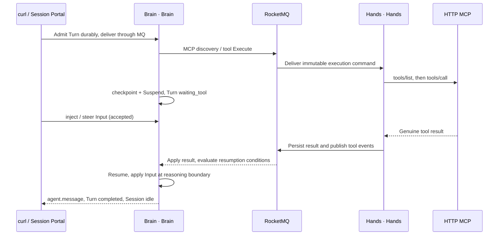

# POC Part 3: Tool calls, Brain/Hands collaboration and in-flight interaction

[中文](tool-collaboration.md) · [POC reading order](README.en.md) · Previous: [Events and streaming](events-and-streaming.en.md) · Next: [API reference](api-reference.en.md)

Use **cURL + jq, Bash/zsh and two terminals** to test a real model calling HTTP MCP through Hands, Brain suspension and resumption, in-flight input, queuing, interruption and redirection. All writes still use `/v1/sessions/{id}/events`. This page selects the project's `turn-inputs-v1` extension and queries Turn/Input resources to target running work precisely. Prompts remain in Chinese to match the deployed test Agent; markers and API fields are unchanged.

| Scenario | What to observe |
| --- | --- |
| A: Tool call + inject + queue | One physical call, input applied after Resume, T2 reuses T1's real result |
| B: steer | The current tool continues; the final answer follows the new direction |
| C: interrupt | Cancellation admission, external settlement and Turn termination are separate facts |
| D: interrupt + message | The replacement Turn runs after cancellation of the old Turn |

Each scenario calls a 90-second tool. The full walkthrough includes at least six minutes of tool waiting, plus model and scheduling time. Run scenarios in sequence rather than pasting them concurrently.

## 1. Reuse configuration and create a tool-test Session (terminal B)

Complete the context setup in the [quickstart](api-quickstart.en.md). In a new terminal, first run its printed, complete `source /actual/path/client.sh` command. Reuse `BASE_URL`, `TENANT`, `NAMESPACE`, `ENVIRONMENT_ID`, `RUN_ID`, `D` and `api`; no new address or login token is needed.

The quickstart Agent disables tools and each Session freezes its Agent definition. Select the cluster's **existing MCP-enabled Agent** and create your own tool-test Session. Keep the original `AGENT_ID` and `SESSION_ID`; do not reuse another person's prepared test Session.

```bash
export TOOLS_D="$D/tools"
mkdir -p "$TOOLS_D"
export TOOL_AGENT_ID="3c8f0737-fab1-4c52-8851-4561a341b087"

tool_api() {
  api "$@" -H 'AgentScope-Extensions: turn-inputs-v1'
}

tool_api "/api/v1/agents/$TOOL_AGENT_ID" | jq '.agent | {id, displayName, version}'
tool_api "/api/v1/agents/$TOOL_AGENT_ID/definition" | jq '.definition | {
  name, version, defaultEnvironmentId, tools,
  mcpServers: [.mcpServers[] | {name, url, transport}]
}'

jq -n --arg agent "$TOOL_AGENT_ID" --arg env "$ENVIRONMENT_ID" \
  '{agent:$agent, environment_id:$env, title:"POC tool collaboration", metadata:{source:"poc-tools"}}' \
  > "$TOOLS_D/session-request.json"
tool_api /v1/sessions -X POST -H "Idempotency-Key: $RUN_ID-tools-session" \
  --data-binary "@$TOOLS_D/session-request.json" > "$TOOLS_D/session.json"
export TOOL_SESSION_ID=$(jq -er '.id' "$TOOLS_D/session.json")
tool_api "/v1/sessions/$TOOL_SESSION_ID/capabilities" | jq \
  '{protocol_revision, extensions, intents, features}'
```

Confirm protocol revision `agentscope-service-2026-10-19-draft3` and support for `new_turn`, `inject`, `steer` and `cancel`. Resolve any failed check before submitting messages. `tool_api` only adds a representation-selection header to the existing `api` helper.

The deployed configuration is below. The GET above selects fields without credentials.

| Item | Current configuration |
| --- | --- |
| Agent | `MCP 长工具顺序验收`, version 1 |
| MCP Server name | `longwait` |
| MCP URL | `http://agentscope-service-long-tool-mcp.agentscope-test.svc.cluster.local:8000/mcp`, accessed inside the cluster by Hands |
| Model-visible tool name | `longwait__long_wait` |
| Remote tool name / public event name | `long_wait` |
| Arguments | `marker`: 1–120 characters; `seconds`: integer from 1 to 180 |
| Policy | `mcp_toolset` references `longwait`, enabled=true, permissionPolicy=`always_allow`; native tools disabled |
| Physical operation | An asynchronous wait returning a random `call_id`, marker, Pod and genuine start/finish timestamps |

MCP credentials are configured server-side. These commands need no credential entry. The tool requires no Sandbox, NAS or Environment Worker and exercises the complete remote-tool execution chain. This page does not execute `bash/read/write` or validate Sandbox tools in the text environment. Test native tools separately with a new Agent/Session, the required Sandbox/Worker, enabled user-file capability and appropriate tool permissions. Their events are `agent.tool_use/result`.

## 2. Prepare query helpers and open the stream

Define these functions in terminal B. They wrap curl queries, pagination and bounded waits; requests and results stay in `$TOOLS_D`.

```bash
wait_tool_turn() {
  local turn_id="$1" expected_state="$2" current_state attempt
  for attempt in {1..120}; do
    if ! tool_api "/v1/sessions/$TOOL_SESSION_ID/turns/$turn_id" > "$TOOLS_D/turn-current.json"; then
      return 1
    fi
    current_state=$(jq -er '.status' "$TOOLS_D/turn-current.json") || return 1
    printf '%s %s\n' "$turn_id" "$current_state"
    if [[ "$current_state" == "$expected_state" ]]; then return 0; fi
    case "$current_state" in
      completed|failed|cancelled) jq . "$TOOLS_D/turn-current.json"; return 1 ;;
    esac
    sleep 2
  done
  printf 'Timed out waiting for %s\n' "$expected_state" >&2
  return 1
}

tool_history() {
  local page=""
  local query
  : > "$TOOLS_D/history.jsonl"
  while true; do
    query=(-G --data-urlencode 'limit=100' --data-urlencode 'order=asc')
    if [[ -n "$page" ]]; then query+=(--data-urlencode "page=$page"); fi
    tool_api "/v1/sessions/$TOOL_SESSION_ID/events" "${query[@]}" \
      > "$TOOLS_D/history-page.json" || return 1
    jq -c '.data[]' "$TOOLS_D/history-page.json" >> "$TOOLS_D/history.jsonl" || return 1
    page=$(jq -r '.next_page // empty' "$TOOLS_D/history-page.json") || return 1
    if [[ -z "$page" ]]; then break; fi
  done
}

tool_output() {
  local turn_id="$1" cursor=""
  local query
  : > "$TOOLS_D/output-$turn_id.jsonl"
  while true; do
    query=(-G --data-urlencode 'limit=100')
    if [[ -n "$cursor" ]]; then query+=(--data-urlencode "after=$cursor"); fi
    tool_api "/v1/sessions/$TOOL_SESSION_ID/turns/$turn_id/output" "${query[@]}" \
      > "$TOOLS_D/output-page.json" || return 1
    jq -c '.data[]' "$TOOLS_D/output-page.json" >> "$TOOLS_D/output-$turn_id.jsonl" || return 1
    cursor=$(jq -r '.next_cursor // empty' "$TOOLS_D/output-page.json") || return 1
    if [[ -z "$cursor" ]]; then break; fi
  done
  jq -r '.content[]? | select(.type == "text") | .text' "$TOOLS_D/output-$turn_id.jsonl"
}

{
  printf 'source %q\n' "$D/client.sh"
  printf 'export TOOLS_D=%q\n' "$TOOLS_D"
  printf 'export TOOL_AGENT_ID=%q\n' "$TOOL_AGENT_ID"
  printf 'export TOOL_SESSION_ID=%q\n' "$TOOL_SESSION_ID"
  typeset -f tool_api wait_tool_turn tool_history tool_output
} > "$TOOLS_D/client.sh"
printf 'In terminal A, run: source %q\n' "$TOOLS_D/client.sh"
```

Each wait lasts at most about four minutes plus request time. On a nonzero return, stop the scenario and inspect saved state and `session.error`. The quickstart uses `set +e`, so errors preserve the terminal but do not automatically prevent subsequent pasted commands. Check the wait result first.

In terminal A, press Ctrl+C to stop the previous observation stream, execute the complete printed `source .../tools/client.sh` command, then run:

```bash
tool_api "/v1/sessions/$TOOL_SESSION_ID/events/stream" -N | tee -a "$TOOLS_D/events.sse"
```

Wait for `:connected` before sending requests in terminal B. Keep this stream for every scenario below.

### Where Brain and Hands hand off work



Brain is Brain, responsible for the model, checkpoints, suspension and resumption. Hands is Hands, responsible for MCP discovery, physical calls and durable results. `waiting_tool` can also occur during MCP discovery, so it alone does not prove `long_wait` started. Find `agent.mcp_tool_use` with the current marker; for physical-start evidence, inspect MCP logs in section 8.

## 3. Scenario A: Long tool, injected context and a queued next Turn (terminal B)

### 3.1 Start a real tool call in T1

```bash
jq -n --arg marker "$RUN_ID-tools-a" '{events:[{
  type:"user.message", agentscope_service:{intent:"new_turn"},
  content:[{type:"text",text:("只调用一次 longwait__long_wait，marker=" + $marker + ", seconds=90。等待真实结果后报告 marker、call_id、started_at、finished_at。不要重复调用或伪造结果。") }]
}]}' > "$TOOLS_D/a-request.json"
tool_api "/v1/sessions/$TOOL_SESSION_ID/events" -X POST \
  -H "Idempotency-Key: $RUN_ID-tools-a" --data-binary "@$TOOLS_D/a-request.json" \
  > "$TOOLS_D/a.json"
export TOOL_T1=$(jq -er '.data[0].agentscope_service.turn_id' "$TOOLS_D/a.json")
wait_tool_turn "$TOOL_T1" waiting_tool
```

In terminal A, find `agent.mcp_tool_use` with `mcp_server_name:longwait`, `name:long_wait` and `input.marker:$RUN_ID-tools-a` before continuing. The marker is the expanded variable value, not the literal shell expression.

### 3.2 Inject context while the tool is running

First check that the Turn still accepts input:

```bash
tool_api "/v1/sessions/$TOOL_SESSION_ID/turns/$TOOL_T1/capabilities" | jq .
jq -n --arg turn "$TOOL_T1" --arg note "$RUN_ID-tools-injected" '{events:[{
  type:"user.message", agentscope_service:{intent:"inject",turn_id:$turn},
  content:[{type:"text",text:("补充要求：本轮最终答复原样包含 " + $note + "，并说明工具真实结束后才继续。不要再调用工具。") }]
}]}' > "$TOOLS_D/inject-request.json"
tool_api "/v1/sessions/$TOOL_SESSION_ID/events" -X POST \
  -H "Idempotency-Key: $RUN_ID-tools-inject" --data-binary "@$TOOLS_D/inject-request.json" \
  > "$TOOLS_D/inject.json"
export TOOL_INJECT_ID=$(jq -er '.data[0].agentscope_service.input_id' "$TOOLS_D/inject.json")
tool_api "/v1/sessions/$TOOL_SESSION_ID/turns/$TOOL_T1/inputs/$TOOL_INJECT_ID" | jq .
```

`accepted` means durably admitted. While the tool is pending, the input neither starts another model inference nor cancels the tool. After the result settles and Brain resumes, the next reasoning boundary applies it and changes its status to `applied`. In this implementation, `steer` also adds context at supported reasoning boundaries; it does not modify parameters of an already-issued RPC.

### 3.3 Queue T2 and verify context continuity

```bash
jq -n --arg marker "$RUN_ID-tools-a" '{events:[{
  type:"user.message", agentscope_service:{intent:"new_turn"},
  content:[{type:"text",text:("这是排队的下一轮。不要调用工具，只从上一轮 marker=" + $marker + " 的真实结果原样报告 marker、call_id、finished_at。") }]
}]}' > "$TOOLS_D/queue-request.json"
tool_api "/v1/sessions/$TOOL_SESSION_ID/events" -X POST \
  -H "Idempotency-Key: $RUN_ID-tools-queue" --data-binary "@$TOOLS_D/queue-request.json" \
  > "$TOOLS_D/queue.json"
export TOOL_T2=$(jq -er '.data[0].agentscope_service.turn_id' "$TOOLS_D/queue.json")
tool_api "/v1/sessions/$TOOL_SESSION_ID/turns/$TOOL_T2" | jq '{id,status,inputs_open}'
```

T2 should remain `accepted` until T1 settles. If T1 has already completed, the queuing window was missed. To repeat a scenario, use new scenario suffixes and request files; do not change a body associated with a used idempotency key.

### 3.4 Wait and compare genuine results

```bash
wait_tool_turn "$TOOL_T1" completed
wait_tool_turn "$TOOL_T2" completed
tool_api "/v1/sessions/$TOOL_SESSION_ID/turns/$TOOL_T1/inputs/$TOOL_INJECT_ID" | jq \
  '{id,status,applied_at,rejection_reason}'
tool_output "$TOOL_T1"
tool_output "$TOOL_T2"
tool_history
jq -s --arg turn "$TOOL_T1" '[.[] | select(.agentscope_service.turn_id == $turn) |
  select(.type == "agent.mcp_tool_use" or .type == "agent.mcp_tool_result" or .type == "session.error")]' \
  "$TOOLS_D/history.jsonl"
```

Pass criteria: the Input is `applied`; T1's final answer includes `$RUN_ID-tools-injected`; the real tool result and T1/T2 answers contain the same `call_id`; `finished_at` is about 90 seconds after `started_at`; T2 makes no additional tool call. A model answer is not physical invocation evidence: cross-check `agent.mcp_tool_result` and MCP logs.

## 4. Scenario B: Steer the current answer

After both scenario A Turns finish, submit another long tool request:

```bash
jq --arg marker "$RUN_ID-tools-b" '.events[0].content[0].text =
  ("只调用一次 longwait__long_wait，marker=" + $marker + ", seconds=90。等待真实结果，然后详细说明调用结果，报告 marker、call_id、started_at、finished_at。")' \
  "$TOOLS_D/a-request.json" > "$TOOLS_D/b-request.json"
tool_api "/v1/sessions/$TOOL_SESSION_ID/events" -X POST \
  -H "Idempotency-Key: $RUN_ID-tools-b" --data-binary "@$TOOLS_D/b-request.json" > "$TOOLS_D/b.json"
export TOOL_STEER_TURN=$(jq -er '.data[0].agentscope_service.turn_id' "$TOOLS_D/b.json")
wait_tool_turn "$TOOL_STEER_TURN" waiting_tool
```

After the stream shows the MCP call with this scenario's marker, run:

```bash
tool_api "/v1/sessions/$TOOL_SESSION_ID/turns/$TOOL_STEER_TURN/capabilities" | jq .
jq -n --arg turn "$TOOL_STEER_TURN" --arg note "$RUN_ID-tools-steered" '{events:[{
  type:"user.message", agentscope_service:{intent:"steer",turn_id:$turn},
  content:[{type:"text",text:("调整方向：等当前工具真实完成后，最终答复只用一行，包含 " + $note + " 及真实 marker、call_id、started_at、finished_at。不要解释，不要再调用工具。") }]
}]}' > "$TOOLS_D/steer-request.json"
tool_api "/v1/sessions/$TOOL_SESSION_ID/events" -X POST \
  -H "Idempotency-Key: $RUN_ID-tools-steer" --data-binary "@$TOOLS_D/steer-request.json" \
  > "$TOOLS_D/steer.json"
export TOOL_STEER_ID=$(jq -er '.data[0].agentscope_service.input_id' "$TOOLS_D/steer.json")
tool_api "/v1/sessions/$TOOL_SESSION_ID/turns/$TOOL_STEER_TURN/inputs/$TOOL_STEER_ID" | jq .
```

Then wait and read the result separately:

```bash
wait_tool_turn "$TOOL_STEER_TURN" completed
tool_api "/v1/sessions/$TOOL_SESSION_ID/turns/$TOOL_STEER_TURN/inputs/$TOOL_STEER_ID" | jq .
tool_output "$TOOL_STEER_TURN"
```

Pass criteria: the Input becomes `applied`; the final answer follows the new direction and includes the steer marker; the original RPC still uses `seconds=90`. Exact answer formatting depends on the model. Input status records the protocol-level application fact.

## 5. Scenario C: Interrupt running work

After scenario B completes, submit a new long tool call:

```bash
jq --arg marker "$RUN_ID-tools-c" '.events[0].content[0].text =
  ("只调用一次 longwait__long_wait，marker=" + $marker + ", seconds=90。等待真实结果并报告 marker、call_id、started_at、finished_at。")' \
  "$TOOLS_D/a-request.json" > "$TOOLS_D/c-request.json"
tool_api "/v1/sessions/$TOOL_SESSION_ID/events" -X POST \
  -H "Idempotency-Key: $RUN_ID-tools-c" --data-binary "@$TOOLS_D/c-request.json" > "$TOOLS_D/c.json"
export TOOL_CANCEL_TURN=$(jq -er '.data[0].agentscope_service.turn_id' "$TOOLS_D/c.json")
wait_tool_turn "$TOOL_CANCEL_TURN" waiting_tool
```

Once the MCP call with this marker appears, request interruption. This uses ordinary `user.interrupt`; the representation header retains a trackable Input receipt:

```bash
tool_api "/v1/sessions/$TOOL_SESSION_ID/turns/$TOOL_CANCEL_TURN/capabilities" | jq .
printf '%s\n' '{"events":[{"type":"user.interrupt"}]}' > "$TOOLS_D/interrupt-request.json"
tool_api "/v1/sessions/$TOOL_SESSION_ID/events" -X POST \
  -H "Idempotency-Key: $RUN_ID-tools-interrupt" --data-binary "@$TOOLS_D/interrupt-request.json" \
  > "$TOOLS_D/interrupt.json"
jq . "$TOOLS_D/interrupt.json"
export TOOL_CANCEL_INPUT=$(jq -er '.data[0].agentscope_service.input_id' "$TOOLS_D/interrupt.json")
tool_api "/v1/sessions/$TOOL_SESSION_ID/turns/$TOOL_CANCEL_TURN" | jq '{id,status,cancel_requested}'
```

Then observe the actual stop boundary:

```bash
wait_tool_turn "$TOOL_CANCEL_TURN" cancelled
tool_api "/v1/sessions/$TOOL_SESSION_ID/turns/$TOOL_CANCEL_TURN/inputs/$TOOL_CANCEL_INPUT" | jq .
tool_output "$TOOL_CANCEL_TURN"
```

**This MCP fixture does not provide physical cancellation.** An already-started wait continues. Hands queries and settles the original execution before Brain completes cancellation, so an interrupt may still wait almost the remaining 90 seconds and be followed by a successful MCP result. HTTP 200, `cancel_requested:true`, closing SSE and Ctrl+C do not prove the external tool stopped. A cancelled Turn may have no final assistant message; inspect its `cancelled` state and the Input's actual resolution. If the tool finished first, the Turn may be `completed` and this run missed the interruption window.

To target a specific Turn, instead use `{"type":"user.interrupt","agentscope_service":{"intent":"cancel","turn_id":"ACTUAL_TURN_ID"}}` with a separate new idempotency key. Do not cancel the same target again in place of observing the result.

## 6. Scenario D: Interrupt and redirect with a new message

After scenario C's Turn reaches a terminal state, create new long-running work:

```bash
jq --arg marker "$RUN_ID-tools-d" '.events[0].content[0].text =
  ("只调用一次 longwait__long_wait，marker=" + $marker + ", seconds=90。等待真实结果并报告 marker、call_id、started_at、finished_at。")' \
  "$TOOLS_D/a-request.json" > "$TOOLS_D/d-request.json"
tool_api "/v1/sessions/$TOOL_SESSION_ID/events" -X POST \
  -H "Idempotency-Key: $RUN_ID-tools-d" --data-binary "@$TOOLS_D/d-request.json" > "$TOOLS_D/d.json"
export TOOL_OLD_TURN=$(jq -er '.data[0].agentscope_service.turn_id' "$TOOLS_D/d.json")
wait_tool_turn "$TOOL_OLD_TURN" waiting_tool
```

Once this marker's MCP call appears, send interrupt and replacement message **in order within one batch**:

```bash
jq -n --arg note "$RUN_ID-tools-redirected" '{events:[
  {type:"user.interrupt"},
  {type:"user.message",content:[{type:"text",text:("改为新的任务。不要调用任何工具，只回复：" + $note)}]}
]}' > "$TOOLS_D/redirect-request.json"
tool_api "/v1/sessions/$TOOL_SESSION_ID/events" -X POST \
  -H "Idempotency-Key: $RUN_ID-tools-redirect" --data-binary "@$TOOLS_D/redirect-request.json" \
  > "$TOOLS_D/redirect.json"
jq . "$TOOLS_D/redirect.json"
export TOOL_NEW_TURN=$(jq -er '.data[1].agentscope_service.turn_id' "$TOOLS_D/redirect.json")
tool_api "/v1/sessions/$TOOL_SESSION_ID/turns/$TOOL_NEW_TURN" | jq '{id,status}'
```

The new message is admitted but cannot overtake unsettled work. Wait for both Turns separately:

```bash
wait_tool_turn "$TOOL_OLD_TURN" cancelled
wait_tool_turn "$TOOL_NEW_TURN" completed
tool_output "$TOOL_NEW_TURN"
```

Pass criteria: the old Turn is `cancelled`, the replacement is `completed`, and the new answer contains the redirect marker without a new tool call. The first `session.status_idle` from the old work does not mean the replacement is finished. Check the replacement Turn ID and its final output. This MCP's physical wait still continues until settlement; redirection does not bypass external execution facts.

## 7. Reconstruct calls and results from events

After each scenario, run:

```bash
tool_history
jq -s '[.[] | select(
  .type == "agent.mcp_tool_use" or .type == "agent.mcp_tool_result" or
  .type == "agentscope_service.input.applied" or .type == "agentscope_service.input.rejected" or
  .type == "agentscope_service.turn.completed" or .type == "agentscope_service.turn.cancelled" or
  .type == "session.error") | {
  id,type,processed_at,name,mcp_server_name,input,mcp_tool_use_id,is_error,content,agentscope_service
}]' "$TOOLS_D/history.jsonl"
```

| Evidence | What to check |
| --- | --- |
| `agent.mcp_tool_use` | `id`, server=`longwait`, name=`long_wait`, marker/seconds in input |
| `agent.mcp_tool_result` | `mcp_tool_use_id` equals the call Event ID; inspect `is_error` and content |
| `agentscope_service.turn_id` | Distinguishes scenarios within this Session; every observation request on this page selects the extension representation |
| `agentscope_service.tool_call_id` | Platform logical-call identity, distinct from the physical `call_id` returned by the tool |
| Input query | `accepted → applied`, or an explicit rejection reason; the admission receipt remains frozen |
| `/turns/{id}/output` | Only committed final assistant messages for that Turn; excludes tools and intermediate messages |
| `session.error` / failed | Inspect failures even if idle appears afterward |

History uses `page/next_page`; final output uses `after/next_cursor`. The two helpers paginate their respective collections completely. SSE only sends events after connection. On reconnect, open the stream first and run `tool_history` again to fill history. Merge by Event ID while allowing processed_at updates; Last-Event-ID is unsupported.

## 8. Optional: Check physical MCP logs

The API walkthrough needs no kubectl. If this machine already has cluster access, open another terminal in the project root, load `tools/client.sh` and perform this read-only check:

```bash
kubectl --kubeconfig "$KUBECONFIG" \
  -n agentscope-test logs -l app=agentscope-service-long-tool-mcp --all-containers=true \
  --prefix=false --since=30m --tail=-1 | jq -R \
  --arg prefix "$RUN_ID-tools-" 'fromjson? | select((.marker // "") | startswith($prefix))'
```

Each marker should have one `long_wait.started` and one `long_wait.completed` with the same `call_id`. Compare them with the public tool result and model answers. `execution.queried` is a recovery query, may occur repeatedly and is not a new physical invocation. Interrupt scenarios can still have a completed log, consistent with this fixture's cancellation boundary. Increase `--since` for longer runs. Missing logs do not prove execution never started; investigate restarted Pods separately.

## Retries and troubleshooting

| Observation | Action |
| --- | --- |
| Ordinary message returns 409 while busy | Use explicit inject/steer for input to this Turn, new_turn for queued work, or ordered interrupt+message for redirection |
| New inject/steer key returns 409 | Input may have closed; query capabilities and state before retrying |
| Changing a body with the same key returns 409 | Keep the original file and key for retries; use new suffixes for new scenarios |
| No tool event after waiting | Check TOOL_SESSION_ID, Agent configuration, actual model answer and session.error |
| `waiting_tool` ends quickly | It may only be discovery; identify the current marker's tool events and physical logs |
| Only an accepted receipt | Query Turn, Input, history and final output for actual results |
| MCP 401 / connection error | Check server-side MCP credentials, Service and network; POC login tokens do not replace MCP authorization |
| Tool succeeds after interrupt | The issued MCP operation lacks physical stop support; wait for settlement and verify the Turn instead of repeating the call |

Every write has its own `$RUN_ID-tools-...` idempotency key. After a lost response or 5xx, resend the same curl request, original file and original key. Keep the Session and RUN_ID. To repeat the entire walkthrough, create a new tool-test Session and consistently choose new run suffixes for Session creation and every scenario.

Implementation and further checks: [Hands responsibilities and state machines](../../agentscope-service/docs/managed-hands-design.md), [MCP execution recovery](../../agentscope-service/docs/mcp-execution-recovery.en.md), [two-replica recovery acceptance](../../agentscope-service/docs/master-sync-20261021.md). This walkthrough does not restart or delete Pods.

Next: [Part 4: API reference](api-reference.en.md). `SESSION_ID` still accesses the original quickstart Session; tool tests use `TOOL_SESSION_ID`.
