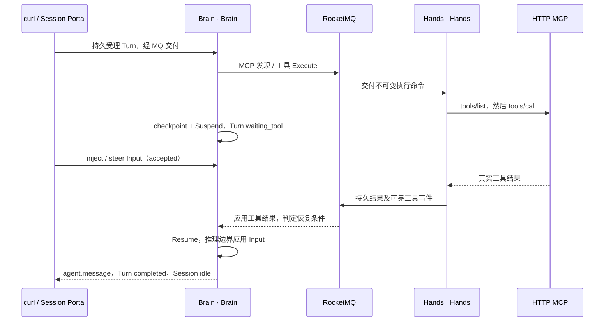

# POC 第 3 篇：工具调用、Brain/Hands 协作与执行中交互

[English](tool-collaboration.en.md) · [POC 阅读顺序](README.md) · 上一篇：[事件与流式交互](events-and-streaming.md) · 下一篇：[API Reference](api-reference.md)

本文使用 **cURL + jq、Bash/zsh、双终端**，测试真实模型发起工具调用、Hands 执行 HTTP MCP、Brain 挂起与恢复、执行中插话、排队、interrupt 和重定向。所有写入仍走 `/v1/sessions/{id}/events`；为准确定位正在运行的工作，本篇使用本项目的 `turn-inputs-v1` 扩展及 Turn/Input 查询。

| 场景 | 观察重点 |
| --- | --- |
| A：工具调用 + inject + 排队 | 工具只执行一次，插话在 Resume 后应用，T2 复用 T1 的真实结果 |
| B：steer | 当前工具继续执行，最终回答按新方向组织 |
| C：interrupt | 请求取消、外部执行结清、Turn 终态分别可观察 |
| D：interrupt + message | 旧 Turn 取消后，新 Turn 执行替换任务 |

每个场景调用一次 90 秒工具，完整体验至少包含 6 分钟工具等待，另加模型和调度时间。按顺序执行，不同时粘贴多个场景。

## 1. 复用配置，创建工具测试 Session（终端 B）

先完成 [Quickstart](api-quickstart.md) 的上下文配置。新终端先执行其中打印的完整 `source /实际路径/client.sh` 命令。本篇继续使用 `BASE_URL`、`TENANT`、`NAMESPACE`、`ENVIRONMENT_ID`、`RUN_ID`、`D` 和 `api`，不重新获取 Token 或配置地址。

Quickstart 的 Agent 显式关闭了工具，已有 Session 又固定了 Agent 定义，因此这里选择集群中**已经配置好 MCP 的 Agent**，创建自己的工具测试 Session。保留原来的 `AGENT_ID`、`SESSION_ID`，不使用其他人的预备测试 Session。

```bash
export TOOLS_D="$D/tools"
mkdir -p "$TOOLS_D"
export TOOL_AGENT_ID="3c8f0737-fab1-4c52-8851-4561a341b087"

tool_api() {
  api "$@" -H 'AgentScope-Extensions: turn-inputs-v1'
}

tool_api "/api/v1/agents/$TOOL_AGENT_ID" | jq '.agent | {id, displayName, version}'
tool_api "/api/v1/agents/$TOOL_AGENT_ID/definition" | jq '.definition | {
  name, version, defaultEnvironmentId, tools,
  mcpServers: [.mcpServers[] | {name, url, transport}]
}'

jq -n --arg agent "$TOOL_AGENT_ID" --arg env "$ENVIRONMENT_ID" \
  '{agent:$agent, environment_id:$env, title:"POC tool collaboration", metadata:{source:"poc-tools"}}' \
  > "$TOOLS_D/session-request.json"
tool_api /v1/sessions -X POST -H "Idempotency-Key: $RUN_ID-tools-session" \
  --data-binary "@$TOOLS_D/session-request.json" > "$TOOLS_D/session.json"
export TOOL_SESSION_ID=$(jq -er '.id' "$TOOLS_D/session.json")
tool_api "/v1/sessions/$TOOL_SESSION_ID/capabilities" | jq \
  '{protocol_revision, extensions, intents, features}'
```

确认协议为 `agentscope-service-2026-10-19-draft3`，支持 `new_turn`、`inject`、`steer`、`cancel`。检查失败时先处理错误，不继续提交消息。`tool_api` 只给原 `api` 增加响应选择 Header，不修改原函数。

本集群的工具配置如下；上面的 GET 只显示无凭据字段：

| 项目 | 当前配置 |
| --- | --- |
| Agent | `MCP 长工具顺序验收`，版本 1 |
| MCP Server 名称 | `longwait` |
| MCP URL | `http://agentscope-service-long-tool-mcp.agentscope-test.svc.cluster.local:8000/mcp`，由 Hands 在集群内访问 |
| 模型看到的工具名 | `longwait__long_wait` |
| MCP 远端工具名 / 公开事件 name | `long_wait` |
| 参数 | `marker`：1–120 字符；`seconds`：1–180 的整数 |
| 工具策略 | `mcp_toolset` 绑定 `longwait`，enabled=true，permissionPolicy=`always_allow`；原生工具关闭 |
| 工具实际动作 | 异步等待指定秒数，返回随机 `call_id`、marker、Pod、真实起止时间 |

MCP 访问凭据已经配置在服务端，不需要在这些命令中填写。该工具不依赖 Sandbox、NAS 或 Environment Worker。它验证的是完整的远程工具执行链路；本篇不执行 `bash/read/write`，当前文本环境不能据此视为已通过 Sandbox 工具验收。原生工具应在具备相应 Sandbox/Worker、启用用户文件能力及相应工具权限的新 Agent/Session 中另测，事件类型为 `agent.tool_use/result`。

## 2. 准备查询函数并打开流

在终端 B 定义以下函数。它们只封装 curl 查询、分页和有限等待，所有请求/结果保存在 `$TOOLS_D`。

```bash
wait_tool_turn() {
  local turn_id="$1" expected_state="$2" current_state attempt
  for attempt in {1..120}; do
    if ! tool_api "/v1/sessions/$TOOL_SESSION_ID/turns/$turn_id" > "$TOOLS_D/turn-current.json"; then
      return 1
    fi
    current_state=$(jq -er '.status' "$TOOLS_D/turn-current.json") || return 1
    printf '%s %s\n' "$turn_id" "$current_state"
    if [[ "$current_state" == "$expected_state" ]]; then return 0; fi
    case "$current_state" in
      completed|failed|cancelled) jq . "$TOOLS_D/turn-current.json"; return 1 ;;
    esac
    sleep 2
  done
  printf 'Timed out waiting for %s\n' "$expected_state" >&2
  return 1
}

tool_history() {
  local page=""
  local query
  : > "$TOOLS_D/history.jsonl"
  while true; do
    query=(-G --data-urlencode 'limit=100' --data-urlencode 'order=asc')
    if [[ -n "$page" ]]; then query+=(--data-urlencode "page=$page"); fi
    tool_api "/v1/sessions/$TOOL_SESSION_ID/events" "${query[@]}" \
      > "$TOOLS_D/history-page.json" || return 1
    jq -c '.data[]' "$TOOLS_D/history-page.json" >> "$TOOLS_D/history.jsonl" || return 1
    page=$(jq -r '.next_page // empty' "$TOOLS_D/history-page.json") || return 1
    if [[ -z "$page" ]]; then break; fi
  done
}

tool_output() {
  local turn_id="$1" cursor=""
  local query
  : > "$TOOLS_D/output-$turn_id.jsonl"
  while true; do
    query=(-G --data-urlencode 'limit=100')
    if [[ -n "$cursor" ]]; then query+=(--data-urlencode "after=$cursor"); fi
    tool_api "/v1/sessions/$TOOL_SESSION_ID/turns/$turn_id/output" "${query[@]}" \
      > "$TOOLS_D/output-page.json" || return 1
    jq -c '.data[]' "$TOOLS_D/output-page.json" >> "$TOOLS_D/output-$turn_id.jsonl" || return 1
    cursor=$(jq -r '.next_cursor // empty' "$TOOLS_D/output-page.json") || return 1
    if [[ -z "$cursor" ]]; then break; fi
  done
  jq -r '.content[]? | select(.type == "text") | .text' "$TOOLS_D/output-$turn_id.jsonl"
}

{
  printf 'source %q\n' "$D/client.sh"
  printf 'export TOOLS_D=%q\n' "$TOOLS_D"
  printf 'export TOOL_AGENT_ID=%q\n' "$TOOL_AGENT_ID"
  printf 'export TOOL_SESSION_ID=%q\n' "$TOOL_SESSION_ID"
  typeset -f tool_api wait_tool_turn tool_history tool_output
} > "$TOOLS_D/client.sh"
printf 'In terminal A, run: source %q\n' "$TOOLS_D/client.sh"
```

每个等待函数最长约 4 分钟（另加请求耗时）；返回非零时停止当前场景，检查保存的状态和 `session.error`。终端使用 Quickstart 的 `set +e`，不会因失败退出，也不会自动阻止你粘贴后续命令，因此先检查等待结果。

终端 A 按 Ctrl+C 停止旧观察流，运行上面打印的完整 `source .../tools/client.sh` 命令，然后：

```bash
tool_api "/v1/sessions/$TOOL_SESSION_ID/events/stream" -N | tee -a "$TOOLS_D/events.sse"
```

看到 `:connected` 后再在终端 B 发请求。后面所有场景共享该观察流。

### Brain 与 Hands 在哪里交接



Brain 对应 Brain，负责模型、checkpoint、挂起与恢复；Hands 对应 Hands，负责 MCP 发现、物理调用和结果持久化。`waiting_tool` 也可能发生在 MCP 目录发现阶段，不能单凭它判断 `long_wait` 已经开始。先看到当前 marker 的 `agent.mcp_tool_use`；需要物理启动证据时按第 8 节查看 MCP 日志。

## 3. 场景 A：长工具 + 中间补充 + 下一轮排队（终端 B）

### 3.1 发起真实工具调用 T1

```bash
jq -n --arg marker "$RUN_ID-tools-a" '{events:[{
  type:"user.message", agentscope_service:{intent:"new_turn"},
  content:[{type:"text",text:("只调用一次 longwait__long_wait，marker=" + $marker + ", seconds=90。等待真实结果后报告 marker、call_id、started_at、finished_at。不要重复调用或伪造结果。") }]
}]}' > "$TOOLS_D/a-request.json"
tool_api "/v1/sessions/$TOOL_SESSION_ID/events" -X POST \
  -H "Idempotency-Key: $RUN_ID-tools-a" --data-binary "@$TOOLS_D/a-request.json" \
  > "$TOOLS_D/a.json"
export TOOL_T1=$(jq -er '.data[0].agentscope_service.turn_id' "$TOOLS_D/a.json")
wait_tool_turn "$TOOL_T1" waiting_tool
```

终端 A 中找到 `mcp_server_name:longwait`、`name:long_wait`、`input.marker:$RUN_ID-tools-a` 的 `agent.mcp_tool_use`，再继续。事件中的 `$RUN_ID-tools-a` 是变量展开后的值，不是字面量。

### 3.2 工具仍在执行时 inject 插话

先确认 Turn 仍开放输入：

```bash
tool_api "/v1/sessions/$TOOL_SESSION_ID/turns/$TOOL_T1/capabilities" | jq .
jq -n --arg turn "$TOOL_T1" --arg note "$RUN_ID-tools-injected" '{events:[{
  type:"user.message", agentscope_service:{intent:"inject",turn_id:$turn},
  content:[{type:"text",text:("补充要求：本轮最终答复原样包含 " + $note + "，并说明工具真实结束后才继续。不要再调用工具。") }]
}]}' > "$TOOLS_D/inject-request.json"
tool_api "/v1/sessions/$TOOL_SESSION_ID/events" -X POST \
  -H "Idempotency-Key: $RUN_ID-tools-inject" --data-binary "@$TOOLS_D/inject-request.json" \
  > "$TOOLS_D/inject.json"
export TOOL_INJECT_ID=$(jq -er '.data[0].agentscope_service.input_id' "$TOOLS_D/inject.json")
tool_api "/v1/sessions/$TOOL_SESSION_ID/turns/$TOOL_T1/inputs/$TOOL_INJECT_ID" | jq .
```

`accepted` 表示持久受理。工具等待期间不会为了这条插话另开推理，也不会取消工具；结果结清、Brain Resume 后，在下一次推理边界应用输入，再变为 `applied`。`steer` 在当前实现中也在受支持的推理边界加入上下文，不会直接修改已经发出的 RPC 参数。

### 3.3 排队 T2，验证上下文接续

```bash
jq -n --arg marker "$RUN_ID-tools-a" '{events:[{
  type:"user.message", agentscope_service:{intent:"new_turn"},
  content:[{type:"text",text:("这是排队的下一轮。不要调用工具，只从上一轮 marker=" + $marker + " 的真实结果原样报告 marker、call_id、finished_at。") }]
}]}' > "$TOOLS_D/queue-request.json"
tool_api "/v1/sessions/$TOOL_SESSION_ID/events" -X POST \
  -H "Idempotency-Key: $RUN_ID-tools-queue" --data-binary "@$TOOLS_D/queue-request.json" \
  > "$TOOLS_D/queue.json"
export TOOL_T2=$(jq -er '.data[0].agentscope_service.turn_id' "$TOOLS_D/queue.json")
tool_api "/v1/sessions/$TOOL_SESSION_ID/turns/$TOOL_T2" | jq '{id,status,inputs_open}'
```

T1 未结清时，T2 应保持 `accepted`；如果操作太慢、T1 已完成，就没有验证到排队窗口。场景重新测试时使用新的场景后缀和请求文件，不修改已使用的幂等键对应正文。

### 3.4 等待、核对真实结果

```bash
wait_tool_turn "$TOOL_T1" completed
wait_tool_turn "$TOOL_T2" completed
tool_api "/v1/sessions/$TOOL_SESSION_ID/turns/$TOOL_T1/inputs/$TOOL_INJECT_ID" | jq \
  '{id,status,applied_at,rejection_reason}'
tool_output "$TOOL_T1"
tool_output "$TOOL_T2"
tool_history
jq -s --arg turn "$TOOL_T1" '[.[] | select(.agentscope_service.turn_id == $turn) |
  select(.type == "agent.mcp_tool_use" or .type == "agent.mcp_tool_result" or .type == "session.error")]' \
  "$TOOLS_D/history.jsonl"
```

通过条件：Input 为 `applied`，T1 最终答复包含 `$RUN_ID-tools-injected`；真实工具结果与 T1/T2 答复中的 `call_id` 一致；`finished_at` 晚于 `started_at` 约 90 秒；T2 未再次调用工具。模型答复不是物理调用证据，应以 `agent.mcp_tool_result` 与 MCP 日志交叉核对。

## 4. 场景 B：steer 调整本轮回答方向

场景 A 两个 Turn 都完成后，提交另一个长工具请求：

```bash
jq --arg marker "$RUN_ID-tools-b" '.events[0].content[0].text =
  ("只调用一次 longwait__long_wait，marker=" + $marker + ", seconds=90。等待真实结果，然后详细说明调用结果，报告 marker、call_id、started_at、finished_at。")' \
  "$TOOLS_D/a-request.json" > "$TOOLS_D/b-request.json"
tool_api "/v1/sessions/$TOOL_SESSION_ID/events" -X POST \
  -H "Idempotency-Key: $RUN_ID-tools-b" --data-binary "@$TOOLS_D/b-request.json" > "$TOOLS_D/b.json"
export TOOL_STEER_TURN=$(jq -er '.data[0].agentscope_service.turn_id' "$TOOLS_D/b.json")
wait_tool_turn "$TOOL_STEER_TURN" waiting_tool
```

在流中看到本次 marker 的 MCP 调用后，执行：

```bash
tool_api "/v1/sessions/$TOOL_SESSION_ID/turns/$TOOL_STEER_TURN/capabilities" | jq .
jq -n --arg turn "$TOOL_STEER_TURN" --arg note "$RUN_ID-tools-steered" '{events:[{
  type:"user.message", agentscope_service:{intent:"steer",turn_id:$turn},
  content:[{type:"text",text:("调整方向：等当前工具真实完成后，最终答复只用一行，包含 " + $note + " 及真实 marker、call_id、started_at、finished_at。不要解释，不要再调用工具。") }]
}]}' > "$TOOLS_D/steer-request.json"
tool_api "/v1/sessions/$TOOL_SESSION_ID/events" -X POST \
  -H "Idempotency-Key: $RUN_ID-tools-steer" --data-binary "@$TOOLS_D/steer-request.json" \
  > "$TOOLS_D/steer.json"
export TOOL_STEER_ID=$(jq -er '.data[0].agentscope_service.input_id' "$TOOLS_D/steer.json")
tool_api "/v1/sessions/$TOOL_SESSION_ID/turns/$TOOL_STEER_TURN/inputs/$TOOL_STEER_ID" | jq .
```

再单独等待并读取结果：

```bash
wait_tool_turn "$TOOL_STEER_TURN" completed
tool_api "/v1/sessions/$TOOL_SESSION_ID/turns/$TOOL_STEER_TURN/inputs/$TOOL_STEER_ID" | jq .
tool_output "$TOOL_STEER_TURN"
```

通过条件：Input 最终为 `applied`，最终回答采用新方向并含 steer marker；原 RPC 仍使用 `seconds=90`。回答格式是否完全遵循要求取决于模型，协议的应用事实以 Input 状态为准。

## 5. 场景 C：运行中 interrupt

等场景 B 完成，提交新的长工具：

```bash
jq --arg marker "$RUN_ID-tools-c" '.events[0].content[0].text =
  ("只调用一次 longwait__long_wait，marker=" + $marker + ", seconds=90。等待真实结果并报告 marker、call_id、started_at、finished_at。")' \
  "$TOOLS_D/a-request.json" > "$TOOLS_D/c-request.json"
tool_api "/v1/sessions/$TOOL_SESSION_ID/events" -X POST \
  -H "Idempotency-Key: $RUN_ID-tools-c" --data-binary "@$TOOLS_D/c-request.json" > "$TOOLS_D/c.json"
export TOOL_CANCEL_TURN=$(jq -er '.data[0].agentscope_service.turn_id' "$TOOLS_D/c.json")
wait_tool_turn "$TOOL_CANCEL_TURN" waiting_tool
```

看到本次 marker 的 MCP 调用后请求中断。这里使用普通 `user.interrupt`，并通过 Header 保留可跟踪的 Input 回执：

```bash
tool_api "/v1/sessions/$TOOL_SESSION_ID/turns/$TOOL_CANCEL_TURN/capabilities" | jq .
printf '%s\n' '{"events":[{"type":"user.interrupt"}]}' > "$TOOLS_D/interrupt-request.json"
tool_api "/v1/sessions/$TOOL_SESSION_ID/events" -X POST \
  -H "Idempotency-Key: $RUN_ID-tools-interrupt" --data-binary "@$TOOLS_D/interrupt-request.json" \
  > "$TOOLS_D/interrupt.json"
jq . "$TOOLS_D/interrupt.json"
export TOOL_CANCEL_INPUT=$(jq -er '.data[0].agentscope_service.input_id' "$TOOLS_D/interrupt.json")
tool_api "/v1/sessions/$TOOL_SESSION_ID/turns/$TOOL_CANCEL_TURN" | jq '{id,status,cancel_requested}'
```

然后观察实际停止边界：

```bash
wait_tool_turn "$TOOL_CANCEL_TURN" cancelled
tool_api "/v1/sessions/$TOOL_SESSION_ID/turns/$TOOL_CANCEL_TURN/inputs/$TOOL_CANCEL_INPUT" | jq .
tool_output "$TOOL_CANCEL_TURN"
```

**本测试 MCP 不提供物理取消能力**：已启动的计时等待会继续，Hands 查询并结清原执行后，Brain 才完成取消；所以 interrupt 后可能仍等待接近剩余 90 秒，并看到成功的 MCP 结果。不要把 HTTP 200、`cancel_requested:true`、关闭 SSE 或 Ctrl+C 当成外部工具已经停止。取消 Turn 可以没有最终助手消息；以 `cancelled` 及 Input 的实际处理结果为准。若工具已先完成，终态可能是 `completed`，这次没有测到中断窗口。

需要明确指定目标时，把请求中的 Event 换成 `{"type":"user.interrupt","agentscope_service":{"intent":"cancel","turn_id":"实际 Turn ID"}}`，使用新的独立幂等键；不要在本场景再次取消同一目标来替代结果观察。

## 6. 场景 D：interrupt + 新消息重定向

等场景 C 的 Turn 已终态，再创建新的长工具工作：

```bash
jq --arg marker "$RUN_ID-tools-d" '.events[0].content[0].text =
  ("只调用一次 longwait__long_wait，marker=" + $marker + ", seconds=90。等待真实结果并报告 marker、call_id、started_at、finished_at。")' \
  "$TOOLS_D/a-request.json" > "$TOOLS_D/d-request.json"
tool_api "/v1/sessions/$TOOL_SESSION_ID/events" -X POST \
  -H "Idempotency-Key: $RUN_ID-tools-d" --data-binary "@$TOOLS_D/d-request.json" > "$TOOLS_D/d.json"
export TOOL_OLD_TURN=$(jq -er '.data[0].agentscope_service.turn_id' "$TOOLS_D/d.json")
wait_tool_turn "$TOOL_OLD_TURN" waiting_tool
```

看到本次 marker 的 MCP 调用后，在**同一批次中按顺序**发送 interrupt 和 replacement message：

```bash
jq -n --arg note "$RUN_ID-tools-redirected" '{events:[
  {type:"user.interrupt"},
  {type:"user.message",content:[{type:"text",text:("改为新的任务。不要调用任何工具，只回复：" + $note)}]}
]}' > "$TOOLS_D/redirect-request.json"
tool_api "/v1/sessions/$TOOL_SESSION_ID/events" -X POST \
  -H "Idempotency-Key: $RUN_ID-tools-redirect" --data-binary "@$TOOLS_D/redirect-request.json" \
  > "$TOOLS_D/redirect.json"
jq . "$TOOLS_D/redirect.json"
export TOOL_NEW_TURN=$(jq -er '.data[1].agentscope_service.turn_id' "$TOOLS_D/redirect.json")
tool_api "/v1/sessions/$TOOL_SESSION_ID/turns/$TOOL_NEW_TURN" | jq '{id,status}'
```

新消息已经受理，但旧工作未结清时不会抢跑。单独等待两个 Turn：

```bash
wait_tool_turn "$TOOL_OLD_TURN" cancelled
wait_tool_turn "$TOOL_NEW_TURN" completed
tool_output "$TOOL_NEW_TURN"
```

通过条件：旧 Turn 为 `cancelled`，新 Turn 为 `completed`，新回答包含 redirect marker 且不产生新工具调用。不要把旧工作结束时的第一个 `session.status_idle` 当成新任务完成；通过 replacement Turn ID 及其最终输出确认。该 MCP 的物理等待仍会继续到结果结清，因此重定向不会绕过外部执行事实。

## 7. 用事件还原调用与结果

每个场景完成后可运行：

```bash
tool_history
jq -s '[.[] | select(
  .type == "agent.mcp_tool_use" or .type == "agent.mcp_tool_result" or
  .type == "agentscope_service.input.applied" or .type == "agentscope_service.input.rejected" or
  .type == "agentscope_service.turn.completed" or .type == "agentscope_service.turn.cancelled" or
  .type == "session.error") | {
  id,type,processed_at,name,mcp_server_name,input,mcp_tool_use_id,is_error,content,agentscope_service
}]' "$TOOLS_D/history.jsonl"
```

| 证据 | 应核对的内容 |
| --- | --- |
| `agent.mcp_tool_use` | `id`、server=`longwait`、name=`long_wait`、input 中的 marker/seconds |
| `agent.mcp_tool_result` | `mcp_tool_use_id` 等于上面的事件 ID；检查 `is_error` 和 content |
| `agentscope_service.turn_id` | 用于区分同一 Session 中的多个场景；本篇所有观察请求都选中了扩展表示 |
| `agentscope_service.tool_call_id` | 平台逻辑调用关联；不等于工具返回的物理 `call_id` |
| Input 查询 | `accepted → applied`，或明确的拒绝原因；回执本身保持冻结 |
| `/turns/{id}/output` | 只包含该 Turn 已提交的最终助手消息；不包含工具及中间消息 |
| `session.error` / failed | 先检查失败，不因随后出现 idle 就判断成功 |

历史用 `page/next_page`，最终输出用 `after/next_cursor`，上面的两个函数分别完整分页。SSE 只发送建连后的事件；重连先开流，再重新调用 `tool_history` 补历史。按 Event ID 合并并允许 processed_at 更新，不能用 Last-Event-ID 续传。

## 8. 可选：核对物理 MCP 日志

普通 API 体验不需要 kubectl。本机已有集群访问权限时，在项目根目录的另一个终端加载 `tools/client.sh`，执行只读检查：

```bash
kubectl --kubeconfig "$KUBECONFIG" \
  -n agentscope-test logs -l app=agentscope-service-long-tool-mcp --all-containers=true \
  --prefix=false --since=30m --tail=-1 | jq -R \
  --arg prefix "$RUN_ID-tools-" 'fromjson? | select((.marker // "") | startswith($prefix))'
```

每个 marker 应只有一次 `long_wait.started` 和一次 `long_wait.completed`，两者 `call_id` 一致；与公开工具结果及模型答案对照。`execution.queried` 是恢复查询，可以多次出现，不是新的物理调用。interrupt 场景通常仍有 completed 日志，符合该 fixture 的取消能力边界。运行较久时扩大 `--since`；日志缺失不能证明从未执行，Pod 重启后的日志另行排查。

## 重试和排查

| 现象 | 处理 |
| --- | --- |
| 忙碌时普通 message 返回 409 | 本轮插话用显式 inject/steer；另起一轮用 new_turn；换方向用有序 interrupt+message |
| inject/steer 新键返回 409 | Turn 可能已经关闭输入，先查 capabilities 和状态；不要换键盲目重试 |
| 相同键修改正文返回 409 | 同一次请求保留原文件和原键；新场景使用新后缀 |
| 等待后没有工具事件 | 检查是否选了 TOOL_SESSION_ID、Agent 工具配置、实际模型答复和 session.error |
| `waiting_tool` 很快结束 | 可能只是目录发现；以当前 marker 的工具事件和物理日志确认实际调用 |
| 只有 accepted 回执 | 它不是执行结果；查 Turn、Input、历史和最终输出 |
| MCP 401 / 连接失败 | 检查服务端 MCP 凭据、Service 及网络；POC 用户登录 Token 不能替代 MCP 授权 |
| interrupt 后仍有工具成功结果 | 已发出的 MCP 操作未提供物理停止能力；等待结清并确认 Turn，而不是重复调用 |

本篇每个写操作都有独立的 `$RUN_ID-tools-...` 幂等键。响应丢失或 5xx 时，原样重发对应 curl、请求文件与原键，不重建 Session、不改 RUN_ID。再次完整体验可创建新测试 Session，并为创建 Session 及各场景统一选择新的运行后缀。

实现与更多验证：[Hands 职责及状态机](../../agentscope-service/docs/managed-hands-design.md)、[MCP 执行恢复](../../agentscope-service/docs/mcp-execution-recovery.md)、[双副本恢复验收](../../agentscope-service/docs/master-sync-20261021.md)。本文不重启或删除 Pod。

下一篇：[第 4 篇：API Reference](api-reference.md)。原 Quickstart Session 仍通过 `SESSION_ID` 访问，工具测试使用 `TOOL_SESSION_ID`。
