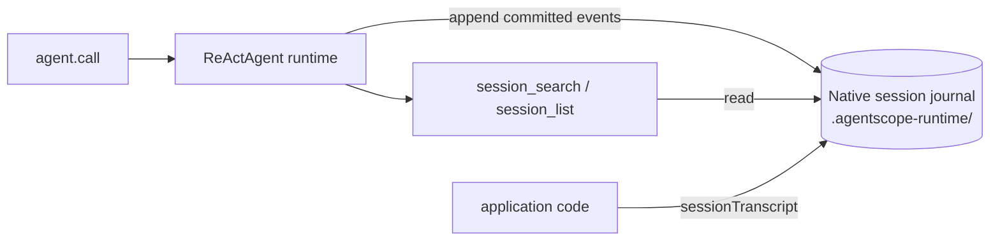

## Purpose

Enable the agent to restore state across requests, process restarts, and multi-user scenarios. Session persistence is owned by the agent runtime itself: conversation progress is appended to a **native session journal** — a lossless, hash-chained sequence of structured events. The journal is never compacted or rewritten; compaction only shrinks the in-context window.

- **Native session journal** — the complete history: messages, tool calls with full inputs/outputs, and reasoning events, stored as atomic commits
- **Read-time projections** — `agent.sessionTranscript(ctx)` and the `session_search` / `session_list` tools project the journal into flat views on demand; no duplicate conversation files are written

## Trigger Points

| When | Action |
|------|--------|
| `agent.call(msg, ctx)` / `agent.session(ctx)` | `(agentId, userId, sessionId)` from `RuntimeContext` selects the journal directory; prior committed events are replayed to restore state |
| After each turn | The runtime appends a hash-chained commit of structured events to the journal |
| Context threshold hit | `CompactionMiddleware` compacts the in-context window (`CompactionConfig`); the journal itself is untouched |
| Before compaction | `MemoryFlushMiddleware` extracts facts into `memory/YYYY-MM-DD.md` (`flushBeforeCompact`, on by default) |

## Key Logic

### Storage Layout



```
workspace/.agentscope-runtime/            ← private runtime storage (not model-visible)
└── agents/<agentId>/sessions/<userId>/<sessionId>/
    ├── session.json                      ← session header
    └── …                                 ← hash-chained commit + payload objects
```

- **Journal**: `JournalSessionLog` writes ordered, hash-chained commits of structured `SessionEvent`s with full payloads, so tool inputs/outputs and reasoning content are preserved verbatim. Compaction summaries are ordinary events; earlier events are never dropped.
- **Backends**: the default `LocalFilesystem` stores journal objects under the workspace's `.agentscope-runtime/` directory; a SQLite backend is used on Windows, and larger deployments can plug `SessionLogStore` / `AtomicSessionStorage` implementations (e.g. a remote store).
- **Reading**: `agent.sessionTranscript(ctx)` projects committed events into a flat `Msg` view; `session_search` / `session_list` query the same journal.

### How `RuntimeContext` Routes the Journal

```java
RuntimeContext ctx = RuntimeContext.builder()
    .sessionId("sess-001")
    .userId("alice")
    .build();

agent.call(msg, ctx).block();
```

`RuntimeContext` decides **which journal** a call reads and writes:

1. **Key derivation**: `(agentId, userId, sessionId)` maps to the journal directory `agents/<agentId>/sessions/<userId>/<sessionId>/`.
2. **Isolation**: different `userId` / `sessionId` values hit different journal directories; there is no shared mutable state between them.
3. **Restore**: committed events are replayed for that identity before the turn runs, so state survives restarts.
4. **Reading from application code**: `agent.sessionTranscript(ctx)` (flat view) or `agent.sessionLog(ctx)` (raw journal) never starts inference.

### Default vs Custom Storage

```java
// 1. Default: journal objects under <workspace>/.agentscope-runtime/
HarnessAgent.builder()
    .name("MyAgent").model(model).workspace(workspace).build();

// 2. Plug a custom store (any AtomicSessionStorage / SessionLogStore)
HarnessAgent.builder()
    ...
    .sessionLogStore(myStore)
    .build();

// 3. Route calls by identity — no per-user builder boilerplate
agent.call(msg, RuntimeContext.builder()
        .sessionId("sess-001")
        .userId("alice")
        .build())
    .block();
```

### Multi-User Isolation

- **Journal level**: `userId` + `sessionId` determine the journal directory; sessions of different users live in disjoint namespaces.
- **File level**: `userId` + `NamespaceFactory` determines the file operation path prefix (the default `LocalFilesystemWithShell` reads the per-call identity).

```java
// Serve alice and bob from the same agent instance
agent.call(msg, RuntimeContext.builder().sessionId("alice-1").userId("alice").build()).block();
agent.call(msg, RuntimeContext.builder().sessionId("bob-1").userId("bob").build()).block();
// Session state and file paths for the two users do not interfere with each other
```

### Listing Sessions

`session_list` / `session_search` read the journal store directly — there is no separate index file to keep in sync. The store discovers sessions by scanning `agents/<agentId>/sessions/` for session headers, so anything committed through the runtime is automatically visible to both tools.

## Related Pages

- [Tool](/v1/en/docs/harness/tool) — `session_search` / `session_list` / `session_history` parameters
- [Memory](/v1/en/docs/harness/memory) — how memory flush interacts with compaction and feeds `memory_search`
- [Filesystem](/v1/en/docs/harness/filesystem) — `userIdRef` + `NamespaceFactory` multi-tenant path isolation
- [Session log](/v2/en/docs/harness/session-log) — journal internals: backends, physical layout, custom stores and exports
