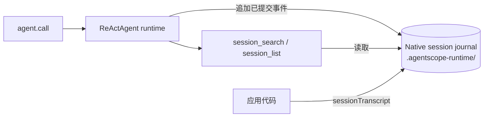

## 作用

让 agent 能在跨请求、跨进程、多用户场景下恢复状态。会话持久化由 agent 运行时自身负责：对话进展会追加进一份 **native session journal**——无损的、hash 链式的结构化事件序列。journal 永不压缩、永不重写；压缩只收缩上下文窗口。

- **Native session journal** —— 完整历史：消息、带完整入参/结果的工具调用、推理事件，以原子 commit 存储
- **读时投影** —— `agent.sessionTranscript(ctx)` 与 `session_search` / `session_list` 工具按需把 journal 投影成扁平视图；不会再写任何对话副本文件

## 触发

| 时机 | 动作 |
|------|------|
| `agent.call(msg, ctx)` / `agent.session(ctx)` | `RuntimeContext` 中的 `(agentId, userId, sessionId)` 选定 journal 目录；先重放已提交事件恢复状态 |
| 每轮结束后 | 运行时向 journal 追加一个 hash 链式的结构化事件 commit |
| 上下文达到阈值 | `CompactionMiddleware` 压缩上下文窗口（`CompactionConfig`）；journal 本身不动 |
| 压缩前 | `MemoryFlushMiddleware` 把事实提取进 `memory/YYYY-MM-DD.md`（`flushBeforeCompact`，默认开启） |

## 关键逻辑

### 存储布局



```
workspace/.agentscope-runtime/            ← 运行时私有存储（模型不可见）
└── agents/<agentId>/sessions/<userId>/<sessionId>/
    ├── session.json                      ← 会话头
    └── …                                 ← hash 链式 commit 与 payload 对象
```

- **Journal**：`JournalSessionLog` 把有序的、hash 链式的 `SessionEvent` commit 落盘，payload 完整保留——工具入参/结果与推理内容不会被截断或丢弃。压缩摘要是普通事件，更早的事件从不删除。
- **后端**：默认 `LocalFilesystem` 把 journal 对象存在 workspace 的 `.agentscope-runtime/` 下；Windows 上使用 SQLite 后端，更大规模部署可以接入自定义 `SessionLogStore` / `AtomicSessionStorage`（如远端存储）。
- **读取**：`agent.sessionTranscript(ctx)` 把已提交事件投影成扁平 `Msg` 视图；`session_search` / `session_list` 查询同一份 journal。

### `RuntimeContext` 怎么路由 journal

```java
RuntimeContext ctx = RuntimeContext.builder()
    .sessionId("sess-001")
    .userId("alice")
    .build();

agent.call(msg, ctx).block();
```

`RuntimeContext` 决定这次调用**读写哪份 journal**：

1. **键推导**：`(agentId, userId, sessionId)` 映射到 journal 目录 `agents/<agentId>/sessions/<userId>/<sessionId>/`。
2. **隔离**：不同的 `userId` / `sessionId` 落在不同的 journal 目录，彼此没有共享可变状态。
3. **恢复**：每轮开始前按该身份重放已提交事件，状态跨重启可恢复。
4. **应用侧读取**：`agent.sessionTranscript(ctx)`（扁平视图）或 `agent.sessionLog(ctx)`（原始 journal）都不会触发推理。

### 默认与自定义存储

```java
// 1. 默认：journal 对象放在 <workspace>/.agentscope-runtime/ 下
HarnessAgent.builder()
    .name("MyAgent").model(model).workspace(workspace).build();

// 2. 接入自定义存储（任意 AtomicSessionStorage / SessionLogStore）
HarnessAgent.builder()
    ...
    .sessionLogStore(myStore)
    .build();

// 3. 按身份路由调用——无需为每个用户单独 build
agent.call(msg, RuntimeContext.builder()
        .sessionId("sess-001")
        .userId("alice")
        .build())
    .block();
```

### 多用户隔离

- **Journal 层**：`userId` + `sessionId` 决定 journal 目录，不同用户的会话处于互不相交的命名空间。
- **文件层**：`userId` + `NamespaceFactory` 决定文件操作路径前缀（默认 `LocalFilesystemWithShell` 会读每次调用的身份）。

```java
// 同一 agent 实例服务 alice / bob
agent.call(msg, RuntimeContext.builder().sessionId("alice-1").userId("alice").build()).block();
agent.call(msg, RuntimeContext.builder().sessionId("bob-1").userId("bob").build()).block();
// 两个会话状态、文件路径都互不干扰
```

### 列出会话

`session_list` / `session_search` 直接读 journal store——没有需要额外同步的索引文件。store 通过扫描 `agents/<agentId>/sessions/` 下的会话头发现会话，所以凡是经运行时提交过的会话对两个工具自动可见。

## 相关文档

- [工具](/v1/zh/docs/harness/tool) — `session_search` / `session_list` / `session_history` 的入参
- [记忆](/v1/zh/docs/harness/memory) — 记忆提取如何与压缩配合，以及如何被 `memory_search` 利用
- [文件系统](/v1/zh/docs/harness/filesystem) — `userIdRef` + `NamespaceFactory` 的多租户路径隔离
- [Session log](/v2/zh/docs/harness/session-log) — journal 内部机制：后端、物理布局、自定义存储与导出
