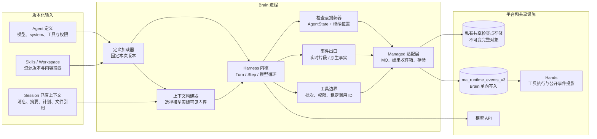
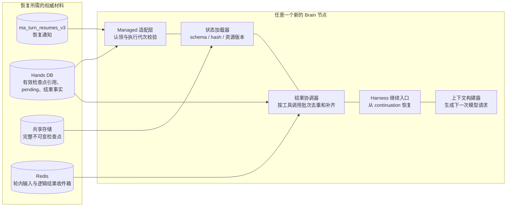
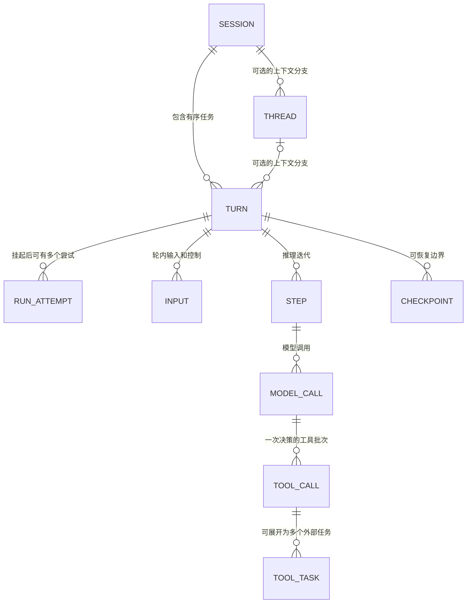
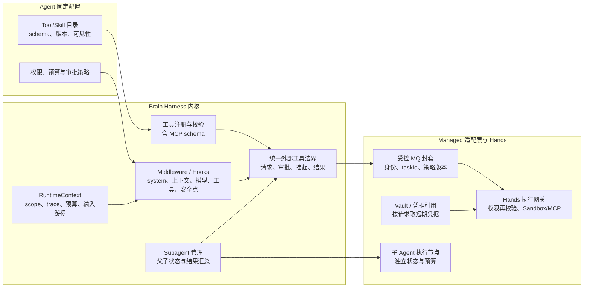

# Managed Agents Brain Harness 内核能力设计

本文只讨论运行在 DataPlane 中的 Brain：需要什么样的 Harness 内核，才能承载已有的 Managed Agents 架构。它是**目标能力与验收标准**，不是当前 AgentScope Java 或其他候选框架已实现能力的清单，也不重写 RocketMQ、Hands 和 Portal 的部署设计。平台边界沿用 [Managed Agents MQ 与 Redis 架构设计 v2](./Managed%20Agents%20MQ%20%E4%B8%8E%20Redis%20%E6%9E%B6%E6%9E%84%E8%AE%BE%E8%AE%A1%20v2.md)，框架比较见 [Harness 选型分析](./harness-design.md)。

Brain 可拆为 **Harness 内核**和 **Managed 适配层**。内核掌握模型调用、上下文、step、工具调用批次及可继续的执行状态；适配层把这些状态接到 Agent 定义、RocketMQ、Redis、共享检查点存储和 Hands。内核可以换实现，但不能只导出一段对话历史就声称可恢复。反过来，MQ 投递、结果收件箱和原 Turn 的 ACK 也不应写死在通用 ReAct 算法里。下面四张图都是**组件/数据关系图**；箭头表示依赖、发布或读取，不表示时间顺序。具体先后约束由图下的文字说明。

## 1. 一次推理：从 Agent 定义到可挂起的工具调用



**初始化不是每次把全部资料塞给模型。** Agent 定义应固定 `agentVersion`、模型与参数、system 指令、可用工具目录、权限策略及引用的 Skill/Workspace 版本。会话状态给出历史消息、摘要、计划和文件引用。上下文构建器按 token 预算和本次目标选择模型实际看到的内容，并记录 `ContextManifest`：选入的消息/Skill/文件版本、压缩覆盖范围、遗漏原因、工具 schema 版本及最终模型请求摘要。完整日志继续保存；模型可见上下文只是其中一次构建的结果。Skill 的资源可以按需加载，但其版本和内容摘要必须在本次执行中固定。

例如同一 Turn 的第一个 step，模型请求只选入 system、当前目标、`skill:repo-search@v3` 的说明和最近两条相关消息。日志中仍可有更多历史；恢复时依据 Manifest 与持久内容重建这一请求，不能悄悄读取已变更的 Skill 文件。

**工具调用需要一个可截断的内核边界。** 模型一次回复可能同时含 `call_fast` 和 `call_slow`。内核先冻结整批 `ToolUseBlock`、原始模型消息及顺序；经参数校验、权限/审批后，适配层为每项生成稳定的 `taskId`、`executionId`，向 `ma_runtime_events_v3` 发布 ToolIntent。只有 Broker 确认接收后，本地才把该意图视为已发出；Hands 的 DB 投影可以稍后完成。工具执行与 Brain 进程解耦，Brain 只按 `taskId` 短等待 Redis 逻辑结果收件箱。短等待期限内两项结果都到达，就在原实例组合完整工具结果并进入下一个 step；期限届满而仍有未决结果，则转入持久挂起。超时只释放等待，不等于工具失败或取消。

本例的内核状态可写成下面的结构；字段名称是目标协议示意，不声称当前 Java 类已有完全相同的序列化形式：

```json
{
  "sessionId": "session_42",
  "turnId": "turn_17",
  "runId": "run_brain_a_1",
  "stepId": "step_2",
  "modelCallId": "model_2",
  "assistantMessageId": "msg_91",
  "toolBatch": [
    {"toolCallId": "call_fast", "taskId": "task_17_fast", "state": "result_applied"},
    {"toolCallId": "call_slow", "taskId": "task_17_slow", "state": "waiting"}
  ],
  "continuation": {"phase": "APPLY_TOOL_RESULTS", "nextStep": 3},
  "appliedInputSeq": 4,
  "contextManifestId": "ctx_2"
}
```

**三层事件各有用途，不能互相冒充。** 内核向实时观察者发模型 token、工具参数与输出的 delta；向原生 Session Log 发完整模型请求/响应、工具意图、输入应用、上下文选择和状态变更事实；Hands 在持久消费后把需要公开的事实投影成用户可查询的 Message/Event。实时 delta 可以用于预览，但它丢了不能充当恢复依据；一条完整 `agent.message` 可以聚合多个 delta，必须有稳定 ID 与终态内容。工具输出流的 delta 由 Hands 经独立 `ma_tool_events_v3` 保存，最终结果也走该 Topic；Brain 不直接生产工具结果事实。建议内核暴露 `onDelta`、`onNativeFact`、`onMessageCompleted` 三类接口，适配层统一补齐 scope、turnId、runId、stepId、来源和去重 ID。

| 记录 | 示例 | 谁持有权威事实 |
| --- | --- | --- |
| 实时片段 | `model_2` 的文本 delta `"正在查询…"` | 当前 Harness 尝试；仅作预览 |
| 原生事实 | `tool/requested(call_slow)`、`context/selected(ctx_2)` | Brain 的有序运行日志，交 Hands 持久化 |
| 公开消息 | `agent.message(id=msg_92, content="查询完成")` | Hands 投影后供 Portal 历史与 SSE 查询 |

**检查点必须在销毁实例前捕获。** 内核在明确安全点冻结完整 `AgentState`、整批工具调用、已取得/已应用结果、输入游标、上下文/Skill/工具版本和 `continuation`。适配层把不可变完整对象写入共享私有存储，验证可读和摘要，再经 Runtime MQ 发送引用、长度、schema、关闭的日志/发布水位及 `pending` 关联。Hands 原子保存引用、`pending` 与 `waiting_tool`；MQ 中不放整份 AgentState。Brain 收到 Broker 的引用消息接收确认后，才清理模型流、工具等待、进程内 Session 状态和临时资源。**Harness 计算资源释放，不等于原 Turn MQ 投递 ACK**：原消费回调仍由 DataPlane 轻量持有，整个 Turn 终态落库后才由 Hands 通知它完成确认。对象写入成功而引用未生效时，该对象不能被新节点当成有效恢复点。

## 2. 一次恢复：结果通知如何变成下一轮推理



Hands 消费工具结果并落库后，把结果送入 Redis 的逻辑收件箱；结果与 `waiting_tool` 的事务无论谁先发生，都必须在结果齐备时登记唯一 Resume 意图。Resume 通知来自 `ma_turn_resumes_v3`，不是 Brain 定时查询 DB。新节点认领该意图后，**只为这一轮恢复读取一次** Hands 已生效的检查点引用、结果与关闭水位，下载共享对象，核对 SHA-256、schema、scope、固定资源版本及执行代次；必要时重放有效检查点之后、关闭水位以内的原生事实。恢复屏障保证旧 writer 的已接受前缀可见，旧实例不能与新实例并发推进。失效或重复的 Resume 只能重新核对/重试交接，不能让两个节点同时恢复同一 Turn。

**状态加载与结果应用要分开。** 对上例，恢复节点看到 `call_fast` 已应用、`call_slow` 已完成，就只补入 `call_slow` 的真实 `ToolResultBlock`，保持两项结果与原 `ToolUseBlock.id` 对应，构成模型下一次请求所需的完整工具回复。若 `call_fast` 已收到但尚未应用，按 `resultEventId` 和 `toolCallId` 判定后恰好应用一次。若尚有结果未完成，就再次短等待或形成新挂起；绝不能重新执行已发出的工具意图，也不能把等待超时写成失败结果。

```json
{
  "resume": {"turnId": "turn_17", "checkpointId": "cp_17_2", "suspensionId": "susp_1"},
  "results": [
    {"toolCallId": "call_fast", "taskId": "task_17_fast", "resultEventId": "result_101", "status": "success", "content": "A"},
    {"toolCallId": "call_slow", "taskId": "task_17_slow", "resultEventId": "result_102", "status": "success", "content": "B"}
  ],
  "restoredPhase": "APPLY_TOOL_RESULTS"
}
```

结果状态必须原样进入内核决策：`success` 把输出交给模型；实际执行失败的 `error` 和明确拒绝的 `denied` 形成对应的错误工具结果，让模型决定修正参数或结束；**尚待审批**是未决 interaction，不可先伪装成拒绝；`cancelled` 只有 Hands 确认远端停止或结算后才成为终态，`unknown` 代表副作用不确定，应先对账而不是让模型当作成功继续。流式 delta 可以留在日志和 UI 中，模型默认只看经过筛选的最终结果或明确可用的中间结果。一次模型决策有多个工具调用时，内核需要显式的批次策略：是否必须全部终态才请求下一次模型、是否允许某个工具 `returnDirect`、部分失败时怎样合成完整 `ToolResultMessage`。这些规则应保存在 checkpoint 的 continuation 中，而不是恢复节点临时猜测。

内核至少需要 `captureAtSafePoint()`、`restore(snapshot, pinnedDefinition)`、`applyToolResults(batch)`、`continueTurn()` 四种语义能力；名字可以不同，语义不能缺。`restore` 不应自动重放带副作用的工具节点；`continueTurn` 必须从 `APPLY_TOOL_RESULTS` 或其他明确阶段开始。检查点中不序列化 Java 线程、Mono/Future、MCP 连接、临时凭据或 MQ receipt；恢复时按持久引用重建这些服务。终态后 Hands 持久化完整运行结果并通知当前持有原 Turn 投递的消费回调返回 SUCCESS；恢复通知本身完成 ACK 与原 Turn ACK 是两件事。

## 3. 会话、Turn、Step 和轮内交互



建议采用以下粒度。`Session` 是租户作用域内的持久会话和 Turn 顺序边界；`Turn` 是一次用户任务，从初始输入到完成/取消/失败，挂起和跨节点恢复仍是**同一个** Turn；`RunAttempt` 是某个 Brain 实例的一次执行尝试，换节点会产生新的 runId/epoch；`Step` 是一次推理迭代，可含一个主模型调用、上下文构建和零到多项工具调用；`ModelCall` 包括辅助摘要或路由模型调用，需标明 purpose；`ToolCall` 是模型输出的调用 ID，一项模型调用也可能展开成多个 Hands `ToolTask`。`Thread` 只在需要分支上下文、并行子任务或子 Agent 时引入，不能拿它替代 Session 或 Turn 的持久顺序边界；子 Thread 的父子关联、结果汇总和取消归属要显式保存。一个 Session 可有多个 Thread，但同 Session 后续 Turn 何时可开始，仍由外层 Turn 投递和终态 ACK 规则决定。候选框架若把“thread”当作顶层会话名称，适配时先映射概念，不应因此改变平台的 Session/Turn 身份。

例如 `session_42 / turn_17 / step_2 / model_2 / call_slow` 在挂起前由 `run_brain_a_1` 执行；恢复后使用 `run_brain_b_2` 和新 epoch，仍是 `turn_17`，`call_slow` 对应的 `task_17_slow` 不变。`step_3` 只在两项结果已按规则进入上下文后出现。`replyId`（流式片段组）、`messageId`（完整消息）、`resultEventId`（结果事实）也应分别保留，不能拿一个 ID 兼用。

轮内操作必须是持久命令，并分清**受理**与**应用**。`inject` 补充背景资料，可在下一安全点加入模型可见上下文；`steer` 改变当前 Turn 后续方向，应绑定目标 turnId 并在下一模型请求前应用；`cancel` 停止新的模型/工具派发、取消本地流和等待，并向 Hands 发远端取消意图，等待远端结算后结束 Turn；`respond` 针对某个待办工具/HITL 审批，必须绑定 requestId、参数摘要与权限版本。模型流中到达的输入不能修改一半已发送的请求；工具等待和 `waiting_tool` 中到达的输入也必须持久接收，并在恢复后按输入序号应用或明确拒绝。已受理的 steer 不能在 Turn 终态时被静默丢弃。

```json
{"inputId":"input_5","sessionId":"session_42","turnId":"turn_17","inputSeq":5,
 "kind":"steer","text":"先检查 slow 的错误原因","status":"accepted"}
```

`status=accepted` 只说明 Portal 已受理；内核在安全点记录 `input/applied(input_5, step_3)` 后，才可显示为已处理。重复命令按 `inputId` 去重；针对旧 runId/已结束 Turn 的控制命令要给出明确拒绝。取消的优先级应高于发起新模型调用或新工具；已经交给 Hands 的副作用不能仅靠取消 Brain 的 Reactor 订阅来撤销。对外若支持类似 Claude 的 interrupt 语义，需要区分“结束当前 Turn 并排队新 Turn”和“在当前 Turn 内 steer/inject”，不能通过改事件名称来混同。

选型时至少检查：能否查询某 Turn 当前 step 和 pending 批次；能否在模型调用前、工具派发前后、终态提交前设置安全点；能否将输入游标和应用事实纳入 checkpoint；能否在原实例销毁后执行 cancel/steer；能否让子 Thread/子 Agent 的未完成工作阻止父 Turn 误终态。

## 4. 执行基础：RuntimeContext、工具/MCP、扩展点与子 Agent



`RuntimeContext` 应是**单次执行的受控上下文**，至少给内核明确的 tenant/namespace/user/session/turn/run/step 身份、追踪、预算、权限模式、输入游标、文件/工作区引用和取消状态。进程内可用对象或 Reactor Context 传播，但跨 MQ 只能复制白名单字段并做签名/校验；不可序列化的服务句柄和明文凭据不进入消息或 checkpoint。恢复节点按这些引用重建模型客户端、工具目录、Sandbox 绑定和日志 writer。当前 Java `RuntimeContext` 已提供 sessionId、userId、runId、AgentState 和类型化值，但目标的跨节点 scope/epoch/资源版本仍须由 Managed 封套与恢复状态显式补齐。

工具的四个边界要分开：**模型可见 schema**、Brain 的参数/权限/审批检查、向 Hands 发出的稳定意图、Hands 真实执行与最终结果。`Tool`、MCP、shell、文件、浏览器及子 Agent 启动都要经过同一托管派发边界；只包装用户自定义工具而保留一个内建 shell 直接在 Brain 执行，会破坏统一权限和恢复。Hands 在实际执行点再次检查租户、Environment、Vault、允许的命令/路径和审批事实，不能仅信任 Brain 的“已允许”标志。用户授权的审批应绑定工具名、规范化参数 hash、requestId 和策略版本；恢复后参数变了需重新审批。

MCP 的 schema 发现可在 Brain 初始化工具目录时完成，但长连接和调用应在 Hands 执行侧建立。固定连接 header 与**每次请求的动态 header**是不同能力：例如 `Authorization` 应由 Hands 用 Vault 引用在每次 HTTP 请求前取得或刷新；`X-Tenant-Id`、traceId、用户身份等只对允许的目标 MCP Server 透传，不能把 RuntimeContext 全量塞进 header 或 MCP `_meta`。stdio MCP 没有 HTTP header，需用受控启动环境/协议字段。MCP 的 `_meta` 是请求元数据，不是模型可见参数，也不等于传输 header；连接级和工具级的允许传播开关都应保留。动态发现、同名工具命名空间、连接重建、取消、超时和流式进度应与 `taskId/executionId` 关联；不可信 MCP 输出进入模型前按工具结果处理，不能升级成 system 指令。

例如发往 Hands 的托管意图只携带 `serverRef=mcp_search_v2`、`credentialRef=vault_search`、`tenantId=tenant_demo`、`traceId=trace_17` 和工具参数；Hands 根据服务器策略在**每次请求**注入短期 `Authorization`，并仅在该服务器允许时加入 `X-Tenant-Id`。实际令牌不进入模型请求、MQ 事件、Session Log 或检查点。

| 扩展或拦截点 | Brain 内核/适配层 | Hands 执行侧 |
| --- | --- | --- |
| 模型可见工具与 Skill | 选择 schema、资源版本、system/上下文片段；记录实际模型请求 | 不决定模型上下文 |
| 工具调用前 | 校验参数、执行前权限、审批和稳定 taskId；发布意图 | 按身份、策略版本及审批事实再校验，创建真实任务 |
| 工具运行中 | 消费逻辑结果收件箱，必要时挂起 | 执行 MCP/Sandbox，发布 delta、进度和最终结果 |
| 工具结果后 | 将原 toolCallId 的结果应用一次，调用后置 Hook，再构建下次模型请求 | 保存权威结果与投影；重复消息只返回既有事实 |

Middleware/Hook 应开放 system prompt、上下文选择、模型调用、工具请求/结果、权限决定、轮内输入应用、挂起捕获、恢复加载和终态结算等接缝，并定义优先级、错误处理和重试语义。副作用 Hook 要么只在持久事实首次提交时执行，要么使用稳定 ID 幂等；恢复后不能因为重新进入 `onActing` 就再次扣费或再次派发工具。Skill 加载也通过扩展点进入上下文：先列出可用 Skill 的名称/摘要，模型需要时再加载全文和文件资源，记下版本、内容 hash 与实际可见片段。不是每个 Skill 都必须依赖 coding agent 的文件系统惯例。

子 Agent 至少有独立的执行身份、上下文、预算、权限上限和可恢复状态；父 Agent 保存 `childTaskId` 与等待条件，收到子任务终态结果后继续原 Turn。子 Agent 若作为分布式工作运行，应像工具一样有稳定意图和结果，而不是父进程内的不可恢复 Future；取消父 Turn 时要传播到子任务并记录结算。若选型目标是轻量通用 Harness，可以先把子 Agent 作为可选扩展，不把复杂的 coding workspace、终端策略和长任务技能包写进最小内核。

当前 AgentScope Java 源码提供了可评估的接缝：`HarnessAgent` 包装 ReAct 与 Harness middleware；直接调用由 `AgentRun` 控制，持久任务由 Durable 的 Session/Thread/Turn API 调度；`InvocationRecorder` 记录原生 `model/chunk`、`tool/requested` 和 `state/checkpoint`。checkpoint 事件仍含 `stateJson`，与目标的“Brain 写共享完整对象、MQ 只传引用”有差距；`McpTool` 已支持请求 `_meta`，`McpClientBuilder` 有静态 header 和每请求 HTTP customizer。原生中断只控制当前调用，不能直接等同本文要求的跨节点 cancel 与远端任务结算。这些是源码事实，不代表分布式恢复、全部工具外置、HITL 和跨节点资源重建已完成。[AgentState](https://github.com/agentscope-ai/agentscope-java/blob/v2.0.4/agentscope-core/src/main/java/io/agentscope/core/state/AgentState.java)、[AgentRun](https://github.com/agentscope-ai/agentscope-java/blob/v2.0.4/agentscope-core/src/main/java/io/agentscope/core/agent/AgentRun.java)、`agentscope-core/src/main/java/io/agentscope/core/journal/InvocationRecorder.java`（未包含在 v2.0.4 中）、[MCP 客户端](https://github.com/agentscope-ai/agentscope-java/blob/v2.0.4/agentscope-core/src/main/java/io/agentscope/core/tool/mcp/McpClientBuilder.java)。

## 选型或自研时的最低验收

能力是否“有 API”不足以决定选型，必须让下列小场景在不同 Brain 进程之间完成。**硬门槛**是有序事实、可冻结的工具批次、完整检查点、明确 continuation、恢复时结果只应用一次、轮内控制安全点及所有真实工具执行入口可外置；system/Skill、MCP、Subagent 的包装方式可以放在适配层，但不能突破这些内核边界。

| 场景 | 可检查的结果 |
| --- | --- |
| 两工具部分完成后挂起 | `call_fast` 已应用、`call_slow` 未完成；新节点只接回 `call_slow`，原 `taskId` 不变，没有第二次工具执行 |
| 结果早于或晚于 `waiting_tool` 落库 | 都恰好产生一条有效 Resume，原 Turn 在终态前不 ACK，正常推进不轮询 DB |
| 任意节点冷恢复 | 从共享对象和已生效引用恢复同一逻辑 Turn；模型实际请求含完整工具回复和正确的 system/Skill 版本 |
| 恢复时收到 steer / cancel | 已受理输入有应用或拒绝回执；cancel 阻止新派发并协调 Hands 已启动任务 |
| 工具失败、拒绝、重复结果及流式输出 | 日志有 delta 和最终事实；模型只收到按原 toolCallId 组装的结果；重复事件不引发重复推理 |
| MCP 与子 Agent | 每请求身份/凭据在 Hands 重建；父子状态、权限和预算跨节点保留；无 Brain 本地副作用旁路 |

比较候选实现时，再衡量内核改造面、Java/Go 实现或迁移成本、升级维护、依赖体积和性能。通用托管服务更适合**小而明确的执行内核 + 可替换的策略/工具扩展 + 独立 Managed 适配层**；自带大量 coding agent 能力不是否决条件，但应量化它们对状态、工具权限、版本升级和长期维护的耦合。模型效果、长任务完成率和 token 成本需另用同题任务测量，不能由接口清单推断。
