# Managed Agents MQ 与 Redis 架构设计

本文是内部讨论用的目标设计，以 Session 请求进入和运行事件处理两张架构图为基础。它描述拟实现的资源、组件、协议和流程，不表示当前部署已经具备这些能力，也不表示完成了真实 Sandbox 验证。

本轮确定以下约定：

- MQ 使用少量 LITE 类型父 Topic；每个父 Topic 内，以完整 Session 作用域标识命名 LiteTopic。同一 Session 的用户 Turn 按其 Turn LiteTopic 的存储顺序执行，不为每个 Session 创建父 Topic 或 ConsumerGroup。Turn、Brain 运行事件、工具事件和 Resume 消费组按父 Topic 全量订阅，新 Session 的 LiteTopic 自动纳入消费，不查询 DB 发现 Session，也不逐个动态订阅。
- Brain 生成完整检查点并先保存到共享私有持久存储，经 MQ 只发送检查点引用和必要关联；Hands 原子保存引用及业务状态。模型、上下文和输入应用事件收到 MQ 接收确认后继续本地执行，不查询 DB 提交回执；只有需要工具输出的步骤等待匹配的 tool result。
- 工具结果只在当前 DataPlane 上等待一个短期限。期限内返回则继续当前推理；超时后先保存完整检查点对象，再发布引用并挂起，同一逻辑 Turn 变为 waiting_tool，释放当前节点的 Harness 计算资源。
- 各 MQ 消费职责统一采用 LitePushConsumer，SDK 请求自动续期，Proxy 执行续期，本部署自动续期上限为 3 小时；不由应用编写逐投递续期循环。
- waiting_tool 时不 ACK 原 Turn 投递。Hands 原子保存挂起检查点引用、pending 关联和 waiting_tool；Brain 释放 Harness 计算资源，原消费回调保持未完成。工具结果通过独立 Resume MQ 唤醒同一 Turn；整个 Turn 终态落库后，Hands 可靠通知当前原消费方，由回调返回 SUCCESS、SDK 执行 ACK。
- steer、inject、cancel 和待办答复进入 Redis，由执行中的组件主动读取。
- DataPlane 负责模型调用和推理推进；Hands Worker 处理运行事件、保存恢复日志、转换公开事件，并调度 Sandbox 工具。
- `ma_runtime_events_v3` 只由 Brain 写入，Hands 工具执行侧将工具 delta、进度和最终结果统一写入独立的 `ma_tool_events_v3`；Hands 事件处理侧消费工具 Topic，持久化后写入 Redis 逻辑结果收件箱；Brain 按稳定任务身份短期限等待收件箱，不设置工具结果 MQ 消费组或动态订阅，也不维护 Brain 节点地址表。结果按 toolCallId / taskId / executionId 校验、去重后纳入上下文；DB 保存恢复事实，不承担正常推进的轮询确认。

设计使用中立的 Managed Agents 资源与协议。以下流程覆盖当前讨论范围；未来扩展集中在文档最后。

## 全局部署架构

### 部署组件简图

下图按入口、资源管理、会话管理、Brain 与 Hands 展示核心物理组件，并标出 MQ 生产与消费、Redis 读写及数据库访问。各服务可以部署多个副本。


Gateway 将 Agent、Environment 等资源 API 路由到 Control Plane，将 Session、Turn 和 Events API 路由到 Session Portal。MQ 表示一套 RocketMQ 部署，其中 Turn、Brain 运行事件、工具事件和 Resume 是四条逻辑通道；Turn 按固定嵌套深度拆分 LITE 父 Topic，其余各使用一个父 Topic，父 Topic 内按 Session 建立 LiteTopic；RDS / DB 表示共享数据库。cloud 模式使用 ACS Sandbox，self_hosted 模式使用用户提供的实例。

实施验证补充：长 Turn 保留 Delivery 的场景采用 RocketMQ 5.5.1 LiteTopic，每个 Session 使用独立的逻辑队列，Turn 与运行事件分别绑定不同父 Topic。单物理队列实测中，经典 FIFO 会阻塞另一个 Session，而 LiteTopic 可以继续消费该 Session 的消息。部署使用独立 Cluster Proxy；内嵌 Local Proxy 未提供 Lite 订阅服务。当前源码的 `ManagedScope.messageGroup()` 是完整作用域的逻辑 key，在 Lite 传输中传给 `setLiteTopic()`，不代表 SDK 的 FIFO MessageGroup。下文统一按父 Topic、LiteTopic 与 ConsumerGroup 说明。[LiteTopic 官方说明](https://rocketmq.apache.org/zh/docs/domainModel/03litetopic/)

[可编辑 SVG 源图](/imgs/service/managed-agents-physical-overview.svg)

### 部署依赖详图

下图描述本方案的目标物理部署。Control Plane、Session Portal、DataPlane、Hands Worker 分别作为独立的服务进程或容器部署，可各自扩缩容；RocketMQ、Redis、DB 和文件存储是共享基础设施。图中的箭头表示组件主动访问的依赖方向，响应沿原连接返回；实线表示核心依赖，虚线表示按能力或 Environment 配置使用的依赖。

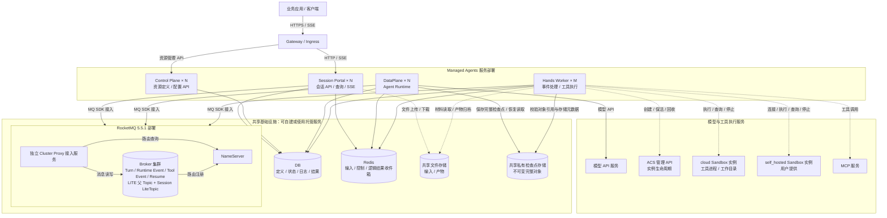

**物理部署边界与依赖说明**

| 部署单元 | 直接依赖 | 部署约定 |
| --- | --- | --- |
| Gateway / Ingress | Control Plane、Session Portal | 按资源 API 与会话 API 路由，长连接配置支持持续事件输出 |
| Control Plane 副本组 | DB | 管理 Agent、Environment 等定义与配置；运行组件读取已保存的配置 |
| Session Portal 副本组 | RocketMQ 接入、Redis、DB；文件能力启用时访问文件存储 | 任意副本可以受理请求与提供结果查询；SSE 连接期间由当前副本维持，重连可进入其他副本 |
| DataPlane 副本组 | RocketMQ 接入、Redis、DB、共享检查点存储、模型 API | 主动消费 Turn、读取输入并短等待 Redis 结果收件箱；多个副本共享一个 Turn 消费组，LitePush 自动续期与推理任务解耦，消费回调等待终态完成通知 |
| Hands Worker 副本组 | RocketMQ 接入、Redis、DB，以及选定的 Sandbox；访问检查点存储校验引用，按能力访问文件存储和 MCP | 分别消费 Brain 运行事件和工具事件、保存工具结果并写入 Redis 结果收件箱、认领工具任务；事件处理和长工具执行分别配置容量；挂起仅原子保存检查点引用及业务状态，整个 Turn 终态提交后才可靠通知原消费方完成确认 |
| RocketMQ 部署 | Proxy、Broker、NameServer 及消息持久化存储 | Turn、Runtime Event、Tool Event、Resume 是同一消息基础设施中的四条独立逻辑通道，不需要分别部署多套 MQ |
| 共享检查点存储 | 私有共享文件系统或对象存储及其持久化保障 | Brain 写入不可变完整检查点，所有恢复节点可按引用读取；可复用现有存储后端的私有命名空间，具有独立的权限与保留规则 |
| DB 与 Redis | 各自的持久化、复制和服务接入 | 各服务复用共享数据库；Portal、DataPlane、Hands 访问同一套 Redis，副本本地内存不承担跨实例恢复依据 |
| 模型与执行服务 | 对应提供方的 API 与运行实例 | 图中按服务边界展示；模型和 MCP 可自建，self_hosted Sandbox 位于用户提供的环境中 |

RocketMQ 图使用 Broker / Proxy 5.5.1 与独立 Cluster Proxy，客户端使用项目当前的 Java gRPC SDK 5.2.2。项目 Lite 测试记录不能等同于正式 Compose / Helm 已完成迁移；目标统一使用 LitePushConsumer，所选部署需要提供 Lite 订阅、自动续期和对应 Topic / ConsumerGroup 的 FIFO 配置。这里不再将内嵌 Local Proxy 写成可直接替换的 POC 配置。托管 MQ 也必须核对相同能力和版本接口。[5.5.1 发布说明](https://rocketmq.apache.org/release-notes/2026/08/20/5.5.1/)、[LiteTopic 官方说明](https://rocketmq.apache.org/docs/domainModel/03litetopic/)

消费者指向 MQ 的箭头表示接收、续期和 ACK 所需的访问连接。业务请求通过 Portal 进入后，DataPlane 和 Hands 通过共享消息与存储协作，主执行链路不依赖 Portal 向某个执行副本发起直连调用。后面的流程图会按消息流向展开这套部署中的具体交互。

## 1. 资源、组件与职责

### 1.1 一等资源

一等资源具有独立的标识、定义和生命周期，可以单独创建、管理并被其他资源引用。Agent 的能力配置与 Session 的执行配置通过这些资源组合。

| 资源 | 定义与用途 |
| --- | --- |
| Agent | 可版本化的指令、模型和能力定义，引用 Skill、Workspace 等资源，描述如何完成任务 |
| Environment | 工具执行环境配置，描述如何获取 Sandbox、连接地址、模板和运行限制 |
| Vault | 可复用的工具凭据集合，由 Session 选用，供工具连接使用 |
| Skill | 可独立管理的任务方法、步骤与附带资源，供 Agent 或 Workspace 引用 |
| Workspace | 可版本化的能力与资料集合，组织指令、工具配置、Skill 引用和工作材料 |
| Memory Store | 可跨 Session 复用的知识与记忆存储，提供共享背景资料 |
| Session | 引用 Agent 固定版本，并选择 Environment、Vault、Memory 等资源的持久化会话，组织连续上下文与多轮执行 |

创建 Session 时解析选定的 Agent、Workspace 和 Skill 定义版本，并保存所选 Environment、Vault、Memory 的资源引用。多个 Session 可以复用同一份资源定义，各自的执行状态和结果仍归属于对应会话。

Tool 和 MCP 连接由 Agent 或 Workspace 的能力配置组织；Skill 通过独立资源引用加入能力定义。

### 1.2 Session 内部概念

Session 内部概念描述某个会话中的执行过程、运行状态和输入输出。它们可以有各自的 ID 和查询接口，归属与生命周期由 Session 组织。

| 内部概念 | 定义与用途 |
| --- | --- |
| Turn | Session 中的一次任务，包含初始输入、轮内交互、执行状态和最终结果 |
| Input | 补充到某个 Turn 的输入或控制请求，具有稳定 ID、受理顺序和应用回执 |
| ToolTask | Turn 中已持久化的工具任务，关联工具参数、执行位置、进度和真实结果 |
| Sandbox 绑定 | Session 按 Environment 获取或连接的实际执行实例及工作目录，用于运行工具 |
| Checkpoint | Brain 捕获并保存到共享私有持久存储的完整不可变恢复对象；包含 AgentState、continuation、pending 和输入/结果应用位置，DB 保存其引用、索引与生效位置 |
| Session Log | 完整运行记录与检查点引用，供恢复和后续上下文加载使用；完整检查点对象由共享存储提供，正常推理不逐事件查询提交状态 |
| Public Event | 面向业务应用的稳定事件，供 SSE、历史查询和页面恢复使用 |
| File / Artifact | 输入文件和已登记的交付产物，保存内容引用、归属和必要的校验信息 |

Turn 组织本轮 Input 和 ToolTask；日志、检查点、公开事件及文件共同形成 Session 的可恢复状态和结果视图。Environment 是可复用的一等资源，Sandbox 绑定则记录某个 Session 实际使用的运行实例。

### 1.3 分层资源关系

下图上层展示一等资源的引用关系，下层展示 Session 内部概念。箭头表示定义引用或会话归属。

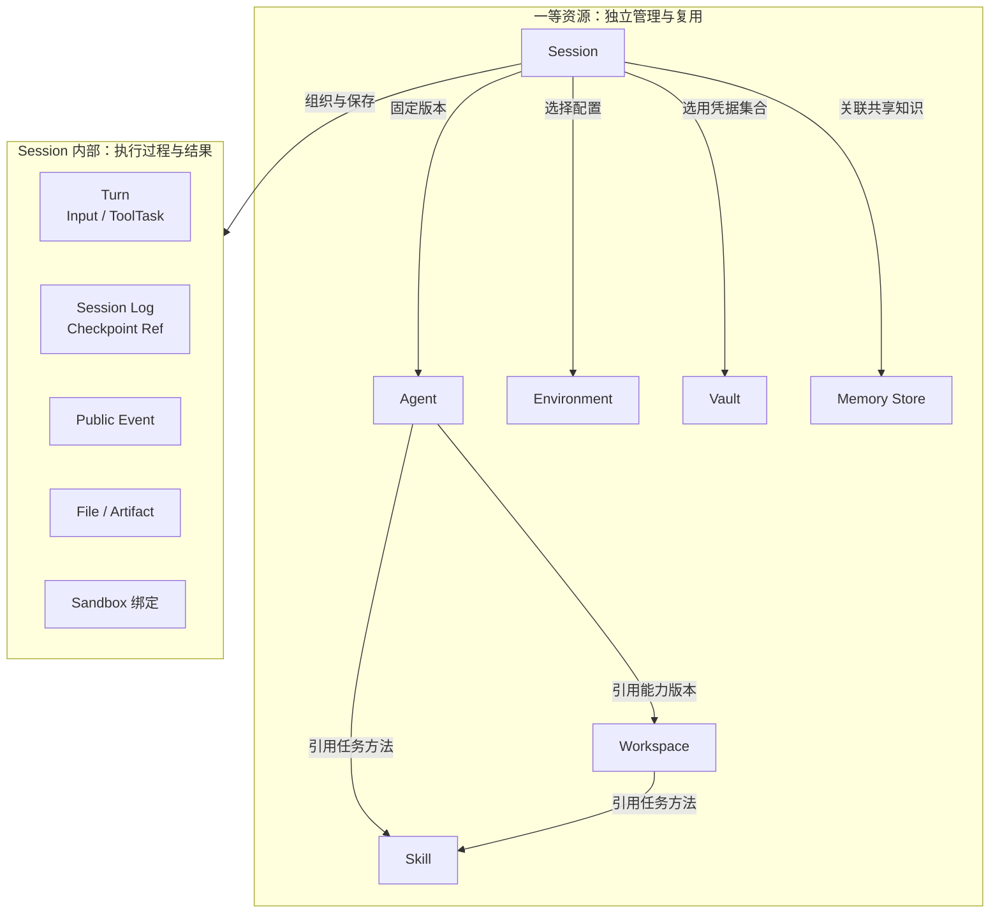

### 1.4 运行组件

| 组件 | 主要职责 |
| --- | --- |
| Gateway | 统一外部入口，按资源 API 与会话 API 将请求路由到对应服务 |
| Control Plane | 管理 Agent、Environment、Vault、Skill 等资源定义，保存版本与执行配置 |
| Session Portal | 统一提供 Session 创建、Turn 提交、轮内交互、状态与历史查询、快照和 SSE 订阅；保存受理记录，向 MQ 或 Redis 投递，读取已提交的公开数据 |
| DataPlane / Agent Runtime | 消费 Turn，加载执行配置和上下文，调用模型；在安全边界生成并保存完整检查点对象，通过运行事件发布引用后推进本地状态，收到匹配的工具结果后继续依赖该结果的步骤 |
| Hands Worker | 事件处理侧消费 Brain / Tool 两条事件通道，转换并存储日志和公开事件；工具执行侧仅向 Tool Topic 发布远端事实；创建、认领、执行及恢复工具任务，可靠返回结果；挂起仅原子持久化检查点引用、pending 和 waiting_tool，终态落库后可靠通知原消费方，由其回调返回 SUCCESS；Resume 通知单独处理回执 |
| RocketMQ | 保存 Turn、Brain 运行事件、工具事件与 Resume 队列，提供有序消费、ACK、重新投递和消费进度 |
| Redis | 保存运行中的输入流、取消信号和按稳定任务身份组织的逻辑结果收件箱，支持短期限阻塞读取 |
| DB | 保存资源定义、受理记录、Turn 状态、执行代次、日志、检查点引用/索引、公开事件和工具任务 |
| 共享检查点存储 | 保存 Brain 写入的完整不可变检查点对象，供任意恢复节点读取；不承担 Turn 状态和有效检查点指针的事务更新 |
| Sandbox | 实际执行工具；由 Hands Worker 获取进度、结果、文件和停止确认 |

Control Plane 管理可复用的资源定义，Session Portal 统一承担会话请求受理和结果读取职责。两者通过共享数据库衔接配置与执行。Hands Worker 的事件处理与工具执行可以在同一个服务中，但必须使用独立的执行资源，长工具不能占住事件处理线程。

MQ、Redis 和 DB 的分工不同：MQ 决定 Turn 的交付顺序，Redis 提供轮内输入和工具结果的运行时收件箱，DB 保存恢复所需的业务事实。DB 中的创建时间不参与 Turn 优先级排序。

### 1.5 Harness 框架选型

本轮继续采用 AgentScope Java Harness 作为原生 Brain；[Codex](https://github.com/openai/codex) 是值得评估的完整 Coding Agent Harness，后续通过 Runtime Host / Adapter 接入。选型比较的是运行内核与本文平台契约的匹配程度，不用模型效果、CLI 易用性或“能恢复历史对话”代替分布式执行正确性的验收。本节于 2026-10-14 核对项目源码、Codex 公开 main 分支及各框架官方文档；main 中的内核接口不代表所选发行版或公开 RPC 已提供相同能力，实际集成必须固定版本并验证。以下结论是架构判断，未进行跨框架任务质量、吞吐或成本基准测试。

#### 1.5.1 本架构对 Harness 的要求

Harness 负责推理策略、上下文和可恢复执行状态；Control Plane、Portal、MQ、Redis、Hands 的职责仍由平台承担。无论采用哪个框架，都要满足以下边界：

| 要求 | 对本文流程的意义 |
| --- | --- |
| 可观测且可恢复的事件 | 区分实时 delta、完整模型消息、工具请求/结果、状态快照和终态；保留来源身份，交由 Hands 转换稳定公开事件，不能直接把框架事件当成恢复日志 |
| 工具执行可外置 | shell、文件、MCP 和业务工具都能进入 Hands；请求具有稳定关联，结果只应用一次，工具执行不依赖 Brain 进程存活 |
| 短等待后的持久挂起 | 运行侧导出完整框架状态、continuation、pending 调用和输入游标；Hands 原子保存，原 Turn 保持未 ACK 并续期，释放 Harness 后任意节点仍可恢复同一逻辑 Turn，原工具不重复启动 |
| 轮内交互与所有权 | steer、inject、cancel、审批答复有明确应用边界；执行代次约束旧回调与旧写入，不能仅依赖进程内锁或 RPC 连接 |
| 资源与版本可重建 | Agent、Skill、Workspace、模型配置及 Sandbox 引用可固定版本；框架对象可销毁，租户数据与凭据隔离由平台和执行环境落实 |

框架已有 Session、checkpoint 或 resume API 可以减少适配工作，但不会自动实现 RocketMQ ACK、跨节点认领、未知副作用结算及 DB 事务的一致性。普通模型推进仍只等待 Broker 接收确认；更换 Harness 不能重新引入逐批次 DB 确认。

#### 1.5.2 候选框架对比

| 候选 | 对本方案有价值的能力 | 接入本文架构的主要成本与不足 | 当前定位 |
| --- | --- | --- | --- |
| AgentScope Java Harness | Java 内嵌 ReAct、Middleware、AgentState、原生 Session Log、Workspace/Sandbox 抽象、Skills 和 Subagent；能直接修改状态捕获及工具边界 | 本项目已经存在 MQ/Hands 适配，但第 6.6 节所列同步确认、结果交付容错及通用 continuation 缺口仍需补齐；不能因同一代码库就宣称可靠挂起已完成 | 原生主实现，优先完成本文正确性闭环；见 [Harness 架构](/v2/zh/docs/harness/architecture) |
| Codex 开源 Harness | 完整 Rust Coding Agent 内核、结构化 app-server 协议、客户端动态工具、远端执行器；源码还有存储抽象及保留原 Turn ID 的挂起/恢复入口 | Java 侧需要进程/RPC 适配；实验接口、框架状态格式、内存工具等待和挂起时交互状态的可靠交接需要专项改造 | 后续 Runtime Host 候选，不直接替换当前 Java Brain；见下节 |
| LangGraph + Deep Agents | 图状态与下一节点检查点、interrupt/resume；Deep Agents 组合文件工具、上下文管理、记忆与子任务，适合显式描述业务步骤 | 图节点/任务边界要与 ToolTask 和 Resume 对齐；回放可能重新执行检查点之后的节点，外部副作用仍需原 executionId 和幂等；默认持久化模式不等于 MQ 发布语义 | 持久工作流或 Python 生态候选；依据 [Checkpointers](https://docs.langchain.com/oss/python/langgraph/checkpointers)、[Deep Agents](https://docs.langchain.com/oss/python/deepagents/overview) |
| Claude Agent SDK | Python/TypeScript 调用 Claude Code 二进制，已有工具、上下文管理、Session、Hooks、Skills、MCP、权限与 Subagent | Java 侧需要 Runtime Host；公开扩展主要通过 SDK、Hooks 和工具接口，不能仅靠 Session resume 推断跨节点 pending 工具恢复；须核对外置执行与持久交接边界 | Claude 运行时接入候选；依据 [Agent SDK](https://code.claude.com/docs/en/agent-sdk/overview) |
| OpenAI Agents SDK | 可定制工具与 Agent 编排；HITL 的 RunState 可序列化并恢复，适合应用定义的执行逻辑 | 与 Codex 是不同项目；仍需组织本方案的 Workspace/Skill、外置工具、等待超时与状态协议，RunState 审批恢复不能直接等同任意工具的持久挂起 | 业务 Agent 或流程适配候选；依据 [RunState 与 HITL](https://openai.github.io/openai-agents-python/human_in_the_loop/) |

Codex 相对通用编排 SDK 的优势，是已有一套相互配合的 Coding Agent 工具、交互和运行策略，减少重新组合 Harness 的工作；相对 AgentScope 的优势不在于“有无这些能力”，而在于提供另一套完整实现及独立进程接入面。AgentScope 更贴合当前 Java 服务与可直接改造的状态/工具契约；LangGraph 的优势是显式图状态与下一节点，不应把 Codex 的对话恢复视为同一种检查点机制。具体任务效果仍由模型、提示、Skill、工具和评测共同决定。

#### 1.5.3 Codex 的优势与能力边界

**运行内核可检查、可改造。** 用户指定的 [openai/codex 仓库](https://github.com/openai/codex) 包含 Rust Harness 与 TypeScript SDK，仓库采用 Apache-2.0 许可证；这有利于检查真实等待、取消和持久化语义，并在必要时扩展内核。开源 Harness 不等于模型服务或托管控制面，平台仍需自行提供本文的资源治理、消息调度和租户隔离。[仓库说明](https://github.com/openai/codex/blob/main/README.md)、[许可证](https://github.com/openai/codex/blob/main/LICENSE)

**Coding Harness 的组合能力较完整。** 命令与文件操作、上下文压缩、Skills、审批和子 Agent 已有相应运行及交互机制，适合仓库修改、构建验证和多步工具任务。与从通用 SDK 重新组合这些机制相比，可以减少应用层实现；与 AgentScope 或 Deep Agents 相比，应具体比较默认策略和任务评测，而不能仅凭功能清单判断效果优劣。[Codex 集成定位](https://developers.openai.com/blog/codex-as-a-platform)、[内核源码入口](https://github.com/openai/codex/blob/main/codex-rs/core/src/lib.rs)

**接入面较完整。** `codex exec` 与 TypeScript SDK 适合非交互任务；SDK 本质上启动 CLI 并交换 JSONL。需要轮内交互时，应评估 app-server 的双向协议，而非解析终端文本。它提供 thread/turn/item 身份、事件通知、审批和动态工具交互，有利于映射 Portal 的事件与控制接口。官方文档对 app-server 命令、WebSocket 接入和动态工具标有实验边界，不能统一标成稳定生产契约。[SDK 源码说明](https://github.com/openai/codex/blob/main/sdk/typescript/README.md)、[官方 app-server 文档](https://developers.openai.com/codex/app-server)

以下将源码已有能力与本文仍需实现的适配分开说明：

| 维度 | Codex 已有能力与优势 | 对本文架构的不足或待验证项 |
| --- | --- | --- |
| 状态后端 | `ThreadStore` / `LiveThread` 提供存储中立接口，线程 ID 可以解析到本地历史、RPC 或其他后端，具备替换持久化实现的基础 | 不能只外挂实时事件就认为完整状态已交接；需要保存 Codex 自身的历史、模型上下文和配置，并与平台 checkpoint、epoch 及输入游标建立一致边界 |
| 同 Turn 挂起与恢复 | Core 的 `suspend_turn_and_shutdown()` 停止未完成根 Turn、flush 历史并关闭 writer；`recover_turn_if_idle()` 保留原 Turn ID，不添加新用户输入 | 这是内核能力，不等同 `thread/resume` 或已确认的公开 app-server 方法；不是现成的 waiting_tool + Hands 事务 + Resume MQ 协议 |
| 挂起的完整性 | 挂起成功前先停止执行并完成存储交接，持久化失败不报告成功；可作为移交执行所有权的适配基础 | 活跃子线程会阻止该挂起路径；排队输入、审批、elicitation 和 server-request 等内存等待者可能被丢弃。必须用平台持久输入和待办协议补齐，不能宣称完整恢复所有交互 |
| tool use / tool result | 动态工具把调用交给客户端，能接入 Hands；Core 按 call ID 登记等待并接收真实结果 | 当前动态等待使用活动 Turn 中的 oneshot，app-server 请求回调也在内存中。记录了工具 schema 不代表重启后恢复原 RPC；需持久保存调用关联并重建结果应用路径，取消等待不能当成真实工具失败 |
| 远端执行 | `exec-server` 已有文件/进程 RPC、远端连接及会话恢复机制，证明 Codex 不局限于本地 shell | 其协议与本文 ToolTask/MQ 不同，恢复依赖执行端保留的会话和输出；仍需 Hands 的原 executionId、unknown 处理、文件归档及取消确认，不能把重连当成任意节点恢复 |
| 模型适配 | 支持自定义模型 Provider、地址与鉴权，并非只能使用固定 OpenAI 端点 | 当前 `wire_api` 仅支持 Responses；第三方模型还需验证流式工具、推理项、压缩及命名约束，不能把兼容 Chat Completions 等同完整兼容 Codex |
| Java 与服务治理 | 独立进程协议可隔离 Rust 运行时和 Java 服务，适合外部 Harness 接入 | 多一层进程生命周期、版本与背压管理；ThreadStore 不自动提供平台租户 ACL，RPC requestId 也不是 durable taskId；多线程运行不替代租户、凭据和工作区隔离 |

状态与挂起判断依据 [ThreadStore](https://github.com/openai/codex/blob/main/codex-rs/thread-store/src/lib.rs)、[CodexThread](https://github.com/openai/codex/blob/main/codex-rs/core/src/codex_thread.rs)、[挂起实现](https://github.com/openai/codex/blob/main/codex-rs/core/src/session/turn_suspension.rs)；工具等待依据 [DynamicToolHandler](https://github.com/openai/codex/blob/main/codex-rs/core/src/tools/handlers/dynamic.rs)、[app-server 请求回调](https://github.com/openai/codex/blob/main/codex-rs/app-server/src/outgoing_message.rs)；远端执行与模型限制依据 [exec-server](https://github.com/openai/codex/blob/main/codex-rs/exec-server/README.md)、[Provider 实现](https://github.com/openai/codex/blob/main/codex-rs/model-provider-info/src/lib.rs)。表中对 MQ、Hands 和恢复协议的影响是基于这些实现的架构推论，不代表已验证的 Codex 适配。

#### 1.5.4 接入位置、检查点与验证门槛

Codex 后续接入时位于 Brain 运行层，由 Runtime Host / Adapter 管理。Portal 和平台资源 ID 保持中立；适配器建立平台 sessionId/turnId/runId/epoch 与 Codex threadId/turnId/itemId/callId 的映射，RPC requestId 仅用于当前请求应答。公开事件仍由 Hands 持久投影，不能直接转发 Codex 事件替代平台日志与终态事务。

运行侧应捕获 **Codex 自身可恢复状态 + continuation + pending 工具与输入关联**，由 Brain 适配器保存到共享持久存储，再经 MQ 发送引用，由 Hands 原子保存引用、pending 与 waiting_tool；不要求 Codex 伪装成 Java AgentState，也不能只保留 finalResponse 或 threadId。第 7.4 节的完整 AgentState 要求适用于原生 AgentScope；异构运行时必须提供等价的恢复材料。自定义 ThreadStore 的 append/flush 与 MQ 接收确认、Hands 落库及接管读取之间需要明确契约，不能直接沿用本地 flush 语义，也不能靠 Brain 轮询 DB 来弥补适配缺口。

内建 shell、文件和 MCP 的实际执行路径也必须逐项纳入 Hands 或获准的执行器边界；仅注册一个远端动态工具，不会自动迁移其他内建工具。短等待结束后，适配器不能用普通 RPC timeout、关闭连接或 `turn/interrupt` 假扮持久挂起。应验证挂起内核、可恢复存储和工具结果重建是否能组合满足以下用例：

| 用例 | 接入前必须验证 |
| --- | --- |
| 工具结果快路径 | 稳定 call/task/execution 关联，快速与重复结果均正确处理，不查询 DB 提交回执 |
| 超时挂起后销毁 Host | Brain 保存完整状态对象并发布引用，Hands 原子保存引用与挂起状态，原 Turn 不 ACK；仅销毁 Harness 时原消费回调保持未完成，由 SDK / Proxy 自动续期，整个进程故障时由 MQ 重投递接管；新节点恢复同一逻辑 Turn，复用原执行结果，不重发原工具 |
| 输入、审批与子任务尚未完成 | 保留平台已受理输入和待办，明确活跃子任务的交接；框架拒绝挂起时不提前释放责任或 ACK |
| 事件与恢复消息重投 | 幂等落库和结果应用；旧节点回调、旧 writer 及重复 Resume 不产生第二个推进者 |
| 远端断连与取消 | 查询原 executionId，区分确认失败与 unknown；取消回执反映真实工具停止状态 |

本轮先完成原生 Harness 的第 6、7、8 节闭环。Codex 的选型记录用于后续接入，不新增当前部署组件、Topic 或通知协调机制，第 4.6.3 节直接采用父 Topic 全量订阅，不再保留 Session 发现通知的 TODO。若后续以成熟 Coding Agent 工作流为主要诉求，Codex 是重点候选；若主要诉求是当前 Java 平台内核可控和最小改造成本，则继续优先 AgentScope；显式持久业务图可另行评估 LangGraph。

## 2. 两条核心架构链路

### 2.1 Session 与 Turn 进入

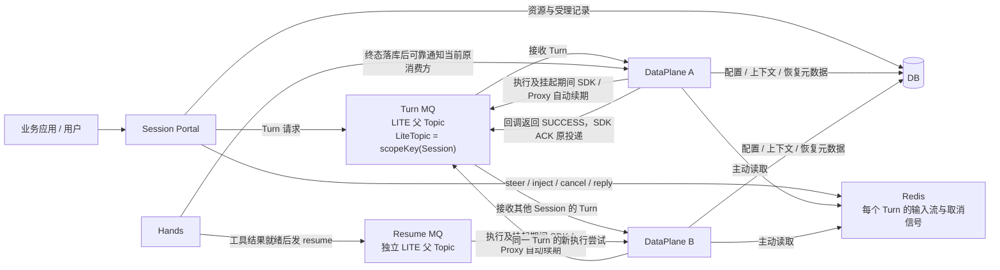

同一个 Session 的 Turn 按 LiteTopic 顺序串行处理；T1 在 running、waiting_tool 和恢复期间一直保留原投递，终态落库后才 ACK 并放行 T2。挂起仅释放 Harness 计算资源，原消费回调等待完成信号，由 SDK / Proxy 自动续期；独立 Resume 通道可在任意 DataPlane 唤醒同一个 T1。正常后续 Turn 不依赖轮询 DB 的 currentTurnId/settledSequence 判断是否放行；执行认领、恢复和去重仍使用必要的持久状态校验。不同 Session 可以并行执行。轮内控制输入走 Redis，执行实例主动读取，因此 Portal 无需维护实例地址映射，也无需将输入转发给某个指定实例。

### 2.2 推理事件、存储与工具执行

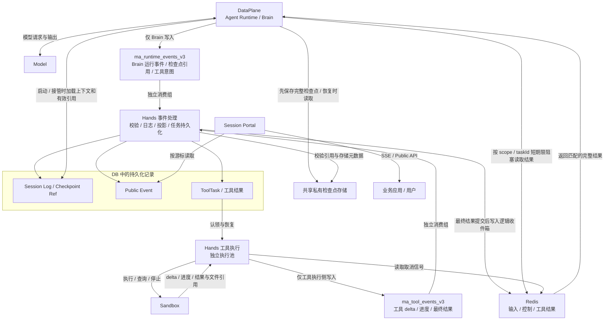

Brain 的模型、上下文、检查点引用和工具意图只进入 `ma_runtime_events_v3`。Hands 工具执行侧从 Sandbox 收取 delta、进度和最终结果，只写入 `ma_tool_events_v3`。两个 Topic 分别指向 Hands 事件处理职责，不存在 Brain 与 Hands 混合生产同一运行事件 Topic 的回路；Hands 的工具执行与事件处理可部署在同一服务中，使用独立资源池，不要求增加新服务。

Hands 事件处理侧沿用统一日志与事务处理入口，形成 Session Log / Checkpoint Ref 和 Public Event 两种视图；远端工具事件使用稳定执行身份和来源位置关联，不能冒充 Brain 原生日志序号。工具最终结果持久化后才写入 Redis 逻辑结果收件箱，Brain 取得匹配结果继续原 Turn。工具输出即使发生在 Brain 挂起后，仍经工具 Topic 入日志和公开投影，不依赖旧 Harness 在线。

Brain 先保存工具边界的完整检查点对象，工具意图与检查点引用再通过 Brain 事件批次交给 Hands 原子保存，ToolTask 提交后才由后台执行侧启动原 executionId。事件消费与长工具执行分开，消费回调不等待工具结束或 Brain 读取结果；不新增独立工具派发服务。

### 2.3 相比原始两图补充的关系

| 补充关系 | 原因 |
| --- | --- |
| Portal → DB | 保存 Session、投递意图和已受理输入，便于重试及查询 |
| DataPlane → DB | 启动或接管时加载配置、有效检查点引用及工具结算事实；正常事件发布不查询 DB 提交回执 |
| DataPlane → 共享检查点存储 | 安全边界生成并持久保存完整对象，再通过 MQ 发布引用；恢复时按 DB 已生效的引用读取和校验对象 |
| DataPlane → MQ 续期 | 长 Turn 需要持续保持消息不可见 |
| Hands 工具执行侧 → Tool Event MQ | 将 Sandbox 的 delta、进度、最终结果和停止结果写入独立工具 Topic |
| Hands 事件处理侧 → MQ | 分别消费 Brain / Tool 两条事件通道；结果齐备后可靠发布 Resume |
| Hands Worker → Redis | 工具结果提交后写入逻辑结果收件箱；长工具运行中读取取消信号 |
| DataPlane → Redis | 按稳定任务身份短期限阻塞读取结果，不查找接收节点地址 |

工具结果使用新增的 `ma_tool_events_v3`，由 Hands 的 `ma_hands_tool_events_v3` 全量订阅消费；`ma_hands_events_v3` 只处理 Brain 的 `ma_runtime_events_v3`。Hands 提交结果后写入 Redis 逻辑结果收件箱，当前 Brain 按相同 scope / taskId 读取；不设置 Brain 工具结果消费组，不使用按 Session 的动态订阅或节点地址转发。普通模型事件仍在 Broker 接收后继续，只有工具依赖等待真实结果。

短等待超时或结果通道不可用时，Brain 先保存完整挂起检查点对象，再经 MQ 发布引用后释放 Harness；Hands 原子保存 checkpoint 引用、pending 关联和 waiting_tool，结果齐备后通过持久 Resume 意图与独立恢复父 Topic 唤醒任意 DataPlane。Redis 是快速交付副本，持久结果和检查点是恢复依据；正常推进不依赖 DB 轮询。第 4.6.4 节说明收件箱协议，第 6.6 节区分当前实现与尚待完成的改造。

## 3. Agent、Environment 与 Session 创建

### 3.1 创建与首次执行

下面省略 Gateway 的路由跳数，资源创建由 Control Plane 处理，会话创建与执行由 Session Portal 接入。

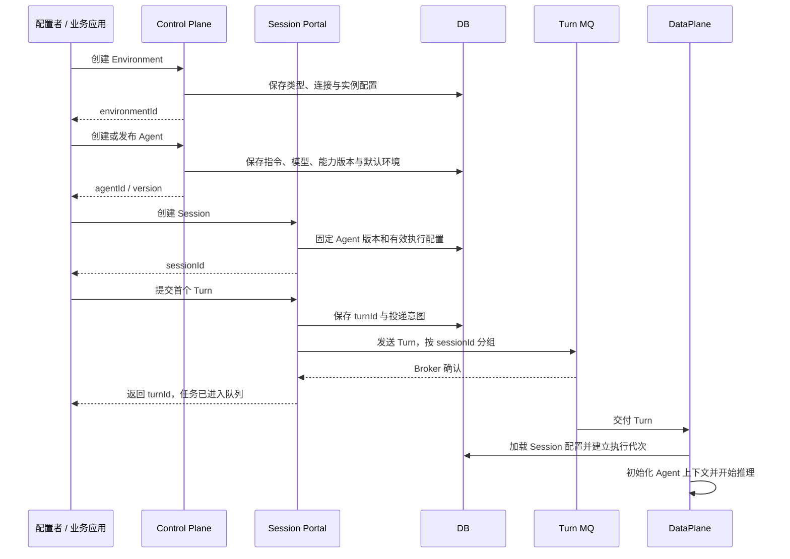

Session 创建成功表示会话定义已可靠保存，应用可以直接提交 Turn。首次执行时由 DataPlane 按固定配置初始化 Agent。创建 Session 不要求额外的运行实例 bootstrap，也不要求客户端先等待一个运行时 ready 状态。

Agent 新版本通过新 Session 生效。已有 Session 使用原来的固定版本；运行中的配置迁移需要另外制定规则。

### 3.2 Environment 类型

| 类型 | 配置与实例管理 | 执行方式 |
| --- | --- | --- |
| `cloud` | 平台按模板创建、保活和回收 ACS Sandbox | Hands Worker 获取会话绑定的 Sandbox 并执行工具 |
| `self_hosted` | 用户提供已有 Sandbox 和连接配置，负责实例生命周期 | Hands Worker 通过配置的执行接口连接并操作该 Sandbox |

两种类型都保持 Brain 在 DataPlane、工具在 Sandbox。Environment 保存配置，Sandbox 是实际实例。`cloud` 在首次需要工具时创建实例，后续工具复用会话工作目录；`self_hosted` 在工具执行前检查连接和依赖。

本轮假定 Hands Worker 可以连接选定的执行接口。若自托管网络只允许出站连接，需要增加该网络内的执行适配器；这是特定部署条件下的接入关系，需单独确认。

## 4. RocketMQ 中的 Turn 排队与 ACK

### 4.1 消息通道

采用“少量业务父 Topic + 每个 Session 一个 LiteTopic + 按职责划分 ConsumerGroup”。父 Topic 是运维和业务隔离资源，LiteTopic 是其中的会话逻辑队列，ConsumerGroup 是一类消费者及其消费进度。每个父 Topic 配置 `message.type=LITE`，不把 Lite 与普通 FIFO 的 MessageGroup 配置混用。Turn、Brain 运行事件、工具事件和 Resume 消费组配置 `lite.bind.topic=<父 Topic>`、`lite.sub.model=Shared` 和 `lite.sub.wildcard=true`；LitePushConsumer 绑定父 Topic 后由 Broker 覆盖其中已有及后续新产生的 LiteTopic，应用不维护 Session 订阅目录。

| 概念 | 本方案中的用途 | 不能据此推导的保证 |
| --- | --- | --- |
| 父 Topic | 按单向生产职责区分用户 Turn、Brain 事件、工具事件和恢复命令 | 相同 Session 在不同 Topic 内不会自动合成一个全局有序队列 |
| LiteTopic | 父 Topic 内按完整 scopeKey 组织一个 Session 的消息及顺序 | 是逻辑队列隔离，不要求每个 Session 独立磁盘文件 |
| ConsumerGroup | 表示 Turn 执行、Brain 事件持久化、工具事件持久化或 Resume 等处理职责及进度 | 同组副本不是广播；不同组有独立进度，不应重复写同一业务投影 |
| FIFO MessageGroup | 普通 FIFO 模式的顺序分组 | 当前 Lite 适配器使用 setLiteTopic，不使用 setMessageGroup |
| Keys / batchId / eventId | 检索、诊断和消费端业务去重身份 | Keys 本身不决定 Session 路由，也不自动去重 |
| Tag / body.type | 消息类型分类；本方案按 body.kind/type 分流 | 不能将 Session ID 当 Tag 就认为它拥有独立顺序队列 |

RocketMQ 5.x 生产者不再配置 ProducerGroup；每个进程复用少量 Producer，可以向多个父 Topic 发送消息，不为每条事件或每个 Session 建立 Producer。[Producer 官方说明](https://rocketmq.apache.org/docs/domainModel/05producer/)

以下按逻辑通道列出基础名称，Turn 的物理深度分道单独展开；部署验收状态以实施记录为准。

| 父 Topic | 类型 / 子通道 | 生产者 | 当前实现与目标 ACK 边界 |
| --- | --- | --- | --- |
| `ma_turns_v3` | LITE；LiteTopic=scopeKey | Portal | running、waiting_tool 及恢复期间保留原投递并续期；整个 Turn 终态与恢复数据落库后，Hands 可靠通知原消费方，回调返回 SUCCESS 后由 SDK ACK |
| `ma_turns_v3_d1` … `ma_turns_v3_d16` | LITE；固定子 Session 深度 | Portal | 与根层完全相同的终态 ACK 边界；每个深度保留独立回调池，后代不争用祖先持有的槽位 |
| `ma_runtime_events_v3` | LITE；LiteTopic=scopeKey | 仅 Brain | Hands 保存模型/上下文事实、checkpoint 引用、工具意图、输入回执和原生结果应用记录后返回 SUCCESS，由 SDK ACK |
| `ma_tool_events_v3` | 新增 LITE；LiteTopic=scopeKey | 仅 Hands 工具执行侧 | Hands 工具事件消费者保存 delta/进度、最终结果和必要 Resume 意图后返回 SUCCESS，由 SDK ACK；最终结果提交后写 Redis 收件箱，不等待 Brain 读取 |
| `ma_turn_resumes_v3` | 独立 LITE；LiteTopic=scopeKey | Hands 持久派发 | 恢复通知通道；本次恢复再次挂起或结束且恢复数据可靠保存后，Hands 通知本次 Resume 消费方返回 SUCCESS，由 SDK ACK；此回执不替代原 Turn 的终态 ACK |

| ConsumerGroup | 绑定父 Topic | 订阅范围 / Lite 模式 | 职责与实现状态 |
| --- | --- | --- | --- |
| `ma_brain_v3` | `ma_turns_v3` | 父 Topic 全量 / Shared | 当前已有；DataPlane 副本共享请求消费，认领后推进本轮 |
| `ma_brain_v3_d1` … `ma_brain_v3_d16` | 对应深度的 Turn 父 Topic | 父 Topic 全量 / Shared | 同一组 Brain 副本中的独立深度回调池；不创建额外部署组件 |
| `ma_hands_events_v3` | `ma_runtime_events_v3` | 父 Topic 全量 / Shared | Hands 事件处理侧保存 Brain 日志、检查点引用、工具意图与公开投影，不消费原始工具结果 |
| `ma_hands_tool_events_v3` | `ma_tool_events_v3` | 父 Topic 全量 / Shared | 新增；Hands 事件处理侧保存工具 delta、进度和最终结果，最终结果提交后写 Redis 收件箱并按需登记 Resume |
| `ma_brain_resumes_v3` | `ma_turn_resumes_v3` | 父 Topic 全量 / Shared | 目标组；任意 DataPlane 可以接收恢复消息，校验后认领新的执行尝试 |

上述各物理消费组均使用 `Shared` 和父 Topic 全量订阅；同组副本分担消费，不为每个 DataPlane/Hands 副本或每个 Session 创建独立业务消费组。两类事件分别消费并进入统一持久化处理入口；Brain 通过 Redis 收件箱接收最终结果，不消费工具事件父 Topic。每个 Topic 限定生产职责，运维 ACL 与应用路由校验应与此一致。[LiteTopic 订阅模式](https://rocketmq.apache.org/docs/bestPractice/02ratelimit/)

单向约束针对业务消息的发布职责；消费者向 MQ 发送订阅、续期和 ACK 是消费控制协议，不表示它向该 Topic 生产业务事件。Hands 对 Runtime Topic 的 ACK 不改变“仅 Brain 写入”的约定。

组织示例中的 scope-S1 / scope-S2 是完整作用域 key 的示意名称：

```text
ma_turns_v3
  ├─ LiteTopic(scope-S1): Turn T1 → T2 → T3
  └─ LiteTopic(scope-S2): Turn T1 → T2

ma_runtime_events_v3
  ├─ LiteTopic(scope-S1): 模型事件 → 工具意图 → 检查点引用 → Brain 结果应用记录……
  └─ LiteTopic(scope-S2): 模型事件 → 检查点引用……

ma_tool_events_v3
  ├─ LiteTopic(scope-S1): 工具 delta → 进度 → 最终结果……
  └─ LiteTopic(scope-S2): 工具进度 → 最终结果……

ma_turn_resumes_v3
  ├─ LiteTopic(scope-S1): resume(T1, suspension-X)……
  └─ LiteTopic(scope-S2): resume(T2, suspension-Y)……
```

同一父 Topic 下，Session 消息归入相应 LiteTopic；多个 Session 可以分别消费。相同 scopeKey 在不同逻辑通道下有独立消费进度，没有跨 Topic 的共同 offset。逻辑归属与持久日志仍以 scope 和调用身份关联，不假定 Broker 为一个 Session 建立了贯穿所有 Topic 的全局顺序。[LiteTopic 官方说明](https://rocketmq.apache.org/docs/domainModel/03litetopic/)

Resume 只唤醒已挂起的 T1，不是新用户 Turn。原 T1 尚未 ACK，恢复通知不能追加到它所在的 Turn LiteTopic 末尾，否则会被 T1 自身挡住；因此保留独立 Resume 通道。四条通道使用同一套 Broker，订阅与 ACK 独立；原 Turn 的顺序屏障一直保留到终态。

### 4.1.1 父子 Turn 的静态深度分道

同步 LitePush 回调在父 Turn 挂起时仍持有消费槽位。若子 Turn 也使用该池，所有槽位被父任务占满后，子任务无法开始；仅增加一个子池仍会被等待孙任务的子 Turn 占满。独立 Resume 池只能恢复已开始的任务，不能解决新子 Turn 的启动容量。

因此使用已有最大嵌套深度 16 做静态隔离：根层使用 `ma_turns_v3` / `ma_brain_v3`，子层使用 `_d1` 至 `_d16` 后缀；加上另三条通道，共 20 个物理父 Topic / 消费组。它们由同一组 Portal / Brain / Hands 进程访问，不新增路由目录、实例地址表或逐 Session 订阅。Session 创建时封存深度；Portal 发布及 Brain 消费均校验该深度，同一 Session 的所有 Turn 永远进入同一父 Topic 和 LiteTopic，仍按 MQ 顺序与终态 ACK 推进。

每个 Brain 默认根回调 64、每个子深度 4、Resume 回调 64；回调信箱最多需要 `64 + 16 × 4 + 64 = 192` 个独立阻塞读取槽位。子层分别受 `builder.managed.child-turn-callbacks` 限制；16 层共享一个额外的配置缓存预算，每层按消息数 / 字节预算的十六分之一分配，最小各为 1。活动 Harness 使用独立有界池，队列满时在本地等待，不能把正常容量不足变成 MQ 重试或死信；挂起后释放 Harness，最深叶子因此可以推进。SDK 消费者并行关闭，避免等待长轮询的时间按深度累加。Service 持久子调用超过 16 层时返回明确的深度超限错误；Harness 自身更严格的委派深度或叶子 Agent 限制仍然生效。

### 4.1.2 首次消费位点的基础设施验收

四条通道必须从已有最早进度连续消费，首次消费不能从最后一条开始。当前官方 Broker 5.5.1 的 Lite 首次取位点路径使用 MAX；`consumeFromMinEnable=true` 不能据此保证 Lite 从最早位置开始。原始 SDK 5.2.2 的独立实测中，对 100 个新 LiteTopic 各发送 first / next，有 49 个只收到 next；Broker 的 `initPopOffsetByCheckMsgInMem=true` 已开启。该问题会影响所有事件前缀，不能只验证单条 Turn 能收到。

这是官方版本的起始策略与本方案前缀要求之间的能力差异，不能凭组配置或流程图视为已经满足。已增加显式本地测试修正版，让 Lite 初次位点遵循消费组的 MIN 配置；关闭热内存捷径后，100 组即时消费、消费者离线积压后重启再首次读取 200 条消息，以及 MAX 对照均通过。修正版不是上游发行，正式部署仍需验证所选 Broker 的同等能力。不得放宽顺序断言或隐式切换 Mock 来掩盖首条缺失；具体失败证据、源码定位与处理进展见`agentscope-service/docs/managed-mq-redis-refactoring-plan.md`（实施记录未包含在 v2.0.4 或其他现有 tag 中）。[官方 Lite 取位点源码](https://github.com/apache/rocketmq/blob/rocketmq-all-5.5.1/broker/src/main/java/org/apache/rocketmq/broker/processor/PopLiteMessageProcessor.java)

### 4.2 按 MQ 接收顺序受理

Turn 消息包含 `sessionId`、`turnId`、初始输入的持久化引用和配置摘要。MQ Message ID 仅用于投递诊断，逻辑去重使用稳定的 `turnId`。

Portal 先保存 Turn 与投递意图，再向 Broker 发送。收到 Broker 确认后，API 返回“已进入队列”。发送失败或结果未知时，Portal 内部重试同一个 Turn；客户端重试也使用同一个请求幂等标识。

同一个 Session 的用户 Turn 优先级按其 Turn LiteTopic 的 Broker 存储顺序确定，Portal 的受理时间、DB 创建时间及客户端时间均不改变它。HTTP 先返回的请求也不一定先执行。重新投递产生的重复消息在消费时去重，不能再次创建或执行同一个逻辑 Turn。

DB 的投递状态与执行状态分开保存。Broker 确认回来时只更新投递状态，避免把已经开始的 Turn 回退到 queued。

### 4.3 T1 完成后 T2 开始

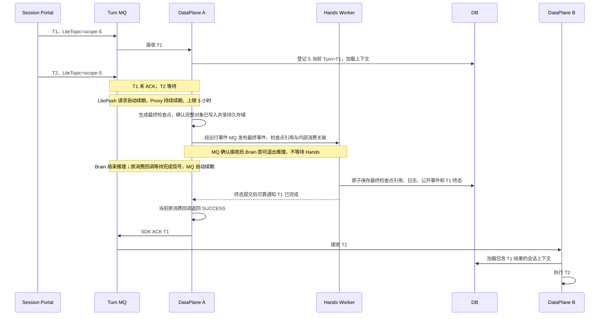

上图是工具结果在短等待期限内返回的快路径；长工具超时挂起时同样不 ACK T1。T1 作为当前未完成投递保留，T2 继续受同一 LiteTopic 的顺序消费约束，直到 T1 终态落库并完成 ACK。消费适配器按 Session 串行处理，不在收到或预取 T2 后并行启动另一个 Harness；无需为“挂起提前 ACK 后的 T2”增加 DB 准入查询、暂存调度或反复重试。T1 的恢复由独立 Resume Topic 驱动，不占用新的用户 Turn 排队位置。[顺序消费要求](https://rocketmq.apache.org/docs/featureBehavior/03fifomessage/)

### 4.4 长 Turn 的消费方式

Turn、Resume、Brain 运行事件和工具事件的 MQ 消费统一采用 LitePushConsumer；Hands 用两个职责消费组分别接收 Brain / Tool 事件，Brain 的短等待通过 Redis 收件箱完成。SDK 接收请求开启 `autoRenew`，由 Proxy 执行自动续期；本部署采用 3 小时自动续期上限，不在应用中维护 receive 循环、逐投递续期定时器或跨进程手动 ACK。3 小时是自动续期的最长窗口，不是续期间隔、单次不可见时间或整个逻辑 Turn 的业务期限；到达上限后的重投递和接管按第 8 节验证。[客户端自动续期实现](https://github.com/apache/rocketmq-clients/blob/master/java/client/src/main/java/org/apache/rocketmq/client/java/impl/consumer/ConsumerImpl.java)、[Proxy 续期配置](https://github.com/apache/rocketmq/blob/rocketmq-all-5.5.1/proxy/src/main/java/org/apache/rocketmq/proxy/config/ProxyConfig.java)

项目 Java SDK 5.2.2 的公开监听接口为 `ConsumeResult consume(MessageView messageView)`，没有供 Hands 远程调用的独立 ACK 方法。原 Turn 回调先登记本次投递关联和完成信号，再启动或恢复 Harness，直到收到可靠的终态完成通知才返回 `ConsumeResult.SUCCESS`，由 SDK 执行 ACK。不能在派发 Harness、发布最终事件或保存 waiting_tool 时提前返回 SUCCESS。[监听接口](https://github.com/apache/rocketmq-clients/blob/master/java/client-apis/src/main/java/org/apache/rocketmq/client/apis/consumer/MessageListener.java)、[LitePushConsumer API](https://github.com/apache/rocketmq-clients/blob/master/java/client-apis/src/main/java/org/apache/rocketmq/client/apis/consumer/LitePushConsumer.java)

工具短等待超时后，Harness / Brain 捕获完整检查点并确认共享持久存储写入，再可靠发布引用；Hands 原子保存 checkpoint 引用、pending 关联和 waiting_tool。Brain 释放工具 Mono、推理工作线程、Agent 实例及本次执行租约；原 MQ 消费回调保持未完成，只等待终态完成信号，SDK / Proxy 继续自动续期。任意 DataPlane 可通过独立 Resume 通道取得新执行代次；原消费方不持有阻止恢复的推理租约。

必须区分 Harness 计算资源与 MQ 消费容量：当前同步监听接口下，等待完成信号仍占用一个消费回调线程/并发槽位，不能宣称挂起后所有线程均已释放。SDK 默认消费线程数为 20，应按同时持有的 Turn 数单独配置 `setConsumptionThreadCount()`、持有配额及背压；Harness 活动并发另行限制。Turn、Resume、Brain 事件消费、工具事件消费、Redis 收件箱读取和完成通知处理保留独立容量，防止等待中的 Turn 耗尽用于唤醒或终态通知的执行资源。当前不以 `ConsumeResultSuspend` 替代这条路径；它进入延期再消费，不能等同于持有原回调等待异步完成。

消费组应启用服务端 FIFO，并保持完整 scopeKey 到 LiteTopic 的固定映射；LitePushConsumer 本身并不自动表示 FIFO。Lite FIFO 以 LiteTopic 为串行边界，同时开启 `setEnableFifoConsumeAccelerator(true)`，让不同 LiteTopic 在同一批消息中并行，避免一个 Session 的等待阻塞其他 Session。并发槽位仍是进程级有限资源，不能以该开关代替容量规划；重复交付仍需业务去重。[Lite FIFO 实现](https://github.com/apache/rocketmq-clients/blob/master/java/client/src/main/java/org/apache/rocketmq/client/java/impl/consumer/LiteFifoConsumeService.java)、[并行消费配置接口](https://github.com/apache/rocketmq-clients/blob/master/java/client-apis/src/main/java/org/apache/rocketmq/client/apis/consumer/LitePushConsumerBuilder.java)

Hands 的 Brain / Tool 事件监听回调只执行幂等短事务：事务提交后返回 SUCCESS，由 SDK ACK；失败交给 SDK / MQ 重试。长工具在独立资源池执行，不能在事件监听回调中等待工具结束。等待期间不主动返回 FAILURE 或轮询 DB 的 currentTurnId/settledSequence 模拟排队；执行租约与 epoch/token 继续隔离失去所有权后的迟到推进。waiting_input 的交互策略仍按第 5 节处理。

### 4.5 Turn 终态与 ACK 条件

| 状态 | 含义 | Turn 消息处理 |
| --- | --- | --- |
| queued | 请求已进入 MQ，等待执行 | 尚未开始消费 |
| running | 正在推理或处理已收到的结果 | 持续续期 |
| waiting_tool | 已持久挂起，等待工具结果 | 不 ACK 原 Turn；释放 Harness 计算资源，原消费回调保持未完成，SDK / Proxy 自动续期；结果就绪通过 Resume MQ 恢复 |
| waiting_input | 等待业务答复或补充材料 | 保留原 Turn 回调，由 SDK / Proxy 续期；保存待办与完整检查点，释放 Harness 和推理令牌；reply / cancel 经持久 Resume 恢复同一 Turn |
| cancelling | 正在停止推理并处理工具停止 | 持续续期 |
| blocked | 工具副作用或恢复状态尚未确认 | 保持队头，等待明确处理 |
| succeeded / failed / cancelled | Hands 已保存最终结论和恢复数据 | Hands 可靠通知原消费方，回调返回 SUCCESS 后由 SDK ACK；Brain 不等待 DB 回执 |

准备结束时，DataPlane 先确认工具及其他等待项可以结算，再关闭该 Turn 的输入受理，处理关闭前已受理的所有 Input；无法继续应用的输入保存明确拒绝原因。随后 Brain 生成最终检查点并确认完整对象已写入共享持久存储，再发布最终事件、检查点引用及受保护的消费关联；MQ 确认接收后 Brain 结束推理任务。Hands Worker 在最终事务中保存最终检查点引用、完整应用回执、终态及待发送的完成通知意图，提交后可靠通知当前原消费方。原 Turn 回调收到匹配信号后返回 SUCCESS，由 SDK ACK。blocked 状态仍允许相关取消或待办答复进入。

原 Turn 回调的生命周期独立于 Harness：Harness 退出、waiting_tool 和终态事件排队期间，回调保持未完成，由 SDK / Proxy 自动续期。只有整个 Turn 的终态事务提交成功，才能生成原 Turn 完成通知；挂起事务不生成该通知。完成通知必须可持久重试或回放，不能只依赖一次进程内回调或 Redis Pub/Sub；派发使用已有持久意图机制，不要求 Brain 查询 DB，也不为普通模型事件增加反向提交回执。运行事件的 ACK 不必等待原 Turn 的 MQ ACK，只需保证事务与完成通知意图已可靠提交。

消费关联包含完整 scope、Topic、消费组、turnId、原消费方身份及本次投递代次；若涉及 Resume，还包含 resumeId / suspensionId。接收方按当前登记的投递关联幂等完成等待信号，信号必须在启动执行前登记，避免快速终态先到。通知与接管竞争时，旧关联不得完成新投递或后续 Turn；当前消费方已退出则依靠通知重试/回放和原 Turn 重投递后的终态检查收敛。receipt handle 由 SDK 管理，不跨进程传给 Hands 代为 ACK，也不从 checkpoint 恢复旧凭据。

Resume Delivery 是独立恢复通知，其回调到本次执行再次挂起或结束、恢复数据可靠保存后，才由 Hands 的持久交接完成通知触发返回 SUCCESS，SDK ACK 本次 Resume。已过期或已处理的重复通知校验后可直接返回 SUCCESS；“已处理”以持久交接边界为准，不能仅因恢复执行已被认领就确认，否则该执行故障后可能失去唤醒。挂起事务可以完成本次 Resume 通知，但不能完成原 Turn；这样连续多次工具挂起不会被前一次 Resume 挡住。原消费方和恢复节点可以不同，Hands 分别通知各自当前有效回调，恢复节点不直接 ACK 原 Turn。

currentTurnId、settledSequence 保留作执行身份、结算及恢复元数据，不用来驱动正常 T2 的 DB 轮询调度。

ACK 不依赖用户是否在线，也不依赖 SSE 客户端是否已经读到结果。如果最终记录已落库而 DataPlane 在 ACK 前重启，新实例读取既有终态后直接返回 SUCCESS，由 SDK ACK，不重新执行任务。

### 4.6 Session 路由、顺序保障与订阅生命周期

#### 4.6.1 发送到哪里

Session 路由使用 `scopeKey = ManagedScope.messageGroup()`，由带长度前缀的 tenant、namespace、sessionId 做 SHA-256，再编码成无填充 Base64URL，当前长度为 43 字符。不要使用裸 sessionId，避免租户或命名空间冲突。当前 record 字段仍叫 messageGroup，这是应用内部逻辑 key；实际 SDK 发送参数是 LiteTopic。

以下为当前发送方式的字段示意，body 使用编解码器生成的原始 Envelope 字节，而不是公开事件 JSON：

```java
Message message = provider.newMessageBuilder()
        .setTopic("ma_runtime_events_v3")
        .setLiteTopic(scope.messageGroup())
        .setKeys(batchId)
        .addProperty("ma_logical_id", batchId)
        .setBody(payloadBytes)
        .build();
producer.send(message);
```

收到消息后同时核对 `MessageView.getLiteTopic()`、body.scope 以及业务消息 ID；Hands 保存内部日志、公开投影与工具记录时，继续使用同一 scopeKey。不能只相信某个 Tag、消息 Keys 或不带租户的 Session ID。公开 SSE 仍由 Portal 读已提交视图，每个应用客户端不新增 MQ 消费组。

#### 4.6.2 三层顺序分别保证

| 层次 | 保证方式 |
| --- | --- |
| 同一个 Brain 的发布顺序 | 每个 Session 使用本地串行发送流水线，前一次 MQ 发送结果明确后再发送下一批；不同 Session 的流水线并行 |
| 同一个 LiteTopic 的消费顺序 | 服务端 FIFO 配合 LitePush 按 LiteTopic 串行回调；运行事件短事务后返回 SUCCESS，原 Turn 则等终态完成通知；不能收到同 Session 两批后丢到并行线程中逆序提交 |
| Brain、Hands、Resume 的业务因果 | 按工具调用/任务/结果身份、来源序号、suspensionId 和执行代次关联；不能仅比较跨 Topic 的 offset 或时间戳 |

例如 Brain 本地确定 E1=模型输出、E2=工具意图、E3=挂起检查点引用，应按 E1 → E2 → E3 发布；E3 引用的完整对象必须先由 Brain 持久写入共享存储。同一 Session 不同时启动多个无序异步 send；失败或发送结果未知时重试相同不可变身份，不让后续批次越过尚未明确的前序。完整对象写入确认属于 Brain 自己的存储操作；事件发布只等待 Broker 发送确认，不查询 Hands 的 DB 回执。模型 delta 可以按原顺序合并成批次，不能因合并改变检查点与工具意图的相对关系。

Broker 按到达存储顺序组织消息，但无法从多个生产者的并发发送还原业务发生顺序。Brain 事件与 Hands 工具事件分别位于两个 Topic，没有跨 Topic 的共同顺序。每个生产者维护自己的来源位置，工具 delta 额外按 executionId / chunkSeq 排序；两类消费者复用统一日志提交入口，以同一 scope / Turn 的短事务串行化关联和投影提交，再分配会话视图持久位置。Core 原生 seq 与 Hands 工具来源序号分别保留，不能把 Hands 事件插入 Brain 已编号的原生前缀，也不通过比较两个 Topic 的 offset 推导因果。旧 Brain 的新推进按执行代次拒绝，旧任务的真实结果仍按原 taskId/executionId 保存。[生产者与存储模型](https://rocketmq.apache.org/docs/domainModel/05producer/)、[有序发送约束](https://rocketmq.apache.org/docs/featureBehavior/03fifomessage/)

工具因果链应由业务处理边界形成：Hands 先从 Brain Topic 消费工具意图并保存 ToolTask，再启动原 executionId；工具执行侧按序向 Tool Topic 发布输出和结果，工具事件消费者保存结果后才能登记相应 Resume 意图。结果先于挂起或挂起先于结果，由同一 Turn 的事务规则串行处理；恢复节点先读取 DB 已生效的 checkpoint 引用与结果，再加载并校验共享存储中的完整对象后继续推理。这些条件由消费者事务和执行认领维护，不增加 Brain 每步的 DB 确认。

#### 4.6.3 父 Topic 全量订阅与新 Session 自动消费

Turn、Brain 运行事件、工具事件和 Resume 消费组统一使用父 Topic 全量订阅。消费组预先配置 `lite.bind.topic`、`lite.sub.model=Shared`、`lite.sub.wildcard=true`；进程启动时创建对应 LitePushConsumer，绑定父 Topic 并注册监听回调。此后生产者通过 `setLiteTopic(scopeKey)` 写入新 Session 的消息，Broker 自动将它纳入该父 Topic 的全量订阅，应用不需要先知道 sessionId，也不需要为每个新 Session 调用 `subscribeLite()`。

RocketMQ 5.5.1 的 `SubscriptionGroupConfig.isWildcardLiteGroup()` 与 `LiteSubscriptionRegistryImpl.addCompleteSubscription()` 实现了这条路径；客户端启动时同步完整订阅，由服务端识别 wildcard 消费组。仅配置客户端 `bindTopic()` 而没有配置消费组全量订阅，不能据此假定已启用该能力；也不将 `subscribeLite("*")` 作为本方案的初始化调用。[消费组属性](https://github.com/apache/rocketmq/blob/rocketmq-all-5.5.1/common/src/main/java/org/apache/rocketmq/common/SubscriptionGroupAttributes.java)、[Broker 全量订阅实现](https://github.com/apache/rocketmq/blob/rocketmq-all-5.5.1/broker/src/main/java/org/apache/rocketmq/broker/lite/LiteSubscriptionRegistryImpl.java)

Hands 的目标处理链为：启动时建立父 Topic 全量订阅 → 新 Session 消息到达并由 MQ 交付 → SDK 触发监听回调 → 校验 LiteTopic / scope / 事件身份 → 按 Session 执行幂等短事务 → 返回 SUCCESS → SDK ACK。同 Session 的投影串行，不同 Session 的事务在消费容量内并行；长工具在独立池执行，保存意图即可完成请求事件消费。扩容增加同组副本，由 MQ 分配消费，不为每个副本建立不同业务 group。

因此删除原先“每个 Hands 进程查询待处理 Session 目录 → 动态订阅 → 按容量轮换”的目标流程，也删除为替代该轮询而提出的 Session 发现通知 TODO。`pendingMqScopes()`、每次发现 4 个候选、256 个本地订阅及 30 秒轮换属于当前旧适配器实现，不继续作为目标设计的前置条件。应用仍限制回调并发、缓存、未完成 Turn 数和 Harness 并发；不再用 Session 订阅轮换管理业务容量。

消费进度由 MQ 按对应消费组和 LiteTopic 维护。新 Session、消息早于消费者启动、同组扩容及节点接管都应在父 Topic 全量订阅下消费，不从 DB 目录补出 sessionId 后才能收消息，也不能在重启时随意将进度重置到末尾。挂起期间保留的是原 Turn 的未完成消费回调，而不是需要应用固定的 Session 订阅；持有进程失效后由 MQ 重投递，再按持久检查点恢复。

这次简化只移除“为了订阅而扫描 Session”的逻辑。工具任务认领、结果与 Resume / 完成通知的持久待发布意图、故障恢复和去重仍按各自协议处理；它们是业务可靠性职责，不再承担发现 LiteTopic 的职责。

#### 4.6.4 Redis 逻辑结果收件箱与 Resume

工具结果统一由 Hands 的 `ma_hands_tool_events_v3` 消费组通过 `ma_tool_events_v3` 父 Topic 全量订阅接收；Brain 运行事件组不再接受原始工具事件。Hands 校验 scope、taskId 和原 executionId，按稳定结果 ID 幂等保存 ToolTask 结果及相关投影；若 Turn 已处于 waiting_tool 且等待集合齐备，在同一事务登记唯一 Resume 待发布意图。事务提交后，Hands 将完整结果消息或可恢复的稳定引用写入 Redis 逻辑结果收件箱。Brain 不再订阅工具结果 LiteTopic，也不查询哪个实例消费了结果。

收件箱按完整 scope 与稳定 taskId 确定，沿用 `ManagedToolResultDelivery.key(scope, taskId)`：`scope.key("tool-result:" + ManagedScope.fingerprint(taskId))`。其中 taskId 已由 scope、turnId 和 Hands 操作 ID 派生；原生 toolCallId 通过 pending 操作关联映射，executionId 用于校验原工具执行。收件箱不包含节点地址，也不随 Brain 的 runId / epoch 改名；恢复实例可识别同一原工具结果，但应用结果前必须验证自身的当前执行代次和推进权，不能把旧 Brain 代次作为拒收真实工具结果的理由。

Brain 在发送工具请求前登记本地关联等待，并确定收件箱 key 和读取位置；短等待期间以有界 `XREAD BLOCK` 等待真实结果，不循环查询 ToolTask.result 或 batchId/committed/hash。读取应覆盖等待建立前已经写入的结果，不能每次从 `$` 开始而漏掉快速返回。结果读取不采用破坏性弹出，也不让多个恢复尝试通过竞争消费互相拿走唯一结果；接收后校验 scope、toolCallId / taskId / executionId 和当前推进身份，按稳定结果 ID 去重，并与超时分支原子仲裁，只有仍拥有快路径推进权的本地等待才能完成 Mono。[Redis XREAD](https://redis.io/docs/latest/commands/xread/)

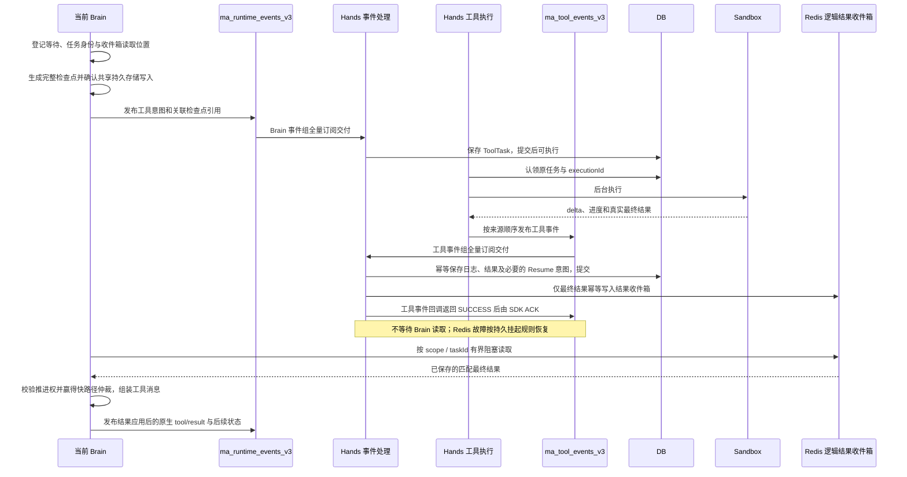

结果收件箱只保存该工具执行的不可变结算结果；进度事件不覆盖它。重复写入必须校验身份和内容一致；当前 Redis 实现以 Lua 校验摘要并只保留一条结果，读取可重复。TTL 是运行时副本的清理期限，不能当作工具或 Turn 的业务期限，也不能在旧等待仍可能读取时无条件删除。Redis 丢失、过期或写入失败均不能删除 DB 中的原结果、重启原工具或伪造失败 tool_result。

结果的 DB 事务与必要 Resume 意图提交后，事件消费可完成，不等待 Brain 接收，也不因 Redis 不可用无限占用事件回调。未能在短期限内取得结果或结果通道不可用的 Brain 进入受控挂起，捕获 checkpoint、continuation 和 pending，先保存完整对象到共享持久存储，再可靠发布引用和关联；Hands 保存 waiting_tool 时检查已经持久化的结果，结果齐备即登记 Resume。结果先落库或挂起先落库均按第 7.4 节收敛，因此 Redis 快速交付失败最多使本次执行转入挂起恢复，不能丢唤醒。

超时后移除旧本地等待和读取任务，不复活旧 Mono；保留共享收件箱中的不可变结果供幂等读取，按期限回收。恢复节点通过独立 Resume MQ 取得新的执行代次，在启动恢复阶段从 DB 取得有效引用和持久结果，再从共享存储加载完整检查点，继续同一 Turn。正常路径由结果事件直接触发收件箱写入，由挂起或结果事务触发 Resume 派发；不以 DB 结果表周期扫描驱动正常短等待或就绪判断。持久待派发意图的重试及故障补偿与正常推理分开，当前源码的扫描差异见 6.6。

#### 4.6.5 部署、保留与验收边界

父 Topic 预先配置 `message.type=LITE`；每个 Lite 消费组配置 `lite.bind.topic` 和 `lite.sub.model`。Turn 各深度、Brain 事件、工具事件、Resume 的消费组均配置 `Shared` 与 `lite.sub.wildcard=true`；工具结果由独立的 Hands 工具事件消费组统一处理，Brain 不配置额外的结果消费组。不能只设置 SDK group 名称或 `bindTopic()` 就认为服务端全量订阅已生效。当前项目测试组合为 Broker/独立 Cluster Proxy 5.5.1 与 Java SDK 5.2.2；目标统一使用 LitePushConsumer，并配置消费组 FIFO、按 LiteTopic 并行和消费容量。Proxy 开启 `enableProxyAutoRenew`，本部署 `renewMaxTimeMillis=10800000`（3 小时）；该值与续期间隔、消息保留期及故障接管时延分别核对。正式部署需要同步 Topic、消费组和服务端版本，当前测试夹具成功不表示生产 Compose/Helm 已迁移。[Lite 配置示例](https://rocketmq.apache.org/docs/bestPractice/02ratelimit/)、[5.5.1 发布说明](https://rocketmq.apache.org/release-notes/2026/08/20/5.5.1/)

LiteTopic 闲置清理时间与消息保留时间是不同配置，都要覆盖最长工具执行、停机和补偿窗口。项目测试夹具使用 `lite.topic.expiration=20160` 分钟作为演示值，不是生产默认承诺；需要考虑无新事件的长等待期间不能提前清理仍需恢复的通道。Broker 的重复交付、保留和死信策略仍需与下述消费验收一起验证。

## 5. Redis 中的轮内输入

### 5.1 数据与持久化分工

每个 Turn 建立一个输入流，例如 `ma:inputs:{sessionId}:{turnId}`。条目保存 `inputId`、`inputSeq`、类型、目标待办及内容引用。cancel 另有一个可重复读取的状态标记，便于等待模型或工具时快速检查。

使用 Stream 的追加和游标读取能力，避免覆盖前一条输入。运行中的 DataPlane 采用 XREAD 读取；同一个 Turn 的输入由当前执行实例处理，暂不引入另一套竞争消费组。[Redis XADD](https://redis.io/docs/latest/commands/xadd/)、[Redis XREAD](https://redis.io/docs/latest/commands/xread/)

DB 保存 Input 原文、受理序号和应用回执，Redis 保存运行时副本。这样，应用收到“已受理”后，输入不会仅依赖 Redis 的缓存寿命；Redis 重建时可以回填尚未应用的输入。

Input 的顺序采用该 Turn 的持久化受理序号。这只决定轮内输入顺序，Turn 之间的排序仍由 MQ 决定。Stream ID 是读取游标，不作为跨重启的业务去重标识。

### 5.2 受理、读取与应用

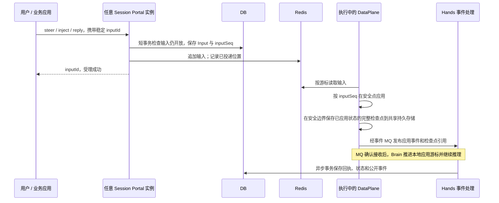

Input 保存和 Turn 输入关闭使用同一条 Turn 元数据的短事务串行化。先受理的输入进入待处理集合；先关闭的 Turn 对后续输入返回明确拒绝。相同 inputId 的重试返回原受理结果。

DB 已保存而 Redis 尚未写入时，Portal 保留待投递标记，由内部任务重试。活动执行在启动、恢复、Redis 连接重建、发现输入序号缺口以及准备结束 Turn 时，从 DB 校对待处理集合；运行中保留低频校对。持久 waiting_input 保存完整检查点与全部 pending actionId，然后释放活动 Harness 和推理令牌。Portal 受理 reply / cancel 与 Hands 提交挂起都在同一 Session 事务锁下检查唤醒条件，并创建持久 Resume 意图，由现有恢复通道唤醒任意 Brain；Session 归档或删除也触发取消恢复。这样答复先到、后到或等待期间没有 Brain，都不会丢失恢复意图。Redis 继续提供轮内输入的快速副本；已应用事实与检查点一同提交，迟到或重复条目按 inputId/inputSeq 去重。

“已读取”只表示条目到达执行实例。Brain 应用输入后，将对应状态和应用事件可靠发布到 MQ，便可推进本地游标；对外可查询的持久“已应用”回执由 Hands 异步落库形成。Brain 不等待这次 DB 投影。实例接管时要先补齐已发布而尚未投影的事实，再恢复输入位置，不能只根据滞后的 DB 回执重复应用输入，也不能在读取后立即删除受理事实。

### 5.3 交互语义

| 类型 | 处理约定 |
| --- | --- |
| inject | 将补充内容加入指定 Turn 的上下文，在下一次模型调用前应用 |
| steer | 调整当前 Turn 后续执行方向；在推理安全点应用，必要时中断当前模型流 |
| reply | 带 actionId 回答 waiting_input 对应的待办，应用后继续同一个 Turn |
| cancel | 请求停止指定 Turn，DataPlane 和 Hands 均读取其状态 |

下一轮新任务提交为新的 Turn。等待用户答复时，reply 进入当前 Turn 的输入流，避免排到等待中的 Turn 后面。

steer 默认影响后续步骤，已经启动的工具继续使用原参数。要求改变已发出的操作时，需要明确的工具停止协议并确认停止；改写输入不会自动修改远端执行。

控制检查独立于模型生成和工具等待。cancel 到达后尽快阻止新步骤，工具停止与最终取消则通过实际执行回执确认。Hands 在 Redis 不可用、连接重建及低频校对时读取 DB 中的取消请求，避免运行中的工具遗漏取消。

## 6. 运行事件、恢复日志与公开结果

本节以 `agentscope-3/agentscope-java` 当前工作区源码为依据说明格式，并按本轮确定的异步原则描述目标流程：**Brain 发布事件，经 MQ 确认接收后继续本地执行；Hands 异步消费和持久化，消费回调返回 SUCCESS 后由 SDK ACK；Brain 只有依赖工具输出时短期限读取 Redis 逻辑结果收件箱。** 不查询 batchId 的 DB 回执，不等待 Hands 对 checkpoint 引用、输入回执或模型日志的 DB 投影；检查点事件发布前，Brain 必须完成自己对完整对象的持久写入。工具等待是业务依赖，不是事件持久化确认；只等待一个短期限，超时先持久保存完整挂起对象，再发布引用并释放 Harness 计算资源，Hands 保存后只 ACK 挂起运行事件，原 Turn 回调保持未完成，由 SDK / Proxy 自动续期。结果通过 MQ 唤醒任意 DataPlane 恢复同一 Turn；终态落库后通知当前原消费方返回 SUCCESS，再由 SDK ACK 原 Turn。当前源码仍有同步 DB 等待，与目标流程的差异集中列在 6.6。

示例 ID、时间、日志位置和输出均为构造数据，不是一次真实模型、RocketMQ 或 Sandbox 执行记录。为了便于阅读，示例选择一个普通成功分支：用户要求执行 `printf 'hello\n'`，Harness 调用一次 `execute`，得到 `hello`，再调用模型生成最终答复；不触发审批、压缩、子 Agent 或 `returnDirect`。

### 6.1 三层事件协议与标识

Harness 的实时事件、原生 Session Log 和公开事件分别服务于观察、恢复与应用集成，不能逐条等同。实时事件进入 `streamEvents()`；原生事实由 `SessionRecorder` 记录，经 Managed 日志适配器进入事件 MQ；Hands 提交原生事实和公开投影后，Portal 才能从 DB 提供历史和 SSE。

| 层次 | 当前源码结构与类型示例 | 保存与使用方式 |
| --- | --- | --- |
| Harness 实时事件 | `AgentEvent`：`MODEL_CALL_START`、`TOOL_CALL_DELTA`、`TOOL_RESULT_END`、`AGENT_RESULT` | 用于进程内流式观察；有事件 `id` 和执行身份，但没有原生日志 `seq`，也不是完整恢复协议 |
| 原生运行事实 | `SessionEvent`：`request/prepared`、`model/chunk`、`tool/dispatch`、`tool/result`、`state/checkpoint` | 保留最终模型请求、结构化响应、上下文变化和恢复状态；提交到 `ma.native_event` |
| Service 公开事件 | `tool.requested`、`item.delta`、`item.completed`、`turn.completed` | Hands 转换到 `ma.public_event`；Portal 返回稳定事件 ID 和独立游标，供业务展示与重放 |

**标识的归属与关联**

以下以 `tenant_demo / default / session_demo_001` 为同一个作用域。跨实例使用的 MQ 分组和 DB/Redis key 必须包含完整作用域；第 4 节使用父 Topic 内的 `LiteTopic=scopeKey` 作为会话逻辑通道。当前 `ManagedScope.messageGroup()` 对带长度前缀的 tenant、namespace、sessionId 做 SHA-256，再做无填充 Base64URL 编码，不直接拼接可见的 Session ID。

| 标识 / 位置 | 示例 | 语义与使用边界 |
| --- | --- | --- |
| `agentId` / `sessionId` | `agent_demo_001` / `session_demo_001` | Agent 定义与持久会话身份；原生事件的 Session 归属来自外层 scope，单条 `SessionEvent` 没有 `sessionId` 字段 |
| `turnId` | `turn_demo_001` | 同一个逻辑任务；恢复继续使用原 Turn ID |
| `runId` / `executionRunId` | `11111111-1111-4111-8111-111111111111` | Harness 一次执行尝试；实时 `execution.runId` 与原生 `executionRunId` 关联；接管时生成新值 |
| `epoch` / `executionToken` | `7` / `lease_demo_epoch_7` | Managed 批次的执行代次与所有权 token；对应设计术语 `executionEpoch`，用于拒绝旧 Brain 的新推进，和 runId 不是同一个字段 |
| 实时事件 `id` | `33333333333343338333333333333333` | 单个 `AgentEvent` 的观察身份；不等于原生 eventId 或 MQ Broker ID |
| 原生 `eventId` / `seq` | `22222222-2222-4222-8222-222222222222` / `25` | 一个不可变事实与该 Session 的原生日志位置；当前 Recorder 根据已提交前缀生成连续 seq；目标中 Brain 维护本地发布位置，不为获得下一个位置查询 DB |
| `batchId` / `expectedSequence` | `batch_demo_004` / `24` | 当前源码的原子提交边界及预期前缀；目标保留批次身份和消费端幂等，不要求 Brain 等待 DB 回执 |
| `stepId` / `iteration` | `step_demo_001` / `0` | 一次 ReAct 迭代；不是 Turn 或模型调用 ID |
| `modelCallId` | `model_demo_001`、`model_demo_002` | 原生日志中每次最终模型适配器调用的标识；一次 Turn 可以调用模型多次，辅助模型调用也有各自身份 |
| `replyId` / `message.id` | `reply_model_001` / `msg_assistant_001` | 实时事件片段组与上下文消息；实时模型、工具、Agent 生命周期使用各自的 replyId，不能假定它们等于 modelCallId 或最终消息 ID |
| 原生 `toolCallId` | `call_demo_001` | 模型发起的工具调用；`ToolUseBlock.id` 与返回的 `ToolResultBlock.id` 必须匹配 |
| 原生 `actionId` | `action_demo_001` | `ActionObservations` 为工具执行观察生成的标识，位于 observation 和 dispatch 关联中；不同于用户待办 actionId |
| Hands 操作 `toolCallId` | `call_demo_001_0` | `ManagedToolRequests` 为该模型工具产生的第 0 个远端操作；一次模型工具可以产生多个操作，参数中的 `native_tool_call_id` 指向 `call_demo_001` |
| `taskId` / `executionId` | `tool_9185462b…` | ToolTask ID 由 scope、turnId、Hands 操作 ID 的摘要生成；当前初始 executionId 与 taskId 相同，远端 `processHandle` 另存 |
| `inputId` / `inputSeq` | `input_demo_002` / `2` | Portal 持久受理的轮内输入与顺序；Redis Stream ID 只是传输读取位置。Core 初始 `input/applied.inputId` 可能是消息 ID，Managed 轮内回执来自 `inbox/*` commandId，不应混淆 |
| 待办 `actionId` / `requestId` | `call_demo_001` | reply/审批/外部执行所回答的请求；当前原生 interaction 的 requestId 取工具调用 ID，而不是上述 action observation ID |
| `checkpoint` / `checkpointSequence` | `state/checkpoint` / `31` | 当前源码事件内含 stateJson；目标改为完整对象的引用/摘要与对应原生日志位置，checkpointId 稳定关联该对象和公开索引，不是 batchId 或 SSE 游标 |
| 公开 `id` / `cursor` | 原生 eventId 或稳定派生 ID / `W18` | id 用于去重；cursor 用于续传，`W18` 在下文代表公开 sequence=18 的不透明编码；原生 seq=25 不必对应公开 sequence=25 |
| `brokerMessageId` / `receiptId` | `broker_demo_004` / `delivery_demo_004` | 当前源码的投递诊断与本地关联；目标以消费方身份及投递代次关联完成信号，实际 receipt handle 由 SDK 管理，不交给 Hands 跨进程 ACK，也不作为业务去重 ID |

当前源码通过唯一 writer 和 `expectedSequence` 建立原生前缀，Hands 结果按 ToolTask 结算，不自行分配 Core 原生 seq。目标设计中，一个 Brain 在本地维护自己已被 MQ 接收的发布顺序，消费者按作用域、生产者身份与事件关联检查连续性并分配持久化位置；生产者位置与 DB 提交位置分开。batchId/hash 的重复检查属于 Hands 内部消费幂等，不能变成 Brain 每步查询 DB 的屏障。

以下含 `stateJson` 的原生批次展示**当前源码格式**。目标 Managed 传输在 Brain 侧先持久保存完整检查点，`state/checkpoint` 改携引用与 manifest，不再把完整 AgentState 放入 MQ 或 Hands 的检查点内容列；引用协议示例见 7.4。其他原生模型、工具与输入事实仍按原方向发布。

#### 6.1.1 Harness 实时事件示例

模型完成工具参数输出时，可以观察到以下 `ToolCallEndEvent`。同一模型调用中的 start/delta/end 共享 replyId 和 toolCallId，每条事件有独立 id。父 Agent 的 source 默认为 null；转发的子 Agent 事件使用自己的来源路径和执行身份。

```json
{
  "type": "TOOL_CALL_END",
  "id": "33333333333343338333333333333333",
  "createdAt": "2026-10-14T00:00:00Z",
  "source": null,
  "execution": {
    "agentId": "agent_demo_001",
    "sessionId": "session_demo_001",
    "turnId": "turn_demo_001",
    "runId": "11111111-1111-4111-8111-111111111111"
  },
  "replyId": "reply_model_001",
  "toolCallId": "call_demo_001",
  "toolCallName": "execute"
}
```

`TOOL_CALL_END` 表示参数流结束；此时不能宣称工具已经执行成功。工具结果最终可观察到同一 toolCallId 的 `TOOL_RESULT_END`，其中 `state` 为 `success`、`error`、`denied` 等。具体工具输出由结果 delta 或最终消息携带。

#### 6.1.2 原生事实与 MQ 批次示例

以下是原生 `tool/requested` 的实际 record 字段。`payloadJson` 是被冻结的 JSON **字符串**，解析后包含模型消息 ID、工具调用 ID 与完整 `ToolUseBlock`。

```json
{
  "schemaVersion": 1,
  "eventId": "22222222-2222-4222-8222-222222222222",
  "seq": 25,
  "occurredAt": 1791936000000,
  "type": "tool/requested",
  "executionRunId": "11111111-1111-4111-8111-111111111111",
  "turnId": "turn_demo_001",
  "required": true,
  "payloadJson": "{\"messageId\":\"msg_assistant_001\",\"toolCallId\":\"call_demo_001\",\"call\":{\"type\":\"tool_use\",\"id\":\"call_demo_001\",\"name\":\"execute\",\"input\":{\"command\":\"printf 'hello\\\\n'\",\"timeout\":30},\"state\":\"pending\"}}"
}
```

当前源码的 `ManagedMqSessionLog` 把一次 Core commit 包装为下列 `ManagedRuntimeBatch`。这个格式是 **MQ 载荷解码后的业务批次**；其中 epoch/token 和 scope 位于批次外层，不需要重复加到每个原生事件。这里仅展示日志前缀已到 24 后的一条事实，不是从空 Session 开始的完整日志。

```json
{
  "scope": {
    "tenant": "tenant_demo",
    "namespace": "default",
    "sessionId": "session_demo_001"
  },
  "turnId": "turn_demo_001",
  "epoch": 7,
  "executionToken": "lease_demo_epoch_7",
  "writerOwner": "11111111-1111-4111-8111-111111111111",
  "batchId": "batch_demo_004",
  "expectedSequence": 24,
  "events": [
    {
      "schemaVersion": 1,
      "eventId": "22222222-2222-4222-8222-222222222222",
      "seq": 25,
      "occurredAt": 1791936000000,
      "type": "tool/requested",
      "executionRunId": "11111111-1111-4111-8111-111111111111",
      "turnId": "turn_demo_001",
      "required": true,
      "payloadJson": "{\"messageId\":\"msg_assistant_001\",\"toolCallId\":\"call_demo_001\",\"call\":{\"type\":\"tool_use\",\"id\":\"call_demo_001\",\"name\":\"execute\",\"input\":{\"command\":\"printf 'hello\\\\n'\",\"timeout\":30},\"state\":\"pending\"}}"
    }
  ],
  "toolIntents": [],
  "inputReceipts": [],
  "terminalStatus": null
}
```

`toolIntents` 为空是有意义的：原生 `tool/requested` 记录模型意图，不能单凭它绕过权限、参数校验或本地工具逻辑直接启动 Sandbox。后续工具派发进入 `ManagedRemoteFilesystem` 时才产生远端 ToolIntent，见 6.3。

当前源码的 Broker 消息体由 `ManagedBatchCodec.Envelope` 包装：`version=2`、`kind=runtime` 或 `tool_result`、scope、batchId、hash、inline。小批次的 inline 是 Jackson 对 byte[] 的 Base64 编码；超过 128 KiB 的内容写入 Brain 和 Hands 可共同访问的私有共享目录，inline 为 null，以 scope/hash 定位。解码器校验消息 ID、作用域逻辑 key（传输层来自 LiteTopic）、批次 ID 和内容摘要；64 MiB 是私有批次内容上限。不能把上述解码后的 JSON 当作 Broker 原始 Envelope 直接发送，也不能把私有恢复数据放进公开 Artifact 路径。目标保留该编解码边界，但按 Topic 校验生产身份与消息种类：Brain 的 runtime 批次只发 Runtime Topic，Hands 的原始 tool_result 和新增 delta/progress 事件只发 Tool Topic；不能因旧 codec 支持两种 kind 就继续共用同一 Topic。

上述超限批次暂存是传输编解码机制，与完整检查点存储是两个契约。即使检查点很小，目标也先保存不可变完整对象，再在批次里携带引用；不能把 codec 的临时 scope/hash 文件当作有效检查点指针，或随传输缓存回收恢复对象。

#### 6.1.3 Public Event 与 SSE 示例

Hands 把上述原生事件转换为 `tool.requested`。Portal 返回的公开事件如下，公开 position 示例取 18。原生事实在 DB 内的投影 source 记录 eventId、native seq 和 runId，但当前 `eventView()` 删除该内部 source 后才返回应用。

```json
{
  "schema_version": 1,
  "id": "22222222-2222-4222-8222-222222222222",
  "cursor": "YWFFVUUwS2xsR2NINm1nSnJWSExQSnNYLWxQQVRZWjZNNURWOG51T0VKTToxOA",
  "session_id": "session_demo_001",
  "type": "tool.requested",
  "created_at": 1791936000050,
  "data": {
    "schema_version": 1,
    "turn_id": "turn_demo_001",
    "run_id": "11111111-1111-4111-8111-111111111111",
    "tool_call_id": "call_demo_001",
    "name": "execute",
    "input": {
      "command": "printf 'hello\\n'",
      "timeout": 30
    }
  }
}
```

该事件的 SSE 外层形如以下内容。`id:` 是续传 **cursor**；data 内的 `id` 是稳定的公开事件身份，两者用途不同。

```text
id: YWFFVUUwS2xsR2NINm1nSnJWSExQSnNYLWxQQVRZWjZNNURWOG51T0VKTToxOA
event: tool.requested
data: {"schema_version":1,"id":"22222222-2222-4222-8222-222222222222","cursor":"YWFFVUUwS2xsR2NINm1nSnJWSExQSnNYLWxQQVRZWjZNNURWOG51T0VKTToxOA","session_id":"session_demo_001","type":"tool.requested","created_at":1791936000050,"data":{"schema_version":1,"turn_id":"turn_demo_001","run_id":"11111111-1111-4111-8111-111111111111","tool_call_id":"call_demo_001","name":"execute","input":{"command":"printf 'hello\\n'","timeout":30}}}
```

公开协议使用 snake_case；Core/Managed record 使用 camelCase。`createdAt` 为实时事件的 ISO 时间字符串，原生 occurredAt 和上述 Portal created_at 为毫秒时间戳。示例时间、ID 和 cursor 应当原样关联，客户端不需要解码 cursor。

### 6.2 完整 Harness 推理执行事件流

`HarnessAgent.streamEvents()` 委托内部 ReActAgent；Core 的 `call()` 与 `streamEvents()` 共用执行生命周期，终态结果均来自 `AgentResultEvent.result`。下图列出本例工具结果在短等待期限内返回时，从开始到结束的**实时事件主流**；超时路径会结束当前执行尝试，再从持久挂起状态创建新的尝试，见 7.4。`*` 表示可以出现多个 delta；框架还可能在工具开始/结束插入 `CUSTOM(name=action_observation)`，在上下文构建时插入 `CUSTOM(name=context_build)`。这些观察事件不代替恢复检查点。

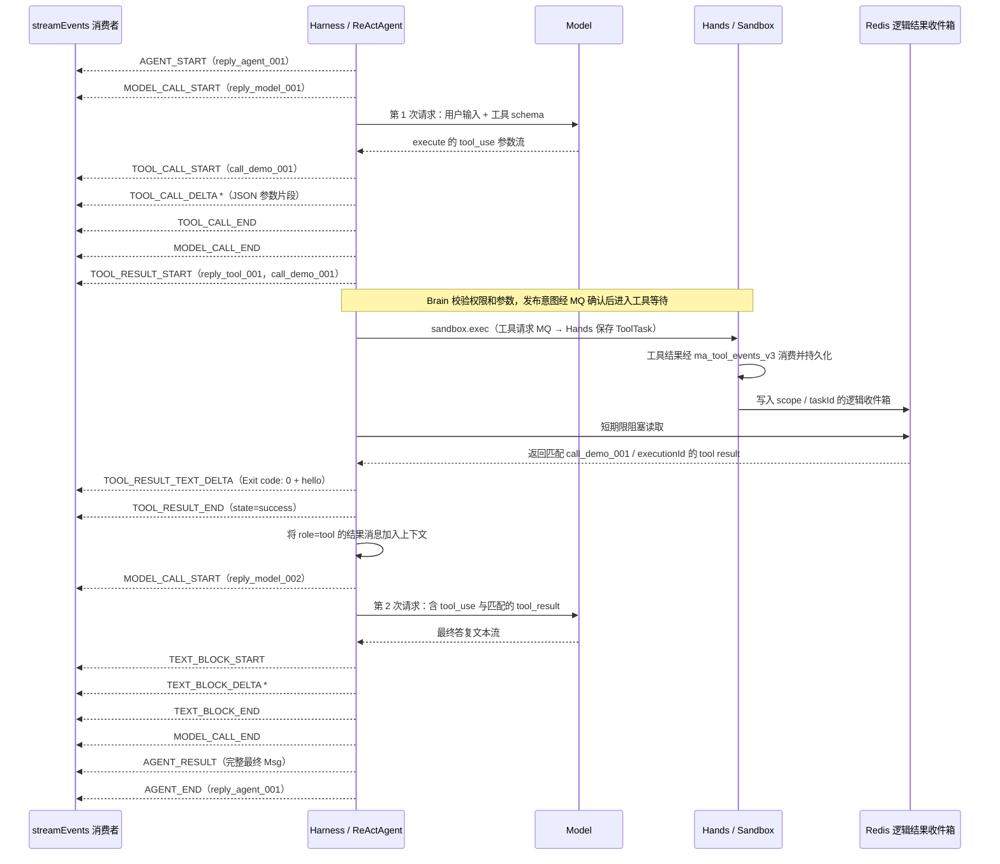

只有模型实际输出了 thinking、text、data 等 block 才出现相应 START/DELTA/END；第 1 次请求也可能先产生文本再发起工具。参数 delta 可能只是半个 JSON，不能逐片执行。没有主动流式输出的工具，Core 会把完整结果转换为结果 delta 后再发 END，因此 `TOOL_RESULT_START` 到 `TOOL_RESULT_END` 之间也可能长时间没有增量。辅助模型调用、中间件、`returnDirect`、审批与取消会改变分支，不能据此断言所有 Turn 都必须调用模型两次。

**同一执行的原生事实与公开投影**

下面按目标正常分支列出完整生命周期；Brain 本地处理与 Hands 后台投影分别推进，不需要对每个阶段等待 DB。每个单元中的箭头表示相应阶段的顺序，多条事实可以合并进一次不可变批次。原生事实与实时事件由不同边界记录，表格不表示二者逐条同步或共用 ID。

| 阶段 | 原生 Session Log / Managed 边界 | 对外可见结果 |
| --- | --- | --- |
| 1. 加载并开始 | 首次日志可能有 `migration/baseline`；恢复可能有 `recovery/applied`；随后 `run/start → turn/start`（接管为 `turn/resumed`）`→ input/received` | `run.started`；Managed 为 Turn 增加 `turn.running`；实时 `AGENT_START` |
| 2. 第 1 次模型请求前 | `step/start`；状态捕获产生 `input/applied → message/user` 及必要的 `message/system`、状态变化、`state/checkpoint`；最终适配器调用前 `request/prepared → model/dispatch` | 用户 `item.completed`；主推理请求 `item.started`；`model.started`。完整 prompt、options 保留在内部日志；完整 AgentState 保存在共享检查点对象中 |
| 3. 第 1 次模型输出 | `model/chunk * → model/end`；输出成为上下文中的 assistant 消息；在工具前捕获为 `message/assistant → tool/requested → state/checkpoint` | 主推理 `item.delta`、assistant `item.completed`、`tool.requested`；model/end 有 usage 时投影 `usage.recorded`，否则 `model.completed` |
| 4. 原生工具派发 | `action/start → tool/decision(allowed) → tool/dispatch`；Brain 先登记结果等待、记录本地事实并发布，MQ 接收后等待匹配结果；Hands 保存意图后执行 | `tool.dispatched`；实时工具结果流开始；action/start 本身没有普通公开投影 |
| 5. Hands 远端操作 | Brain 发布 `ToolIntent(call_demo_001_0, sandbox.exec)` 并等待结果；Hands 按已消费的检查点引用和意图保存 ToolTask，独立执行并可靠返回真实结果 | 远端操作结果发布 `tool.operation.completed`，以原生 toolCallId 更新同一工具下的操作；这一步不追加 Core 原生 `tool/result` |
| 6. Core 工具结算 | Brain 收到匹配工具结果，转换完整 `ToolResultBlock`；`action/end` 保存 observation 和 result；结果加入上下文，在下次状态捕获时产生 `tool/result → state/checkpoint`；工具主动 emit 时另有 `tool/chunk *` | 原生 tool/result 的真实结果投影模型级 `tool.completed` 与 `item.completed(type=tool_result)`；挂起结果不完成工具；恢复重放按 Turn / toolCallId 去重；chunk 投影 `tool.delta` |
| 7. 第 2 次模型调用 | 迭代边界 `step/end(continued) → step/start`；捕获上述结果后 `request/prepared → model/dispatch → model/chunk * → model/end` | 新 modelCallId 对应新的 item；文本 `item.delta` 和模型完成/usage |
| 8. Harness 正常结束 | 最终状态捕获产生 `message/assistant` 和必要的 `state/checkpoint`；随后 `turn/output → step/end(completed) → turn/completed → run/end` | `item.completed → item.finalized(final_output=true)`、`run.ended`；实时 `AGENT_RESULT → AGENT_END` |
| 9. Service Turn 结算 | Brain 关闭输入、发布结算事实与 terminalStatus=succeeded，MQ 接收后结束推理；Hands 异步保存终态、检查点引用与完成通知意图，通知原消费方返回 SUCCESS，由 SDK ACK Turn MQ | `turn.completed(status=completed)`；这是 Service 逻辑 Turn 的完成事实 |

`turn/output` 保存这次执行选定的最终 Msg，`message/assistant` 保存上下文消息，两者可以引用同一 message ID；公开展示应更新同一个 item，不能把它们渲染成两条答复。`state/checkpoint` 没有普通公开投影，却是恢复的关键。目标中这些检查点边界均先由 Brain 保存完整对象，日志中的检查点事实只携引用；Hands 事务保存引用与索引，不保存完整 AgentState 内容。Core `turn/completed`、实时 `AGENT_END` 与 Service 的 `turn.completed` 分别处于不同边界；Hands 未完成整个 Turn 的最终事务前不能 ACK 原 Turn，长工具挂起也不例外。挂起事务提交后仅可 ACK 对应运行事件及已完成本次交接的 Resume 通知，原 Turn 仍持有并续期。Brain 不等待这些事务的 DB 回执。

### 6.3 tool use、Hands 操作与 tool result 的交互

#### 6.3.1 模型消息的对应关系

模型的第 1 次输出是 assistant 消息，content 中的 `tool_use` 只描述调用意图。以下为 `Msg` 的相关字段视图，省略 timestamp、usage、metadata 等辅助字段。

```json
{
  "id": "msg_assistant_001",
  "name": "demo-agent",
  "role": "assistant",
  "content": [
    {
      "type": "tool_use",
      "id": "call_demo_001",
      "name": "execute",
      "input": {"command": "printf 'hello\\n'", "timeout": 30},
      "state": "pending"
    }
  ]
}
```

Core 在模型流结束后得到完整参数，执行工具可用性、权限、schema 和中间件检查。目标中 Brain 在本地记录 action/start、allowed 决定和 dispatch，并可靠发布到 MQ；Hands 消费请求并保存工具意图后执行。Brain 不先查询这些记录是否落库。当前 `ActionObservations`/`ToolExecutor` 仍通过日志 commit 等待 DB，属于待改造路径。拒绝、错误或挂起产生对应结果/待办，不能伪装成 Sandbox 成功。本文示例使用普通允许分支。

`ShellExecuteTool.execute` 调用文件系统的 execute；Managed 场景的 `ManagedRemoteFilesystem` 把它转换为 `sandbox.exec`。本例的一次模型工具调用产生一个 Hands 操作；文件上传/下载、批量操作或工具内部多次访问则可能产生多个操作。

#### 6.3.2 远端意图、执行与结果

下列为当前源码中远端意图的解码后批次，示例原生日志头为 31。目标流程中，Brain 先保存完整工具检查点对象，再按本地顺序发布引用和意图，Hands 消费后建立持久关联；Brain 不先查询检查点是否提交。`events=[]` 表示这个批次登记远端操作，不制造新的 Core 原生事实；Hands 将意图与检查点关联保存为唯一 ToolTask。

```json
{
  "scope": {
    "tenant": "tenant_demo",
    "namespace": "default",
    "sessionId": "session_demo_001"
  },
  "turnId": "turn_demo_001",
  "epoch": 7,
  "executionToken": "lease_demo_epoch_7",
  "writerOwner": "lease_demo_epoch_7",
  "batchId": "intent_tool_9185462bcb1f7921d19bce40e4ecea51e3fc0822186d865f52015a19e3575af2",
  "expectedSequence": 31,
  "events": [],
  "toolIntents": [
    {
      "toolCallId": "call_demo_001_0",
      "toolName": "sandbox.exec",
      "arguments": "{\"command\":\"printf 'hello\\\\n'\",\"timeout_seconds\":30,\"native_tool_call_id\":\"call_demo_001\"}"
    }
  ],
  "inputReceipts": [],
  "terminalStatus": null
}
```

ToolTask 的 `taskId=tool_…` 由 scope、Turn 和 `call_demo_001_0` 派生，初始 executionId 与 taskId 相同。后台线程先保存认领状态与稳定 executionId，再启动 Sandbox；收到 processHandle 后保存关联，后续按原执行标识查询。长操作占用工具执行池，不能阻塞事件消费池。查询得到确认的响应后，Hands 发布以下 `ManagedToolResult`，MQ Envelope 的 kind 为 `tool_result`。

```json
{
  "scope": {
    "tenant": "tenant_demo",
    "namespace": "default",
    "sessionId": "session_demo_001"
  },
  "taskId": "tool_9185462bcb1f7921d19bce40e4ecea51e3fc0822186d865f52015a19e3575af2",
  "executionId": "tool_9185462bcb1f7921d19bce40e4ecea51e3fc0822186d865f52015a19e3575af2",
  "status": "succeeded",
  "result": "{\"output\":\"hello\\n\",\"exitCode\":0,\"truncated\":false}"
}
```

这个结果的稳定批次 ID 是 `result_b3c9b8034e6f11ca4348b4f6e3aa8d3f3a7f09146290a377a05cd8b223139f77`，由 taskId 和 executionId 派生。它没有 Brain epoch：已启动工具的真实结果可以在 Brain 接管后到达，按原任务身份结算。目标将该结果写入 `ma_tool_events_v3`；Hands 工具事件消费者检查任务存在且 executionId 匹配，保存 ToolTask 结果及回执后 ACK 该工具事件。当前工具终态已写 Tool Topic，进度协议与剩余验收见 6.6。目标中 Hands 提交后写入 Redis 逻辑结果收件箱，Brain 有界阻塞读取，并按 toolCallId、操作 ID 和 executionId 校验、去重后继续，不循环查询 DB 的 `task.result`。结果发布、消费和恢复按稳定任务身份保证；当前源码已提供收件箱及短等待基础，恢复阶段仍可读取持久结果，不能将该读取误写为正常路径轮询。实现差异见 6.6。

#### 6.3.3 将真实结果送回模型

Brain 将 ExecuteResponse 转换为工具结果，保留原始工具 ID 和名字。`ShellExecuteTool` 本例生成的文本是 `Exit code: 0\n\nhello\n`，并以 ToolExecutionDetails 保存 shell 类型、执行结果和 exitCode。`ToolResultMessageBuilder` 构造 role=tool 的消息，消息自身有新 ID，但 block.id 继续指向 `call_demo_001`。这是 Brain 对真实结果的应用记录，后续原生 `tool/result` 仍由 Brain 经 `ma_runtime_events_v3` 发布；Hands 原始操作结果仅走 `ma_tool_events_v3`，不能把两层事实展示为两次工具执行。

```json
{
  "id": "msg_tool_001",
  "name": "demo-agent",
  "role": "tool",
  "content": [
    {
      "type": "tool_result",
      "id": "call_demo_001",
      "name": "execute",
      "state": "success",
      "output": [{"type": "text", "text": "Exit code: 0\n\nhello\n"}],
      "executionDetails": {
        "kind": "shell",
        "outcome": "SUCCEEDED",
        "exitCode": 0,
        "outputTruncated": false
      }
    }
  ]
}
```

该消息经过 post-acting 中间件加入 AgentState 的 context；下一次模型请求前记录 `tool/result` 和检查点，再将以下上下文传给模型适配器：system 与历史消息 → 本轮 user → 含 `call_demo_001` 的 assistant tool_use → 同 ID 的 tool_result。适配器再映射为模型供应商自己的工具协议。模型随后生成 `msg_assistant_002`，例如“命令执行成功，输出为 hello。”

工具 `state=success` 表示这次工具结算；exitCode=0 表示这个 shell 命令成功；它们都不直接证明整个用户任务完成。最终任务结论仍由后续推理、验证与 Turn 终态确定。多个工具并行时应按 toolCallId 配对，不能按返回次序绑定结果。

**当前模型工具与操作视图**：`commitToolResult()` 发布 `tool.operation.completed`，以 `tool_call_id=call_demo_001` 关联模型工具，以 `operation_tool_call_id=call_demo_001_0`、taskId 和 executionId 标识内部操作。它只更新同一工具的 `operations`，不覆盖模型工具的名称、最终结果或状态。框架的真实 `tool/result` 再投影模型级 `tool.completed` 与完整结果 item；挂起结果只形成等待消息，不完成工具。同一 Turn / toolCallId 的恢复记录与后续记录共用完成身份，避免重复显示。框架内部维护操作不进入公开工具视图。

Managed Hands 的短等待结果在同一次执行中继续；超时后是平台内部 waiting_tool 挂起，恢复时继续同一个逻辑 Turn，但使用新 runId 和执行代次。它不自动产生面向用户的 `REQUIRE_EXTERNAL_EXECUTION`。只有 schema-only/external 工具或权限 ASK 的实际分支才登记 `interaction/requested`、挂起并等待 reply；答复用对应 actionId/requestId 关联，记录 `interaction/resolved` 后继续原 Turn。挂起结果没有真实 output，不能把它当成成功结果传给模型。

#### 6.3.4 工具 delta、进度与最终结果的独立通道

目标工具事件统一走 `ma_tool_events_v3`，由 Hands 工具执行侧发布、Hands 工具事件消费组保存；不先转交 Brain 再入队。Brain 挂起或实例退出后，采集和日志记录仍继续。`tool.delta` 输出进入内部 Session Log 并投影为公开工具增量；`tool.progress` 是执行状态事实，不代表工具完成，也不填入最终结果收件箱。

工具来源事件由 `ManagedToolEvent` 编码为 `kind=tool_event` 的 Envelope，继续使用现有内容哈希与私有大对象机制。`tool_result` 编码保留给 Brain 的最终结果信箱，不作为 Tool Topic 的消息类型。下面是解码后的输出来源事件；Turn、原生 toolCallId 和操作 ID 由消费者根据持久 ToolTask 补齐，不接受生产者另行指定关联。

```json
{
  "type": "tool.delta",
  "scope": {
    "tenant": "tenant_demo",
    "namespace": "default",
    "sessionId": "session_demo_001"
  },
  "taskId": "tool_demo_001",
  "executionId": "tool_demo_001",
  "sourceSeq": 2,
  "data": {
    "chunk_seq": 1,
    "from_offset": 0,
    "to_offset": 6,
    "channel": "combined",
    "data": "aGVsbG8K"
  }
}
```

事件 ID 由完整作用域、taskId、executionId 和 sourceSeq 稳定推导。示例中的数据是 `hello\n` 的原始字节；stdout / stderr 当前合并采集，不将其标成可区分的两条流。

`sourceSeq` 表示原 executionId 内工具事件的来源顺序，`data.chunk_seq` 表示输出片段顺序，均不等于 Core native seq、公开 cursor 或 Broker offset。多个工具的输出可交错，每个执行独立排序。发布端可按大小或时间合批，但保留片段身份与顺序；同一来源的后序批次不越过结果未知的前序批次。重试复用原 eventId 和内容，消费端幂等保存；身份重复但内容不同应记录冲突，不覆盖旧事实。

最终 `tool.result` 仍携带原 taskId / executionId、真实终态和完整模型可用结果，必要时附截断说明及完整产物引用；流式协议同时声明 `data.last_chunk_seq`，不能用“最后一段 delta”充当最终结果。工具事件消费者核对来源连续性，缺口要补齐或明确记录，不能静默把丢失输出标为日志完整。采集游标与待发布批次应可恢复，接管重读原执行输出而不重启原工具；若执行端无法回放，应如实暴露输出缺口。

当前持久结构分三部分：`ma.tool_stream` 保存采集字节位置、来源 / 片段序号、完整性和已消费前缀；`ma.tool_event` 保存不可变来源事件、发布确认、接收和投影事实；`ma.tool_result_outbox` 先保存完整真实结果。收到最终结果后，仍需续采剩余输出并记录最终水位，再允许结果进入 Brain 信箱 / Resume。接管使用原执行和持久字节游标，不重新发起工具。

发布端不越过 Broker 结果未知的前序；消费端可以保存提前到达的事件并 ACK，待缺口补齐后按连续前缀投影，避免把缺失片段堵在 MQ 队头之后。投影、消费前缀、最终结果和 Resume 意图处于同一事务。重复身份但不同内容记录 `ma.tool_event_conflict` 并拒绝覆盖；delta / progress 不完成最终结果等待。

当前每片最多 16 KiB，每次采集最多四片；单操作最多采集 16 MiB。超限或来源丢失生成显式 `tool.output_gap`；终态 `log_status` 区分 complete、gapped 和 not_supported。内部保存原始字节，公开事件使用 UTF-8 替换解码；快照只留 65,536 个 UTF-16 代码单元 / 256 块的预览，达到上限设置 progress_truncated，完整已采集内容从持久事件读取。`self_hosted` Worker 经 HTTPS `/output` 接口提交片段，读取共享游标；不接触 DB / MQ / Redis。这里是当前源码协议，真实多副本、Broker 故障和长日志容量仍需专项验收，不能仅凭协议单测宣称全部边界已通过。

Hands 原始输出与 Brain 工具消息是两层事实。Brain 收到完整结果后负责转换 ToolResultBlock、执行框架 hook 并组装本轮结果消息；其原生 `tool/result` / `state/checkpoint` 仍发 Runtime Topic。Brain 若镜像远端 delta 为框架流式回调，应保留原事件来源关联，避免再次记录或展示为另一段相同输出。当前本地 `ToolEmitter` 自动追加 `tool/chunk` 的行为不能直接证明远端流式去重已经实现。两类 Topic 的持久化入口需要保留来源身份，公开视图按原 toolCallId 更新同一工具项，不累计为两次执行。

### 6.4 消息消费、事务处理与 ACK

“消息消费”在这里有四种边界：Brain 消费 Turn MQ，Hands 消费运行批次，运行组件消费 Redis 输入，应用消费公开事件。它们各自的游标、回执和失败行为不同。

#### 6.4.1 Turn / Resume MQ：执行尝试、挂起与 ACK

当前 `ManagedTurnPublisher.Command` 包含 scope、turnId、publicationSequence；消息业务 ID 为 turnId。publicationSequence 是投递身份，不是原生 seq 或公开 cursor。当前代码还将持久投递位置用于 DB 前序屏障；目标保留身份校验与去重，但正常 Turn 放行由原投递的有序消费和终态 ACK 决定，不继续用 currentTurnId/settledSequence 查询、暂存 T2 和后台重查来调度。执行认领、重投递、恢复及异常修复仍读取必要的持久事实。并发受理、结果未知的发布和死信路径需要单独验收。

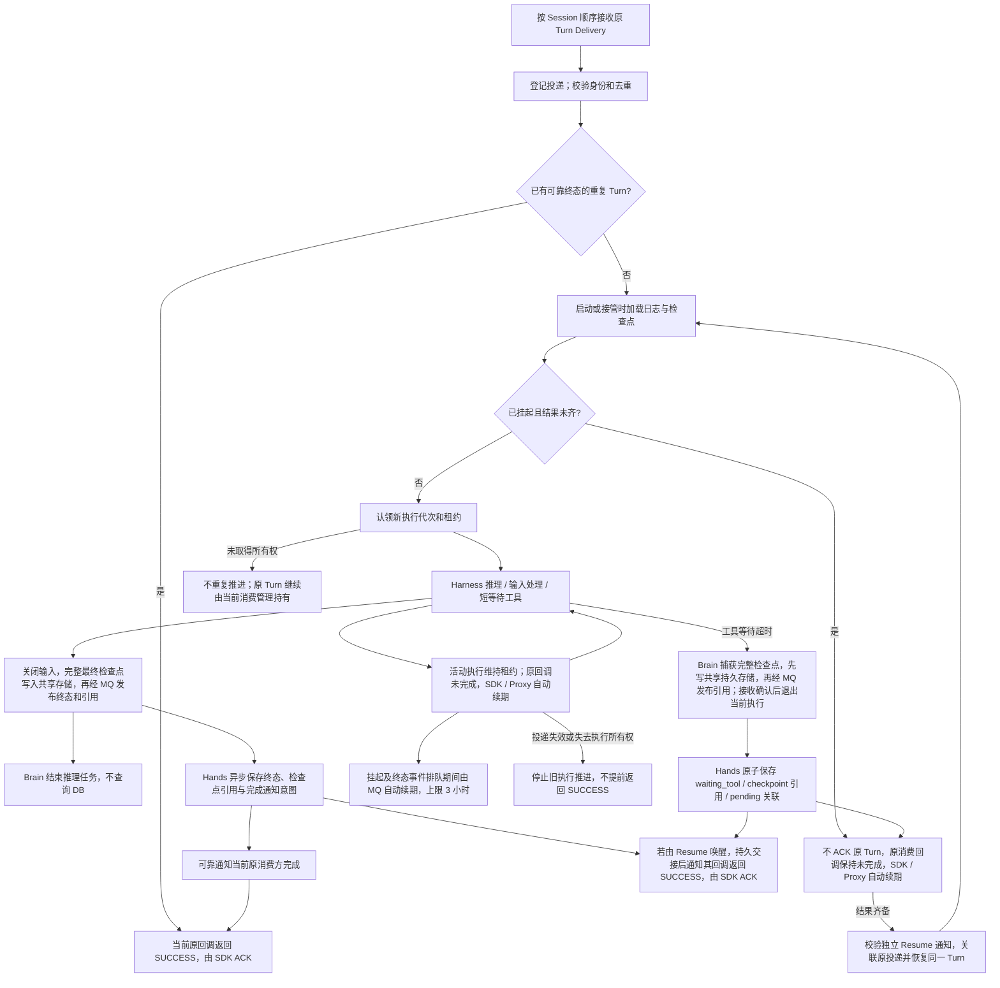

目标流程中，Brain 先保存完整检查点对象，再发布最终事件或挂起事件及检查点引用，经 MQ 接收确认后退出当前执行；原 Turn 消费回调继续等待完成信号，自动续期由 SDK / Proxy 承担。Hands 保存挂起事务不完成原 Turn 回调；只有整个 Turn 的终态与恢复数据提交后才可靠通知原消费方，由回调返回 SUCCESS、SDK ACK。Resume 回调的完成边界见 4.5，不释放原 Turn 的顺序屏障。

已结束 Turn 的重投递在启动恢复时读取持久终态，直接返回 SUCCESS，不再调用模型；仍为 waiting_tool 则登记本次回调并等待结果，不能仅因检查点存在就确认。guard 检查贯穿日志、模型与 Hands 请求边界；失去所有权后的迟到推进受 epoch/token 拒绝。既有 `abandon()`、显式续期及跨进程 receipt ACK 属于旧传输适配方式，不作为 LitePush 挂起或确认协议；完成信号与 SDK 回调的衔接按 4.4、4.5 实现。

#### 6.4.2 Brain / Tool Event MQ：独立发布，事务后 ACK

Brain 对自己的模型请求、响应、消息上下文、检查点和 Input 应用过程已有本地事实，发布不是一次远程业务查询。MQ 发送确认后即可推进本地状态，不等待 Hands 处理完成，不查询 batchId/committed/hash，也不为普通事件增加反向“提交成功”消息。发送失败或结果未知时使用原事件身份重试；被 MQ 接收后，后台消费可靠性由 MQ 重新投递和 Hands 的幂等处理负责。

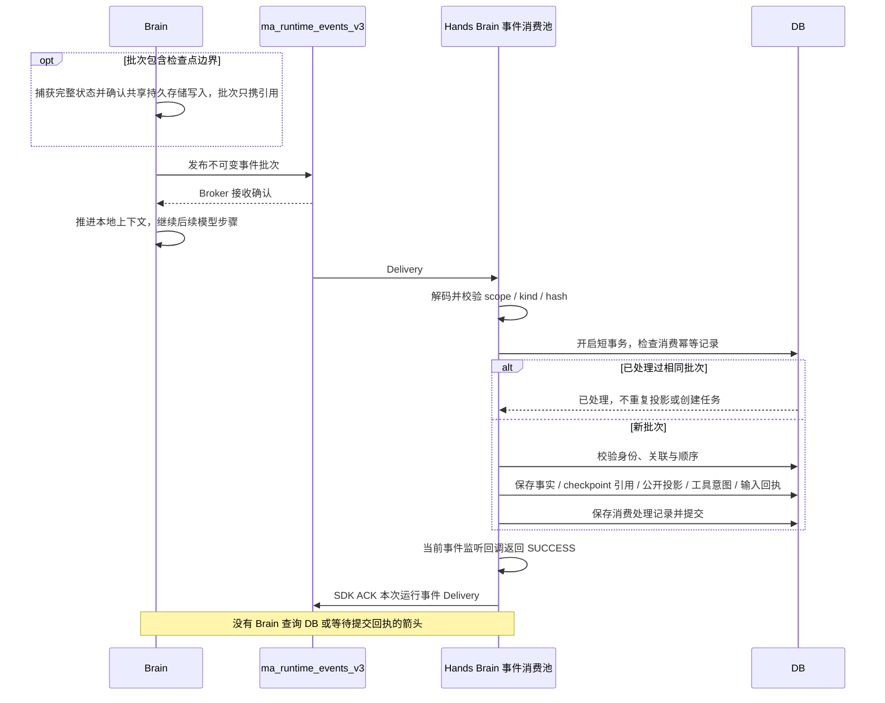

Hands 对每个批次的 DB 事务仍负责原生事实、检查点引用/索引、公开投影、ToolTask、Input 回执之间的一致性：按稳定 batchId/eventId 去重，校验相同 ID 的内容，检查执行身份和关联，更新派生记录后提交，再 ACK 运行事件。hash 校验留在解码与消费者内部；它不要求发送端再次查询持久回执。

工具请求额外触发后台执行；ToolTask 和相关状态可靠保存后才启动工具。Hands 工具执行侧仅向 `ma_tool_events_v3` 发布 delta、进度和结果；独立工具事件消费者保存各类事实，只有最终结果提交后才写入 Redis 逻辑结果收件箱，短等待中的 Brain 有界阻塞读取；超时后的真实结果由 Hands 保存并触发持久 Resume 意图，不再寻找已经释放的旧 Mono。普通 Brain 运行事件没有反向提交确认路径；工具结果是独立 Tool Topic 的业务事实，不能写回 Runtime Topic。发送前先登记短等待关联；超时与结果到达由同一等待状态仲裁，完整规则见 7.4。

挂起事件包含已保存完整对象的 checkpoint 引用/manifest、pending 调用关联、继续位置摘要及原消费关联；这些字段用于完成信号路由和恢复，不授予原 Turn 提前确认资格。Hands 保存 waiting_tool 后，当前事件回调可返回 SUCCESS，由 SDK ACK 该条运行事件；原 Turn 回调仍等待。若本次由 Resume 唤醒，同一挂起事务还可靠登记该次 Resume 的交接完成通知。

终态处理先检查输入已结算、工具结果完整、完整检查点对象已可靠保存且引用有效，在同一事务保存最终引用、终态及原 Turn / 本次 Resume 的完成通知意图。提交后，当前运行事件回调即可返回 SUCCESS；持久派发异步通知各自消费方，由匹配的回调返回 SUCCESS、SDK 完成 ACK。通知与 SDK ACK 可独立重试，不要求事件消费线程等待原 Turn ACK，也不把 receipt handle 跨进程传给 Hands。恢复后再次挂起只完成当前 Resume，不完成原 Turn；Brain 推理不等待这些事务和确认。

| 消费情况 | 处理与恢复 |
| --- | --- |
| Hands DB 事务失败 | 回滚事务，回调不返回 SUCCESS，由 SDK / MQ 重试后幂等处理 |
| 已提交但运行事件 ACK 丢失 | 相同身份重投递不重复投影或执行工具，ACK 新 Delivery |
| 终态已提交但完成通知或 Turn ACK 未完成 | 持久派发重试完成通知；回调返回 SUCCESS 后 ACK 由 SDK 处理，Turn 重投递读取终态直接完成，不能重跑模型或工具 |
| 过期执行产生的新推进 | 消费端按执行身份拒绝无效推进；Brain 的独立租约/控制循环停止旧执行，不依靠逐事件 DB 回执 |
| 来源事件有顺序缺口或关联未到达 | 保留待处理事实并补齐前序，不将“暂未投影”解释为业务未发生，不跳过缺口启动工具 |
| 同一事件或结果 ID 对应不同内容 | 消费端记录冲突，不覆盖原事实，进入错误处理 |
| 结果找不到原任务或执行标识不匹配 | 不交给模型使用，保留诊断并补齐或修复关联 |
| Envelope / 私有 blob 损坏或缺失 | 不提交、不 ACK；按传输修复和错误/死信策略处理 |
| Redis 结果写入失败或收件箱过期 | 保留已提交结果及必要 Resume 意图；Brain 短等待失败后受控挂起，挂起事务检查已有结果并触发恢复，不轮询 DB、不重跑工具 |
| 工具启动或停止无法确认 | 保持 unknown；不盲目重启或伪造成功结果 |

两条事件通道分别配置 Topic、消费组、容量、重试与积压指标；回调分别确认自身投递。工具事件只能在日志/结果和必要恢复意图提交后返回 SUCCESS；delta 和进度不完成最终结果等待，也不改变原 Turn 的终态 ACK 条件。

`ManagedHandsEvents`、`ManagedJournalStore`、`ManagedConsumerLoop` 提供当前消费、事务与有界执行池的实现依据；目标保留消费端幂等和短事务，并移除生产端同步 DB 确认。事件池与长工具执行池分别配置容量，事件处理在不可见窗口内完成，失败由 MQ 再投递，不占住 Brain 的正常推理。

#### 6.4.3 Redis 输入：读取不等于应用

Portal 先持久受理 Input，再投递 Redis。运行组件在安全点读取并按 Input ID/顺序去重。当前 `ManagedRuntimeInputMiddleware` 在推理边界直接查询 DB 的 accepted steer/inject，补入上下文，记录 `inbox/accepted` 与 `inbox/applied.commandIds`；日志适配器将 commandIds 转换为批次 inputReceipts，`inbox/rejected` 则生成 rejected 回执。Redis 仍承担输入传递与取消信号，DB 查询提供持久待处理集合。目标中 Brain 可靠发布应用事件后便推进本地位置；**检查点引用、原生事实、Input 结算和公开回执同事务提交**由 Hands 异步完成，Brain 不等待该事务；完整对象已由 Brain 在发送引用前写入共享持久存储，不属于这次 DB 事务。

Redis 条目到达不表示 Input 已应用，不能只推进 Stream 游标就永久删除受理事实。恢复、序号缺口和结束前仍需从 DB 校对；cancel 的 Brain/Hands 控制循环也必须核对持久取消事实。完整受理、关闭竞争与重放规则见第 5 节。

### 6.5 SSE、历史与页面恢复

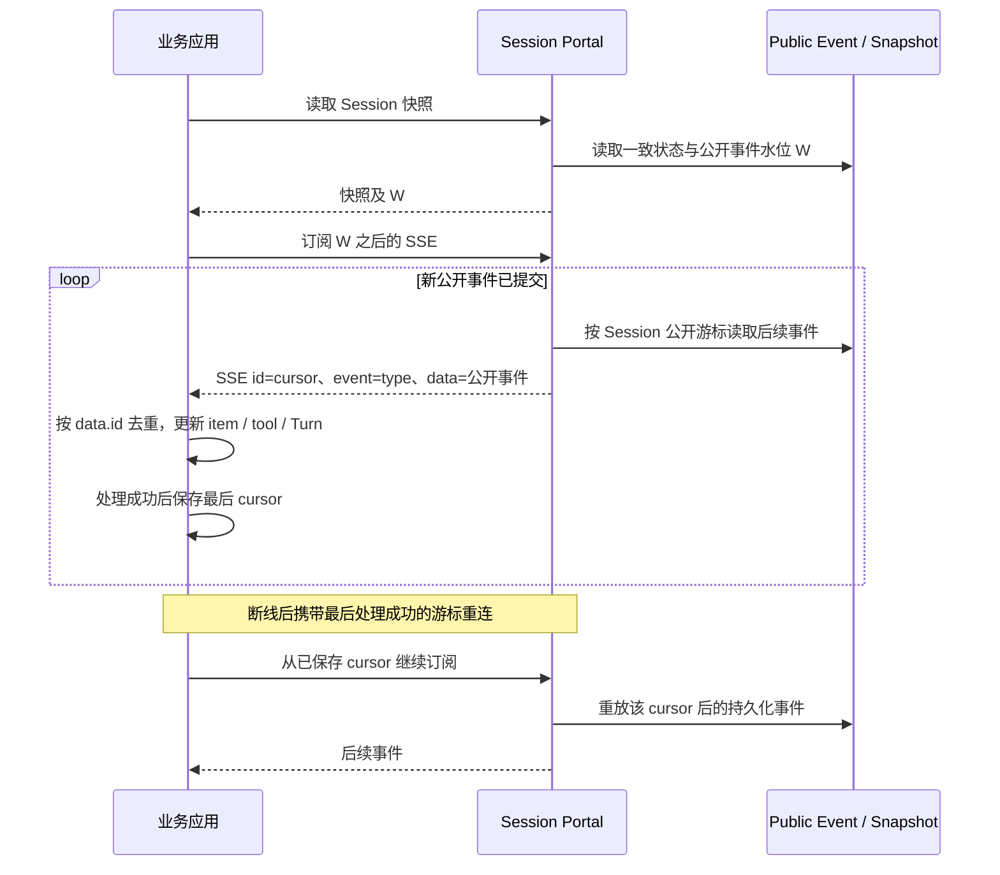

当前原生 Managed 路径为 `GET /v1/sessions/{id}/events?after=…` 与 `GET /v1/sessions/{id}/events/stream?after=…`；SSE 入口也接受 `Last-Event-ID`；当前 `/v1/sessions` 控制器优先使用该请求头，仅在请求头缺失时使用 after。cursor 使用作用域与 public sequence 的编码，Portal 校验作用域和已提交范围；不能拿 Core native seq、Broker ID、Redis Stream ID 或旧管理接口游标代替它。

应用应以稳定 item_id/message_id 更新消息，按 tool_call_id 关联工具，按 turn_id 更新状态。`item.delta` 为流式内容，`item.completed` 提供完整 item，`item.finalized` 标记选定最终输出；重放时完成 item 应覆盖已拼接的临时内容，避免把完整结果再次追加到 delta 后面。提示词、检查点、私有 thinking 内容由公开投影过滤；内部模型输入不是 SSE 响应的一部分。

每个客户端有自己的读取游标，多个订阅不会抢走彼此的消息。客户端只在业务处理成功后保存 cursor；连接层已收到与业务层已消费不是同一回事。允许重连出现重复，以 data.id 去重后继续；用户离线不会停止 Turn。心跳不是业务事实，不应推进已消费位置。

快照与水位 W 必须来自一致读取；W 后的事件包含并发更新。当前 Portal 使用有界、分页的 DB 重放，超出允许重放范围或读取前缀出现缺口时需要重新取得快照并处理错误，不能静默从“现在”开始。通知只用于唤醒，完整性仍由已提交事件和游标保证。

### 6.6 源码核对位置与实现边界

下表中的完整路径相对于项目根目录。缩写 Core、Harness、Service Common 分别使用 [`agentscope-core/src/main/java/io/agentscope/core/`](https://github.com/agentscope-ai/agentscope-java/tree/v2.0.4/agentscope-core/src/main/java/io/agentscope/core)、[`agentscope-harness/src/main/java/io/agentscope/harness/`](https://github.com/agentscope-ai/agentscope-java/tree/v2.0.4/agentscope-harness/src/main/java/io/agentscope/harness)、[`agentscope-service/service-common/src/main/java/io/agentscope/builder/`](https://github.com/agentscope-ai/agentscope-java/tree/v2.0.4/agentscope-service/service-common/src/main/java/io/agentscope/builder) 前缀；Session Portal 使用 `agentscope-service/service-session-portal/` 前缀。链接仅提供 v2.0.4 的历史源码入口；下表的 Managed runtime、Session Portal、Hands、Core session 与 ExecutionIdentity/ActionObservations 路径属于后续开发记录，不存在于该 tag，保留为源码导读文本而不生成发布版链接。文档示例本身不构成独立协议实现。

| 核对对象 | 关键源码位置 |
| --- | --- |
| Harness 与实时事件生命周期 | `agentscope-harness/src/main/java/io/agentscope/harness/agent/HarnessAgent.java`；`agentscope-core/src/main/java/io/agentscope/core/ReActAgent.java`；Core `event/AgentEvent.java`、`agent/ExecutionIdentity.java` |
| 原生 envelope、模型/状态/终态事实 | Core `session/SessionEvent.java`、`SessionRecorder.java`、`SessionModels.java`、`SessionEventTypes.java` |
| 工具权限、执行观察与模型消息 | Core `tool/ToolExecutor.java`、`observation/ActionObservations.java`、`tool/ToolResultMessageBuilder.java`；Harness `agent/tool/ShellExecuteTool.java` |
| 作用域、MQ 编解码与本地已发布前缀 | Service Common `runtime/managed/ManagedScope.java`、`ManagedRuntimeBatch.java`、`ManagedBatchCodec.java`、`ManagedMqSessionLog.java`、`ManagedRuntimeWriter.java` |
| 检查点捕获、挂起引用与索引 | Core `session/SessionRecorder.java`；Service Common `runtime/managed/ManagedTurnExecution.java`、`ManagedSuspensions.java`、`ManagedCheckpoints.java` |
| 消费、原生提交与公开投影 | Service Common `runtime/managed/ManagedBrainTurns.java`、`ManagedHandsEvents.java`、`ManagedJournalStore.java`、`ManagedConsumerLoop.java`；`web/managed/CommittedSessionEventProjector.java` |
| Hands 操作意图与真实结果 | Service Common `runtime/managed/ManagedToolRequests.java`、`ManagedRemoteFilesystem.java`、`ManagedToolExecutions.java`、`ManagedToolResult.java` |
| 逻辑结果收件箱与补偿 | Service Common `runtime/managed/ManagedToolResultDelivery.java`、`RedisManagedToolResultDelivery.java`、`ManagedToolResultRelay.java`；Hands `agentscope-service/service-hands/src/main/java/io/agentscope/builder/hands/ManagedHandsConfiguration.java` |
| 公开历史、SSE 与输入 | Session Portal `src/main/java/io/agentscope/builder/portal/session/ManagedSessionTurnsApi.java`；Service Common `runtime/managed/ManagedRuntimeInputMiddleware.java` |

以下为 2026-10-15 工作区的实施状态；完整证据与未完成项另见
`agentscope-service/docs/managed-mq-redis-refactoring-plan.md`（改造实施记录未包含在 v2.0.4 或其他现有 tag 中）。
这是源码进展说明，不改变前文的目标协议，也不以局部验证代替整体验收。

- `RocketMqManagedMessageBus` 已切换为四个 Lite 父 Topic 的 `LitePushConsumer` 全量订阅，
  分别承载 Turn、Runtime Event、Tool Event、Resume。Session 发现扫描、逐项动态订阅、应用
  逐投递续期和 receipt 跨进程手动 ACK 已移除。原 Turn 挂起保留回调，终态事务保存持久完成
  通知，原消费方收到后返回 SUCCESS，由 SDK ACK；Resume 独立完成其本次交接。
- `ManagedRuntimeWriter` 不再按批次轮询 DB 提交回执。`ManagedLocalJournal` 保存本次已发布
  的原生前缀，Hands 持久化位置单独维护；重投递和接管仍需经过持久前缀与执行代次检查。
- 原生 `SessionRecorder` 仍按既有契约捕获完整状态。Managed 适配层在发布前把完整原生载荷
  和 continuation 写入共享私有存储的不可变对象，MQ、DB 和挂起记录传递 manifest 引用。
  `ManagedCheckpointObjects` 验证作用域、源事件、位置、大小与摘要；Hands 以流式校验处理引用，
  不构造 AgentState。日志读取和恢复时才还原原始载荷，fork / baseline 也使用引用。
  挂起与终态从已捕获的活动状态创建新对象，保留输入水位、工具原身份、部分结果及应用状态。
- `ManagedToolExecutions` 已改发独立 `TOOL_EVENTS`。Runtime / Tool 事件消费与物理工具执行
  使用独立处理池。工具终态消费提交后直接写入 Redis 结果收件箱，结果与挂起事务登记 Resume；
  短等待超时释放活动 Harness，仍保留整个逻辑 Turn。修复扫描不作为正常每步推进条件。
- 正常运行、180 秒本地工具、双 Brain 同时替换、不同 Session 并行、跨 Portal 输入和 SSE
  重连已有隔离双副本验证；模型为明确标记的 Fake，Sandbox 为实际本地子进程，并非真实 ACS。
  最新检查点引用与结果 outbox 已在冻结双副本产物中通过复验：52 个私有捕获、8 个终态捕获，
  以及跨 Brain 重建的真实推理步序列。整套正式容器部署与其余故障矩阵仍待完成。
- 同一逻辑 Turn 的迭代预算也必须跨挂起恢复。Managed 捕获已提交的 step 与推理完成位置，
  通过可选的宿主执行位置绑定继续 Core 循环；不能把进程重建或 AgentState.curIter 的存在
  当作已经恢复预算。未绑定宿主的通用 Core 保持既有入口行为。

工具终态发布前的 outbox 已接入平台与 self_hosted 路径：先保存不可变完整结果，再发送，
由 Tool 消费事务结清；发布响应丢失和传输文件重建的专项已通过，真实组合故障仍待验收。

尚未完成的边界包括：工具 delta / progress 与多来源 sourceSeq 协议、旧 Managed Runtime 图清理、
父子回调容量饱和、首次消费前过期 / 死信、
3 小时自动续期上限、提交后 ACK 丢失、MQ / DB / 网络分区组合故障，以及整套正式部署验收。
工具结果暂存之前发生故障时，仍需依赖原 executionId 查询或显式 unknown，禁止盲目重跑；
结果 outbox、消费后的 Redis 投递修复、Turn 完成通知 outbox 是三个不同的持久边界。

## 7. Brain–Hands 分离与长周期工具

### 7.1 工具任务生命周期

ToolTask 至少保存：调用标识、参数、Environment 与 Sandbox 绑定、关联检查点引用、当前状态、远端执行标识和真实结果。

| 状态 | 处理方式 |
| --- | --- |
| pending | 已保存执行意图，等待 Hands 认领 |
| dispatching | 已认领，正在建立远端执行；启动结果未知时禁止盲目重发 |
| running | 远端执行已确认，持续获取进度并维持 Sandbox 生命周期 |
| stopping | 正在停止远端执行，等待明确回执 |
| succeeded / failed / cancelled | 结果或停止已确认，发布稳定结果事件 |
| unknown | 无法确认启动、完成或停止，阻塞依赖该结果的推理 |

Hands 后台任务以 DB 条件更新认领 ToolTask。Worker 重启后通过远端执行标识继续查询，避免因为 Worker 失联就重新执行工具。

启动请求使用稳定 executionKey。Sandbox 若支持请求去重，重试复用该标识；若执行接口无法确认启动是否成功，则进入 unknown，等待查询、停止证明或业务处理。ToolTask 去重只能防止重复调度记录，外部副作用的幂等仍需执行接口或目标操作支持。

工具完成后，Hands 先保存已收取响应和待发布标记，再向 `ma_tool_events_v3` 发布结果事件，delta 与进度也走该 Topic。发布重试复用 eventId。Hands 的持久保存与结果返回由可靠交付协议衔接；Hands 消费结果并提交后写入 Redis 逻辑收件箱，DataPlane 等待匹配 taskId/executionId 的结果，按原 toolCallId 纳入本地上下文后继续，不通过轮询 ToolTask.result 或批次 DB 回执推进。

### 7.2 ACS 长工具完整流程

设计示例：用户提交“处理一批材料并生成核验报告”，Agent 发起一个预期持续 20 分钟的工具。下面描述预期流程，未实际执行。

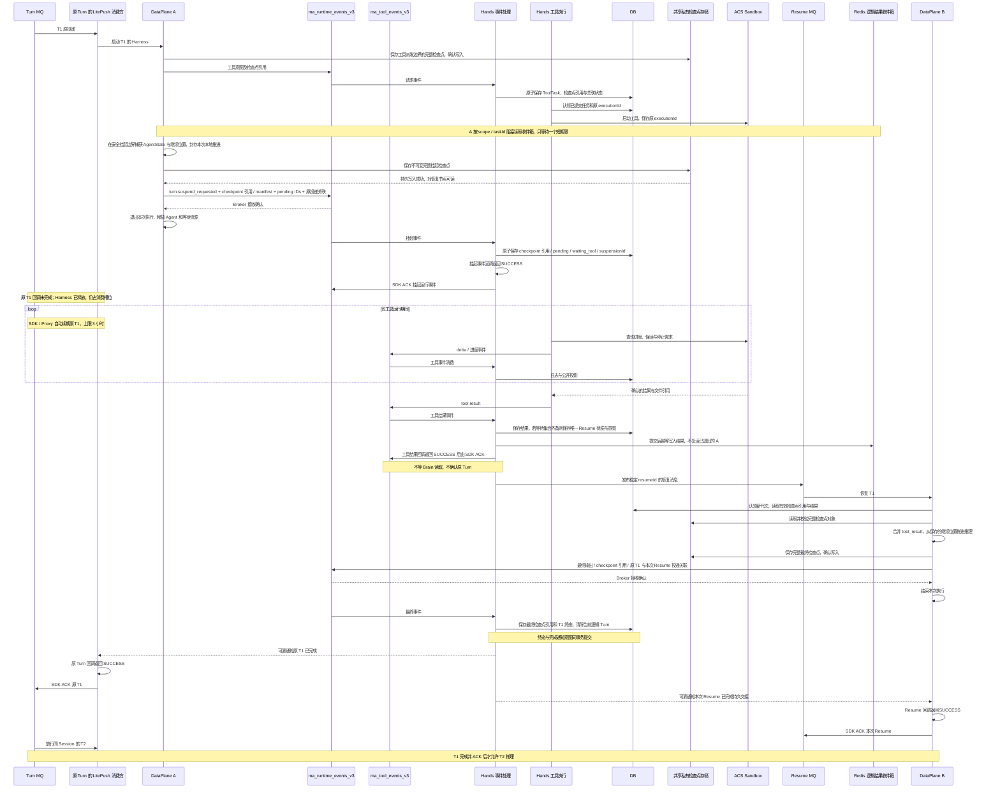

长工具运行期间不保留 DataPlane A 的 Agent、Mono 或推理线程，但原 Turn 的 LitePush 回调继续等待完成信号，占用消费槽位，由 SDK / Proxy 自动续期。Hands 继续执行原工具，真实结果触发同一逻辑 Turn 在任意 DataPlane 的新执行尝试；原投递持有者与恢复节点可以不同。若整个持有进程故障，MQ 重投递原 T1，由新消费管理恢复持有并结合检查点接管，不能 ACK 掉仍在等待的 T1。恢复无需重跑此前模型调用或重新启动工具。客户端仍通过同一个 Turn 的公开事件观察进度和最终结果。

本地短等待期限、工具执行期限、MQ 自动续期上限（3 小时）、消息保留期和 Sandbox 存活期限分别配置。短等待超时只是选择持久挂起，不代表工具执行失败，不自动停止 Sandbox。

### 7.3 取消运行中的长工具

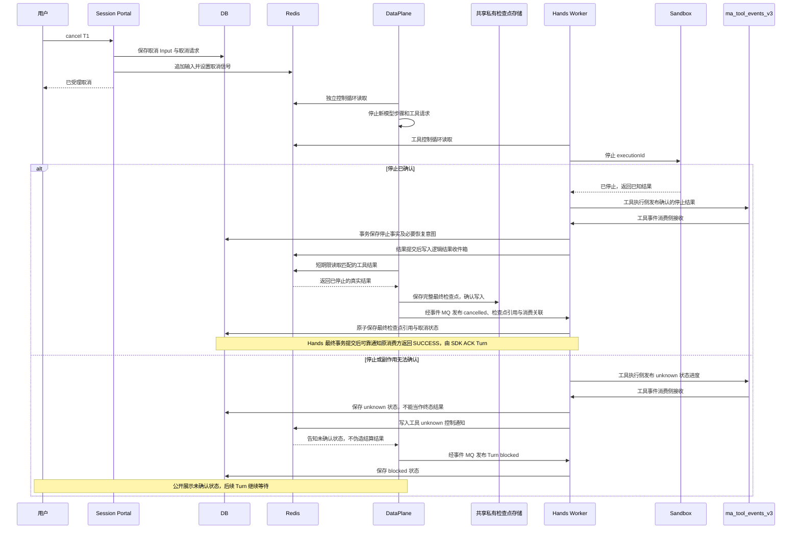

上图描述 Brain 仍在线的取消过程。已持久挂起的 Turn 由 Hands/控制消费处理取消：停止原 executionId，保存确认结果，再通过恢复或结算消息完成原 Turn 的 cancelled 状态，不要求旧 DataPlane 在线。

排队中的 Turn 接收 cancel 后保存取消标记，等它到达队头时直接结算取消，跳过模型与工具执行。取消 API 返回的是受理回执，最终取消结果从 Turn 状态和公开事件确认。

### 7.4 短期限等待、持久挂起与任意节点恢复

**两条路径。** Brain 在发送工具请求前登记关联等待和逻辑结果收件箱读取位置，按 `inlineWaitTimeout` 有界阻塞读取 Redis；当前配置默认 5 秒，可通过 `builder.managed.inline-tool-wait-seconds` 调整。Hands 通过 Tool Topic 消费并持久化结果后写入收件箱，Brain 不直接消费 MQ 工具结果，也不查询 DB 等待结果。期限内取得结果且赢得推进仲裁，完成原工具 Mono，按现有 acting 流程写入上下文并继续模型调用。超时则结束当前执行尝试，持久化 waiting_tool，由结果消息驱动新的执行尝试。Mono 只承担快路径，不承担长工具的生命周期。

```text
running / 短等待
  ├─ Hands 消费并持久化结果 → Redis 逻辑结果收件箱
  │   └─ Brain 在期限内读到结果并赢得仲裁 → 当前执行应用结果 → 下一次 reasoning
  └─ 短等待超时 → Harness / Brain 在安全边界捕获完整 AgentState + continuation
                  → Brain 将不可变完整检查点写入共享持久存储，确认写入成功
                  → Brain 经 Runtime MQ 发布检查点引用和挂起关联，Broker 确认后释放 Harness
                  → Hands 原子保存 checkpoint 引用 + pending 关联 + waiting_tool
                  → 原 Turn 不 ACK；原消费回调保持未完成，SDK / Proxy 自动续期
                  → 工具结果齐备，持久派发 resume
                  → 任意 DataPlane 认领，读取 DB 已生效的引用与结果
                  → 从共享存储读取并校验完整对象 → 恢复同一 Turn → 下一次 reasoning
```

**谁生成、谁保存。** Harness/Core 在 Brain 进程中持有运行中的 AgentState，在安全挂起边界捕获一致快照和明确的继续位置。Brain 的运行适配器补齐执行身份、pending 工具和输入/结果应用位置，生成完整检查点对象，并将对象写入所有恢复节点都可访问的共享私有持久存储。存储须保证完整对象原子可见，部分写入不能作为可读检查点；存储确认写入成功后，Brain 才经 `ma_runtime_events_v3` 发布引用及 manifest；MQ 中不传完整 AgentState。共享后端可以是私有对象存储或共享文件系统，不新增必需的独立服务，也不能使用节点本地临时目录或只覆盖一份“最新 AgentState”的可变记录。

Hands 沿用原事件消费方向，校验引用、执行身份、来源位置和任务关联，在同一 DB 短事务中保存 checkpoint 引用/manifest/索引、pending 关联及 waiting_tool，更新该 Turn 的有效检查点指针，并检查已落库的结果，必要时登记唯一 Resume 意图。Hands 不生成或重建完整 AgentState，也不接收完整对象后再次代为保存。**Brain 写完对象只表示恢复材料已就绪；引用在 Hands 事务提交后才成为有效恢复边界。** 对象存储与 DB 不做分布式事务：先有对象，后有引用，DB 回滚不删除对象。挂起事务仍不产生原 Turn 的 ACK 资格。

**检查点的用途和内容。** 检查点用于原 Harness 实例销毁后的继续执行，记录“哪些上下文和输入已经应用、哪些工具已经发出、当前等待什么、结果到达后从哪里继续”。选择挂起后，先封存旧执行的本地推进，在清理 Agent、上下文和等待资源之前从活动运行态生成快照；迟到回调不得再修改它。不能在异常清理后从可能滞后的 `SessionProjection.stateJson` 拼出挂起状态，也不能仅因投影中存在非空快照就认为材料完整。

完整对象必须包含完整 AgentState 和 continuation：scope、turnId、checkpointId、suspensionId、原 runId/epoch、Agent/Workspace 固定版本、待结果的模型 toolCallId、Hands 操作 ID、taskId/executionId、工具参数、已获得与已应用的部分结果、输入应用游标、ReAct 迭代位置、原生日志/来源水位及 `resumePhase=APPLY_TOOL_RESULTS` 等恢复阶段。AgentState 包括消息上下文、summary、replyId、curIter，以及权限、工具、任务和计划状态；它不能替代 continuation 与 pending 操作关联。不能只保存 assistant 文本，也不序列化 Mono、future、线程、SDK receipt handle 或 Java 回调。消费关联由受保护的事件字段和持久投递登记管理，恢复时不复用旧 ACK 凭据。

检查点描述 Brain **已经应用的运行状态**，不要求 Brain 为了生成它消费 Hands 的全部工具事件。工具 delta/进度仍由 Hands 通过 Tool Topic 保存；尚未被 Brain 应用的最终结果可能已持久化，恢复节点按稳定任务身份补入。已到达与已应用必须区分，多工具场景保留本轮完整 tool_use 集合、部分结果和剩余 pending；每个结果只应用一次。Workspace/Sandbox 通过共享持久文件与稳定引用恢复，不要求把全部文件塞入 AgentState；多步工具仍需明确的可恢复步骤或结果重建契约。因此无需反转事件消费方向。

**引用协议示例。** 以下是目标 `turn.suspend_requested` 业务内容的示意，实际仍封装在带 scope、batchId、执行 token、消费关联的运行批次中，由现有 codec 编码。`checkpoint` 是引用及 manifest；完整 AgentState 和 continuation 已存在 storageRef 指向的私有对象里。示例长度与摘要仅为构造字段，生产环境必须按实际写入字节计算。

```json
{
  "schemaVersion": 1,
  "type": "turn.suspend_requested",
  "eventId": "suspend_event_demo_001",
  "scope": {
    "tenant": "tenant_demo",
    "namespace": "default",
    "sessionId": "session_demo_001"
  },
  "turnId": "turn_demo_001",
  "runId": "11111111-1111-4111-8111-111111111111",
  "epoch": 7,
  "suspensionId": "suspension_demo_001",
  "checkpoint": {
    "checkpointId": "checkpoint_demo_wait_tools_001",
    "schemaVersion": 1,
    "storageRef": "managed-checkpoints/tenant_demo/default/session_demo_001/turn_demo_001/checkpoint_demo_wait_tools_001.json",
    "contentHash": "sha256:0123456789abcdef0123456789abcdef0123456789abcdef0123456789abcdef",
    "sizeBytes": 16384,
    "nativeSequence": 31,
    "appliedInputSeq": 2,
    "resumePhase": "APPLY_TOOL_RESULTS"
  },
  "pending": [
    {
      "nativeToolCallId": "call_demo_001",
      "operationToolCallId": "call_demo_001_0",
      "taskId": "tool_9185462b_demo_001",
      "executionId": "tool_9185462b_demo_001"
    }
  ]
}
```

checkpointId 在捕获时生成，重试复用相同 ID、内容和摘要；不得用相同 ID 覆盖另一个快照。storageRef 是配置存储中的内部对象引用，不能接受任意外部 URL 或公开下载地址。Hands 校验 manifest 必填字段、schema、完整作用域、runId/epoch、pending 与已登记 ToolTask 的关联，并通过存储的持久写入契约及对象元数据核验引用、摘要与长度；存储 I/O 在 DB 短事务之外完成，无需反序列化完整 AgentState 才能保存关联。Brain 与恢复侧的存储 I/O 也不能阻塞 Reactor 事件循环线程。恢复节点读取完整字节后再核验摘要、内容身份、版本和 manifest 一致性。状态语义完整性由 Brain 负责，跨节点恢复验收验证；摘要校验不是 Brain 查询 DB 的 committed/hash 回执。

初始、工具派发前、结果应用后、挂起和最终检查点统一采用“Brain 保存不可变完整对象、MQ 携引用、Hands 保存有效引用”的协议。是否形成新的检查点遵守运行边界，不要求逐个模型 delta 保存完整对象。挂起对象必须描述“已有工具请求正在等待结果”，不能描述为“尚未发起工具”。只有 Hands 提交的引用可以用于恢复/fork，不能根据共享存储目录中“最新文件”接管；新代次可复用旧对象，但不能让旧执行覆盖新有效指针。

**保存和释放顺序。** Brain 完成一致快照 → 共享存储确认完整对象持久可读 → MQ 确认引用批次已接收 → 可以释放本次 Harness、工具等待和执行租约。Brain 不等待 Hands 的 DB 提交回执，原 MQ 消费回调仍保持未完成并自动续期。Hands 随后原子提交引用及 waiting_tool，封存旧代次；已在 MQ 的前序事实和引用未补齐前，恢复方不能按旧投影推进。挂起不推进终态结算位置、不关闭本轮输入；整个 Turn 终态落库后才通知原消费方返回 SUCCESS、由 SDK ACK。计算资源、执行所有权和 MQ 投递生命周期分别管理。

对象写入失败或结果未知时，不能发布一个已就绪引用或宣称挂起交接完成；以相同身份重试并确认存储结果。对象已写入而 MQ 失败/结果未知时保留对象，按稳定批次身份重试；MQ 已接收而 DB 事务失败时由 MQ 重投递引用，原 Turn 仍不 ACK。已发布或已生效的对象必须保留至恢复、fork 和历史保留要求结束，不能随 Harness 退出清理。未生效对象只有在超过发布/重试/恢复安全窗口、确认无未决发布及持久引用后才能回收；不能仅凭某一时刻 DB 查不到引用就删除。

**结果如何唤醒。** 每个结果由 Hands 通过独立 `ma_tool_events_v3` 消费，按稳定 taskId/executionId 保存，提交后写入 Redis 逻辑结果收件箱；Brain 从收件箱取得结果并校验，不需要查找节点地址或动态订阅。Hands 检查结果所属的 Turn 和 suspensionId：已经持久挂起且待结果集合齐备时，在保存结果的同一 DB 事务里写入唯一 Resume 待发布意图；尚未挂起时先保存真实结果，后续挂起事务必须检查已有结果。随后后台派发到独立 Resume Topic，发送失败重试相同 resumeId；DB 与 MQ 之间不能只用一次内存回调，否则“结果已保存但恢复消息未发送”的重启窗口会丢唤醒。

以下是目标恢复命令示例，不是当前源码已有的 record。消息携带 checkpointId 等持久关联，恢复节点在启动阶段从 DB 取得已生效引用和结果，再读取共享存储中的完整检查点；这次加载不属于正常推理的 DB 轮询。

```json
{
  "schemaVersion": 1,
  "type": "turn.resume",
  "resumeId": "resume_demo_001",
  "scope": {
    "tenant": "tenant_demo",
    "namespace": "default",
    "sessionId": "session_demo_001"
  },
  "turnId": "turn_demo_001",
  "suspensionId": "suspension_demo_001",
  "checkpointId": "checkpoint_demo_wait_tools_001",
  "toolCallIds": ["call_demo_001"],
  "resultIds": ["result_demo_001"],
  "reason": "tool_results_ready"
}
```

**恢复的是 Turn，不是旧 Mono。** 任意 DataPlane 消费恢复消息后，校验 Turn 仍有效、suspensionId 匹配且结果齐备，以条件更新取得新的执行代次；重复或过期消息幂等处理。先从 DB 取得已生效的检查点引用、manifest 和持久结果，再从共享存储读取完整对象并校验内容摘要、schema、scope、turnId 及原执行身份，重新创建 HarnessAgent，按 toolCallId 只合并尚未应用的真实 ToolResultBlock，并从保存的继续位置进入 acting 后处理或下一次 reasoning。turnId 保持不变，runId 和 epoch 更新，原 ToolTask/executionId 不变。恢复消息不固定到旧 DataPlane 的实例地址，也不重新调用原工具产生副作用。

原 Turn 的消费关联与恢复执行关联，但原消费方和恢复节点不必相同。原消费方保留等待中的 LitePush 回调，由 SDK / Proxy 自动续期；它失效后由重投递的新消费方登记新的关联。原 Turn 重投递与 Resume 同时到达时，使用执行租约、代次和 suspensionId 仲裁，只允许一个恢复执行。仍在 waiting_tool 且结果未齐的重投递只建立消费等待；已就绪的接管复用结果，不重新启动原工具。终态完成通知只完成当前匹配的消费回调，旧关联不能确认新投递；原 Harness 的回调和 SDK 的消费回调是两个独立生命周期。

实现不能只给工具 Mono 添加普通 timeout 异常：当前工具错误处理可能把异常转为失败 ToolResultBlock，导致模型错误地继续。也不能直接把平台挂起套用到现有 `ToolSuspendException` 的用户外部执行分支，因为它会产生 `REQUIRE_EXTERNAL_EXECUTION`。需要明确的平台内部挂起结果与 RunOutcome，结束当前调用链并保存 pending 状态，避免误发成功/失败终态。

当前 Core 的 `SessionProjection`、`SessionRecovery` 和 Managed 内建工具结果重建可以提供部分基础，但还没有通用的继续位置协议。工具内部若包含多次远端操作，挂起可能发生在某次操作之间，需要保存该工具的可恢复步骤或可重建的转换规则；不能通过恢复普通 Java 调用栈来支持任意工具。单个 execute 可从既有 ExecuteResponse 重建最终工具结果；多步工具需要逐类明确契约。

**超时与结果竞争。** 本地等待状态只允许一条路径赢得推进权，不能让超时分支与结果回调同时推进同一执行。进入挂起分支后迟到结果只交给持久协调，不复活旧 Mono。挂起处理与结果处理在同一 Turn 的事务状态上串行化：结果先保存，挂起事务保存后立即检查已有结果并登记 Resume；挂起先保存，后续结果事务登记 Resume。两种顺序都不丢唤醒；同一 suspensionId 的就绪恢复意图只生成一次。

| 情况 | 处理方式 |
| --- | --- |
| 结果在短期限内到达 | Hands 提交并写入收件箱，原 Brain 阻塞读取并赢得快路径仲裁后应用；不为该等待创建新的执行尝试 |
| Redis 结果写入失败、读取故障或副本过期 | 原结果仍持久保存；Brain 受控挂起，Hands 检查已有结果并登记 Resume，不让结果表周期扫描成为继续执行的必要条件 |
| 等待超时，工具仍运行 | 原 Turn 不 ACK，Brain 保存完整对象并发布引用后释放 Harness，Hands 原子保存引用与挂起状态，原消费回调保持未完成，由 SDK / Proxy 自动续期；不取消工具、不把超时转换成失败 tool_result |
| 结果先于挂起事件落库 | 保存结果；挂起事务检查已存在结果并登记恢复意图 |
| 结果晚于挂起事件落库 | 结果事务检查 waiting_tool，并登记恢复意图 |
| 结果已保存，派发 resume 前重启 | 从持久待发布意图重发原 resumeId |
| 多个工具并行，部分结果返回 | 记录已到结果和等待集合；按本轮工具批次完整性决定就绪，不为每条结果启动一个模型调用 |
| 工具确认失败 | 失败是真实结果，可恢复交给模型处理；不只对 succeeded 唤醒。无法确认副作用的 unknown 仍阻塞 |
| 重复结果或重复 resume | 按调用 ID、suspensionId 和 resumeId 去重；执行代次确保同一 Turn 只有一个推进者 |
| 同一 Turn 恢复后再次等待工具 | 保存新的挂起边界后可 ACK 前次 Resume 通知；原 Turn 仍不 ACK，下一次 Resume 不被旧通知挡住 |
| 旧执行迟到回调 | 不能绕过已经交接的状态恢复推进，也不能覆盖新代次 |
| 用户在持久等待期间 cancel | 控制处理由 Hands/持久输入承担，停止原工具；确认停止后通过恢复/结算消息完成取消，不依赖旧 Agent 在线 |

**Session 顺序由未完成的原 Turn 投递维持。** T1 在挂起、恢复和后续工具等待期间都不 ACK；消费适配器遵守同 LiteTopic 串行处理约定，T1 终态落库并 ACK 后才处理 T2，不再通过 DB 轮询 currentTurnId/settledSequence 调度 T2。Resume 只用于唤醒已释放 Harness 的 T1，独立 Topic 避免通知被仍未 ACK 的 T1 自身挡住；它不创建新用户 Turn，也不解除原投递的顺序屏障。执行代次、currentTurnId 和去重记录保留用于恢复认领、身份校验及异常修复。[RocketMQ 有序消息与消费顺序](https://rocketmq.apache.org/docs/featureBehavior/03fifomessage/)

本方案将长工具等待从常驻 Harness 计算变为持久状态与等待完成信号的消费回调，续期由 SDK / Proxy 承担，保留 MQ 的可靠交付、Session 顺序及 Hands 消费事务；挂起/恢复不增加逐事件 DB 确认或正常后续 Turn 的 DB 调度循环。

## 8. 重启、重新投递与副作用恢复

### 8.1 执行代次与恢复检查点

Session 元数据保存当前逻辑 Turn、执行代次 executionEpoch 和最近已生效的检查点引用；完整不可变对象保存在共享持久存储。DataPlane 接收新的消费尝试时，先按可靠事件的回放边界补齐已经被 MQ 接收但尚未落库的事实，再建立新代次并加载恢复状态。这个启动/接管过程与正常模型步骤分开；不能把每次事件发布变成 DB 确认，也不能在前序事实尚未补齐时按旧检查点重复执行。

正常排队与消息持有时间由 MQ 管理；执行代次用于拒绝过期实例推进共享状态，不参与实例地址路由。DataPlane 检查自己的代次，Hands 在提交推理事件和创建新工具任务时也检查它。

Brain 先持久保存完整检查点对象，Hands 再将引用、索引及 ToolTask 关联在同一 DB 事务保存；事务更新有效检查点指针，不跨共享存储与 DB 假设分布式原子提交。接管与旧事件提交使用同一会话状态的条件更新串行化：旧提交先完成时，新实例恢复它；新代次先建立时，旧实例产生的新推进事件不能改变当前状态。

已经确认启动的工具是独立的持久化任务。其真实结果仍按 toolCallId 收取，不能因为 Brain 换了代次就丢弃已有工具结果。新 Brain 复用这个任务等待结果。

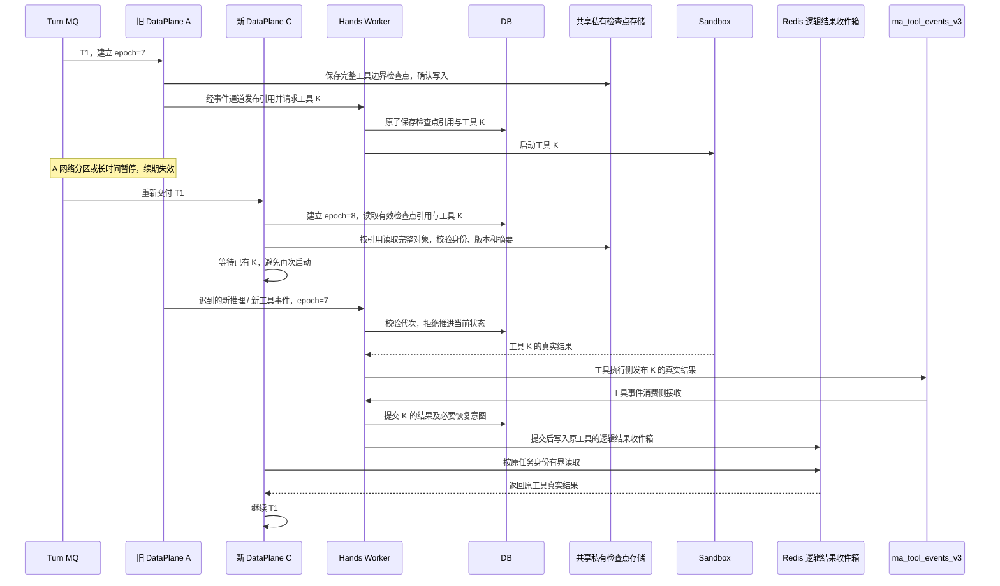

MQ 重新投递不能停止旧线程或已发出的远端操作。模型调用可能仍有成本，旧结果需要隔离；工具需要稳定任务关联、幂等及停止确认。本方案不承诺所有外部操作恰好执行一次。

### 8.2 故障处理

| 故障位置 | 恢复方式 |
| --- | --- |
| Portal 保存 Turn 后发送失败 | 重试原投递意图，以 Broker 实际接收顺序入队 |
| Broker 已收到但 Portal 未拿到确认 | 查询原请求并重试稳定 turnId，消费端去重 |
| Input 已保存但 Redis 投递失败 | Portal 重试；启动、恢复和结束前从 DB 校对输入 |
| 工具结果已落库但 Redis 写入失败或收件箱丢失 | 持久结果不丢失；Brain 在短等待超时/通道故障后受控挂起，挂起事务检查已有结果并可靠派发 Resume；不依赖正常 DB 轮询 |
| Hands 保存事件后未 ACK | 重新消费，按 eventId 返回已有处理结果 |
| 工具意图保存后 Worker 重启 | 扫描 pending ToolTask 并条件认领 |
| 工具启动响应丢失 | 查 executionKey/远端执行；无法确认则 unknown |
| 工具结束后结果消息未发布 | 从持久化响应与待发布标记重发相同 eventId |
| Brain 检查点对象写入失败或确认未知 | 不发布已就绪引用，不宣称挂起交接完成；按相同 checkpointId/摘要确认或重试对象写入，原 Turn 不 ACK |
| 完整对象已保存，引用尚未进 MQ | 保留对象，以稳定批次身份重试发布；不因 DB 暂无引用删除对象，也不将上传成功视为 waiting_tool 已生效 |
| 引用指向的对象缺失、损坏或版本不兼容 | Hands 校验失败不提交有效引用，恢复读取失败不启动推理；重试存储故障或进入异常修复，不回退到过期状态、伪造结果或提前 ACK 原 Turn |
| Hands 保存引用事务失败 | DB 引用、pending、waiting_tool 和 Resume 意图一起回滚，MQ 重投递；已写入的不可变对象保留，不执行跨存储回滚删除 |
| 挂起事件已进 MQ，Brain 退出但尚未落库 | 原回调保持未完成，由 SDK / Proxy 自动续期；Hands 重投递处理挂起运行事件，保存有效检查点引用及挂起状态后仅 ACK 该事件，原 Turn 不 ACK；接管先补齐已发布事实 |
| waiting_tool 期间仅 Harness 被销毁 | 不影响原 Turn 消费回调等待及 SDK / Proxy 自动续期，结果就绪后通过 Resume 重建 Harness |
| waiting_tool 期间投递持有进程故障 | 原 T1 失效后由 MQ 重投递；新进程读取检查点、恢复持有和续期，不因 waiting_tool 直接返回 SUCCESS，不重新启动原工具 |
| 结果已保存，Resume 未发送 | 持久待发布意图重发相同 resumeId |
| Resume 重投递或重复派发 | 校验 suspensionId 与有效执行尝试，旧恢复命令幂等结束；已恢复的执行不启动第二份 |
| 原 Turn 重投递与 Resume 同时到达 | 按当前投递登记、租约和执行代次认领一份执行；旧完成通知不能结束新投递的回调 |
| DataPlane 重启或消息重新交付 | 补齐 MQ 已接受而未投影的事实，建立新代次，恢复检查点并复用原工具结果等待 |
| Turn 已保存终态但通知或 ACK 丢失 | 持久派发重试完成通知，SDK 处理 ACK；Turn 重投递读取终态后返回 SUCCESS，不重跑推理 |
| 无法确认旧工具是否仍运行 | Turn blocked；确认停止或隔离执行环境后再继续 |

### 8.3 死信与顺序保护

RocketMQ 重试达到上限后可能将消息送入死信并允许后续消息前进。因此，“一直不 ACK 就永远挡住下一轮”不是无限期保证。[RocketMQ 消费重试](https://rocketmq.apache.org/docs/featureBehavior/10consumerretrypolicy/)

正常路径保留原 Turn 投递，并在 running、waiting_tool、恢复及终态事件排队期间持续续期；正常等待不主动失败，不依靠重投递次数推进业务。终态落库后才 ACK，按同 LiteTopic 串行消费放行下一轮，无需 DB 查询驱动的 T2 调度。消费进程失效、自动续期达到 3 小时上限、续期失败、死信或消息到期属于异常路径，必须先恢复或明确处理前序任务，不能自动越过它。

**死信和保留期导致队头跳过是实施前必须验证的边界。** 包括首次执行前死信、3 小时自动续期上限、长等待期间续期失败及消息过期；不能把“未 ACK”当成无限期保证。选定 Broker/SDK 后需验证相应 LiteTopic 可以在异常跳过时受控停止并告警，恢复前序或完成明确结算后才继续。异步死信扫描或 DB currentTurnId 查询本身不能证明严格无跳过；不为正常路径重新增加 DB 轮询调度，异常保护能力未确认前也不能宣称故障路径严格有序。

死信处理属于异常修复流程，处理后保持原 turnId。MQ 消息保留时间也必须覆盖最长运行、停机和修复窗口；DB 中的完整历史不能替代已过期的待消费请求。

## 9. 其他示例场景

### 9.1 文件、Skill、MCP 与产物交付

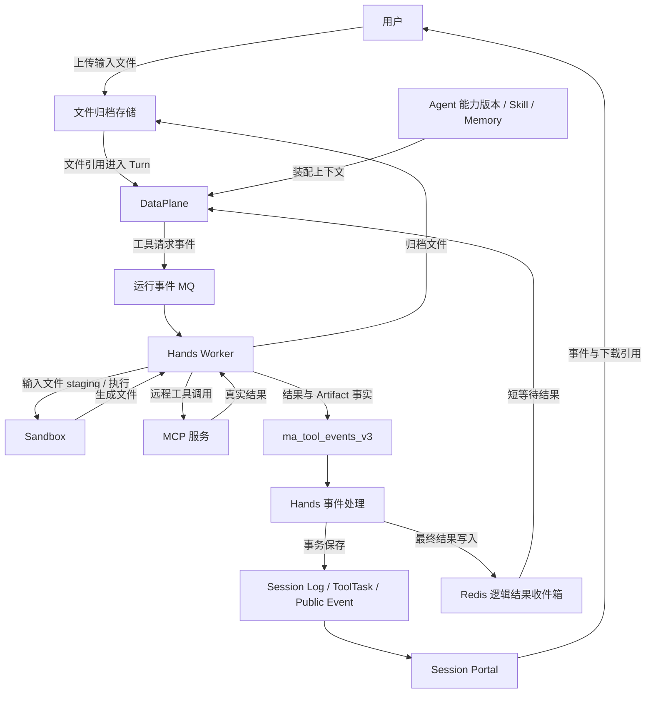

Skill 提供指令和资源，脚本仍通过工具任务在 Sandbox 执行。MCP 在本轮统一作为工具执行适配器，由 Hands 调用；stdio 服务使用选定 Environment 的进程能力，远程服务使用可达的连接。

Hands 把生成文件归档后再登记 Artifact，公开事件携带可下载的内容引用。Sandbox 路径本身不能当作业务下载地址。文件归档存储沿用已有基础设施；如果部署中没有它，文件交付场景需要补充该依赖。

当前交付入口采用 `publish_artifact(path, name, media_type)`：由 Brain 显式选择文件，转换为稳定的 `artifact.publish` ToolTask；Hands 捕获最多 16 MiB 的普通文件，将内容和摘要固定在原执行结果中。工具事件提交时在同一事务保存文件、Artifact、公开事件和完成结果，Brain 及 Redis 结果收件箱只接收下载元数据。结果重放复用 ToolTask / executionId，不能重新读取已变化的源文件或再次发布。配额与校验失败作为工具失败完成，事务性故障则重试原结果；不自动发布整个目录，也不公开私有执行和检查点文件。此路径的专项与实际多副本验收分别记录，不能以接口接入代替完整验收。

### 9.2 平台内 Subagent

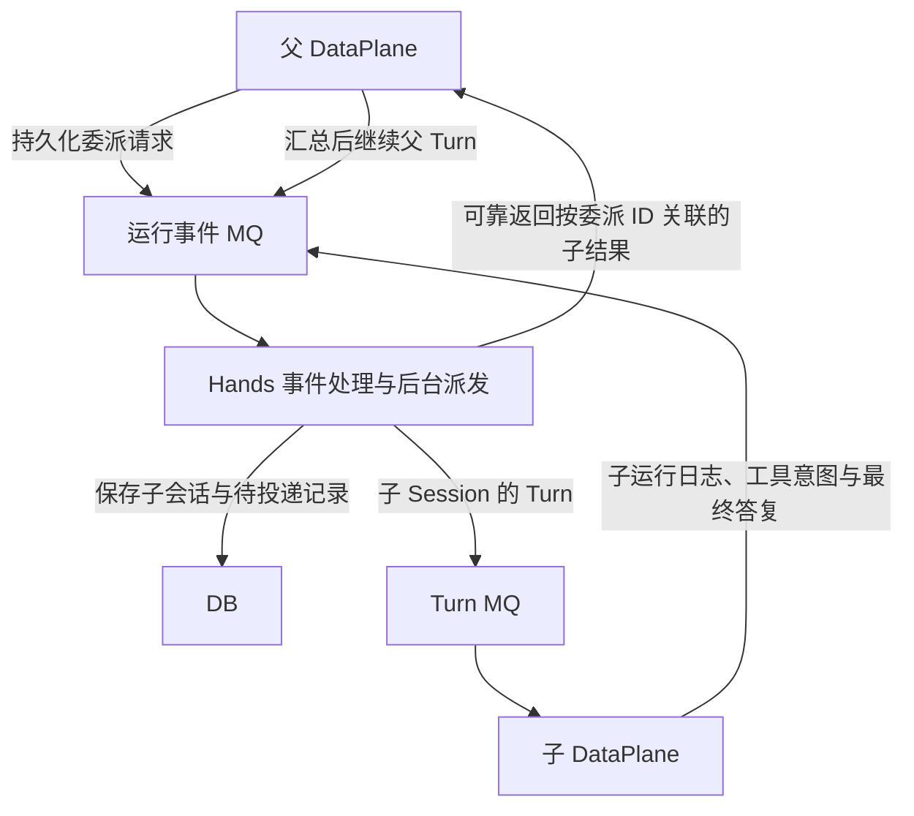

父子 Session 独立排队，委派 ID 去重。子结果保存后可靠返回，父任务收到匹配委派 ID 的结果后继续，不轮询 DB；子完成不会结束父 Turn。父任务等待子结果时同样采用短等待与持久挂起；挂起后释放父 Harness 执行名额，原父 Turn 消费回调保持未完成，由 SDK / Proxy 自动续期。子结果触发父 Turn 的 Resume；持有进程故障时按原投递重交付接管，不要求原 Harness 或父实例持续在线。

此场景需要 Hands 内部增加一个短时间的委派派发处理器，复用 DB 和 Turn MQ。它是可选能力，不影响单 Agent 主流程。

### 9.3 Channel、定时触发与离线通知

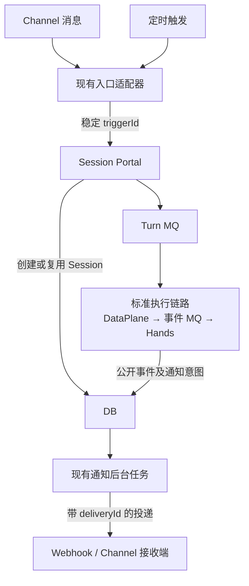

Channel 按业务线程复用 Session，周期任务明确选择复用或新建 Session。入口适配器用稳定 triggerId 避免重试生成新 Turn；排序仍按 MQ 接收顺序。

离线通知使用持久化投递意图和 deliveryId 重试，接收方去重后查询完整结果。Scheduler 或通知后台任务仅在这些接入场景使用，不参与 Turn 队头唤醒或 steer 路由。

### 9.4 检查点与 fork

会话恢复先取得 DB 最近已生效的检查点引用，再从共享持久存储读取、校验完整对象，并继续等待其中已经登记的工具或子任务。fork 从明确的稳定检查点创建新 Session，引用独立上下文和文件快照，再向 Turn MQ 提交新任务。

被恢复或 fork 引用的对象、文件快照必须仍可读取，且按完整作用域校验访问权限；不能在原 Harness 退出或 Turn 完成时立即删除检查点。fork 不复制正在执行的远端操作。存在未知副作用或尚未结算的工具时，需要先完成结算，或选择更早的稳定检查点。

## 10. 与现状的衔接及实施验收

### 10.1 本轮设计调整

本方案沿用已有的资源定义、模型调用、Sandbox 接入、会话持久化和公开事件能力，重新明确组件间的调度与交付边界。下表是目标调整，不是已完成的实现清单。

| 领域 | 目标调整 |
| --- | --- |
| Session 初始化 | 保存固定配置；首次消费 Turn 时初始化，简化客户端 ready 等待 |
| Turn 调度 | 用户 Turn 按其 LiteTopic 的存储顺序串行处理；挂起保留原 Turn 并续期，终态落库后 ACK，不用 DB currentTurnId/settledSequence 轮询放行后续 Turn |
| 轮内交互 | Portal 持久受理，Redis 投递，执行实例主动读取 |
| 工具请求与结果 | Brain 仅写 Runtime Topic；Hands 工具执行侧仅写 Tool Topic，由工具事件消费组统一保存结果，持久化后写入 Redis 逻辑收件箱；Brain 短期限阻塞读取，无专用结果消费组、动态订阅或 DB 轮询 |
| 恢复日志与 SSE | Brain 发布后继续；Hands 异步持久化和转换，Session Portal 读取已提交视图 |
| 故障接管 | MQ 重新交付并补齐已接受事实，执行代次隔离旧推进，复用持久工具任务 |
| 挂起与结束 | Brain 生成并保存完整检查点到共享持久存储，再经 MQ 发布引用后释放 Harness；Hands 原子保存引用、pending 和 waiting_tool，但不 ACK 原 Turn，原消费回调未完成且由 MQ 自动续期；整个 Turn 终态落库后可靠通知原消费方返回 SUCCESS，由 SDK ACK，Resume 通知独立结算 |

### 10.2 实施次序

1. 定义 Session、Turn、Input、事件、Checkpoint 和 ToolTask 的稳定标识与事务边界；实现 Brain 的完整检查点安全捕获、不可变共享存储写入和 MQ 引用协议，Hands 仅原子保存引用/索引及关联状态，恢复节点加载并校验完整对象。
2. 统一 LITE 父 Topic、scopeKey 路由和按职责划分的 Shared 全量订阅消费组，统一迁移 LitePushConsumer，Turn、Hands 运行事件和 Resume 使用父 Topic 全量订阅，移除 Session 目录发现与订阅轮换；配置 FIFO、按 LiteTopic 并行及 3 小时自动续期；实现挂起原回调未完成、Hands 终态持久通知和 SDK ACK；去掉正常后续 Turn 的 DB 放行/defer 重查。
3. 实现 Brain / Tool 两条事件通道的可靠异步发布、生产职责校验、Hands 统一短事务投影和 Session Portal 的历史/SSE 读取；移除逐批次 DB 确认并明确接管回放边界。
4. 实现 Redis 输入流、持久化回执、关闭边界和故障回填。
5. 实现 cloud / self_hosted 工具适配、Tool Topic 结果消费到 Redis 逻辑收件箱的直接交付、短期限阻塞读取、挂起检查点、独立 Resume 消费、结果就绪派发和取消/unknown 处理；不以 DB 轮询代替结果交付。
6. 验证重启、重新投递、旧实例迟到、死信与保留时间，再接入第 9 章的可选场景。

### 10.3 验收矩阵

以下为待执行用例，本轮只完成设计与文档校验。

| 用例 | 必须观察到的结果 |
| --- | --- |
| 创建 Agent / Environment / Session | 配置可靠保存，Session 可直接提交首轮请求 |
| 同 Session 两个 Turn | T1 挂起期间原投递未 ACK 且持续续期，T2 不启动 Harness；T1 经独立 Resume 完成、终态落库并 ACK 后才处理 T2，不查询 DB 放行 T2 |
| 不同 Session 并行 | 在同一物理父队列下，长工具/未 ACK 投递不阻塞另一个 LiteTopic 的推理与事件处理 |
| Topic 单向生产 | Runtime Topic 仅接收 Brain 生产的批次，Tool Topic 仅接收 Hands 工具执行侧的 delta/进度/结果；生产配置和消费校验拒绝错投，不存在工具结果回写 Runtime Topic |
| 工具流式日志 | Brain 已挂起时仍持续保存 delta 和进度；重投、批次重发、来源缺口及最终 lastChunkSeq 均可核对，delta 不完成最终结果等待 |
| 跨 Topic 因果与视图去重 | 工具意图提交后才启动原任务；结果/挂起两种先后均只生成一次有效 Resume；原始工具事实与 Brain 结果应用记录关联同一调用，不覆盖原生前缀、不重复展示 |
| 同 Session 串行发送 | 同一 owner 的模型、工具意图与检查点引用按来源顺序被 MQ 接收，发送重试不让后序越过前序 |
| 同 Session 消费顺序 | 多个 Hands 副本下同 LiteTopic 事务不逆序提交，工具执行不占住事件消费 |
| 统一结果消费与逻辑收件箱 | 任意 Hands 经 Tool Topic 消费结果并提交，再写入同一 scope / taskId 的 Redis 收件箱；Brain 无结果消费组、动态订阅或节点地址查询，正常推进不查 DB |
| 快路径不依赖修复扫描 | 停止周期 resultsForDelivery 扫描后，正常结果仍由事件消费直接交付；Redis 写入失败、丢失或过期时仍能经短等待超时/受控挂起和 Resume 恢复 |
| 收件箱身份与重读 | 结果早于读取、重复写入、重复读取、跨节点恢复均不串任务或重复应用；同 ID 内容冲突被拒绝，旧 epoch 无法推进 |
| 新 Session 自动消费 | 仅预先配置父 Topic 全量订阅，创建新 Session 并发送消息，无 DB 目录查询、无逐 Session subscribeLite 调用，Turn、Brain 事件、工具事件和 Resume 四个职责均能收到对应消息 |
| 全量订阅与重启扩容 | 消息早于消费者启动、同组扩容、ACK 丢失与新节点接管均延续消费进度，不跳过待处理消息 |
| 挂起后的 MQ 接管 | 原 Turn 未 ACK，回调保持等待；进程故障后 MQ 重投递给同组存活节点，独立全量订阅收到 Brain 事件、工具事件与 Resume，不依赖 Session 发现目录 |
| Hands 投影滞后 | 模型日志、已保存对象的检查点引用和输入应用已进 MQ 后，Brain 不查询 DB 回执，继续本地推理 |
| 快速工具返回 | 发送请求前建立等待关联，tool result 不因先到而丢失，重复结果不重复应用 |
| Brain 结束、终态事件积压 | 推理任务已结束，Turn Delivery 仍持续续期；Hands 落库并可靠通知后，原回调返回 SUCCESS、SDK ACK，不提前启动 T2 |
| 接管时 DB 投影滞后 | 先补齐 MQ 已接收事实，再恢复输入与工具状态，避免重复应用或启动 |
| 连续 steer / inject | 每条输入均有独立回执，重复提交不重复应用 |
| 输入与 Turn 关闭并发 | 已受理输入得到结算，关闭后的新输入明确拒绝 |
| waiting_input 答复 | 保存待办与检查点并释放计算槽位；reply / cancel 的持久 Resume 恢复同一 Turn，保留原 Turn 回调和会话顺序 |
| ACS 长工具 | 短等待超时后 Brain 保存完整对象，Hands 将引用和 waiting_tool 原子落库，原投递不 ACK 且持续续期，Harness 计算资源释放；工具完成后任意节点恢复原 Turn，整个 Turn 终态提交后 ACK |
| 检查点对象与引用边界 | Brain 完成完整对象写入后才发引用；MQ 不携完整 AgentState，Hands 不重建状态，引用/索引、pending 和 waiting_tool 同事务生效 |
| 检查点写入与发布故障 | 对象写入失败/未知、上传后 MQ 失败/未知、MQ 接收后 DB 失败均可按稳定身份重试；不形成有效悬空引用、不提前 ACK、不丢唤醒 |
| 检查点读取与保留 | 任意恢复节点按 DB 有效引用读取并校验 schema/身份/hash；损坏、缺失、跨作用域或不兼容版本不能继续；未决发布及恢复/fork 引用的对象不被清理 |
| 挂起后销毁原 Harness 实例 | 原消费回调保持未完成，由 SDK / Proxy 自动续期原投递；新节点恢复完整 AgentState 与继续位置，上下文、任务、权限及输入游标一致，结果只应用一次，原 toolCallId/executionId 保持不变，原工具不再次执行 |
| 挂起期间持有进程故障 | 原 T1 重投递后按检查点恢复轻量持有或就绪执行，不提前 ACK，不重复发工具；与 Resume 并发时仅一个代次推进 |
| 连续两次工具挂起 | 每次持久交接后只结算相应 Resume 通知，原 Turn 始终未 ACK；第二次结果能唤醒，终态后才放行 T2 |
| 等待容量与恢复容量 | 原回调等待占消费槽位但不占 Harness 推理线程；明确配置消费线程、持有配额和 Harness 并发，Resume、Brain / Tool 事件、Redis 收件箱及完成通知仍可处理 |
| FIFO 与跨 Session 并行 | 服务端消费组启用 FIFO，客户端开启按 LiteTopic 并行；同 Session 无逆序，同批其他 Session 在容量内可推进 |
| 自动续期上限 | Proxy 开启自动续期且上限为 3 小时；上限前后、持有节点故障与重新交付均不跳过前序或重复工具 |
| 终态完成通知可靠性 | 终态与通知意图同事务提交；通知早到、丢失、重复、派发重启或原消费方退出均可收敛；旧通知不完成新投递，不增加 Brain DB 轮询 |
| 挂起材料缺失或过期 | 缺失必要恢复材料的批次不进入 waiting_tool、不触发原投递 ACK；已有 stateJson 未覆盖挂起边界时，Brain 必须先捕获并持久保存有效完整对象，再发布引用 |
| 超时与结果并发 | 快路径或挂起恢复只有一方推进，不丢结果、不重复启动模型或工具 |
| 多工具部分完成 | 挂起状态保留部分结果与剩余集合，就绪条件满足后只发一次有效 Resume |
| 结果保存后派发失败 | 持久恢复意图补发同一 resumeId，任意节点可以继续 |
| 工具期间取消 | 新步骤停止，公开展示真实停止或未确认状态 |
| Worker 重启 | pending 任务可恢复，已启动任务查询原 executionId |
| A 分区、C 接管 | 旧推进不能修改当前状态，已存在工具不会重新启动 |
| 终态落库后 ACK 丢失 | 重投递读取终态后返回 SUCCESS，由 SDK ACK，模型与工具不重新运行 |
| SSE 断线与多订阅 | 各自按持久游标重放，客户端去重后无结果缺失 |
| 死信与消息到期 | 前序不会被静默跳过；首次消费前死信边界有已验证方案 |
| 文件与 Artifact | 文件真实归档、内容可下载且与工具结果一致 |

观察指标包括检查点捕获/对象写入耗时与失败、未生效对象积压、引用提交延迟、恢复读取与校验失败、队列等待时间、活动 Harness 数、等待中的消费回调数与槽位占用、完成通知积压/延迟、自动续期接近上限和续期失败、输入应用延迟、Brain / Tool 两条通道各自的积压与消费延迟、结果持久化到收件箱可读的延迟、Redis 结果交付失败/超时、工具执行耗时、unknown 数量、终态到 ACK 延迟和 SSE 重放延迟。初期按组件现有监控采集，避免另建协调服务。

## 11. 未来规划

### 11.1 性能与部署演进

- 按负载优化可靠 tool result 返回通道的路由、批量与等待资源；保持消息交付与恢复语义，不引入正常执行的 DB 轮询。
- 为公开事件增加读取通知，减少 Session Portal 的空查询。
- 按负载调整父 Topic 资源、消费缓存、回调并发、逻辑结果收件箱容量与 TTL 和事件批量大小；分别限制活动 Turn、模型调用与工具执行数量。
- 在确有部署需要时增加内网执行适配器，并完善环境隔离、文件快照与跨实例恢复。

这些优化保持 DB 中的结果、游标及有效检查点引用与共享存储中的完整检查点对象共同作为恢复依据，通知丢失不影响任务完整性。

### 11.2 Team 与 Workflow

未来可以在现有 Session、Turn 和事件协议上扩展多 Agent 分工、依赖节点、结果汇总和工作流恢复。新增的是协作状态与调度规则，基础 Turn 排队和工具执行协议继续复用。

### 11.3 Hosted Runtime

Codex、Claude Code 等外部运行时接入属于未来规划。Harness 选型、Codex 源码能力及适配门槛见第 1.5 节；后续需要单独实现生命周期、事件转换、交互及恢复适配，不纳入本轮 DataPlane 与 Sandbox 主方案。
