# Managed Agents POC 设计

本文描述一套 Managed Agents 体系，重点说明 Agent、Session、Environment 的资源关系，Brain、Hands 与持久化会话的部署边界，以及长周期任务的执行和用户交互流程。当前 POC 聚焦平台托管 Agent、平台内 Subagent 与 ACS Sandbox 工具执行。

参考 Claude Managed Agents 的 [Brain–Hands 分离设计](https://www.anthropic.com/engineering/managed-agents)、[Session 生命周期](https://platform.claude.com/docs/en/managed-agents/sessions)和[事件交互](https://platform.claude.com/docs/en/managed-agents/events-and-streaming)：把持久化会话、推理循环与工具执行分开，让用户连接寿命不决定任务寿命。

## 1. 总体架构

### 1.1 当前部署与调用关系

当前方案的部署范围包含六类组件：Gateway、Control Plane、Session Portal、Data Plane、Hands Worker、Scheduler。

引入 RocketMQ 的完整候选方案另见配套《Managed Agents RocketMQ 架构与流程》，覆盖创建、排队、交互、长工具、订阅与故障恢复；本文保留当前实现描述，候选方案尚未实施。

存储依赖一个 PostgreSQL 实例

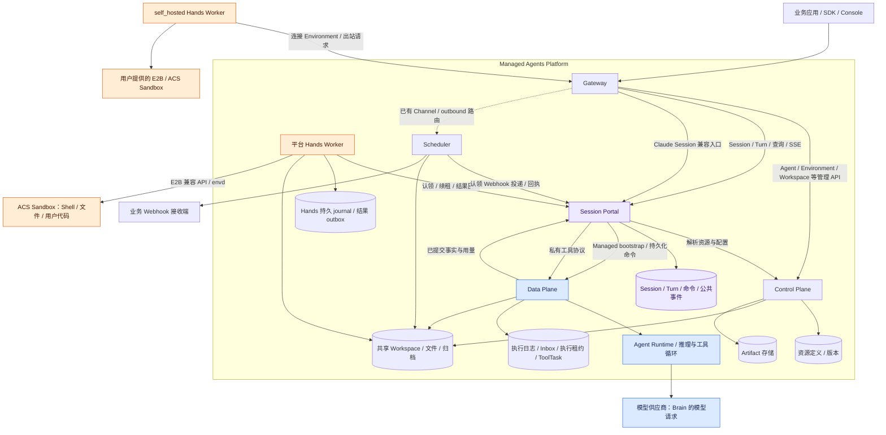

Gateway 是统一的公开入口，各组件通过内部服务地址互访。生产仅暴露 Gateway/Ingress；平台 Hands 连接内部 Session Portal，self_hosted Hands Worker 通过 Gateway 出站接入。组件端口、域名和部署方式由运行环境配置。

数据面和 Portal 之间用 HTTP 投递持久化命令及事实，数据保存在 PostgreSQL，不以新增 Kafka/RabbitMQ 为前提。通知只唤醒消费者，遗漏通知后仍可扫描持久状态补偿。Hands 认领的是 ToolTask，不扫描用户 SSE，也不根据前端页面是否在线决定工具执行。

| 组件 | 核心职责与权威状态 | 关键边界 |
| --- | --- | --- |
| Gateway | 公开入口、请求转发与 API 路由 | 将管理请求与执行请求送到对应组件；不执行 Agent |
| Control Plane | Agent/Workspace 版本、Environment、Memory、Application 与配置解析 | 保存资源定义并提供执行配置；不执行推理循环 |
| Session Portal | Session 注册、Turn/输入/动作准入、共享应用额度、公开事件与查询投影 | 接收命令不等于运行端已经应用；不保存权威 Agent Runtime 上下文 |
| Data Plane | Agent Runtime 激活、Session 独占写入锁与执行代次、执行 SQL 日志、Inbox、checkpoint、ToolTask、调用用量收据 | Brain；工具结果提交到执行 Inbox 后才进入后续推理 |
| Hands Worker | 工具认领、心跳、Sandbox 连接或生命周期、文件 staging/归档、结果 journal | Hands；不负责提交 Turn；用户代码在 Sandbox 执行 |
| Scheduler | Channel/Cron 协议与周期调度、出站发送、Webhook 重试 | Webhook 已走 Portal 投递；Channel/Cron 仍存在历史触发桥接 |

资源目录、会话与公共事件、执行状态分别拥有逻辑存储边界，可以部署在同一个 PostgreSQL 实例的不同 schema，也可以按规模拆分。共享文件、Artifact 和 Worker journal 单独持久化。存储初始化由独立迁移任务完成，各组件启动时校验结构。

### 1.2 Brain、Hands 与 Session 的三条边界

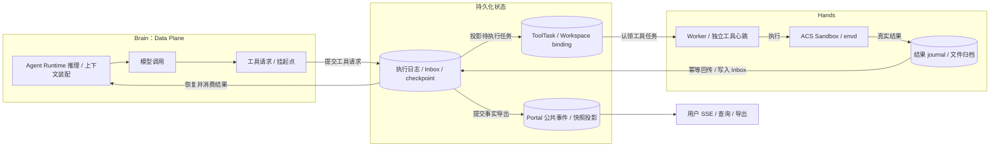

Brain 在数据面运行，调用模型、决定下一步，并从日志恢复。Hands 在另一个 Worker/执行环境运行，操作文件、Shell 和代码。Session 的持久状态不依赖某个 Brain 进程或某个 Sandbox 的存活：执行日志用于恢复，Portal 标准事件用于业务观察，文件归档用于恢复工作文件。

外部工具挂起可以释放当前推理激活，结果到达后以新的 Run 继续同一 Turn。这里的“持续推进”是 **等待真实工具结果后继续推理**，不表示模型在等待期间持续生成，也不表示同一 Session 可以并行改写一个上下文。一个 Turn 可以跨多次 Run；Sandbox ID、Run ID 都不能替代稳定的 Session ID/Turn ID。


## 2. 核心组件与概念

Managed Agents 的基础资源描述 Agent 的能力、执行环境及会话关联；用户发起请求后，再产生任务、执行记录和结果对象。以下按这两个层次简要列出。

**基础资源**

| 资源 | 定义 | 用途 |
| --- | --- | --- |
| Agent | 可版本化的 Agent 定义，包含指令、模型和能力配置 | 定义 Agent 如何理解任务并完成工作 |
| Environment | 工具执行环境与实例管理方式的配置 | 指定工具在哪个 Sandbox 执行、由谁管理实例 |
| Session | 引用 Agent 和 Environment 的持久化会话 | 保存连续对话、组织多轮请求与执行结果 |
| Workspace | 可发布版本的能力与资料集合 | 复用指令、工具配置、Skills 和子 Agent 定义 |
| Tool | Agent 可以调用的操作及其参数定义 | 提供文件读写、命令执行或业务操作能力 |
| MCP 连接 | 外部工具服务的连接配置 | 通过 MCP 协议发现并调用工具 |
| Skill | 任务方法、步骤与附带资源的集合 | 为 Agent 提供可复用的工作方法 |
| Subagent 定义 | 专项子 Agent 的指令、模型与工具配置 | 供父 Agent 委派独立的子任务 |
| Memory Store | 可跨 Session 使用的知识与记忆存储 | 提供共享背景资料和历史经验 |
| Application | 业务应用的调用配置 | 关联业务会话，配置并发与用量限制 |
| Channel | 外部消息渠道的连接与处理配置 | 将渠道消息转为会话输入，并发送任务结果 |
| Scheduled Deployment | 定时执行的目标、计划与输入配置 | 按计划触发 Agent 任务 |
| Webhook Subscription | 会话事件的通知配置 | 将指定事件回调给业务接收端 |

Tool、MCP 连接、Skill 和 Subagent 定义可以配置在 Agent 或 Workspace 中，随选定的定义版本进入 Session。

**运行对象**

| 对象 | 定义 | 用途 |
| --- | --- | --- |
| Turn | Session 中一次用户请求对应的任务 | 跟踪该请求的输入、状态与最终结果 |
| Run | Turn 的一次执行激活 | 记录推理开始、挂起、恢复或结束；一个 Turn 可跨多次 Run |
| ToolTask | 交给 Hands 的持久化工具请求 | 由 Worker 认领、执行并回传真实结果 |
| Sandbox | Environment 下实际创建或连接的执行实例 | 运行命令与用户代码，保存工作文件 |
| 子 Session | 委派发生后产生的子 Agent 会话 | 保存独立推理与工具记录，并将结果交回父任务 |
| Input | 提交给会话或当前任务的补充内容 | 支持 inject、steer 与输入应用回执 |
| Command | 控制或恢复执行的持久化命令 | 跟踪取消、恢复和待办答复是否实际应用 |
| Session File | 归属于 Session 的输入或结果文件 | 传递任务材料，供工具读取或用于交付 |
| Artifact | 显式登记的交付结果 | 向用户展示或下载实际产物 |
| Checkpoint | 已保存的 Agent 执行状态 | 支持恢复上下文与 fork 试验 |
| Event | 已提交的执行事实或公开状态变化 | 提供进度订阅、历史查询与结果重放 |
| Snapshot | 某个事件水位上的会话视图 | 恢复页面，再从该水位继续订阅增量 |

### 2.1 以 Agent 与 Session 为中心的资源关系

#### 静态层：资源定义与引用

下图的箭头表示资源引用关系。Session 引用一个固定版本的 Agent，并选择 Environment、Memory Store 等资源；Agent 可以引用已发布的 Workspace，从中取得能力定义。

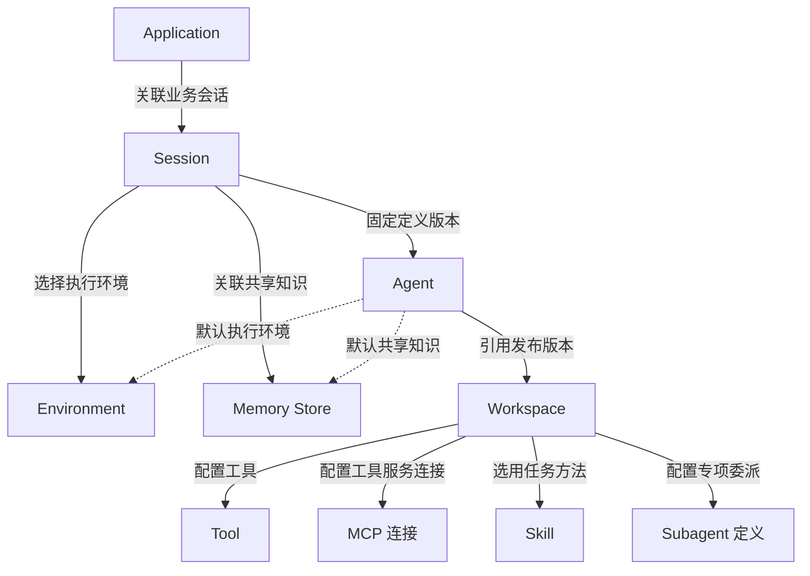

创建 Session 时，显式指定的 Environment 覆盖 Agent 默认值；未指定时使用默认配置。Agent 也可以直接配置工具、MCP、Skill 和子 Agent 定义。Session 固定所选 Agent/Workspace 版本。需要使用新版本时，选择新定义创建 Session；已有 Session 继续使用原版本。

Environment 是配置，Sandbox 是实际执行实例。多个 Session 可以引用同一个 Environment；共享配置不会自动共享会话状态或工作文件。Workspace 提供能力定义，Session 工作目录保存工具产生的文件。

#### 动态层：用户请求与执行结果

用户向已有 Session 提交请求后，平台创建 Turn 并启动 Run。需要在 Sandbox 执行工具时产生 ToolTask，Hands 在选定 Environment 对应的实例中执行；真实结果返回后，Brain 继续推理，最终结果通过事件交给用户。

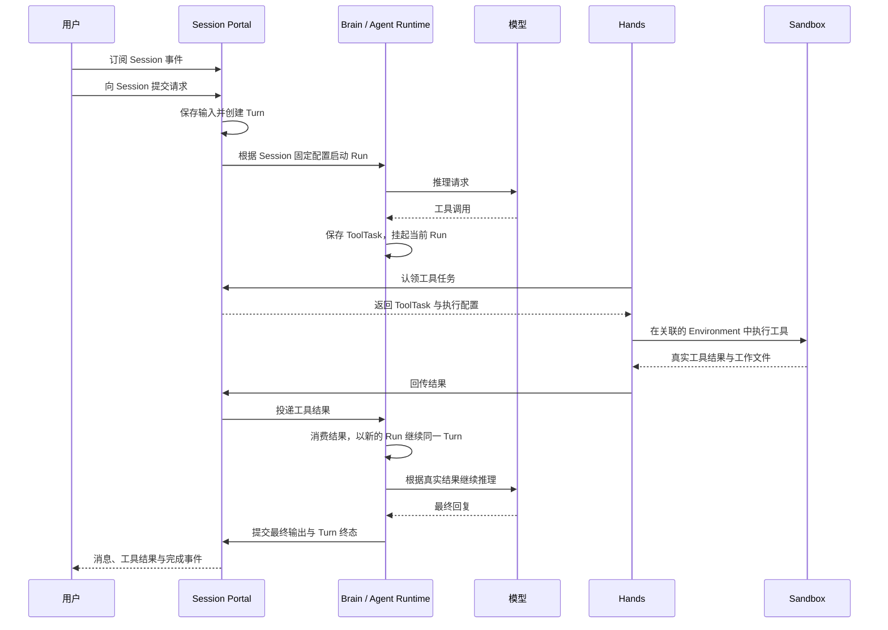

一个 Session 可以包含多个顺序执行的 Turn，一个 Turn 可以经过多次 Run 和工具调用。发生委派时产生子 Session，子结果交回后父任务继续。Event 记录执行过程，Snapshot 提供固定水位的状态视图，Artifact 表示明确交付的结果。

### 2.2 Environment 与 ACS 接入

本方案只讨论以下两种执行环境。Brain 均在平台 Data Plane 运行，文件、Shell 和用户代码由 Hands 在 Sandbox 执行。

| 类型 | 实例由谁提供和管理 | 工具如何执行 |
| --- | --- | --- |
| `cloud` | 平台按 Environment 配置创建和管理 ACS Sandbox，负责保活、文件归档与回收 | 平台 Hands 认领 ToolTask 并在实例中执行 |
| `self_hosted` | 用户提供已有的 ACS/E2B 兼容 Sandbox，并负责实例启停和回收 | 对应 Hands Worker 连接实例、执行工具并回传结果 |

创建 Environment 只保存执行配置。`cloud` 在实际需要工具时获取或创建实例；`self_hosted` 先准备好实例与连接配置。两种模式都通过 ToolTask 连接 Brain 与 Hands，完整长工具流程见第 4 章。

## 3. 基本流程与状态契约

核心 `/api/v1/agent-sessions` API；记 `S=/api/v1/agent-sessions/{sessionId}`。

### 3.1 Environment、Agent、Session 创建

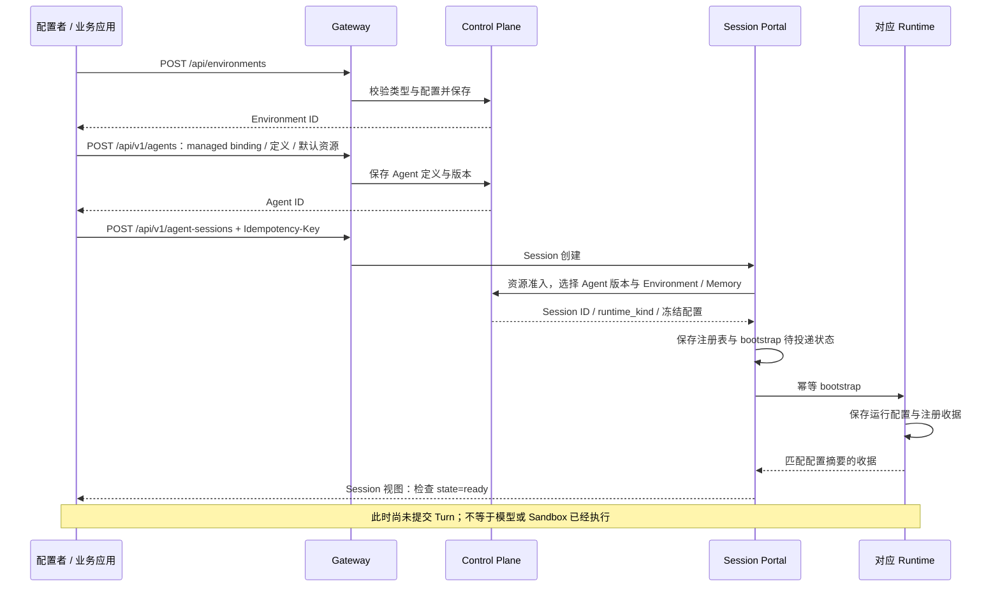

定义创建与运行准备是两步。
* 创建 Session 不立即启动推理，cloud Sandbox 在实际工具需要时由 Hands 获取；
* 不要以 Environment/Session 创建成功推断 ACS 网络、模板或执行已经可用。
* bootstrap 暂不可用时保存待投递状态，后台重试，客户端读取 `state` 确认 ready 后再提交任务。


### 3.2 发起 Turn、推理与结果订阅

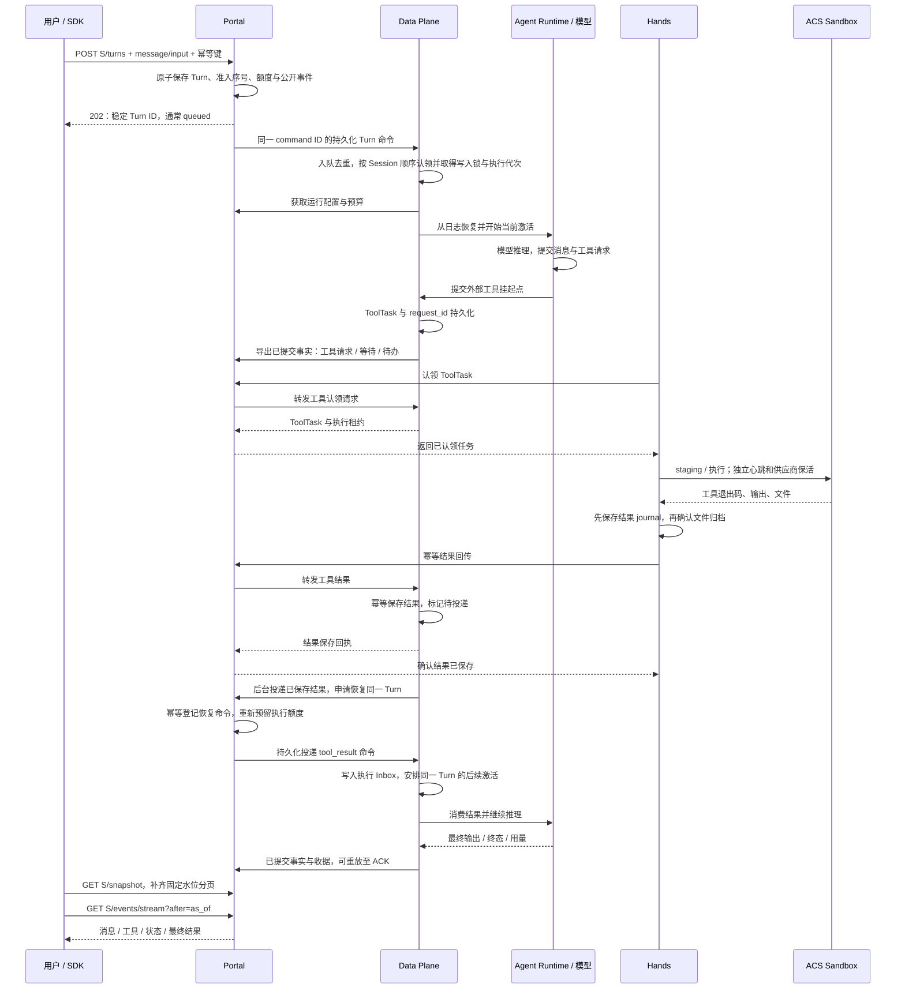

图中展示当前实现：ToolTask 在 Data Plane 中生成并持久化，Hands 经 Portal 认领；工具请求事件进入 Portal 后供用户观察，执行任务本身由 Data Plane 返回。结果回传分成两步：Data Plane 先保存工具结果并确认，后台再将结果交给 Portal，登记恢复命令与执行额度，随后由 Data Plane 消费结果继续同一 Turn。结果保存回执不代表 Brain 已经消费或任务已经完成。

这里经过 Portal 是当前 Hands 接入与恢复命令处理的实现选择，Brain–Hands 分离本身不要求工具执行链路经过 Portal。后续可评估 Hands 直接接入 Data Plane，并将自动工具结果的后续激活留在数据面；需同时梳理额度预留、取消竞争与恢复命令的职责，详见配套《Managed Agents 改造待办》的 MA-004。

`202` 只表示准入已保存。Portal 命令、Runtime 接收、实际应用和任务终态是不同阶段；控制命令需要查询 `GET S/commands/{commandId}`，输入需要查询 `GET S/inputs/{inputId}`。接收回执不能当作工具完成或取消已经生效。

观察与执行解耦：SSE 可以在提交前建立，也可以提交后用快照补齐历史。推荐先取快照、完整读取 `resources` 中各集合的后续页，再从 `as_of` 续流。页数多时注意快照默认 120 秒有效期；410 后重新创建快照，不能重发任务来“恢复页面”。

### 3.3 同一 Session 多 Turn、同一 Turn 多请求与多订阅

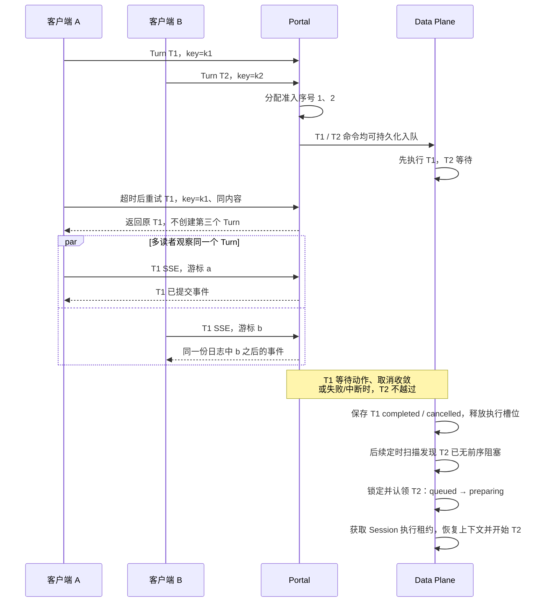

同一 Session 支持并发提交，根 Turn 按准入顺序执行。同一个上下文只由一个根 Turn 改写；`requires_action`、`cancel_requested`、`failed`、`interrupted` 等前序状态会阻塞后续任务。失败/中断后需要恢复或明确关闭，T2 不能自动越过 T1。不同 Session 是根推理并发单元，另受实例槽位和 Application `maxConcurrent` 限制。

排队由持久化记录实现。Portal 在 Session 行锁保护下分配递增的 `admissionSequence`，保存 Turn 与待投递命令；后台按同 Session 的投递顺序送到 Data Plane，等待前一条命令被持久化接收，不等待前一个 Turn 执行完成。Data Plane 将后续 Turn 保存为 `queued`，认领查询排除存在较小序号阻塞任务的候选项，真正认领时再加锁检查。

T1 完成后，Data Plane 按已提交的运行终态更新命令状态，清理认领并释放实例执行槽位；后续定时扫描才认领 T2。当前扫描采用固定延迟，默认每次扫描结束后间隔 1 秒，不是 T1 完成回调直接唤醒 T2，也不依赖客户端或 Portal 再发一次请求。T2 认领后获取 Session 执行租约，从已有会话状态继续新一轮推理；实际开始还取决于执行槽位、租约和配置准备情况，1 秒不是最大等待时间承诺。

以上流程以 T2 通过准入为前提。当前 Application `maxConcurrent` 在受理 Turn 时预留额度，排队 Turn 也占用该额度；因此配置为 1 且 T1 的预留尚未释放时，T2 可能返回 429，而不是进入队列。Application、Session 的队列上限与请求速率限制也可能拒绝新的 Turn。

能力声明、命令受理与状态转换必须一致。POC 应覆盖“放弃恢复、明确关闭前序失败任务”这一分支，核对 `available_commands`、命令应用回执与队列实际解锁行为，不能只验证成功任务出队。

同一 Turn 的重试使用相同幂等键；多条 SSE 连接是多个只读观察者，不会多执行一次模型或工具。同一 Turn 可以有多个 ToolTask，但当前同一 Workspace 的外部操作有独占占用，不能据此承诺多个 Shell 并发修改一个目录。需要真正并行时，设计独立 Session 或隔离的执行作用域。

### 3.4 Turn 状态、用户待办与外部结果

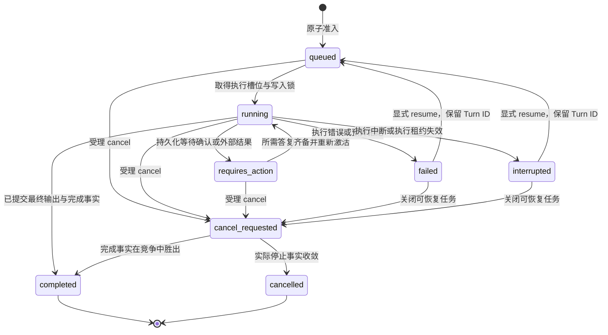

状态图是运行语义摘要，不表示每条边在所有瞬时状态下都可调用。操作前读取 `S/capabilities` 与 `S/turns/{turnId}/capabilities` 的 `available_commands`。`completed`、`cancelled` 不 resume；`failed`、`interrupted` 可按能力恢复。若当前执行代次的执行完成事实延迟到达，Portal 可以校正保守的 failed/interrupted，既不重新推理，也不重复释放额度。

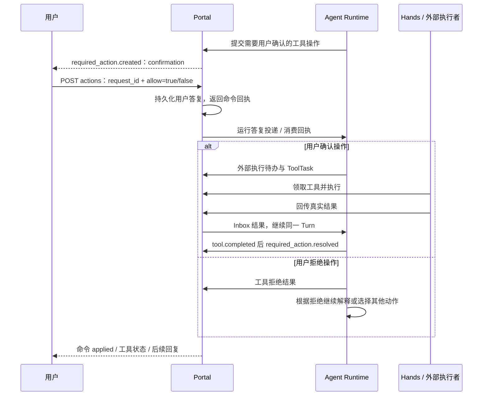

待办区分 **confirmation** 与 **external execution**。前者等待用户确认操作内容，后者等待 Hands 或外部执行者回传结果。Cloud 工具等待通常由平台自动回传，页面应显示执行中，而不是要求用户补填结果。用户确认只完成一次交互，工具是否完成仍以真实结果为准。

多个外部结果可以分批回传。只答一个时，未答工具仍保持等待；不得把部分答复当作整个 Turn 完成。核心动作请求分别为：

```json
{"answers":[{"request_id":"待办返回的 ID","allow":true,"reason":"已核对参数"}]}
```

```json
{"answers":[{"request_id":"外部执行待办 ID","output":"真实执行结果","is_error":false}]}
```

两种答复都提交到 `POST S/turns/{turnId}/actions` 并带幂等键，跟踪命令回执。需要为子 Agent 答复时，在 answer 中增加 `child_session_id`，仍通过根 Turn 提交。工具拒绝或 `is_error=true` 可能被 Agent 消化并继续，不必然导致 Turn failed。

### 3.5 inject、steer、取消与恢复

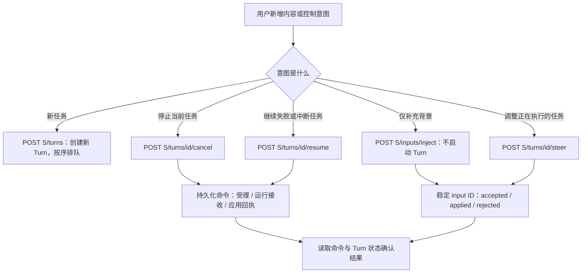

steer 在后续执行边界生效，不改写已经发出的模型请求或已开始的 Shell；inject 是上下文输入，不触发新一轮推理。输入接收、应用、拒绝均按稳定 input ID 保存回执；重试复用原键与原内容，新的补充输入使用新键。

#### 分布式实例之间的 steer 交付

正在推理的实例 A 与接收 steer 的实例 B 可以不同。Portal 面向 Data Plane 服务地址投递命令，不按 Turn 固定路由到 A。B 将带有稳定 input ID、Session ID 和目标 Turn ID 的输入写入共享的执行 Inbox；B 不需要持有 Agent 对象，也不获取该 Turn 的执行写入租约。当前默认使用共享 SQL 日志与独立的 Inbox 写入域，所有 Data Plane 副本必须连接同一套对应存储。

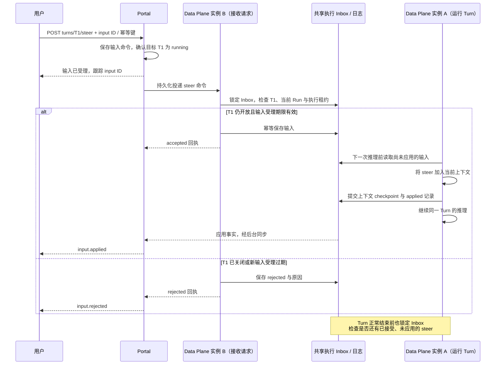

A 在每次后续推理前读取共享 Inbox，将匹配当前 Turn 的未应用输入加入上下文，先保存 checkpoint，再记录 `applied`。这不是上一节的 Turn 排队扫描，也不是 B 通过 HTTP 调用 A 的内存对象；steer 不主动中断正在进行的模型请求或工具执行，因此生效时间取决于下一次推理边界。

正常结束检查与 steer 受理使用同一把 Inbox 写入锁。若 steer 先被执行 Inbox 接受，结束检查会发现未应用输入并继续同一 Turn 的后续步骤；若结束先关闭 Inbox，后来输入会被拒绝，不会误投到 T2。Portal 目前给 steer 设置最长 10 秒的执行端受理窗口；这限制尚未接受输入的投递时间，不承诺 10 秒内应用，已经接受的输入也不会仅因回执重试超过期限而被撤销。异常退出、取消或执行租约失效仍需结合拒绝回执与 Turn 状态判断，不能仅凭 Portal 受理回执认定输入已应用。

其他控制操作的跨实例路径有所不同：cancel 先持久化命令，再通过共享协调存储记录带执行标识的中断请求；运行实例在租约心跳时消费匹配请求并停止本地运行。resume 则安排新的执行激活，可以由后续取得租约的实例恢复。两者都不要求 HTTP 请求命中原执行实例。

用户 cancel 的成功回执表示命令受理，后续还要确认实际停止。Queued Turn 可以在执行前关闭；运行工具的 Turn 要等停止处理与未知副作用收敛。已完成的外部写入不能被取消撤销。resume 创建新的激活命令并重新检查预算与旧工具状态，沿原日志继续同一个 Turn；不应以重新 POST Turn 替代恢复，否则会产生新的业务任务。

### 3.6 公共事件与恢复页面

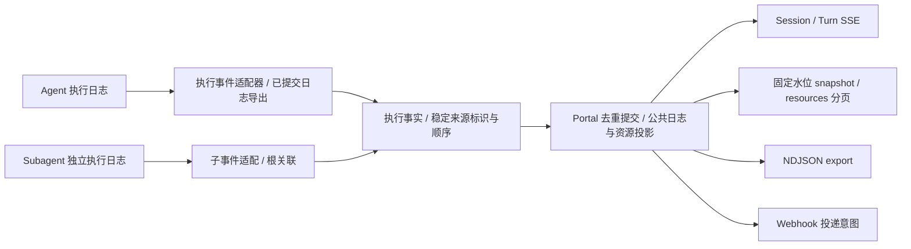

Agent Runtime 从已提交的执行日志生成事实，Portal 去重保存公共事件与资源投影。根 Session 和 Subagent 使用同一套事件封装，但各自保留独立日志游标，子事实通过根关联提供查询与用量汇总。当前执行范围使用 `managed`；具体交互、文件和恢复能力通过 `/capabilities` 声明。

| 公共事实 | 用户侧解释与处理 |
| --- | --- |
| `item.delta` → `item.completed` | 展示文本增量；完成时以累计内容替换，避免重复追加 |
| `item.finalized` | 使用相同 `item_id` 更新最终内容与 `final_output`，不新建第二条最终消息 |
| `tool.requested` → `tool.waiting` | 工具被提出并正在等待；不能展示为成功完成或空结果 |
| `tool.completed` → `required_action.resolved` | 真实结果已消费，`status` 可为 completed/failed/denied/interrupted |
| `input.*` / required action / command 回执 | 区分接收、等待、应用、拒绝，按钮依赖当前能力与待办类型 |
| `subagent.*` | 子 Agent 状态与结果变化；子任务完成不能据此结束根 Turn |
| `context.updated` / `context.compacted` | 一般上下文替换与实际压缩分开；不公开原始思考或上下文正文 |
| Turn 终态 / usage / artifact 事件 | 按目标 `turn_id` 结算 UI；用量收据去重，产物按实际 ID 下载 |

SSE 的 `id` 是游标，公共封装还有事件 `id`、`type`、`session_id`、可选 `turn_id`、`cursor` 和 `data`。客户端按事件 ID 去重、按资源 ID 更新，只在事件成功应用后保存游标。断线从最后已应用的游标恢复，`Last-Event-ID` 优先于 `after`。Managed Turn 从同一 Session 日志中过滤，沿用该日志游标；子 Session 与其他独立日志不能混用游标。

导出固定 `through` 水位并逐窗口读取，与 SSE 使用同一份公共事件日志。流结束、连接超时或心跳均不等于 Turn 完成；完成应以目标 Turn 的终态为准。

### 3.7 参考 Claude 的细化场景与协议差异

以下借鉴官方 [Session event stream](https://platform.claude.com/docs/en/managed-agents/events-and-streaming) 的使用场景，并映射到本文的会话与任务模型。兼容入口是 `Gateway → Portal /v1/sessions → 持久化 Session/Turn`，协议事件通过独立投影读取；Agent、Environment 和能力配置仍通过体系的管理 API 创建。

| 场景 | Managed Agents 核心流程 | Claude 兼容入口 / 当前限制 |
| --- | --- | --- |
| 注册后再开始任务 | 创建 Session，再 POST turns | POST `/v1/sessions`，再发送 `user.message`；也支持 `initial_events` |
| 持续多轮对话 | 新 Turn 复用原 Session，保留上下文并排队 | 继续发送 `user.message`，不重新创建 Session |
| 长任务期间离开与重连 | snapshot + `as_of` + SSE 或 Last-Event-ID | 兼容事件历史 + stream，支持公开事件 ID 续传 |
| 工具确认 | confirmation 待办 + actions/allow | `user.tool_confirmation` 用公开 `tool_use_id`，不要传内部 request ID |
| 自定义工具结果 | 外部执行待办 + actions/output | `user.custom_tool_result` 用 `custom_tool_use_id`；可分批回答 |
| self_hosted 内置工具结果 | 外部工具结果由 Worker/执行者回传 | `user.tool_result`，区分文本/图像块与 `is_error` |
| 中断后换方向 | cancel 收敛，再提交新 Turn；steer 为另一种操作 | `user.interrupt` + `user.message` 同批排队，不等同于任务 interrupted/resume |
| 消息预览与用量 | 公共 item 增量和已提交模型用量 | `event_start/event_delta` 是预览，不进入完整事件历史 |
| 运行中归档或删除 | 核心接口要求先结束未结算工作 | 兼容接口先关闭输入、取消再异步清理，语义不同 |
| 文件、预算、tools/MCP 中途更新 | 核心 files、budget 与资源绑定接口 | file/document 输入、标准 list-cost budget、Agent overrides 等未全部映射，明确拒绝 |
| 子 Agent 观察与高级协作协议 | 通过根关联读取 Subagent 快照和独立事件 | 本 POC 不映射 Claude 的高级协作协议 |

Claude 环境概念也区分环境定义与实际 Sandbox（见[官方环境说明](https://platform.claude.com/docs/en/managed-agents/environments)）。本文体系的创建时机、归档格式、空闲回收与预算单位按自身契约定义；上表列出当前兼容范围，未映射的能力明确拒绝。

## 4. Brain–Hands 分离：ACS 长工具调用重点方案

### 4.1 目标与观察证据

场景：用户要求在平台管理的 ACS Sandbox 执行约三分钟的计算与文件写入，Agent 等待真实结果后读取文件，再进行第二次工具核验并给出最终回复。第一条命令在 Sandbox 内生成随机 nonce，指令不预先提供它，以此区分真实执行与模型复述预期答案。

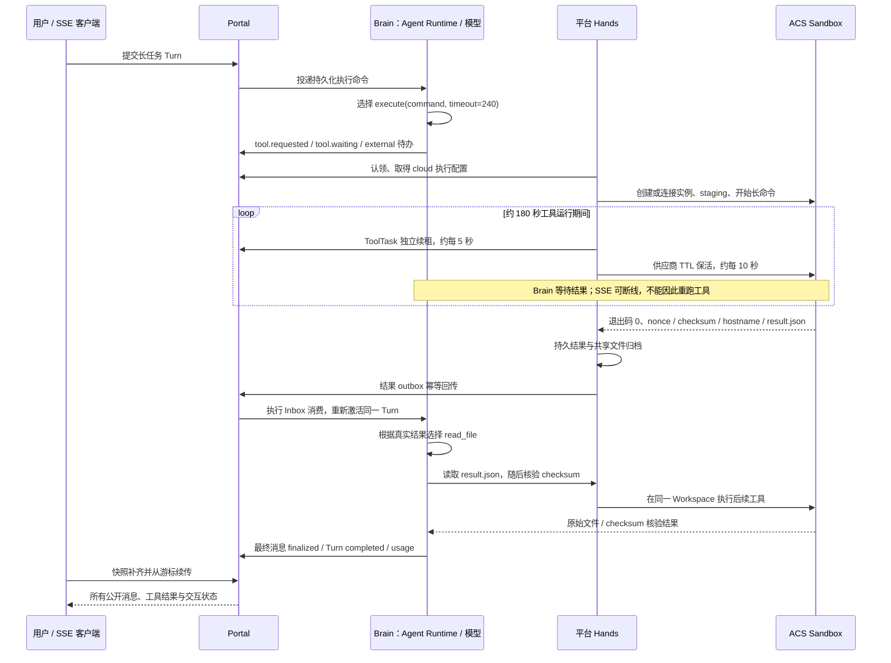

| 验收维度 | 必须取得的证据 | 不能替代该证据的现象 |
| --- | --- | --- |
| Hands 的执行位置 | Worker 认领 cloud Task；供应商实例 ID；命令返回 Sandbox hostname/cwd；可在该实例核对文件 | Agent 回复“我在沙箱运行了”、Environment 创建成功 |
| 长周期持续执行 | start/end 时间约 180 秒；跨多次工具续租及 TTL 保活；命令只执行一次 | 一条几毫秒 fake 工具响应 |
| Brain 消费真实结果 | nonce/checksum 进入公开工具结果；随后发生模型调用与读取/核验工具；最终回复与文件一致 | 单纯 tool.completed、模型把计划当结果复述 |
| 用户交互 | 自动外部结果解除待办；可选用户确认操作；最终无残留必答待办 | 把每个 external 待办都要求用户手工填结果 |
| 可恢复观察 | 断开前后同一 Turn ID；快照与 SSE/导出一致；事件去重后结果只出现一次 | 断线后重新提交 Turn 获得一个新结果 |
| 文件与实例状态 | 结果已知、归档确认状态独立核对；后续文件读回一致 | 工具成功但 `workspace_snapshot_pending` 一直未确认 |

供应商实例 ID 从运行记录或 Worker/供应商记录核对；`S/tool-tasks` 用于查看任务状态、结果回传状态和 Workspace 归档状态，结合 Sandbox 中的实际文件确认执行位置。

### 4.2 四类时间限制必须分开

当前 ToolTask 的 `timeout` 从工具参数取秒数，没有该参数时默认 60 秒，并限制在 1–3600 秒。Shell 工具定义自身有默认值，因此长任务应明确让模型设置 `timeout=240`，并核对实际 `tool.requested` 参数，不能只在自然语言里说“等待三分钟”。

| 参数 / 时间 | 建议 POC 值 | 作用 |
| --- | ---: | --- |
| 工具 `timeout` | 240 秒 | 约 180 秒命令的执行截止时间 |
| `sandboxTimeoutSeconds` | 120 秒 | 初始供应商 TTL；工具超过该 TTL，用独立保活验证延寿 |
| Hands ToolTask 租约 | 当前每次最多约 30 秒 | Worker 约 5 秒续租，与工具执行和供应商保活分别处理 |
| `sandboxIdleTimeoutSeconds` | 300 秒 | 无运行操作且文件归档已确认时回收；不应中断活动工具 |
| `sandboxMaxLifetimeSeconds` | 3600 秒 | 平台绑定维护限制；不是长工具的执行超时 |
| envd Start 流 | 按工具 deadline 控制 | 当前客户端允许无输出的长进程，不能用普通 HTTP 空闲 read timeout 截断 |

Hands 管理 API 请求的短 HTTP 超时不等于工具执行超时。工具在阻塞 Worker 执行线程等待，心跳由独立调度器处理，不占用异步事件处理线程。当前 envd 客户端捕获输出并在结束后返回；**不承诺 cloud Shell 每行 stdout 都实时转成用户 `tool.delta`**。要求“收到所有结果”指公开消息、真实工具结果、动作与终态完整可读，不包括私有执行日志或未实现的逐行输出直播。

长任务还需注意约一小时的单 ToolTask 上限。超过一小时的业务应拆成多个可恢复步骤/异步业务任务，不能仅把 Session 保持数天就推断一个 Shell 可以无限运行。

### 4.3 后续手工验证命令

以下为待执行示例。先准备 Managed Agents 访问地址、ACS 连接配置与网络，并准备含 `python3`、`/bin/bash` 的 ACS template。命令中的域名和模板需要替换为实际配置。

```bash
set -euo pipefail
BASE_URL="https://managed-agents.example.com"
ACS_API_URL="https://YOUR_ACS_API_ENDPOINT"
ACS_DOMAIN="YOUR_ACS_SANDBOX_DOMAIN"
ACS_TEMPLATE_ID="YOUR_ACS_TEMPLATE_ID"
POC_KEY="managed-poc-$(date +%Y%m%d%H%M%S)"

# ACS 连接配置已由运行环境准备。
ENV_REQUEST=$(jq -n --arg api "$ACS_API_URL" --arg domain "$ACS_DOMAIN" \
  --arg template "$ACS_TEMPLATE_ID" '{
  name:"Managed POC ACS", type:"cloud", config:{
    provider:"acs", apiBaseUrl:$api, domain:$domain, templateId:$template,
    isolationScope:"SESSION", workspaceRoot:"/home/user",
    sandboxTimeoutSeconds:120, sandboxIdleTimeoutSeconds:300,
    sandboxMaxLifetimeSeconds:3600
  }
}')
ENVIRONMENT_JSON=$(curl -sS --fail-with-body "$BASE_URL/api/environments" \
  -H 'Content-Type: application/json' --data-binary "$ENV_REQUEST")
ENVIRONMENT_ID=$(jq -er '.id' <<< "$ENVIRONMENT_JSON")
```

创建资源后还需让 **平台 Hands** 对应这个 Environment 在线。Worker 配置包括 Environment ID、共享工作目录与独立 journal。部署或配置匹配的 Worker，并核对心跳与可用执行槽位；已有 self_hosted Worker 的实例生命周期由环境所有者负责，不能直接承担平台 cloud 的实例管理。

创建只启用 Shell 与文件读取的 Managed Agent：

```bash
AGENT_REQUEST=$(jq -n --arg env "$ENVIRONMENT_ID" --arg key "$POC_KEY" '{
  tenant:"default", namespace:"default", agentKey:$key,
  displayName:"ACS Brain-Hands POC", binding:{kind:"managed"},
  definition:{
    name:"ACS Brain-Hands POC",
    system:"严格按请求执行真实工具。长命令显式设置 timeout=240。工具结束后必须读取结果文件并核验，再根据真实结果回复。工具失败时明确报告，不能编造成功。",
    maxIters:12, defaultEnvironmentId:$env,
    tools:[{type:"agent_toolset", defaultConfig:{enabled:false}, configs:[
      {name:"bash",enabled:true},
      {name:"read",enabled:true}
    ]}]
  }
}')
AGENT_JSON=$(curl -sS --fail-with-body "$BASE_URL/api/v1/agents" \
  -H 'Content-Type: application/json' --data-binary "$AGENT_REQUEST")
AGENT_ID=$(jq -er '.agent.id' <<< "$AGENT_JSON")
SESSION_REQUEST=$(jq -n --arg agent "$AGENT_ID" --arg env "$ENVIRONMENT_ID" \
  '{target:{type:"agent",id:$agent},environmentId:$env}')
SESSION_JSON=$(curl -sS --fail-with-body "$BASE_URL/api/v1/agent-sessions" \
  -H 'Content-Type: application/json' -H "Idempotency-Key: $POC_KEY-session" \
  --data-binary "$SESSION_REQUEST")
SESSION_ID=$(jq -er '.id' <<< "$SESSION_JSON")
SESSION_URL="$BASE_URL/api/v1/agent-sessions/$SESSION_ID"
curl -sS --fail-with-body "$SESSION_URL" | jq '{id,state,status}'
curl -sS --fail-with-body "$SESSION_URL/capabilities"
```

确认 `state=ready` 后提交任务。准备一个约三分钟的真实命令：前 45 秒完全静默，后续输出进度，结束才写入结果。nonce 在执行时生成，checksum 使用固定数列得到，hostname/cwd 用于运维关联。

```bash
LONG_COMMAND=$(cat <<'SH'
python3 - <<'PY'
import hashlib, json, os, secrets, socket, time
started = time.time()
nonce = secrets.token_hex(16)
time.sleep(45)
for index in range(9):
    time.sleep(15)
    print(f"progress={index + 1}/9", flush=True)
checksum = hashlib.sha256(
    ",".join(str(number * number) for number in range(1000)).encode()
).hexdigest()
result = dict(nonce=nonce, checksum=checksum, hostname=socket.gethostname(),
              cwd=os.getcwd(), elapsed_seconds=round(time.time() - started, 2))
with open("poc-result.json", "w", encoding="utf-8") as output:
    json.dump(result, output, ensure_ascii=False)
print(json.dumps(result, ensure_ascii=False), flush=True)
PY
SH
)
PROMPT=$(cat <<TEXT
请先用 bash/execute 工具执行下方命令，工具参数 timeout 必须是 240。
完成前不要宣布成功。完成后用 read_file 读取 poc-result.json。
再执行一次 python3 命令，重新计算 0..999 的平方序列的 SHA-256，
与 poc-result.json 中 checksum 比较；一致才写 poc-verified.txt，
内容为文件中的 nonce，并打印核验结果。最终回复实际 nonce、checksum、
执行耗时和核验结果。工具失败时说明失败，不要补造结果。

$LONG_COMMAND
TEXT
)
TURN_REQUEST=$(jq -n --arg message "$PROMPT" '{message:$message}')
TURN_JSON=$(curl -sS --fail-with-body "$SESSION_URL/turns" \
  -H 'Content-Type: application/json' -H "Idempotency-Key: $POC_KEY-turn" \
  --data-binary "$TURN_REQUEST")
TURN_ID=$(jq -er '.id' <<< "$TURN_JSON")
```

在另一个终端持续观察。快照通过 `resources` 返回分页集合，以同一 `snapshot_id` 和 `as_of` 水位组织读取：

```bash
SNAPSHOT=$(curl -sS --fail-with-body "$SESSION_URL/snapshot?limit=100")
jq '{snapshot_id,as_of,expires_at,resources,usage}' <<< "$SNAPSHOT"
CURSOR=$(jq -er '.as_of' <<< "$SNAPSHOT")
curl -sS --fail-with-body -N -G "$SESSION_URL/events/stream" \
  -H 'Accept: text/event-stream' --data-urlencode "after=$CURSOR"
```

若资源集合 `has_more=true`，通过 `S/resources/{kind}` 和返回的 `next_cursor`、`snapshot_id` 补齐；保存每个成功应用的 SSE 游标。执行中关闭连接，随后从最后游标用 `Last-Event-ID` 续传，或重新获取完整快照；**不要再次提交该 Turn**。

```bash
curl -sS --fail-with-body -G "$SESSION_URL/tool-tasks" \
  --data-urlencode "turn=$TURN_ID" --data-urlencode 'limit=100'
curl -sS --fail-with-body "$SESSION_URL/turns/$TURN_ID"
curl -sS --fail-with-body "$SESSION_URL/turns/$TURN_ID/snapshot?limit=100"
curl -sS --fail-with-body "$SESSION_URL/usage"
```

预期顺序为每个外部工具的 `tool.requested → tool.waiting → 实际 tool.completed → required_action.resolved`，中间可以交错消息、模型用量和运行状态。根 Turn 在后续读取、第二次核验、最终输出提交后才 completed。核对最终文件、工具结果与回复中的 nonce/checksum 一致；事件完整性通过固定水位导出逐页核对，不只看终端最后几行。

该任务依赖模型正确选择工具，属于真实集成验收；若模型跳过工具或忽略 timeout，应记录实际偏差。协议级确定性流程使用固定输入的模型响应与供应商模拟服务校验，真实 ACS 流程另行验证。

### 4.4 故障、失败、取消与未知副作用

租约过期只能撤销旧执行的状态提交权，不能证明旧进程、模型请求或 Sandbox 工具已经停止。当前可能已开始的 Turn 不自动重启，远程工具结果不确定时保留 `unknown`；显式 resume 或 owner 迁移也不能直接当作重复执行工具的依据。Brain 迁移时应先核对原 ToolTask、结果与 Workspace 占用，已有结果复用，未确认的副作用不自动重跑。

线程中断、命令受理和供应商实际停止是不同证据。当前部分 stopped 回传路径仅报告 Worker 本地停止，服务端据任务与绑定身份释放占用；SDK 各路径的远程停止证明仍需专项验证，不能把该回执一概解释为 Sandbox 子进程已经退出。相关待修改点与网络分区、长 GC 验收记录在配套《Managed Agents 改造待办》MA-006。

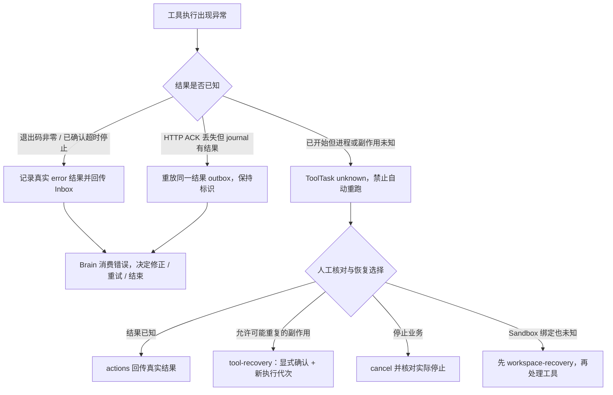

| 细化场景 | 当前处理规则 | 后续验收点 |
| --- | --- | --- |
| 命令退出非零 | `is_error=true` 回传，Agent 可继续推理 | 用户看到真实 error，后续决定不是虚构成功 |
| 工具 deadline 到期 | 尝试终止远程进程；确认终止才作为已知 timeout 结果 | 无持续运行的残留进程；停止确认失败保留不确定性 |
| envd 流断开 | 尝试终止并核对进程，不无限等或直接再执行 | 已知失败和未知停止分开，不重复非幂等副作用 |
| 供应商明确 404 | 有确认归档时可重建并恢复文件 | 归档内容一致；不把网络异常误判为 404 |
| 创建请求结果未知 | Workspace binding 标为不确定，人工核对供应商 | 不因请求重试生成第二个未知 Sandbox |
| Worker 运行后崩溃 | 租约过期进入 unknown；journal 有稳定结果则补报 | 替代 Worker 不自动重跑已开始命令 |
| 结果 ACK 丢失 | 相同结果标识重放、Inbox/事实去重 | 一个结果只消费一次，用量与公共事件不重复 |
| 工具运行中 cancel | 命令受理、Worker 中断任务、远程停止与 Turn 收敛分别处理 | cancel_requested 不冒充已停止；副作用仍需核对 |
| 归档失败而工具结果已知 | 保留结果，Workspace snapshot pending 独立呈现 | 不丢真实结果，不无条件使用未确认归档重建 |

显式工具重试使用 `POST S/turns/{turnId}/tool-recovery`，提交原任务、当前执行代次、明确的副作用确认与幂等键。Workspace 恢复还需明确绑定代次、实例空闲或不存在的确认，以及数据恢复或丢弃选择。两个恢复不是同一命令：修复绑定不代表未知工具可以自动重跑。旧代次的迟到结果不能覆盖新执行。

取消与停止需遵守 capabilities 和运行端约束，不把状态图中“关闭失败任务”的业务意图理解为任意失败状态都可立即 cancel。存在 unknown 时先核对、回传或显式恢复，再确认关闭条件。

## 5. 其他示例场景

### 5.1 File 协作：知识库、输入文件、工具文件与 Artifact

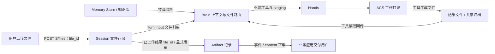

知识库文件、Session 输入文件、Sandbox 工作文件和 Artifact 分别建模。文件上传使用原始 bytes、`X-File-Name` 和 Content-Type，返回 `file_id`；Turn 通过结构化 `input` 引用，Hands staging 将材料放到对应工作目录。共享知识提供查询材料，写回与跨 Session 更新作为后续能力单独设计。

Shell 写出一个文件不等于应用已有可下载 Artifact。当前 Managed 可把本 Session 已上传文件通过 `POST S/artifacts {file_id}` 显式发布，或登记 HTTPS 结果引用；从 Sandbox 到上传/发布之间还需明确的结果搬运流程。图中没有假设“所有生成文件自动上报”。文件输入与产物发布能力须检查 `/capabilities`。

验收材料固定为一个包含已知事实与一处矛盾的报告；要求 Agent 引用实际 file_id、读取来源、输出核验文件，再由交付流程登记 Artifact。核对跨 Session 引用拒绝、重传幂等、下载 checksum、删除 Artifact 后文件和旧快照仍按各自契约保留。

### 5.2 MCP + Skills

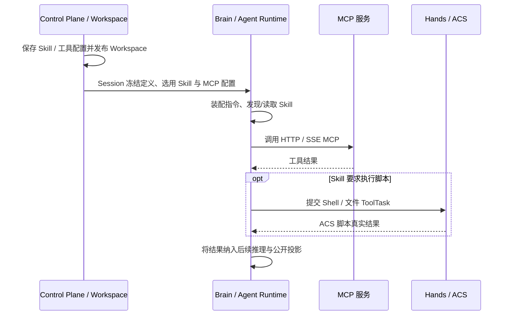

Skill 是指令和附带资源。Workspace Skill API 保存文件与选用声明，发布并绑定 Agent 后在新 Session 生效。脚本依赖与网络连通性由实际 Environment 准备，上传 Skill 本身不会自动安装解释器。

当前 HTTP/SSE MCP 由 Brain 侧可达的连接调用；并非所有 MCP 都在 ACS 执行。stdio MCP 需要本地进程执行能力与程序依赖，其调用位置由执行后端明确配置。业务 MCP、Hands 文件/Shell、客户端自定义外部工具分别使用对应的执行和结果回传契约。

验收使用一个 MCP 查询与一个要求脚本核验的 Skill：记录 MCP 实际请求/结果、Skill 文件与版本、随后 ACS 工具结果。需要用户确认时先回答待办，MCP 超时或返回错误则记录真实结果与后续处理。

### 5.3 SubAgents：子推理、子工具与父续跑

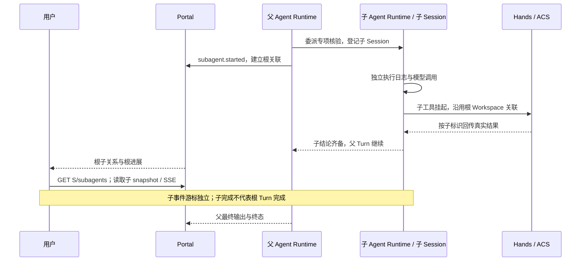

平台内 Subagent 有独立日志、快照与事件游标，与父任务共享根预算和工具 Workspace 关联。子用量在根汇总中计一次，子交互通过根 actions 路由并带 `child_session_id`。子结果齐备后，父 Turn 继续；不要把子完成当作根完成。

POC 使用 evidence-reviewer 子 Agent：它读取材料、执行一个 ACS 核验工具，父 Agent 在真实子结果齐备后汇总。额外验证只答一个子结果时父任务仍等待。异步恢复、remote 子事实及中断后的完整子续跑仍有接入欠项，不将本地同步闭环推广为所有分布式子 Agent 都已覆盖。

### 5.4 Channel 与 Scheduled 驱动

当前阶段的 Channel callback/outbound 由 Scheduler 接入，Cron 通过控制面触发，部分调用仍使用历史会话桥接。下图虚线表示待收敛到 Portal 的目标流程，尚未完成的新入口须单独验收。

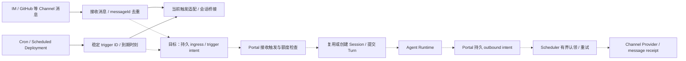

目标规则：同一 message/trigger 重试使用稳定输入 ID；Channel 会话按业务线程复用 Session，周期工作明确选择复用或新建 Session。触发和回复各自持久化，Scheduler 不依赖一个同步 HTTP 连接等待完整长任务。

这一类 POC 当前先定义验收：重复 webhook 不多建 Turn，Cron 重启不遗漏/重复触发，取消某次任务不删除调度定义，出站发送以供应商 message ID 确认。补齐 Portal ingress、稳定 trigger ID 和 outbound intent 后再记为新架构跑通。

### 5.5 用户离线后的 Webhook

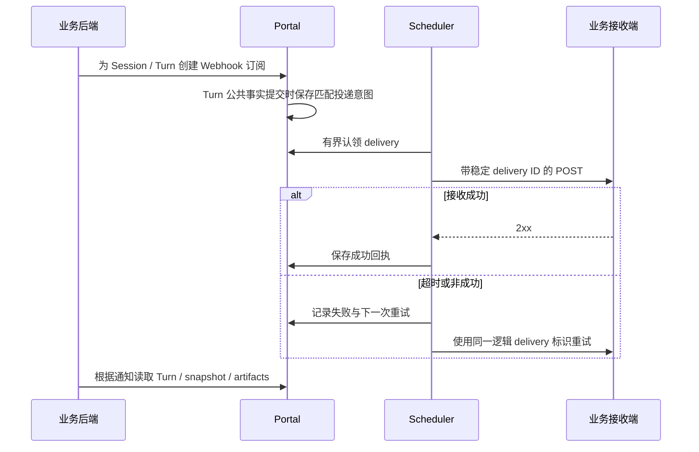

Webhook 负责通知，公开日志负责完整重放。Portal 保存订阅与投递，Scheduler 发送并回报。接收方按 delivery ID 去重，再查询 Turn、快照或产物获取完整结果；首次失败后的重试保持同一 delivery ID。该路径与仍在迁移的 Channel/Cron 触发分别验收。

## 6. 测试用例与验收计划

### 6.1 功能矩阵

以下全部是 **待执行用例**。先用固定输入与模拟服务检查确定性协议，再用真实模型和 ACS 验证供应商、模板、网络、TTL 与文件归档。模拟验证与真实集成记录分别保留，不能将不同阶段的结果拼接成一次完整 ACS 全流程成功。

| 编号 | 固定场景与操作 | 通过标准 / 对应图 |
| --- | --- | --- |
| F01 | 创建 cloud Environment、managed Agent、空 Session；同键重复创建 | 资源关联与 ready 正确；没有消息就没有推理；3.1 |
| F02 | 文字任务，先/后建立 SSE 各一次 | 同一 Turn 完成，历史+增量无遗漏/重复；3.2、3.6 |
| F03 | 同 Session 同时提交 T1/T2，T1 等工具或人工动作 | T2 排队；完成/取消 T1 才推进；3.3 |
| F04 | 同键同内容重试、同键异内容、两个 SSE 读者 | 同一 Turn ID、异内容冲突、多读者不重复执行；3.3 |
| F05 | 首轮记住随机标识，第二轮引用；新增 inject 与运行中 steer | 上下文连续；inject 不启动 Turn；输入有应用回执；3.5 |
| F06 | 工具确认待办，分别确认、拒绝、重复答复 | 同一待办的答复不重复消费，工具与后续结果可读；3.4 |
| F07 | 两个外部工具，仅回传第一个，再回传第二个 | 部分结果保持等待，齐备后同一 Turn 续跑；3.4 |
| F08 | ACS 180 秒工具，静默 45 秒，断开 SSE 后重连 | 实际位置、续租/TTL、nonce/校验、后续推理全部达标；4.1–4.3 |
| F09 | Worker 在副作用后崩溃；结果回传 ACK 丢失 | unknown 不自动重跑；有 journal 时同结果补报；4.4 |
| F10 | 非零退出、执行 timeout、ACS 404、创建响应未知 | 已知 error 与 unknown 区分；归档恢复与人工修复符合边界；4.4 |
| F11 | queued/running/等待动作时取消；failed/interrupted 恢复 | 命令与实际停止分开；Turn ID 保留；旧执行代次不能提交；3.4–3.5 |
| F12 | 文件上传、跨 Session 引用、工具文件、Artifact 发布/下载 | 输入隔离、校验一致、无虚构下载 URL；5.1 |
| F13 | Skill + MCP 查询 + ACS 核验，增加超时和错误结果分支 | 定义版本可追溯，实际调用与真实结果可核对；5.2 |
| F14 | 子 Agent 工具挂起、分批子结果、父继续 | 子游标独立，父不提前完成，用量不重复；5.3 |
| F15 | Channel 消息与 Cron 重启/重复触发 | 先完成新入口迁移，再验收唯一 trigger/Turn/投递；5.4 |
| F16 | Webhook 首次失败、重试期间重启、接收方去重 | 稳定 delivery ID、重试与最终可读结果；5.5 |
| F17 | 达到预算、提高限额、显式 resume | 拒绝后续模型调用；预算不重复记账；恢复不创建新 Turn |
| F18 | 空闲 checkpoint restore/fork；归档/恢复/删除 | 旧历史保留；fork 不复制文件/预算；生命周期阻止错误准入 |
| F19 | Claude 兼容创建/消息/确认/结果/中断/事件历史 | 官方 SDK 可解析受支持子集；不支持项明确拒绝；3.7 |

取消、恢复、预算和 checkpoint 要记录服务返回的 command/input ID，再核对应用回执，不只检查 HTTP 2xx。F03 还应覆盖 T1 failed/interrupted 阻塞 T2，避免把失败当成自动出队。

### 6.2 验证层次与执行方法

验证分为接口契约、跨组件流程、真实供应商与业务交互四个层次。各层次使用独立测试资源和存储，保留 Session/Turn/命令关联；模拟服务与真实模型的结果分别记录。

| 层次 | 执行方法 | 证明范围 |
| --- | --- | --- |
| 接口契约 | 固定请求与模型响应，检查创建、幂等、状态、动作、游标和错误分支 | 请求/响应与状态转换一致；不证明真实模型或 Sandbox 行为 |
| 跨组件流程 | 运行 Gateway、控制面、Portal、Agent Runtime、Hands、Scheduler 与持久化存储，注入重启和 ACK 丢失 | 持久化命令、事实投递、租约、结果去重和恢复闭环 |
| 真实供应商 | 按第 4 章配置真实 ACS 与模型，执行长命令、文件核验和供应商失效场景 | 模板、网络、envd、TTL、执行位置、远程停止与文件归档 |
| 业务交互 | 使用实际客户端处理 SSE、用户答复、文件下载、Webhook 和多 Agent 结果 | 用户可观察、可操作的流程与运行事实一致 |

通用的运行状态核对使用以下接口；其中变量沿用第 4.3 节。`COMMAND_ID`、`INPUT_ID` 必须取自对应操作的实际回执，不根据命名规则推导。

```bash
curl -sS --fail-with-body "$SESSION_URL/capabilities"
curl -sS --fail-with-body "$SESSION_URL/turns/$TURN_ID/capabilities"
curl -sS --fail-with-body "$SESSION_URL/turns/$TURN_ID"

# 在提交了控制命令或输入之后，分别查询其实际应用回执。
curl -sS --fail-with-body "$SESSION_URL/commands/$COMMAND_ID"
curl -sS --fail-with-body "$SESSION_URL/inputs/$INPUT_ID"
```

当前多 Agent 验证限于平台内 Subagent，检查独立日志、子工具挂起、结果回传、父续跑及用量去重。供应商模拟服务不作为真实 ACS 的执行证明。Channel/Cron 的新入口在完成持久化触发与 Portal 准入后单独验收。整个过程还应核对存储持久化、文件一致性与跨副本读取，不仅检查服务健康状态。

### 6.3 性能与长周期测试

功能正确后再压测，报告实测曲线，不预写 QPS/延迟目标为已达标。单 Session 的串行 Turn、不同 Session 并发和多观察者连接要分开测；“同时提交 100 个 Turn”不能直接当作“100 个 Brain 同时推理”。

| 测试维度 | 负载与指标 | 必须同时验证 |
| --- | --- | --- |
| Turn 准入与推理 | 不同 Session 并发递增；202 延迟、排队等待、TTFT、终态耗时、错误率 | Application 限额、实例槽位、数据库连接预算 |
| ACS 长工具 | 1/4/16 个 Session，各运行 180 秒静默/输出命令 | 工具续租、TTL、Worker 线程/槽位、unknown/残留进程数量 |
| 多观察者 SSE | 同 Session 多连接、反复断线与不同副本重连 | 事件完整性、去重、慢读者背压与断线恢复 |
| 长日志与恢复 | 逐步增加 Turn/工具数，记录日志量与恢复时间 | SQL 读取有界不等于运行时全量恢复成本恒定；检查内存与连接 |
| 故障期间吞吐 | Portal/Data/Hands 逐一重启与 ACK 丢失 | 没有旧执行代次写入、未知副作用未自动重跑 |
| 文件与交付 | 文件大小、归档量、snapshot/export 页数递增 | staging/大小上限、固定水位、checksum、归档确认 |

一次 180 秒演示只覆盖跨租约、静默连接、工具结果续跑，不能代表小时/天级可靠性。后续补充多 Turn 长 Session、接近 3600 秒工具、长期无用户连接、供应商失效和跨副本恢复，分别记录资源消耗与恢复时间。

### 6.4 执行记录模板

每次测试记录：体系/API 契约版本、运行镜像或二进制版本、部署方式及副本数、Environment 类型与模板、Agent/Workspace 版本、Session/Turn/command/ToolTask ID、执行与 Workspace 代次、供应商实例 ID、输入与 checksum、关键事件/游标、实际结果、偏差、清理情况。

长工具特别保留“工具开始 → 多次续租/保活 → 真实结果 → 后续模型/工具 → 最终输出”的关联证据。测试资源与用户资源分开标识；完成后按实际停止、归档/删除、平台 Sandbox 回收与测试资源清理的顺序处理。生命周期删除是 tombstone，不等于底层审计和文件立即物理擦除。

## 7. 设计契约索引

下列契约是组件之间以及客户端与平台之间的协作边界。具体实现可以替换，资源标识、事件含义和恢复规则必须保持一致。

| 契约 | 负责组件 | 对外或跨组件内容 | 对应章节 |
| --- | --- | --- | --- |
| 资源与版本 | Control Plane | Agent、Environment、Workspace、Memory、Application；资源关联与配置版本 | 2、3.1 |
| 会话与任务准入 | Session Portal | Session/Turn 标识、幂等键、排队、预算与能力声明 | 3.1–3.5 |
| 推理与状态恢复 | Data Plane / Agent Runtime | 执行日志、Inbox、checkpoint、写入代次、模型调用收据 | 1.2–1.3、3.2 |
| 工具执行 | Hands / Sandbox Adapter | ToolTask 认领、执行代次、独立续租、真实结果与 unknown 处理 | 4 |
| 文件与交付 | 文件存储 / Hands / Artifact 管理 | 输入文件隔离、staging、确认归档、显式发布与下载 | 5.1 |
| 事件与观察 | Session Portal / 执行事件适配层 | 标准事件、固定水位快照、SSE、NDJSON export、兼容投影 | 3.6–3.7 |
| 平台内子 Agent | Agent Runtime | 子 Session、委派、独立事件、根交互路由、父续跑与用量汇总 | 5.3 |
| 触发与投递 | Scheduler / Session Portal | 稳定 trigger/delivery ID、持久化意图、重试与回执 | 5.4–5.5 |
| 验收与运行记录 | 运维与测试系统 | 契约版本、运行标识、实际证据、偏差、容量与清理记录 | 6 |

## 8. 未来规划与讨论点

### 8.1 优先完成的架构闭环

1. **真实 ACS 验收**：按第 4 章验证 template、envd 协议、网络、静默长工具、TTL 延寿、远程停止与文件恢复；供应商模拟验证记录单独列出。
2. **触发与出站收敛**：Channel/Cron/Automation 迁移到 Portal 的持久化 ingress/trigger/outbound intent，统一稳定 trigger ID、任务回执与投递状态。
3. **故障与容量**：补齐多副本认领、全部副作用未知组合、长日志恢复成本和数据库连接总预算；不把一条进程闭环作为生产容量验收。
4. **协作与执行扩展**：当前先完善平台内 Subagent 的异步恢复与复杂子运行；后续扩展方向分别见本章后文。

### 8.2 组件与能力

持久记忆需要分清 Session 对话状态、Agent Runtime 上下文压缩/checkpoint、共享 Memory Store 和跨 Session 的长期学习。现有只读知识挂载不能代表已经具备自动记忆写回；版本冲突、写回时机与更新记录需另行设计。

Webhook 已有 Portal/Scheduler 分工，后续扩展事件过滤、积压与重试观测，同时保持“通知”和“权威可重放日志”的边界。长工具若需要 stdout 逐行进度，应新增明确的有界流、持久化/重放策略与 UI 契约，不能直接把 Worker 捕获日志透传当作完整事件协议。

内部讨论优先确认：生产共享 Workspace/Artifact 后端与保留期；ACS template 和网络策略；结果搬运/Artifact 发布责任；真实工具的幂等标识与 unknown 操作责任；长 Session 的预算与恢复时延目标。脑、手、会话分离之后，这些仍是可靠运行必需的契约。

### 8.3 Team 与 Workflow：未来协作扩展

**本节是未来目标，不属于当前 POC 的架构、执行流程或验收范围。** Team 面向动态分工与结果汇聚，Workflow 面向明确的步骤、分支、审批和信号。未来可增加独立 Orchestration Runtime，协调多个平台托管 Agent；每个 Agent 继续通过 Brain–Hands 路径推理和执行工具。

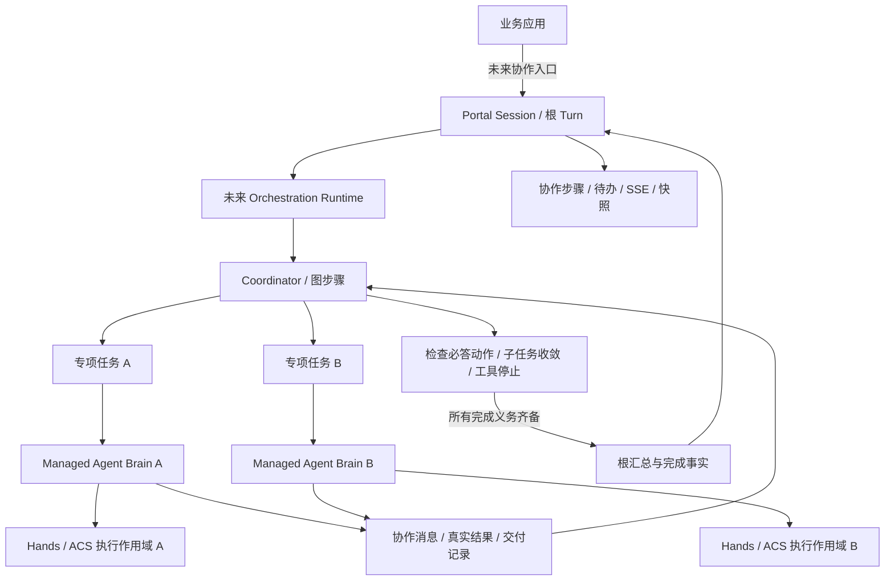

可先设计“事实核验 + 结论审阅并行 → 汇总”，再为 Workflow 增加“人工批准 → 交付”。独立分支可以继续推进，某一分支等待审批不应暂停其他可运行分支。根 Turn 必须在必答动作处理、子任务收敛和活动工具停止后结算；一个节点完成或一条总结消息不能提前结束整个任务。

未来验收覆盖根与子状态、步骤快照、部分结果、重复答复冲突、信号路由、取消传播和全部活动执行的停止确认。这些检查独立于当前平台内 Subagent 的同步委派验收。

### 8.4 Hosted Runtime：未来运行时接入

**本节仅保留扩展方向，不纳入当前方案。** 后续可评估接入 Codex、Claude Code 等 Coding Agent 运行时，由专门的 Runtime Host 或 Adapter 管理 Provider 进程与工作目录，并映射到统一的 Session、Turn、交互和公共事件契约。

接入前需单独定义 Attempt 租约、交互映射、事件 journal、用量与产物报告、取消和物理停止证明。Provider 报告完成、进程实际退出、事件排空是不同阶段，必须齐备后再结算执行。执行进程与 ACS 工具实例分别管理生命周期。

当前架构中的 Brain 仍由平台 Agent Runtime 承担；未来是否接入这些运行时、具体协议与验收范围另行确定。
